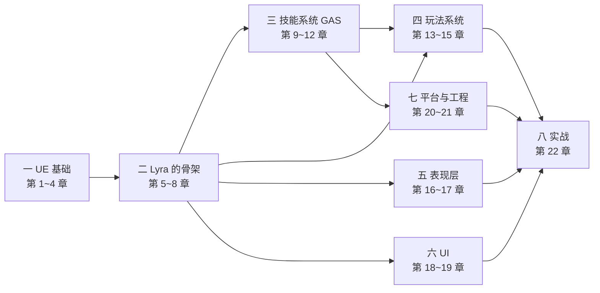

# 第 0 章　怎么用这本书 + 环境准备

## 一个问题：打开 `Source/LyraGame`，从哪里开始读？

你把 Lyra 克隆下来，用 IDE 打开 `Source/LyraGame`。里面有二十多个子目录、两百多个头文件、两百多个 cpp 文件。你随手点开 `LyraGameMode.cpp`，看到 `GetDefault<ULyraDeveloperSettings>()`、`UPROPERTY(EditDefaultsOnly, Instanced)`、`HandleStartingNewPlayer_Implementation`，每一行都认识字母，却不知道它在干什么。你换一个文件，`LyraAbilitySystemComponent.cpp`，又是一堆新词：`AbilitySpec`、`GameplayTag`、`ActivationGroup`。

这是读 Lyra 最常见的失败方式：**从代码的任意一点切入，每读三行就撞上一个没学过的概念，最后读成了一本词典**。Lyra 不是一个小项目，它同时用到了 UE 对象系统、Gameplay Framework、网络复制、资产管理、GameFeature、GAS、增强输入和 CommonUI，这些东西彼此咬合，读哪一个都需要先懂另一个。

这本书的做法是：先花四章把 UE 的地基打好，再给你一张 Lyra 的全局地图，然后一个系统一个系统地走。这一章是使用说明：这本书为谁写、怎么读、怎么把环境搭起来、项目里的东西都放在哪、后面每一部分能带你走到哪里。

## 读完本章你能……

- 判断自己是否适合从头读这本书，并为自己选一条学习路线；
- 按“预测，再验证”的方式做一章里的实验，并知道每章结构里各部分的用意；
- 在本机打开项目、从 IDE 编译、在编辑器里用单机和多人模式运行 PIE，会看日志、敲控制台命令、给 C++ 下断点；
- 给任意一个 `B_*` 蓝图找到它背后的 C++ 类，并在引擎源码和项目源码之间来回跳转；
- 说出项目里每个顶层目录是干什么的，以及后面八个部分各自带你走到哪里。

## 这本书写给谁

本书假设你：

- 会 C++（多态、RAII、模板），也理解常见的架构设计：观察者、依赖注入、组合优于继承、ECS 之类；
- 用过 UE 编辑器，摆过 Actor，写过一个 `AActor` 子类，拖过蓝图节点；
- **没读过 UE 源码**，不确定 UObject 和普通 C++ 对象有什么区别，不知道 CDO、复制、RPC、GAS、AssetManager、GameFeature 是什么。

如果你已经能不查资料地说清楚“CDO 是什么、PlayerState 为什么存在、`BlueprintNativeEvent` 的 `_Implementation` 从哪来”，可以直接跳读第一部分，从第 5 章开始。否则请按顺序读。

读完全书，你应该能做三件事：掌握 UE 游戏编程的核心概念；理解 Lyra 每个系统为什么这样设计、代码怎么走；接到“基于 Lyra 改一个功能”的需求时，知道从哪里下手、改哪些类和资产、会踩什么坑。最后一章（第 22 章）会让你从零做一个新玩法模式，把这些串起来。

## 怎么读：五个习惯

### 习惯一：按顺序读

后面的章节默认你读过前面的章节，每个概念只在第一次出现时详细解释，之后只链接回去。跳读时撞上陌生概念，用章末的“继续深入”或术语表（附录 A2）回头找。

如果你的目标是尽快动手改 Lyra，可以走一条快速路线：第 0、2、3 章 → 第 5-8 章 → 第 10-12 章，然后按需求跳到对应章节；第 1、4、9 章遇到不懂的概念时再回头查。如果想系统掌握 UE 和 Lyra，从头读到尾，每章做完实验和自测题，最后做第 22 章的综合项目。

### 习惯二：开着编辑器和 IDE 读

每章约 45 到 90 分钟。这个时间不是“读完”的时间，而是“读完并动手做完实验”的时间。只看不动手，大概率半小时后就忘了。

### 习惯三：先预测，再验证

每个实验里都有一个“**先写下你的预测**”的步骤。请真的写下来，哪怕只是在纸上画两行。比如实验问“PIE 里有几个 GameMode 实例？”，你先写“我猜 3 个”，然后跑出来是 1 个，这个落差才是学习发生的地方。

预测错了不是坏事，它精确地告诉你哪个心智模型是错的。如果实验结果和书里写的预期不一致，**不要跳过**，先怀疑自己的理解，再怀疑环境差异，再考虑是书写错了——书里的结论都对照过源码，但编辑器界面的措辞、菜单位置因版本而异，凡是涉及蓝图和资产内容的描述，书里会写“请以编辑器为准”，这时以你眼前所见为准。

### 习惯四：每段运行时代码，先问“它跑在哪一端”

Lyra 是联机游戏，同一份代码可能在专用服务器、拥有者客户端、其他客户端上跑出不同结果。书里讲到任何运行时逻辑，都会交代执行端；你读源码时也要养成这个习惯。第 3 章会给你一套完整的思维框架。

### 习惯五：认清“教程”和“手册”的分工

仓库里有两套文档：

- **本书**（`Docs/Lyra/Book/`）：讲“为什么”和“主干”，按学习顺序组织，每个系统只讲理解它所需要的那 20%。
- **参考手册**（`Docs/Lyra/10-*.md` 到 `80-*.md`）：讲“全貌”，包括完整类表、函数级调用链、几十个速查问答。它们按模块组织，适合在你已经读懂主干之后，当字典查。

本书每章末尾的“继续深入”会指向手册的对应章节，例如[参考手册 10](../Reference/10-CoreFramework.md)（核心框架）、[参考手册 20](../Reference/20-AbilitySystem-Input.md)（GAS 与输入）。[`95-Verification-Report.md`](../Reference/95-Verification-Report.md) 是对这些文档的核验报告，里面登记了 Lyra 原版代码里已知的缺陷。

### 关于版本和外部资料

本书对照的是 **UE 5.8 随附的 Lyra 源码**。Epic 的官方 Lyra 文档大多写于 5.0 到 5.3 时期，之后很少更新，所以官方文档和 5.8 源码不一致时，本书以源码为准，并在正文里写明“官方文档（5.x 版本）写的是……，当前源码是……”。社区资料（X157 的 Lyra 笔记、tranek 的 GASDocumentation 等）也多写于 5.0 到 5.5，同样只当旁证。

另外要说清楚一件事：Epic 把 Lyra 定位成“学习 UE5 各框架、可作为项目起点的示例工程”，但没有公开的更新日程，新引擎特性不保证进入 Lyra。所以本书凡是说“Lyra 现在怎么做”，都指 5.8 随附的版本，不代表官方承诺。

书里凡是设计动机只能从代码推断、官方和社区都没有明说的地方，会标“（推断）”。官方没有专页的几块（相机、队伍、外观、消息路由、UI 扩展、HUD 指示器、加载屏、作弊命令）也是这样处理的。

### 本书的书写约定

读代码片段时请留意：

- 每段代码上方会写 `// 简化自 Source/LyraGame/.../Xxx.cpp 的 ULyraXxx::Func`，表示它来自真实源码，但删掉了日志和无关分支。**教程里不写行号**（行号会过时），请用“文件名 + 类名::函数名”在 IDE 里搜；
- 引擎自带的类（`AActor`、`UGameplayAbility`）不在项目里，书里会注明“这是引擎类”，也不会给项目内链接；
- 术语首次出现时写成“中文（English）”并给一句话定义，之后统一使用约定的译名。`Pawn`、`Controller`、`PlayerState`、`GameMode`、`GameState`、`GameInstance`、`LocalPlayer`、`Experience` 这类词保持英文不翻译，因为你在代码和编辑器里看到的就是英文。

## 环境准备

### 你需要什么

- **Unreal Engine 5.8**：项目文件 `LyraStarterGame.uproject` 里写的 `EngineAssociation` 是 `5.8`。请用 Epic Games Launcher 安装，并勾选引擎源码和编辑器调试符号，否则你无法在 IDE 里直接跳进引擎源码、也看不到引擎函数的调用栈。
- **一个 C++ IDE**：Windows 上用 Visual Studio 2022（需要安装“使用 C++ 的游戏开发”工作负载），也可以用 Rider。Mac 上用 Xcode 或 Rider。本书的步骤以 Windows + Visual Studio 为例，其他 IDE 的操作大同小异。
- **足够的磁盘和耐心**：第一次打开会编译大量着色器、填充派生数据缓存（`DerivedDataCache` 目录），可能需要几十分钟到更久。这是正常的。

### 打开项目，从 IDE 编译

**第一步**：在资源管理器里右键 `LyraStarterGame.uproject`，选“Generate Visual Studio project files”，在项目根目录生成 `.sln` 解决方案。以后新增或删除 C++ 文件后，也要重新生成一次。

**第二步**：用 IDE 打开解决方案，把解决方案配置选成 **Development Editor**，确认 `LyraStarterGame` 是启动项目，然后生成（Build）解决方案。第一次完整编译会比较久。

**第三步**：编译成功后，在 IDE 里按 Ctrl+F5（不带调试启动）启动编辑器，或者直接双击 `.uproject`。项目的模块有两个：运行时模块 `LyraGame` 和仅编辑器使用的 `LyraEditor`（见 `.uproject`）。

编译方面有几条经验：

- **改了 `UPROPERTY`、`UFUNCTION`、`UCLASS` 这类反射声明（第 1 章），或者新增了文件，请关闭编辑器后完整编译**，不要依赖 Live Coding（编辑器里的热更新）。Live Coding 适合只改函数体的小改动；
- 项目有多个构建目标：`LyraEditor`（编辑器）、`LyraGame`（客户端）、`LyraClient`、`LyraServer`（专用服务器），还有带 EOS/Steam 的变体（见 `Source/*.Target.cs`，第 21 章详讲）。学习阶段只会用到 `LyraEditor`；
- 在 IDE 里目标类型被折进了配置名：`Development Editor` 是 `LyraEditor`，`Development` 是 `LyraGame`，`Development Client` 是 `LyraClient`，`Development Server` 是 `LyraServer`。
- 启动编辑器后，项目会默认显示插件内容（`ULyraEditorEngine` 在第一次 Tick 里强制开启了 Content Browser 的“显示插件文件夹”），所以你能直接在内容浏览器里看到 `ShooterCore Content`、`ShooterMaps Content` 这些目录。

### 第一次运行 PIE

**PIE（Play In Editor，编辑器内运行）** 是你最常用的测试方式。我们来跑一个最小的验证：

1. 在内容浏览器里找到 `ShooterMaps Content/Maps/L_Expanse`，双击打开这张地图（也可以直接点编辑器顶部工具栏的 `Common Maps → L_Expanse`；编辑器刚打开时的默认启动地图是概览图 `L_DefaultEditorOverview`，而打包游戏的默认启动地图是前端主菜单 `L_LyraFrontEnd`，学习玩法时从 `L_Expanse` 开始最方便）；
2. 点击工具栏的 Play。你应该看到加载屏，随后角色出生在地图里。如果你选的是 `L_Expanse`，默认玩法由这张地图 World Settings 里的 `Default Gameplay Experience` 决定（第 6 章会解释）。

**几个与 PIE 相关的开关**（在 Play 按钮旁的下拉菜单里，“高级设置”里，具体名称以你的编辑器为准）：

- **玩家数量（Number of Players）**：模拟几个玩家；
- **网络模式（Net Mode）**：`Play Standalone`（单机）、`Play As Listen Server`（你是主机服务器，其余是客户端）、`Play As Client`（编辑器起一个专用服务器，所有窗口都是客户端）；
- **在一个进程内运行（Run Under One Process）**：勾选后服务器和各客户端的日志都集中在同一个输出日志里，本书的实验默认这样用。

第 3 章会告诉你这些选项背后发生了什么。眼下只需要记住：**学 Gameplay Framework 和 Experience 时，单机模式足够；学复制和 RPC 时，用“Play As Client + 2 个玩家”**。

有一个小细节：如果地图的 World Settings 勾选了 `ForceStandaloneNetMode`（前端主菜单地图这样设），编辑器会无视你选的网络模式，强制用单机并弹出提示 “Forcing NetMode: Standalone for the Frontend”，这是 `ULyraEditorEngine::PreCreatePIEInstances` 做的，不是 bug。

### 看日志：Output Log 与日志类别

打开 **窗口 → 开发者工具 → 输出日志（Output Log）**（菜单位置以你的编辑器为准）。它有一个过滤框，在里面输入文字，只显示包含它的行。更好用的是按**日志类别（Log Category）** 过滤：UE 里每条日志都属于一个类别，格式是 `LogXxx: 内容`。[`LyraLogChannels.h`](../../../Source/LyraGame/LyraLogChannels.h) 集中定义了四个全局最常用的类别（各子系统在自己的文件里还定义了 `LogLyraCheat`、`LogLyraGamePhase` 等专用类别）：

- `LogLyra`：通用；
- `LogLyraExperience`：Experience 的选择与加载（第 6 章）；
- `LogLyraAbilitySystem`：技能系统；
- `LogLyraTeams`：队伍。

我们来做一次验证：过滤框输入 `LogLyraExperience`，再运行一次 PIE，你应该能看到类似下面的行（具体内容因地图和设置而异）：

```
LogLyraExperience: Identified experience LyraExperienceDefinition:B_ShooterGame_Elimination (Source: WorldSettings)
LogLyraExperience: EXPERIENCE: StartExperienceLoad(CurrentExperience = ..., ...)
LogLyraExperience: EXPERIENCE: OnExperienceLoadComplete(CurrentExperience = ..., ...)
```

这三行来自 `ALyraGameMode::OnMatchAssignmentGiven` 和 `ULyraExperienceManagerComponent` 的日志。括号里的 `Source` 会告诉你这次的 Experience 是谁选的（URL、开发者设置、命令行、World Settings 还是默认），第 6 章会解释这个顺序。如果你看到了这几行，说明环境基本没问题。

多人 PIE 里，同一个进程输出多个“世界”的日志，怎么分辨哪行是服务器、哪行是客户端？Lyra 的许多日志行带 `Server` 或 `Client` 标记，来自 [`LyraLogChannels.cpp`](../../../Source/LyraGame/LyraLogChannels.cpp) 的 `GetClientServerContextString`。

想临时提高某个类别的详细程度，在控制台输入引擎命令：

```
Log LogLyraExperience Verbose
```

### 控制台命令

PIE 运行时按波浪线键 `` ` `` 打开控制台（或者在点击 Play **之前**，直接使用输出日志窗口底部的 `Cmd` 命令输入框），可以输入命令。Lyra 本身给你准备了不少，下面是学习阶段最常用的几个，你会在后面的章节里反复用到：

- `lyra.chaos.ExperienceDelayLoad.MinSecs 5`：在点击 Play **之前**输入到输出日志底部的命令框里，会让 Experience 加载人为多等 5 秒，用来观察“加载期间玩家没有 Pawn”（第 6 章；做完记得设回 `0`）；
- `Lyra.DumpLoadedAssets`：列出 AssetManager 加载并常驻的资产；
- `AddPlayerBot` / `RemovePlayerBot`：加/删一个 Bot（作弊命令，非 Shipping 构建里可用；如果在客户端窗口输入，前面要加 `Cheat ` 转发到服务器，例如 `Cheat AddPlayerBot`）；
- `showdebug abilitysystem`：引擎命令，在 HUD 上显示技能系统状态（第 9、10 章）。

附录 A1 有一份按“症状”组织的完整调试清单。

### 在 C++ 里下断点

1. 在 IDE 里把配置设为 **DebugGame Editor**（比 Development Editor 优化少，变量更容易看到，断点更可靠；代价是运行较慢），重新编译；
2. 按 F5 启动调试，IDE 会启动编辑器并自动附加调试器（如果编辑器已经开着，也可以用“附加到进程”附加到 `UnrealEditor.exe`）；
3. 在你想看的代码行下断点，比如 [`LyraGameMode.cpp`](../../../Source/LyraGame/GameModes/LyraGameMode.cpp) 的 `ALyraGameMode::HandleMatchAssignmentIfNotExpectingOne`，然后在编辑器里运行 PIE，断点命中后可以看调用栈、变量、一步步往下走。

调试多人 PIE 时注意：服务器和客户端在**同一个进程**里，断点会命中任意一个世界。这时可以在断点里加条件，比如判断 `GetNetMode()`，或者用调用栈窗口里对象名中的 PIE 实例编号分辨。

### 从蓝图找到它背后的 C++ 类

[第 1 章](01-UObject.md)会讲到：蓝图是一个类，它的父类可能是 C++ 类，也可能是另一个蓝图。实操步骤：

1. 在内容浏览器里双击打开蓝图（比如 `ShooterCore Content/Game/B_ShooterBotSpawner`）；
2. 在蓝图编辑器的工具栏点 **Class Settings（类设置）**，在 Details 面板里看 **Parent Class（父类）**；如果父类还是一个蓝图，再打开它继续往上追，直到看到一个 C++ 类；
3. 在 IDE 里按类名搜索（Visual Studio 里是 Ctrl+T，或“转到所有”；Rider 里是 Search Everywhere），或者在 `Source/` 目录里 grep。

例如 `B_ShooterBotSpawner`（机器人生成器蓝图）的父类是 C++ 类 `ULyraBotCreationComponent`，位于 [`LyraBotCreationComponent.h`](../../../Source/LyraGame/GameModes/LyraBotCreationComponent.h)。有些蓝图的类名路径还出现在配置文件里，比如 `Config/DefaultEngine.ini` 里的 `GameInstanceClass=/Game/B_LyraGameInstance.B_LyraGameInstance_C`：路径末尾的 `_C` 后缀就代表“由该蓝图资产生成的类”。本章末尾的实验 2 会让你亲手追一条更长的蓝图继承链。

反过来，想知道“这个 C++ 类被哪些蓝图继承了”，可以在内容浏览器里用右键 → 引用查看器（Reference Viewer），或者用编辑器的“类查看器”。

### 引擎源码和项目源码，怎么来回跳

Lyra 的类大量继承引擎的类，读着读着你会想知道“`AGameModeBase::RestartPlayer` 到底做了什么”。

- **项目里的源码**在项目目录的 `Source/` 和 `Plugins/` 下。书里的链接都是相对路径，形如 `../../../Source/LyraGame/...`；
- **引擎源码**在你的 UE 安装目录下：`<UE 安装目录>/Engine/Source`（核心运行时模块在 `Engine/Source/Runtime/...`），引擎自带插件的源码在 `<UE 安装目录>/Engine/Plugins/...`。比如 `AGameModeBase` 的声明在 `Engine/Source/Runtime/Engine/Classes/GameFramework/GameModeBase.h`，实现在 `Engine/Source/Runtime/Engine/Private/GameModeBase.cpp`；`UGameFrameworkComponentManager` 属于 ModularGameplay 插件，在 `Engine/Plugins/Runtime/ModularGameplay/` 下；
- 在 IDE 里对一个引擎类型按 F12（转到定义），就能直接跳到引擎源码，前提是你装了引擎源码（上面“你需要什么”里勾选的）；
- 书里引用引擎类时会注明“这是引擎类”，不会给项目内链接。

还有一个诊断技巧：不知道某个函数在哪里被调用，就在 IDE 里“查找所有引用”，或者给它下断点，看调用栈。第 2 章的实验 3 会练习这个。

## 项目文件夹一览

打开项目根目录，你会看到下面这些东西。先建立一个大致印象，后面每一章会回到对应的目录。

```
LyraStarterGame/
├─ LyraStarterGame.uproject    项目文件：引擎版本、模块列表、启用的插件
├─ Source/
│   ├─ LyraGame/               游戏运行时模块：几乎所有 C++ 都在这里
│   ├─ LyraEditor/             仅编辑器模块：校验器、命令行工具、编辑器扩展
│   └─ *.Target.cs             构建目标：Editor / Game / Client / Server 及 EOS/Steam 变体
├─ Plugins/                    项目自带的插件
│   ├─ GameFeatures/           GameFeature 插件：玩法内容的载体
│   └─ （其他插件，见下）
├─ Content/                    核心内容资产：蓝图、材质、动画、UI、数据
├─ Config/                     ini 配置：引擎、游戏、输入、GameplayTag……
├─ Docs/Lyra/                  参考手册 + 本书
└─ Binaries / Intermediate / DerivedDataCache / Saved   编译产物和缓存，自动生成
```

### `Source/LyraGame`：运行时 C++

这是全书代码的主战场，按功能分目录，下面是主要的几个，括号里是本书的对应章节：

- `GameModes`、`Player`、`Character`、`System`：核心框架——GameMode、GameState、Experience、PlayerState、Pawn、GameInstance、AssetManager（第 2、5~8 章）；
- `GameFeatures`：往世界里注入内容的各种 Action（第 6、7 章）；
- `AbilitySystem`、`Input`：GAS 和增强输入的 Lyra 扩展（第 9~12 章）；
- `Inventory`、`Equipment`、`Weapons`、`Interaction`、`Teams`、`Messages`：玩法系统（第 13~15 章）；
- `Camera`、`Animation`、`Cosmetics`、`Feedback`、`Audio`：表现层（第 16、17 章）；
- `UI`：UI 基础设施（第 18、19 章）；
- `Settings`、`Replays`、`Performance`、`Hotfix`、`Development`、`Tests`：设置、回放、性能、热修、开发者工具和测试（第 20、21 章与附录 A1）。

顶层的 `LyraGameplayTags.*` 定义原生 GameplayTag，`LyraLogChannels.*` 定义日志类别，`LyraGameModule.cpp` 是模块入口。

### `Source/LyraEditor`：仅编辑器

编辑器专用，打包的游戏里没有它：数据校验器（`Validation/`，你在第 1 章实验 3 里会触发它）、命令行工具（`Commandlets/`）、`ULyraEditorEngine`（`LyraEditorEngine.cpp`，PIE 启动的定制）。它在 `.uproject` 里的类型是 `Editor`。

### `Plugins`：插件

分三类：

- **基础设施插件**，大多是从 Lyra 里拆出来的可复用模块：`ModularGameplayActors`（Modular 基类，第 7 章）、`CommonGame`、`CommonUser`、`CommonLoadingScreen`、`CommonStartupLoadingScreen`、`GameSettings`、`UIExtension`、`GameplayMessageRouter`、`AsyncMixin`、`PocketWorlds`、`GameSubtitles` 等；
- **GameFeature 插件**（`Plugins/GameFeatures/`）：`ShooterCore`（射击玩法的核心：规则、武器、Bot 的数据和少量 C++）、`ShooterMaps`（地图，包括 `L_Expanse`）、`ShooterExplorer`、`ShooterTests`、`TopDownArena`（俯视角玩法）。它们在 `.uplugin` 里都是 `ExplicitlyLoaded` 且初始状态为 `Registered`，意思是“游戏启动时并不生效，等某个 Experience 要求才激活”（第 6 章）；
- **工具与测试内容插件**：`LyraExampleContent`（示例内容）、`LyraExtTool`（编辑器工具，`ChangeMeshMaterials` 之类批量处理）、`GreenRoom` 和 `RedRoom`（只含测试房间地图，未在 `.uproject` 里启用）。

### `Content`：核心内容

主要是蓝图和资产：`Characters`（角色）、`Weapons`（武器）、`Input`（输入动作和映射）、`UI`（界面）、`Effects`（特效）、`GameplayEffects`（GAS 的效果资产）、`System`（`Experiences`、`FrontEnd`、`Playlists`，核心的系统资产）等。项目根下还有两个关键蓝图：`B_LyraGameMode` 和 `B_LyraGameInstance`。注意：**玩法内容大多不在这里，而在 `Plugins/GameFeatures/*/Content`**。这不是巧合，Epic 的官方总览页明确写了：`Content` 里只放通用资产和主菜单（前端），游戏的核心内容放在插件里，玩家在大厅选了某个玩法，游戏才去加载它需要的插件（第 5、6 章讲为什么）。

资产的名字有约定俗成的前缀，读多了你会靠前缀认出资产类型：`B_` 是蓝图（`B_LyraGameMode`），`W_` 是 UMG 控件（`W_JumpTouchButton`），`GA_` 是技能，`GE_` 是效果，`LAS_` 是 Experience 的 ActionSet（`LAS_ShooterGame_StandardHUD`），`HeroData_` 是角色配置资产（`HeroData_ShooterGame`）。这些名词后面的章节会逐个解释，现在只要知道前缀能帮你认路。

### `Config`：配置文件

- `DefaultEngine.ini`：引擎级配置，包括用哪个类替换引擎的类（第 2 章）、渲染、物理、碰撞；
- `DefaultGame.ini`：游戏级配置，包括 AssetManager 的扫描规则（第 4 章）、GameFeature 管理器类；
- `DefaultInput.ini`、`DefaultGameplayTags.ini`：输入和 GameplayTag；
- `Custom/`（EOS、Steam 变体的覆盖）、`Windows/`、`Android/` 等平台目录。

## 全书路线图



每一部分的内容和章节标题见[目录](README.md)，这里只说两点。第一部分（第 1-4 章）补齐读懂 Lyra 所必需的 UE 概念，读完之后 Lyra 的源码对你就不再有“生词”。第二部分（第 5-8 章）先用四个需求推出 Lyra 的五个决定，并给你一张“12 步主干时序”的地图，后面所有章节都会指回这张地图，这是全书最重要的一部分。其余部分按系统展开，最后一章（第 22 章）综合项目让你不改 GameMode，只用 Experience、GameFeature 和组件，从零做一个新模式。附录有三份：A1 调试工具箱（按症状排查）、A2 术语表、A3 源码地图与已知坑。

### 一个预告：Lyra 不是完美范本

Lyra 是 Epic 的示例项目，不是产品级代码。它有一些已知的原版缺陷，本书在遇到时会明确标出，避免你把它当作“应该这样做”的证据。比如第 14 章会讲到的：服务器收到客户端报告的命中后，`LyraGameplayAbility_RangedWeapon.cpp` 里的 `bIsTargetDataValid` 被直接写成 `true`，没有做真正的校验；`Config/DefaultRuntimeOptions.ini` 的节名拼成了 `LyraRuntimeOptons`，与类名不符，所以那份配置不会生效。完整清单见各参考手册的“坑与注意事项”和 `95-Verification-Report.md`。学习一个架构，最好也学会辨别它的缺陷。

## 动手实验

下面两个实验不改任何代码，只验证你的环境，并让你第一次体验“先预测，再验证”。

### 实验 1：第一次 PIE，读出 Experience 的选择日志

**目标**：确认环境可用，并看到 Lyra 启动主干的第一批日志。

**步骤**：

1. 输出日志的过滤框输入 `LogLyraExperience`，点清空日志；
2. 打开 `L_Expanse`，网络模式选 Play Standalone，运行 PIE，记下日志里各行出现的次数；
3. 停止 PIE，清空日志，改成 Play As Client、玩家数 2，再运行一次。

**先写下你的预测**：单机模式下，`Identified experience` 和 `StartExperienceLoad` 各出现几次？它们的 `Source` 是什么？换成“客户端 + 2 个玩家”后，两种日志又各出现几次？

**预期结果**：单机模式各出现 1 次，`Source` 是 `WorldSettings`（前提是你没有在 `编辑 → 编辑器偏好设置 → LyraStarterGame → Lyra Developer Settings` 里填 `Experience Override`）。Play As Client 模式里，`Identified experience` 仍然只有 1 次（只有服务器有 GameMode，选 Experience 只在服务器发生），`StartExperienceLoad` 则是 3 次：专用服务器 1 次，两个客户端各 1 次，行末的 `Server` / `Client` 标记能把它们分开。

**原理**：这里先不展开细节。你只需要记住两个事实：选 Experience 这件事只有服务器能做，而加载是每一端各做各的。第 3 章解释前者，第 6 章解释后者。如果你的结果和上面不一样，先检查有没有残留的 `Experience Override` 设置，再检查日志过滤框。

### 实验 2：从蓝图追到 C++ 类

**目标**：练一遍“蓝图 → 父类链 → C++ 类 → IDE 里搜到它”。

**步骤**：

1. 在内容浏览器打开 `Content` 根目录下的 `B_LyraGameMode`，工具栏点 Class Settings，看 Parent Class；
2. 再打开 `ShooterCore Content/Game/B_Hero_ShooterMannequin`，沿父类一路往上点，直到看见带 C++ 图标的类；
3. 在 IDE 里搜这个 C++ 类名，打开头文件。

**先写下你的预测**：`B_LyraGameMode` 的父类是什么？`B_Hero_ShooterMannequin` 往上要点几次才到 C++ 类？

**预期结果**：`B_LyraGameMode` 的父类是 C++ 类 `ALyraGameMode`，一步到位。`B_Hero_ShooterMannequin` 的继承链是 `B_Hero_ShooterMannequin → B_Hero_Default → Character_Default → ALyraCharacter`，经过两层蓝图父类（都在 `Content/Characters/Heroes/` 下）才到达 C++ 基类 `ALyraCharacter`。

**原理**：蓝图是一个类，它的父类可以是 C++ 类也可以是另一个蓝图（第 1 章）。“原生基类 + 蓝图子类”是 Lyra 里随处可见的分工：C++ 写逻辑，蓝图填数据。

## 常见误区

**误区 1：改了 `UPROPERTY` / `UFUNCTION` 声明，却依赖 Live Coding。**
反射声明变了，UHT 要重新生成代码，Live Coding 处理不了，症状往往是编辑器崩溃或改动不生效。关掉编辑器，完整编译。

**误区 2：用单机 PIE 学网络。**
单机模式下 GameMode、PlayerController、Pawn 全在一个世界里，你永远看不到“客户端上没有 GameMode”。学复制和 RPC 请用 Play As Client、至少 2 个玩家。

**误区 3：把参考手册当教程，从头读到尾。**
手册按模块组织，每章有几十个速查问答，适合查，不适合学。先读本书建立主干，再去手册查细节。

**误区 4：用 Development Editor 配置下断点，然后抱怨变量被优化掉。**
要看变量用 DebugGame Editor（本章“在 C++ 里下断点”一节）。代价是运行较慢，不用时切回去。

**误区 5：看到实验结果和书里不一致就怀疑自己。**
先怀疑环境差异（残留的开发者设置、PIE 选项、版本），再怀疑自己的理解，书也可能有错：蓝图和资产内容的描述都标了“请以编辑器为准”。

## 本章小结

这本书的读法可以压缩成一个循环：读一节，写下预测，在编辑器和 IDE 里验证，把落差记下来，章末用自测题检查。环境上，你需要 UE 5.8 加源码和调试符号、一个 C++ IDE，能编译 `LyraEditor`，会用 PIE 的三种网络模式、输出日志、控制台命令和断点，并会从蓝图追到它的 C++ 类。

```
        读一节 ──▶ 写下预测 ──▶ 动手验证（编辑器 + IDE）
          ▲                           │
          │                           ▼
     自测题 / 回头重读  ◀──  对照落差：哪个心智模型错了？

   Source/LyraGame      运行时 C++（几乎所有逻辑）
   Plugins/*            基础设施插件 + GameFeature 插件（玩法内容）
   Content/             通用资产 + 前端
   Config/*.ini         类替换、扫描规则、Tag、输入
   Docs/Lyra/Book       本书（教程）    Docs/Lyra/*.md  参考手册（字典）
```

## 自测题

1. 为什么每个实验都要求“先写下你的预测”？实验结果和书里不一致时，应该按什么顺序排查？

<details><summary>答案</summary>

预测让你把心智模型显式写出来，落差才能精确指出哪里理解错了。排查顺序：先怀疑环境差异（残留设置、PIE 选项、版本），再怀疑自己的理解，最后才考虑书写错了。涉及蓝图和资产内容时以编辑器为准。
</details>

2. 怎么找到 `B_LyraGameMode` 背后的 C++ 类？

<details><summary>答案</summary>

打开蓝图，Class Settings 里看 Parent Class，父类还是蓝图就继续往上，直到看到 C++ 类（`ALyraGameMode`）；也可以从 `DefaultEngine.ini` 的 `GlobalDefaultGameMode=/Game/B_LyraGameMode.B_LyraGameMode_C` 反推，`_C` 后缀表示蓝图生成的类。
</details>

3. 玩法内容（如射击玩法的技能和地图）为什么在 `Plugins/GameFeatures` 而不在 `Content`？

<details><summary>答案</summary>

Epic 的约定是 `Content` 只放通用资产和前端，玩法放进 GameFeature 插件，选了某个玩法才加载对应插件。这样核心和玩法解耦，主菜单不会被迫加载所有玩法的资源（第 5、6 章展开）。
</details>

4. 想观察“客户端上没有 GameMode”，PIE 该怎么设置？日志里怎么区分某一行来自服务器还是客户端？

<details><summary>答案</summary>

网络模式选 Play As Client，玩家数至少 2（并勾选在一个进程内运行，日志集中在一处）。单机和主机服务器（Listen Server）模式下本地玩家所在的世界有 GameMode，看不到这个现象。Lyra 的日志行末通常带 `Server` 或 `Client` 标记（来自 `GetClientServerContextString`），PIE 的输出日志也会给每个实例加 `[Client N]` 之类的前缀。
</details>

## 准备好了吗

动手之前，用这份清单确认一遍：

- [ ] 引擎版本是 5.8，已安装引擎源码和调试符号；
- [ ] 能用 IDE 以 Development Editor 配置成功编译 `LyraEditor`，并启动编辑器；
- [ ] 在内容浏览器里能看到 `ShooterMaps Content/Maps/L_Expanse` 和 `ShooterCore Content/Experiences`；
- [ ] 能在 `L_Expanse` 里运行 PIE，输出日志里过滤 `LogLyraExperience` 能看到 `Identified experience ...` 这一行；
- [ ] 试过切换 PIE 的网络模式：`Play As Client`、玩家数 2，并确认日志能区分服务器和客户端；
- [ ] 知道怎么给蓝图找 C++ 父类，并在 IDE 里搜到对应的类；
- [ ] 准备好一张纸或一个笔记文件，用来写“先写下你的预测”；
- [ ] 知道遇到问题时去哪里查：本书章末的“继续深入”、`Docs/Lyra/` 下的参考手册、附录 A1。

全部打勾了，就翻到[第 1 章　UE 的对象世界](01-UObject.md)。我们从一行 `UPROPERTY` 开始。

## 继续深入

官方资料（Epic 的 Lyra 文档大多写于 5.0 到 5.3，与 5.8 有出入时以源码为准）：

- [Lyra Sample Game 总览页](https://dev.epicgames.com/documentation/en-us/unreal-engine/lyra-sample-game-in-unreal-engine)：插件、地图、Experience 的官方概览，以及“`Content` 只放通用资产和前端”的说法；
- [Tour of Lyra](https://dev.epicgames.com/documentation/en-us/unreal-engine/tour-of-lyra-in-unreal-engine)：前端菜单与三种玩法（团队死斗、占点、Exploder 俯视角）的游玩导览；
- [Learning Path: Lyra Starter Game](https://dev.epicgames.com/community/learning/paths/Z4/lyra-starter-game)：Epic 整理的 Lyra 教程合集；Tech Talk《Lyra Starter Game Overview》（State of Unreal 2022）和《Lyra Cross-platform UI Development》可在 [Epic 论坛公告](https://forums.unrealengine.com/t/watch-the-new-lyra-starter-game-tech-talks/536863)里找到；
- [Upgrading the Lyra Starter Game to the Latest Engine Release](https://dev.epicgames.com/documentation/en-us/unreal-engine/upgrading-the-lyra-starter-game-to-the-latest-engine-release-in-unreal-engine)：升级 Lyra 的官方建议（摘要只见到 5.1 到 5.3 的条目）。

社区资料（多写于 5.0 到 5.5，只作旁证）：

- X157，[Pros and Cons of using Lyra](https://x157.github.io/UE5/LyraStarterGame/Pros-and-Cons)：Lyra 为通用性付出的复杂度，以及“强制使用增强输入与 CommonUI”的取舍；
- X157，[Development Considerations](https://x157.github.io/UE5/LyraStarterGame/Development-Considerations)：二进制资产无法合并，不要原地改 Lyra 的资产，复制进自己的 GameFeature 插件再改。

本书内部：[参考手册 80 构建与配置](../Reference/80-Build-Config.md)补充了本章没展开的目标文件与构建变体；[参考手册 95 核验报告](../Reference/95-Verification-Report.md)登记了原版缺陷；下一章 [第 1 章](01-UObject.md) 开始讲对象系统。
