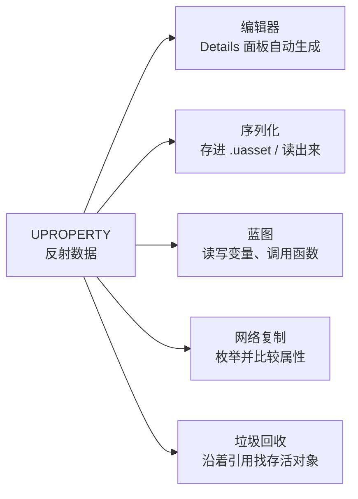
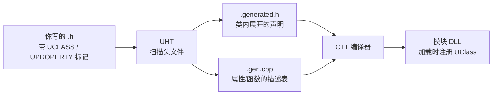
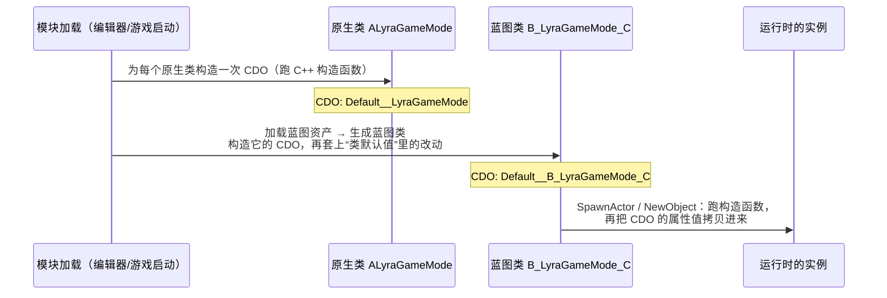

# 第 1 章　UE 的对象世界：UObject、反射、CDO、GC、蓝图与 C++

## 一个问题：`ULyraPawnData` 里的一行声明，凭什么能被策划改、被蓝图读、被存盘、被引擎回收？

打开 [`LyraPawnData.h`](../../../Source/LyraGame/Character/LyraPawnData.h)，你会看到这样几行：

```cpp
UPROPERTY(EditDefaultsOnly, BlueprintReadOnly, Category = "Lyra|Pawn")
TSubclassOf<APawn> PawnClass;
```

用你已有的 C++ 经验来读：这是一个类成员，类型是个模板包装的类指针，没了。可是在编辑器里，它是 Details 面板里一个带类选择器的下拉框；策划改完保存，数值被写进 `.uasset` 文件；蓝图节点能读它；游戏运行中，持有它的对象被卸载时，引擎还知道该不该把它指向的类也卸载掉。

如果在你熟悉的普通 C++ 里给一个 `struct` 加一个 `int` 字段，这些事一件都不会发生。UE 是怎么让“声明一个成员”这件事连带出这么多能力的？

再往后读 Lyra，你还会连续撞上一堆眼熟又陌生的写法：`GENERATED_BODY()`、`UPROPERTY(EditDefaultsOnly, Instanced)`、`GetDefault<ULyraExperienceDefinition>(AssetClass)`、`HandleStartingNewPlayer_Implementation`、`TObjectPtr<...>`、两个名字只差一个字母的 `ULyraTeamAgentInterface` 和 `ILyraTeamAgentInterface`。这些都不是 Lyra 的发明，而是 UE 对象系统的日常。这一章把它们一次讲清楚，后面的章节就不用再停下来解释了。

## 读完本章你能……

- 解释 UE 为什么要在 C++ 之上再造一套对象系统，并说出“反射”给一个属性带来的五种能力；
- 看到 `UPROPERTY` / `UFUNCTION` 上常见的说明符，能说出它在编辑器、蓝图、存盘、网络里分别意味着什么；
- 区分 `NewObject`、`CreateDefaultSubobject`、`SpawnActor`，并说出各自应该在哪里调用；
- 解释为什么存放对象指针的成员必须是 `UPROPERTY`，并在 `TObjectPtr`、`TWeakObjectPtr`、裸指针之间选对；
- 说出类默认对象（CDO）是什么，解释“蓝图是一个类，‘类默认值’存在它的 CDO 里”，以及 Lyra 为什么到处写 `GetDefault<>`；
- 面对任何一个 `B_*` 蓝图，找出它背后的 C++ 基类，并说清“原生基类 + 蓝图子类”各自负责什么。

## 需要先知道的 UE 概念

这是全书第一章，前置只有[第 0 章](00-HowToUse.md)的环境准备：你需要能编译项目、打开编辑器、运行 PIE（Play In Editor，编辑器内运行）。除此之外只需要会 C++（多态、RAII、模板），并且在编辑器里打开过蓝图。本章要讲的 UE 概念比较多，但我们按“一个问题引出一个概念”的节奏来，一次只引入一个。

为了让例子用真实的 Lyra 代码，本章会提前碰到几个 Lyra 和 UE 的名词。你现在不需要懂它们，只需要知道它们是什么，后面的章节会逐个展开：

- **Actor**：能放进关卡里的实体，场景里的一棵树、一个角色都是 Actor；**Pawn** 是“能被玩家或 AI 控制的 Actor”；**组件（Component）** 是挂在 Actor 上的能力模块（第 2 章）；
- **GameMode**：服务器上负责一局游戏规则的类（第 2 章）；
- **Experience（体验）**：Lyra 里描述“这一局玩什么”的数据资产，`ULyraExperienceDefinition` 就是它的 C++ 类（第 6 章）；
- **PawnData**：描述“一个角色有哪些技能、用什么输入和相机”的数据资产（第 8 章）；
- **ASC（能力系统组件）与 AbilitySet**：Lyra 的技能系统 GAS 里管理技能和属性的组件，以及一组技能的打包配置（第 9、10 章）；
- **GameFeature Action**：插件激活时对游戏“做点什么”的小对象（第 6 章）。

---

## 1. 为什么 UE 要在 C++ 之上再造一套对象系统

先想一想，一个游戏引擎对“对象”有哪些要求：

1. **编辑器要能看到并修改它的数据**。策划在 Details 面板里改血量，不应该需要程序员写一行面板代码。
2. **数据要能存进文件，再读出来**，而且几年后类里加了新字段，旧资产还得能加载。
3. **脚本（蓝图）要能调用 C++ 函数、读写 C++ 变量**，还要能“继承”一个 C++ 类并覆盖其中的函数。
4. **网络同步要能知道“这个对象有哪些属性需要复制”**，并且只发送变化的部分。
5. **成千上万个对象互相引用，资产会被动态加载和卸载**，谁来决定一个对象什么时候可以销毁？

### 最直观的做法

普通 C++ 里，你会这样解决：给每个类手写一个 `Describe()` 或 `Serialize(Archive&)` 函数，列出所有字段；或者像 Qt 那样用一个预处理器（moc）扫描源码；内存则用 `shared_ptr` 管。

### 这样做在什么场景下会出问题

手写列表会漏、会和真正的字段不同步：有人加了字段，忘了改 `Serialize`，于是存盘丢数据，而编译器一声不吭。C++ 自带的运行时类型信息（RTTI）只有类型名，没有字段名、没有元数据，更没有偏移量，帮不上忙。至于 `shared_ptr`，对象之间一旦有循环引用就泄漏，而且引擎需要知道“这个资产被谁引用着”才能决定卸不卸载——引用计数做不到这种全局视图。

### UE 的做法：用代码生成补上 C++ 缺失的反射

UE 的答案分两步。

第一步，**让程序员在头文件里用宏做标记**：`UCLASS()`、`USTRUCT()`、`UENUM()`、`UPROPERTY()`、`UFUNCTION()`。这些宏在普通编译时基本是空的，它们是写给另一个工具看的。

第二步，**一个叫 UHT（Unreal Header Tool，UE 头文件工具）的预处理程序在每次编译前扫描这些头文件**，为每个被标记的类生成一份“说明书”：这个类叫什么、父类是谁、有哪些属性（名字、类型、在对象内存里的偏移量、标志位）、有哪些函数（参数、返回值）。这份说明书在运行时是一棵可以被查询的数据结构，对应引擎里的 `UClass`、`FProperty`、`UFunction` 这些类型。

这种“程序在运行时能查询自己有哪些类、哪些字段”的能力叫**反射（Reflection）**。如果你用过 Java 的反射、C# 的 Attribute，或者 Qt 的元对象系统，概念是一样的。但有一个关键差别：C++ 自己没有反射，UE 的反射靠的是**编译前的代码生成**，所以**只有你用宏标记过的东西才被反射**，没标记的成员对引擎来说是不存在的。

一旦有了这份说明书，引擎的各个子系统都可以“不认识你的类，却能处理你的类”：



记住这张图。本章后面几乎每一节，都是在讲这五条线中的某一条。

### UObject 和普通 C++ 对象的区别

承载这套机制的基类叫 **`UObject`**。凡是继承自 `UObject` 的类（`AActor`、`UActorComponent`、`UDataAsset` 都是它的后代），就“接入”了上面五条线。

| | 普通 C++ 对象 | `UObject` 子类 |
|---|---|---|
| 怎么创建 | `new` / 栈上 / `make_shared` | `NewObject`、`CreateDefaultSubobject`、`SpawnActor`（后面讲） |
| 谁来销毁 | 你（RAII/delete） | 垃圾回收器（GC） |
| 编辑器可见、可存盘 | 否 | 是（标了 `UPROPERTY` 的成员） |
| 蓝图可见 | 否 | 是（标了 `UFUNCTION`/`UPROPERTY` 的部分） |
| 类型转换 | `dynamic_cast`（UE 默认关闭 RTTI） | `Cast<T>()`，基于反射的类层次 |

这里有一个小细节：UE 默认不开启 C++ RTTI，所以你在 Lyra 里永远看不到 `dynamic_cast`，而是 `Cast<T>(Obj)`，比如 [`LyraCharacter.cpp`](../../../Source/LyraGame/Character/LyraCharacter.cpp) 的构造函数里：

```cpp
// 简化自 Source/LyraGame/Character/LyraCharacter.cpp 的 ALyraCharacter::ALyraCharacter
ULyraCharacterMovementComponent* LyraMoveComp = CastChecked<ULyraCharacterMovementComponent>(GetCharacterMovement());
```

`Cast<T>` 失败返回 `nullptr`；`CastChecked<T>` 失败直接断言崩溃，用于“这里绝不可能不是 T”的场合。

### 不是所有东西都该是 UObject

UObject 很重：每个实例有额外的头部数据，要被 GC 追踪，创建流程也复杂。所以 UE 提供了三档选择，Lyra 里三档都用：

- **UObject / Actor / 组件**：需要被引用、需要多态、需要被引擎管理生命周期、需要作为资产。例如 `ULyraPawnData`。
- **USTRUCT**：轻量的数据包，值语义（按值拷贝），有反射（能存盘、能被复制、能放进蓝图），但**不继承 UObject**，也没有自己的生命周期。例如 [`LyraDeveloperSettings.h`](../../../Source/LyraGame/Development/LyraDeveloperSettings.h) 中的 `FLyraCheatToRun`（里面的 `Phase` 成员类型 `ECheatExecutionTime` 是一个 `UENUM`）。
- **普通 C++**：纯算法、工具、不需要和编辑器/蓝图/网络打交道的东西。

`USTRUCT` 里的成员都写了初始值（`ECheatExecutionTime Phase = ECheatExecutionTime::OnPlayerPawnPossession;`），这是个不起眼的规矩。Lyra 的 `Config/DefaultEngine.ini` 里有一段 `[CoreUObject.UninitializedScriptStructMembersCheck]`，把“反射成员没有初始化”设为 `Error` 级别：反射成员会被存盘和复制，读到未初始化的随机值既难复现又难排查。你自己写 `UPROPERTY` 成员时，养成“永远写初始值”的习惯。

---

## 2. 反射在代码里长什么样：UHT 与 `GENERATED_BODY()`

五个宏你会天天见到：`UCLASS`（标记一个 UObject 派生类，如 `ULyraPawnData`）、`USTRUCT`（值类型数据结构）、`UENUM`（枚举）、`UPROPERTY`（成员变量）、`UFUNCTION`（成员函数）。每个被标记的类体内必须写 `GENERATED_BODY()`，而且这个头文件的**最后一个 `#include` 必须是 `XXX.generated.h`**。看一眼 [`LyraPawnData.h`](../../../Source/LyraGame/Character/LyraPawnData.h) 的骨架：

```cpp
// 简化自 Source/LyraGame/Character/LyraPawnData.h
#include "Engine/DataAsset.h"
#include "LyraPawnData.generated.h"      // ← 必须是最后一个 include

UCLASS(MinimalAPI, BlueprintType, Const, Meta = (DisplayName = "Lyra Pawn Data"))
class ULyraPawnData : public UPrimaryDataAsset
{
    GENERATED_BODY()                      // ← UHT 在这里展开生成的代码

public:
    UPROPERTY(EditDefaultsOnly, BlueprintReadOnly, Category = "Lyra|Pawn")
    TSubclassOf<APawn> PawnClass;
    // ……还有 AbilitySets、TagRelationshipMapping、InputConfig、DefaultCameraMode
};
```

`LyraPawnData.generated.h` 并不在源码仓库里，它是 UHT 在编译时现生成的，放在 `Intermediate/Build/<平台>/UnrealEditor/Inc/<模块名>/UHT/` 之类的目录下（以你机器上的实际目录为准）。整个流程是：



好奇的话可以打开引擎自己的生成文件。引擎的 `AInfo` 类（`AGameModeBase` 的父类）对应的 `Info.generated.h` 里，`GENERATED_BODY()` 展开的核心是：

```cpp
// 简化自引擎 UHT 输出 Engine/Intermediate/Build/Win64/UnrealEditor/Inc/Engine/UHT/Info.generated.h
DECLARE_CLASS2(AInfo, AActor, COMPILED_IN_FLAGS(CLASS_Abstract | CLASS_Config),
               CASTCLASS_None, TEXT("/Script/Engine"), Z_Construct_UClass_AInfo)
AInfo(AInfo&&) = delete;       // UObject 不允许按值拷贝或移动
AInfo(const AInfo&) = delete;
```

不需要读懂每个宏，只要知道三个结论。第一，`StaticClass()` 就是从这里来的，它返回这个类的 `UClass` 描述对象。第二，Lyra 里到处能看到的 `Super::` 和 `ThisClass::`（比如 `&ThisClass::OnExperienceLoaded`）也在这里定义。第三，`"/Script/Engine"` 说明了类的“路径”：`/Script/<模块名>.<类名去掉前缀>`，所以 `DefaultEngine.ini` 里的 `GameEngine=/Script/LyraGame.LyraGameEngine` 指的就是 C++ 类 `ULyraGameEngine`。

对 `UFUNCTION`，UHT 还会生成包装函数。`GameModeBase.generated.h` 里有这么两行，第 3 节会用到：

```cpp
// 简化自引擎 UHT 输出 Engine/.../UHT/GameModeBase.generated.h
ENGINE_API virtual UClass* GetDefaultPawnClassForController_Implementation(AController* InController);
DECLARE_FUNCTION(execGetDefaultPawnClassForController);   // 给蓝图虚拟机调用的“跳板”
```

### 反射也可以在运行时直接用

Lyra 里有个调试命令，用反射遍历一个类的所有属性，把一批对象的属性值和 CDO 的默认值逐个对比，找出“哪些字段从来没被改过，可以省内存”：

```cpp
// 简化自 Source/LyraGame/Performance/LyraMemoryDebugCommands.cpp 的 AnalyzeObjectListForDifferences
UObject* CommonClassCDO = CommonClass->GetDefaultObject();
for (TFieldIterator<FProperty> PropIt(CommonClass); PropIt; ++PropIt)   // 遍历反射属性
{
    FProperty* Prop = *PropIt;
    FString DefaultValueStr;
    Prop->ExportText_InContainer(0, DefaultValueStr, CommonClassCDO, CommonClassCDO, nullptr, 0);
    // ……再对每个对象导出同一属性，和默认值比较
}
```

这段代码**不需要知道这个类的任何编译期信息**。编辑器的 Details 面板、`.uasset` 存盘、网络复制，用的是同一套机制。这里还出现了一个后面要讲的词：CDO，先放着。

> 反射只覆盖被标记的东西。`float Speed;` 没有 `UPROPERTY()`，对编辑器、存盘、蓝图、复制都不可见；`UObject* Target;` 没有 `UPROPERTY()`，连垃圾回收也看不见——这是第 5 节要讲的最危险的情形。

---

## 3. 说明符：`UPROPERTY` 和 `UFUNCTION` 括号里那些词

`UPROPERTY(...)` 括号里的词叫**说明符（Specifier）**。按“回答什么问题”来分类记，比按字母表背容易得多。

### 谁能在编辑器里改？蓝图能不能读写？

最常见的几个只管**编辑器 UI**：

| 说明符 | 在蓝图类默认值里 | 在关卡里的实例上 |
|---|---|---|
| `EditDefaultsOnly` | 可改 | 不可改 |
| `EditInstanceOnly` | 不可改 | 可改 |
| `EditAnywhere` | 可改 | 可改 |
| `VisibleAnywhere` | 只读可见 | 只读可见 |
| 什么都不写 | 不可见 | 不可见 |

`ULyraPawnData` 的所有成员都是 `EditDefaultsOnly`：PawnData 是数据资产，没有“关卡里的实例”，只在资产里编辑。[`LyraPlayerState.h`](../../../Source/LyraGame/Player/LyraPlayerState.h) 里的 ASC 子对象是 `VisibleAnywhere`：你能在 Details 面板看到它，但不该换掉它。

蓝图侧是另一组：`BlueprintReadOnly`（蓝图只能读）、`BlueprintReadWrite`（能读能写），不写则蓝图看不见。**这两组说明符都不是访问控制**：它们只约束编辑器 UI 和蓝图，C++ 代码照样能写一个 `EditDefaultsOnly` 的成员。

### 存不存盘、复制不复制、从哪读配置？

`Transient` 表示这个属性不存盘，每次加载都是默认值。Lyra 的 [`LyraBotCreationComponent.h`](../../../Source/LyraGame/GameModes/LyraBotCreationComponent.h) 里有一个典型：

```cpp
// 简化自 Source/LyraGame/GameModes/LyraBotCreationComponent.h
UPROPERTY(EditDefaultsOnly, BlueprintReadOnly, Category=Gameplay)
int32 NumBotsToCreate = 5;                       // 配置数据：存盘

UPROPERTY(Transient)
TArray<TObjectPtr<AAIController>> SpawnedBotList;   // 运行时状态：不存盘，但仍是 UPROPERTY
```

运行时的状态不该存进资产，所以是 `Transient`；但它里面装着对象指针，**必须是 `UPROPERTY`**，否则 GC 看不见它们（第 5 节）。`Transient` 和 `UPROPERTY` 并不矛盾。

`Replicated` / `ReplicatedUsing=OnRep_X` 表示属性要网络复制，第 3 章细讲。`Config` 表示值从 ini 读取：[`LyraDeveloperSettings.h`](../../../Source/LyraGame/Development/LyraDeveloperSettings.h) 里的 `ExperienceOverride` 就是 `config`，它所在的类声明了 `config=EditorPerProjectUserSettings`。“ini 的值读进了哪里”，第 6 节讲 CDO 时回答。

### 内嵌子对象：`Instanced`，以及 `meta=(...)`

[`LyraExperienceDefinition.h`](../../../Source/LyraGame/GameModes/LyraExperienceDefinition.h) 里的 `Actions`：

```cpp
UPROPERTY(EditDefaultsOnly, Instanced, Category="Actions")
TArray<TObjectPtr<UGameFeatureAction>> Actions;
```

普通对象指针属性（比如 `DefaultPawnData`）表示“引用另一个独立资产”。加上 `Instanced`，意思变成“这个资产**拥有**这些子对象”：每个 Action 是 Experience 资产内部的子对象，在编辑器里直接展开编辑，不会出现在内容浏览器里。第 6 章会用到这一点。

`meta` 里的内容不影响运行时，只影响编辑器。Lyra 里有三个：`meta=(AllowedTypes="LyraExperienceDefinition")`（`ExperienceOverride` 上，只允许选这个类型的主资产）；`meta=(TitleProperty=Ability)`（[`LyraAbilitySet.h`](../../../Source/LyraGame/AbilitySystem/LyraAbilitySet.h) 里，数组每一项的标题显示它的 `Ability` 字段而不是“Element 0”）；`meta=(AssetBundles="Client,Server")`（`GameFeatureAction_AddInputBinding.h` 里，给资产包系统用，第 4 章讲）。

### `UFUNCTION`：C++ 和蓝图怎么互相调用

三个最重要的说明符，把“谁实现、谁调用”理清楚：

| 说明符 | C++ 里 | 蓝图里 |
|---|---|---|
| `BlueprintCallable` | 你写函数体 | 可以作为节点调用 |
| `BlueprintImplementableEvent` | 只声明，**没有**函数体 | 蓝图实现它；C++ 调用它等于“发事件” |
| `BlueprintNativeEvent` | 你写默认实现 `Xxx_Implementation` | 蓝图可以覆盖；不覆盖则走 C++ 默认实现 |

`BlueprintImplementableEvent` 在 Lyra 里的例子是 [`LyraGameplayAbility.h`](../../../Source/LyraGame/AbilitySystem/Abilities/LyraGameplayAbility.h) 里的 `K2_OnAbilityAdded()`：技能被授予时 C++ 调用它，蓝图技能子类实现了就执行蓝图逻辑，没实现就什么也不发生。

`BlueprintNativeEvent` 的例子在 `LyraBotCreationComponent`：

```cpp
// 简化自 Source/LyraGame/GameModes/LyraBotCreationComponent.h 与 .cpp
UFUNCTION(BlueprintNativeEvent, BlueprintAuthorityOnly, Category=Gameplay)
void ServerCreateBots();                        // 头文件里声明的是这个名字

void ULyraBotCreationComponent::ServerCreateBots_Implementation()   // .cpp 里实现的是 _Implementation 版本
{
    // ……按 NumBotsToCreate 循环调用 SpawnOneBot()
}
```

规则是：**头文件里声明 `Foo`，.cpp 里要写 `Foo_Implementation`**。UHT 生成的 `Foo()` 会先查有没有蓝图覆盖，没有就调用你的 `_Implementation`。

回头看第 2 节那两行生成代码：`GetDefaultPawnClassForController_Implementation` 被生成为一个**虚函数**，所以 C++ 子类可以直接 `override` 它。[`LyraGameMode.h`](../../../Source/LyraGame/GameModes/LyraGameMode.h) 里的 `GetDefaultPawnClassForController_Implementation`、`HandleStartingNewPlayer_Implementation` 都是这么来的：覆盖带 `_Implementation` 后缀的版本，需要时调 `Super::Xxx_Implementation(...)`。这是 UE 里“引擎提供的可覆盖钩子”最常见的形态，你读 Lyra 会反复看到。

另有一个小标记 `BlueprintAuthorityOnly`：函数只在拥有权威的一端（通常是服务器）才会被蓝图执行，第 3 章讲网络时回来解释。

---

## 4. 三种“造对象”的方式

普通 C++ 里创建对象只有一种办法：`new`（或栈上构造）。UE 里有三种，因为“造对象”牵涉到谁来拥有它、什么时候造、要不要登记到引擎：

| 函数 | 什么时候用 | 造出来的对象 |
|---|---|---|
| `CreateDefaultSubobject<T>` | **只能在构造函数里**，给类“预装”一个子对象 | 属于类的一部分，每个实例（和 CDO）都有 |
| `NewObject<T>(Outer, Class)` | 运行时创建一个**非 Actor** 的 UObject | 受 GC 管理，需要被某个 `UPROPERTY` 引用着 |
| `World->SpawnActor<T>` | 运行时往世界里放一个 **Actor** | 登记进 World，参与 Tick、复制、渲染 |

三种在 Lyra 里都有真实用例。**构造函数里预装组件**（[`LyraCharacter.cpp`](../../../Source/LyraGame/Character/LyraCharacter.cpp)）：

```cpp
// 简化自 Source/LyraGame/Character/LyraCharacter.cpp 的 ALyraCharacter::ALyraCharacter
ALyraCharacter::ALyraCharacter(const FObjectInitializer& ObjectInitializer)
    // 把父类 ACharacter 默认创建的 CharacterMovement 子对象，替换成 Lyra 自己的子类
    : Super(ObjectInitializer.SetDefaultSubobjectClass<ULyraCharacterMovementComponent>(ACharacter::CharacterMovementComponentName))
{
    PawnExtComponent = CreateDefaultSubobject<ULyraPawnExtensionComponent>(TEXT("PawnExtensionComponent"));
    HealthComponent  = CreateDefaultSubobject<ULyraHealthComponent>(TEXT("HealthComponent"));
    CameraComponent  = CreateDefaultSubobject<ULyraCameraComponent>(TEXT("CameraComponent"));
}
```

`FObjectInitializer` 是 UE 创建每个 UObject 时传给构造函数的“初始化上下文”，`SetDefaultSubobjectClass` 能在不改引擎代码的前提下，把父类的某个默认子对象换成自己的子类。每个子对象有个名字（`TEXT("HealthComponent")`），它是子对象在这个类里的“身份证”，蓝图子类和存盘数据靠它找到对应的子对象，**不要随便改**。

**运行时造非 Actor 对象**（[`LyraEquipmentManagerComponent.cpp`](../../../Source/LyraGame/Equipment/LyraEquipmentManagerComponent.cpp)，“穿上一件装备”时）：

```cpp
// 简化自 Source/LyraGame/Equipment/LyraEquipmentManagerComponent.cpp 的 FLyraEquipmentList::AddEntry
NewEntry.Instance = NewObject<ULyraEquipmentInstance>(OwnerComponent->GetOwner(), InstanceType);
```

`NewObject` 的第一个参数是 **Outer**（外部对象）。每个 UObject 都有一个 Outer，构成一棵“所属关系树”，对象的路径名（形如 `/Game/Maps/...:PersistentLevel.某Actor.某组件`，冒号和点分隔的就是 Outer 链）和存盘时“它属于哪个包”都由它决定。这里 Lyra 把 Outer 设成了拥有该组件的 Actor。注意不要把 Outer 和 Actor 的 **Owner**（Gameplay 层面的“属于谁”，影响网络相关性和 RPC 路由，第 2、3 章讲）混为一谈。

**运行时往世界里放 Actor**（`ULyraBotCreationComponent::SpawnOneBot`）：

```cpp
// 简化自 Source/LyraGame/GameModes/LyraBotCreationComponent.cpp 的 ULyraBotCreationComponent::SpawnOneBot
FActorSpawnParameters SpawnInfo;
SpawnInfo.SpawnCollisionHandlingOverride = ESpawnActorCollisionHandlingMethod::AlwaysSpawn;
SpawnInfo.ObjectFlags |= RF_Transient;      // 这个 Actor 不要存进地图
AAIController* NewController = GetWorld()->SpawnActor<AAIController>(
    BotControllerClass, FVector::ZeroVector, FRotator::ZeroRotator, SpawnInfo);
```

`BotControllerClass` 是 `TSubclassOf<AAIController>`：它不是对象，而是“一个类”的引用，可以指向 `AAIController` 或它的任何子类（包括蓝图子类）。同一段 C++ 逻辑，造出来的具体是哪个类，由蓝图里填的值决定——这是“数据驱动”的基础。

构造函数是 UE 里最容易写错的地方，因为它**不只在“游戏开始造对象”时才跑**，第 6 节会解释为什么。

---

## 5. 垃圾回收：为什么对象指针必须被“反射”

你在组件里缓存了一个对象指针，过一阵子要用。UE 里的对象会被引擎销毁（切换场景、卸载资产、Actor `Destroy()`），你怎么知道它还活着？

最直观的做法，是和普通 C++ 一样存一个裸指针：`UMyAsset* CachedAsset;`，没有 `UPROPERTY`。

问题出在 UE 的回收方式上。UE 用**追踪式垃圾回收（Tracing GC）**：周期性地（以及切换关卡等时机）从一批“根”对象出发，沿着所有**反射属性**里的对象引用向下遍历，把能到达的对象标记为存活，没被标记的统统销毁。关键在于：**GC 只沿着反射属性（`UPROPERTY`）走**。上面那个裸指针对 GC 来说不存在。如果 `CachedAsset` 指向的对象没有被别处引用，某次 GC 之后它就被回收了，你的指针指向已释放的内存，之后某一刻读它就崩溃——崩溃点离真正的原因可能隔了几分钟。这是 UE 新手最常见、也最难查的 bug 来源之一。

### Lyra 的做法

规则很简单：**类成员里的 UObject 指针，必须是 `UPROPERTY`，并且写成 `TObjectPtr<T>`**。Lyra 到处遵守，[`LyraPlayerState.cpp`](../../../Source/LyraGame/Player/LyraPlayerState.cpp) 的构造函数里有一条很直白的注释：

```cpp
// 简化自 Source/LyraGame/Player/LyraPlayerState.cpp 的 ALyraPlayerState::ALyraPlayerState
// These attribute sets will be detected by AbilitySystemComponent::InitializeComponent.
// Keeping a reference so that the sets don't get garbage collected before that.
HealthSet = CreateDefaultSubobject<ULyraHealthSet>(TEXT("HealthSet"));
CombatSet = CreateDefaultSubobject<ULyraCombatSet>(TEXT("CombatSet"));
```

对应的头文件里，`HealthSet` 声明成 `UPROPERTY() TObjectPtr<const class ULyraHealthSet> HealthSet;`。这个成员存在的意义之一，就是保持一个“GC 能看见的引用”，让对象在被别人取走之前不会被回收。

更狠的是，Lyra 的 [`LyraEditor.Target.cs`](../../../Source/LyraEditor.Target.cs)（编辑器的构建目标配置，第 21 章会讲）里有：

```csharp
// 简化自 Source/LyraEditor.Target.cs
if (!bBuildAllModules)
{
    NativePointerMemberBehaviorOverride = PointerMemberBehavior.Disallow;
}
```

意思是编译编辑器目标时，**反射类里的裸 UObject 指针成员直接报错**，必须用 `TObjectPtr`，把一类错误挡在编译期。（它检不出“`TObjectPtr` 成员忘了写 `UPROPERTY`”，那一类仍要靠你自己记住。）

### 三种指针，怎么选

- **`TObjectPtr<T>`**：强引用（GC 意义上的：让对象不被回收，和第 4 章“加载资产时连带加载”的硬引用是相关但不同的概念），用于**类成员**，必须配 `UPROPERTY`。只要持有者活着，被指的对象就不会被回收。
- **`TWeakObjectPtr<T>`**：弱引用，**不阻止回收**，对象被回收后自动失效，用 `.IsValid()` / `.Get()` 判断。适合“只想观察、不想拥有”。Lyra 的 `GameFeatureAction_AddInputBinding.h` 里有 `TArray<TWeakObjectPtr<APawn>> PawnsAddedTo`：这个 Action 只想记住“我给哪些 Pawn 加过输入”，绝不该因此让 Pawn 无法销毁。
- **裸指针 `T*`**：只用于函数的**局部变量或参数**，生命周期短到不会跨越 GC。

如果你的类**根本不是 UObject**（比如一个 Slate 控件——UE 底层的纯 C++ UI 框架，不继承 UObject）却要持有 UObject，就要继承 `FGCObject` 并手动汇报引用：Lyra 的 `SActorCanvas`（[`SActorCanvas.cpp`](../../../Source/LyraGame/UI/IndicatorSystem/SActorCanvas.cpp)）在 `AddReferencedObjects` 里调用 `Collector.AddReferencedObjects(AllIndicators)`，就是在告诉 GC“这些对象我还在用”。

### `IsValid` 和 `!= nullptr` 不一样

一个 Actor 被 `Destroy()` 之后、真正被 GC 释放之前，指向它的指针不是 `nullptr`，但它已被标记为“待回收”。所以 UE 代码里判断对象可用，用 `IsValid(Obj)`，它同时检查“非空”和“没被标记销毁”。Lyra 里 [`LyraAbilitySet.cpp`](../../../Source/LyraGame/AbilitySystem/LyraAbilitySet.cpp) 授予属性集时就写了 `if (!IsValid(SetToGrant.AttributeSet)) { …报错并 continue… }`。

GC 换来的是：不用手写 `delete`，不会因循环引用泄漏，引擎能做全局的“谁还在用这个资产”分析。代价是：你必须记住**每一个跨函数存放的 UObject 指针都要让 GC 看见**。把它变成肌肉记忆：成员指针 = `UPROPERTY` + `TObjectPtr`。

---

## 6. CDO：每个类的“出厂设置”

你在蓝图里打开 `B_ShooterBotSpawner`，在“类默认值”里把 `NumBotsToCreate` 改成 8。场景里将来会有很多个这样的实例，这个 8 存在哪里？

最直观的做法是每个实例各存各的值。可是想象一张地图里有 1000 个同类 Actor：每个都完整存一遍所有属性，存盘体积会爆炸；而且当你想“改一下默认值，让所有没被单独改过的实例跟着变”，就得逐个判断“这个值是用户改过的，还是原来的默认值？”

UE 的做法是：**每个类有且只有一个“默认实例”，叫类默认对象（Class Default Object，CDO）**。每个 `UClass` 在内存里都有这么一个特殊的实例，存着这个类所有属性的默认值。其他实例创建时，**先以 CDO 为模板初始化**，再应用“与默认值不同的覆盖”；存盘时也只存与 CDO 不同的部分。CDO 是理解 UE 的一个枢纽，这张时间线值得记住：



**推论 1：你写的 C++ 构造函数，首先是为 CDO 跑的。** 引擎启动、编辑器启动、蓝图编译时，构造函数都会被调用，而那时**没有 World、没有玩家、什么都没有**。所以构造函数里只做三种事：设置默认值、`CreateDefaultSubobject`、绑定自己内部的委托。`ALyraCharacter` 的构造函数里全是这类事（设置胶囊体大小、移动参数），没有一行触碰 World。

**推论 2：实例创建时，属性值是“先跑构造函数，再从 CDO 拷贝”**。所以对被反射的属性，最终生效的是 CDO 里的值（原生类的 CDO 值就是构造函数里写的值；蓝图类的 CDO 值是“类默认值”里改的值）。这也是为什么在蓝图里改过某个属性、又回头改 C++ 构造函数里的默认值，行为却没变：蓝图里那个属性已经是一个“覆盖”。

### `GetDefault<T>`：直接读 CDO

既然 CDO 里装着一个类的默认配置，就可以**不创建实例，直接读它**，这就是 `GetDefault<T>()`。Lyra 在三个地方用了它：

```cpp
// ① 简化自 Source/LyraGame/GameModes/LyraExperienceManagerComponent.cpp 的 SetCurrentExperience
// Experience 本质是一个蓝图类，“类默认值”就是配置数据；Lyra 从不创建它的实例，直接读 CDO
const ULyraExperienceDefinition* Experience = GetDefault<ULyraExperienceDefinition>(AssetClass);

// ② 简化自 Source/LyraGame/Equipment/LyraEquipmentManagerComponent.cpp 的 FLyraEquipmentList::AddEntry
// 装备定义（ULyraEquipmentDefinition）也是只读配置，用 CDO 取值
const ULyraEquipmentDefinition* EquipmentCDO = GetDefault<ULyraEquipmentDefinition>(EquipmentDefinition);

// ③ 简化自 Source/LyraGame/GameModes/LyraGameMode.cpp 的 HandleMatchAssignmentIfNotExpectingOne
// 开发者设置：ini 里的 config 值在构造 CDO 时就读进了它
ExperienceId = GetDefault<ULyraDeveloperSettings>()->ExperienceOverride;
```

第三个例子回答了第 3 节留的悬念：`config` 属性的值，是引擎在构造 CDO 时从 ini 读进去的，所以 `UDeveloperSettings` 一类的配置对象，本质上就是“单例 = 它的 CDO”。

三个例子的共同点是：**数据放在类的 CDO 里，运行时只读**。这就是 `ULyraExperienceDefinition`、`ULyraPawnData` 这些“定义类”标 `UCLASS(Const)` 的原因：`Const` 向读代码的人表明“这是只读数据”。CDO 是进程内全局共享的，如果有人用 `GetMutableDefault` 改了它，所有之后使用这个类的地方都会受影响。

另一个小提醒：CDO 也是真实存在的 UObject，用 `TObjectIterator` 遍历“所有 `UAbilitySystemComponent`”会连各种类的 CDO 一起遍历到。[`LyraHUD.cpp`](../../../Source/LyraGame/UI/LyraHUD.cpp) 的 `GetDebugActorList` 里就用 `if (!ASC->HasAnyFlags(RF_ClassDefaultObject | RF_ArchetypeObject))` 把它们过滤掉：`RF_ClassDefaultObject` 标出类的 CDO，`RF_ArchetypeObject` 标出蓝图里为组件预配置的原型模板对象，两者都不是场景里真正在跑的实例。

---

## 7. 蓝图与 C++：原生基类 + 蓝图子类

整个游戏，哪部分写 C++，哪部分用蓝图？

全 C++ 的问题是：策划改一个数值也要找程序员重新编译，美术摆一个新角色也要写代码。全蓝图的问题是：大型项目里蓝图难 diff、难合并，复杂逻辑可读性差，而且很多引擎扩展点只有 C++ 才能访问。

Lyra 的做法是：**C++ 搭框架，蓝图装配资产**。先弄清一件事：**蓝图（Blueprint）不是一种“脚本文件”，而是一个类**。蓝图资产编译后生成一个 `UBlueprintGeneratedClass`，它是 C++ 类的子类，名字带 `_C` 后缀，比如 `DefaultEngine.ini` 里的：

```
GlobalDefaultGameMode=/Game/B_LyraGameMode.B_LyraGameMode_C
GameInstanceClass=/Game/B_LyraGameInstance.B_LyraGameInstance_C
```

`B_LyraGameMode_C` 是蓝图类，它的 C++ 父类是 `ALyraGameMode`。一个蓝图类里装着：它自己的 CDO（“类默认值”面板里填的值）、在 C++ 父类基础上额外加的组件、蓝图变量与事件图逻辑。所以“原生基类 + 蓝图子类”可以理解成：**C++ 类是接口和主要逻辑，蓝图子类是一份具体配置加少量胶水逻辑**。Lyra 里几组真实的对应关系如下：

- `B_LyraGameMode` → `ALyraGameMode`；`B_LyraGameInstance` → `ULyraGameInstance`；
- `B_Hero_ShooterMannequin` → `B_Hero_Default` → `Character_Default` → `ALyraCharacter`（完整拆解见[参考手册 70](../Reference/70-GameFeatures-Content.md)）。这是“蓝图继承蓝图”，对角色蓝图是允许的；
- `B_ShooterGame_Elimination` → `ULyraExperienceDefinition`，这一条**只允许继承一层**，见下文。

回看前面见过的 `ULyraBotCreationComponent`：它是 `UCLASS(Blueprintable, Abstract)`，C++ 写出“生成 Bot”的逻辑（`SpawnActor`、走和玩家一样的出生流程，这些要用 C++ 才能访问的引擎接口），数据（`NumBotsToCreate`、`BotControllerClass`、名字表）都是 `EditDefaultsOnly`，由蓝图子类（ShooterCore 里的 `B_ShooterBotSpawner`）去填；`ServerCreateBots` 是 `BlueprintNativeEvent`，蓝图愿意的话可以整个换掉；`Abstract` 保证没人把 C++ 基类直接拿来用。这个模式在 Lyra 里随处可见，第 6 章实验里你把 `B_ShooterBotSpawner` 加到 GameState 上，用的就是它。

### 反射的一个实用例子：校验“只能继承一层”

这条规则是怎么在代码里强制的？看 [`LyraExperienceDefinition.cpp`](../../../Source/LyraGame/GameModes/LyraExperienceDefinition.cpp) 的 `IsDataValid`：

```cpp
// 简化自 Source/LyraGame/GameModes/LyraExperienceDefinition.cpp 的 ULyraExperienceDefinition::IsDataValid
#if WITH_EDITOR
EDataValidationResult ULyraExperienceDefinition::IsDataValid(FDataValidationContext& Context) const
{
    EDataValidationResult Result = CombineDataValidationResults(Super::IsDataValid(Context), EDataValidationResult::Valid);
    // ……（检查 Actions 里没有空项，略）

    if (!GetClass()->IsNative())                       // 这是一个蓝图类
    {
        const UClass* ParentClass = GetClass()->GetSuperClass();
        const UClass* FirstNativeParent = ParentClass;
        while ((FirstNativeParent != nullptr) && !FirstNativeParent->IsNative())
        {
            FirstNativeParent = FirstNativeParent->GetSuperClass();   // 沿继承链往上找第一个原生类
        }
        if (FirstNativeParent != ParentClass)          // 直接父类不是原生类 → 蓝图继承了蓝图
        {
            Context.AddError(/* “不支持 Blueprint experience 的蓝图子类，请改用 ActionSet 组合” */);
            Result = EDataValidationResult::Invalid;
        }
    }
    return Result;
}
#endif
```

这几行用到了本章好几个概念：`IsDataValid` 是 `UObject` 提供的**虚函数钩子**（编辑器“验证数据”时调用）；`GetClass()` / `GetSuperClass()` / `IsNative()` 是**反射 API**，通过 `UClass` 描述对象在运行时遍历继承链；`#if WITH_EDITOR` 表示这段代码只存在于编辑器构建，打包出去的游戏里没有。

一条经验法则：被很多资产复用的基础类、系统规则、性能敏感代码、网络复制逻辑、需要引擎底层接口的部分，放 C++；具体资产配置（这个角色用哪些技能、哪个模型）、数值调优、UI 布局、动画蓝图和少量“串一下”的胶水逻辑，放蓝图。至于“怎么从一个蓝图找到它背后的 C++ 类”，[第 0 章](00-HowToUse.md)的环境准备里有具体步骤。

---

## 8. 接口：`UInterface` 为什么是两个类

`ALyraPlayerState`、`ALyraPlayerController`、`ALyraCharacter`、`ALyraPawn`、`ALyraPlayerBotController`、`ULyraLocalPlayer` 分属不同的继承树，但它们都“属于某个队伍”。Lyra 想写一个统一的 `ULyraTeamSubsystem::FindTeamFromObject`：给一个对象，返回它的队伍号。

最直观的做法是 C++ 多重继承：写一个纯虚的接口类，让它们都继承。这能做，但 UE 还要回答：`Cast<>` 能不能转成接口？蓝图认不认识这个接口？一个纯 C++ 抽象类，反射系统看不见。

UE 的接口由两个类配合组成。看 [`LyraTeamAgentInterface.h`](../../../Source/LyraGame/Teams/LyraTeamAgentInterface.h)：

```cpp
// 简化自 Source/LyraGame/Teams/LyraTeamAgentInterface.h
UINTERFACE(MinimalAPI, meta=(CannotImplementInterfaceInBlueprint))
class ULyraTeamAgentInterface : public UGenericTeamAgentInterface
{
    GENERATED_UINTERFACE_BODY()                 // U 版本：只是个“反射用的壳”，让引擎知道有这个接口
};

class ILyraTeamAgentInterface : public IGenericTeamAgentInterface
{
    GENERATED_IINTERFACE_BODY()                 // I 版本：真正的纯虚函数写在这里

    virtual FOnLyraTeamIndexChangedDelegate* GetOnTeamIndexChangedDelegate() { return nullptr; }
    // ……
};
```

规则：**`U` 开头的类（带 `UINTERFACE`）是给反射系统看的壳，`I` 开头的类才放真正的函数**。要实现接口的类，继承 **I 版本**，比如：

```cpp
class ALyraPlayerState : public AModularPlayerState, public IAbilitySystemInterface, public ILyraTeamAgentInterface
```

使用时，`Cast<ILyraTeamAgentInterface>(Obj)` 是可用的——引擎靠 U 版本的反射信息判断“这个对象的类有没有实现这个接口”。这就是 `FindTeamFromObject` 的做法：

```cpp
// 简化自 Source/LyraGame/Teams/LyraTeamSubsystem.cpp 的 ULyraTeamSubsystem::FindTeamFromObject
int32 ULyraTeamSubsystem::FindTeamFromObject(const UObject* TestObject) const
{
    // 对象自己实现了队伍接口：直接问它
    if (const ILyraTeamAgentInterface* ObjectWithTeamInterface = Cast<ILyraTeamAgentInterface>(TestObject))
    {
        return GenericTeamIdToInteger(ObjectWithTeamInterface->GetGenericTeamId());
    }
    // ……不是的话，再看它的 Instigator、是不是队伍信息 Actor、有没有关联的 PlayerState
}
```

`meta=(CannotImplementInterfaceInBlueprint)` 的意思是：这个接口只能在 C++ 里实现，蓝图不能实现它。如果要持有接口指针，GC 友好的包装是 `TScriptInterface<ILyraTeamAgentInterface>`（Lyra 的 `ConditionalBroadcastTeamChanged` 就接受这种参数）。第 15 章会专门讲队伍系统。

---

## 9. 读代码速查：命名前缀

UE 的命名前缀不是风格偏好，UHT 会检查它。读 Lyra 时靠前缀就能判断一个类型的身份：`U` 是继承 UObject 的非 Actor 类（`ULyraPawnData`），`A` 是继承 AActor 的类（`ALyraGameMode`），`F` 是结构体或普通 C++ 类（`FLyraCheatToRun`、`FPrimaryAssetId`），`E` 是枚举（`ECheatExecutionTime`），`I` 是接口（`ILyraTeamAgentInterface`），`T` 是模板（`TArray`、`TObjectPtr`）。布尔成员习惯以 `b` 开头（`bIsDefaultExperience`）。

类声明前还常见一组模块导出宏：`UE_API` / `LYRAGAME_API` 让别的模块（另一个 DLL）能链接到这个类的函数；`MinimalAPI` 是类说明符，意思是“只导出类型反射信息（让别的模块能对它做 `Cast`），不导出所有成员函数”，用来缩小导出符号表、加快编译链接。

---

## 动手实验

下面三个实验里，前两个会在你本地的 `Source/LyraGame` 里加或改几行代码，做完记得还原。步骤的共同前提：**关闭编辑器 → 改代码 → （新增文件后）重新生成项目文件 → 在 IDE 里编译 `LyraEditor`（Development Editor）→ 启动编辑器**。怎么编译、怎么启动，见第 0 章“环境准备”。

### 实验 1：亲眼看看说明符做了什么

**目标**：看到 `EditDefaultsOnly` / `EditInstanceOnly` / `VisibleAnywhere` / `BlueprintCallable` / `BlueprintImplementableEvent` / `BlueprintNativeEvent` 在编辑器里分别表现成什么样。

**步骤**：

1. 新建两个文件 `Source/LyraGame/Development/MyProbeActor.h` 和 `MyProbeActor.cpp`。

```cpp
// MyProbeActor.h（实验用，非 Lyra 源码；做完请删除）
#pragma once

#include "GameFramework/Actor.h"
#include "MyProbeActor.generated.h"

UCLASS(Blueprintable)
class AMyProbeActor : public AActor
{
    GENERATED_BODY()

public:
    UPROPERTY(EditDefaultsOnly, BlueprintReadOnly, Category="Probe")
    int32 DefaultsOnly = 1;

    UPROPERTY(EditInstanceOnly, BlueprintReadOnly, Category="Probe")
    int32 InstanceOnly = 2;

    UPROPERTY(EditAnywhere, BlueprintReadWrite, Category="Probe")
    int32 Anywhere = 3;

    UPROPERTY(VisibleAnywhere, Category="Probe")
    int32 VisibleOnly = 4;

    UPROPERTY(Transient, VisibleAnywhere, Category="Probe")
    int32 RuntimeCounter = 0;

    UFUNCTION(BlueprintCallable, Category="Probe")
    void PrintHello() const;

    UFUNCTION(BlueprintImplementableEvent, Category="Probe")
    void OnProbeEvent();

    UFUNCTION(BlueprintNativeEvent, Category="Probe")
    int32 ComputeScore() const;
};
```

```cpp
// MyProbeActor.cpp（实验用，非 Lyra 源码；做完请删除）
#include "MyProbeActor.h"
#include "LyraLogChannels.h"

void AMyProbeActor::PrintHello() const
{
    UE_LOG(LogLyra, Warning, TEXT("[Probe] Hello from %s, score=%d"), *GetName(), ComputeScore());
}

int32 AMyProbeActor::ComputeScore_Implementation() const
{
    return 100;
}
```

2. 编译，启动编辑器。**新建一张空白地图**（不要在 `L_Expanse` 里做）。
3. 内容浏览器 → 新建蓝图类，在“所有类”里搜 `MyProbeActor`，命名为 `BP_MyProbe`。
4. 打开 `BP_MyProbe`，进入“类默认值”（Class Defaults）面板，看 `Probe` 分类下的五个属性。
5. 把 `BP_MyProbe` 拖进空白地图，选中这个实例，看 Details 面板里的同一组属性。
6. 回到蓝图，在事件图里右键搜 `Print Hello` 和 `On Probe Event`，把 `Event BeginPlay` 连到 `Print Hello`；在“我的蓝图”面板的函数区点“覆盖（Override）”，看能不能找到 `Compute Score`。先不覆盖，编译蓝图并点击运行 PIE 看输出日志里 `[Probe]` 的打印；再覆盖 `Compute Score` 让它返回 `7`，编译后再运行一次对比。（实验做完清理时，先在编辑器里删掉 `BP_MyProbe` 和空白地图，关闭编辑器，再删掉 `MyProbeActor.h/.cpp` 重新编译。）

**先写下你的预测**：每个属性在“类默认值”里、在关卡实例上分别是可编辑、只读还是不可见？三个函数各自在蓝图里以什么形式出现（节点、事件、可覆盖函数）？

**预期结果**：

- `DefaultsOnly`、`Anywhere`：类默认值里可改；实例上，`DefaultsOnly` 不可改，`Anywhere` 可改；
- `InstanceOnly`：类默认值里不可改（灰显或不显示，随编辑器版本而异），实例上可改；
- `VisibleOnly`、`RuntimeCounter`：两处都只读可见（`Transient` 不影响它们在面板里出现，只影响存盘）；
- `PrintHello` 是一个可调用节点；`OnProbeEvent` 是一个可以在事件图里创建的事件（它只存在于蓝图）；`ComputeScore` 可以被覆盖。如果你在蓝图里没覆盖它，调用 `PrintHello` 会打印 `score=100`；覆盖并返回 7 之后，就会打印 `score=7`。

**原理**：这些行为全都来自 UHT 生成的反射数据，你只在头文件里多写了几个词，编辑器的 Details 面板、蓝图节点库就自动生成了。最后一条印证了 `BlueprintNativeEvent` 的“有覆盖走覆盖，没覆盖走 `_Implementation`”。

### 实验 2：数一数构造函数被调用了几次

**目标**：理解“构造函数首先是为 CDO 跑的”。

**步骤**：

1. 在 [`LyraGameMode.cpp`](../../../Source/LyraGame/GameModes/LyraGameMode.cpp) 的 `ALyraGameMode::ALyraGameMode` 构造函数体内（赋值语句之后）临时加一行：

```cpp
UE_LOG(LogLyra, Warning, TEXT("[CtorProbe] ALyraGameMode ctor: %s (%s)"),
    *GetName(), HasAnyFlags(RF_ClassDefaultObject) ? TEXT("CDO") : TEXT("instance"));
```

2. 编译并启动编辑器；打开输出日志，搜索 `CtorProbe`。
3. 在日志里先记下启动编辑器时已经出现了几行、对象名字是什么。
4. 打开 `L_Expanse`，用“以主机服务器运行（Play As Listen Server）”、玩家数 2 运行 PIE，再看新增了几行。

**先写下你的预测**：还没开始玩（刚启动编辑器）日志里有没有这行？有的话对象名叫什么、是 CDO 还是实例？PIE 启动后，GameMode 的“实例”被构造了几次——服务器一次，每个客户端一次，共 2 次吗？

**预期结果**：启动编辑器时就能看到至少一行 `Default__LyraGameMode (CDO)`，那是原生类的 CDO，它在模块加载时就被构造了，此时一局游戏都没开始。蓝图类 `B_LyraGameMode_C` 被加载（最晚到 PIE 时）还会出现 `Default__B_LyraGameMode_C (CDO)`。运行 PIE 之后，会看到一行名字类似 `B_LyraGameMode_C_0` 的 `instance`——只有**一次**。蓝图被重新编译时 CDO 会被重建，所以你可能看到更多 CDO 行，不必深究。

**原理**：PIE 里的客户端不会构造 GameMode，因为 GameMode 只存在于服务器（第 2 章）。而那行 CDO 日志证明：构造函数在游戏开始前就跑过了，那时 `GetWorld()` 是空的。**实验完成后，把加的那行删掉。**

### 实验 3：触发一次 `IsDataValid`

**目标**：把第 7 节的校验代码变成亲眼可见的结果。

**步骤**：

1. 在内容浏览器里找到 `B_ShooterGame_Elimination`（位于 ShooterCore 插件内容的 `Experiences` 目录）。
2. 右键 → 创建子蓝图类（Create Child Blueprint Class），命名为 `B_TestChild`。**先不要保存其它东西。**
3. 选中 `B_TestChild`，右键 → 资产操作（Asset Actions）→ 验证资产（Validate Assets，具体菜单位置以你的编辑器版本为准），然后看消息日志。如果提示资产需要先保存才能验证，保存这个新资产即可（这一步会在磁盘上留下一个文件，所以实验完成后记得删除）。
4. 实验完成后删除 `B_TestChild`。

**先写下你的预测**：校验会通过吗？失败的话，报错信息会提到哪两个类？

**预期结果**：校验失败，错误信息的大意是“Blueprint 子类化 Blueprint experience 暂不支持（请改用 ActionSet 组合）。父类是 `B_ShooterGame_Elimination`，但应该是原生类 `LyraExperienceDefinition`”。

**原理**：校验代码沿着 `GetSuperClass()` 链发现第一个原生父类不是直接父类，正是前面 `IsDataValid` 里那段。第 6 章会解释为什么 Lyra 禁止这种继承。

---

## 常见误区

**误区 1：成员里的 `UObject*` 不加 `UPROPERTY`。**
GC 看不见它，对象被回收后你的指针就悬垂，崩溃点往往远离真正的原因。正确做法：类成员指针一律 `UPROPERTY()` + `TObjectPtr<T>`；只想观察不想拥有时用 `TWeakObjectPtr`。

**误区 2：在构造函数里访问 World、其他 Actor，或者把游戏逻辑放进去。**
构造函数首先是为 CDO 跑的，那时没有 World。构造函数里只设默认值、`CreateDefaultSubobject`、绑定自身内部的委托；需要世界的逻辑放到 `PostInitializeComponents` / `BeginPlay`（第 2 章）。

**误区 3：改了 C++ 构造函数里的默认值，行为却没变。**
如果这个属性在蓝图“类默认值”里被改过，蓝图那个值已经是一个“覆盖”，C++ 后来的修改不再对它生效。去蓝图里把这个属性恢复成默认值（点属性旁边的重置箭头）即可。

**误区 4：以为 `EditDefaultsOnly` / `BlueprintReadOnly` 是访问控制。**
它们只约束编辑器 UI 和蓝图。C++ 代码照样能写这些属性。如果你想保护数据，请用 C++ 的 `private`/`const`，或者像 Lyra 那样把定义类标 `Const`，把它们当只读数据来约定。

**误区 5：运行时用 `GetMutableDefault` 改 CDO 来“存状态”。**
CDO 全局共享，改了它，所有之后使用这个类的地方都会受影响，甚至跨局污染。运行时可变的状态应该放在实例（Actor、组件）上。

**误区 6：对象被 `Destroy()` 后仍用 `ptr != nullptr` 判断可用。**
被销毁但还没被 GC 的对象，指针不是空的。用 `IsValid(Obj)`。

---

## 本章小结

UE 在 C++ 之上建了一套对象系统，核心是**反射**：UHT 在编译前扫描你用 `UCLASS`/`UPROPERTY`/`UFUNCTION` 标记过的头文件，生成运行时可查询的类和属性描述；编辑器、存盘、蓝图、网络复制、垃圾回收都靠它工作。只有被标记的成员才有这些能力，所以成员里的对象指针必须是 `UPROPERTY`，GC 才看得见。

每个类有一个 CDO，保存着这个类的默认值；实例以它为模板创建；蓝图是一个继承了 C++ 类的类，它的“类默认值”就存在它自己的 CDO 里；Lyra 用“C++ 写逻辑和规则、蓝图填数据和资产”的分工，并且大量用 `GetDefault<>` 直接读 CDO 里的配置。

```
   你写的头文件（UCLASS / UPROPERTY / UFUNCTION）
              │  UHT
              ▼
        反射数据（UClass / FProperty / UFunction）
   ┌────────┬────────┬────────┬────────┬────────┐
   ▼        ▼        ▼        ▼        ▼
 编辑器   存盘/读盘   蓝图    网络复制    垃圾回收
                                          │
                       成员指针必须是 UPROPERTY + TObjectPtr

   C++ 类 ALyraGameMode ──CDO: Default__LyraGameMode
        ▲ 继承
   蓝图类 B_LyraGameMode_C ──CDO: Default__B_LyraGameMode_C（“类默认值”存这里）
        │ NewObject / SpawnActor
        ▼
   运行时实例：构造函数 → 从 CDO 拷贝属性
```

## 自测题

1. UE 为什么不直接用 C++ 的 RTTI 和手写序列化，而要造反射系统？反射数据是怎么产生的？

<details><summary>答案</summary>

C++ 的 RTTI 只有类型名，没有字段名、类型、偏移量和元数据；手写序列化会和字段脱节。UE 的做法是在头文件里用 `UCLASS/UPROPERTY/UFUNCTION` 等宏做标记，UHT 在编译前扫描这些头文件，生成 `.generated.h` 和 `.gen.cpp`，里面包含每个类、属性、函数的描述数据；运行时的 `UClass`/`FProperty`/`UFunction` 就是这份数据。编辑器、存盘、蓝图、网络复制、垃圾回收都消费这份数据。
</details>

2. 下面这个类有什么隐患？怎么改？

```cpp
UCLASS()
class UMyManager : public UObject
{
    GENERATED_BODY()
    UMyAsset* Cached;
};
```

<details><summary>答案</summary>

`Cached` 没有 `UPROPERTY`，GC 看不见这个引用。如果别处没人引用 `UMyAsset`，它可能被回收，`Cached` 就悬垂。应改为 `UPROPERTY() TObjectPtr<UMyAsset> Cached;`（并且 Lyra 的 Target 设置会让裸指针成员直接编译失败）。如果只是想观察而不想拥有，改用 `TWeakObjectPtr<UMyAsset>`。另外成员应该有初始值（`= nullptr` 或由 `TObjectPtr` 默认初始化）。
</details>

3. `NewObject`、`CreateDefaultSubobject`、`SpawnActor` 各自该在什么场合用？Lyra 里各举一例。

<details><summary>答案</summary>

`CreateDefaultSubobject` 只能在构造函数里用，给类预装子对象，例如 `ALyraCharacter` 构造函数里创建 `ULyraHealthComponent`。`NewObject` 在运行时创建非 Actor 的 UObject，需要指定 Outer，并要被某个 `UPROPERTY` 引用住，例如 `FLyraEquipmentList::AddEntry` 里创建 `ULyraEquipmentInstance`。`SpawnActor` 在运行时往 World 里放 Actor，例如 `ULyraBotCreationComponent::SpawnOneBot` 里生成 `AAIController`。
</details>

4. 在蓝图“类默认值”里把某个属性改成 8，这个 8 存在哪里？运行时一个新实例是怎么拿到这个值的？

<details><summary>答案</summary>

存在这个蓝图类的 CDO 里（只记录与父类默认值不同的覆盖）。运行时创建新实例时，先跑 C++ 构造函数，再由引擎以该蓝图类的 CDO 为模板把属性值拷贝进新实例，所以新实例拿到的是 8。
</details>

5. `ULyraExperienceDefinition` 为什么用 `GetDefault<ULyraExperienceDefinition>(AssetClass)` 而不是 `NewObject` 一个实例？这样做对类上标的 `Const` 有什么要求？

<details><summary>答案</summary>

Experience 只是一份只读配置数据，创建实例没有意义，直接读蓝图类的 CDO 就能拿到编辑器里填的所有值，省去实例的开销和管理。CDO 是进程内全局共享的，所以不应在运行时修改它；类上标 `Const` 就是向读代码的人表明这是只读数据，请勿修改（否则会影响之后所有使用这个类的地方）。
</details>

6. 为什么 UE 的接口要拆成 `ULyraTeamAgentInterface` 和 `ILyraTeamAgentInterface` 两个类？某个类要实现它，该继承哪个？

<details><summary>答案</summary>

`U` 版本（带 `UINTERFACE`）只是给反射系统看的壳，让引擎知道“有这个接口”、能让 `Cast<>` 在运行时判断某个类是否实现了它；真正的虚函数声明在 `I` 版本里。实现接口的类继承 `I` 版本，例如 `class ALyraPlayerState : ..., public ILyraTeamAgentInterface`。
</details>

7. 设计题：你要加一种“Bot 难度”配置：策划需要在编辑器里为每种难度填敌人数量、命中率、使用哪个 AI 控制器类，运行时代码要读取它们。你会选 UObject、USTRUCT 还是普通 C++ 类来承载？它该继承什么？访问时用什么手段？

<details><summary>答案</summary>

用一个继承 `UPrimaryDataAsset` 的 UObject 子类（`UCLASS(BlueprintType, Const)`），属性用 `EditDefaultsOnly`（比如敌人数量、命中率、`TSubclassOf<AAIController>`）。策划在编辑器里为每种难度创建一个资产。运行时通过持有它的引用（软/硬引用，第 4 章讲）读取，只读，不修改。如果只是几个数值的小包，也可以做成 `USTRUCT`，再放进某个配置资产的数组里；不要用普通 C++ 类，因为它进不了编辑器、存不了盘。
</details>

## 继续深入

- 本章概念在 Lyra 里最集中的体现：[参考手册 10 §2 关键类表](../Reference/10-CoreFramework.md)（`ULyraPawnData`、`ULyraExperienceDefinition` 的完整字段）；
- 蓝图类与 C++ 父类的对应、各蓝图资产的拆解：[参考手册 70](../Reference/70-GameFeatures-Content.md)；
- 引擎官方文档（不是 Lyra 专页，页面随引擎版本更新，打开后请确认版本选择器是 5.8 或最新版）：[Objects in Unreal Engine](https://dev.epicgames.com/documentation/en-us/unreal-engine/objects-in-unreal-engine)（UObject、UCLASS、不要对 UObject 用 `new`）、[Unreal Object Handling](https://dev.epicgames.com/documentation/en-us/unreal-engine/unreal-object-handling-in-unreal-engine)（根集合与垃圾回收怎么判断对象还活着）、[Object Pointers in Unreal Engine](https://dev.epicgames.com/documentation/unreal-engine/object-pointers-in-unreal-engine)（`TObjectPtr`、`TWeakObjectPtr`、`TStrongObjectPtr` 各自的用途，对应本章第 5 节）、[Creating Objects](https://dev.epicgames.com/documentation/unreal-engine/creating-objects-in-unreal-engine)（`NewObject` 与对象标志）；
- Lyra 总览页的 “Lyra Framework Systems” 表按插件列出了各个子系统，是后面“模块与插件”的官方入口：[Lyra Sample Game](https://dev.epicgames.com/documentation/en-us/unreal-engine/lyra-sample-game-in-unreal-engine)；
- 上一章：[第 0 章　怎么用这本书](00-HowToUse.md)；下一章：[第 2 章　Gameplay Framework：谁负责什么](02-GameplayFramework.md)，我们会认识 `AGameModeBase`、`AGameStateBase`、`APlayerController`、`APlayerState`、`APawn` 这些引擎提供的“固定角色”，以及一个 Actor 从构造到 `BeginPlay` 的完整生命周期；
- 想看反射和 CDO 之外的“数据驱动”：[第 4 章　数据驱动：引用与加载、AssetManager、GameplayTag、委托、配置、模块与插件](04-DataAndAssets.md)。
