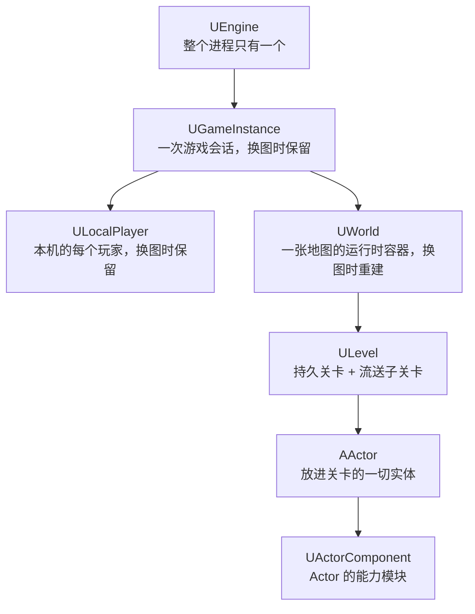
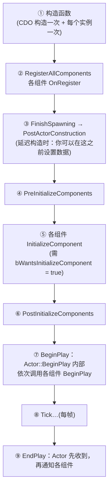
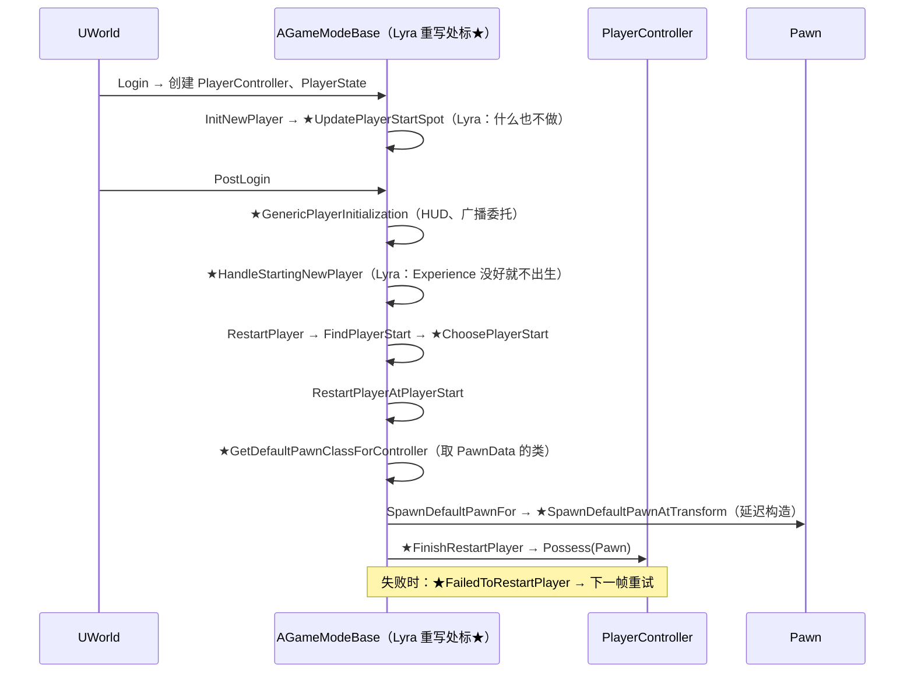

# 第 2 章　Gameplay Framework：谁负责什么

## 一个问题：这三份数据，该放在哪个类里？

假设你在 Lyra 里做三个小需求：

1. 屏幕上方显示本局**剩余时间**，所有玩家看到的必须一致；
2. 记分板上显示每个玩家的**击杀数**，每个人都能看到所有人的击杀数，而且玩家死了再重生，击杀数不能清零；
3. 每个玩家有一份**鼠标灵敏度**设置，只有他自己用，别人不需要知道。

按你写普通 C++ 游戏的习惯，大概率会把这三样都塞进玩家角色类里：反正角色身上什么都有。可是只要跑起来就会遇到麻烦：角色一死，击杀数跟着角色销毁，重生后清零；剩余时间放在每个角色身上，每个玩家各存一份，再费劲同步；灵敏度放在角色里，别人的客户端上也有这个角色，白白多了一份别人的设置。

UE 的做法是：**引擎已经替你预先规划好了一组“固定岗位”的类**，每个岗位规定了“谁来创建它、在哪些机器上存在、活多久”。上面三个需求的答案分别是 GameState、PlayerState 和 LocalPlayer/PlayerController，这一章就是要让你看到：为什么是它们，以及 Lyra 是怎么在这套岗位之上搭房子的。

## 读完本章你能……

- 画出 Engine → GameInstance → World → Level → Actor 的层级，并说出每一层在换地图时是留下还是重建；
- 说出 GameMode、GameState、PlayerController、PlayerState、Pawn、HUD、LocalPlayer 各自负责什么，分别存在于哪些机器上；
- 按顺序说出一个 Actor 从构造函数到 `BeginPlay` 再到 `EndPlay` 的生命周期，并解释为什么“不要依赖 `BeginPlay` 的先后顺序”；
- 沿着 `PostLogin → HandleStartingNewPlayer → RestartPlayer → … → Possess` 走一遍玩家出生流程，并指出 `ALyraGameMode` 在其中改了哪几环；
- 说明子系统（Subsystem）解决什么问题，会用 `GetSubsystem` 找到 Lyra 的 `ULyraTeamSubsystem` 和 `UGameplayMessageSubsystem`；
- 看到 `DefaultEngine.ini` 里的 `LocalPlayerClassName=...`，知道 Lyra 在换掉引擎的哪个零件。

## 需要先知道的 UE 概念

[第 1 章](01-UObject.md)讲过：UObject 与反射、`NewObject` / `SpawnActor`、CDO、`Cast<T>`、`BlueprintNativeEvent` 与 `_Implementation`。本章会反复用到它们。本章新出现的概念，我们按“用到时再讲”的节奏引入，先给一张全局地图。

---

## 1. 先搞清楚谁住在哪一层

### 问题

“世界”“关卡”“游戏实例”“引擎”这几个词，在入门教程里常常混着用。它们各自管一段不同长度的生命周期：进程启动到退出、一次联机会话、一张地图。弄混的后果很具体：你把“玩家的登录信息”放在了随地图销毁的对象里，换图就丢了。

### UE 的层级



- **引擎（`UEngine`）**：整个进程一个。运行游戏时是 `UGameEngine`，编辑器里是 `UEditorEngine`。Lyra 在配置里把它们换成了自己的子类（第 9 节）。
- **游戏实例（`UGameInstance`）**：从游戏启动到退出，一直存在。**换地图时它不会被销毁**。适合放“跨地图要保留”的东西：登录状态、会话信息、全局服务。
- **世界（`UWorld`）**：一张地图在运行时的容器。切换地图（非无缝切换——即断开旧世界、重建新世界，[第 21 章](21-OnlineAndBuild.md)会对比无缝切换）时，旧 World 整个销毁，新 World 重建，里面所有 Actor 随之销毁。
- **关卡（`ULevel`）**：World 里的一层 Actor 集合。一个 World 有一个始终加载的持久关卡（Persistent Level），还可以按需动态加载进来若干流送子关卡（Streaming Level，把大地图拆成几块按区域流式加载）。你在编辑器里打开的 `.umap` 文件就是一个关卡。
- **本地玩家（`ULocalPlayer`）**：属于 GameInstance，代表“这台机器上的第 N 个玩家”（分屏时有多个）。注意它**不是 Actor**。

Lyra 的 [`LyraGameInstance.cpp`](../../../Source/LyraGame/System/LyraGameInstance.cpp) 在 `Init` 里做了一件典型的“会话级”的事：

```cpp
// 简化自 Source/LyraGame/System/LyraGameInstance.cpp 的 ULyraGameInstance::Init
void ULyraGameInstance::Init()
{
    Super::Init();

    // 注册 4 个自定义初始化状态（InitState，第 8 章讲）。放在 GameInstance 里，
    // 因为它们是整个游戏会话共用的规则，不属于某一张地图
    UGameFrameworkComponentManager* ComponentManager = GetSubsystem<UGameFrameworkComponentManager>(this);
    if (ensure(ComponentManager))
    {
        ComponentManager->RegisterInitState(LyraGameplayTags::InitState_Spawned, false, FGameplayTag());
        ComponentManager->RegisterInitState(LyraGameplayTags::InitState_DataAvailable, false, LyraGameplayTags::InitState_Spawned);
        // ……DataInitialized、GameplayReady 同理
    }
}
```

先不用管 InitState 是什么。看这里的位置选择：**“会话级的全局设置”放 GameInstance，“这张地图里的东西”放 World 里的 Actor**。同时注意 `GetSubsystem<...>(this)` 这个写法，第 7 节会讲。

在 PIE 里，这个层级还有一个后果（[第 3 章](03-Networking.md)详讲）：一个进程里可以同时存在多个 GameInstance 和多个 World——服务器一个、每个客户端各一个。所以**任何“全局唯一”的静态变量在 PIE 里都不再唯一**。这是子系统（第 7 节）存在的主要原因之一。

---

## 2. Actor 与组件：组合优于继承

### 问题

你要做一个会走路、有血量、有摄像机、能被 AI 操控的角色。继承树怎么设计？`Character → HealthCharacter → CameraHealthCharacter → …`？很快就会撞上“多继承菱形”或者“基类越来越胖”。

### UE 的做法

UE 把“放进世界里的东西”和“它的能力”分成两层：

- **Actor（`AActor`）**：能被放进 Level 的实体。它有生命周期（创建、`BeginPlay`、销毁）、可以被复制到网络上、有 Owner。它本身几乎没有“能力”，是个**容器**。
- **组件（`UActorComponent`）**：挂在 Actor 上的能力模块。比如血量、摄像机、移动、网格体，每个组件做一件事。需要在世界里有位置的组件继承自 `USceneComponent`（带变换和父子挂接），渲染相关的比如网格体、胶囊体再往下派生。

这就是你已经熟悉的“组合优于继承”：能力用组件拼，而不是靠继承树叠。看 Lyra 的 [`LyraCharacter.cpp`](../../../Source/LyraGame/Character/LyraCharacter.cpp)，这个构造函数在第 1 章见过：

```cpp
// 简化自 Source/LyraGame/Character/LyraCharacter.cpp 的 ALyraCharacter::ALyraCharacter
PawnExtComponent = CreateDefaultSubobject<ULyraPawnExtensionComponent>(TEXT("PawnExtensionComponent"));
HealthComponent  = CreateDefaultSubobject<ULyraHealthComponent>(TEXT("HealthComponent"));
CameraComponent  = CreateDefaultSubobject<ULyraCameraComponent>(TEXT("CameraComponent"));
```

血量、摄像机、“Pawn 初始化协调”各自是一个组件，`ALyraCharacter` 自己只负责把它们接线。更关键的是：**组件不一定要在构造函数里写死。** 它们可以在运行时被“注入”到 Actor 上，这是第 7 章 GameFrameworkComponentManager 的核心，也是 Lyra 能把玩法做成数据的前提。

和 ECS 的类比：组件像 ECS 的 Component，但 UE 的组件**带有行为**（有自己的 `BeginPlay`、`Tick`），不是纯数据；Actor 像 Entity，但它不是一个无意义的 ID，有自己的虚函数和生命周期。网络方面：组件随 Owner Actor 一起存在，Actor 被复制时，打了“复制”标记的组件也一起复制（第 3 章）。

---

## 3. 岗位表：Gameplay Framework 的固定角色

回到开篇的三个需求。要回答“放哪里”，必须先回答两个问题：**这个对象在哪些机器上存在？它能活多久？** [第 3 章](03-Networking.md)会把服务器和客户端的关系讲透，这里先用一张压缩的图记住结论（以“一台专用服务器 + 两个客户端 A、B”为例）：

```
                    专用服务器        客户端 A             客户端 B
GameMode              ●               ✗                    ✗
GameState             ●               ●（副本）            ●（副本）
PlayerState A / B     ●               ●（副本）            ●（副本）
PlayerController A    ●               ● 仅 A 自己有        ✗
PlayerController B    ●               ✗                    ● 仅 B 自己有
Pawn A / B            ●               ●（相关性允许时）    ●（相关性允许时）
HUD / LocalPlayer     ✗               ● 仅本机             ● 仅本机
```

“副本”的意思是：这个对象在客户端上也有一个 C++ 实例，状态靠服务器复制过来，但**真正说了算的是服务器上那个**（权威端）；至于图里的“相关性（Relevancy）”，先简单理解成“距离太远或只属于别人的对象，服务器不会发给你”。更完整的图和原因见[第 3 章](03-Networking.md)。下面逐个看岗位职责。

**`AGameModeBase`（游戏模式）**：一局游戏的**规则裁判**——谁能加入，怎么出生，什么时候开始、结束。**只存在于服务器**（单机里也有），客户端上永远拿不到；引擎源码的类注释就写着 “It is only instanced on the server and will never exist on the client”。它继承自 `AInfo`，一种不打算有物理表现的“逻辑型”Actor。

**`AGameStateBase`（游戏状态）**：**所有人都需要知道的整局状态**——剩余时间、比分、玩家列表（`PlayerArray`）。服务器上创建，复制给所有客户端。引擎在构造函数里把它设为“始终相关、需要复制”（`bReplicates = true; bAlwaysRelevant = true;`）。

**`APlayerController`（玩家控制器）**：**一个人类玩家的“意志”**——接收输入、持有摄像机管理器、持有 HUD。它由服务器创建，只复制给它所属的那个客户端。这就是上图中“仅 A 自己有”的原因：基类 `AController` 里设置了 `bOnlyRelevantToOwner = true`。

**`APlayerState`（玩家状态）**：**关于某个玩家、所有人都需要知道的数据**——名字、分数、队伍。它和 GameState 一样复制给所有人，而且**和 Pawn 的寿命无关**：Pawn 死了，PlayerState 还在。

**`APawn` / `ACharacter`**：**被控制的身体**——在世界里的位置、碰撞、模型。`ACharacter` 是 `APawn` 的子类，自带胶囊体、骨骼网格体和一个行走移动组件。Pawn 会死会换，所以不适合存“跨命”的数据。

**`AAIController`**：和 PlayerController 对应的**AI 版“意志”**。同一个 Pawn 类既可以被 PlayerController 控制也可以被 AIController 控制，这是 Controller 与 Pawn 拆开的原因：控制逻辑和身体可以独立替换。Lyra 的 Bot 就是这样：[`ALyraPlayerBotController`](../../../Source/LyraGame/Player/LyraPlayerBotController.cpp) 继承 `AModularAIController`，在构造函数里设置 `bWantsPlayerState = true`，让 Bot 也拥有 PlayerState——这样 Bot 在队伍、记分板、技能系统里和真人玩家享受完全一样的待遇。

**`AHUD`、`ULocalPlayer`、`UGameViewportClient`**：**本机专属**的三个。`AHUD` 由 PlayerController 通过 `ClientSetHUD` 在**客户端本地**生成（服务器不会生成，也不复制），Lyra 的 HUD 基本只剩下一层薄薄的壳，真正的界面在 CommonUI 里（第 18 章）。`ULocalPlayer` 代表这台机器上的玩家本人。`UGameViewportClient` 是“画面窗口”，处理输入进入引擎的最前端，专用服务器上不存在。

### 回到开篇

现在可以回答开头的三个问题了：

1. **剩余时间** → 放 GameState，所有人都需要看到同一份；
2. **击杀数** → 放 PlayerState，所有人都需要看到，而且不随 Pawn 死亡丢失；
3. **灵敏度** → 只有本机玩家本人需要，不需要任何网络同步，放在本地的 LocalPlayer 或 PlayerController 一侧。Lyra 把玩家的共享设置挂在 `ULyraLocalPlayer` 上（[`LyraLocalPlayer.cpp`](../../../Source/LyraGame/Player/LyraLocalPlayer.cpp) 的 `GetSharedSettings`），第 20 章详讲。

用 Lyra 自己的代码验证一下这个分配。看 [`LyraPlayerState.h`](../../../Source/LyraGame/Player/LyraPlayerState.h) 里存了什么：

```cpp
// 简化自 Source/LyraGame/Player/LyraPlayerState.h 的 ALyraPlayerState
UPROPERTY(ReplicatedUsing = OnRep_PawnData)
TObjectPtr<const ULyraPawnData> PawnData;           // 这个玩家用哪份角色配置（第 8 章）

UPROPERTY(VisibleAnywhere, Category = "Lyra|PlayerState")
TObjectPtr<ULyraAbilitySystemComponent> AbilitySystemComponent;   // 能力系统组件 ASC：技能和属性的家（第 9、10 章）

UPROPERTY(ReplicatedUsing=OnRep_MyTeamID)
FGenericTeamId MyTeamID;                            // 队伍号

UPROPERTY(Replicated)
FGameplayTagStackContainer StatTags;                // 可计数的 Tag（击杀数之类的统计）
```

PawnData、技能、队伍、统计，全是“属于玩家、跨命存在、别人也要看”的数据。这就是 Lyra 把能力系统组件（ASC，管理技能、属性和状态标签的组件，第 9 章讲）放在 PlayerState 而不是 Pawn 上的根本原因——Pawn 一死，技能就没了的话，冷却、已获得的升级都会丢。而 [`LyraGameState.h`](../../../Source/LyraGame/GameModes/LyraGameState.h) 里存的是 `ULyraExperienceManagerComponent`（当前玩法，全局）和一个“全局用”的 ASC。

### 官方的通用建议，和 Lyra 的具体取舍

Epic 的 Gameplay Framework 文档把这几个岗位的职责说得很明确（以下是转述）：GameMode 只存在于服务器，一个 GameMode 创建唯一一个 GameState；GameState 放“所有玩家都关心的数据”，比如队伍得分和目标；PlayerState 放“与某个玩家相关的数据”，官方举的例子是名字、分数和等级，PlayerState 会存在于所有机器上，所以不适合把某个玩家的得分放在 GameState 里。本章前面的分配和这套官方划分一致。

但官方的通用例子不等于 Lyra 的做法。一些官方示例会把弹药、背包这类数据也放在 PlayerState 上，而 Lyra 的背包管理组件（`ULyraInventoryManagerComponent`）挂在 **Controller** 上，能力系统组件（ASC）才放在 PlayerState 上。这是 Lyra 的具体取舍：背包只有玩家自己需要看，Controller 恰好只复制给拥有者（第 3 章解释为什么），而技能和属性别人也要读（比如血条）。所以读到“数据放哪”的问题时，请区分“官方通用建议”和“Lyra 在这个项目里的选择”，第 13 章会回到背包的归属问题。

### 附身（Possession）

Controller 和 Pawn 是分开的两个对象，它们之间通过**附身（Possess）**绑定：`Controller->Possess(Pawn)`。绑定后，Controller 的输入驱动 Pawn，Pawn 的 `GetController()` 返回它。附身发生在服务器上，会触发两个回调：Controller 端的 `OnPossess` 和 Pawn 端的 `PossessedBy`（这也是 Pawn 的 Owner 被设为 Controller 的时机，第 3 章讲 Owner 与 RPC 路由时会用到）。Lyra 在 [`LyraPlayerController.cpp`](../../../Source/LyraGame/Player/LyraPlayerController.cpp) 的 `OnPossess` 里做了点编辑器专用的事（执行开发者设置里配置的作弊命令）和重置自动跑状态，它是附身流程的一个钩子，不是核心逻辑。

---

## 4. Actor 的一生：生命周期与“不要依赖 BeginPlay 顺序”

### 问题

你写了一个 Actor，需要在初始化时拿到另一个 Actor 的引用。写在构造函数里？`PostInitializeComponents`？`BeginPlay`？写错位置会表现为“有时候空指针，有时候不空”，非常难查。所以先搞清楚引擎调用这些函数的顺序。

### 顺序

下面是 `SpawnActor` 一个 Actor 时的实际顺序（对照引擎的 `AActor::PostSpawnInitialize` 和 `AActor::PostActorConstruction`）：



几点说明：

**① 构造函数**：第 1 章讲过，首先是为 CDO 跑的，此时没有 World。里面只设默认值和创建默认子对象。

**② `OnRegister`**：组件被注册进 World 时调用。组件的 Owner 已经确定。适合做“依赖 Owner、但不依赖其他 Actor”的初始化。Lyra 的例子是 [`LyraCameraComponent.cpp`](../../../Source/LyraGame/Camera/LyraCameraComponent.cpp)：

```cpp
// 简化自 Source/LyraGame/Camera/LyraCameraComponent.cpp 的 ULyraCameraComponent::OnRegister
void ULyraCameraComponent::OnRegister()
{
    Super::OnRegister();

    if (!CameraModeStack)
    {
        CameraModeStack = NewObject<ULyraCameraModeStack>(this);   // 运行时创建，Outer 是组件本身
        check(CameraModeStack);
    }
}
```

**④⑥ `PreInitializeComponents` / `PostInitializeComponents`**：Actor 的所有组件都已创建注册，**但还没有 `BeginPlay`**。Lyra 利用 `PreInitializeComponents` 做一件很关键的事：把自己登记为“组件接收者”，这样第 7 章讲的注入机制才能找到它。看 [`ModularGameState.cpp`](../../../Plugins/ModularGameplayActors/Source/ModularGameplayActors/Private/ModularGameState.cpp)（`ModularGameplayActors` 插件里的 Lyra 基类，`ALyraGameState` 继承自它）：

```cpp
// 简化自 Plugins/ModularGameplayActors/Source/ModularGameplayActors/Private/ModularGameState.cpp
void AModularGameStateBase::PreInitializeComponents()
{
    Super::PreInitializeComponents();
    UGameFrameworkComponentManager::AddGameFrameworkComponentReceiver(this);   // 登记：欢迎别人往我身上注入组件
}

void AModularGameStateBase::BeginPlay()
{
    // 注意：先发“我就绪了”的事件，再调 Super::BeginPlay
    UGameFrameworkComponentManager::SendGameFrameworkComponentExtensionEvent(this, UGameFrameworkComponentManager::NAME_GameActorReady);
    Super::BeginPlay();
}
```

**⑤ `InitializeComponent`**：一个冷门但有用的钩子，只有把组件的 `bWantsInitializeComponent` 设为 `true` 才会被调用，发生在 Actor 的 `PostInitializeComponents` 之前。Lyra 的 `ULyraUICameraManagerComponent` 在构造函数里设了这个标志，同一个构造函数里还有第 1 章讲过的模式：绑定运行时委托（`AHUD::OnShowDebugInfo`）前先用 `if (!HasAnyFlags(RF_ClassDefaultObject))` 排除 CDO。

**⑦ `BeginPlay`**：游戏正式开始，Actor 已经进入“活”状态。注意细节：Actor 的 `BeginPlay` 被调用后，基类 `AActor::BeginPlay` 里会**遍历所有已注册的组件，依次调用它们的 `BeginPlay`**。所以你在自己的 Actor 里 `Super::BeginPlay()` 之前，组件的 `BeginPlay` 还没跑；`Super::BeginPlay()` 返回后，它们都跑过了。Lyra 的 `AModularGameStateBase::BeginPlay` 把“我就绪了”的事件放在 `Super::BeginPlay` 之前发出，这个顺序是刻意的，原因在第 7 章讲。

**⑨ `EndPlay`**：Actor 被销毁、切图或游戏结束时。Lyra 的模块化基类在这里做 `RemoveGameFrameworkComponentReceiver`。重写这些函数时忘了调 `Super::`，轻则注册的东西没清理，重则引擎直接 `Fatal`：`PostActorConstruction` 里检查到 `PostInitializeComponents` 没走到基类，会报 “failed to route PostInitializeComponents. Please call Super::PostInitializeComponents()” 并崩溃。

注意 ③：`SpawnActor` 可以指定 `bDeferConstruction = true`，意思是“先创建出来，**暂时不要继续走 ④~⑦**，等我塞点数据再调 `FinishSpawning`”。这是 Lyra 出生玩家 Pawn 时用的关键技巧，下一节会看到。

### 不要依赖 BeginPlay 的先后顺序

回到开头的问题：“我需要另一个 Actor 的引用，什么时候取？”最直观的做法是在 `BeginPlay` 里 `FindActor`，或读 `GetWorld()->GetGameState()` 上的某个组件。问题在于：

- 不同 Actor 之间的 `BeginPlay` **没有保证的先后顺序**，你不应该把正确性建立在“碰巧先创建”上；
- 在客户端上，被复制出来的 Actor 要等**初始属性复制到达之后**才会 `BeginPlay`（引擎在 `PostActorConstruction` 里对动态复制的 Actor 推迟 `BeginPlay`），而各个 Actor 到达客户端的先后取决于网络；
- 所以在服务器上“此刻一定存在”的对象，在客户端上同一时刻可能还没到。

Lyra 里有一个现成的证据，在 [`LyraPlayerController.cpp`](../../../Source/LyraGame/Player/LyraPlayerController.cpp) 的 `OnRep_PlayerState` 里，开发者专门写了一大段注释：

```cpp
// 简化自 Source/LyraGame/Player/LyraPlayerController.cpp 的 ALyraPlayerController::OnRep_PlayerState
// When we're a client connected to a remote server, the player controller may replicate later than
// the PlayerState and AbilitySystemComponent. However, TryActivateAbilitiesOnSpawn depends on the
// player controller being replicated in order to check whether on-spawn abilities should execute locally.
// Therefore once the PlayerController exists and has resolved the PlayerState, try once again ...
if (GetWorld()->IsNetMode(NM_Client))
{
    if (ALyraPlayerState* LyraPS = GetPlayerState<ALyraPlayerState>())
    {
        if (ULyraAbilitySystemComponent* LyraASC = LyraPS->GetLyraAbilitySystemComponent())
        {
            LyraASC->RefreshAbilityActorInfo();
            LyraASC->TryActivateAbilitiesOnSpawn();   // 到货顺序不对，补做一次
        }
    }
}
```

翻译一下：在客户端上，PlayerController 可能比 PlayerState 晚到。如果 ASC 初始化时 PlayerController 还没到，“是不是本地玩家”的判断就是错的。所以等 PlayerController 到了，必须**补做一次**。这就是到货顺序不确定的真实代价。

**Lyra 的解法**不是去猜顺序，而是三个“**注册并等待**”模式，你会在后面反复看到：

1. 依赖 Experience 的逻辑：`CallOrRegister_OnExperienceLoaded`（[第 6 章](06-Experience.md)讲）；
2. 依赖 ASC 初始化的逻辑：`OnAbilitySystemInitialized_RegisterAndCall`（`ALyraCharacter` 构造函数里就用了它，第 8、9 章讲）；
3. Pawn 内部各组件的先后：初始化状态链 InitState（[第 8 章](08-PawnAssembly.md)讲）。

它们的共同点是：**如果条件已经满足，立刻执行；如果还没满足，登记起来，等条件满足时再执行**。无论调用者什么时候出现，都不会错过。这是应对“不确定顺序”的标准答案。

---

## 5. 玩家怎么出生：GameMode 的流程，与 Lyra 改了哪几环

### 问题

一个玩家连进来，到屏幕上出现他能控制的角色，中间发生了什么？这是你“基于 Lyra 改功能”时最常要钻进去的流程（比如“出生点不对”“角色类不对”“出生时要初始化点数据”），所以值得一次走清楚。

### 先看整张图



下面分段走一遍，每一环对着引擎源码核对。

### Login 到 PostLogin：创建玩家的“人”

`UWorld::SpawnPlayActor` 先调 `GameMode->Login`：它创建 PlayerController（里面会顺带创建 PlayerState），然后调 `InitNewPlayer`，其中会调用 `UpdatePlayerStartSpot` 选一个初始出生点。**Lyra 重写了它，什么也不做**：

```cpp
// 简化自 Source/LyraGame/GameModes/LyraGameMode.cpp 的 ALyraGameMode::UpdatePlayerStartSpot
bool ALyraGameMode::UpdatePlayerStartSpot(AController* Player, const FString& Portal, FString& OutErrorMessage)
{
    // Do nothing, we'll wait until PostLogin when we try to spawn the player for real.
    // Doing anything right now is no good, systems like team assignment haven't even occurred yet.
    return true;
}
```

注释说得很清楚：这一刻队伍分配之类的系统还没运行，现在选出生点没意义，推迟到真正出生时。接着引擎调 `PostLogin`，里面依次调 `GenericPlayerInitialization` 和 `HandleStartingNewPlayer`。

### GenericPlayerInitialization：给 HUD 开门，顺便通知别人

引擎的 `GenericPlayerInitialization` 会调用 `InitializeHUDForPlayer`，进而 `PC->ClientSetHUD(HUDClass)`——这是一个 Client RPC（由服务器发起、在目标客户端上远程执行的函数调用，[第 3 章](03-Networking.md)详讲），让**该玩家自己的客户端**生成 HUD。`ALyraGameMode` 在构造函数里设置了 `HUDClass = ALyraHUD::StaticClass()`。Lyra 在这里的重写只加了一件事：

```cpp
// 简化自 Source/LyraGame/GameModes/LyraGameMode.cpp 的 ALyraGameMode::GenericPlayerInitialization
void ALyraGameMode::GenericPlayerInitialization(AController* NewPlayer)
{
    Super::GenericPlayerInitialization(NewPlayer);
    OnGameModePlayerInitialized.Broadcast(this, NewPlayer);   // 通知订阅者：玩家（或 Bot）初始化好了
}
```

注意 `OnGameModePlayerInitialized` 是个**委托**（Delegate，类似观察者模式里的事件）：别的系统可以订阅，不用 GameMode 知道它们。

### HandleStartingNewPlayer：Lyra 的第一道闸

引擎默认实现：“只要不是旁观者、`PlayerCanRestart` 为真，就立即 `RestartPlayer`”。Lyra 在这里加了闸：Experience（体验，Lyra 里描述“这一局玩什么”的数据资产，第 6 章详讲）还没加载好之前，玩家先不出生。

```cpp
// 简化自 Source/LyraGame/GameModes/LyraGameMode.cpp 的 ALyraGameMode::HandleStartingNewPlayer_Implementation
void ALyraGameMode::HandleStartingNewPlayer_Implementation(APlayerController* NewPlayer)
{
    // Experience 没加载好之前不出生；加载完后由 OnExperienceLoaded 补一次 RestartPlayer
    if (IsExperienceLoaded())
    {
        Super::HandleStartingNewPlayer_Implementation(NewPlayer);
    }
}
```

### RestartPlayer 到 Possess：真正造出身体

这一段是出生的核心，引擎的顺序是 `RestartPlayer` → `FindPlayerStart` → `ChoosePlayerStart` 选点 → `RestartPlayerAtPlayerStart` → `GetDefaultPawnClassForController` 选类 → `SpawnDefaultPawnFor` → `SpawnDefaultPawnAtTransform` 创建 → `FinishRestartPlayer` 附身。Lyra 在四处插手：

**选点**交给 GameState 上的一个组件，GameMode 自己不再知道规则：

```cpp
// 简化自 Source/LyraGame/GameModes/LyraGameMode.cpp 的 ALyraGameMode::ChoosePlayerStart_Implementation
AActor* ALyraGameMode::ChoosePlayerStart_Implementation(AController* Player)
{
    if (ULyraPlayerSpawningManagerComponent* PlayerSpawningComponent = GameState->FindComponentByClass<ULyraPlayerSpawningManagerComponent>())
    {
        return PlayerSpawningComponent->ChoosePlayerStart(Player);   // 规则在组件里，由 Experience 注入
    }
    return Super::ChoosePlayerStart_Implementation(Player);          // 没有这个组件就退回引擎默认
}
```

这个模式是 Lyra 的灵魂：**GameMode 把“怎么选出生点”这种可变的规则外包给 GameState 上的组件**。不同的玩法（Experience）可以注入不同的出生点组件，GameMode 一行不改。`ShouldSpawnAtStartSpot` 被重写成永远返回 `false`，是同样的意图：不用引擎的“固定出生点”逻辑。

**选类**：不再用 `DefaultPawnClass`，而是取玩家 PawnData 里的类：

```cpp
// 简化自 Source/LyraGame/GameModes/LyraGameMode.cpp 的 ALyraGameMode::GetDefaultPawnClassForController_Implementation
UClass* ALyraGameMode::GetDefaultPawnClassForController_Implementation(AController* InController)
{
    if (const ULyraPawnData* PawnData = GetPawnDataForController(InController))
    {
        if (PawnData->PawnClass)
        {
            return PawnData->PawnClass;                      // “这个玩家用哪种身体”由数据决定
        }
    }
    return Super::GetDefaultPawnClassForController_Implementation(InController);
}
```

**创建**：这是用上延迟构造的地方。

```cpp
// 简化自 Source/LyraGame/GameModes/LyraGameMode.cpp 的 ALyraGameMode::SpawnDefaultPawnAtTransform_Implementation
FActorSpawnParameters SpawnInfo;
SpawnInfo.Instigator = GetInstigator();         // Instigator = 行为发起者的 Pawn（这里只是透传 GameMode 的默认值）
SpawnInfo.ObjectFlags |= RF_Transient;          // 玩家 Pawn 永远不存进地图
SpawnInfo.bDeferConstruction = true;            // 先别 BeginPlay，我还要塞数据

if (UClass* PawnClass = GetDefaultPawnClassForController(NewPlayer))
{
    if (APawn* SpawnedPawn = GetWorld()->SpawnActor<APawn>(PawnClass, SpawnTransform, SpawnInfo))
    {
        if (ULyraPawnExtensionComponent* PawnExtComp = ULyraPawnExtensionComponent::FindPawnExtensionComponent(SpawnedPawn))
        {
            if (const ULyraPawnData* PawnData = GetPawnDataForController(NewPlayer))
            {
                PawnExtComp->SetPawnData(PawnData);        // 在任何组件 BeginPlay 之前，把 PawnData 塞进去
            }
        }
        SpawnedPawn->FinishSpawning(SpawnTransform);       // 这时才走 PreInitializeComponents → BeginPlay
        return SpawnedPawn;
    }
}
```

为什么要延迟？因为 Pawn 上的各个组件会在自己的 `BeginPlay` 里读 PawnData。如果不延迟，组件 `BeginPlay` 时 PawnData 还是空的。延迟构造让服务器上这个顺序成立：**先设置数据，再开始游戏**。（客户端上则没有这个保证，要等 PawnData 复制到达，这正是第 8 章 InitState 要解决的问题。）

**附身**：`FinishRestartPlayer` 先让出生点组件做它的收尾，再调 `Super`（引擎的实现里会 `NewPlayer->Possess(NewPlayer->GetPawn())`）。

**失败重试**：如果上面任何一步失败（比如没有出生点），引擎调 `FailedToRestartPlayer`。Lyra 重写为“下一帧再试一次”，用到了第 8 节的 `SetTimerForNextTick`。

### 回头看

Lyra 没有改写出生流程的骨架，每一环都是在引擎预留的**钩子**上做的：重写 `_Implementation`、把变化的部分外包给组件、读 PawnData。

---

## 6. GameState / PlayerState 上的组件

上一节里，GameMode 把选点规则交给了 GameState 上的组件。为什么挂在 GameState 而不是 GameMode 上？因为 **GameMode 只在服务器上有**，而许多玩法逻辑（比如 Experience 加载，客户端也要独立执行）需要**两端都有**。GameState 两端都存在，挂在它上面的组件天然也是。

引擎的 ModularGameplay 插件提供了一组专门的组件基类：`UGameStateComponent` 挂在 GameState 上，可以用 `GetGameMode<T>()` 访问 GameMode（只在服务器上非空），也能收到 `HandleMatchHasStarted` 之类的事件；`UPlayerStateComponent`、`UControllerComponent`、`UPawnComponent` 同理，分别挂在 PlayerState、Controller、Pawn 上。Lyra 的玩法规则几乎都是这类组件：`ULyraExperienceManagerComponent`（Experience 加载，第 6 章）、`ULyraPlayerSpawningManagerComponent`（出生点规则）、`ULyraTeamCreationComponent`（创建队伍，第 15 章）、`ULyraBotCreationComponent`（生成 Bot，第 1 章见过）都继承 `UGameStateComponent`。

为了让框架类能把事件转发给这些组件、并支持第 7 章的“运行时注入组件”，Lyra 的框架类继承的不是引擎的 `AGameStateBase`，而是 `ModularGameplayActors` 插件里的 `AModularGameStateBase`（`ALyraGameState`、`ALyraPlayerState`、`ALyraCharacter`、`ALyraPawn`、`ALyraGameMode` 都有对应的 `AModular*` 基类）。

设想你要做新玩法，需要“一套新的出生点规则”。传统做法是写一个新的 GameMode 子类并重写 `ChoosePlayerStart`，但这样玩法和 GameMode 一对一绑死。Lyra 把规则拆成组件后，新玩法只需要**往 GameState 上加一个不同的出生点组件**，GameMode 完全不变。这个思路是第二部分整个故事的起点。

---

## 7. 子系统：引擎托管的“服务”

### 问题

Lyra 里到处有“全局服务”：查队伍关系、广播游戏消息、管理 UI 层级。用 C++ 老办法写成**静态单例**，在 PIE 里就会出事：服务器和客户端是同一个进程的多个 World，静态单例是进程级的，它们会共用一个实例，互相串数据。另外，单例的创建、销毁时机也得自己管。

### UE 的做法

**子系统（Subsystem）**是引擎托管的单例：你只要继承一个子系统基类，引擎就会在它的“外层对象”创建时自动创建一个实例，在外层销毁时自动销毁并调用 `Deinitialize`。按外层对象不同分四种，**寿命正好对应第 1 节的层级**：

| 基类 | 实例随谁创建/销毁 | Lyra 例子 |
|---|---|---|
| `UEngineSubsystem` | 引擎（进程级） | `ULyraExperienceManager`（编辑器里多个 PIE 共享插件的引用计数） |
| `UGameInstanceSubsystem` | GameInstance（会话级） | `UGameplayMessageSubsystem`、`ULyraUIManagerSubsystem` |
| `UWorldSubsystem` | World（一张地图） | `ULyraTeamSubsystem`、`ULyraGamePhaseSubsystem` |
| `ULocalPlayerSubsystem` | LocalPlayer（一个本机玩家） | `UCommonMessagingSubsystem`（CommonGame 插件） |

用法：

```cpp
// 简化自 Source/LyraGame/AbilitySystem/Executions/LyraDamageExecution.cpp 的 ULyraDamageExecution::Execute_Implementation
ULyraTeamSubsystem* TeamSubsystem = HitActor->GetWorld()->GetSubsystem<ULyraTeamSubsystem>();   // 从 World 取
if (ensure(TeamSubsystem))
{
    DamageInteractionAllowedMultiplier = TeamSubsystem->CanCauseDamage(EffectCauser, HitActor) ? 1.0 : 0.0;
}
```

伤害计算时问队伍子系统“能不能伤害”，既没有全局变量，也不用到处传引用。PIE 里每个 World 各有一份 `ULyraTeamSubsystem`，互不串扰。

`UGameplayMessageSubsystem`（`GameplayMessageRouter` 插件）是 GameInstance 级别，它提供了一个静态便捷函数 `Get(WorldContextObject)`：你传任何一个“属于某个 World 的对象”（比如 `this`），它自己顺着 World 找到 GameInstance 再取出子系统。这个 `WorldContextObject` 参数是 UE 里的常见模式。Lyra 的 [`LyraQuickBarComponent.cpp`](../../../Source/LyraGame/Equipment/LyraQuickBarComponent.cpp) 里就是 `UGameplayMessageSubsystem::Get(this).BroadcastMessage(...)`，消息系统第 15 章详讲。

子系统的生命周期钩子很简单：`ShouldCreateSubsystem`（返回 false 可以拒绝创建）、`Initialize`、`Deinitialize`。`UWorldSubsystem` 默认只在 Game、Editor、PIE 这三种 World 里创建。`ULyraTeamSubsystem::Initialize` 里向作弊管理器注册了队伍相关的作弊命令扩展，`Deinitialize` 里对称地注销——谁注册谁注销，是子系统里的标准写法。

### 子系统还是 GameState 组件？

这两样都是“服务”，怎么选？一个实用的判断：**需要网络复制，或需要由 Experience 数据驱动地装上/拿掉，就用 GameState/PlayerState 组件；只是想要一个不依赖网络的、随便哪里都能查询的入口，就用子系统。**`ULyraTeamSubsystem` 自己不复制任何东西，真正的队伍数据在复制的 `ALyraTeamInfoBase` Actor 和 PlayerState 上，子系统只是一个**查询门面**。

---

## 8. 定时器：不用 Tick 的“稍后再做”

### 问题

经常有这样的需求：“下一帧再做”“3 秒后做”“每秒做一次”。最朴素的做法是自己在 `Tick` 里累加时间、判断。缺点是：必须让 Actor 一直 Tick（Lyra 把很多 Actor 的 Tick 都关了以省性能），逻辑还分散在不同的函数里。

### UE 的做法

每个 World 有一个**定时器管理器**（`FTimerManager`），用 `GetWorld()->GetTimerManager()` 或在 Actor 里用 `GetWorldTimerManager()` 取得。常用两个：

- `SetTimer(Handle, Object, &Class::Func, Seconds, bLoop)`：多少秒后调用；
- `SetTimerForNextTick(Object, &Class::Func)`：**下一帧**调用一次。

定时器属于 World，World 销毁时一起清理，PIE 里不会串；传 UObject 与成员函数时，对象已经销毁了就不会调用，比裸回调安全。

### Lyra 里用它做了两件事

**① 延迟到下一帧，给其他系统初始化时间**：GameMode 的 `InitGame`：

```cpp
// 简化自 Source/LyraGame/GameModes/LyraGameMode.cpp 的 ALyraGameMode::InitGame
void ALyraGameMode::InitGame(const FString& MapName, const FString& Options, FString& ErrorMessage)
{
    Super::InitGame(MapName, Options, ErrorMessage);

    // Wait for the next frame to give time to initialize startup settings
    GetWorld()->GetTimerManager().SetTimerForNextTick(this, &ThisClass::HandleMatchAssignmentIfNotExpectingOne);
}
```

`InitGame` 发生在 World 初始化的早期，GameState 之类还没有创建完毕，Lyra 选择等一帧再选 Experience（第 6 章）。

**② 避免“在自己的调用栈里销毁自己”**：Character 死亡动画结束的回调里不直接销毁，而是下一帧销毁：

```cpp
// 简化自 Source/LyraGame/Character/LyraCharacter.cpp 的 ALyraCharacter::OnDeathFinished
void ALyraCharacter::OnDeathFinished(AActor*)
{
    GetWorld()->GetTimerManager().SetTimerForNextTick(this, &ThisClass::DestroyDueToDeath);
}
```

这是个一般性的好习惯：回调往往由一个“正在使用 Actor”的调用栈触发，当场销毁它容易留下悬空状态；推迟到下一帧，调用栈已经走完。另外两处：`RequestPlayerRestartNextFrame` 用 `SetTimerForNextTick` 去触发 `ServerRestartPlayer`（出生失败后的重试），Experience 管理组件为了测试人为拖慢加载，则用了带秒数的 `SetTimer`（第 6 章的 `lyra.chaos.ExperienceDelayLoad.*` 实验）。

---

## 9. Lyra 怎么“换零件”：DefaultEngine.ini

### 问题

前面说过，引擎里的 `UGameEngine`、`ULocalPlayer`、`AWorldSettings` 这些类，是引擎自己创建的。你怎么把它们换成自己的子类，又不去改引擎源码？

### UE 的做法

引擎在需要创建这些对象的地方，**不是写死 `NewObject<ULocalPlayer>`，而是读一个配置项，里面写着类路径**，再用这个类创建对象。你只要在项目的 `Config/DefaultEngine.ini` 里改这几个路径，就换了零件。这是依赖注入的一种朴素形式（配置驱动的工厂）。Lyra 的 [`DefaultEngine.ini`](../../../Config/DefaultEngine.ini) 里相关的两段：

```ini
[/Script/Engine.Engine]
GameEngine=/Script/LyraGame.LyraGameEngine
UnrealEdEngine=/Script/LyraEditor.LyraEditorEngine
EditorEngine=/Script/LyraEditor.LyraEditorEngine
GameViewportClientClassName=/Script/LyraGame.LyraGameViewportClient
AssetManagerClassName=/Script/LyraGame.LyraAssetManager
WorldSettingsClassName=/Script/LyraGame.LyraWorldSettings
LocalPlayerClassName=/Script/LyraGame.LyraLocalPlayer
GameUserSettingsClassName=/Script/LyraGame.LyraSettingsLocal

[/Script/EngineSettings.GameMapsSettings]
GlobalDefaultGameMode=/Game/B_LyraGameMode.B_LyraGameMode_C
GameInstanceClass=/Game/B_LyraGameInstance.B_LyraGameInstance_C
GameDefaultMap=/Game/System/FrontEnd/Maps/L_LyraFrontEnd.L_LyraFrontEnd
```

路径格式 `/Script/<模块名>.<类名去掉前缀>` 在第 1 章讲过；以 `_C` 结尾的是蓝图类（见第 1 章）。每个被换的零件，职责一句话：

- **`LyraGameEngine`、`LyraEditorEngine`**：引擎本身。前者几乎是空壳（`Init` 里只调 `Super`）；编辑器版有实际作用，会拦截 PIE 启动，比如给前端地图强制 Standalone（[第 3 章](03-Networking.md)）；
- **`LyraGameViewportClient`**：画面窗口，继承自 CommonGame 插件的 `UCommonGameViewportClient`；
- **`LyraAssetManager`**（第 4 章）、**`LyraSettingsLocal`**（第 20 章）：资产管理器、本机设置对象；
- **`LyraWorldSettings`**：每张地图的“世界设置”，Lyra 在里面加了 `DefaultGameplayExperience`，是第 6 章 Experience 的来源之一；
- **`LyraLocalPlayer`**：本机玩家，挂玩家的共享设置和队伍观察；
- **`GlobalDefaultGameMode`**：没有更具体的指定时使用的 GameMode。引擎选择 GameMode 的优先级是：URL 里的 `?game=`，其次地图 World Settings 里的 GameMode Override，最后才是项目设置里的这一项（引擎 `UGameInstance::CreateGameModeForURL` 的逻辑）。Lyra 的各玩法地图都没有单独设置 GameMode Override，全项目统一使用这里的蓝图 `B_LyraGameMode`（父类 `ALyraGameMode`），玩法差异全部交给 Experience；
- **`GameInstanceClass`**：`B_LyraGameInstance`，父类 `ULyraGameInstance`；
- **`GameDefaultMap`**：启动后第一张地图，前端主菜单。

`ALyraGameMode` 的构造函数也是同样的思路：它把引擎 GameMode 里的一批“类槽位”全换成了 Lyra 的类。

```cpp
// 简化自 Source/LyraGame/GameModes/LyraGameMode.cpp 的 ALyraGameMode::ALyraGameMode
GameStateClass = ALyraGameState::StaticClass();
GameSessionClass = ALyraGameSession::StaticClass();
PlayerControllerClass = ALyraPlayerController::StaticClass();
ReplaySpectatorPlayerControllerClass = ALyraReplayPlayerController::StaticClass();
PlayerStateClass = ALyraPlayerState::StaticClass();
DefaultPawnClass = ALyraCharacter::StaticClass();
HUDClass = ALyraHUD::StaticClass();
```

这七行就是“GameMode 决定这一局用哪套岗位类”的具体含义。第 5 节你看到 `PC->ClientSetHUD(HUDClass)`，用的就是这里设置的 `HUDClass`。

---

## 10. 预告：Lyra 往这些类里放了多少玩法？

读到这里，你该有一个有趣的发现：前面每个重写都只有寥寥几行，而且全是“转交给组件”“读数据”“等一帧”。翻翻 Lyra 的 `Source/LyraGame/UI/LyraHUD.cpp`，只有 74 行，除了模块化基类那套登记/注销，只剩一个调试用的 `GetDebugActorList`；`LyraGameState.cpp` 也只有 144 行；`LyraGameMode.cpp` 有 522 行，其中相当一大块是专用服务器登录（`TryDedicatedServerLogin`、`HostDedicatedServerMatch`）。

玩法规则——计分、队伍、出生点、Bot、HUD 内容——**不在这些类里**。它们在 GameState/Controller 上的组件里，由 Experience 数据在运行时注入。你将在[第 5 章](05-BirdsEye.md)用一张图看到这件事的全貌，在[第 6、7 章](06-Experience.md)看到它的机制。

---

## 动手实验

下面的实验都要**临时改几行代码**。做之前约定：只加 `UE_LOG`，做完删掉；改动之前先关掉编辑器，编译 `LyraEditor` 后再启动。编译与启动的步骤见[第 0 章](00-HowToUse.md)。

### 实验 1：亲眼看一个 Pawn 的生命周期

**目标**：验证第 4 节的顺序，尤其是“延迟构造让 PawnData 先于 BeginPlay”。

**步骤**：

1. 在下面五个位置各加一行日志（行首统一前缀 `[Life]` 方便过滤）：

```cpp
// ① Source/LyraGame/Character/LyraPawnExtensionComponent.cpp 的 ULyraPawnExtensionComponent::OnRegister，Super::OnRegister() 之后
UE_LOG(LogLyra, Warning, TEXT("[Life] PawnExt OnRegister   %s (%s)"), *GetNameSafe(GetOwner()), *GetClientServerContextString(this));

// ② Source/LyraGame/GameModes/LyraGameMode.cpp 的 SpawnDefaultPawnAtTransform_Implementation，
//    SpawnedPawn->FinishSpawning(...) 的前一行
UE_LOG(LogLyra, Warning, TEXT("[Life] GameMode: before FinishSpawning (%s)"), *GetNameSafe(SpawnedPawn));

// ③ Source/LyraGame/Character/LyraCharacter.cpp 的 ALyraCharacter::PreInitializeComponents，Super 调用之后
UE_LOG(LogLyra, Warning, TEXT("[Life] Character PreInitializeComponents %s (%s)"), *GetNameSafe(this), *GetClientServerContextString(this));

// ④ 同一个文件的 ALyraCharacter::BeginPlay：Super::BeginPlay() 之前和之后各一行
UE_LOG(LogLyra, Warning, TEXT("[Life] Character BeginPlay ENTER %s (%s)"), *GetNameSafe(this), *GetClientServerContextString(this));
//   …… Super::BeginPlay();
UE_LOG(LogLyra, Warning, TEXT("[Life] Character BeginPlay EXIT  %s (%s)"), *GetNameSafe(this), *GetClientServerContextString(this));

// ⑤ ULyraPawnExtensionComponent::BeginPlay，Super::BeginPlay() 之后
UE_LOG(LogLyra, Warning, TEXT("[Life] PawnExt BeginPlay    %s (%s)"), *GetNameSafe(GetOwner()), *GetClientServerContextString(this));
```

2. 编译，启动编辑器。为了不被 3 个 Bot 的出生日志淹没，建议先在 `编辑 → 编辑器偏好设置 → LyraStarterGame → Lyra Developer Settings` 里勾选 `Override Num Bots to Spawn` 并设为 `0`（实验 2 也需要这一步，两个实验都做完后再取消勾选）。打开 `L_Expanse`，网络模式选“以主机服务器运行（Play As Listen Server）”，玩家数 2，运行 PIE。
3. 在输出日志的搜索框输入 `[Life]`，按某个 Pawn 的对象名（如 `B_Hero_ShooterMannequin_C_0`）对齐阅读。

**先写下你的预测**：服务器上那个 Pawn 的五条日志按什么顺序出现？`GameMode: before FinishSpawning` 排在 `OnRegister` 之前还是之后？`Character BeginPlay ENTER` 和 `PawnExt BeginPlay` 谁先谁后？客户端上同一个 Pawn 的顺序和服务器一样吗？

**预期结果**（服务器那一个 Pawn）：`PawnExt OnRegister` → `GameMode: before FinishSpawning` → `Character PreInitializeComponents` → `Character BeginPlay ENTER` → `PawnExt BeginPlay` → `Character BeginPlay EXIT`。客户端上的 Pawn 是通过复制创建的，`BeginPlay` 会等到初始属性到达后才触发，所以日志里会出现标着 `Client` 的另一组，出现的时间点也和服务器不同。编辑器的蓝图预览窗口、资产缩略图也可能触发 `OnRegister`，日志里偶尔有无关行，认准 PIE 的那一批。

**原理**：`OnRegister` 发生在 `SpawnActor` 的 `PostSpawnInitialize` 里（组件注册），所以排在最前；因为 Lyra 用了 `bDeferConstruction`，`SpawnActor` 返回后 Pawn 还没进入 ④~⑦，GameMode 趁这个空隙设置 PawnData，随后 `FinishSpawning` 才走 `PreInitializeComponents`；`BeginPlay` 里 Actor 的 `ENTER` 在组件 `BeginPlay` 之前、`EXIT` 在之后，因为组件的 `BeginPlay` 是在 `Super::BeginPlay()`（`AActor::BeginPlay`）里被调用的。做完请删除这些日志。

### 实验 2：数一数每种对象各有几个

**目标**：验证第 3 节“谁在哪台机器上存在”的那张图。

**步骤**：

1. 在下面五个位置各加一行日志，用 `GetNetMode()` 的整数值区分机器（0=单机，1=专用服务器，2=主机服务器，3=客户端）：

```cpp
// ALyraGameMode::InitGame（Super 调用之后）
UE_LOG(LogLyra, Warning, TEXT("[Exist] GameMode      %s netmode=%d"), *GetNameSafe(this), (int32)GetNetMode());
// ALyraGameState::PostInitializeComponents（Super 调用之后）
UE_LOG(LogLyra, Warning, TEXT("[Exist] GameState     %s netmode=%d"), *GetNameSafe(this), (int32)GetNetMode());
// ALyraPlayerState::PostInitializeComponents（Super 调用之后）
UE_LOG(LogLyra, Warning, TEXT("[Exist] PlayerState   %s netmode=%d"), *GetNameSafe(this), (int32)GetNetMode());
// ALyraPlayerController::BeginPlay（Super::BeginPlay() 之后）
UE_LOG(LogLyra, Warning, TEXT("[Exist] PlayerCtrl    %s netmode=%d"), *GetNameSafe(this), (int32)GetNetMode());
// ALyraHUD::BeginPlay（Super::BeginPlay() 之后；LyraHUD.cpp 需要先 #include "LyraLogChannels.h"）
UE_LOG(LogLyra, Warning, TEXT("[Exist] HUD           %s netmode=%d"), *GetNameSafe(this), (int32)GetNetMode());
```

2. 为了不让 Bot 干扰计数（Bot 也有 PlayerState），先打开 编辑 → 编辑器偏好设置 → `LyraStarterGame` 分类下的 Lyra Developer Settings，在 Lyra Bots 一组里勾选覆盖 Bot 数量（`bOverrideBotCount`），并把 `OverrideNumPlayerBotsToSpawn` 设为 0（做完实验记得改回来）。
3. 编辑器里网络模式选“以客户端运行（Play As Client）”，玩家数 2，并确保勾选“在一个进程内运行（Run Under One Process）”（具体名称以你的编辑器为准），这样服务器和客户端的日志都在同一个输出日志里。
4. 运行 PIE，过滤 `[Exist]`。

**先写下你的预测**：每类对象各有几行？其中 `netmode=1`（专用服务器）和 `netmode=3`（客户端）各占几行？

**预期结果**：

- `GameMode`：1 行，`netmode=1`——客户端上根本没有 GameMode；
- `GameState`：3 行，服务器一行、两个客户端各一行；
- `PlayerState`：6 行，每台机器上都有两个玩家的 PlayerState（服务器 2 + 客户端 2×2）；
- `PlayerCtrl`：4 行，服务器上 2 个，每个客户端只有自己的 1 个；
- `HUD`：2 行，都是 `netmode=3`，服务器上没有 HUD。

**原理**：每一行对应第 3 节的一条规则：GameMode 只在服务器；GameState、PlayerState 复制给所有人；PlayerController 只复制给拥有者；HUD 由 `ClientSetHUD`（Client RPC）在本机生成。如果你的数字和上面不一样，不要跳过：用 `netmode` 和对象名（里面有 PIE 实例编号）去推理为什么，这正是理解复制范围最好的练习。做完请删除这些日志。

### 实验 3：用断点读出生调用栈

**目标**：把第 5 节的流程图变成你亲眼看到的调用栈。

**步骤**：

1. 在 IDE 里打开 [`LyraGameMode.cpp`](../../../Source/LyraGame/GameModes/LyraGameMode.cpp)，在 `ALyraGameMode::SpawnDefaultPawnAtTransform_Implementation` 的第一行下断点。
2. 以“附加到编辑器”的方式调试（操作见第 0 章），在编辑器里运行 PIE，网络模式选单机（Play Standalone）。
3. 命中断点后，打开调用栈窗口，读栈。
4. 继续运行，如果又命中了，对比第二次的调用栈。

**先写下你的预测**：栈里会看到 `RestartPlayer`、`RestartPlayerAtPlayerStart`、`SpawnDefaultPawnFor` 吗？再往下，是 `HandleStartingNewPlayer_Implementation` 还是 `OnExperienceLoaded`？为什么？

**预期结果**：从上到下依次是 `SpawnDefaultPawnAtTransform_Implementation` ← `SpawnDefaultPawnFor_Implementation` ← `RestartPlayerAtPlayerStart` ← `RestartPlayer`，再往下很可能是 `ALyraGameMode::OnExperienceLoaded`（经过委托的广播函数）而不是 `HandleStartingNewPlayer`。

**原理**：在 PIE 里玩家通常和 World 几乎同时登录，这时 Experience 还没加载完，`HandleStartingNewPlayer_Implementation` 被闸住直接返回；等 Experience 加载完，`OnExperienceLoaded` 才对“还没有 Pawn 的玩家”补一次 `RestartPlayer`。如果没装引擎符号、看不到引擎函数名，只看项目里的帧也能确认这一点。想看另一条路径（玩家比 Experience 晚到），需要让某个客户端在 Experience 加载完成之后才连进来，按代码推理，栈里会变成 `HandleStartingNewPlayer_Implementation`。

---

## 常见误区

**误区 1：把“跨命的玩家数据”放在 Pawn（Character）里。**
Pawn 死了就销毁，数据随之消失。击杀数、队伍、技能等要放在 PlayerState（或其组件）上。Lyra 把 ASC 放 PlayerState 的原因就在此。

**误区 2：在客户端代码里使用 `GetAuthGameMode()`，期望拿到 GameMode。**
GameMode 只在服务器上，客户端永远拿到空指针。需要两端共享的规则放 GameState 组件；只需要服务器参与的部分，用 `HasAuthority()` 判断后再访问 GameMode。（[第 3 章](03-Networking.md)）

**误区 3：在 `BeginPlay`（或构造函数）里假设别的 Actor 一定已经存在。**
`BeginPlay` 顺序不保证，客户端上的复制到货顺序更不保证。用 `CallOrRegister`、`RegisterAndCall` 或 InitState 这类“已满足就立即执行，否则等待”的模式。

**误区 4：重写生命周期函数时忘记调 `Super::`。**
轻则注册的东西没清理，重则引擎 `Fatal`。Lyra 的 `AModular*` 基类在 `PreInitializeComponents` 和 `EndPlay` 里做注册和注销，你的子类漏调就等于关掉了第 7 章的整套注入机制。

**误区 5：用 C++ 静态变量做“全局服务”。**
PIE 里一个进程有多个 World 和 GameInstance，静态变量在它们之间共享，会串数据。用对应层级的子系统。

**误区 6：新玩法 = 新 GameMode 子类，或用 `Tick` 轮询“条件什么时候满足”。**
前者在 Lyra 里几乎总是错的方向：GameMode 只负责“选 Experience、等加载、出生玩家”，玩法规则应写成 GameState/PlayerState/Controller 的组件，由 Experience 注入。后者则应改用事件/委托或定时器，Lyra 把大量 Actor 的 Tick 都关掉了。

---

## 本章小结

UE 把游戏拆成一组固定岗位：GameInstance 管会话，World/Level 管地图，GameMode（仅服务器）管规则，GameState 与 PlayerState 存两端共享的数据，PlayerController（服务器加拥有者客户端）代表玩家意志，Pawn 是可替换的身体，HUD、LocalPlayer、ViewportClient 是本机专属。能力不靠继承堆，而靠挂在 Actor 上的**组件**。Actor 有明确的生命周期，但同一阶段跨 Actor 的先后顺序不可依赖，所以 Lyra 用“注册并等待”的模式代替猜测顺序。

Lyra 没有重写这套骨架，而是通过 `DefaultEngine.ini` 换零件、重写 `_Implementation` 钩子、把变化的规则外包给 GameState 上的组件，并用子系统提供全局服务。

```
              ┌────────────── UEngine（进程）──────────────┐
              │  GameInstance（会话）— 子系统(GameInstance 级)│
              │   ├─ LocalPlayer ── 子系统(LocalPlayer 级)    │
              │   └─ World（地图）── 子系统(World 级)         │
              │        ├─ GameMode（仅服务器）               │
              │        ├─ GameState ◀── 组件（规则、Experience）│
              │        ├─ PlayerState ◀── 组件、ASC          │
              │        ├─ PlayerController ──Possess──▶ Pawn   │
              │        └─ HUD（仅本机）                        │
              └──────────────────────────────────────────────┘

玩家出生：Login → PostLogin → HandleStartingNewPlayer（Lyra：等 Experience）
        → RestartPlayer → ChoosePlayerStart（组件） → 选类（PawnData）
        → SpawnActor(延迟构造) → SetPawnData → FinishSpawning → Possess
```

## 自测题

1. GameMode、GameState、PlayerController、PlayerState、HUD 分别在“专用服务器”“拥有者客户端”“其他客户端”上是否存在？

<details><summary>答案</summary>

GameMode：只在专用服务器。GameState：三者都有（客户端是副本）。PlayerController：服务器有全部，拥有者客户端只有自己的，其他客户端没有别人的。PlayerState：三者都有。HUD：只在有画面的客户端本机生成，服务器上没有，也不复制。
</details>

2. 为什么 Lyra 把能力系统组件（ASC）放在 PlayerState 而不是 Pawn 上？

<details><summary>答案</summary>

PlayerState 的寿命等于玩家在这一局里的寿命，Pawn 死了会销毁。技能、冷却、已获得的升级属于“玩家”而不是“这个身体”，放在 Pawn 上会随死亡丢失。PlayerState 还复制给所有客户端，别的玩家也能读到。Pawn 只是 ASC 的 Avatar。（ASC 的详细设计见第 10 章。）
</details>

3. 一个 Actor 通过 `SpawnActor` 创建，请按顺序写出：构造函数、`PreInitializeComponents`、`BeginPlay`、`PostInitializeComponents`、组件 `OnRegister`、组件 `BeginPlay` 的先后次序。

<details><summary>答案</summary>

构造函数 → 组件 `OnRegister` → `PreInitializeComponents` → （组件 `InitializeComponent`，如果启用）→ `PostInitializeComponents` → Actor 的 `BeginPlay`（其基类实现里调用各组件的 `BeginPlay`，所以组件 `BeginPlay` 在 `Super::BeginPlay()` 内部发生）。
</details>

4. Lyra 为什么在 `SpawnDefaultPawnAtTransform_Implementation` 里要先 `bDeferConstruction = true`，再 `FinishSpawning`？

<details><summary>答案</summary>

为了在 Pawn 的 `PreInitializeComponents`、`BeginPlay` 之前把 PawnData 设置进 `ULyraPawnExtensionComponent`。这样服务器上各组件在 `BeginPlay` 时 PawnData 已经存在。不延迟的话，`SpawnActor` 返回前就会走完 `BeginPlay`，那时 PawnData 还没设置。
</details>

5. 你要在 GameState 的 `BeginPlay` 里使用另一个 Actor 的数据，但偶尔拿到空指针。可能原因是什么？Lyra 里有哪些常用的解法？

<details><summary>答案</summary>

不同 Actor 的 `BeginPlay` 顺序不保证，客户端上复制来的 Actor 到达的先后取决于网络。解法是“注册并等待”：Experience 用 `CallOrRegister_OnExperienceLoaded`，ASC 初始化用 `OnAbilitySystemInitialized_RegisterAndCall`，Pawn 内部组件用 InitState 链；它们的共同点是条件已满足则立即执行，否则登记等待。
</details>

6. 子系统和静态单例相比，好处是什么？`ULyraTeamSubsystem` 为什么是 `UWorldSubsystem`，而 `UGameplayMessageSubsystem` 是 `UGameInstanceSubsystem`？

<details><summary>答案</summary>

子系统由引擎按外层对象的生命周期自动创建和销毁，PIE 中每个 World/GameInstance 各有一份，不会像静态变量一样串数据。队伍信息属于“这一张地图里的这一局”，换图就该重置，所以是 World 级；消息路由是不属于某张地图的会话级服务，所以是 GameInstance 级（换图时不销毁）。
</details>

7. 设计题：策划要求“占点模式里，每个玩家的出生点要选距离自己队伍已占领据点最近的那个”，其他模式不变。你会改哪里？不应该改哪里？

<details><summary>答案</summary>

不改 `ALyraGameMode`。它的 `ChoosePlayerStart_Implementation` 已经把选点委托给 GameState 上的 `ULyraPlayerSpawningManagerComponent`。应写一个继承该组件的新组件（C++ 或蓝图），重写其 `OnChoosePlayerStart` 之类的扩展点（参考 `TDM_PlayerSpawningManagmentComponent` 的做法），然后在占点 Experience 的 `Actions` 里用 `Add Components` 注入到 `LyraGameState`。这样只有占点模式会换出生规则。
</details>

## 继续深入

参考手册：

- 玩家出生与各重写的函数级调用链：[参考手册 10 §8.3 Pawn 出生](../Reference/10-CoreFramework.md)；启动序列：[参考手册 10 §3.1](../Reference/10-CoreFramework.md)；类表：[参考手册 10 §2](../Reference/10-CoreFramework.md)；
- `Modular*` 基类与组件注入的实现：[参考手册 10 §2.7、§3.3](../Reference/10-CoreFramework.md)。

官方文档（引擎通用文档，不是 Lyra 专页，打开后请确认版本选择器）：

- [Gameplay Framework in Unreal Engine](https://dev.epicgames.com/documentation/en-us/unreal-engine/gameplay-framework-in-unreal-engine) 与 [Game Mode and Game State](https://dev.epicgames.com/documentation/en-us/unreal-engine/game-mode-and-game-state-in-unreal-engine)：GameMode、GameState、PlayerState 的官方职责划分，本章第 3 节的依据；
- [Unreal Engine Actor Lifecycle](https://dev.epicgames.com/documentation/unreal-engine/unreal-engine-actor-lifecycle)：第 4 节生命周期图的官方版本；
- [Programming Subsystems in Unreal Engine](https://dev.epicgames.com/documentation/en-us/unreal-engine/programming-subsystems-in-unreal-engine)：第 7 节的四种子系统；
- Epic 的 Lyra 总览页写明“`Content` 只放通用资产和前端，核心玩法在插件里”，这是第 10 节预告的起点：[Lyra Sample Game](https://dev.epicgames.com/documentation/en-us/unreal-engine/lyra-sample-game-in-unreal-engine)。

本书内部：

- 上一章：[第 1 章　UE 的对象世界](01-UObject.md)；
- 下一章：[第 3 章　网络入门：服务器权威、复制、RPC](03-Networking.md)，这一章里“副本”“权威端”“Owner”这些词会被讲透；
- 再下一章：[第 4 章　数据驱动：引用与加载、AssetManager、GameplayTag、委托、配置、模块与插件](04-DataAndAssets.md)，认识 GameplayTag、委托、ini 配置，之后进入 Lyra 自己的骨架。
