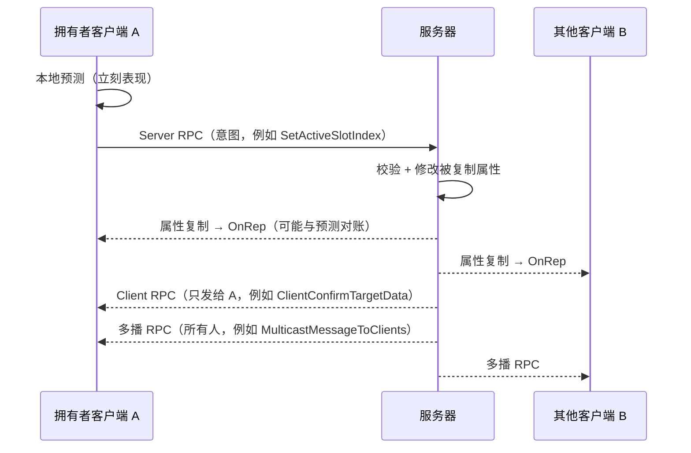

# 第 3 章　网络入门：服务器权威、复制、RPC

## 一个问题：角色死了，别人的屏幕上怎么也倒下了？

假设你在 Lyra 里朝一个 Bot 开了一枪，血量归零，Bot 倒地。如果这是一个单机游戏，整件事只有一台机器参与：算伤害、扣血、播倒地动画，全在同一个进程里。

现在换成四个玩家联网对战。玩家 A 开枪打中玩家 B，于是：

- 谁来判定“这一枪打中了”？如果由 A 的机器说了算，作弊者只要改一行代码就能让每一枪都“命中”；
- B 的血量存在谁的内存里？A、B、C、D 四台机器上各有一份，它们怎么保持一致？
- B 倒下这件事，C 和 D 的屏幕上也要看到，而且 C 可能是中途才加入的，他加入时 B 已经死了，他看到的应该是什么？
- 开枪的“砰”声要立刻响（不能等服务器回话），但伤害数字必须以服务器为准——这两件事怎么同时成立？

如果你只写过单机游戏或后端服务，你大概会想到“让服务器保存状态，客户端发请求、收通知”。思路没错，UE 的网络模型也是这个思路，只是它把“发请求”和“收通知”做成了语言级别的机制：被复制的属性（Replicated Property）负责“状态同步”，RPC 负责“一次性事件”，Role 负责“这台机器对这个对象有多大发言权”。

这一章把这套机制讲到“能读懂 Lyra 里每一行带 `Replicated`、`OnRep`、`Server`、`Client`、`NetMulticast` 的代码”的程度。它是本书“网络是一等公民”这条原则的基础：之后每一章讲到运行时逻辑，都会回答“这段代码在服务器、拥有者客户端、还是所有客户端上跑”。

## 读完本章你能……

- 画出“专用服务器 + 两个客户端”时，GameMode、GameState、PlayerState、PlayerController、Pawn 各存在于哪几台机器上；
- 在一段 Lyra 代码前，不看注释就判断它在哪个 NetMode、哪个 Role 下执行；
- 说清楚被复制属性、OnRep 回调、Server/Client/多播 RPC 各自适合解决什么问题，并给每一种在 Lyra 里找到一个真实例子；
- 解释为什么服务器上不会自动触发 C++ 的 OnRep，以及 Lyra 是怎么处理这件事的；
- 在编辑器里用“以客户端运行 + 多个玩家”测试网络行为，并从日志里区分服务器和客户端。

## 需要先知道的 UE 概念

前面两章讲过的内容这里只链接：`UPROPERTY` 和反射见 [第 1 章](01-UObject.md)，Actor、组件、GameMode / GameState / PlayerState / Controller / Pawn 各自是什么见 [第 2 章](02-GameplayFramework.md)。本章把 UE 的网络模型拆成五步，按“机器身份 → 对象权力 → 状态同步 → 一次性事件 → 进阶容器”的顺序推进。

## 一、基础前提：服务器权威、NetMode 与 PIE

### 服务器权威：为什么不能“谁先算谁说了算”

**服务器权威（Server Authority）**：整局游戏的“真相”只存在于一台机器（服务器）上；客户端手里的一切状态，都只是服务器真相的副本，或者是对真相的“预测”，随时可能被服务器纠正。

为什么要这样？先看最直观的做法：每个客户端各自模拟，再互相告诉对方结果（这叫对等网络，peer-to-peer，类比后端里“多主写入”）。它会遇到两个难题。

第一个是**作弊**。如果“我打中你了”由我这台机器宣布，那任何一个修改过客户端的玩家都能宣布“我打中了所有人”。服务器权威的做法是：客户端只能说“我想开枪、我瞄准的方向是这样”（这叫**输入**或**意图**），服务器去判定结果，再通知大家。客户端没有“宣布结果”的权力。

第二个是**一致性**。四台机器各自模拟，浮点误差、网络延迟、帧率差异会让它们慢慢发散：我这里你已经死了，你那里你还活着。让一台机器说了算，其他机器向它看齐，就从根本上消除了“谁对”的问题。

这个模型的代价也很直观：客户端按下按键后，要等一个往返延迟（RTT）才能看到服务器的确认。所以 UE（以及 Lyra）还有第二层设计——**客户端预测**：客户端先按自己的理解立刻表现出来，等服务器的结果回来再对账。移动、跳跃、技能激活都是这样做的。本章只讲预测的概念，细节留给 [第 9 章 GAS 入门](09-GASConcepts.md)。

### NetMode：同一份代码，四种“身份”

同一个 UE 程序可以以四种身份运行，叫 **NetMode**（网络模式）。引擎用枚举 `ENetMode` 表示，你可以随时对 Actor 或组件调用 `GetNetMode()`，或者用 `IsNetMode(NM_xxx)` 判断。

| NetMode | 含义 | 有没有本地玩家 | 有没有 GameMode |
|---|---|---|---|
| `NM_Standalone` | 单机，没有网络 | 有 | 有 |
| `NM_ListenServer` | 主机服务器（Listen Server）：一个玩家既是服务器又在玩 | 有（主机玩家） | 有 |
| `NM_DedicatedServer` | 专用服务器（Dedicated Server）：没有画面、没有本地玩家的纯服务器 | 无 | 有 |
| `NM_Client` | 客户端，连接着某个服务器 | 有 | **无** |

最后一列是很多新手栽跟头的地方：**GameMode 只存在于服务器（以及单机）上，客户端根本没有这个对象**。你在客户端代码里写 `GetWorld()->GetAuthGameMode()` 永远拿到空指针。

注意“主机服务器”这个身份：它同时拥有服务器的全部权力，也有一个本地玩家的全部需求（要渲染、要处理输入）。所以很多逻辑需要同时问两个问题：“我有权威吗？”和“我是本地玩家吗？”。这两个问题对应后面要讲的 `HasAuthority()` 和 `IsLocallyControlled()`，它们的答案在主机服务器的本地玩家身上同时为真。

### 在编辑器里测试网络：PIE 的几个开关

你不需要真的开几台电脑。编辑器的 **PIE（Play In Editor，编辑器内运行）** 可以在一台机器上模拟多个玩家。点击工具栏 Play 按钮旁的下拉菜单，进入高级设置（具体名称以你的编辑器界面为准），你会看到这几项：

- **玩家数量（Number of Players）**：模拟几个玩家。
- **网络模式（Net Mode）**：Play Standalone（单机）、Play As Listen Server（你是主机，其余是客户端）、Play As Client（编辑器启动一个专用服务器，所有玩家窗口都是客户端）。
- **Run Under One Process（在一个进程内运行）**：所有服务器和客户端实例是否跑在同一个编辑器进程里。

最后一项值得多说两句，因为它直接解释了 Lyra 的一些奇怪写法。勾选时，服务器和各个客户端是**同一个进程里的多个 World（`UWorld`）**，每个 World 有自己的世界上下文（World Context），自己的 GameInstance，自己的 Actor。但是：**全局变量、静态变量、类默认对象（CDO）是整个进程共享的**。

这有两个后果。第一，如果你在客户端 World 里修改了某个 CDO 或静态变量，服务器 World 也会“看见”——这种串扰在打包后的真实网络里不存在，却会在 PIE 里出现，让你调试出一些不存在的 bug（或者掩盖真实的 bug）。第二，凡是“对整个进程生效”的机制，在 PIE 里都要小心它到底作用于哪个 World。Lyra 的 Experience 机制就特别处理了这一点：Experience 是 Lyra 里描述“这一局玩什么”的数据资产（第 6 章详讲），执行它的 Action 时，会用 `SetRequiredWorldContextHandle` 把作用范围限制在“当前这个 World”（[第 6 章](06-Experience.md) §阶段 4）；Experience 资产本身标成 `Const`，也是因为它的 CDO 被所有 World 共享（[第 6 章](06-Experience.md) §阶段 1）。

Lyra 的编辑器模块还做了一个小定制：如果地图的 World Settings 里勾选了 `ForceStandaloneNetMode`（前端主菜单地图会这样设），`Source/LyraEditor/LyraEditorEngine.cpp` 的 `ULyraEditorEngine::PreCreatePIEInstances` 会把你选的 NetMode 强制改成 Standalone，并弹出一条“Forcing NetMode: Standalone for the Frontend”的提示。主菜单本来就是单机界面，没必要起服务器。

## 二、这台机器对这个 Actor 有多大权力：所有权（Owner）与角色（Role）

在讲“复制什么属性、发什么 RPC”之前，要先认识 Actor 身上的两个标签：**它属于哪位玩家（Owner）**，以及**当前机器对它有多大发言权（Role）**。后面的复制条件和 RPC 规则都建立在这两个概念之上。

### 拥有者与连接：这个 Actor 属于哪位玩家

每个 Actor 有一个 `Owner`（`AActor::GetOwner()`）。这条所有权链的终点是某个 **PlayerController**，而每个 PlayerController 对应服务器上的一条网络连接（Connection）。一个客户端“拥有”的就是链条终点是它那个 PlayerController 的所有 Actor：

```
 连接 (Connection) ── 对应 ──▶ PlayerController
                                  ├── owns ──▶ PlayerState        （Controller 初始化 PlayerState 时设置为 Owner）
                                  ├── owns ──▶ Pawn               （Possess 时 Owner 变成这个 Controller）
                                  │              └── owns ──▶ Pawn 身上的武器 Actor 等
                                  └── owns ──▶ 挂在 Controller 上的组件（如 Lyra 的 QuickBar）
```

Lyra 的代码里能看到对这条链的依赖。`ULyraHeroComponent::CanChangeInitState` 里有一段检查：“如果我们是权威端或自主代理，需要等一个已经与 PlayerState 登记了所有权的控制器”，判断条件是 `Controller->PlayerState->GetOwner() == Controller`。意思是：PlayerState 的所有者确实已经指向了这个 Controller，所有权链才算建立完毕，否则 Pawn 的初始化要继续等。

所有权决定三件事：`COND_OwnerOnly` 的属性发给谁、哪个客户端能对这个 Actor 发 Server RPC、以及 Client RPC 会发往哪个客户端。把它记成一句话：**“拥有者”就是这个 Actor 所属的那位玩家。**

Epic 的官方文档（Actor Owner and Owning Connection）说的是同一件事：所有权链用来决定哪些连接收到某个 Actor 的更新，`bOnlyRelevantToOwner` 为真的 Actor 只有拥有者的连接才会收到属性更新；RPC 由哪条连接发送和执行，也由这条链决定。引擎的 `AController` 构造函数里就设了 `bOnlyRelevantToOwner = true`，这就是“别人的 PlayerController 不会复制给你”的直接原因（已核对 5.8 源码）。后面[第 13 章](13-Inventory.md)会看到，官方 Inventory 文档给出的结论是“背包只复制到服务器和自主代理”，原因就在这里：背包挂在 Controller 上。

### Role：这台机器对这个 Actor 有多大发言权

每个 Actor 在每台机器上都有两个角色字段：`GetLocalRole()`（本机上它是什么角色）和 `GetRemoteRole()`（对端那边它是什么角色）。取值是 `ENetRole`，我们只关心三个：

- `ROLE_Authority`（权威端）：这台机器上的这个 Actor 是“真相”。一般就是服务器；
- `ROLE_AutonomousProxy`（自主代理）：这台机器上的这个 Actor 是由本机玩家操控的副本，可以发输入、做预测；
- `ROLE_SimulatedProxy`（模拟代理）：别人操控的副本，只能被动接收服务器的更新，靠插值/外推让它看起来平滑。

同一个 Pawn，在三台机器上的 Role 是不同的。用“玩家 A 的 Pawn”举例：

| 机器 | 该 Pawn 的 LocalRole |
|---|---|
| 服务器 | `ROLE_Authority` |
| 玩家 A 的客户端 | `ROLE_AutonomousProxy` |
| 玩家 B 的客户端 | `ROLE_SimulatedProxy` |

围绕 Role，代码里最常用的是几个简写：

- `HasAuthority()`：`GetLocalRole() == ROLE_Authority`。“我是不是这个 Actor 的真相所在地？”
- `IsLocallyControlled()`（对 Pawn/Controller）：这个 Pawn 是不是被本机的玩家控制着。主机服务器上的本地玩家 Pawn：`HasAuthority()` 和 `IsLocallyControlled()` 同时为真；专用服务器上的玩家 Pawn：前者真后者假；玩家自己客户端上的 Pawn：前者假后者真；别人客户端上的副本：两者皆假。
- `GetNetMode()`：整个进程的身份，不是单个 Actor 的。

Lyra 里这些判断随处可见。`Source/LyraGame/Character/LyraPawnExtensionComponent.cpp` 的 `CanChangeInitState` 里写道：“如果是权威端，或者本地控制，就必须等到被 Controller 附身”，对应代码是 `if (bHasAuthority || bIsLocallyControlled)`；而模拟代理（别人的副本）在客户端上永远不会有对应的 Controller（别人的 PlayerController 不会复制给你），所以它不用等。理解了 Owner 和 Role，这段代码说的其实就是“谁需要 Controller，谁不需要”。

## 三、状态同步：Actor 复制、属性复制、复制条件与 OnRep

### Actor 复制：哪些对象会被送到客户端

不是所有对象都在网络上同步。一个 Actor 要被复制，必须满足：它在服务器上存在，并且 `bReplicates = true`（C++ 里常在构造函数中设置，蓝图里是 Class Defaults 的 Replicates 选项）。满足后，服务器会为每个连接的客户端判断：这个 Actor 对这个客户端**相关吗**（relevancy）？

相关性的直觉是“这个客户端需要知道它吗”：离得太远的 Pawn 不用发给你；只属于别人的东西（比如别人的 PlayerController）也不发给你。相关的 Actor 才会在客户端被创建出来，并持续同步它的被复制属性。Actor 上有几个调节相关性的开关，Lyra 的 `Source/LyraGame/Teams/LyraTeamInfoBase.cpp` 展示了一组典型设置：

```cpp
// 简化自 Source/LyraGame/Teams/LyraTeamInfoBase.cpp 的 ALyraTeamInfoBase::ALyraTeamInfoBase
bReplicates = true;          // 这个 Actor 要被复制到客户端
bAlwaysRelevant = true;      // 对所有客户端永远相关：队伍信息谁都要知道，不能因距离被裁掉
NetPriority = 3.0f;          // 带宽紧张时，优先级比默认值高
SetReplicatingMovement(false); // 队伍信息是个“看不见”的 Actor，不需要同步位置
```

另一个常见的开关是**更新频率**（`NetUpdateFrequency`，每秒最多检查几次这个 Actor 有没有变化需要发送）。Lyra 的 `ALyraPlayerState` 构造函数里有一行 `SetNetUpdateFrequency(100.0f)`，注释说明原因：“AbilitySystemComponent needs to be updated at a high frequency”。ASC（能力系统组件，Lyra 的技能系统 GAS 里管理技能、属性和状态标签的组件，第 9 章讲）挂在 PlayerState 上（见 [第 10 章](10-LyraGAS.md)），技能、属性、Tag 的变化都靠 PlayerState 这个 Actor 来同步，所以要提高它的频率。已核对 5.8 引擎源码：`APlayerState` 的构造函数里是 `SetNetUpdateFrequency(1)`，也就是默认每秒只更新 1 次，同时设了 `bAlwaysRelevant = true`；Lyra 把它改成 100。社区的 GAS 文档（tranek 的 GASDocumentation）也提醒过：把 ASC 放在 PlayerState 上，必须提高它的更新频率，否则属性和 Tag 的变化会迟到。

相关性的细节（距离裁剪、`NetCullDistanceSquared`、复制图 Replication Graph）是个很大的主题，本书只在需要时提到。你只要记住：**“复制”的单位是 Actor，一个 Actor 在某个客户端上存不存在，由服务器根据相关性决定。**

### 属性复制：状态同步的主力

Actor 被复制后，它的哪些数据会同步？答案是：**你明确标记为被复制的属性**。这是 UE 网络里最常用的机制，三步：

1. 在头文件里给属性加 `UPROPERTY(Replicated)` 或 `UPROPERTY(ReplicatedUsing=OnRep_Xxx)`；
2. 在 `GetLifetimeReplicatedProps` 里用 `DOREPLIFETIME` 系列宏登记；
3. 在**服务器**上修改它的值。

服务器会定期（按更新频率）比较这个属性和“上次发给这个客户端的值”，有变化就发送；客户端收到后直接把值写进本地对象。注意方向：**属性复制永远是服务器到客户端，单向的**。客户端修改自己本地的副本不会传回服务器（反而下次收到服务器的值时会被覆盖）。

看一个最小的真实例子。`Source/LyraGame/Teams/LyraTeamInfoBase.h` 里有这样两个属性，对应的登记在 `.cpp`：

```cpp
// 简化自 Source/LyraGame/Teams/LyraTeamInfoBase.h
UPROPERTY(Replicated)
FGameplayTagStackContainer TeamTags;

UPROPERTY(ReplicatedUsing=OnRep_TeamId)
int32 TeamId;
```

```cpp
// 简化自 Source/LyraGame/Teams/LyraTeamInfoBase.cpp 的 ALyraTeamInfoBase::GetLifetimeReplicatedProps
void ALyraTeamInfoBase::GetLifetimeReplicatedProps(TArray<FLifetimeProperty>& OutLifetimeProps) const
{
    Super::GetLifetimeReplicatedProps(OutLifetimeProps);   // 别忘了父类的

    DOREPLIFETIME(ThisClass, TeamTags);
    DOREPLIFETIME_CONDITION(ThisClass, TeamId, COND_InitialOnly);
}
```

`GetLifetimeReplicatedProps` 是一个虚函数，“lifetime”的意思是“这个类的整个生命周期里，哪些属性需要被复制”。`UPROPERTY(Replicated)` 只是打标记，**不在这里登记就不会复制**——这是新手最常见的“明明加了 Replicated 却没同步”的原因。UHT（Unreal Header Tool，第 1 章讲过的代码生成器）会帮你生成 `GetLifetimeReplicatedProps` 的声明，你只需要写实现。

### 复制条件：不是每个人都需要每个属性

`DOREPLIFETIME_CONDITION(ThisClass, TeamId, COND_InitialOnly)` 里的 `COND_InitialOnly` 是一个**复制条件**，决定“这个属性发给哪些客户端、什么时候发”。常用的几个：

| 条件 | 含义 | 典型用途 |
|---|---|---|
| `COND_None`（默认） | 发给所有相关客户端，变化时发 | 大多数状态 |
| `COND_InitialOnly` | 只在 Actor 第一次复制到某个客户端时发一次 | 创建后不再变的数据（Lyra 的 `TeamId`） |
| `COND_OwnerOnly` | 只发给这个 Actor 的拥有者客户端 | 只有自己需要知道的数据，如弹药数 |
| `COND_SkipOwner` | 发给除拥有者以外的所有人 | 拥有者自己已经在本地预测了，不需要再被覆盖 |
| `COND_SimulatedOnly` | 只发给模拟代理（别人看到的副本） | 只有“旁观者”才需要的表现数据 |

这些条件的本质是**省带宽**。Lyra 里有两个很好的例子。`ALyraCharacter` 在 `GetLifetimeReplicatedProps` 里写了 `DOREPLIFETIME_CONDITION(ThisClass, ReplicatedAcceleration, COND_SimulatedOnly)`：加速度用来在别人的屏幕上驱动动画，本地操控的玩家自己就知道加速度，不需要服务器再告诉他。`ALyraPlayerState` 里的 `ReplicatedViewRotation` 则用 `COND_SkipOwner`：它是给旁观者看“这个玩家正朝哪看”的，玩家本人不需要。

### OnRep：收到新值之后做点什么

光把值写进去不够，客户端往往还要“对变化做出反应”：血量变了要刷新血条，队伍变了要换颜色。`ReplicatedUsing=OnRep_Xxx` 就是给属性绑一个**回调函数**：客户端收到新值、写入属性之后，引擎自动调用它。类比：这是一个“属性变更的观察者”，只是由网络触发。

这里有三个必须记住的规则，Lyra 里到处都在围绕它们做文章。

**规则一：OnRep 只在客户端自动触发，服务器上不会。** 服务器是修改值的那一方，引擎不认为它“收到”了什么。（蓝图里的 RepNotify 变量则不同：服务器在蓝图里改值时会自动调用，这是蓝图和 C++ 的一个差异。）所以如果服务器自己也需要对变化做出反应——主机服务器上的本地玩家要看到特效，专用服务器要维护一些状态——你得**手动**在服务器上做同样的事。

看 `Source/LyraGame/Weapons/LyraWeaponSpawner.cpp`：武器刷新点的 `bIsWeaponAvailable` 是 `ReplicatedUsing = OnRep_WeaponAvailability` 的属性。玩家捡走武器时，服务器上的代码是这样的：

```cpp
// 简化自 Source/LyraGame/Weapons/LyraWeaponSpawner.cpp 的 ALyraWeaponSpawner::AttemptPickUpWeapon_Implementation
// 服务器路径：武器被捡起
bIsWeaponAvailable = false;      // 改属性，稍后会复制给所有客户端
SetWeaponPickupVisibility(false);  // 服务器自己手动做表现
PlayPickupEffects();
StartCoolDown();
```

```cpp
// 简化自 ALyraWeaponSpawner::OnRep_WeaponAvailability
// 客户端路径：收到新值后做同样的事
if (bIsWeaponAvailable) { PlayRespawnEffects(); SetWeaponPickupVisibility(true); }
else { SetWeaponPickupVisibility(false); StartCoolDown(); PlayPickupEffects(); }
```

同一件事走了两条路：服务器直接做，客户端等 OnRep 来做。这是 Lyra 里一个非常常见的模式，也是你读代码时要主动找的“对称结构”。另一个版本出现在 `Source/LyraGame/Equipment/LyraQuickBarComponent.cpp`：服务器改完 `ActiveSlotIndex` 后，直接调用一次 `OnRep_ActiveSlotIndex()`，这样服务器自己也会广播“当前槽位变了”的消息。

**规则二：OnRep 只在值真的变了的时候才触发。** 引擎比较的是“客户端本地的旧值”和“收到的新值”，相同就不调用。（用 `REPNOTIFY_Always` 可以改成每次都调用，但很少需要。）

**规则三：OnRep 可以带“旧值”参数。** 像 `OnRep_DeathState(ELyraDeathState OldDeathState)`、`OnRep_MyTeamID(FGenericTeamId OldTeamID)` 这样，函数参数就是复制前客户端本地的值，方便做“从什么变成什么”的处理。

还有一个微妙之处：**不同对象、不同时刻到达的数据，先后顺序是不保证的**。（引擎对同一个 Actor 的同一次更新，是先写完所有属性、再调用各个 OnRep；但 Actor 和组件之间、被引用的对象和引用者之间、不同更新频率或不同复制条件的属性之间，没有顺序承诺。）如果 `OnRep_A` 里要用另一个 Actor 或另一批尚未到达的数据，就可能读到旧值或空指针。遇到这种依赖，要么把数据放进同一个结构体一起复制，要么像 Lyra 的 InitState 链那样“数据到齐了再动手”（[第 8 章](08-PawnAssembly.md)）。

## 四、一次性事件：三种 RPC

### RPC：一次性的“函数调用”

属性适合描述“持续的状态”（血量是多少）。但有些事情是**一次性事件**：“我按了换枪键”“你被击杀了，弹一个提示”。把它建模成属性很别扭（你得设计一个计数器让它递增）。UE 为此提供了 **RPC（Remote Procedure Call，远程过程调用）**：在这台机器上调用一个函数，它实际在另一台机器上执行。

声明方式是在 `UFUNCTION` 里加一个“方向”说明符，三种：

- **Server RPC**：客户端调用，在服务器上执行。这是客户端向服务器提交“意图”的唯一正规渠道；
- **Client RPC**：服务器调用，在这个 Actor 的拥有者客户端上执行；
- **多播 RPC（NetMulticast）**：服务器调用，在服务器自己和所有相关客户端上执行。

再加上一个**可靠性**说明符：`Reliable`（可靠，保证送达且按序，丢包会重传，代价是占用带宽并可能阻塞后续数据）或 `Unreliable`（不可靠，可能丢，丢了就算了）。一个经验法则：改变游戏状态的事件用 Reliable，纯表现的、丢了无所谓的用 Unreliable。

实现 RPC 时，你写的是一个名字带 `_Implementation` 后缀的函数；声明里写 `ServerFoo`，实现里就是 `ServerFoo_Implementation`（UHT 帮你生成调用端的包装）。Lyra 里这四种组合都有真实例子，我们挨个看。

**Server RPC。** `Source/LyraGame/Equipment/LyraQuickBarComponent.h` 的 `UFUNCTION(Server, Reliable, BlueprintCallable) void SetActiveSlotIndex(int32 NewIndex)`：玩家切换快捷栏槽位。它的实现在服务器上执行：

```cpp
// 简化自 Source/LyraGame/Equipment/LyraQuickBarComponent.cpp 的 ULyraQuickBarComponent::SetActiveSlotIndex_Implementation
// 这是 Server RPC 的实现，只在服务器上跑
if (Slots.IsValidIndex(NewIndex) && (ActiveSlotIndex != NewIndex))   // 服务器自己校验：客户端传来的数不可信
{
    UnequipItemInSlot();
    ActiveSlotIndex = NewIndex;     // 这是一个被复制的属性，改完会同步给所有人
    EquipItemInSlot();
    OnRep_ActiveSlotIndex();        // 服务器不会自动触发 OnRep，手动调一次
}
```

注意这个组件是挂在 Controller 上的（`ULyraQuickBarComponent` 继承自 `UControllerComponent`），而 Controller 正是拥有者链的终点，所以客户端调用这个 RPC 才会被服务器接受。同时，**服务器对参数做了校验**（`IsValidIndex`）——Server RPC 的参数来自客户端，永远不可信。

**Server RPC 的所有权规则：** 如果你在一个客户端**不拥有**的 Actor 上调用 Server RPC，这个调用会被丢弃（日志里有警告）。新手常见的错误是在场景里随便一个 Actor（比如一扇门）上声明 Server RPC，然后在客户端调用——没有所有者，不会生效。正确做法是通过自己拥有的对象（Controller、Pawn、PlayerState）转发。

**`WithValidation`。** 给 Server RPC 加 `WithValidation` 说明符，你需要多写一个 `_Validate` 函数，引擎会在执行前先调用它，返回 false 就**断开这个客户端的连接**（认为它在作弊）。Lyra 的 `ALyraPlayerController::ServerCheat` 就是这样的：

```cpp
// 简化自 Source/LyraGame/Player/LyraPlayerController.h
UFUNCTION(Reliable, Server, WithValidation)
void ServerCheat(const FString& Msg);
```

Lyra 的 `ServerCheat_Validate` 直接 `return true`——也就是不做任何校验。这在开发期方便调试，但提醒你：`WithValidation` 只是提供了位置，校验逻辑得由你来写。

**Client RPC。** `Source/LyraGame/Weapons/LyraWeaponStateComponent.h` 的 `UFUNCTION(Client, Reliable) void ClientConfirmTargetData(uint16 UniqueId, bool bSuccess, const TArray<uint8>& HitReplaces)`：服务器处理完一次射击的命中结果后，通知开枪的那个客户端“你的第 N 次命中被确认了”，客户端据此显示命中标记。它挂在 Controller 组件上，拥有者就是那位玩家，所以这条消息只会发给他一个人。（这个流程在 [第 14 章](14-Weapons.md) 展开。）

**多播 RPC。** `Source/LyraGame/GameModes/LyraGameState.h` 有两个：

```cpp
// 简化自 Source/LyraGame/GameModes/LyraGameState.h
// 所有客户端“大概率”会收到；适合击杀提示这类丢了也无所谓的通知
UFUNCTION(NetMulticast, Unreliable, BlueprintCallable)
void MulticastMessageToClients(const FLyraVerbMessage Message);

// 保证所有客户端收到，适合不能丢的通知
UFUNCTION(NetMulticast, Reliable, BlueprintCallable)
void MulticastReliableMessageToClients(const FLyraVerbMessage Message);
```

它们的实现里有一个值得注意的判断：

```cpp
// 简化自 Source/LyraGame/GameModes/LyraGameState.cpp 的 ALyraGameState::MulticastMessageToClients_Implementation
if (GetNetMode() == NM_Client)
{
    UGameplayMessageSubsystem::Get(this).BroadcastMessage(Message.Verb, Message);
}
```

多播 RPC 会在服务器自己身上也执行一次。这个判断让“把消息广播进本地消息系统”只发生在纯客户端上；服务器、单机不走这条路径。同样的写法也出现在 `ALyraPlayerState::ClientBroadcastMessage_Implementation`（一个 `Client, Unreliable` 的 RPC，源码注释说是为了防止在单机模式下执行）。读到这种 `GetNetMode() == NM_Client` 守卫时，要想一想：被排除的那些端（专用服务器、单机、主机服务器的本地玩家）有没有别的途径拿到同样的消息。

还有一个关于 RPC 的现实提醒：RPC 在**连接建立之前、Actor 还没被复制到客户端之前**调用是会丢的。“新玩家加入时需要知道的状态”应该用属性（天然支持中途加入），而不是靠 RPC 补发。这也是 Lyra 用属性而不是 RPC 来传递 `CurrentExperience` 的原因。

## 五、进阶复制机制：组件/子对象复制、推送模型、FastArray 与 Iris

前面四节已经够读懂 Lyra 里八成的网络代码。读源码时你还会碰到四项进阶机制，放在一起备查：

### 组件和子对象的复制

Lyra 大量功能放在组件里（`ULyraHealthComponent`、`ULyraEquipmentManagerComponent` ……），所以还要知道组件怎么复制。规则很简单：**组件所属的 Actor 必须被复制，组件自己也要声明“我是被复制的”**。C++ 里在组件构造函数中调用 `SetIsReplicatedByDefault(true)`（如 `ULyraHealthComponent` 的构造函数），对运行时动态添加的组件可用 `SetIsReplicated(true)`。之后组件和 Actor 一样，有自己的 `GetLifetimeReplicatedProps`、自己的 OnRep、自己的 RPC。例如 `ULyraHealthComponent` 的 `DeathState` 就是挂在组件上的被复制属性。

更进一步，如果被复制的数据放在一个**不是 Actor 也不是组件的普通 UObject** 上（Lyra 的装备实例 `ULyraEquipmentInstance`、物品实例 `ULyraInventoryItemInstance` 就是这种），这个 UObject 要作为**被复制的子对象（Replicated Subobject）**由拥有它的 Actor 或组件“登记”才能同步。UE 5.x 推荐的做法是**注册子对象列表（Registered Subobject List）**：拥有者调用 `AddReplicatedSubObject(Object)` 注册、`RemoveReplicatedSubObject` 注销，并让子对象类重写 `IsSupportedForNetworking()` 返回 `true`。看 `Source/LyraGame/Equipment/LyraEquipmentManagerComponent.cpp`：

```cpp
// 简化自 Source/LyraGame/Equipment/LyraEquipmentManagerComponent.cpp 的 ULyraEquipmentManagerComponent::EquipItem
Result = EquipmentList.AddEntry(EquipmentClass);      // 创建装备实例（服务器上）
if (Result != nullptr)
{
    Result->OnEquipped();
    if (IsUsingRegisteredSubObjectList() && IsReadyForReplication())
    {
        AddReplicatedSubObject(Result);               // 登记为被复制的子对象
    }
}
```

同一个文件里还保留着旧式写法 `ReplicateSubobjects(UActorChannel*, ...)` 的重写，兼容没有启用注册列表的情况。你不需要记住两种写法的区别，只要知道：**一个 UObject 想被复制，必须有人（Actor 或组件）负责把它登记到复制系统里，否则客户端上它永远是空指针。**

### 推送模型（Push Model）：不再每帧比较

默认的属性复制是“服务器每次到更新时间，把这个 Actor 所有被复制属性逐个和上次发送的值比较”。Actor 多、属性多的时候，这笔 CPU 开销不小。

**推送模型**让你改成“我改了值，我主动告诉引擎这个属性脏了，你只处理脏的”。用法是：在登记属性时设置 `bIsPushBased = true`，每次修改值之前（或之后）调用 `MARK_PROPERTY_DIRTY_FROM_NAME`。Lyra 的 `ALyraPlayerState` 是项目里使用推送模型的典型：

```cpp
// 简化自 Source/LyraGame/Player/LyraPlayerState.cpp 的 ALyraPlayerState::GetLifetimeReplicatedProps
FDoRepLifetimeParams SharedParams;
SharedParams.bIsPushBased = true;                    // 开启推送模型

DOREPLIFETIME_WITH_PARAMS_FAST(ThisClass, PawnData, SharedParams);
DOREPLIFETIME_WITH_PARAMS_FAST(ThisClass, MyTeamID, SharedParams);
// ……

SharedParams.Condition = ELifetimeCondition::COND_SkipOwner;   // 改条件，后面的属性共用这组参数
DOREPLIFETIME_WITH_PARAMS_FAST(ThisClass, ReplicatedViewRotation, SharedParams);
```

```cpp
// 简化自 ALyraPlayerState::SetGenericTeamId
if (HasAuthority())
{
    MARK_PROPERTY_DIRTY_FROM_NAME(ThisClass, MyTeamID, this);   // 告诉引擎：这个属性脏了
    MyTeamID = NewTeamID;
    // ……
}
```

代价是**你必须记得每次修改都标脏**。忘了标脏，这个属性就永远不会发出去，而且不会有任何报错——这个坑要提防。所以 Lyra 把推送模型只用在 PlayerState 这种“数量固定、修改入口集中”的对象上，每个属性都只有一两个修改函数，容易保证。

### FastArraySerializer：给“数组”做增量复制

如果被复制的是一个 `TArray`，默认行为是：数组里任何一个元素变化，整个数组（或至少大段内容）重发一遍。背包、装备栏这类“元素多、每次只变一两个”的数据，这样很浪费。

**FastArraySerializer** 是 UE 提供的一套机制：数组的每个元素有一个自增的 ID 和版本号，服务器只发“新增了哪些、删除了哪些、哪个元素变了”，客户端收到后通过**三个回调**精确知道发生了什么。使用步骤是固定的：元素结构体继承 `FFastArraySerializerItem`，容器结构体继承 `FFastArraySerializer`，实现 `NetDeltaSerialize`，并通过 `TStructOpsTypeTraits` 声明 `WithNetDeltaSerializer = true`。修改数据时必须调用 `MarkItemDirty` 或 `MarkArrayDirty`。

Lyra 项目里最小的一个例子是 `Source/LyraGame/System/GameplayTagStack.h`（一个“Tag 加数量”的计数容器，用于物品的弹药数、玩家的统计）：

```cpp
// 简化自 Source/LyraGame/System/GameplayTagStack.h
USTRUCT(BlueprintType)
struct FGameplayTagStack : public FFastArraySerializerItem      // 元素
{
    GENERATED_BODY()
    UPROPERTY() FGameplayTag Tag;
    UPROPERTY() int32 StackCount = 0;
};

USTRUCT(BlueprintType)
struct FGameplayTagStackContainer : public FFastArraySerializer  // 容器
{
    GENERATED_BODY()
    // ……AddStack / RemoveStack / GetStackCount

    // 三个回调：客户端收到“删除前 / 新增后 / 修改后”的通知
    void PreReplicatedRemove(const TArrayView<int32> RemovedIndices, int32 FinalSize);
    void PostReplicatedAdd(const TArrayView<int32> AddedIndices, int32 FinalSize);
    void PostReplicatedChange(const TArrayView<int32> ChangedIndices, int32 FinalSize);

    bool NetDeltaSerialize(FNetDeltaSerializeInfo& DeltaParms)
    {
        return FFastArraySerializer::FastArrayDeltaSerialize<FGameplayTagStack, FGameplayTagStackContainer>(Stacks, DeltaParms, *this);
    }

private:
    UPROPERTY() TArray<FGameplayTagStack> Stacks;      // 真正被复制的数组
    TMap<FGameplayTag, int32> TagToCountMap;           // 不复制，客户端靠回调重建的查询加速表
};

template<> struct TStructOpsTypeTraits<FGameplayTagStackContainer> : public TStructOpsTypeTraitsBase2<FGameplayTagStackContainer>
{
    enum { WithNetDeltaSerializer = true };   // 告诉引擎：这个结构体自己处理复制
};
```

使用时，容器作为一个普通的被复制属性放在 Actor 上，例如 `ALyraPlayerState` 里的 `UPROPERTY(Replicated) FGameplayTagStackContainer StatTags;`。修改发生在服务器上：

```cpp
// 简化自 Source/LyraGame/System/GameplayTagStack.cpp 的 FGameplayTagStackContainer::AddStack
// 找到已有的就加数量，并标记这个元素脏
Stack.StackCount = NewCount;
TagToCountMap[Tag] = NewCount;
MarkItemDirty(Stack);
```

客户端收到后，`PostReplicatedAdd` / `PostReplicatedChange` 会被调用，用来更新那张**不复制**的 `TagToCountMap`——这个“复制一份主数据，客户端再在回调里重建派生数据”的模式非常典型。Lyra 的装备列表（`FLyraEquipmentList`）、角色外观部件列表、物品栏列表也是同样的结构，我们会在 [第 13 章](13-Inventory.md) 再见到它。

### 关于 Iris

UE 5 引入了新一代复制系统 **Iris**，目标是更高的吞吐和更低的 CPU 开销。从项目文件能看到 Lyra 对它有所准备：`Config/DefaultEngine.ini` 里有 `[/Script/IrisCore.ObjectReplicationBridgeConfig]`（配置按类过滤，例如 Pawn 用空间过滤 `Spatial`）和 `[/Script/IrisCore.ReplicationStateDescriptorConfig]`（登记 `LyraGameplayAbilityTargetData_SingleTargetHit` 这个结构体支持自定义序列化）；`LyraGame.Build.cs` 调用了 `SetupIrisSupport(Target)`；`ULyraEquipmentInstance` 和 `ULyraInventoryItemInstance` 重写了 `RegisterReplicationFragments`，让 Iris 从被复制属性生成复制片段。

但是，**这些只能说明项目里有 Iris 相关的代码和配置，不能说明运行时一定在用 Iris**。引擎在创建 NetDriver 时决定用 Iris 还是传统的通用复制系统，取决于引擎默认值、配置和命令行：命令行 `-UseIrisReplication=1` 或 `=0` 可以强制选择（见引擎 `UnrealEngine.cpp`，`LogNet` 日志会打印是哪一种）。想知道你的 PIE 在用哪个，看 `LogNet` 的启动日志，本书没有在编辑器里实测。同样，项目里还有一套 Replication Graph 的实现（`LyraReplicationGraph`），而 `DefaultGame.ini` 里写着 `bDisableReplicationGraph=True`。本书不依赖这两者中的任何一个：你学到的属性复制、RPC、Role 在两套系统下的使用方式是一样的。

## 六、谁在哪台机器上存在：一张必须能默画的图

把上面的内容拼起来，就能回答第一个实战问题：**在“专用服务器 + 两个客户端”的对局里，每种对象各存在于哪里？**

```
                专用服务器              客户端 A（玩家 A）          客户端 B（玩家 B）
 ┌───────────┬────────────────────┬─────────────────────────┬─────────────────────────┐
 │ GameMode  │ ●                  │ ✗ 不存在                │ ✗ 不存在                │
 │ GameState │ ●                  │ ● 副本                  │ ● 副本                  │
 │ PlayerState A │ ●              │ ● 副本                  │ ● 副本                  │
 │ PlayerState B │ ●              │ ● 副本                  │ ● 副本                  │
 │ PlayerController A │ ●         │ ● 自己的（有输入/UI）   │ ✗ 不会发给你            │
 │ PlayerController B │ ●         │ ✗                       │ ● 自己的                │
 │ Pawn A    │ ● Authority        │ ● AutonomousProxy       │ ● SimulatedProxy        │
 │ Pawn B    │ ● Authority        │ ● SimulatedProxy        │ ● AutonomousProxy       │
 │ HUD/控件/LocalPlayer │ ✗ 无    │ ● 仅本机                │ ● 仅本机                │
 └───────────┴────────────────────┴─────────────────────────┴─────────────────────────┘
 ● 存在   ✗ 不存在     Pawn 是否存在于某客户端还取决于相关性（距离等）
```

这张图里有几个直接来自这一章的结论：

- **GameMode 只在服务器上**。这意味着“选 Experience”只能在服务器做，客户端靠复制的 `CurrentExperience` 才知道选了什么（[第 6 章](06-Experience.md)）。
- **GameState 和所有 PlayerState 在所有机器上都有**。这就是为什么“全局共享的状态”（整局的 Experience、每个人的队伍和分数）放在这两个类上；挂在它们上面的组件也一样。
- **PlayerController 只存在于服务器和它自己的客户端**。别人的 Controller 你拿不到。所以任何“要知道别人的信息”的逻辑，都不能依赖 Controller，只能通过 PlayerState 或 Pawn。这正是 Lyra 把 ASC 放在 PlayerState 而不是 Controller 上的原因之一，也是 `ALyraPlayerState` 里有 `ReplicatedViewRotation` 的原因：UE 默认通过 Controller 同步旁观者视角，但 Controller 不会到别人那里，所以 Lyra 在 `ALyraPlayerController::GetLifetimeReplicatedProps` 里用 `DISABLE_REPLICATED_PROPERTY(APlayerController, TargetViewRotation)` 把引擎那条路径关掉，改走 PlayerState。

服务器、拥有者客户端、其他客户端三者之间的数据流向，用一张序列图总结：



## 七、“这段代码在哪台机器上跑”：六个必读样本

读 Lyra 代码时，对每个函数先问一句：它在哪几个“端”上执行？答案往往直接写在代码里，下面是项目里六个值得熟悉的样本。

**样本 1：`ALyraGameMode`——只在服务器。** 整个类里没有任何 RPC 或复制，因为它根本不会出现在客户端。`HandleMatchAssignmentIfNotExpectingOne`（选 Experience）、`HandleStartingNewPlayer`（让玩家出生）都是纯服务器逻辑。

**样本 2：`ULyraExperienceManagerComponent::CurrentExperience`——服务器设置，客户端 OnRep。** 它是 GameState 上的组件，属性声明是 `UPROPERTY(ReplicatedUsing=OnRep_CurrentExperience)`，登记写的是最朴素的 `DOREPLIFETIME(ThisClass, CurrentExperience)`。服务器调用 `SetCurrentExperience`，客户端在 `OnRep_CurrentExperience` 里开始自己的加载。注意 `LoadState` 没有复制：每一端各自加载，各自进度（[第 6 章](06-Experience.md)）。

**样本 3：`ULyraHealthComponent::DeathState`——服务器改、客户端 OnRep 推进。** 这是 `Source/LyraGame/Character/LyraHealthComponent.cpp` 里最值得读的一段 OnRep：

```cpp
// 简化自 Source/LyraGame/Character/LyraHealthComponent.cpp 的 ULyraHealthComponent::OnRep_DeathState
void ULyraHealthComponent::OnRep_DeathState(ELyraDeathState OldDeathState)
{
    const ELyraDeathState NewDeathState = DeathState;

    // 先把值“还原”成旧值：因为后面要调用 StartDeath/FinishDeath，由它们自己去推进状态
    DeathState = OldDeathState;

    if (OldDeathState > NewDeathState)
    {
        // 客户端已经预测到比服务器更靠后的状态了，忽略服务器这次“回退”
        return;
    }

    if (OldDeathState == ELyraDeathState::NotDead)
    {
        if (NewDeathState == ELyraDeathState::DeathStarted)       { StartDeath(); }
        else if (NewDeathState == ELyraDeathState::DeathFinished) { StartDeath(); FinishDeath(); }   // 跳级：补齐中间步骤
    }
    else if (OldDeathState == ELyraDeathState::DeathStarted && NewDeathState == ELyraDeathState::DeathFinished)
    {
        FinishDeath();
    }
    // ……（非法转换会打错误日志）
}
```

这段代码同时展示了 OnRep 的“旧值参数”、“把服务器值翻译成本地的一连串动作”（客户端也要触发 `OnDeathStarted` 委托去播放死亡动画），以及“客户端预测超前于服务器”的处理。另外，死亡的**起因**——血量归零的处理 `HandleOutOfHealth`——被包在 `#if WITH_SERVER_CODE` 里，在纯客户端构建里这段代码根本不被编译：谁来判定死亡，一目了然。

**样本 4：`ALyraCharacter::ReplicatedAcceleration`——`COND_SimulatedOnly`。** 服务器在 `PreReplication` 里把加速度压缩成三个字节（方向 `uint8`、大小 `uint8`、Z 分量 `int8`），只发给模拟代理；客户端 OnRep 里解压后喂给移动组件，让别人的角色动画能“知道”它在加速。省带宽、只发给需要的人，是复制条件的典型用法。

**样本 5：`ALyraPlayerState::ClientBroadcastMessage`——Client RPC，发给一个人。** `Client, Unreliable`，只发给这个 PlayerState 的拥有者；注释写明用途：“只用于可以容忍偶尔丢失的客户端通知，比如勋章、任务提示”。

**样本 6：`ALyraGameState::MulticastMessageToClients`——多播，发给所有人。** 同样是 Unreliable，用于击杀播报这类“丢一条无所谓”的通知；不能丢的用 `MulticastReliableMessageToClients`。

这六个样本合起来，几乎覆盖了你在 Lyra 里会遇到的所有网络写法。以后读到任何一段新代码，试着把它归到这六类之一。

## 八、回头看：这套机制换来了什么，付出了什么

换来的是：服务器权威（防作弊、一致）、中途加入天然支持（属性复制会把当前状态一次性补发）、带宽可控（条件、频率、相关性、推送模型、FastArray 都是省流量的手段）、业务代码和网络细节分离（你只写“改属性”和“OnRep 里做表现”，序列化引擎替你做）。

付出的是：认知负担。同一个函数要同时想三个端；OnRep 不在服务器触发，导致“服务器路径”和“客户端路径”必须成对写；复制顺序不保证，使初始化逻辑需要像 InitState 链那样“等数据到齐”；Server RPC 的参数永远不可信。Lyra 的很多“奇怪的结构”——Experience 的 CallOrRegister、InitState、PlayerState 上的 ASC——本质上都是在为这些代价付费。

## 动手实验

### 实验 1：用日志区分服务器和客户端

**目标**：在 PIE 里亲眼看到“同一段代码在不同端各跑一次”。

**步骤**：

1. 打开 Play 按钮旁的下拉菜单，进入高级设置，把 Net Mode 设为 Play As Client，Number of Players 设为 2（具体命名以你的编辑器界面为准）。
2. 打开 输出日志（窗口 → 输出日志），过滤框输入 `LogLyraExperience`。
3. 在 World Settings 里确认地图是 `L_Expanse`（在 ShooterMaps 插件的 Maps 目录），运行 PIE。

**先写下你的预测**：`EXPERIENCE: StartExperienceLoad` 这行会出现几次？每一行末尾会带什么标记？

**预期结果**：出现 3 次——专用服务器 1 次，两个客户端各 1 次。每行末尾的上下文字符串来自 `Source/LyraGame/LyraLogChannels.cpp` 的 `GetClientServerContextString`：权威端打印 `Server`，非权威端打印 `Client`。（日志窗口通常也会给 PIE 实例加 `[Client 1]` 之类的前缀，可以对照看。）

**原理**：`ULyraExperienceManagerComponent` 是 GameState 的组件，三台机器上各有一份，各自响应 `OnRep_CurrentExperience`（客户端）或 `SetCurrentExperience`（服务器），各自走完加载流程。这正是第 6 章说的“服务器只负责选，加载由每一端自己完成”。

### 实验 2：OnRep 到底在哪触发

**目标**：验证“服务器上不会自动触发 OnRep，客户端会触发”。

**步骤**（实验后请还原代码；你也可以只读不改，用推理回答预测题）：

1. 在 `ULyraHealthComponent::OnRep_DeathState` 函数体第一行加一条日志：`UE_LOG(LogLyra, Warning, TEXT("[OnRep_DeathState] %s (%s) DeathState=%d"), *GetNameSafe(GetOwner()), *GetClientServerContextString(this), (int32)DeathState);`；在 `ULyraHealthComponent::StartDeath` 函数体里 `DeathState = ELyraDeathState::DeathStarted;` 这行之后也加一条：`UE_LOG(LogLyra, Warning, TEXT("[StartDeath] %s (%s) DeathState=%d"), *GetNameSafe(GetOwner()), *GetClientServerContextString(this), (int32)DeathState);`（用不同前缀和 Owner 名区分两条路径）。
2. 编译并运行 PIE（Play As Client，2 个玩家）。
3. 在玩家 1 的窗口按 `~` 打开控制台，输入 `Cheat DamageSelfDestruct`。（`Cheat` 是 `ULyraCheatManager` 的 Exec 命令，客户端会把后面的命令通过 `ServerCheat` 这个 Server RPC 转到服务器上执行，见 `LyraCheatManager.cpp`。）

**先写下你的预测**：`OnRep_DeathState` 的日志出现在哪几端？`StartDeath` 的日志出现在哪几端？旁观的玩家 2 和死者玩家 1 看到的日志会一样吗？

**预期结果**：`OnRep_DeathState` 的日志只会出现在客户端，**绝不会**出现在服务器上。旁观的那个客户端（没有执行 `Cheat` 的玩家 2）最干净：它收到复制后进入 `OnRep_DeathState`，由 OnRep 里的 `StartDeath()` 触发 `StartDeath` 日志。服务器上只有 `StartDeath` 日志，没有 `OnRep_DeathState` 日志。死者自己的客户端（玩家 1）可能略有不同：死亡技能 `ULyraGameplayAbility_Death` 的 `NetExecutionPolicy` 是 `ServerInitiated`，源码里也有“客户端已经预测超过服务器状态”的处理分支，所以它的日志次序和条数可能与玩家 2 不一样——这正是 OnRep 里要处理“旧值、预测”这些情况的原因。请把你实际看到的结果和上面的推理对照。

**原理**：服务器修改 `DeathState` 不触发 OnRep；客户端收到复制后触发，并在 OnRep 内部重放同样的状态推进。这与武器刷新点、快捷栏“服务器手动做一遍”的写法是同一个套路。（顺带一提，`LyraCheatManager.h` 里 `USING_CHEAT_MANAGER` 在所有非 Shipping 构建中均为 `1`，所以在编辑器和开发版构建里 `Cheat` 命令始终可用。）

### 实验 3：感受延迟与客户端预测

**目标**：体会“服务器权威 + 客户端预测”的手感。

**步骤**：

1. 同实验 1 的设置运行 PIE。Lyra 的 `Config/DefaultEditorPerProjectUserSettings.ini` 已经预设了网络模拟：启用，目标为服务器，档位 `Average`，收发各 30~60 毫秒延迟和 1% 丢包（在编辑器偏好设置的 Play 页的 Multiplayer Options → Network Emulation 里可以看到并修改，以编辑器界面为准）。
2. 在客户端窗口里跑动、跳跃、开火。
3. 把网络模拟改到更差的档位（例如 Bad）再试一次；做完后记得把档位改回 `Average`（或关闭自定义延迟），如果开了下面的 `p.NetShowCorrections 1` 也设回 `0`。

**先写下你的预测**：自己的移动会延迟响应吗？别人（另一个窗口里的角色）移动时，你看到的是什么样？

**预期结果**：自己的移动几乎没有延迟——这是客户端预测：你的 Pawn 是自主代理，先在本地移动，再由服务器确认。别人的角色则是模拟代理，你看到的是服务器告知后经过平滑的结果，延迟越大越能看出“滞后”。网络质量很差时，自己的角色偶尔会被“拉回”，这是服务器在纠正预测。你也可以在控制台输入 `p.NetShowCorrections 1` 查看纠正（这是引擎角色移动组件的调试变量，已在 5.8 源码 `CharacterMovementComponent.cpp` 里核对）。

**原理**：移动由引擎的角色移动组件做预测与纠正；技能激活由 GAS 做预测（[第 9 章](09-GASConcepts.md)）。而别人的血量、位置只能等服务器通知。这里体现的就是本章开头那个问题：开枪的“砰”声必须立刻响，伤害必须以服务器为准。

## 常见误区

**误区 1：在客户端修改了被复制的属性，以为同步给了所有人。**
属性复制是服务器到客户端的单向通道。客户端改自己的副本，别人看不到，而且下次服务器发来值时会被覆盖。想让服务器知道，必须通过 Server RPC 提交意图，由服务器来改。

**误区 2：加了 `UPROPERTY(Replicated)` 但没在 `GetLifetimeReplicatedProps` 里登记。**
标记只是声明，登记才是注册。没登记的属性永远不会被复制，也没有任何报错。使用推送模型时同理，还要记得每次修改都标脏。

**误区 3：以为服务器上会触发 C++ 的 OnRep。**
不会。服务器是修改方，不是接收方。凡是服务器自己也需要的反应，要在修改处手动做一遍，或者像 `OnRep_ActiveSlotIndex()` 那样手动调用。蓝图 RepNotify 的行为不同，两者混用时尤其要注意。

**误区 4：在不属于任何玩家的 Actor 上调用 Server RPC。**
Server RPC 需要所有权链终点是调用者的 PlayerController。场景里的门、拾取物没有拥有者，调用会被丢弃。通过玩家拥有的对象（Controller、Pawn、PlayerState 及其组件）转发。

**误区 5：用 RPC 同步“持续状态”。**
血量、队伍这类需要让中途加入者也知道的状态，用属性，不用 RPC。RPC 只适合一次性事件，而且在 Actor 还没复制到客户端之前发出就丢了。

**误区 6：信任 Server RPC 的参数。**
客户端发来的任何数据都可能是伪造的。`SetActiveSlotIndex_Implementation` 在使用 `NewIndex` 之前先 `IsValidIndex`，是对的做法；`WithValidation` 给了你一个集中校验的位置，但它不会替你写校验逻辑（Lyra 的 `ServerCheat_Validate` 就直接返回 true）。

**误区 7：在 `BeginPlay` 里假设所有被复制的数据都已经到齐。**
属性和 Actor 引用到达的先后不保证。这就是为什么 Lyra 不在 `BeginPlay` 里访问 ASC，而是等 InitState 或使用 `OnAbilitySystemInitialized_RegisterAndCall`（[第 8 章](08-PawnAssembly.md)）。

## 本章小结

UE 的网络模型是“服务器权威 + 客户端副本 + 客户端预测”。服务器是唯一的真相；持续的状态用被复制的属性单向同步（`Replicated`/`ReplicatedUsing` + `GetLifetimeReplicatedProps` + 复制条件，必要时用推送模型和 FastArray），收到新值后用 OnRep 做表现；一次性事件用 RPC（Server 提交意图，Client 通知单人，多播通知所有人，可靠与否看是否能丢）；谁有资格发什么由所有权链和 Role 决定。同一个 Actor 在三台机器上的 Role 各不相同，所以任何一段运行时代码，都要先问“它在哪个端上跑”。

```
                     服务器 (Authority, 唯一真相)
                     GameMode · GameState · PlayerState · Controller · Pawn
                       │   ▲                      │
   属性复制 (单向) ────┘   │ Server RPC           └──── Client RPC / 多播 RPC
   Replicated / OnRep      │ （只能从拥有者发）          （一次性事件）
                       ▼   │
        ┌─────────────────────────────┐   ┌──────────────────────────┐
        │ 拥有者客户端 (Autonomous)   │   │ 其他客户端 (Simulated)   │
        │ 本地预测 + 接受服务器纠正   │   │ 只读副本 + 平滑          │
        │ 有 Controller / HUD         │   │ 无别人的 Controller      │
        └─────────────────────────────┘   └──────────────────────────┘
   判断工具： HasAuthority · IsLocallyControlled · GetNetMode · GetLocalRole
```

## 自测题

1. 说出 NetMode 的四种取值，并指出哪一种没有 GameMode、哪一种没有本地玩家。

<details><summary>答案</summary>

`NM_Standalone`、`NM_ListenServer`、`NM_DedicatedServer`、`NM_Client`。客户端（`NM_Client`）没有 GameMode；专用服务器（`NM_DedicatedServer`）没有本地玩家。
</details>

2. 一个属性标了 `UPROPERTY(ReplicatedUsing=OnRep_Foo)` 并且在 `GetLifetimeReplicatedProps` 里登记了。服务器修改它之后，`OnRep_Foo` 在哪些机器上被自动调用？如果服务器自己也要执行同样的逻辑，该怎么办？

<details><summary>答案</summary>

只在收到新值且与本地旧值不同的客户端上自动调用，服务器不会。服务器要自己执行时，必须在修改属性之后手动调用 `OnRep_Foo()` 或把逻辑写在修改处（例如 `ULyraQuickBarComponent::SetActiveSlotIndex_Implementation` 手动调用 `OnRep_ActiveSlotIndex()`，`ALyraWeaponSpawner` 在服务器路径里直接 `PlayPickupEffects()`）。
</details>

3. `ALyraCharacter` 的 `ReplicatedAcceleration` 用了 `COND_SimulatedOnly`，`ALyraPlayerState` 的 `ReplicatedViewRotation` 用了 `COND_SkipOwner`。各自省掉了哪些客户端的流量？为什么这些客户端不需要它？

<details><summary>答案</summary>

`COND_SimulatedOnly` 省掉了拥有者（自主代理）的流量：本地操控的玩家自己本来就知道自己的加速度，这个值只是用来驱动别人屏幕上的动画。`COND_SkipOwner` 省掉了拥有者自己的流量：玩家本人不需要“自己正朝哪看”的复制值，这个值是给旁观者看的。
</details>

4. 你在一个场景里的 `ADoor`（没有任何 Owner）上声明了 `UFUNCTION(Server, Reliable) void ServerOpen();`，客户端调用后什么也没发生。为什么？该怎么改？

<details><summary>答案</summary>

Server RPC 要求调用者拥有这个 Actor（所有权链的终点是调用者的 PlayerController），`ADoor` 没有所有者，调用被丢弃。应改为让玩家拥有的对象（如 Pawn、PlayerController 或其组件）声明 Server RPC，参数里带上要开的门，服务器收到后校验距离等条件再让门开。
</details>

5. `ALyraGameState::MulticastMessageToClients_Implementation` 里为什么只在 `GetNetMode() == NM_Client` 时才广播进本地消息系统？在这个条件下，哪些端不会执行广播？

<details><summary>答案</summary>

多播 RPC 会在服务器自己身上也执行，这个条件把“广播到本地消息系统”限定在纯客户端上。不会执行广播的端是：专用服务器、单机（以及主机服务器的本地玩家，因为它的 NetMode 是 ListenServer）。想想这些端是否通过别的路径得到同样的通知，是读这类代码的关键。
</details>

6. 在“专用服务器 + 玩家 A + 玩家 B”的对局中，玩家 A 的客户端上有没有玩家 B 的 PlayerController？有没有玩家 B 的 PlayerState？这对 ASC 放在哪个类上有什么影响？

<details><summary>答案</summary>

没有 B 的 PlayerController（Controller 只存在于服务器和它自己的客户端），但有 B 的 PlayerState（PlayerState 复制给所有客户端）。因此需要被别人看到、同步给所有人的数据（技能、属性、Tag）放在 PlayerState 上才可行；放在 Controller 上别的客户端拿不到。
</details>

7. `FGameplayTagStackContainer` 里 `Stacks` 被复制，`TagToCountMap` 不被复制。客户端怎么保证 `TagToCountMap` 与 `Stacks` 一致？

<details><summary>答案</summary>

通过 FastArray 的三个回调：`PostReplicatedAdd` 把新增的元素加进 `TagToCountMap`，`PostReplicatedChange` 更新修改过的元素，`PreReplicatedRemove` 把即将删除的元素从 map 里移除。派生数据在客户端靠回调重建，不占用复制带宽。
</details>

8. 设计题：策划要求“玩家拾取一个护盾道具后，所有人都能看到他身上出现护盾特效，而且中途加入的人也能看到”。你会用属性还是多播 RPC？为什么？属性放在哪个对象上、用什么条件？

<details><summary>答案</summary>

用属性（例如一个被复制的布尔值或 Tag 计数），加 OnRep 回调来开关特效。因为多播 RPC 是一次性事件，中途加入的玩家不会收到之前发过的 RPC，看不到护盾；属性会在 Actor 复制到新客户端时一次性补发当前值。属性放在所有人都有的对象上，比如护盾所属的 Pawn（或 PlayerState）；条件用默认的所有相关客户端即可，不要用 `COND_OwnerOnly`。服务器路径上也要手动触发一次特效逻辑（OnRep 不在服务器触发）。
</details>

## 继续深入

参考手册：

- Lyra 各系统“什么复制、何时复制”的清单：[参考手册 10 §3.5](../Reference/10-CoreFramework.md)；
- 武器射击里客户端预测与服务器确认的完整链路：[参考手册 30](../Reference/30-GameplaySystems.md)，本书对应 [第 14 章](14-Weapons.md)。

官方文档（引擎通用网络文档，不是 Lyra 专页，打开后请确认版本选择器）：

- [Networking Overview](https://dev.epicgames.com/documentation/en-us/unreal-engine/networking-overview-for-unreal-engine)：服务器权威的客户端-服务器架构；
- [Actor Role and Remote Role](https://dev.epicgames.com/documentation/en-us/unreal-engine/actor-role-and-remote-role-in-unreal-engine) 与 [Actor Owner and Owning Connection](https://dev.epicgames.com/documentation/en-us/unreal-engine/actor-owner-and-owning-connection-in-unreal-engine)：本章 Role 与所有权两节的官方说明；
- [Replicate Actor Properties](https://dev.epicgames.com/documentation/en-us/unreal-engine/replicate-actor-properties-in-unreal-engine)、[Remote Procedure Calls](https://dev.epicgames.com/documentation/en-us/unreal-engine/remote-procedure-calls-in-unreal-engine)、[Replicating UObjects](https://dev.epicgames.com/documentation/en-us/unreal-engine/replicating-uobjects-in-unreal-engine)：属性复制、RPC 和子对象复制；
- [Using Network Emulation](https://dev.epicgames.com/documentation/en-us/unreal-engine/using-network-emulation-in-unreal-engine)：实验 3 的网络模拟设置。

社区资料：

- Cedric 的 Multiplayer Compendium（[Traveling in Multiplayer 一章](https://cedric-neukirchen.net/docs/multiplayer-compendium/traveling-in-multiplayer/)）：本书第 21 章讲地图切换时会用到，是社区公认的 UE 网络入门资料，写于较早版本，细节以 5.8 源码为准；
- tranek 的 [GASDocumentation](https://github.com/tranek/GASDocumentation)：把 ASC 放在 PlayerState 时为什么必须提高更新频率，以及复制模式的建议，第 9、10 章会用。

本书内部：

- 上一章：[第 2 章　Gameplay Framework：谁负责什么](02-GameplayFramework.md)；
- 下一章：[第 4 章　数据驱动：引用与加载、AssetManager、GameplayTag、委托、配置、模块与插件](04-DataAndAssets.md)。第 6 章会用到其中的“资产包”和“CallOrRegister”，请在读第 6 章之前读完；
- 预测的真正细节：[第 9 章　GAS 入门](09-GASConcepts.md)。
