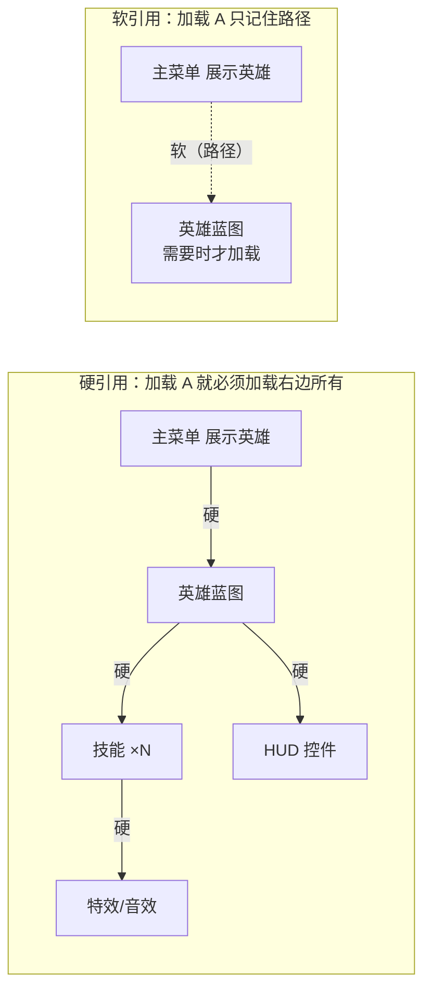
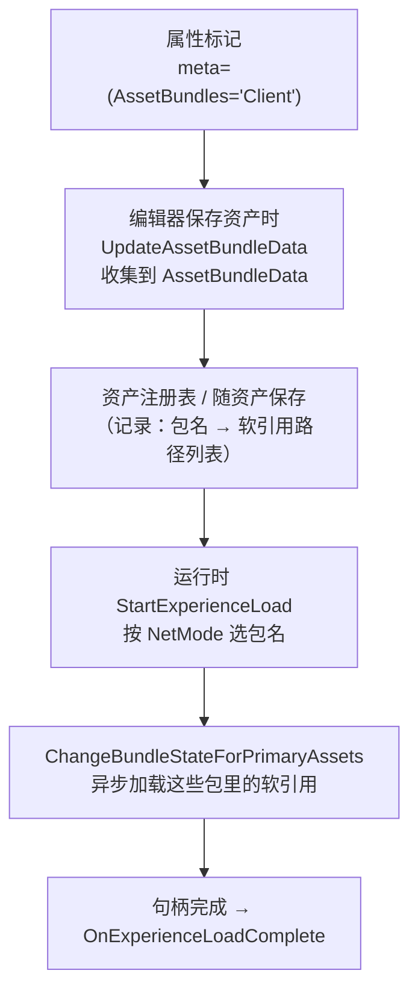
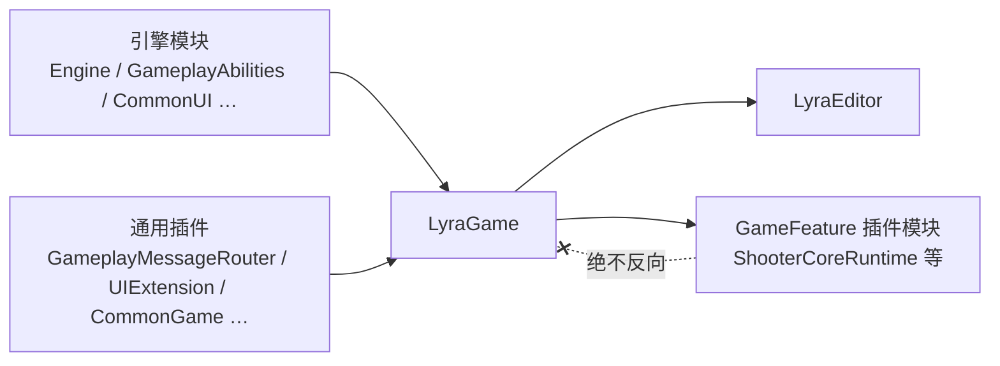

# 第 4 章　数据驱动：引用与加载、AssetManager、GameplayTag、委托、配置、模块与插件

## 一个问题：为什么“只是打开主菜单”，却把整个射击玩法都加载进内存了？

假设你照着 UE 入门教程的习惯，给 Lyra 的主菜单写了一个“展示英雄”的小功能：从一个英雄蓝图里读出模型，摆在大厅里转圈。你在 C++ 里写了一个 `TSubclassOf<ACharacter> ShowcaseHero`，在蓝图里指向 `B_Hero_ShooterMannequin`，一切正常。

然后测试同学报告：主菜单启动时间多了十几秒，内存多了几百兆。你一查才发现，这个英雄蓝图里引用了它的技能，技能引用了冷却特效和命中音效，英雄的 HUD 组件引用了一整套 UI 控件……**你只想要一个模型，引擎却顺着引用链把整个射击玩法都拖了进来。**

这个问题只是冰山一角。一个 Lyra 规模的项目，要同时解决五件“不想焊死”的事：

- **资源不要焊死**：用到才加载，按需、按端加载（专用服务器不需要 UI 和音效）；
- **玩法参数不要焊死**：放进数据资产，策划能改、不用重新编译；
- **系统之间不要互相焊死**：用 GameplayTag 和委托通信，而不是互相 `#include`、互相调用；
- **配置不要焊死**：路径、开关放进 ini，而不是写死在 C++ 里；
- **代码不要焊死**：拆成模块和插件，玩法插件可以独立开发、独立开关。

这五件事合起来，就是 Lyra 所谓“数据驱动”的底座。[第 6 章](06-Experience.md)那句“玩法即数据”能成立，靠的全是这一章的东西：读第 6 章时你会反复遇到资产包、AssetManager 扫描规则、`CallOrRegister`，它们都在本章讲清楚，所以请先读完这一章。

## 读完本章你能……

- 说出硬引用和软引用的区别，并解释“为什么一个硬引用能把整条引用链拖进内存”；
- 打开 `DefaultGame.ini`，读懂 Lyra 的一条 `PrimaryAssetTypesToScan` 规则，并说出“新建的 Experience 放错目录会怎样”；
- 说清楚资产包（Asset Bundle）从“属性上的 `meta=(AssetBundles=...)`”到“运行时按需加载”的完整过程；
- 区分 `MatchesTag` 与 `MatchesTagExact`，并判断一个 Tag 查询在层级里会不会命中；
- 区分单播、多播、动态委托，并在 Lyra 源码里为每一种找到例子；
- 说出 `UCLASS(config=...)`、`UPROPERTY(config)`、`UDeveloperSettings` 与 ini 文件之间的对应关系，并知道 Lyra 项目里一个已知的 ini 拼写缺陷；
- 看着 `.Build.cs`、`.uplugin` 和 `.Target.cs`，画出 Lyra 的模块依赖方向。

## 需要先知道的 UE 概念

这一章几乎全是新概念，所以我们按“问题驱动”的顺序展开：先讲引用与加载（资源怎么不焊死），再讲数据资产与 AssetManager（数据放哪、怎么找），然后资产包，接着是 Tag、委托（系统怎么不互相焊死），最后是配置与模块（工程怎么不焊死）。对象系统和反射的基础见 [第 1 章](01-UObject.md)，网络部分见 [第 3 章](03-Networking.md)，这里不再重复。

为了用真实的 Lyra 代码做例子，本章会提前碰到几个后面才详讲的名词，先给一句话定义：

- Experience（体验）：描述“这一局玩什么”的数据资产（第 6 章）；
- PawnData：描述“一个角色有哪些技能、用什么输入”的数据资产（第 8 章）；
- GameFeature Action（动作）：GameFeature 插件激活时对游戏“做点什么”的小对象，Experience 里就有一串（第 6 章）；
- GameplayCue：GAS 里的视听表现提示，比如命中特效和音效（第 9 章）。

你现在只需要知道它们是“放在资产里的数据或小对象”，细节不影响理解本章。全章八节可以归成三块地图：

- **资产怎么按需加载与索引**（第一～四节）：硬/软引用 → 同步/异步加载 → 数据资产与主资产 → AssetManager 与资产包；
- **系统怎么解耦通信**（第五～六节）：GameplayTag 层级契约 → 委托与 `CallOrRegister`；
- **工程怎么配置与拆分**（第七～八节）：ini 配置与 `UDeveloperSettings` → 模块与插件。

## 一、硬引用与软引用：谁把谁拖进了内存

### 最直观的做法，和它的问题

在 C++ 里你想“记住另一个资产”，最直接的写法是加一个 `UPROPERTY` 指针。比如 `ULyraPawnData::PawnClass` 是 `TSubclassOf<APawn>`，`ULyraUserFacingExperienceDefinition::TileIcon` 是 `TObjectPtr<UTexture2D>`。

`TObjectPtr<T>` 是 UE 5 里 `UPROPERTY` 指针的推荐写法（对 GC 可见，编辑器里还支持延迟解析）；`TSubclassOf<T>` 是“指向某个类（UClass）”的指针。它们都叫**硬引用（Hard Reference）**：只要持有它们的这个资产被加载进内存，**它们指向的资产也会被一并加载**，而被指向的资产又会递归地加载它自己的硬引用……

这就是开场那个问题的根源。一条硬引用就像 `#include`：你 include 了一个头文件，就得编译它 include 的所有头文件。区别是，C++ 的 include 发生在编译期，而资产的硬引用链在**每一次加载时**都要走一遍。



### 软引用：只记路径，用时再取

**软引用（Soft Reference）** 存的不是指针，而是资产的**路径**（一个字符串形式的标识）。加载持有它的资产时，被引用的资产**不会**被加载；等你真正需要它时，再显式地加载。

UE 提供了几种软引用类型，用法一一对应硬引用：

| 硬引用 | 对应的软引用 | 指向什么 |
|---|---|---|
| `TObjectPtr<UTexture2D>` | `TSoftObjectPtr<UTexture2D>` | 一个资产对象 |
| `TSubclassOf<AActor>` | `TSoftClassPtr<AActor>` | 一个类（蓝图类） |
| — | `FSoftObjectPath` | 最底层：只是一个路径，不带类型 |

软引用类型（`TSoftObjectPtr` 等）的常用接口有这几个：`IsNull()`（路径是否为空）、`ToSoftObjectPath()`（取出路径）、`Get()`（如果**已经在内存里**就返回对象，否则返回空，**不会触发加载**）、`LoadSynchronous()`（同步加载并返回）。

类比：这就像“存一个 URL 而不是存下载好的文件内容”，用的时候再下载。类比不准确的地方在于：UE 里“已经加载过”的资产全局只有一份，所以 `Get()` 有时会“凑巧”返回非空（别处已经加载了它）。**你不能依赖这个巧合**，要么显式加载，要么先确认加载完成。

### Lyra 是怎么选的

Lyra 的原则大致是：**会被很多地方引用、体积小、一定会用到的数据，用硬引用；体积大、只在某些模式或某一端才需要的资源，用软引用。** 在源码里很容易找到对照。

[`LyraUserFacingExperienceDefinition.h`](../../../Source/LyraGame/GameModes/LyraUserFacingExperienceDefinition.h)（主菜单里“一个可选玩法”的描述）里同时出现了两种：

```cpp
// 简化自 Source/LyraGame/GameModes/LyraUserFacingExperienceDefinition.h
/** Icon used in the UI */
UPROPERTY(BlueprintReadWrite, EditAnywhere, Category=Experience)
TObjectPtr<UTexture2D> TileIcon;                       // 硬：小图标，列表里一定要显示

/** The loading screen widget to show when loading into (or back out of) a given experience */
UPROPERTY(BlueprintReadWrite, EditAnywhere, Category=LoadingScreen)
TSoftClassPtr<UUserWidget> LoadingScreenWidget;        // 软：加载屏控件，只有真进这个玩法时才需要
```

[`LyraWorldSettings.h`](../../../Source/LyraGame/GameModes/LyraWorldSettings.h) 里地图默认 Experience 用的也是软类引用 `TSoftClassPtr<ULyraExperienceDefinition> DefaultGameplayExperience`——地图一加载就拖进一个玩法，可就糟了。`ALyraWorldSettings::GetDefaultGameplayExperience` 靠 `UAssetManager::GetPrimaryAssetIdForPath` 把这个软引用换成主资产 ID（下一节讲），全程不加载资产本身。

再看一个“妥协”：`ULyraExperienceDefinition::DefaultPawnData` 是硬引用 `TObjectPtr<const ULyraPawnData>`，源码里留着 `//@TODO: Make soft?`。`ULyraPawnData` 里的 `PawnClass`（`TSubclassOf<APawn>`）和 `AbilitySets` 也都是硬引用。这是有意的取舍：PawnData 就是“这个角色的全部”，用到它时本来就需要这些东西，硬引用换来简单、依赖齐全、没有“还没加载完”的状态要处理。

## 二、同步加载与异步加载

用软引用意味着你得自己决定“什么时候加载、等不等”。

### 同步加载：简单，但会卡住游戏线程

`LoadSynchronous()` 会阻塞当前线程直到资产加载完毕。好处是代码线性、好写；坏处是如果资产大、磁盘慢，这一帧会明显卡顿（卡帧，hitch）。适合：启动阶段（本来就要等）、小资产、编辑器工具。

Lyra 把同步加载收口到了 `ULyraAssetManager` 里，并加了“保活”处理：

```cpp
// 简化自 Source/LyraGame/System/LyraAssetManager.h 的 ULyraAssetManager::GetAsset
template<typename AssetType>
AssetType* ULyraAssetManager::GetAsset(const TSoftObjectPtr<AssetType>& AssetPointer, bool bKeepInMemory)
{
    AssetType* LoadedAsset = nullptr;
    const FSoftObjectPath& AssetPath = AssetPointer.ToSoftObjectPath();

    if (AssetPath.IsValid())
    {
        LoadedAsset = AssetPointer.Get();                        // 先看内存里有没有
        if (!LoadedAsset)
        {
            LoadedAsset = Cast<AssetType>(SynchronousLoadAsset(AssetPath));   // 没有就同步加载
            ensureAlwaysMsgf(LoadedAsset, TEXT("Failed to load asset [%s]"), *AssetPointer.ToString());
        }
        if (LoadedAsset && bKeepInMemory)
        {
            Get().AddLoadedAsset(Cast<UObject>(LoadedAsset));    // 放进一个 UPROPERTY 集合里，防止被 GC 回收
        }
    }
    return LoadedAsset;
}
```

`GetSubclass` 是它处理 `TSoftClassPtr` 的孪生函数。几个要点：第一，**加载出来的资产如果没有任何强引用持有，下一次垃圾回收（GC，第 1 章讲过）就可能把它清掉**，所以 `bKeepInMemory` 为真时 Lyra 把它登记进成员 `LoadedAssets`（一个 `UPROPERTY` 的 `TSet`，GC 可见）；第二，`SynchronousLoadAsset` 里实际调用的是 `UAssetManager::GetStreamableManager().LoadSynchronous(AssetPath, false)`；第三，Lyra 项目里有控制台命令 `Lyra.DumpLoadedAssets`，把这个集合打到日志里，实验 1 会用到；还有命令行参数 `-LogAssetLoads`，会给每次同步加载打耗时日志，方便找“谁在卡我”。

读 Lyra 时你会经常见到 `ULyraAssetManager::GetSubclass(ULyraGameData::Get().DamageGameplayEffect_SetByCaller)` 这样的写法（比如 `ULyraHealthComponent::DamageSelfDestruct`）：先从全局数据资产里取出软类引用，再用 AssetManager 同步取出真正的类。

### 异步加载：不卡帧，但要处理“还没好”

异步加载把读盘放到后台，加载完成后回调你。核心类是 `FStreamableManager`（可流送资产管理器，AssetManager 持有一个），请求加载后返回 `TSharedPtr<FStreamableHandle>`（可流送句柄）。句柄有三层含义：

- 它是**进度和结果的查询入口**（`HasLoadCompleted()`、`GetProgress()`、`GetLoadedAsset()`）；
- 它是**回调的挂载点**（`BindCompleteDelegate`）；
- 它是**引用计数的持有者**：只要句柄还活着，它加载的资产就不会被卸载；句柄销毁（或显式释放）后，资产才可能被 GC。

Lyra 里的一个真实例子是 GameplayCue 管理器按需异步加载表现资源：

```cpp
// 简化自 Source/LyraGame/AbilitySystem/LyraGameplayCueManager.cpp
// 需要播某个 Cue 时：已加载就直接用，否则异步加载，完成后回调
StreamableManager.RequestAsyncLoad(
    CueData.GameplayCueNotifyObj,                                   // 要加载的软路径
    FStreamableDelegate::CreateUObject(this, &ThisClass::OnPreloadCueComplete,
        CueData.GameplayCueNotifyObj, WeakOwner, bAlwaysLoadedCue), // 完成后的回调，带上下文
    FStreamableManager::DefaultAsyncLoadPriority, false, false, TEXT("GameplayCueManager"));
```

注意回调里传的是 `TWeakObjectPtr<UObject> WeakOwner`，而不是裸指针：异步回调回来时，发起请求的对象可能已经被销毁了，弱指针让你能安全地检查 `IsValid()`。这是写所有异步代码的通用规矩。

启动阶段则是“把异步当同步用”：`FLyraAssetManagerStartupJob::DoJob` 拿到句柄后 `Handle->WaitUntilComplete(...)` 阻塞等待。启动时画面本来就在等，用同步等待换来代码简单。

## 三、数据资产与主资产：把“玩法参数”放进文件里

### 为什么需要数据资产

先看最直观的做法：玩法参数写在 C++ 里（`static const float Damage = 25.f`），或者写在某个蓝图的默认值里。前者每次改数都要重新编译；后者“数据”和“行为”缠在一个蓝图里，没法复用，也没法让两个玩法共享一份配置。

**数据资产（Data Asset）** 的思路是：用一个**只装数据**的对象，单独存成一个 `.uasset` 文件。你在 C++ 里定义“这类数据有哪些字段”（继承 `UDataAsset`），策划在内容浏览器里右键创建一个实例，填值。运行时代码通过引用拿到它，读字段。类比：它像一个带类型的 JSON/YAML 配置文件，只是有编辑器界面、有类型检查、有引用关系。

和 `UDataTable`（数据表）的区别：数据表适合“同一结构的很多行”（武器数值表）；数据资产适合“一个对象一份配置”（某个英雄的完整定义）。

### 主数据资产与主资产 ID

`UPrimaryDataAsset`（主数据资产）是 `UDataAsset` 的子类，多了两个能力：

- 它有一个 **主资产 ID（Primary Asset ID）**，格式是 `类型:名字`，例如 `LyraExperienceDefinition:B_ShooterGame_Elimination`（[第 6 章](06-Experience.md)里 Experience 就是用 `FPrimaryAssetId` 这个类型来标识的）。**ID 是比路径更稳定的“逻辑名字”**：资产移动目录后路径变了，ID 里的名字不变；而且你可以不知道路径，只用 ID 向管理者要资产。
- 它能记录**资产包数据（`AssetBundleData`）**，下一节讲。

Lyra 里的主数据资产随处可见：`ULyraExperienceDefinition`（玩法）、`ULyraPawnData`（角色配置）、`ULyraGameData`（全局数据）、`ULyraExperienceActionSet`、`ULyraUserFacingExperienceDefinition`……其中前三个都标了 `UCLASS(BlueprintType, Const)`：`Const` 表示运行时不应被修改，因为它们被所有人共享。看一个最小的，[`LyraGameData.h`](../../../Source/LyraGame/System/LyraGameData.h)：

```cpp
// 简化自 Source/LyraGame/System/LyraGameData.h
UCLASS(MinimalAPI, BlueprintType, Const)
class ULyraGameData : public UPrimaryDataAsset
{
    GENERATED_BODY()
public:
    static const ULyraGameData& Get();     // 内部转发到 ULyraAssetManager::GetGameData()

    // 伤害用哪个 GameplayEffect：软类引用，用时才加载；EditDefaultsOnly = 在资产默认值面板里编辑，运行时只读
    UPROPERTY(EditDefaultsOnly, Category = "Default Gameplay Effects")
    TSoftClassPtr<UGameplayEffect> DamageGameplayEffect_SetByCaller;
};
```

### 两种“数据资产”：资产实例 vs 蓝图类

这是[第 6 章](06-Experience.md)马上会遇到的一个区别。主数据资产有两种存在形式：

- **资产实例**：在内容浏览器里“创建 → 杂项 → 数据资产”，选你的 C++ 类。文件里存的是一个对象实例。`ULyraPawnData`、`ULyraGameData` 就是这种（例如 `/Game/DefaultGameData`）。
- **蓝图类**：右键“蓝图类”，父类选你的 C++ 数据类，填类默认值。文件里存的是一个类，值在类默认对象（CDO）上。`ULyraExperienceDefinition` 就是这种（`B_ShooterGame_Elimination` 是个蓝图类）。

Lyra 为什么让 Experience 用蓝图类，源码里没有明说；可见的后果是：读取时要通过 `GetDefault<T>(类)` 取 CDO（第 6 章的 `SetCurrentExperience` 就是这么做的），并且“蓝图再继承蓝图”要靠数据校验禁止（第 6 章）。对照一下：`ULyraExperienceActionSet` 的声明是 `UCLASS(BlueprintType, NotBlueprintable)`，只能做成资产实例。接下来的扫描规则里，字段 `bHasBlueprintClasses` 专门区分这两种形式：扫蓝图类的主资产时要写 `True`（Lyra 的 Experience 就是），扫资产实例时写 `False`，两者写反了通常就会在索引里找不到资产。

## 四、AssetManager：怎么按“ID”找到资产

### 问题：资产多了，谁来维护“ID → 路径”的索引？

有了主资产 ID，就需要一个管理者：“给我 `LyraExperienceDefinition:B_ShooterGame_Elimination`，告诉我它在磁盘上的哪里；或者把某一类型的所有资产都加载进来。” 这个管理者就是 `UAssetManager`，一个引擎级的单例。它在启动时**扫描**项目里的资产，建立 ID 到路径的索引。至于扫描哪些目录、哪些类型，由 **扫描规则** 决定。

### 扫描规则：DefaultGame.ini 里的 PrimaryAssetTypesToScan

扫描规则写在 `Config/DefaultGame.ini` 的 `[/Script/Engine.AssetManagerSettings]` 小节里，每一条是一个 `PrimaryAssetTypesToScan` 数组元素。打开文件，找到 Experience 那一条（为了阅读，这里在逗号处折行，原文是一整行）：

```ini
; 摘自 Config/DefaultGame.ini
+PrimaryAssetTypesToScan=(
    PrimaryAssetType="LyraExperienceDefinition",
    AssetBaseClass="/Script/LyraGame.LyraExperienceDefinition",
    bHasBlueprintClasses=True,
    bIsEditorOnly=False,
    Directories=((Path="/Game/System/Experiences")),
    SpecificAssets=("/Game/System/FrontEnd/B_LyraFrontEnd_Experience.B_LyraFrontEnd_Experience"),
    Rules=(Priority=-1,ChunkId=-1,bApplyRecursively=True,CookRule=AlwaysCook))
```

逐个字段看：

- `PrimaryAssetType`：这类资产的“类型名”，也就是 ID 里冒号前面那一段；
- `AssetBaseClass`：只有继承自这个类的资产才算数；
- `bHasBlueprintClasses`：为 `True` 表示扫描的是**蓝图类**（取蓝图生成的类作为主资产），为 `False` 表示扫描的是**资产实例**。对照 `LyraGameData` 那条规则里写的是 `bHasBlueprintClasses=False`；
- `Directories`：扫描哪些目录（递归，因为 `bApplyRecursively=True`）；
- `SpecificAssets`：目录之外再点名的单个资产（这里是前端 Experience）；
- `Rules.CookRule=AlwaysCook`：烘焙（Cook，把编辑器资产转成目标平台运行格式的打包前步骤）时一定包含，即使没有别的资产引用它。

所以，“新建的 Experience 放错目录就找不到”这件事现在有了完整的解释：核心规则只扫 `/Game/System/Experiences` 加那一个前端资产，你把 Experience 放在别处，AssetManager 的索引里压根没有它，`?Experience=` 和 `-Experience=` 都会报找不到。社区有一个真实案例：Garashka 的《Fixing Lyra's Inventory System》里，原型背包用的 `LAS_InventoryTest` 不在任何 GameFeatureData 的扫描路径里，日志就是 `Invalid Primary Asset Id LyraExperienceActionSet:LAS_InventoryTest`。

那插件里的 Experience（ShooterCore 的那几个）是怎么被找到的？答案在 GameFeature 子系统里，5.8 源码可以核对：插件进入 Registered 状态时，子系统会调用 `UGameFeaturesSubsystem::AddGameFeatureToAssetManager`，它做两件事：把插件的 `GameFeatureData` 资产自己登记为一个主资产；再把这个资产里声明的 `PrimaryAssetTypesToScan` 加进 AssetManager，并把规则里的插件相对目录补成完整的包路径。例如打开 `ShooterCore` 插件内容根目录下的 `ShooterCore` 数据资产，它的 `PrimaryAssetTypesToScan` 就登记了扫描 `/Experiences` 下的 `LyraExperienceDefinition` 与 `LyraExperienceActionSet`，以及 `/Experiences/Playlist` 下的 `LyraUserFacingExperienceDefinition`。插件注册时这些规则才被加入 AssetManager，这也是你新建的玩法目录必须被“项目规则或插件的 GameFeatureData”二者之一覆盖的原因。

前面 ini 里还有一条 `PrimaryAssetType="GameFeatureData"` 的规则，目录是 `/Game/Unused`。Epic 的文档说，启用 Game Features 插件时编辑器会提示你加上这条扫描规则，它是标准动作；`/Game/Unused` 只是占位目录，插件里的 `GameFeatureData` 并不靠它被发现，靠的是上面那个子系统直接登记。

还有一个小细节。这一节 ini 的开头几行是这样的：

```ini
; 摘自 Config/DefaultGame.ini
-PrimaryAssetTypesToScan=(PrimaryAssetType="Map",AssetBaseClass=/Script/Engine.World,...)
-PrimaryAssetTypesToScan=(PrimaryAssetType="PrimaryAssetLabel",...)
+PrimaryAssetTypesToScan=(PrimaryAssetType="Map",AssetBaseClass="/Script/Engine.World",...)
```

开头的 `-` 是**删除**引擎默认配置里的同名元素，`+` 是**添加**元素。ini 里数组类型的配置就靠这两个前缀做增删，后面“配置”一节会再讲。

### AssetManager 的常用函数

扫描完成后，代码里最常用的是这几个（都是 `UAssetManager` 的接口）：

- `GetPrimaryAssetPath(Id)`：ID → 软路径（第 6 章的 `SetCurrentExperience` 会用它）；
- `GetPrimaryAssetIdForPath(Path)`：反过来，路径 → ID（上面 `LyraWorldSettings` 的例子）；
- `GetPrimaryAssetData(Id, 输出 FAssetData)`：查这个 ID 在不在索引里（第 6 章用它判断 Experience 有没有找到）；
- `LoadPrimaryAssetsWithType(Type)`：加载某一类型的**所有**主资产，返回句柄；配合 `GetPrimaryAssetObjectList(Type, 输出)` 取回对象列表（`ALyraGameMode::HostDedicatedServerMatch` 用它加载所有“面向用户的 Experience”，并 `WaitUntilComplete()` 强制等完——专用服务器启动阶段没有画面要卡）；
- `ChangeBundleStateForPrimaryAssets(...)`：加载或卸载资产包，下一节细讲。

### Lyra 的 AssetManager：ULyraAssetManager

Lyra 继承 `UAssetManager` 写了 `ULyraAssetManager`，并在 `DefaultEngine.ini` 里用 `AssetManagerClassName=/Script/LyraGame.LyraAssetManager` 替换了引擎默认的实现。`ULyraAssetManager::Get()` 里会检查：如果引擎里的 AssetManager 不是它，就 `UE_LOG(LogLyra, Fatal, ...)` 直接崩溃，提示你检查 `DefaultEngine.ini`。

它覆写的最重要的函数是 `StartInitialLoading`，这是进程启动时 AssetManager 被引擎调用的入口：

```cpp
// 简化自 Source/LyraGame/System/LyraAssetManager.cpp 的 ULyraAssetManager::StartInitialLoading
void ULyraAssetManager::StartInitialLoading()
{
    // 先让父类做完所有扫描——这一步必须现在做，即使后面的加载被推迟
    Super::StartInitialLoading();

    // 注册启动任务（带权重，用于计算进度）
    STARTUP_JOB(InitializeGameplayCueManager());     // 预加载“始终需要”的 GameplayCue
    STARTUP_JOB_WEIGHTED(GetGameData(), 25.f);       // 加载全局数据资产，权重 25（最重）

    DoAllStartupJobs();                              // 依次执行；专用服务器直接跑，客户端按权重更新进度
}
```

`GetGameData()` 最终走到 `LoadGameDataOfClass`，从 `DefaultGame.ini` 里配置的路径加载全局数据资产。**这个加载失败的话，Lyra 直接 `UE_LOG(..., Fatal, ...)`**，注释写得很直白：“失败是不可接受的，它会导致难以诊断的软故障”。这是个很典型的设计：对于“没有它游戏根本没法运行”的数据，早崩溃比晚出错好。

这里的路径 `LyraGameDataPath` 和 `DefaultPawnData` 是 `ULyraAssetManager` 上的 `UPROPERTY(Config)` 属性（见下文“配置”一节），它们都是软引用（`TSoftObjectPtr<...>`），资产本身要等 `GetAsset`/`LoadGameDataOfClass` 时才真正加载。这一整条链——ini 里的路径字符串 → 软引用 → 启动任务里加载 → `ULyraGameData::Get()` 一行拿到——把前面讲的五件事串在了一起。

## 资产包：同一份资产，不同的端加载不同的东西

### 问题：Experience 里的软引用，到底要不要加载？

现在来看[第 6 章](06-Experience.md)马上会碰到的问题。一个 Experience（或 ActionSet）里有一大堆 Action，Action 里有大量**软引用**：要授予的技能类、要添加的 HUD 控件、要绑定的输入映射……加载 Experience 的时候，这些软引用资产要不要加载？

- 一律不加载：Experience 加载完之后，玩家一进游戏就发现 HUD 控件还要现读盘，卡顿；
- 一律全加载：专用服务器没有屏幕，却把 HUD 控件、UI 贴图、音效全读进内存，白白浪费；纯客户端又不需要“只服务器才用的数据”。

**资产包（Asset Bundle）** 解决的就是这个问题：把一个主资产的软引用按名字**分组**，运行时按需加载某几组。你可以把它想成资产上的“标签化预加载清单”：某些软引用被贴上 `Client` 标签，某些贴上 `Server`，需要时说“把 `Client` 这一组给我加载进来”。类比：像 Gradle/Maven 里的“依赖分组”（`implementation` / `runtimeOnly`），按构建场景决定拉哪些。

### 三步走：标记 → 收集 → 加载

**第一步，在属性上标记（编写时）。** 在软引用属性的 `UPROPERTY` 里加 `meta=(AssetBundles="...")`，值是这个引用属于哪些包，逗号分隔。看 [`GameFeatureAction_AddAbilities.h`](../../../Source/LyraGame/GameFeatures/GameFeatureAction_AddAbilities.h)：

```cpp
// 简化自 Source/LyraGame/GameFeatures/GameFeatureAction_AddAbilities.h
USTRUCT(BlueprintType)
struct FLyraAbilityGrant
{
    GENERATED_BODY()

    // 服务器要用（授予技能），客户端也要用（本地预测、显示）：两个包都属于
    UPROPERTY(EditAnywhere, BlueprintReadOnly, meta=(AssetBundles="Client,Server"))
    TSoftClassPtr<UGameplayAbility> AbilityType;
};
```

而 [`GameFeatureAction_AddWidget.h`](../../../Source/LyraGame/GameFeatures/GameFeatureAction_AddWidget.h) 里的 HUD 控件类只属于客户端：

```cpp
// 简化自 Source/LyraGame/GameFeatures/GameFeatureAction_AddWidget.h
UPROPERTY(EditAnywhere, Category=UI, meta=(AssetBundles="Client"))
TSoftClassPtr<UUserWidget> WidgetClass;     // 专用服务器永远不需要它
```

**第二步，在编辑器里保存资产时自动收集（编辑期）。** `UPrimaryDataAsset` 有一个仅编辑器可用的虚函数 `UpdateAssetBundleData()`，在资产保存（`PreSave`）和属性变化时被调用，它会扫描这个资产的属性，把带 `AssetBundles` 标记的软引用收集进 `AssetBundleData`，随资产一起写进磁盘并登记到资产注册表。你不需要手动维护这份清单。

这里有三个已在 5.8 源码里核对的细节。第一，扫描是**递归**的：它会钻进结构体、数组、Map 里面找带标记的软引用，所以标记写在 Action 内部的结构体成员上（比如上面的 `FLyraAbilityGrant::AbilityType`）也会被收集。第二，遇到 `UObject` 指针属性时，只有标了 `Instanced`（或 `IncludeAssetBundles`）才会钻进去；Experience 的 `Actions` 正好是 `Instanced`，所以每个 Action 对象里的标记都会被扫到。第三，包数据是**保存时**才更新的：改了 Experience、ActionSet 或 GameFeatureData 里的软引用，要保存资产，运行时看到的包清单才会更新。

除了自动收集，Lyra 还让每个 Action 有机会手动补充：看 [`LyraExperienceDefinition.cpp`](../../../Source/LyraGame/GameModes/LyraExperienceDefinition.cpp)：

```cpp
// 简化自 Source/LyraGame/GameModes/LyraExperienceDefinition.cpp 的 ULyraExperienceDefinition::UpdateAssetBundleData（仅编辑器）
Super::UpdateAssetBundleData();                                  // 先做引擎默认的收集
for (UGameFeatureAction* Action : Actions)
{
    if (Action) { Action->AddAdditionalAssetBundleData(AssetBundleData); }   // 让每个 Action 自己补充
}
```

`ULyraExperienceActionSet` 有一模一样的实现。`AddAdditionalAssetBundleData` 是给“光靠属性标记表达不了”的引用准备的补充钩子：比如引擎自带的 `Add Components` Action，要根据每一项的 `bClientComponent` / `bServerComponent` 决定把组件类登记进 `Client` 还是 `Server` 包，这不是一个属性标记能表达的。Lyra 的 `UGameFeatureAction_AddWidgets` 也覆写了它：

```cpp
// 简化自 Source/LyraGame/GameFeatures/GameFeatureAction_AddWidget.cpp 的 UGameFeatureAction_AddWidgets::AddAdditionalAssetBundleData
for (const FLyraHUDElementEntry& Entry : Widgets)
{
    // 手动登记：这个控件类属于 Client 包
    AssetBundleData.AddBundleAsset(UGameFeaturesSubsystemSettings::LoadStateClient,
                                   Entry.WidgetClass.ToSoftObjectPath().GetAssetPath());
}
```

严格说，`FLyraHUDElementEntry::WidgetClass` 上本来就有 `meta=(AssetBundles="Client")`，按上面的递归收集已经会被登记，这里手动再加一遍属于冗余，但无害（`AddBundleAsset` 对同一条目是幂等的）。读到这种“标记 + 手动”双保险的写法，不用纠结哪个起作用。

这里的包名 `Client`、`Server` 来自引擎的 GameFeature 设置（`UGameFeaturesSubsystemSettings::LoadStateClient` / `LoadStateServer`），Lyra 沿用了这两个名字，没有另起炉灶。顺便澄清官方文档特别强调过的一点：**资产包不是 pak 里的 Chunk 分块**。它只决定“通过 AssetManager 加载某个主资产时，连带加载哪几组软引用”，和打包时资产放进哪个 pak 文件无关。

**第三步，运行时按名字加载（运行期）。** 这是第 6 章 `StartExperienceLoad` 里的一行，这里先预览：

```cpp
// 简化自 ULyraExperienceManagerComponent::StartExperienceLoad
TArray<FName> BundlesToLoad;
BundlesToLoad.Add(FLyraBundles::Equipped);                        // Lyra 自定义的包名
if (bLoadClient) { BundlesToLoad.Add(UGameFeaturesSubsystemSettings::LoadStateClient); }
if (bLoadServer) { BundlesToLoad.Add(UGameFeaturesSubsystemSettings::LoadStateServer); }

// “对这批主资产，把这几个包切换到已加载状态”——异步，返回句柄
BundleLoadHandle = AssetManager.ChangeBundleStateForPrimaryAssets(
    BundleAssetList.Array(), BundlesToLoad, {}, false, FStreamableDelegate(), FStreamableManager::AsyncLoadHighPriority);
```

`ChangeBundleStateForPrimaryAssets(资产列表, 要加入的包, 要移除的包, ...)` 的意思是：对列表里的每个主资产，读它的 `AssetBundleData`，把我要求的包里记录的所有软引用都异步加载进来（并保持加载状态）。`bLoadClient`、`bLoadServer` 由 `NetMode` 决定：专用服务器不加载 `Client` 包，纯客户端不加载 `Server` 包，编辑器里（`GIsEditor`）都加载，因为 PIE 里服务器和客户端是同一个进程。（这段逻辑旁边有一行 `//@TODO: Centralize this client/server stuff into the LyraAssetManager`，Epic 自己也觉得这段分散。）

整个过程画成一张图：



### 回头看：资产包的边界

资产包只管“**通过 AssetManager 的包接口加载时**加载哪些”。如果你代码里自己对某个软引用 `LoadSynchronous()`，那就和包无关了；如果某个引用本来是硬引用，包也管不了——它随持有者一起加载。

另外，Lyra 还在运行时用 `AddDynamicAsset` 注册过一个动态主资产（`ULyraGameplayCueManager::RefreshGameplayCuePrimaryAsset`，把所有 GameplayCue 路径放进 `Client` 包），让这些表现资源也走统一的包机制。

> 项目 C++ 和资产里都没有给任何属性标记 `Equipped` 包（只有 `FLyraBundles::Equipped` 常量和 `StartExperienceLoad` 里的读取），实际有内容的资产包只有 `Client` 和 `Server` 两个。

## 五、GameplayTag：用层级名字做“契约”

### 问题：系统之间怎么约定，又不互相焊死？

输入系统要告诉技能系统“玩家按了换弹键”；UI 层要知道“把血条放进哪个槽位”；技能要说明“我在什么状态下不能激活”。最直观的做法有两种：用枚举（`enum class EInputAction`），或者用字符串（`"Reload"`）。枚举的问题是：加一个值要改定义枚举的那个头文件，所有 include 它的模块都要重新编译；而且玩法插件想加自己的值，只能改核心代码。字符串的问题是：拼写错了没人发现，也没有层级和查询能力。

**GameplayTag（简称 Tag）** 是 UE 对这个问题的回答：它是一个用 `.` 分隔的层级名字，例如 `Status.Death.Dying`，由全局的 Tag 管理器（`UGameplayTagsManager`）统一注册。类比：它像一个层级化的枚举——但和枚举不同，它在运行时由字符串注册，可以在 ini 里添加而不用重新编译；并且有“父子关系”可以查询。

代码里 Tag 的类型是 `FGameplayTag`（单个 Tag）和 `FGameplayTagContainer`（一个 Tag 的集合）。Tag 内部不是字符串比较，而是一个轻量的句柄，比较很快；在网络上，Tag 复制的是编号而不是字符串（Lyra 的 `DefaultGameplayTags.ini` 里有 `FastReplication=True`，让 Tag 容器用更紧凑的方式同步）。

### 层级匹配：父子关系决定“命不命中”

Tag 最重要的特性是**匹配规则**。记住一句话：**子 Tag 匹配父 Tag，反过来不成立。**

`Status.Death.Dying` 是 `Status.Death` 的子节点。所以：

- `Dying.MatchesTag(Death)` → `true`（子匹配父）；
- `Death.MatchesTag(Dying)` → `false`（父不匹配子）；
- `Dying.MatchesTagExact(Death)` → `false`（精确匹配只认完全相同）；
- 对容器：`HasTag(X)` 是“容器里有没有任何 Tag 匹配 X（包含子孙）”，`HasTagExact(X)` 只认完全相同；`HasAny(其他容器)`/`HasAll(其他容器)` 是对集合的“至少一个/全部”版本。

Lyra 的代码里两种用法都有。技能检查能不能激活时：

```cpp
// 简化自 Source/LyraGame/AbilitySystem/Abilities/LyraGameplayAbility.cpp 的 ULyraGameplayAbility::DoesAbilitySatisfyTagRequirements
if (AbilitySystemComponentTags.HasAny(AllBlockedTags))      // ASC 身上有任何一个“阻止”Tag（含子孙）就不能激活
{
    // 如果因此被拒，且玩家处于死亡状态，附上“死亡”这条失败原因
    if (OptionalRelevantTags && AbilitySystemComponentTags.HasTag(LyraGameplayTags::Status_Death))
    {
        OptionalRelevantTags->AddTag(LyraGameplayTags::Ability_ActivateFail_IsDead);
    }
    bBlocked = true;
}
```

这里查的是 `Status_Death`，而 Lyra 的死亡流程实际授予的是它的子 Tag：`StartDeath` 设 `Status.Death.Dying`，`FinishDeath` 设 `Status.Death.Dead`（见 `LyraHealthComponent.cpp`）。因为“子匹配父”，一次 `HasTag(Status_Death)` 就同时覆盖“正在死”和“已经死”两个阶段，不用写两遍判断。这就是层级命名的价值。

相反，需要“就是这个，不要子孙”的场合用精确匹配。`ULyraHealthSet` 里判断一个伤害是不是“自杀式伤害”：

```cpp
// 简化自 Source/LyraGame/AbilitySystem/Attributes/LyraHealthSet.cpp 的 ULyraHealthSet::PreGameplayEffectExecute
const bool bIsDamageFromSelfDestruct = Data.EffectSpec.GetDynamicAssetTags().HasTagExact(TAG_Gameplay_DamageSelfDestruct);
```

还有 `ULyraGamePhaseSubsystem::IsPhaseActive` 里的 `PhaseEntry.PhaseTag.MatchesTag(PhaseTag)`：问“当前有没有哪个阶段是 `PhaseTag` 或它的子阶段”。

### Tag 从哪里来：C++ 原生与 ini

Tag 要先注册才能用。Lyra 主要有两个来源（引擎还支持从数据表导入），选哪个取决于“谁要用”。

**C++ 原生 Tag。** C++ 代码要引用的 Tag，用宏在代码里声明和定义，编译期就是确定的、有 IDE 补全、改名会报错。[`LyraGameplayTags.h`](../../../Source/LyraGame/LyraGameplayTags.h) 声明，[`LyraGameplayTags.cpp`](../../../Source/LyraGame/LyraGameplayTags.cpp) 定义：

```cpp
// 简化自 Source/LyraGame/LyraGameplayTags.h
namespace LyraGameplayTags
{
    LYRAGAME_API UE_DECLARE_GAMEPLAY_TAG_EXTERN(Status_Death_Dying);
    LYRAGAME_API UE_DECLARE_GAMEPLAY_TAG_EXTERN(InitState_Spawned);
    // ……
}

// 简化自 Source/LyraGame/LyraGameplayTags.cpp
UE_DEFINE_GAMEPLAY_TAG_COMMENT(Status_Death_Dying, "Status.Death.Dying", "Target has begun the death process.");
```

**ini 里的 Tag。** 只有资产（蓝图、数据资产）会用到、不需要在 C++ 里引用的 Tag，直接写进 ini。`Config/DefaultGameplayTags.ini` 里是一行一个：

```ini
; 摘自 Config/DefaultGameplayTags.ini
[/Script/GameplayTags.GameplayTagsSettings]
ImportTagsFromConfig=True
FastReplication=True
+GameplayTagList=(Tag="HUD.Slot.RespawnTimer",DevComment="")
```

在编辑器里 项目设置 → GameplayTags 里添加 Tag，写入的就是这个文件。**GameFeature 插件有自己的 Tag 文件**，在 `Plugins/GameFeatures/ShooterCore/Config/Tags/ShooterCoreTags.ini` 之类的位置，小节名是 `[/Script/GameplayTags.GameplayTagsList]`。这样插件的 Tag 随插件走：插件没启用，这些 Tag 就不存在，不会污染核心。

选择原则很简单：**C++ 要引用，用原生；只有资产用，写 ini。** 反过来的坑也值得记一下：在 C++ 里用 `RequestGameplayTag(Name, /*ErrorIfNotFound=*/ false)` 查一个字符串 Tag，拼错了得到的是一个**无效 Tag**，没有任何报错，后续比较都为假。用原生 Tag 的一个好处就是把这类拼写错误变成了编译错误。

### Lyra 把 Tag 当成“系统之间的契约”

读 Lyra 时你会发现，几乎所有“系统 A 和系统 B 需要约定一个名字”的地方，用的都是 Tag：

- 输入到技能：`InputTag.*`（第 11 章）；
- HUD 控件放在哪个槽位：`HUD.Slot.*`（`FLyraHUDElementEntry::SlotID`，第 19 章）；
- UI 往哪一层放：`UI.Layer.*`（`FLyraHUDLayoutRequest::LayerID` 的 `meta=(Categories="UI.Layer")` 让编辑器里的 Tag 选择器只显示 `UI.Layer` 之下的 Tag）；
- 初始化阶段：`InitState.*`（第 8 章）；
- 消息频道：`Lyra.Elimination.Message` 这类以 `.Message` 结尾的 Tag；
- 技能失败原因：`Ability.ActivateFail.*`。

这就是为什么 [第 5 章](05-BirdsEye.md)会说“在 Lyra 里找‘谁和谁连在一起’，第一步搜 Tag，而不是搜类名”。发出者和接收者不需要互相知道对方的类，只需要同意同一个名字。

## 六、委托：让 A 通知 B，而 A 不认识 B

### 问题：观察者模式，UE 版

血量归零时，`ULyraHealthComponent` 要通知“角色该播放死亡动画了”“HUD 该刷新了”“计分系统该记一笔了”。组件不应该知道这些系统的存在（否则每多一个听众就要改组件）。这是经典的**观察者模式**，UE 里用**委托（Delegate）**实现。你可以把它理解为“带类型的回调列表”，类似 C++ 的 `std::function`，但是多了对 `UObject` 生命周期的安全处理。

### 三种委托，三个选择

**单播委托（`DECLARE_DELEGATE_*`）**：最多绑定一个函数，可以有返回值。用来表示“请你告诉我一件事”。例如 `ULyraCameraComponent` 的 `DECLARE_DELEGATE_RetVal(TSubclassOf<ULyraCameraMode>, FLyraCameraModeDelegate)`：相机组件问外部“现在用哪个相机模式”，外部绑一个函数返回答案。

**多播委托（`DECLARE_MULTICAST_DELEGATE_*`）**：可以绑定任意多个函数，调用 `Broadcast` 时依次通知，没有返回值。例如 [`LyraExperienceManagerComponent.h`](../../../Source/LyraGame/GameModes/LyraExperienceManagerComponent.h) 里的 `DECLARE_MULTICAST_DELEGATE_OneParam(FOnLyraExperienceLoaded, const ULyraExperienceDefinition*)`：Experience 加载完成时通知所有等待者。

**动态委托（`DECLARE_DYNAMIC_*`）**：和上面的区别是它走**反射系统**：可以序列化、能在蓝图里绑定（`BlueprintAssignable`）、绑定的函数必须是 `UFUNCTION`；代价是比非动态版本慢，参数类型必须是反射支持的类型。例如 `ULyraHealthComponent` 的死亡事件：

```cpp
// 简化自 Source/LyraGame/Character/LyraHealthComponent.h
DECLARE_DYNAMIC_MULTICAST_DELEGATE_OneParam(FLyraHealth_DeathEvent, AActor*, OwningActor);

UPROPERTY(BlueprintAssignable)
FLyraHealth_DeathEvent OnDeathStarted;       // 蓝图里可以直接“绑定事件”
```

选择方法很简单：**需要蓝图能绑 → 动态；纯 C++ 内部通信 → 非动态（更快）；只有一个听众且需要返回值 → 单播。**

### 绑定与触发

绑定的写法按“绑什么”不同：

- 绑定到 `UObject` 的成员函数：`Delegate.AddUObject(this, &ThisClass::Func)`（非动态），`Delegate.AddDynamic(this, &ThisClass::Func)`（动态，`Func` 必须是 `UFUNCTION`）。UObject 版本内部持有的是**弱引用**：对象被销毁后，委托不会去调用悬空指针，自动跳过——这是 UE 委托比裸 `std::function` 安全的地方；
- 绑定 lambda：`AddLambda`；
- 绑定裸指针/普通 C++ 对象：`AddRaw`，**不会**帮你检查生命周期，你自己负责在对象销毁前解绑。

看 `ALyraCharacter` 的构造函数里怎么订阅健康组件的死亡事件：

```cpp
// 简化自 Source/LyraGame/Character/LyraCharacter.cpp 的 ALyraCharacter::ALyraCharacter
HealthComponent->OnDeathStarted.AddDynamic(this, &ThisClass::OnDeathStarted);
HealthComponent->OnDeathFinished.AddDynamic(this, &ThisClass::OnDeathFinished);
```

触发则是在持有者一侧：`OnDeathStarted.Broadcast(Owner)`（见 `ULyraHealthComponent::StartDeath`）。持有者不知道有几个听众，也不关心。这个解耦正是第 3 章那张“谁在哪台机器上”图的补充：**委托只在本机内部通信，不会跨网络**。服务器的 `OnDeathStarted` 和客户端的 `OnDeathStarted` 是各自独立触发的，客户端那次是由第 3 章讲的 OnRep 驱动的。

### 预告：CallOrRegister 模式

多播委托有个固有缺陷：**广播只发生一次，晚来的订阅者听不到。** 第 6 章会详细讲这个问题和 Lyra 的解法，这里只给出“模式”本身，因为它会在后面反复出现：

```cpp
// 简化自 Source/LyraGame/GameModes/LyraExperienceManagerComponent.cpp
void ULyraExperienceManagerComponent::CallOrRegister_OnExperienceLoaded(FOnLyraExperienceLoaded::FDelegate&& Delegate)
{
    if (IsExperienceLoaded()) { Delegate.Execute(CurrentExperience); }   // 事件已经发生：立刻回调
    else                      { OnExperienceLoaded.Add(MoveTemp(Delegate)); } // 还没发生：排队
}
```

```cpp
// 简化自 Source/LyraGame/Character/LyraPawnExtensionComponent.cpp 的 ULyraPawnExtensionComponent::OnAbilitySystemInitialized_RegisterAndCall
void ULyraPawnExtensionComponent::OnAbilitySystemInitialized_RegisterAndCall(FSimpleMulticastDelegate::FDelegate Delegate)
{
    if (!OnAbilitySystemInitialized.IsBoundToObject(Delegate.GetUObject()))
    {
        OnAbilitySystemInitialized.Add(Delegate);                 // 登记，以后发生时会通知
    }
    if (AbilitySystemComponent) { Delegate.Execute(); }           // 如果已经发生了，也立刻调用一次
}
```

两个函数同一个思路：**把“状态”和“事件”合并**——“已经就绪就立刻回调，没就绪就登记”。看到 `CallOrRegister_` 或 `RegisterAndCall` 这样的名字，就知道调用者不用关心自己来早还是来晚。这在网络游戏里尤其重要，因为（第 3 章讲过）复制到达的顺序不确定。

## 七、配置：ini 文件系统

### 问题：路径和开关不该写死在 C++ 里

`LyraGameDataPath`（全局数据资产放哪）、`DefaultPawnData`（后备角色配置）、各种开关、数组……这些值：策划或者发布工程师要能改；不同平台、不同构建可能不同；没必要因此重新编译。UE 的答案是 **ini 配置系统**：文本文件，键值对，按小节组织，在引擎启动时读入并写到对应类的属性上。

### 文件是怎么分层的

ini 文件有层级，**后面读到的覆盖前面的**。你需要记住的主线是：

1. 引擎自带的 `Base*.ini`（引擎目录下，你一般不碰）；
2. **项目的 `Config/Default*.ini`**：项目的默认配置，随项目提交到版本库。Lyra 的 `DefaultEngine.ini`、`DefaultGame.ini`、`DefaultGameplayTags.ini`、`DefaultInput.ini` 都在这里；
3. **平台特有配置**：`Config/Windows/WindowsEngine.ini` 这样的文件，只在对应平台生效；
4. **`Saved/Config/<平台>/*.ini`**：本机生成的，是用户在编辑器或游戏里改了设置后写出的，不进版本库，**优先级最高**。

引擎大致按这个顺序合并，具体的完整层级以引擎文档为准。文件名里的 `Engine`、`Game`、`Input`、`Editor` 等对应配置“类别”，`UCLASS(config=Game)` 里的 `Game` 说的就是它。

### 属性怎么对应到 ini

三个要素：

- 类上 `UCLASS(config=Game)`：这个类的配置读写 `Game` 类别的 ini（即 `DefaultGame.ini` 等）；
- 属性上 `UPROPERTY(Config)`（蓝图风格的小写 `config` 也行）：这个属性的值从 ini 读入；
- ini 里的小节名是 `[/Script/模块名.类名]`，**类名不带 `U`/`A` 前缀**，键名就是属性名。

用 Lyra 最典型的一例对照：

```cpp
// 简化自 Source/LyraGame/System/LyraAssetManager.h
UCLASS(MinimalAPI, Config = Game)
class ULyraAssetManager : public UAssetManager
{
    // ……
    UPROPERTY(Config)
    TSoftObjectPtr<ULyraGameData> LyraGameDataPath;     // 全局数据资产放哪

    UPROPERTY(Config)
    TSoftObjectPtr<ULyraPawnData> DefaultPawnData;      // 后备 PawnData
};
```

```ini
; 摘自 Config/DefaultGame.ini
[/Script/LyraGame.LyraAssetManager]
LyraGameDataPath=/Game/DefaultGameData.DefaultGameData
DefaultPawnData=/Game/Characters/Heroes/EmptyPawnData/DefaultPawnData_EmptyPawn.DefaultPawnData_EmptyPawn
```

`/Script/LyraGame` 表示 `LyraGame` 模块里的原生类；`LyraAssetManager` 去掉了 `U`。这就是“ini 值 → 软引用 → 启动时加载”的完整路径，在前面 AssetManager 一节你已经见过它的后半段。

一个值得学习的反面例子：[`Config/DefaultRuntimeOptions.ini`](../../../Config/DefaultRuntimeOptions.ini) 里的小节名是 `[/Script/LyraGame.LyraRuntimeOptons]`，而类名是 `ULyraRuntimeOptions`（`Options` 被拼成了 `Optons`）。**小节名对不上类名，这一节的配置永远不会生效**，也不会报错。这是项目里已知的原版缺陷（参见[参考手册 95](../Reference/95-Verification-Report.md)）。教训：ini 的小节名是字符串，拼写由你负责。

数组类型的配置靠前缀增删：前面见过 `+`（添加）和 `-`（删除），还有 `!Key=ClearArray`（清空，`DefaultEngine.ini` 的 Iris 过滤配置里就这样先清空再逐条 `+` 添加）。覆盖别人的默认配置时这三个前缀非常常用。

### UDeveloperSettings：在设置窗口里出现的配置

如果你想让某些配置出现在编辑器的设置窗口里，而不是手改 ini，继承 `UDeveloperSettings`。它的子类是一个普通的配置类，编辑器会自动为它生成设置页面。出现在哪个窗口由类的 `config=` 决定（引擎 `UDeveloperSettings::GetContainerName`）：`config=EditorPerProjectUserSettings` 或 `config=EditorSettings` 的出现在 编辑 → **编辑器偏好设置**，其余（如 `config=Game`）出现在 编辑 → **项目设置**。

[`LyraDeveloperSettings.h`](../../../Source/LyraGame/Development/LyraDeveloperSettings.h) 就是第 6 章实验 1 里你会用到的那个：

```cpp
// 简化自 Source/LyraGame/Development/LyraDeveloperSettings.h
UCLASS(config=EditorPerProjectUserSettings, MinimalAPI)
class ULyraDeveloperSettings : public UDeveloperSettingsBackedByCVars
{
    // 设置窗口左侧显示的分类名：返回项目名
    virtual FName GetCategoryName() const override;       // 实现是 FApp::GetProjectName()

    // PIE 时的 Experience 覆盖
    UPROPERTY(EditDefaultsOnly, BlueprintReadOnly, config, Category=Lyra, meta=(AllowedTypes="LyraExperienceDefinition"))
    FPrimaryAssetId ExperienceOverride;
    // ……
};
```

注意 `config=EditorPerProjectUserSettings`：这类设置是**每个用户自己的**，保存在 `Saved/Config/...` 下，不会提交进版本库，所以你在 PIE 里设的 `ExperienceOverride` 不会影响同事。对比 [`ShooterCoreRuntimeSettings.h`](../../../Plugins/GameFeatures/ShooterCore/Source/ShooterCoreRuntime/Public/ShooterCoreRuntimeSettings.h)：

```cpp
// 简化自 Plugins/GameFeatures/ShooterCore/Source/ShooterCoreRuntime/Public/ShooterCoreRuntimeSettings.h
UCLASS(config = Game, defaultconfig)
class UShooterCoreRuntimeSettings : public UDeveloperSettings
```

`config=Game, defaultconfig` 的意思是写入项目的 `Config/DefaultGame.ini`，是**全项目共享的**（小节 `[/Script/ShooterCoreRuntime.ShooterCoreRuntimeSettings]`）。`UDeveloperSettingsBackedByCVars` 还允许属性写 `meta=(ConsoleVariable="xxx")` 与控制台变量绑定，比如 `LogGameplayMessages` 绑定 `GameplayMessageSubsystem.LogMessages`。

## 八、模块与插件：代码怎么拆

### 模块：编译与链接的单位

UE 的 C++ 代码被组织成**模块（Module）**。一个模块就是一个独立编译、独立链接的单元（在 Windows 编辑器里通常是一个独立的 DLL；而在打包发行的整体式构建 monolithic build 中，所有模块会静态链接进同一个可执行文件）。它的最小形态是：

- 一份 `Xxx.Build.cs`：用 C# 写的构建脚本，声明这个模块的**依赖**；
- `Public/` 与 `Private/` 目录：Public 里的头文件对依赖它的模块可见，Private 里的是内部实现；
- 一行宏 `IMPLEMENT_MODULE(...)`（游戏主模块用 `IMPLEMENT_PRIMARY_GAME_MODULE`），告诉引擎“这里有个模块”。

类比：模块就像 Gradle/Maven 里的子项目，`Build.cs` 就是它的依赖声明。依赖有两类，要分清：

- `PublicDependencyModuleNames`：我的**公共头文件**里用到了对方的类型，所以依赖我的人也需要看到对方；
- `PrivateDependencyModuleNames`：只有我的 `.cpp` 里用到，不传递给依赖我的人。

看 [`LyraGame.Build.cs`](../../../Source/LyraGame/LyraGame.Build.cs)：公共依赖里有 `GameplayTags`、`GameplayAbilities`、`ModularGameplay`、`GameFeatures`、`ReplicationGraph`……私有依赖里有 `EnhancedInput`、`CommonUI`、`UMG`、`NetCore`……。如果你写了某个类的头文件并使用了 GAS 的类型，却忘了在 `Build.cs` 里加对应模块，编译会通过前面（IDE 里能找到头），**链接阶段**报“未解析的外部符号”——这是新手最常遇到的构建错误之一。

### 项目文件、目标文件与模块类型

项目的 `.uproject` 文件（JSON）列出了项目里有哪些模块和启用了哪些插件。Lyra 声明了两个模块：`LyraGame`（`Type: Runtime`）和 `LyraEditor`（`Type: Editor`），`LoadingPhase` 都是 `Default`。

`Type` 决定“哪些构建里包含这个模块”：`Runtime`（游戏和编辑器都有）、`Editor`（只有编辑器有，打包出来的游戏里没有）、`RuntimeNoCommandlet`（运行时有，但命令行工具模式下不加载）、`UncookedOnly`（只在未烘焙的构建里，比如编辑器里）。`LoadingPhase` 决定模块在引擎启动流程的哪个时机被加载，大多数是 `Default`，加载屏相关的是更早的 `PreEarlyLoadingScreen`（见 `Plugins/CommonLoadingScreen/CommonLoadingScreen.uplugin`，加载画面本身要在游戏模块之前就能显示）。

这就解释了 Lyra 为什么拆成 `LyraGame` 和 `LyraEditor` 两个模块：编辑器相关的东西（数据校验器、编辑器引擎子类 `ULyraEditorEngine`、GameplayCue 的编辑器钩子）依赖 `UnrealEd` 等只在编辑器里存在的模块，如果混进 `LyraGame`，打包的游戏就编译不过了。**依赖方向永远是 `LyraEditor` → `LyraGame`，反过来不行。** `LyraEditor.Build.cs` 的公共依赖里有 `LyraGame`，而 `LyraGame` 不知道 `LyraEditor` 存在。（编辑器里用的 `ULyraDeveloperSettings` 放在 `LyraGame` 里，靠 `WITH_EDITOR` 宏隔离只有编辑器才有的代码。）

再往上一层是**目标（Target）**，`Source/*.Target.cs`：`LyraGame.Target.cs`（`Type = Game`）、`LyraClient.Target.cs`（`Client`，纯客户端）、`LyraServer.Target.cs`（`Server`，专用服务器）、`LyraEditor.Target.cs`（`Editor`）。它们决定“为哪种产物编译”，都把 `LyraGame` 放进 `ExtraModuleNames`。`Server` 目标编出专用服务器，`Client` 目标编出纯客户端，这四个目标对应第 3 章的 NetMode 身份，也是 `#if WITH_SERVER_CODE` 这类宏能把代码从纯客户端构建里剔除的原因。

### 插件：模块 + 内容 + 开关

**插件（Plugin）** 是比模块更大的打包单位：一个文件夹，里面有一份 `.uplugin` 描述文件，可以包含若干模块、内容资产、配置。插件让你把一块功能（加载屏、UI 扩展点、消息系统）**独立出来**：可以单独开关、单独复用到别的项目，依赖关系写在 `.uplugin` 里。

`.uplugin` 里的关键字段，看 `Plugins/ModularGameplayActors/ModularGameplayActors.uplugin`：`"Modules"` 声明包含的模块；`"Plugins"` 声明它依赖哪些别的插件（这里依赖 `ModularGameplay`）；`"EnabledByDefault"` 等是开关。`Plugins/GameplayMessageRouter/GameplayMessageRouter.uplugin` 里则有两个模块：运行时的 `GameplayMessageRuntime` 和蓝图节点用的 `GameplayMessageNodes`（`UncookedOnly`，只在编辑器里需要）。

拆出这么多插件（`GameplayMessageRouter`、`UIExtension`、`CommonGame`、`AsyncMixin`……）的好处：边界清晰（依赖必须在 `.uplugin` 里显式声明）、可复用、可替换。

### GameFeature 插件：能在运行时开关的插件（预告）

GameFeature 插件是 UE 5 引入的一种特殊插件：它有一个可以在运行时切换的状态（已安装、已注册、已加载、已激活），激活时执行自己 `GameFeatureData` 里的一串 Action。第 6 章会详细讲它，这里先看它在 `.uplugin` 里长什么样。按 Epic 的要求，GameFeature 插件必须放在 `Plugins/GameFeatures/` 目录下才会被引擎发现。看 `Plugins/GameFeatures/ShooterCore/ShooterCore.uplugin` 里与普通插件不同的字段：

```json
// 摘自 Plugins/GameFeatures/ShooterCore/ShooterCore.uplugin（简化）
"EnabledByDefault": false,
"ExplicitlyLoaded": true,
"BuiltInInitialFeatureState": "Registered",
"Modules": [ { "Name": "ShooterCoreRuntime", "Type": "Runtime", "LoadingPhase": "Default" } ]
```

`ExplicitlyLoaded: true` 表示“不在启动时自动加载，由代码显式加载”；`BuiltInInitialFeatureState: Registered` 表示初始状态是“已注册、未激活”，Epic 的文档也把 Registered 当作理想的初始状态（第 6 章详讲）。`LyraGame.Target.cs` 的 `ConfigureGameFeaturePlugins` 会遍历 `Plugins/GameFeatures/` 下的所有 `.uplugin`，检查它们是否设置了 `ExplicitlyLoaded`（没设置会打警告）。

还有一条最重要的方向：`ShooterCoreRuntime.Build.cs` 的公共依赖里写着 `"LyraGame"`。**GameFeature 插件依赖核心模块，核心模块绝不依赖 GameFeature 插件。** 这就是项目设计约定“核心 C++（`Source/LyraGame`）不得引用 GameFeature 插件内容”的编译层保证：`LyraGame.Build.cs` 里根本没有 `ShooterCoreRuntime`，想引用也链接不上。依赖图如下：



## 动手实验

### 实验 1：看见引用链，看见 AssetManager 的保活集合

**目标**：亲眼看到硬引用的引用链，以及 `ULyraAssetManager` 保活了哪些资产。

**步骤**：

1. 在内容浏览器里找到 `ShooterCore 内容/Experiences/B_ShooterGame_Elimination`（没显示插件内容时，在内容浏览器设置里打开“显示插件内容”）。右键 → 引用查看器（Reference Viewer），再对 `HeroData_ShooterGame`（PawnData）做一次；硬引用和软引用的线型区分以你的编辑器版本为准。右键 → 资产操作 → 尺寸图（Size Map）可以看连带的资产总大小。
2. 运行 PIE（Standalone 即可），在控制台输入 `Lyra.DumpLoadedAssets`，在输出日志过滤 `LogLyra`。

**先写下你的预测**：PawnData 和 Experience 哪个的引用链更深？日志最后一行 “assets in loaded pool” 的数量是几？

**预期结果**：PawnData 硬引用了角色类、技能集、输入配置、相机模式，我们预期它的链更深（以实际所见为准）。日志会列出通过 `ULyraAssetManager::GetAsset/GetSubclass` 加载并保活的资产，数量取决于你的运行进度，**以你看到的为准**。

**原理**：硬引用链决定“加载一个资产要连带多少”，软引用把成本推迟到“真正用到时”；`LoadedAssets` 是 AssetManager 为防止 GC 而保存的强引用集合。

### 实验 2：层级匹配，亲手验证“子匹配父，父不匹配子”

**目标**：不写代码，验证 Tag 的层级语义。

**步骤**：

1. 在 `L_Expanse` 里以 Standalone 模式运行 PIE（用团队死斗 Experience 即可；建议先在 `编辑 → 编辑器偏好设置 → LyraStarterGame → Lyra Developer Settings` 里勾选 `Override Num Bots to Spawn = 0`，并在进图后等几秒让开局热身免伤阶段过去，免得机器人攻击或热身免伤干扰观察）。
2. 打开控制台，输入 `AddTagToSelf Cheat`，再输入 `DamageSelf 10`。（这两个是 `ULyraCheatManager` 的 Exec 命令；`AddTagToSelf` 内部用 `FindTagByString` 查 Tag，再通过 ASC 添加一个动态 Tag。）
3. 观察血量变化（血条，或用控制台命令 `CycleAbilitySystemDebug` 打开 ASC 调试显示）。
4. 再输入 `AddTagToSelf Cheat.GodMode`，再次 `DamageSelf 10`，观察。
5. 输入 `RemoveTagFromSelf Cheat.GodMode` 清理。

**先写下你的预测**：第 2 步只给了自己父 Tag `Cheat`，伤害会被免疫吗？第 4 步呢？

**预期结果**：第 2 步仍然掉血——`LyraHealthSet` 查的是 `HasMatchingGameplayTag(Cheat.GodMode)`，ASC 身上只有父 Tag `Cheat`，**父不匹配子**，不命中。第 4 步加上 `Cheat.GodMode` 后伤害被免疫。

**原理**：源码里 `ULyraHealthSet::PreGameplayEffectExecute` 检查 `Cheat_GodMode`（`#if !UE_BUILD_SHIPPING` 内，所以仅非发行构建有效）。同样一个 Tag 名字，既是“作弊开关”这个约定的载体，又不需要 HealthSet 知道谁来加这个 Tag——这就是“Tag 作为契约”。（如果你的 PIE 不是 Standalone 或主机服务器，这些 Exec 命令需要用 `Cheat <命令>` 的形式转发到服务器，见第 3 章。）

## 常见误区

**误区 1：以为把属性换成 `TSoftObjectPtr` 就一定省内存。**
软引用只推迟加载。如果你的代码在启动时就对它 `LoadSynchronous()`，或者别的硬引用链已经把它拖进内存，就没有省到。同时，一个“软”的地方要配套设计“什么时候加载、加载完谁来保活”，否则 `Get()` 经常返回空，或者资产被 GC 回收。

**误区 2：新建的主资产放在随便哪个目录。**
Experience、PawnData 这类主资产必须被 `PrimaryAssetTypesToScan` 的某条规则覆盖（目录或 `SpecificAssets`），否则 AssetManager 的索引里没有它，按 ID 找不到。插件里的主资产要检查插件 `GameFeatureData` 里的规则。

**误区 3：以为 `meta=(AssetBundles="Client")` 自己会生效。**
这个标记只是“登记”：编辑器保存资产时由 `UpdateAssetBundleData` 收集；真正加载还需要运行时代码调用 `ChangeBundleStateForPrimaryAssets` 并指明包名。如果你自己写了数据资产，希望按端加载，必须自己实现这最后一步（或者通过 Experience/GameFeature 的机制复用它）。

**误区 4：混淆 `MatchesTag` 和 `MatchesTagExact`。**
想表达“属于 `Status.Death` 这一类”就用层级匹配，想表达“恰好就是它”就用精确匹配。把子 Tag 当作独立的东西去 `==` 比较，会漏掉层级关系。

**误区 5：改了 Experience、ActionSet 或 GameFeatureData 里的软引用，却没保存资产，就去测试资产包。**
资产包清单是保存资产时由 `UpdateAssetBundleData` 写进去的，不保存就不会更新，你会看到“明明加了引用，运行时却没被预加载”。改完先保存，再测。

**误区 6：ini 小节名手写，拼错了不会报错。**
`[/Script/LyraGame.LyraRuntimeOptons]` 就是活例子。改完 ini 没效果时，第一件事检查小节名是否和 `/Script/模块名.类名`（无 `U`/`A` 前缀）完全一致，以及属性是否标了 `config`、类是否标了 `config=...`。

## 本章小结

这一章把 Lyra 的“数据驱动”拆成了五件事。

引用方面：硬引用简单但会拖进整条链，软引用只存路径、按需加载，同步加载省事但卡帧，异步加载靠 `FStreamableHandle` 回调。资产方面：玩法参数放进 `UPrimaryDataAsset`，用 `类型:名字` 的主资产 ID 标识，由 AssetManager 按 `DefaultGame.ini` 的 `PrimaryAssetTypesToScan` 规则扫描建索引；资产包让同一份资产按端加载不同的软引用，三步走：属性标记 → 编辑器收集 → 运行时 `ChangeBundleStateForPrimaryAssets`。

通信方面：GameplayTag 用层级名字做系统间的契约（子匹配父），委托让“发出者不认识接收者”，`CallOrRegister` 把“状态”和“事件”合一。配置方面：ini 分层，类通过 `config=` 和 `UPROPERTY(config)` 对应小节，`UDeveloperSettings` 让配置出现在项目设置或编辑器偏好设置里（由 `config=` 决定）。拆分方面：模块用 `Build.cs` 声明依赖，插件打包模块和内容，依赖方向永远是上层 → 下层，GameFeature 插件 → 核心。

```
  ini ──▶ UPROPERTY(Config) ──▶ 软引用 ──▶ AssetManager ──▶ 主资产 ID ──▶ 数据资产
 (路径/开关)                  (只记路径)   (扫描规则也在 ini)              (PawnData / Experience / GameData)
                                 │                                          │
                 同步 LoadSynchronous / 异步 StreamableHandle          资产包 Client / Server
                 （用完要保活：LoadedAssets / 句柄）                    按 NetMode 异步加载
  Tag：层级名字，系统间的契约        委托：Broadcast；CallOrRegister 保证“来早来晚都收到一次”
  模块 (Build.cs) ⊂ 插件 (.uplugin)：LyraEditor ──▶ LyraGame ◀── ShooterCoreRuntime (GameFeature)
```

## 自测题

1. 硬引用和软引用在“加载持有者资产时”的行为有什么区别？为什么 Lyra 的 `LyraWorldSettings::DefaultGameplayExperience` 用软类引用？

<details><summary>答案</summary>

硬引用在持有者被加载时一起加载被指向的资产，并递归加载它的硬引用；软引用只存路径，不触发加载。World Settings 属于地图资产，如果它硬引用 Experience，每次加载地图（包括只是在编辑器里打开）都会把整个玩法的引用链拖进来；用软类引用，只在确实要用时才通过 AssetManager 取 ID 并加载。
</details>

2. 读下面这条规则，回答：它扫描什么类型？是资产实例还是蓝图类？你把新 Experience 放在 `/Game/MyStuff/` 下，能找到吗？
`+PrimaryAssetTypesToScan=(PrimaryAssetType="LyraExperienceDefinition",AssetBaseClass="/Script/LyraGame.LyraExperienceDefinition",bHasBlueprintClasses=True,...,Directories=((Path="/Game/System/Experiences")),SpecificAssets=("/Game/System/FrontEnd/B_LyraFrontEnd_Experience.B_LyraFrontEnd_Experience"),...)`

<details><summary>答案</summary>

扫描类型 `LyraExperienceDefinition`，`bHasBlueprintClasses=True` 表示扫描的是蓝图类。放在 `/Game/MyStuff/` 下找不到：规则只覆盖 `/Game/System/Experiences` 目录和一个指定的前端资产。需要把资产挪过去，或者给项目/插件加一条覆盖新目录的扫描规则。
</details>

3. 解释 `meta=(AssetBundles="Client")`、`UpdateAssetBundleData`、`ChangeBundleStateForPrimaryAssets` 三者各在什么时候起作用、做什么。

<details><summary>答案</summary>

`meta=(AssetBundles="Client")` 是编写时在属性上做的标记，声明这个软引用属于 `Client` 包。`UpdateAssetBundleData` 在编辑器保存（和烘焙）资产时运行，扫描属性标记并（Experience/ActionSet 还让每个 Action 补充）把包名与软引用路径列表写入资产的 `AssetBundleData`。`ChangeBundleStateForPrimaryAssets` 在运行时调用，指定一批主资产和包名，AssetManager 读这些资产的 `AssetBundleData` 并异步加载对应包里的所有软引用。
</details>

4. `Status.Death` 与 `Status.Death.Dying`、`Status.Death.Dead` 的关系。`ASC Tags.HasTag(Status.Death)` 在玩家处于 Dying 或 Dead 时的结果是什么？`HasTagExact(Status.Death)` 呢？

<details><summary>答案</summary>

后两个是前者的子 Tag。`HasTag(Status.Death)` 在 Dying 和 Dead 时都为 true（子匹配父）；`HasTagExact(Status.Death)` 为 false，除非 ASC 上恰好有那个父 Tag 本身。
</details>

5. 你想让主菜单里的一个 UI 控件在“某个 Experience 加载完成时”做出反应，但这个控件可能在 Experience 已加载完之后才创建。应该怎么写？为什么直接绑定 `OnExperienceLoaded` 不行？

<details><summary>答案</summary>

使用 `CallOrRegister_OnExperienceLoaded`（或其他优先级版本）注册回调：已经加载完就立刻调用，否则排队等广播。直接绑定多播委托只会收到“绑定之后才发生的广播”，如果控件创建得晚、Experience 早已加载完，就永远收不到通知。
</details>

6. 设计题：你要给 Lyra 加一个“新手引导”小功能，需要一个全局开关“是否启用引导”，一个“引导用的 HUD 控件”，还有一个“引导进行中”的状态让技能系统阻止玩家使用某些技能。分别应该用什么机制承载（Config / 软引用 / Tag / 数据资产），为什么？

<details><summary>答案</summary>

开关放配置：做一个 `UDeveloperSettings` 子类（`config=Game, defaultconfig`），属性标 `config`，全项目共享，`config=Game` 的设置出现在项目设置里，策划直接在那里改，不用重新编译；HUD 控件用 `TSoftClassPtr<UUserWidget>`，并标 `meta=(AssetBundles="Client")`，让专用服务器不加载，通常放在一个 Add Widgets Action 或数据资产里；“引导进行中”做成一个 Tag（例如在 ini 里添加 `Status.Tutorial`），由引导逻辑授予 ASC，技能的“阻止激活 Tag”里配置这个 Tag，技能系统不需要认识引导系统。引导的流程参数（步骤、文案）可以做成一个 `UPrimaryDataAsset`，按 ID 查找。
</details>

## 继续深入

参考手册：

- AssetManager、GameFeature、Experience 相关的完整调用链：[参考手册 10 §8](../Reference/10-CoreFramework.md)；插件、资产扫描与 GameFeatureData：[参考手册 70](../Reference/70-GameFeatures-Content.md)；
- 构建目标、模块依赖、Target 变体（EOS/Steam）：[参考手册 80](../Reference/80-Build-Config.md)。

官方文档（引擎通用文档，不是 Lyra 专页，打开后请确认版本选择器）：

- [Asset Management in Unreal Engine](https://dev.epicgames.com/documentation/en-us/unreal-engine/asset-management-in-unreal-engine)：主资产与次级资产、主资产 ID、资产包的官方定义；本章的“资产包不是 Chunk”就出自它的口径（页面历史上有 4.27 版，内容以最新版为准）；
- [Data Assets in Unreal Engine](https://dev.epicgames.com/documentation/en-us/unreal-engine/data-assets-in-unreal-engine)：`UDataAsset` 与 `UPrimaryDataAsset` 的区别，以及主资产类型默认取继承链上第一个原生类名的规则；
- [Using Gameplay Tags in Unreal Engine](https://dev.epicgames.com/documentation/en-us/unreal-engine/using-gameplay-tags-in-unreal-engine)：Tag 的三种来源（项目设置、数据表、C++ 原生）和 `HasTag` / `HasAny` / `HasAll`；
- [Programming Subsystems](https://dev.epicgames.com/documentation/en-us/unreal-engine/programming-subsystems-in-unreal-engine) 也提到引擎怎么托管单例，可对照上一章。

社区资料：

- Tom Looman，[Why you should be using GameplayTags in Unreal Engine](https://tomlooman.com/unreal-engine-gameplaytags-data-driven-design/)：用 Tag 去掉资产之间的硬引用，与本章的“Tag 作为契约”同方向；
- Tom Looman，[Asset Manager for Data Assets & Async Loading](https://tomlooman.com/unreal-engine-asset-manager-async-loading/)：主数据资产、资产包与异步加载的实战写法；
- Garashka，[Fixing Lyra's Inventory System](https://garashka.github.io/LyraDocs/lyra/fixing-inventory-system)：本章“新建主资产放错目录”的真实案例（`LAS_InventoryTest` 不在任何扫描路径里）。

本书内部：

- 上一章：[第 3 章　网络入门](03-Networking.md)；下一部分从 [第 5 章　鸟瞰 Lyra](05-BirdsEye.md) 开始，然后是 [第 6 章　Experience 与 GameFeature](06-Experience.md)——现在你应该能读懂其中每一个新概念了；
- Tag 如何成为输入与技能的桥梁：[第 11 章](11-Input.md)；`InitState` 与 `CallOrRegister` 的更多用法：[第 8 章](08-PawnAssembly.md)。
