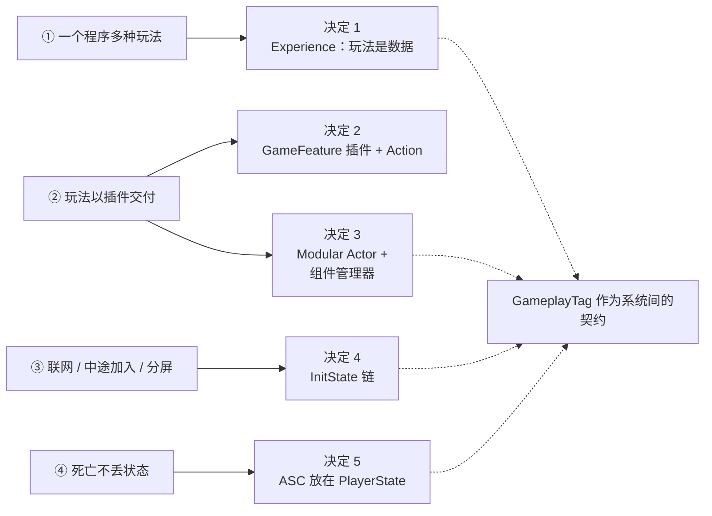

# 第 5 章　鸟瞰 Lyra：四个需求推出五个决定

## 一个思想实验：先别看 Lyra，自己设计一遍

老板交给你一个任务：做一个射击游戏框架。需求只有四条：

1. **一个可执行文件里要装下多种玩法**：主菜单、团队死斗、占点、俯视角竞技场、自动化测试关卡。
2. **新玩法最好由另一个团队以“插件”交付**，他们不改你的核心代码。
3. **要支持联网**：专用服务器、主机服务器、中途加入，外加本地分屏。
4. **角色死了会重生**，但技能冷却和属性不能因为死亡而丢失。

你会怎么做？大多数人的第一反应和 UE 入门教程一样：每个玩法一个 `AGameMode` 子类，一个 `ACharacter` 子类，技能直接加在角色蓝图里，HUD 在 `PlayerController::BeginPlay` 里 `CreateWidget`。

**停下来，拿张纸写下：这个“教程式”写法在上面四条要求下，分别会在哪里崩？** 每条至少写一个具体的失败场景。写完再往下读，你会发现 Lyra 的每一个核心设计，几乎都是对你写下的某个失败场景的回应。

这一章不深入任何一个系统，目的只有一个：给你一张**地图**。之后每一章都会回到这张地图上，说“这件事发生在第 N 步”“这个东西属于第 N 层”。

## 读完本章你能……

- 把四条需求逐一对应到 Lyra 的五个核心决定，并说出每个决定的代价；
- 在白纸上画出五层结构图，并解释“依赖只能向下”这条规则为什么保护了插件化；
- 按顺序复述从进程启动到“按下左键开火”的 12 步主干，并说出每一步发生在服务器还是客户端；
- 对任意一个新需求（背包、击杀数、灵敏度、倒计时……），判断它该放在 GameMode、GameState、PlayerController、PlayerState、Pawn、LocalPlayer 还是 HUD；
- 认出 Lyra 里反复出现的六个设计模式，读陌生代码时少花一半力气。

## 需要先知道的 UE 概念

本章是地图，不是细节，所以几乎所有概念都只点到为止。你需要预先熟悉的是前几章讲过的东西：Actor 和组件的关系、GameMode/GameState/PlayerController/PlayerState/Pawn 各自存在于哪些机器上（[第 2 章](02-GameplayFramework.md)），服务器权威与复制（[第 3 章](03-Networking.md)），主资产与 GameplayTag（[第 4 章](04-DataAndAssets.md)）。

本章会提前出现几个后面才详讲的名词，先给一个够用的定义，细节留给后面的章节：

- **能力系统组件（Ability System Component，ASC）**：挂在 Actor 上、负责管理“这个 Actor 拥有哪些技能、哪些属性、身上有哪些状态标签”的组件。技能的冷却、属性的当前值、被施加的效果，都存在它里面（第 9 章）；
- **初始化状态（InitState）**：给 Actor 上的每个“功能模块”（一般是组件）配一条状态链，每个模块自己声明“我要什么数据都到齐了，才能进入下一状态”。它解决的是联网时对象到达顺序不确定的问题（第 8 章）；
- **Experience（体验）**：描述“这一局玩什么”的数据资产；**GameFeature Action（动作）**：GameFeature 插件激活时对游戏“做点什么”的小对象，比如加组件、授予技能（第 6 章）；
- **PawnData**：描述“一个角色有哪些技能、用什么输入和相机”的数据资产；**AbilitySet**：一组打包好的技能、效果和属性集（第 8、10 章）；
- **PawnExtension 组件与 Hero 组件**：挂在 Lyra 角色上的两个组件，前者协调角色的初始化，后者负责本地玩家的输入和相机（第 8 章）。

现在你只需要记住：ASC 是“技能和属性的家”，InitState 是“等数据到齐再初始化”的协议，Experience 加 Action 是“玩法就是数据”的载体。

关于版本，请留意：本章和后面所有“Lyra 现在怎么做”的描述，都指 UE 5.8 随附的 Lyra 版本。Epic 的官方 Lyra 文档大多写于 5.0 到 5.3，官方也没有公开 Lyra 的更新日程，新引擎特性不保证进入 Lyra，所以我们以 5.8 源码为准。另外，官方没有一页“Lyra 架构总图”，下文的“五个决定”“五层结构”是本书的归纳，不是 Epic 的官方说法。

## 教程式写法，在四条要求下怎么崩

先把你可能写在纸上的答案过一遍。

**要求 1：多种玩法。** 一张地图在 World Settings 里只能指定一个 GameMode，玩法和地图被 1:1 绑死。团队死斗和占点 80% 的逻辑相同，两个 GameMode 子类要么互相复制，要么继承出一个越来越胖的基类。三周后你修了死斗里的出生点 bug，占点里的同一个 bug 还在。（[第 6 章](06-Experience.md) 开头会从另一个角度再讲这个场景。）

**要求 2：插件交付。** 如果技能、组件、HUD 都写在角色蓝图和 PlayerController 里，那么核心角色蓝图就必须**硬引用**每一个玩法的资产。主菜单里那个用来展示的角色，也被迫把所有玩法的资源加载进内存。另一个团队想加东西，只能改你的蓝图——这正是老板说“不准”的事。

**要求 3：联网。** 教程式代码默认“`BeginPlay` 的时候一切都就绪了”。联网后这个假设会在客户端上破产：Pawn 复制到客户端时，它的 PlayerState、Controller、输入组件可能还没到，到达顺序还因每次网络状况而不同。你在 `BeginPlay` 里写 `GetPlayerState()->...`，高延迟的玩家就会崩溃；写成“空就跳过”，那个玩家就永远没有技能栏，因为之后没有任何人再来补一次初始化。中途加入还会带来另一个问题：他连进来时，游戏规则早就加载完了，“加载完成”的那次广播他永远收不到。分屏则意味着“HUD 在 PlayerController 里创建”的代码要对每个本地玩家各跑一次，而 GameMode 里的状态只在服务器上，不可能给本地玩家用。

**要求 4：死亡不丢状态。** 如果 ASC 放在 `ACharacter` 上，角色死亡销毁，ASC 跟着销毁：冷却清零、属性重置、授予的技能全部丢失。玩家发现“快死的时候让自己死一次，所有冷却就刷新了”——一个现成的作弊手段，而且是你设计出来的。

把这四个失败场景压缩成四句话：

- 玩法不能绑在类上；
- 内容不能被核心硬引用；
- 初始化不能依赖时序；
- 状态不能寄生在会死的东西上。

## Lyra 的五个决定

Lyra 对这四句话的回答，可以排成一张对应图：



注意第 2 条需求对应两个决定：“插件能带来内容”是 GameFeature 解决的，“插件能把内容装到不属于它的类上”是组件管理器解决的。下面逐个看。

### 决定 1：玩法是一份数据（Experience）

整个项目只有一个 GameMode 类 `ALyraGameMode`。它不知道“团队死斗”和“占点”的存在，只做三件事：**选出 Experience、等它加载完、放玩家出生**。具体玩什么，由一份叫 Experience 的数据资产决定——它列出要激活哪些插件、玩家用什么角色配置、执行哪些 Action。

选择逻辑集中在 [`LyraGameMode.cpp`](../../../Source/LyraGame/GameModes/LyraGameMode.cpp) 的 `ALyraGameMode::HandleMatchAssignmentIfNotExpectingOne`。这是 [第 6 章](06-Experience.md) 的主题，这里不再展开。

Epic 的官方总览页把 Experience 描述为“一个更高级的 GameMode”，用 `ULyraExperienceDefinition` 这个类定义，你能在地图 World Settings 的 Game Mode 区域看到 `Default Gameplay Experience` 这个选项。这个类比好用，但别被它带偏：在实现上 GameMode 依然只有一个 `ALyraGameMode`，Experience 是一份数据，不是 GameMode 的子类。连主菜单也是一个 Experience（前端地图 `L_LyraFrontEnd` 的默认 Experience 是 `B_LyraFrontEnd_Experience`，资产在 `Content/System/FrontEnd/`），这是“玩法即数据”最有说服力的例子。

**代价**：玩法变成了散落在资产里的数据，读代码已经找不到“占点规则在哪”——你得去看 Experience 资产。调试时的第一反应要从“搜类名”变成“找当前是哪个 Experience、它注入了什么”。

### 决定 2：玩法以 GameFeature 插件交付，靠 Action 注入

GameFeature 插件是一种有运行时状态的插件，可以在游戏过程中被激活和停用。每个插件带一个 `GameFeatureData` 资产，里面是一串 Action（动作）——“激活时对游戏做点什么，停用时撤销”的小对象：加组件、授予技能、加输入映射、往 HUD 上挂控件……

于是“占点玩法”不再是核心代码里的一个分支，而是一个**默认处于未激活状态的插件**。看 [`ShooterCore.uplugin`](../../../Plugins/GameFeatures/ShooterCore/ShooterCore.uplugin)：`BuiltInInitialFeatureState` 是 `Registered`，`EnabledByDefault` 是 `false`。启动时它只是被登记，直到某个 Experience 说“我需要 ShooterCore”才会被激活。

这也是 Epic 官方总览页明确写出的组织约定：`Content` 目录里只放通用资产和主菜单（前端），游戏的核心内容放在 `Plugins/GameFeatures/` 下的 GameFeature 插件里；玩家在大厅选了某个玩法，游戏才加载它需要的插件。比如选团队死斗，会加载 `ShooterCore`（Pawn 与机制）和 `ShooterMaps`（关卡）。

**代价**：玩法代码和核心代码被强制隔离。项目有一条硬规则：核心 C++（`Source/LyraGame`）**不得引用 GameFeature 插件里的内容**。这条规则让你在核心代码里写不出“如果是占点模式就……”这种捷径，不方便，但正是它保证了核心可以脱离任何玩法编译和运行。

### 决定 3：Modular Actor + 组件管理器，让插件能装东西到别人的类上

插件要往 `ALyraCharacter` 上加一个组件，可是 `ALyraCharacter` 不属于插件，而且**不一定已经存在**——Pawn 是玩家出生时才创建的。Lyra 的做法是让框架里的 Actor（GameMode、GameState、PlayerState、Character……）都继承一组 `Modular*` 基类。这些基类在 Actor 初始化早期，向一个叫 `UGameFrameworkComponentManager` 的游戏实例子系统“登记”自己：“我是一个可以被扩展的 Actor”。

插件之后只需要对管理器说：“凡是 `ALyraCharacter`，都给我加上这个组件。”管理器负责让**现在已经存在的和将来才出生的**每一个符合条件的 Actor 都拿到组件，并在请求撤销时把它们拿走。

看 [`ModularCharacter.cpp`](../../../Plugins/ModularGameplayActors/Source/ModularGameplayActors/Private/ModularCharacter.cpp)，登记就这么几行：

```cpp
// 来自 Plugins/ModularGameplayActors/.../Private/ModularCharacter.cpp 的 AModularCharacter
void AModularCharacter::PreInitializeComponents()
{
    Super::PreInitializeComponents();
    // 在组件初始化之前登记自己：此后管理器才可能给我注入东西
    UGameFrameworkComponentManager::AddGameFrameworkComponentReceiver(this);
}

void AModularCharacter::EndPlay(const EEndPlayReason::Type EndPlayReason)
{
    // 对称地撤销登记，管理器会顺便清掉它加的组件
    UGameFrameworkComponentManager::RemoveGameFrameworkComponentReceiver(this);
    Super::EndPlay(EndPlayReason);
}
```

这套机制是 [第 7 章](07-ModularGameplay.md) 的主题。

**代价**：如果你的 Pawn 不是 `Modular*` 的子类（也没有自己做这三个调用），所有针对它的注入请求都会**静默无效**——没有报错，只是什么也没发生。

### 决定 4：用 InitState 链代替 BeginPlay

联网时，Pawn、PlayerState、Controller、输入组件到达客户端的顺序不确定。Lyra 不去猜顺序，而是让每个需要这些数据的组件各自声明条件：“我需要 PlayerState 才能进入 `DataAvailable` 状态”。每当任何数据到达（一次 OnRep、一次 Possess、一次输入组件创建……），所有组件都重新检查一次自己的条件，条件满足就前进一步。顺序再乱，最后都会收敛到同一个结果。

四个状态是 `InitState.Spawned → DataAvailable → DataInitialized → GameplayReady`。注册它们的地方在 [`LyraGameInstance.cpp`](../../../Source/LyraGame/System/LyraGameInstance.cpp) 的 `ULyraGameInstance::Init`。这是 [第 8 章](08-PawnAssembly.md) 的主题。

**代价**：初始化流程不再是读一遍函数就能看懂的直线，而是“事件触发 + 条件检查”的网。更要命的是：只要有一个组件永远到不了 `DataAvailable`，整个 Pawn 就会卡住——能出生，但没有输入、没有技能。

### 决定 5：ASC 放在 PlayerState，Pawn 只是化身

Lyra 把玩家的 ASC 创建在 `ALyraPlayerState` 上，而不是 `ALyraCharacter` 上。PlayerState 在整个连接期间一直存在，跨越多次死亡和重生；Pawn 每次死亡都会销毁，它在 GAS 的语境里只是 ASC 的**化身（Avatar）**。

```cpp
// 简化自 Source/LyraGame/Player/LyraPlayerState.cpp 的 ALyraPlayerState 构造函数
ALyraPlayerState::ALyraPlayerState(const FObjectInitializer& ObjectInitializer)
    : Super(ObjectInitializer)
{
    // ASC 是 PlayerState 的默认子对象，跟着 PlayerState 活
    AbilitySystemComponent = ObjectInitializer.CreateDefaultSubobject<ULyraAbilitySystemComponent>(this, TEXT("AbilitySystemComponent"));
    AbilitySystemComponent->SetIsReplicated(true);
    // Mixed：拥有者客户端拿到完整的效果信息，其他客户端只拿精简信息
    AbilitySystemComponent->SetReplicationMode(EGameplayEffectReplicationMode::Mixed);
    // ...属性集、网络更新频率等省略
}
```

每次出生，新 Pawn 通过 `InitAbilityActorInfo(PlayerState, Pawn)` 告诉 ASC“我是你现在的化身”。旧 Pawn 死亡时，被“摘下”的只是化身，技能、冷却、属性都留在 PlayerState 的 ASC 里。

**代价**：Pawn 上的代码不能再随手 `GetAbilitySystemComponent()`——在初始化完成之前它返回空。你必须等到 InitState 链走到 `DataInitialized`，这也是决定 4 和决定 5 紧紧绑在一起的原因。

### 贯穿全局的契约：GameplayTag

五个决定之外还有一个贯穿全局的做法：**系统之间尽量不互相引用类，而是约定 GameplayTag**。输入到技能用 `InputTag.*`；HUD 槽位用 `HUD.Slot.*`；UI 层用 `UI.Layer.*`；初始化阶段用 `InitState.*`；消息频道用各种带 `.Message` 后缀的 Tag。

一个能立刻用上的推论：在 Lyra 里想知道“谁和谁连在一起”，**第一步搜 Tag，而不是搜类名**。比如想知道某个 HUD 元素从哪来，去搜它挂的 `HUD.Slot.xxx`，就能找到是哪个 Experience 或 ActionSet 里的 `Add Widgets` 把它放进了那个槽位。原生 Tag 定义在 [`LyraGameplayTags.cpp`](../../../Source/LyraGame/LyraGameplayTags.cpp)，其余在 `Config/DefaultGameplayTags.ini`。

回头看一眼：五个决定里，每一个都是“把耦合从类关系挪到数据/事件上”。这是整个 Lyra 的一句话心智模型——**C++ 提供空壳，数据资产描述玩法，GameFeature 在运行时把玩法注入空壳，所有连接靠 Tag 和“注册-等待”回调完成。**

## 一张必须能默画的图：五层结构

把 Lyra 的代码和内容按依赖关系分层，是五层（这是本书的归纳，不是官方图）：

```
┌──────────────────────────────────────────────────────────────┐
│ ⑤ 内容层   GameFeature 插件（ShooterCore / TopDownArena …）    │
│            Experience、ActionSet、PawnData、武器、HUD、地图     │
├──────────────────────────────────────────────────────────────┤
│ ④ 玩法系统 GAS（技能/属性/伤害）· 物品/装备/武器 · 队伍 · 交互  │
│            相机 · 动画 · 外观 · 表面特效 · UI                   │
├──────────────────────────────────────────────────────────────┤
│ ③ 组装层   Experience 加载器 · PawnData · InitState 链          │
│            GameFrameworkComponentManager（注入/扩展事件）       │
├──────────────────────────────────────────────────────────────┤
│ ② 空壳层   ALyraGameMode / GameState / PlayerState / Character │
│            （都继承 Modular*，几乎不含玩法）                     │
├──────────────────────────────────────────────────────────────┤
│ ① 平台层   AssetManager · GameInstance · CommonUser/Session    │
│            CommonGame(UI 分层) · Settings · LoadingScreen      │
└──────────────────────────────────────────────────────────────┘
依赖方向：只能上层依赖下层。核心 C++（①~④）永远不引用 ⑤ 里的东西。
```

读这张图要抓住三点。

**第一，②空壳层几乎不含玩法。** `ALyraCharacter` 是什么？它创建了几个默认组件（PawnExtension、Health、Camera），转发几个事件，仅此而已。“这个角色能跳、能射击、能冲刺”不在它身上，而在 PawnData 引用的 AbilitySet 里。

**第二，③组装层是 Lyra 的特色。** 一般框架只有“类”和“资产”两层，Lyra 在中间多了一层专门负责“把资产装配到类上”的机制：Experience 加载器负责决定装什么，组件管理器负责怎么装，InitState 链负责什么时候装完。第 6、7、8 章依次拆这一层。

**第三，⑤内容层只能被“注入”，不能被“引用”。** 这条规则直接来自需求 2。验证一下你有没有理解：开火技能 `GA_Weapon_Fire_Rifle_Auto` 属于哪一层？答案是第⑤层——它是 `ShooterCore` 插件里的蓝图，先继承核心内容的 `/Game/Weapons/GA_Weapon_Fire`，最终继承第④层的 C++ 基类 `ULyraGameplayAbility_RangedWeapon`。它怎么到达角色身上的？经过 物品定义 → 装备定义 → AbilitySet → 装备时授予，最终进入 PlayerState 上的 ASC。第 13、14 章会走完这条链。

## 十二步主干：从进程启动到第一枪

这是全书的**脊柱**。后面每一章讲到运行时逻辑，都会说“这是主干的第 N 步”。请认真读两遍，第一遍抓顺序，第二遍留意每一步“已经有什么、还没有什么”。

先看全貌：


下面逐步走。每一步标出在哪一端运行，括号里是你可以去读的关键函数。

**步骤 1：引擎启动，AssetManager 扫描主资产。**（两端）`ULyraAssetManager::StartInitialLoading` 先调用父类完成扫描——按 `DefaultGame.ini` 的规则建立“主资产 ID → 路径”的索引——再预加载 `ULyraGameData`（里面是伤害、治疗用的 GameplayEffect 等全局数据）。此时**还没有 World**。

**步骤 2：GameInstance 初始化，注册四个 InitState。**（两端）`ULyraGameInstance::Init` 向组件管理器注册 `Spawned → DataAvailable → DataInitialized → GameplayReady` 这条状态链。它必须这么早，因为之后任何 Pawn 出生时都要用到。

**步骤 3：地图加载，GameMode 和 GameState 创建。**（服务器）GameMode 在 `InitGame` 里没有立刻选 Experience，而是 `SetTimerForNextTick` 推迟到下一帧；`InitGameState` 里它向 GameState 上的 `ULyraExperienceManagerComponent` 注册“加载完成后叫我”的回调。此刻 GameState 上的 Experience 管理组件存在，但是空的。

**步骤 4：选 Experience。**（服务器）`HandleMatchAssignmentIfNotExpectingOne` 依次尝试 URL 选项、PIE 开发者设置、命令行、World Settings，最后落到默认值。**只有服务器选，客户端没有 GameMode。**

**步骤 5：`CurrentExperience` 被设置并复制，两端各自开始加载。**（两端）服务器 `SetCurrentExperience`，客户端靠复制属性的 OnRep 触发 `StartExperienceLoad`。两端各加载各的，进度不同步。此时玩家可能已经连进来了，但**没有 Pawn**——下一步结束前，出生都被挡住。

**步骤 6：加载资产包 → 激活 GameFeature 插件 → 执行 Experience 的 Actions。**（两端）这一步把“玩法”真正装进世界：Action 向组件管理器提交“凡是 XX 类的 Actor 都给我加 YY”的请求。注意提交的是**订阅**，不是对当前 Actor 的一次性操作。

**步骤 7：广播“Experience 已加载”。**（两端）分 High、Normal、Low 三批。同一次广播里有三个互不依赖的等待者：

- 步骤 7a：PlayerState 给自己的 ASC 授予 PawnData 里的 AbilitySet（服务器）；
- 步骤 7b：GameMode 让等待中的玩家出生（服务器）；
- 步骤 7c：Bot 生成组件创建 Bot，它在 Low 批，保证规则组件都就绪了才开始（服务器）。

7a 和 7b 的先后其实无所谓：`ALyraGameMode::GetPawnDataForController` 在 PlayerState 还没存 PawnData 时，会回退到 Experience 的 `DefaultPawnData`，两条路径拿到的是同一个资产。

**步骤 8：延迟生成 Pawn，在 `FinishSpawning` 之前把 PawnData 塞进去。**（服务器）`SpawnDefaultPawnAtTransform_Implementation` 用 `bDeferConstruction` 生成 Pawn，先调用 `PawnExtComp->SetPawnData`，再 `FinishSpawning`。因此**服务器上任何组件 `BeginPlay` 时 PawnData 已经存在；客户端上要等复制**。

**步骤 9：Pawn 登记为接收者，已激活的 Action 给它加组件。**（两端）`FinishSpawning` 触发 `PreInitializeComponents`，Modular 基类在这里调用 `AddGameFrameworkComponentReceiver`。步骤 6 里提交的所有请求，在这一刻对这个新 Pawn 生效。

**步骤 10：InitState 推进，走到 DataInitialized。**（两端各自推进）`Spawned → DataAvailable → DataInitialized`，在 `DataInitialized` 的转换里，Hero 组件把 ASC 绑定到 Pawn（`InitializeAbilitySystem`），并为本地玩家绑定输入。**这一步之后才能安全访问 ASC。**

**步骤 11：发送 `BindInputsNow`，GameFeature 追加的输入此时绑定。**（本地玩家）核心输入绑定完成后，Hero 组件发出自定义扩展事件，`UGameFeatureAction_AddInputBinding` 收到后追加插件带来的输入配置。

**步骤 12：按下左键。**（本地 → 服务器）增强输入把按键翻译成 `InputTag`，Hero 组件把 Tag 交给 ASC，每帧由 `ALyraPlayerController::PostProcessInput` 驱动 `ULyraAbilitySystemComponent::ProcessAbilityInput` 去激活绑定到该 Tag 的技能。多数技能是客户端先预测执行、再由服务器确认（具体取决于技能的网络执行策略，第 9~11 章细讲）。

读完这 12 步，有三个现象需要强调。

**现象一：这条线不是单线程的。** 服务器和每个客户端各有自己的一份时间线，步骤 5、6、7 在两端并行发生；步骤 8 只在服务器；步骤 9、10 在两端各做一次。写任何运行时代码，先问：**我这段代码在哪一端跑？** 这是第 3 章打下的底，在这里变成了习惯。

**现象二：整条主干上有两道“门”。** 第一道在步骤 7：Experience 没加载完，玩家不会出生（`HandleStartingNewPlayer_Implementation` 直接跳过，等 `OnExperienceLoaded` 补发）。第二道在步骤 10：Pawn 的数据没齐，InitState 不前进，ASC 和输入就不会绑定。两道门的存在，正是“初始化不能依赖时序”这条要求的落地。

**现象三：每一步都可能“晚到”。** 步骤 7 的广播是一次性的，晚到的玩家怎么办？步骤 10 的数据是逐个到达的，后到的怎么办？这就引出了本章后面要讲的第三个设计模式：先查状态，已经就绪就立刻调用，否则排队等待。

### 把主干当成诊断地图

主干最实用的地方，是它能把模糊的症状翻译成“卡在了第几步”。先看三个典型症状，试着自己定位，再往下读。

“玩家进了游戏，一直停在加载画面，没有 Pawn。”这是步骤 5 到 7 的问题：Experience 没有加载完，或者根本没选出来（日志里会有 `Failed to identify experience, loading screen will stay up forever`），门一直没开。去看 `LogLyraExperience` 和 `LogGameFeatures`。

“角色能出生、能走动画，但按键没反应，也没有技能。”Pawn 已经走完步骤 8，卡在步骤 10：某个组件没有到达 `DataAvailable`，导致 `DataInitialized` 的转换从未发生，ASC 没绑定、输入没绑定。去看各组件的 `CanChangeInitState`。

“我加了一个 `Add Components`，组件却没出现在 Pawn 上。”要么是步骤 6 根本没执行到这个 Action（Experience 没引用它、或插件没激活），要么是步骤 9 里 Pawn 没有登记成接收者（它不是 `Modular*` 的子类）。

这三个症状在后面的章节里都会被讲透。现在记住的是方法：**先定位步骤，再问“那一步结束时，哪些数据应该已经有了”。**

### 这条主干的函数级版本在哪

本章故意只保留“步骤、位置、为什么”。如果你想看每一步精确到函数调用的版本——带 `[S]`（服务器）、`[C]`（客户端）、`[OnRep]` 标记——请看 [参考手册 10 §8 调用链](../Reference/10-CoreFramework.md)。第 6、7、8 章会按各自负责的步骤放大其中的片段。

## 谁拥有什么：用“存在范围”来决定放哪

Lyra 一半的 bug 来自“把东西放错了 Actor”。每种 Actor 的职责见[第 2 章](02-GameplayFramework.md)，它们各存在于哪些机器上、为什么，[第 3 章](03-Networking.md)已经讲透。这里只放一张压缩版，把它变成“新需求该放哪”的判断工具（2 人联机：一台专用服务器 + 两个客户端）：

```
                 服务器     客户端 A         客户端 B
                          （玩家 A 本人）  （玩家 B 本人）
GameMode          ●          ✗               ✗
GameState         ●          ●               ●
PlayerController  A、B       仅 A 的         仅 B 的
PlayerState       A、B       A、B 的         A、B 的
Pawn              A、B       A、B 的         A、B 的
LocalPlayer       ✗          仅 A 本人        仅 B 本人
HUD               ✗          仅 A 本人        仅 B 本人
```

（LocalPlayer 和 HUD 只存在于有屏幕的本地端；专用服务器没有。）

对着这张图，逐个看 Lyra 把什么放在了哪里。

**GameMode：只在服务器。** 放“规则的裁判逻辑”：选 Experience、决定谁能出生、选出生点。客户端不需要，也**不应该能看到**这些——放在客户端的东西都可能被篡改。所以凡是“客户端要读”的数据，都不能放在 GameMode 上。

**GameState：所有端都有，一局一份。** 放“所有人都需要看到的局内状态”：Experience 管理组件（客户端要靠它触发本地加载）、整局共享的规则组件（计分、队伍创建、Bot 生成）。GameState 上还有一个自己的 ASC，给“不属于任何一个玩家”的全局能力用，比如游戏阶段（热身、进行中、赛后）就是作为技能在它上面运行的。

**PlayerController：服务器和拥有者客户端有，其他客户端没有。** 放“只有玩家自己需要”的东西：快捷栏、背包、武器状态、指示器管理、外观选择。它跨越 Pawn 的生死，所以背包和快捷栏放这里，死了不丢。注意这些组件都不是写死在 `ALyraPlayerController` 构造函数里的，而是通过 `Add Components` 按需注入的：例如 `ShooterCore` 插件数据资产把背包管理与武器状态注入到基类 `AController`（让 AI 机器人也能共享）、把指示器管理注入到 `ALyraPlayerController`；共享 ActionSet `LAS_ShooterGame_StandardComponents` 把 `B_QuickBarComponent` 注入到 `AController`；团队死斗 Experience 再把随机外观组件 `B_PickRandomCharacter` 注入到 `AController`。“放哪”这个决定，就明明白白写在每条 Action 的 `Actor Class` 一栏里。

**PlayerState：所有端都有，连接期间一直存在。** 放“别人也要看、死了也不能丢”的东西：ASC 和属性（需求 4）、PawnData、队伍 ID、统计数据（击杀数）。看计分板要读所有玩家的击杀数，所以必须所有端都有；技能冷却死亡不能丢，所以必须不依附 Pawn。

**Pawn：所有端都有，一条命。** 放“和身体绑定、死亡即重置”的东西：装备管理、生命值组件、相机组件、外观部件、移动。

**LocalPlayer：纯本地，进程内一份（分屏时每个本地玩家一份）。** 放“只属于这台机器上这位用户”的东西：灵敏度这类设置（`ULyraSettingsShared`），UI 根布局。它不联网，不复制。

**HUD：纯本地。** `ALyraHUD` 只是一个让 GameFeature 往里挂 HUD 布局的“挂点”，纯表现。

分屏时，上表里“仅 A 本人”的那几行会在同一台机器上出现多份——每个本地玩家一份 PlayerController、PlayerState、LocalPlayer、HUD，GameState 仍然只有一份。这正是“HUD 不要写在 GameMode 里、设置不要放全局单例里”的原因。

三个问题可以帮你快速判断：

1. 谁需要看到它？只有自己 → PlayerController；所有人 → GameState 或 PlayerState。
2. 死了要不要保留？要 → 不能放 Pawn。
3. 谁有权修改它？凡是不能信任客户端的状态（击杀数、技能授予），修改只能发生在服务器，客户端靠复制看到结果——所以它必须放在服务器上存在、并且会被复制的 Actor 上，而不是纯本地的 LocalPlayer 或 HUD。

### 练习：这些东西该放哪

先自己答，再展开答案。

(a) 背包　(b) 当前手持武器　(c) 击杀数　(d) 灵敏度设置　(e) 回合倒计时　(f) 角色皮肤选择

<details><summary>答案</summary>

(a) 背包：`ULyraInventoryManagerComponent`，Lyra 里它被注入到 **Controller**，跨死亡保留。死后是否掉落由玩法规则决定。

(b) 当前手持武器：装备在 **Pawn** 的 `ULyraEquipmentManagerComponent` 上；“选中第几格”记在 Controller 的 `ULyraQuickBarComponent` 里。

(c) 击杀数：**PlayerState** 的 `StatTags`，所有人可见。

(d) 灵敏度：**LocalPlayer** 的 `ULyraSettingsShared`，按用户存档，不联网同步。

(e) 回合倒计时：**GameState**（计分组件本身就是 GameState 组件）。

(f) 皮肤选择：Controller 上的 `ULyraControllerComponent_CharacterParts` 记录选择，再复制到 Pawn 的 `ULyraPawnComponent_CharacterParts` 去实际表现。
</details>

## 六个反复出现的设计模式

后面的章节你会不断撞见下面六个模式。提前认识它们，读陌生模块的速度会快很多。

**模式 1：定义/实例分离（Definition / Instance）。** 不变的配置放在数据资产或类默认对象里（定义），运行时状态放在 `UObject` 实例里（实例）。出现在：Experience、PawnData、物品定义与物品实例、装备定义与装备实例、AbilitySet 与授予句柄。口诀：**改数值找定义资产，改行为找实例类。**

**模式 2：片段组合（Fragment）。** 定义里放一组多态的 `Instanced` 子对象，用组合代替继承树。出现在：物品的 Fragment、Experience 的 Actions、技能的 Cost。口诀：**加新特性 = 加一个 Fragment 子类，不动原有类。**

**模式 3：注册并等待（CallOrRegister）。** “已经就绪就立即调用，否则排队等广播”。你会在 [第 6 章](06-Experience.md) 见到 `CallOrRegister_OnExperienceLoaded`（[第 4 章](04-DataAndAssets.md)已经预告过这个模式），同样的思路还有 `OnAbilitySystemInitialized_RegisterAndCall`、`UAsyncAction_ExperienceReady`、UI 扩展的注册。口诀：**永远不要假设“我注册的时候事情还没发生”。**

**模式 4：Tag 作为契约。** 见前面“贯穿全局的契约”一节。口诀：找连接，先搜 Tag。

**模式 5：注入而非引用。** 核心代码定义“扩展点”（组件接收者、UI 扩展槽、消息频道、Tag 映射），内容层往里面填。口诀：**想知道某个东西从哪来，别去找谁引用了它，去找谁往扩展点里注册了它。**

**模式 6：服务器权威 + 客户端预测。** 改变游戏状态的操作只在服务器生效，客户端要么等复制，要么先预测、再被修正。Lyra 里到处是这种写法，比如授予 PawnData 的函数：

```cpp
// 简化自 Source/LyraGame/Player/LyraPlayerState.cpp 的 ALyraPlayerState::SetPawnData
void ALyraPlayerState::SetPawnData(const ULyraPawnData* InPawnData)
{
    check(InPawnData);

    if (GetLocalRole() != ROLE_Authority)
    {
        return;      // 只有权威端有资格设置，客户端调用直接无效
    }

    if (PawnData)
    {
        return;      // 只能设一次（源码里这里还打了 Error 日志）
    }

    PawnData = InPawnData;            // 被复制的属性，客户端靠 OnRep 收到
    // ...给 ASC 授予 AbilitySets、发扩展事件
}
```

口诀：**读每一个函数，先问“它在哪一端跑”。**看 `HasAuthority()`、`IsLocallyControlled()`、`GetLocalRole()`、`WITH_SERVER_CODE` 和 Server/Client RPC 标记。

## 动手：一次导览

下面是一次“沿着主干走一遍”的导览，共四个站点。每个站点先写下预测，再动手。

### 站点 1：在日志里认出主干

**目标**：把抽象的 12 步和真实日志对上号。

**步骤**：

1. 打开地图 `L_Expanse`（ShooterMaps 插件内容的 `Maps` 目录下）。
2. 打开输出日志，过滤器里分别输入 `LogLyraExperience` 和 `LogGameFeatures` 观察（先清空日志）。
3. 播放模式选“以客户端运行（Play As Client）”，玩家数设为 2，运行 PIE。

**先写下你的预测**：日志里会出现几次 `StartExperienceLoad`？服务器和客户端的行有什么区别？

**预期结果**：能看到 `Identified experience ... (Source: ...)`（步骤 4，只有服务器），然后是服务器和每个客户端各自一条的 `EXPERIENCE: StartExperienceLoad(...)`（步骤 5，行末带 Server/Client 之类的上下文标记）和 `EXPERIENCE: OnExperienceLoadComplete(...)`（步骤 6 的开头）。3 个世界（1 服务器 + 2 客户端）各走一遍，共 3 次。

**原理**：步骤 4 的日志只在 `ALyraGameMode` 里打，而客户端没有 GameMode；步骤 5 开始每个世界都有自己的 `ULyraExperienceManagerComponent`，各自独立加载。

### 站点 2：换一个 Experience，看哪一层变了

**目标**：体会“只有第⑤层在变”。

**步骤**：

1. 编辑 → 编辑器偏好设置，在以项目名命名的分类下找到 Lyra Developer Settings（它是 `config=EditorPerProjectUserSettings`，所以在“编辑器偏好设置”而不是“项目设置”里），把 `Experience Override` 设为 `B_TopDownArenaExperience`。
2. 仍然在 `L_Expanse` 里运行 PIE。

**先写下你的预测**：地图变不变？相机变不变？GameMode 的类变不变？PlayerState 的类变不变？

**预期结果**：地图不变，相机、操作、HUD 都变成俯视角竞技场那一套（官方 Tour of Lyra 页把这个俯视角派对玩法叫 Exploder，`TopDownArena` 是它的插件名）。GameMode、GameState、PlayerState 的**类**都不变——在 PIE 的世界大纲视图里依然是 `B_LyraGameMode`、`LyraGameState`、`LyraPlayerState`。

**原理**：Experience 影响的是第⑤层的内容和第③层的“装什么”，第①②层的类一概不动。做完后把 `Experience Override` 清空。

### 站点 3：人为拉长步骤 7 的“门”

**目标**：亲眼看到“Experience 没加载完，玩家没有 Pawn”。

**步骤**：

1. 在点击运行 PIE **之前**，在输出日志底部的控制台命令输入框输入 `lyra.chaos.ExperienceDelayLoad.MinSecs 5`。
2. 运行 PIE（仍是 Play As Client，2 个玩家）。

**先写下你的预测**：前 5 秒屏幕上是什么？有没有 Pawn？

**预期结果**：加载画面持续数秒，期间没有 Pawn。结束后把变量改回 `0`。

**原理**：延迟加在 `OnExperienceFullLoadCompleted` 的开头，Action 执行和“已加载”广播都被推迟，`HandleStartingNewPlayer_Implementation` 因此被跳过。第 6 章的实验 2 有更详细的讲解。

### 站点 4：看 ASC 的“主人”和“化身”

**目标**：验证决定 5——死亡不影响 PlayerState 上的 ASC。

**步骤**：

1. PIE 里按 `` ` `` 打开控制台，输入 `showdebug abilitysystem`。屏幕上方会出现 ASC 的调试信息，标题行里能看到 `for avatar ...`（化身，即 Pawn）和 `for owner ...`（拥有者，即 PlayerState）的名字（如果当前焦点落在了某个 Bot 身上，输入 `AbilitySystem.Debug.NextTarget` 切回你自己的角色）。
2. 记下 avatar 和 owner 的名字，以及已授予的技能列表。
3. 控制台输入 `Cheat DamageSelfDestruct`，让自己死一次，等待重生。（联网时要加 `Cheat` 前缀，让命令通过 Server RPC 在服务器上执行。）
4. 再看调试信息。

**先写下你的预测**：重生后 avatar 变不变？owner 变不变？技能列表变不变？

**预期结果**：avatar 的名字变了（新 Pawn 是新对象，名字末尾的编号不同），owner 不变，已授予的技能依旧在。

**原理**：新 Pawn 在步骤 10 里通过 `InitAbilityActorInfo(PlayerState, NewPawn)` 成为新化身；拥有者 PlayerState 和它的 ASC 没有被销毁。`DamageSelfDestruct` 是 `ULyraCheatManager` 里的控制台命令，它施加一个等于最大生命值的伤害效果；注意它内部要求 Pawn 的 PawnExtension 已经到达 `InitState.GameplayReady`（步骤 10 走完）才会生效。

## 常见误区

**误区 1：以为 Lyra 的玩法逻辑在 GameMode 里。**
GameMode 只选 Experience、等加载、放玩家出生。玩法规则写成 GameState 组件，由 Experience 的 `Add Components` 注入。想加新模式时第一个念头不应该是“新建 GameMode 子类”。

**误区 2：把新功能直接加到 Pawn 蓝图里，因为最省事。**
这样所有使用这个 Pawn 的 Experience（包括只想预览角色的前端）都会带上它，并且它会被硬引用、总是被加载。正确做法是写成 Action（如 `Add Abilities`、`Add Components`），只在需要它的 Experience 里激活。

**误区 3：在 `BeginPlay` 里读 ASC、PlayerState 或当前 Experience。**
这三样东西在 `BeginPlay` 时都可能还没就绪。ASC 要等 InitState 走到 `DataInitialized`（或用 `OnAbilitySystemInitialized_RegisterAndCall`）；Experience 要用 `CallOrRegister_OnExperienceLoaded`。

**误区 4：把客户端需要读的状态放在 GameMode 里。**
客户端根本没有 GameMode，读出来是空指针。需要所有人可见的状态放 GameState 或 PlayerState。

**误区 5：想知道“谁和谁连着”时先搜类名。**
Lyra 的系统之间靠 Tag 解耦，搜类名往往只能找到一堆互不相干的代码。先搜 `HUD.Slot.xxx`、`InputTag.xxx`、`UI.Layer.xxx`。

**误区 6：把 12 步当成一条线性时间线。**
它是一个“顺序骨架”，但服务器和每个客户端各有自己的时间线，客户端上步骤 8~10 里的数据到达顺序还是随机的。把它当线性流程，你会在客户端上写出只在服务器上成立的假设。

## 本章小结

Lyra 是一个“空壳 + 数据 + 注入”的框架。四条需求（多玩法、插件交付、联网、死亡不丢状态）推出五个决定：玩法是数据（Experience）、玩法以插件交付并靠 Action 注入（GameFeature）、让框架 Actor 都能被注入（Modular + 组件管理器）、用状态链代替 BeginPlay（InitState）、让状态寄生在不死的 Actor 上（ASC 在 PlayerState）；再加一条贯穿全局的契约：用 GameplayTag 连接系统。

五层结构（平台 → 空壳 → 组装 → 玩法系统 → 内容）规定了依赖只能向下，核心 C++ 不引用插件内容。十二步主干把整个启动过程压缩成可以背下来的顺序，其中有两道门：Experience 加载完才放玩家出生，InitState 数据齐了才绑定 ASC 和输入。

```
          四条需求                      五个决定                     主干步骤
  ┌───────────────────┐        ┌─────────────────────────┐
  │ 多玩法            │──────▶ │ Experience（数据）       │ ── 步骤 3~7
  │ 插件交付          │──────▶ │ GameFeature + Action     │ ── 步骤 6
  │                   │──────▶ │ Modular + 组件管理器     │ ── 步骤 9
  │ 联网/迟到/分屏    │──────▶ │ InitState 链             │ ── 步骤 10~11
  │ 死亡不丢状态      │──────▶ │ ASC 在 PlayerState       │ ── 步骤 7a, 10
  └───────────────────┘        └─────────────────────────┘
             ↑ 以上所有连接都靠 GameplayTag + CallOrRegister 完成
  步骤 1~2 启动 │ 3~5 选玩法 │ 6~7 装配 │ 8~9 出生 │ 10~11 初始化 │ 12 开火
```

## 自测题

1. 说出四条需求，以及各自对应 Lyra 的哪个决定。

<details><summary>答案</summary>

一个程序多种玩法 → Experience；玩法以插件交付 → GameFeature 插件 + Action（以及让插件能装东西的 Modular Actor + 组件管理器）；联网下初始化顺序不确定 → InitState 链；死亡不丢技能和属性 → ASC 放在 PlayerState。
</details>

2. 五层结构里，“依赖方向”是什么？这条规则在需求 2 里起了什么作用？

<details><summary>答案</summary>

只能上层依赖下层，核心 C++（第 ①~④ 层）永远不引用第⑤层内容层的东西。这使得核心代码可以脱离任何玩法独立编译运行，玩法插件只能通过 Action “注入”核心，而不是被核心引用，需求 2 里“另一个团队不改核心代码”才有可能成立。
</details>

3. 主干里有哪两道“门”？每一道门挡住了什么？

<details><summary>答案</summary>

第一道在步骤 7：Experience 未加载完，`HandleStartingNewPlayer_Implementation` 直接跳过，玩家不出生，直到 `OnExperienceLoaded` 补发。第二道在步骤 10：InitState 要求数据齐了才推进，在到达 `DataInitialized` 之前不会绑定 ASC 化身和输入。
</details>

4. 服务器上 Pawn 的组件 `BeginPlay` 时，PawnData 一定已经存在吗？客户端呢？为什么？

<details><summary>答案</summary>

服务器上是的：步骤 8 里 GameMode 用延迟生成，先调用 `SetPawnData`，再 `FinishSpawning`，所以组件 `BeginPlay` 时 PawnData 已经设置。客户端上不一定：PawnExtension 上的 PawnData 是被复制的属性，要等复制到达（`OnRep_PawnData`）。所以统一的做法是用 InitState，在 `DataAvailable` 之后再读。
</details>

5. 一个玩家在“最后 1 分钟”需要显示一个倒计时，另一个玩家需要保存自己的鼠标灵敏度。它们分别应该放在哪个对象上？

<details><summary>答案</summary>

倒计时是所有人都要看到的局内状态，放 GameState（实际上是 GameState 组件）。灵敏度是这台机器上这位用户自己的设置，放 LocalPlayer（`ULyraSettingsShared`），不联网同步。
</details>

6. 为什么 Lyra 把 ASC 放在 PlayerState 而不是 Character 上？如果放在 Character 上，会有什么具体的 bug？

<details><summary>答案</summary>

PlayerState 在整个连接期间存在，跨越多次死亡和重生；Character 每次死亡都会销毁。如果 ASC 在 Character 上，死亡时 ASC 随之销毁：冷却清零、属性重置、授予的技能全部丢失，玩家可以通过“故意死一次刷新所有冷却”来作弊。
</details>

7. 设计题：策划想给团队死斗加一个“只在这个模式里生效的冲刺技能”。按 Lyra 的做法，你会改哪里、不会改哪里？

<details><summary>答案</summary>

不改 Pawn 蓝图，也不新建 GameMode。做一个冲刺技能和对应的 AbilitySet，再在团队死斗的 Experience 里（或其引用的 ActionSet 里）加一个 `Add Abilities` Action，目标 Actor 类选 `LyraPlayerState`，授予这个 AbilitySet；需要输入时再用 `Add Input Binding` 追加输入配置。这样只有使用这个 Experience 的玩法才有冲刺，别的 Experience 不受影响。
</details>

## 继续深入

参考手册：

- 完整的启动序列、数据流和函数级调用链：[参考手册 10 §3、§8](../Reference/10-CoreFramework.md)；
- 设计意图与朴素做法的失败场景：[参考手册 10 §10](../Reference/10-CoreFramework.md)；
- 每个 Experience 和插件的完整拆解：[参考手册 70 §2、§3](../Reference/70-GameFeatures-Content.md)。

官方资料（写于 5.0 到 5.3 时期，与 5.8 有出入时以源码为准）：

- [Lyra Sample Game 总览页](https://dev.epicgames.com/documentation/en-us/unreal-engine/lyra-sample-game-in-unreal-engine)：Experience 的官方定义、`Content` 与插件的分工、“Lyra Framework Systems” 插件表；
- [Tour of Lyra](https://dev.epicgames.com/documentation/en-us/unreal-engine/tour-of-lyra-in-unreal-engine)：三种玩法的游玩导览；
- Tech Talk《Lyra Starter Game Overview》（State of Unreal 2022）：讲 Lyra 是什么、为什么做、模块化理念，可在 [Epic 论坛公告](https://forums.unrealengine.com/t/watch-the-new-lyra-starter-game-tech-talks/536863)里找到；[Learning Path: Lyra Starter Game](https://dev.epicgames.com/community/learning/paths/Z4/lyra-starter-game) 是官方整理的教程合集。

社区资料（多写于 5.0 到 5.5）：

- X157，[Game Initialization](https://x157.github.io/UE5/LyraStarterGame/InitGame/)：World 加载顺序（InitGame → 玩家登录 → BeginPlay → 加载 Experience），与本章主干一致；
- X157，[Pros and Cons of using Lyra](https://x157.github.io/UE5/LyraStarterGame/Pros-and-Cons)：Lyra 为多玩法、多平台、季节性内容付出的复杂度；
- X157，[Development Considerations](https://x157.github.io/UE5/LyraStarterGame/Development-Considerations)：为什么不要原地改 Lyra 的资产，改成放进自己的 GameFeature 插件。

本书内部：

- 上一章：[第 4 章　数据驱动：引用与加载、AssetManager、GameplayTag、委托、配置、模块与插件](04-DataAndAssets.md)；
- 下一章：[第 6 章　Experience 与 GameFeature：玩法即数据](06-Experience.md)，放大步骤 3~7；
- 之后：[第 7 章　组件注入](07-ModularGameplay.md) 放大步骤 6 和 9；[第 8 章　组装一个角色](08-PawnAssembly.md) 放大步骤 8~11。
