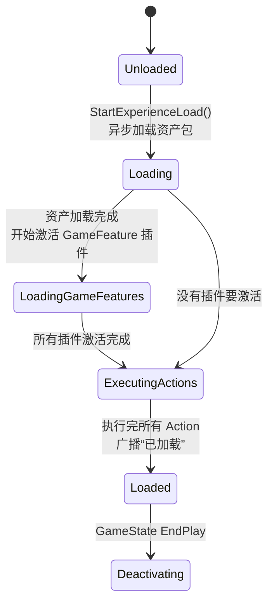
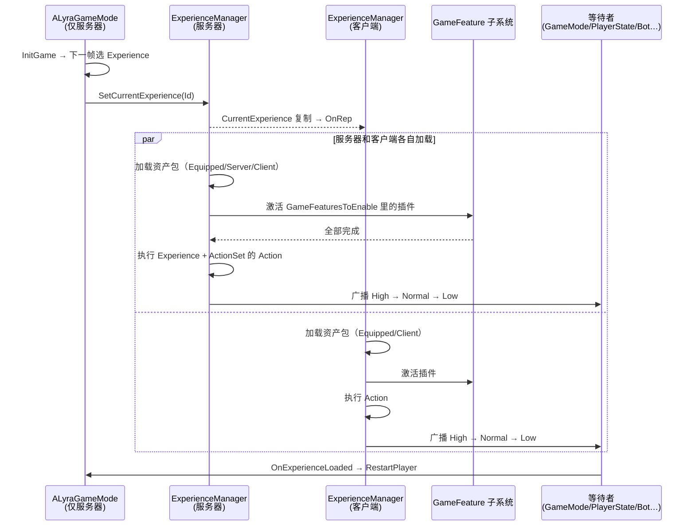

# 第 6 章　Experience 与 GameFeature：玩法即数据

## 一个问题：同一张地图，怎么跑两种玩法？

假设你接手了 Lyra，策划提了两个需求：

1. 在 `L_Expanse` 这张地图上，除了现在的团队死斗，再加一个“占点模式”；
2. 下个月还要加一个俯视角的派对玩法，由另一个小组开发，**不准他们改核心代码**。

如果你按 UE 入门教程的习惯来做，大概会这么写：建一个 `AControlPointGameMode`，在里面写计分规则；在 `AMyCharacter` 蓝图里加上占点要用的技能；在 PlayerController 的 `BeginPlay` 里 `CreateWidget` 出占点 HUD；地图的 World Settings 里把 GameMode Override 改成新的 GameMode。

这么做第一个模式没问题，但很快就会遇到这些麻烦：

- 一张地图只能在 World Settings 里指定一个 GameMode。想在同一张地图上跑两种模式，要么复制地图，要么在启动 URL 里用 `?game=` 指定类，类名就写死在各处。
- 团队死斗和占点有 80% 的逻辑是一样的（出生、HUD 框架、输入、Bot），两个 GameMode 子类要么互相复制，要么搞出一个越来越胖的基类。
- 角色蓝图里塞满了“只有某个模式才用”的技能和组件，主菜单里那个用来展示的角色也被迫加载了这些东西。
- 派对玩法的小组想加东西，就必须改你的 GameMode、角色蓝图和 PlayerController——这正是策划说的“不准”。

这一章讲 Lyra 怎么解决这件事。答案的核心只有一句话：**“玩什么”不由 GameMode 类决定，而由一份叫 Experience 的数据资产决定；具体的玩法内容放在 GameFeature 插件里，在需要时才激活并“注入”到游戏世界。** Epic 的官方总览页用一个类比描述 Experience：“一个更高级的 GameMode”。这个类比好懂，但请记住实现上的区别：GameMode 依然只有一个，Experience 是一份数据，不是 GameMode 的子类。

## 读完本章你能……

- 说出一个 Experience 资产里有哪四样东西，以及各自的作用；
- 说出 Lyra 选择 Experience 的 5 个来源和它们的优先级；
- 画出 Experience 从“被选中”到“加载完成”的 4 个阶段，并说出每个阶段在服务器和客户端上各做了什么；
- 解释为什么玩家在 Experience 加载完成前不会出生，以及“晚到”的系统怎么拿到“已加载”的通知；
- 动手新建一个 Experience，并在 PIE 和命令行中启动它。

## 需要先知道的 UE 概念

本章会用到前几章讲过的几个概念，先快速回顾一下：

- **主资产（Primary Asset）和 AssetManager**：主资产是能被 AssetManager 按“类型 + 名字”（`FPrimaryAssetId`，例如 `LyraExperienceDefinition:B_ShooterGame_Elimination`）找到的资产。AssetManager 在启动时按 `DefaultGame.ini` 的规则扫描目录，建立“ID → 资产路径”的索引。不熟悉的话回看 [第 4 章](04-DataAndAssets.md)的“数据资产与主资产”和“AssetManager”两节。
- **类默认对象（CDO）**：每个 UClass 都有一个默认实例，里面存着这个类所有属性的默认值。蓝图里在“类默认值”面板填的数，存的就是 CDO。见 [第 1 章](01-UObject.md)。
- **GameState 组件**：GameState 在服务器和所有客户端上都存在，挂在它上面的组件也一样，适合放“整局游戏共享的状态”。见 [第 2 章](02-GameplayFramework.md)。
- **OnRep 回调**：服务器修改一个被复制的属性后，客户端收到新值时自动调用的函数。见 [第 3 章](03-Networking.md)。
- **资产包（Asset Bundle）与 `CallOrRegister`**：资产包是把一个主资产的软引用按名字分组、运行时按需加载某几组的机制；`CallOrRegister` 是“已就绪就立刻调用，否则登记等待”的模式。都见[第 4 章](04-DataAndAssets.md)。

本章新出现的概念只有一个：GameFeature 插件。

### GameFeature 插件是什么

UE 的普通插件（Plugin）你可能已经用过：一个带 `.uplugin` 文件的文件夹，里面可以有 C++ 模块和内容资产，项目启动时按配置加载。

**GameFeature 插件**（简称 GFP）是 UE 5 引入的一种特殊插件，它和普通插件的区别在于：**它有一个可以在运行时切换的状态**。按 Epic 的官方文档，一个 GameFeature 插件可以处于“已安装（Installed）→ 已注册（Registered）→ 已加载（Loaded）→ 已激活（Active）”这样一串状态之间，游戏运行中可以随时把它激活或停用。官方把 Registered 当作理想的初始状态（插件被登记、但不生效），激活中的插件不要去编辑。官方列出的好处是：代码库干净、无关功能之间没有意外的依赖，尤其适合功能集随时间变化的线上产品。GameFeature 插件必须放在 `Plugins/GameFeatures/` 目录下才会被引擎发现；启用 Game Features 和 Modular Gameplay 两个引擎插件之后，新建插件时会多出 “Game Feature (Content Only)” 和 “Game Feature (with C++)” 两个模板。

激活时它做什么？每个 GameFeature 插件都有一个 `GameFeatureData` 资产，里面列着一组 **Action（动作，`UGameFeatureAction`）**。Action 是一个“激活时对游戏做点什么、停用时撤销”的小对象，例如：

- “给所有 `ALyraCharacter` 加上某个组件”；
- “给 PlayerState 授予某组技能”；
- “往 HUD 上加一个控件”；
- “注册一组输入映射”。

引擎自带的 Action 有 Add Components、Add Cheats、Add Data Registry 等几种，官方说 Add Components 是最常见的用法；Lyra 又自己写了授予技能、加 HUD 控件、绑定输入等 Action（第 7 章细讲）。

可以把 GameFeature 插件想成**一个可以热插拔的玩法模块**，把 Action 想成**模块插上时要执行的安装脚本**（脚本自带卸载逻辑）。不过这个类比有一处不准确：Action 并不是插上那一刻对现有对象执行一次就完了，它通常是“订阅”某类 Actor，之后才出生的 Actor 也会被处理。这个机制第 7 章会细讲。

在 Lyra 的 `.uplugin` 里，这些插件的初始状态被设置为 `Registered`，见 `Plugins/GameFeatures/ShooterCore/ShooterCore.uplugin` 里的 `BuiltInInitialFeatureState`。也就是说，**游戏启动时 ShooterCore 里的玩法并不生效**，要等某个 Experience 说“我需要 ShooterCore”，它才会被激活。

## Experience 里有什么

打开编辑器，在内容浏览器里找到 `ShooterCore 内容/Experiences/B_ShooterGame_Elimination`（团队死斗模式的 Experience），双击打开。你会看到它的类默认值里有四组设置。它们对应 C++ 类 `ULyraExperienceDefinition` 的四个属性：

```cpp
// 简化自 Source/LyraGame/GameModes/LyraExperienceDefinition.h
UCLASS(BlueprintType, Const)
class ULyraExperienceDefinition : public UPrimaryDataAsset
{
    // 1. 需要激活哪些 GameFeature 插件（填插件名，比如 "ShooterCore"）
    UPROPERTY(EditDefaultsOnly)
    TArray<FString> GameFeaturesToEnable;

    // 2. 玩家默认用什么“角色配置”出生（第 8 章详讲 PawnData）
    UPROPERTY(EditDefaultsOnly)
    TObjectPtr<const ULyraPawnData> DefaultPawnData;

    // 3. 这个 Experience 自己要执行的 Action 列表
    UPROPERTY(EditDefaultsOnly, Instanced)
    TArray<TObjectPtr<UGameFeatureAction>> Actions;

    // 4. 复用的 Action 集合（多个 Experience 共享的部分）
    UPROPERTY(EditDefaultsOnly)
    TArray<TObjectPtr<ULyraExperienceActionSet>> ActionSets;
};
```

注意几个细节：

- 它继承自 `UPrimaryDataAsset`，所以是一个**主资产**，可以被 AssetManager 按 ID 查找。
- `UCLASS` 里的 `Const` 表示这个类的实例运行时不应被修改。
- `Actions` 上的 `Instanced` 说明数组里的每个 Action 都是这个资产“私有”的子对象，在编辑器里可以直接展开编辑它的属性，而不是引用另一个独立资产。

以团队死斗 `B_ShooterGame_Elimination` 为例，这四样东西填的是：

- `GameFeaturesToEnable`：`ShooterCore`；
- `DefaultPawnData`：`HeroData_ShooterGame`（射击英雄，带跳跃、冲刺、手雷等技能）；
- `ActionSets`：四个共享集合，分别负责共享输入（`LAS_ShooterGame_SharedInput`）、标准组件（`LAS_ShooterGame_StandardComponents`，含快捷栏、飘字等）、标准 HUD（`LAS_ShooterGame_StandardHUD`）、击杀勋章（`EAS_BasicShooterAcolades`）；
- `Actions`：只属于团队死斗的部分——给 `LyraPlayerState` 加“按住看记分板”和“自动复活”技能（`AbilitySet_Elimination`）；给 `LyraGameState` 加计分组件、背景音乐、Bot 生成组件、两队创建组件、出生点规则组件；给 `Controller` 加随机角色外观组件 `B_PickRandomCharacter`；往 HUD 的 `HUD.Slot.TeamScore` 槽位放比分控件。

再打开占点模式 `B_LyraShooterGame_ControlPoints` 对比一下：它的 `GameFeaturesToEnable`、`DefaultPawnData`、`ActionSets` 和团队死斗**完全一样**，区别只在 `Actions` 里——计分组件换成了占点计分，HUD 上放的是占点状态控件。

**这就是 Experience 的核心思想：一种玩法 = 一组共享的积木（ActionSet）+ 这个玩法独有的几块积木（Actions）。** 整个 Lyra 只有一个 GameMode 类 `ALyraGameMode`，它根本不知道“团队死斗”和“占点”的存在。

### 为什么是“组合”而不是“继承”

你可能会想：占点和团队死斗这么像，为什么不让 `B_ControlPoints` 继承 `B_Elimination`，只改不同的部分？

Lyra 明确禁止这么做。在 `ULyraExperienceDefinition::IsDataValid` 里，如果发现一个 Experience 蓝图的父类是另一个 Experience 蓝图，会直接报数据校验错误，错误信息写的是：“不支持 Blueprint experience 的蓝图子类（请改用 ActionSet 组合）”。

原因（推断，源码里只有“请改用 ActionSet 组合”这句提示，没有解释动机）可能在于数组属性的继承语义很容易出错：子类如果修改了 `Actions` 数组，是“在父类基础上追加”还是“整个替换”？蓝图里改数组属性的默认值，通常是整个替换。于是你在子类里加了一个 Action，父类的所有 Action 就可能悄悄消失——玩家进游戏发现不能动了，因为输入绑定的 Action 不见了。而 ActionSet 的语义是明确的：Experience 用到的 Action = 自己的 `Actions` + 每个 ActionSet 的 `Actions`，全部执行，没有覆盖。

## Experience 是怎么被选中的

现在我们知道 Experience 里有什么了。下一个问题是：进入一张地图时，Lyra 怎么决定用哪个 Experience？

回忆第 5 章的主干时序：地图加载后，服务器创建 GameMode，GameMode 在**下一帧**开始选择 Experience。选择逻辑全部在 `ALyraGameMode::HandleMatchAssignmentIfNotExpectingOne` 这一个函数里。它按顺序尝试 5 个来源，**先找到的生效**：

```cpp
// 简化自 Source/LyraGame/GameModes/LyraGameMode.cpp 的 ALyraGameMode::HandleMatchAssignmentIfNotExpectingOne
FPrimaryAssetId ExperienceId;

// ① 地图 URL 里的选项，例如 open L_Expanse?Experience=B_ShooterGame_Elimination
if (!ExperienceId.IsValid() && UGameplayStatics::HasOption(OptionsString, TEXT("Experience")))
{
    const FString Name = UGameplayStatics::ParseOption(OptionsString, TEXT("Experience"));
    // 类型固定为 LyraExperienceDefinition，名字就是资产名
    ExperienceId = FPrimaryAssetId(FPrimaryAssetType(ULyraExperienceDefinition::StaticClass()->GetFName()), FName(*Name));
}

// ② 编辑器里的开发者设置（只在 PIE 中生效）
if (!ExperienceId.IsValid() && World->IsPlayInEditor())
{
    ExperienceId = GetDefault<ULyraDeveloperSettings>()->ExperienceOverride;
}

// ③ 命令行参数 -Experience=xxx
// ④ 地图 World Settings 里的 DefaultGameplayExperience
// （代码结构相同，此处省略）

// 找到了 ID，但 AssetManager 里查不到这个资产 → 打错误日志，当作没找到
if (ExperienceId.IsValid() && !AssetManager.GetPrimaryAssetData(ExperienceId, Dummy))
{
    ExperienceId = FPrimaryAssetId();
}

// ⑤ 都没有：专用服务器走登录流程；否则用硬编码的默认 Experience
if (!ExperienceId.IsValid())
{
    if (TryDedicatedServerLogin()) { return; }
    ExperienceId = FPrimaryAssetId(FPrimaryAssetType("LyraExperienceDefinition"), FName("B_LyraDefaultExperience"));
}

OnMatchAssignmentGiven(ExperienceId, ExperienceIdSource);
```

几个值得注意的地方：

**为什么要等到下一帧？** `InitGame` 里只是 `SetTimerForNextTick` 安排了这个函数。源码注释说是“给启动设置留出初始化的时间”（Wait for the next frame to give time to initialize startup settings）。至于具体等的是什么，注释没说；一个合理的推断是 `InitGame` 发生在 World 初始化早期，GameState 等对象还没创建完，下一帧再选更安全。

**为什么 URL 选项优先级最高？**（推断）因为“从主菜单开一局”的流程靠它实现。玩家在主菜单选了“团队死斗”，前端会构造一个类似 `L_Expanse?listen?Experience=B_ShooterGame_Elimination` 的 URL 去切换地图（第 21 章会讲这个 URL 是怎么拼出来的）。这样地图本身不需要知道自己会被用来跑哪种玩法。另外，源码注释的优先级列表最前面还写了“Matchmaking assignment (if present)”，但当前函数里没有这个来源，所以我们只讲实际存在的这几个。

**ID 只是一个名字。** 无论来自 URL 还是命令行，最终都是“类型 `LyraExperienceDefinition` + 资产名”。AssetManager 必须能通过这个 ID 找到资产，前提是资产放在被扫描的目录里。打开 `Config/DefaultGame.ini`，找到 `PrimaryAssetType="LyraExperienceDefinition"` 那一行，可以看到核心内容只扫描 `/Game/System/Experiences`（外加前端 Experience 这一个特例）。那 ShooterCore 插件里的 Experience 是怎么被找到的？GameFeature 子系统在插件进入 Registered 状态时，会把插件 `GameFeatureData` 里声明的扫描规则加进 AssetManager（第 4 章“AssetManager”一节讲了源码里的这一步）。所以新建的玩法目录，必须被“项目 ini 的规则”或“插件 GameFeatureData 的规则”二者之一覆盖，否则就找不到。**新建的 Experience 放错目录、找不到，是新手最常见的问题之一**，日志里会看到 `Wanted to use ... but couldn't find it` 或 `Invalid Primary Asset Id`。

在主菜单里，玩家点选的其实是另一种资产 `ULyraUserFacingExperienceDefinition`（“面向用户的 Experience”，带标题、图标、`MapID` 和一个指向真正 Experience 的 `ExperienceID`）。它有一个 `bShowInFrontEnd` 选项，关掉就不在主菜单里显示这个模式。主菜单选中后拼出带 `?Experience=` 的 URL，第 21 章会讲这个过程。主菜单自己也是一个 Experience：前端地图 `L_LyraFrontEnd` 的默认 Experience 是 `B_LyraFrontEnd_Experience`。

最后，`OnMatchAssignmentGiven` 在 GameState 上找到 `ULyraExperienceManagerComponent`，调用它的 `SetCurrentExperience`。从这里开始，工作交给 Experience 管理组件。

## Experience 是怎么被加载的

`ULyraExperienceManagerComponent` 是挂在 `ALyraGameState` 上的组件（在 GameState 的构造函数里创建）。它是整个 Experience 机制的核心，内部是一个小状态机：



（实际还有一个 `LoadingChaosTestingDelay` 状态，用于人为延迟加载来测试，实验 2 会用到。）

下面按阶段走一遍。

### 阶段 1：设置 CurrentExperience，并复制给客户端

```cpp
// 简化自 Source/LyraGame/GameModes/LyraExperienceManagerComponent.cpp
void ULyraExperienceManagerComponent::SetCurrentExperience(FPrimaryAssetId ExperienceId)
{
    // ID → 资产路径 → 同步加载蓝图类
    FSoftObjectPath AssetPath = ULyraAssetManager::Get().GetPrimaryAssetPath(ExperienceId);
    TSubclassOf<ULyraExperienceDefinition> AssetClass = Cast<UClass>(AssetPath.TryLoad());
    check(AssetClass);

    // 关键：用的是蓝图类的 CDO，而不是 new 一个实例
    const ULyraExperienceDefinition* Experience = GetDefault<ULyraExperienceDefinition>(AssetClass);

    check(CurrentExperience == nullptr);   // 一局只能设一次
    CurrentExperience = Experience;         // 这是一个被复制的属性
    StartExperienceLoad();
}

void ULyraExperienceManagerComponent::OnRep_CurrentExperience()
{
    StartExperienceLoad();                  // 客户端收到后，自己开始加载
}
```

这里有两个重要的设计。

第一，**Experience 用的是 CDO**。Experience 资产其实是一个蓝图类（继承自 `ULyraExperienceDefinition`），你在编辑器里填的那些值都存在它的 CDO 上。Lyra 不创建实例，直接读 CDO。这就是为什么类上标了 `Const`——CDO 是全局共享的，运行时改了它，下一局也会受影响。

第二，**服务器只负责“选”，加载由每一端自己完成**。`CurrentExperience` 是被复制的属性。服务器设置它之后，每个客户端都会收到 `OnRep_CurrentExperience` 回调，然后各自调用 `StartExperienceLoad`。注意 `LoadState`（加载进度）**不**复制：服务器和每个客户端的加载进度是独立的，谁先加载完都可以。

这个设计让“中途加入”变得很简单：一个玩家在比赛进行到一半时连进来，GameState 复制过来时 `CurrentExperience` 已经有值，客户端马上收到 OnRep，开始加载，和一开始就在的玩家走完全相同的流程。服务器不需要为迟到的玩家做任何特殊处理。

### 阶段 2：异步加载资产包

`StartExperienceLoad` 把 Experience 自己和它引用的所有 ActionSet 交给 AssetManager，要求加载其中标记为特定**资产包（Bundle）**的资源：

```cpp
// 简化自 ULyraExperienceManagerComponent::StartExperienceLoad
LoadState = ELyraExperienceLoadState::Loading;

TSet<FPrimaryAssetId> BundleAssetList;
BundleAssetList.Add(CurrentExperience->GetPrimaryAssetId());
for (const auto& ActionSet : CurrentExperience->ActionSets)
{
    BundleAssetList.Add(ActionSet->GetPrimaryAssetId());
}

TArray<FName> BundlesToLoad;
BundlesToLoad.Add(FLyraBundles::Equipped);
// 专用服务器不加载纯客户端资源（比如 HUD 控件），纯客户端不加载纯服务器资源
const ENetMode NetMode = GetOwner()->GetNetMode();
if (GIsEditor || NetMode != NM_DedicatedServer) { BundlesToLoad.Add(UGameFeaturesSubsystemSettings::LoadStateClient); }
if (GIsEditor || NetMode != NM_Client)          { BundlesToLoad.Add(UGameFeaturesSubsystemSettings::LoadStateServer); }

// 异步加载资产包；若资产已在内存则立刻触发，否则绑定完成回调 OnExperienceLoadComplete
TSharedPtr<FStreamableHandle> Handle = AssetManager.ChangeBundleStateForPrimaryAssets(
    BundleAssetList.Array(), BundlesToLoad, {}, false, FStreamableDelegate(), FStreamableManager::AsyncLoadHighPriority);
FStreamableDelegate OnAssetsLoadedDelegate = FStreamableDelegate::CreateUObject(this, &ThisClass::OnExperienceLoadComplete);
if (!Handle.IsValid() || Handle->HasLoadCompleted()) { FStreamableHandle::ExecuteDelegate(OnAssetsLoadedDelegate); }
else { Handle->BindCompleteDelegate(OnAssetsLoadedDelegate); }
```

资产包是 [第 4 章](04-DataAndAssets.md) 讲过的概念：资产的某些软引用属性被打上 `meta=(AssetBundles="Client")` 之类的标记，加载这个资产时可以选择“只加载 Client 包里的东西”。标记写在 Action 内部的结构体成员上也会被自动收集（编辑器保存资产时递归扫描），所以你写自己的 Action 时，只要给软引用属性加标记，这里就能预加载；改完 Experience 或 GameFeatureData 记得保存资产，包清单才会更新。这里的意义是：**专用服务器没有屏幕，不需要加载 HUD 控件、音乐、特效这类资源**，按网络模式选择要加载的包，可以显著减少服务器的内存和加载时间。注意资产包只决定“加载哪几组软引用”，不是 pak 里的 Chunk 分块。

### 阶段 3：激活 GameFeature 插件

资产加载完成后进入 `OnExperienceLoadComplete`。它收集 Experience 和所有 ActionSet 的 `GameFeaturesToEnable`，去重后逐个激活：

```cpp
// 简化自 ULyraExperienceManagerComponent::OnExperienceLoadComplete
// 插件名 → 插件 URL（找不到就 ensure 报错并跳过）
CollectGameFeaturePluginURLs(CurrentExperience, CurrentExperience->GameFeaturesToEnable);
for (const auto& ActionSet : CurrentExperience->ActionSets)
{
    CollectGameFeaturePluginURLs(ActionSet, ActionSet->GameFeaturesToEnable);
}

NumGameFeaturePluginsLoading = GameFeaturePluginURLs.Num();
if (NumGameFeaturePluginsLoading > 0)
{
    LoadState = ELyraExperienceLoadState::LoadingGameFeatures;
    for (const FString& PluginURL : GameFeaturePluginURLs)
    {
        // 每个插件激活完成后回调 OnGameFeaturePluginLoadComplete，计数减一，减到 0 进入下一阶段
        UGameFeaturesSubsystem::Get().LoadAndActivateGameFeaturePlugin(PluginURL,
            FGameFeaturePluginLoadComplete::CreateUObject(this, &ThisClass::OnGameFeaturePluginLoadComplete));
    }
}
else
{
    OnExperienceFullLoadCompleted();
}
```

插件被激活时，**插件自己的 `GameFeatureData` 里的 Action** 会被 GameFeature 子系统执行。例如 ShooterCore 的 `GameFeatureData` 会给角色加装备管理、背包等组件——只要 ShooterCore 被激活，不管是哪个 Experience 激活的，这些组件都会加上。

这里有一个原版留下的坑：`OnGameFeaturePluginLoadComplete` 只做计数，**不检查加载结果**。插件激活失败时，流程照样往下走，玩家能进游戏但缺了东西。遇到“组件没挂上”之类的怪问题，记得去日志里搜 `LogGameFeatures`。

### 阶段 4：执行 Experience 的 Action，然后广播“已加载”

所有插件就绪后，进入最后一步 `OnExperienceFullLoadCompleted`：

```cpp
// 简化自 ULyraExperienceManagerComponent::OnExperienceFullLoadCompleted
LoadState = ELyraExperienceLoadState::ExecutingActions;

// 只作用于当前这个 World（PIE 里服务器和客户端可能在同一个进程，各有一个 World）
FGameFeatureActivatingContext Context;
Context.SetRequiredWorldContextHandle(GEngine->GetWorldContextFromWorld(GetWorld())->ContextHandle);

auto ActivateListOfActions = [&Context](const TArray<UGameFeatureAction*>& ActionList)
{
    for (UGameFeatureAction* Action : ActionList)
    {
        // 正常插件的三个阶段会分开发生，这里一口气连续调用
        Action->OnGameFeatureRegistering();
        Action->OnGameFeatureLoading();
        Action->OnGameFeatureActivating(Context);
    }
};

ActivateListOfActions(CurrentExperience->Actions);
for (const auto& ActionSet : CurrentExperience->ActionSets)
{
    ActivateListOfActions(ActionSet->Actions);
}

LoadState = ELyraExperienceLoadState::Loaded;

// 按优先级分三批通知等待者
OnExperienceLoaded_HighPriority.Broadcast(CurrentExperience);  OnExperienceLoaded_HighPriority.Clear();
OnExperienceLoaded.Broadcast(CurrentExperience);               OnExperienceLoaded.Clear();
OnExperienceLoaded_LowPriority.Broadcast(CurrentExperience);   OnExperienceLoaded_LowPriority.Clear();
```

这里有一个初学者容易混淆的点：**现在有两条执行 Action 的路径**。

| | Experience/ActionSet 里的 Action | 插件 `GameFeatureData` 里的 Action |
|---|---|---|
| 谁执行 | `ULyraExperienceManagerComponent`（上面这段代码） | GameFeature 子系统（插件激活时） |
| 作用范围 | 只作用于当前这个 World | 整个进程 |
| 什么时候撤销 | GameState 销毁时（离开这局） | 插件被停用时 |
| 适合放什么 | 某个玩法独有的东西 | 只要用了这个插件就一定需要的东西 |

“只作用于当前 World”这件事在 PIE 里很重要。用编辑器测试多人游戏时，服务器和几个客户端常常跑在同一个进程里，各自有自己的 World。如果 Action 对整个进程生效，服务器的 World 加载了 Experience，客户端 World 里的 Actor 也会被处理，会出现很难排查的串扰。

## 等待 Experience：CallOrRegister 模式

Experience 加载需要时间——可能是几百毫秒，也可能是好几秒。在这期间，很多系统都在等它：GameMode 要等它才能让玩家出生，PlayerState 要等它才知道该用哪份 PawnData，Bot 生成组件要等它才能开始生成 Bot。

### 问题：只有一次的广播，晚到的人怎么办？

最直观的做法是提供一个多播委托 `OnExperienceLoaded`，想等待的系统在初始化时订阅它。问题在于：如果某个系统**在 Experience 已经加载完之后**才订阅（比如一个中途加入的玩家的 PlayerState，或者一个由 Action 加进来、加载完成后才 `BeginPlay` 的组件），它会永远等不到这次广播。

Lyra 的解决办法是提供一组 `CallOrRegister_` 函数：

```cpp
// 简化自 Source/LyraGame/GameModes/LyraExperienceManagerComponent.cpp
void ULyraExperienceManagerComponent::CallOrRegister_OnExperienceLoaded(FOnLyraExperienceLoaded::FDelegate&& Delegate)
{
    if (IsExperienceLoaded())
    {
        Delegate.Execute(CurrentExperience);        // 已经加载完了：立刻调用
    }
    else
    {
        OnExperienceLoaded.Add(MoveTemp(Delegate)); // 还没加载完：排队等广播
    }
}
```

用法是：**任何依赖 Experience 的逻辑，都通过 `CallOrRegister_OnExperienceLoaded` 注册回调，而不是直接读 `CurrentExperience`**。这样不管调用者什么时候出现，都一定会恰好收到一次通知。这个“注册并等待”的模式在 Lyra 里随处可见（第 5 章列出的六个设计模式之一），以后看到 `RegisterAndCall`、`CallOrRegister` 这类名字，就知道是同一个思路。

与之对应，有一个函数**不要轻易使用**：`GetCurrentExperienceChecked()`。它内部 `check(LoadState == Loaded)`，在加载完成前调用会直接让游戏崩溃。

### 为什么要分三个优先级

广播分成 High、Normal、Low 三批，是为了解决等待者之间的先后顺序问题。看看 Lyra 自己是怎么用的：

- **High**：`ULyraTeamCreationComponent`（创建队伍）和前端状态组件 `ULyraFrontendStateComponent`；
- **Normal**：`ALyraGameMode`（让等待中的玩家出生）和 `ALyraPlayerState`（设置 PawnData 并授予技能）；
- **Low**：`ULyraBotCreationComponent`（生成 Bot）。

为什么 Bot 要放在 Low？因为生成 Bot 时要走和玩家一样的出生流程，需要出生点规则组件、队伍组件等等都已经就绪。放在最后一批，就能保证其他系统都处理完了。如果 Bot 生成也用 Normal 而且注册得更早，它就可能抢在规则组件就绪前生成 Bot，Bot 会出现在错误的出生点或者没有队伍。

反过来有一条容易踩的规则：**同一批里的回调顺序是不确定的**（多播委托按注册顺序广播，而注册顺序取决于各 Actor 的 `BeginPlay` 先后，这个顺序本身不确定）。所以你自己的 High 回调不能依赖队伍已经创建好，因为队伍创建恰好也在 High 里；需要队伍就放到 Normal 或更晚。蓝图里对应的是异步节点 `Wait For Experience Ready`（`UAsyncAction_ExperienceReady`），它在 Experience 加载完成后触发。

## 玩家在 Experience 加载前不会出生

把上面的内容串起来，就能解释一个现象：Experience 加载完之前，玩家没有 Pawn。

UE 默认的流程是：玩家登录后，GameMode 的 `HandleStartingNewPlayer` 会立即让他出生。Lyra 重写了这个函数：

```cpp
// 简化自 Source/LyraGame/GameModes/LyraGameMode.cpp
void ALyraGameMode::HandleStartingNewPlayer_Implementation(APlayerController* NewPlayer)
{
    // Experience 还没加载好：什么都不做，玩家先等着
    if (IsExperienceLoaded())
    {
        Super::HandleStartingNewPlayer_Implementation(NewPlayer);
    }
}

// 在 InitGameState 里通过 CallOrRegister_OnExperienceLoaded 注册的回调
void ALyraGameMode::OnExperienceLoaded(const ULyraExperienceDefinition* CurrentExperience)
{
    // 给所有还没有 Pawn 的玩家补一次出生
    for (FConstPlayerControllerIterator It = GetWorld()->GetPlayerControllerIterator(); It; ++It)
    {
        APlayerController* PC = Cast<APlayerController>(*It);
        if (PC && PC->GetPawn() == nullptr && PlayerCanRestart(PC))
        {
            RestartPlayer(PC);
        }
    }
}
```

为什么要这样？因为在 Experience 加载完成前，**玩家该用什么角色、有哪些技能、有哪些组件，都还不知道**。如果按默认流程马上出生，玩家会拿到一个没有 PawnData、没有技能、没有被 Action 处理过的“裸”角色。

这段等待期间屏幕上显示的是加载画面。`ULyraExperienceManagerComponent` 实现了加载屏系统的接口，在 Experience 加载完成前一直告诉加载屏“我还没好”。加载屏的机制在第 19 章讲。

## 把整个过程画成一张图



对照第 5 章的 12 步主干，本章讲的是第 3~7 步。第 7 章讲 Action 是怎么把组件“注入”到 Actor 上的，第 8 章讲第 8~10 步 Pawn 出生和初始化。

## 动手实验

### 实验 1：在 PIE 中切换 Experience

**目标**：亲眼看到“同一张地图，不同玩法”。

**步骤**：

1. 打开地图 `L_Expanse`（在 ShooterMaps 插件内容的 `Maps` 目录下）。
2. 打开 World Settings，找到 `Default Gameplay Experience`，记下它的值。
3. 打开 编辑 → 编辑器偏好设置（注意不是项目设置：`ULyraDeveloperSettings` 是 `config=EditorPerProjectUserSettings`，引擎会把这类设置放进编辑器偏好设置），在左侧以项目名命名的分类（`LyraStarterGame`）下找到 Lyra Developer Settings，把 `Experience Override` 设置为 `B_TopDownArenaExperience`。

**先写下你的预测**：PIE 运行后，地图会变吗？相机、操作方式、HUD 会变吗？

4. 运行 PIE，观察。
5. 结束后把 `Experience Override` 清空。

**预期结果**：地图还是 `L_Expanse`，但相机变成了俯视角，操作和 HUD 都换成了 TopDownArena 的那一套。

**原理**：PIE 时，开发者设置的优先级高于 World Settings（选择逻辑的第 ② 步早于第 ④ 步）。地图只提供场景，玩法完全由 Experience 决定。TopDownArena 的 Experience 激活的是 TopDownArena 插件而不是 ShooterCore，所以连带的组件、技能、HUD 全部不同。

### 实验 2：看看加载期间发生了什么

**目标**：理解“Experience 加载前玩家没有 Pawn”。

**步骤**：

1. 打开输出日志（窗口 → 开发者工具 → 输出日志），在过滤器里输入 `LogLyraExperience`。
2. 在点击 Play **之前**，在输出日志底部的控制台命令框输入 `lyra.chaos.ExperienceDelayLoad.MinSecs 5`。这个控制台变量会在资产包与插件都加载完之后、执行 Action 之前额外等待 5 秒。
3. 网络模式选“以客户端运行（Play As Client）”，玩家数 2，运行 PIE。

**先写下你的预测**：前 5 秒屏幕上显示什么？日志里会依次出现哪些行？服务器和客户端的日志行会混在一起吗，怎么区分？

**预期结果**：前 5 秒一直停留在加载画面。日志里先看到 1 条服务器的 `Identified experience ... (Source: ...)`，紧接着几乎立刻看到 3 条（1 服务器 + 2 客户端）`EXPERIENCE: StartExperienceLoad(...)` 和 `EXPERIENCE: OnExperienceLoadComplete(...)`；然后静默等待约 5 秒，玩家才真正出生进图——每行末尾带有 `Server` 或 `Client` 标记，表明服务器和每个客户端都在各自独立走这套加载状态机。

4. 结束后把 `lyra.chaos.ExperienceDelayLoad.MinSecs` 改回 `0`。

**原理**：`OnExperienceLoadComplete` 在资产包加载完时就打出来了，而人为延迟 `LoadingChaosTestingDelay` 加在下一阶段 `OnExperienceFullLoadCompleted` 的开头——Action 执行和“已加载”广播都被推迟了 5 秒。这期间 GameMode 的 `OnExperienceLoaded` 没有被调用，`HandleStartingNewPlayer` 也被闸住跳过，所以玩家一直没有 Pawn；加载屏一直在询问 Experience 管理组件是否进入 `Loaded`，得到的回答都是“没有”。

### 实验 3：新建你自己的 Experience

**目标**：不写一行 C++，组合出一个新玩法，并亲眼看见每一块积木缺席时的症状。

**步骤**：

1. 在 `ShooterCore Content/Experiences` 目录下，右键 → 蓝图类，父类搜索 `LyraExperienceDefinition`，命名为 `B_MyFirstExperience`。（父类必须直接是 `LyraExperienceDefinition`，不能选别的 Experience 蓝图；放在这个目录是因为 `ShooterCore` 的 `GameFeatureData` 已经配置了对 `/Experiences` 的扫描规则，AssetManager 找得到它。）
2. 打开它，在类默认值里设置：
   - `Game Features To Enable` 加一项 `ShooterCore`；
   - `Default Pawn Data` 选 `HeroData_ShooterGame`；
   - `Action Sets` 加入 `LAS_ShooterGame_SharedInput`、`LAS_ShooterGame_StandardComponents`、`LAS_ShooterGame_StandardHUD`；
   - `Actions` 先留空。
3. **保存资产（`Ctrl+S`）**，在 `编辑 → 编辑器偏好设置 → LyraStarterGame → Lyra Developer Settings` 里把 `Experience Override` 设为 `B_MyFirstExperience`，在 `L_Expanse` 中运行 PIE。

**先写下你的预测**：能移动、开枪吗？有计分板吗？有 Bot 吗？有队伍吗？角色身体长什么样？

**预期结果**：能移动、开枪，有准星和快捷栏（来自共享 ActionSet），但没有 Bot、没有计分、没有队伍——而且你会发现一个好玩的现象：**你的角色身体是隐形的，只有一把手枪悬在半空！** 这是因为 `B_Hero_ShooterMannequin` 底层主网格用的是透明骨骼 `SKM_Manny_Invis`，真正可见的男女角色模型是由团队死斗 `Actions` 里的 `B_PickRandomCharacter` 组件动态拼上去的（[第 17 章](17-AnimCosmeticsEffects.md)详讲），你的空 `Actions` 没装这块积木，自然就隐身了。

4. 进阶（把缺失的积木一块块补齐）：在 `B_MyFirstExperience` 的 `Actions` 里加一个 `Add Components`，展开添加三项组件注入（**全部只勾选 `Server`，取消 `Client`**）：
   - `Actor Class = Controller`，`Component Class = B_PickRandomCharacter`（补上可见角色模型）；
   - `Actor Class = LyraGameState`，`Component Class = B_ShooterBotSpawner`（生成 Bot）；
   - `Actor Class = LyraGameState`，`Component Class = B_TeamSetup_TwoTeams`（创建红蓝两队——没有它，全员无队伍，你打 Bot 一滴血也不会掉！）。
   改完务必**保存 `B_MyFirstExperience`（`Ctrl+S`）**以刷新资产包清单，再次运行 PIE：角色身体、Bot 和互相伤害都就位了（这一版 `B_MyFirstExperience` 在[第 15 章](15-TeamsInteractionMessages.md)实验里还可以继续复用）。
5. 进阶：独立进程运行时（`Play Standalone Game` 或命令行），需要同时传入地图名和参数：`L_Expanse -Experience=B_MyFirstExperience`（如果不指定 `L_Expanse`，默认启动的前端地图 `L_LyraFrontEnd` 会走主菜单流程）。实验结束后记得清空 `Experience Override`（若不再保留测试资产也可一并删除）。

## 做新玩法的官方工作流

实验 3 为了省事，把新 Experience 放进了 ShooterCore。真做一个新玩法时，Epic 推荐的做法是：**新建自己的 GameFeature 插件，在里面做新 Experience，不去改 Lyra 的核心代码**。这样以后升级 Lyra 时好合并，核心也始终能脱离你的玩法编译。第 22 章的综合项目就按这个流程做。

流程大致是这样（以 Epic 的教程和社区整理的步骤为依据，具体菜单名以你的编辑器为准）：

1. 在 `Plugins/GameFeatures/` 下新建 GameFeature 插件（内容插件或带 C++ 的插件），初始状态设为 Registered；
2. 编辑器启用插件后，把插件的 `GameFeatureData` 的扫描规则配好（让 Experience 和 ActionSet 所在目录被 AssetManager 扫到），需要时再给 GameplayCue 加路径；
3. 复制 `B_ShooterGame_Elimination` 作为你的开发用 Experience，改成指向你的插件；
4. 准备一张把 World Settings 的 `Default Gameplay Experience` 指向它的地图，最小关卡只要一块地板、一盏灯和一个 `LyraPlayerStart`。

社区作者 X157 还建议：二进制资产无法合并，不要原地改 Lyra 的 `.uasset`，而是复制进自己的插件再改；C++ 尽量派生而不是改核心。这与本章一直强调的原则同向：不新建 GameMode 子类，不往 Pawn 蓝图里硬塞玩法。

## 常见误区

**误区 1：在 `BeginPlay` 里直接读当前 Experience。**
`BeginPlay` 时 Experience 很可能还没加载完，`GetCurrentExperienceChecked()` 会直接崩溃。正确做法：用 `CallOrRegister_OnExperienceLoaded` 注册回调，在回调里做事。蓝图里用 `Wait For Experience Ready` 异步节点。

**误区 2：新建的 Experience 放在任意目录。**
Experience 是主资产，必须在 AssetManager 的扫描规则覆盖的目录里，否则 `?Experience=` 和 `-Experience=` 都找不到它。核心内容放 `/Game/System/Experiences`；插件里的 Experience 要确认插件 `GameFeatureData` 里有对应的扫描规则（照着 ShooterCore 的设置检查）。

**误区 3：让一个 Experience 蓝图继承另一个 Experience 蓝图。**
数据校验会报错。共享部分抽成 ActionSet，用组合代替继承。

**误区 4：运行时修改 Experience 的属性。**
`CurrentExperience` 指向的是蓝图类的 CDO，修改它会影响之后所有使用这个类的地方。需要运行时可变的状态，应该放在组件里，而不是 Experience 上。

**误区 5：以为给 Experience 加了 `GameFeaturesToEnable` 就会自动带上那个插件的所有玩法。**
激活插件只会执行插件自己 `GameFeatureData` 里的 Action。插件里各个 Experience/ActionSet 的 Action 并不会因为插件激活而执行——只有被当前 Experience 引用的才会执行。实验 3 里没有 Bot 就是这个原因。

**误区 6：新玩法写一个新的 GameMode 子类。**
在 Lyra 里这几乎总是错误的方向。玩法规则应该写成 GameState 组件（参考 `B_TeamDeathMatchScoring`），由 Experience 的 `Add Components` 注入。只有需要改变“出生/重启”这类所有玩法共用的底层流程时，才考虑修改 `ALyraGameMode`。

## 本章小结

Lyra 把“玩什么”从代码里拿出来，放进了一份叫 Experience 的数据资产。一个 Experience 描述四件事：激活哪些 GameFeature 插件、玩家用什么 PawnData、执行哪些自己的 Action、组合哪些共享的 ActionSet。整个项目只有一个 GameMode，它只负责三件事：选出 Experience、等它加载完、放玩家出生。

选择只在服务器进行（URL > PIE 开发者设置 > 命令行 > World Settings > 默认），选中后 `CurrentExperience` 复制到所有客户端，每一端独立完成“加载资产包 → 激活插件 → 执行 Action → 分三批广播”。任何依赖 Experience 的系统都用 `CallOrRegister` 注册，不管来得早还是晚都能收到恰好一次通知。

```
          ┌─────────── 服务器 ───────────┐
URL/PIE/命令行/WorldSettings/默认
          │ 选择 (GameMode)
          ▼
  CurrentExperience ──复制──▶ 每个客户端
          │                         │
          ▼                         ▼
   ┌───────── 每一端独立执行 ─────────┐
   │ ① 加载资产包（按网络模式选包）     │
   │ ② 激活 GameFeature 插件           │
   │    （插件自己的 Action 随之执行）  │
   │ ③ 执行 Experience + ActionSet 的 Action（限当前 World）│
   │ ④ 广播 High → Normal → Low        │
   └───────────────────────────────────┘
          │
          ▼
  GameMode 让等待的玩家出生 · PlayerState 设置 PawnData · Bot 生成
```

## 自测题

1. 一个 Experience 资产包含哪四样东西？各自的作用是什么？

<details><summary>答案</summary>

`GameFeaturesToEnable`：需要激活的 GameFeature 插件名；`DefaultPawnData`：玩家默认使用的角色配置；`Actions`：这个 Experience 独有的 Action；`ActionSets`：组合进来的共享 Action 集合。
</details>

2. 在 PIE 中，地图 World Settings 指定了 Experience A，开发者设置里 `Experience Override` 是 B，PIE 启动 URL 里又带了 `?Experience=C`。最终用哪个？打包后的游戏里呢？

<details><summary>答案</summary>

PIE 中用 C（URL 选项优先级最高）。打包后开发者设置不生效（它只在 `IsPlayInEditor()` 时才读），所以有 URL 选项时用 C，没有时用命令行参数，再没有才用 World Settings 的 A。
</details>

3. 客户端的 `LoadState` 为什么不需要复制？如果服务器把加载进度也复制给客户端，会有什么问题？

<details><summary>答案</summary>

每一端都要在本地加载资产、激活插件、执行 Action，加载进度是每一端自己的事情，服务器“加载完了”不代表客户端也加载完了。如果复制服务器的状态，客户端可能在自己的资产还没加载好时就被告知“已加载”，接着去访问还不存在的东西。
</details>

4. 你写了一个 GameState 组件，在它的 `BeginPlay` 里调用 `GetCurrentExperienceChecked()`，在团队死斗里运行正常，但同事说他那边一启动就崩溃。可能的原因是什么？怎么改？

<details><summary>答案</summary>

组件 `BeginPlay` 时 Experience 是否已经加载完，取决于时序：如果组件是 Experience 的 Action 加进来的，它出现时 Experience 已经快加载完了，所以碰巧没事；如果组件在别的时机创建，或者同事的机器加载慢，就会在加载完成前调用，触发 `check` 崩溃。应改为 `CallOrRegister_OnExperienceLoaded`。
</details>

5. 为什么 Bot 生成组件用的是 `CallOrRegister_OnExperienceLoaded_LowPriority`？

<details><summary>答案</summary>

Bot 走和玩家一样的出生流程，依赖出生规则组件、队伍组件等已经就绪，以及 GameMode 已经处理完正常玩家。Low 优先级保证它在所有 Normal 级等待者之后执行。
</details>

6. 设计题：策划想要“占点模式”在最后 1 分钟时把所有人的移动速度提高 50%。不改任何 C++，这个逻辑应该写在哪里？由什么机制加到游戏里？

<details><summary>答案</summary>

写成一个 GameState 组件（蓝图即可，继承 `GameStateComponent`），监听比赛剩余时间，到时间后给所有玩家施加一个提高移动速度的 Gameplay Effect（第 9 章会讲 GE）。然后在占点 Experience 的 `Actions` 里用 `Add Components` 把这个组件加到 `LyraGameState` 上（勾选仅服务器）。这样它只在占点模式生效，不影响其他玩法。
</details>

## 继续深入

参考手册：

- 函数级的完整调用链（带服务器/客户端标记）：[参考手册 10 §8.1、§8.2](../Reference/10-CoreFramework.md)；
- 每个 Experience 的完整拆解和资产引用链：[参考手册 70 §3、§9](../Reference/70-GameFeatures-Content.md)；新建插件与 Experience 的配方：[参考手册 70 §6.1](../Reference/70-GameFeatures-Content.md)。

官方资料（Lyra 相关页面写于 5.0 到 5.3 时期，与 5.8 源码冲突时以源码为准）：

- [Lyra Sample Game 总览页](https://dev.epicgames.com/documentation/en-us/unreal-engine/lyra-sample-game-in-unreal-engine)：Experience 的官方定义（“更高级的 GameMode”）、`Content` 与插件的分工；
- [Game Features and Modular Gameplay](https://dev.epicgames.com/documentation/en-us/unreal-engine/game-features-and-modular-gameplay-in-unreal-engine)：GameFeature 插件的状态、模板、内置 Action；
- Epic 教程 [How to create a new Game Feature Plugin and Experience in Lyra](https://dev.epicgames.com/community/learning/tutorials/rdW2/unreal-engine-how-to-create-a-new-game-feature-plugin-and-experience-in-lyra)（论坛讨论串在[这里](https://forums.unrealengine.com/t/tutorial-how-to-create-a-new-game-feature-plugin-and-experience-in-lyra/627240)）：官方推荐的“新建插件 + 新 Experience”工作流；
- 社区学习区的 [Modular Game Features: What you need to know](https://dev.epicgames.com/community/learning/tutorials/dz7/unreal-engine-modular-game-features-what-you-need-to-know)，以及 Epic 论坛的 [Inside Unreal: Modular Game Features](https://forums.unrealengine.com/t/inside-unreal-modular-game-features/242614)（4.27 时期的直播，早于 Lyra，讲的是 GameFeature 本身）。

社区资料（多写于 5.0 到 5.5）：

- X157，[Lyra Experience](https://x157.github.io/UE5/LyraStarterGame/Experience/)：Experience 的加载状态、三档优先级，以及“不要在 `BeginPlay` 里启动玩法，要等 `OnExperienceLoaded`”；
- X157，[How to Create a GameFeature Experience](https://x157.github.io/UE5/LyraStarterGame/How-To-Create-New-GameFeature-Dev-Experience) 与 [Create a GameFeature Plugin](https://x157.github.io/UE5/LyraStarterGame/How-To-Create-a-GameFeature-Plugin.html)：本章“官方工作流”一节的分步版本；
- unrealist.org，[Lyra Deep Dive 第 2 章：Experiences](https://unrealist.org/lyra-part-2/)。

注意：Unreal Fest 2024 的《Plugin-afying Lyra》是第三方工作室的分享，不代表 Epic 的观点，这里不引用它的结论。

本书内部：

- 上一章：[第 5 章　鸟瞰 Lyra：四个需求推出五个决定](05-BirdsEye.md)；
- 下一章：[第 7 章　组件注入：Modular Actor 与 GameFrameworkComponentManager](07-ModularGameplay.md)，我们会打开 `Add Components` 这个 Action，看它是怎么做到“现在的和将来出生的 Actor 都会被加上组件”的；
- 第 22 章的综合项目会把这里的“官方工作流”完整走一遍：[第 22 章](22-Capstone.md)。
