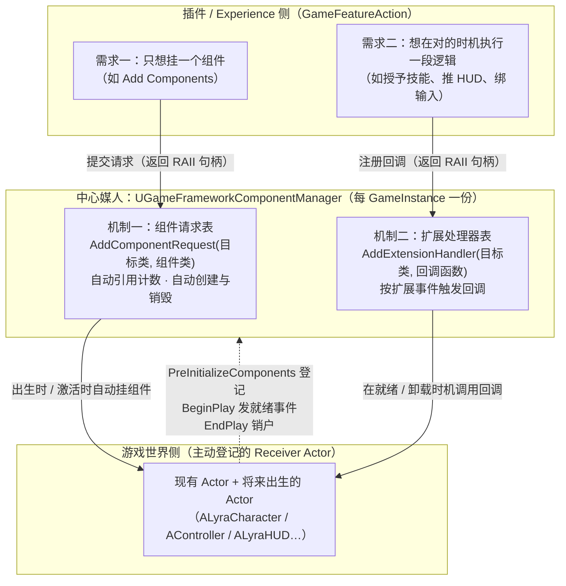
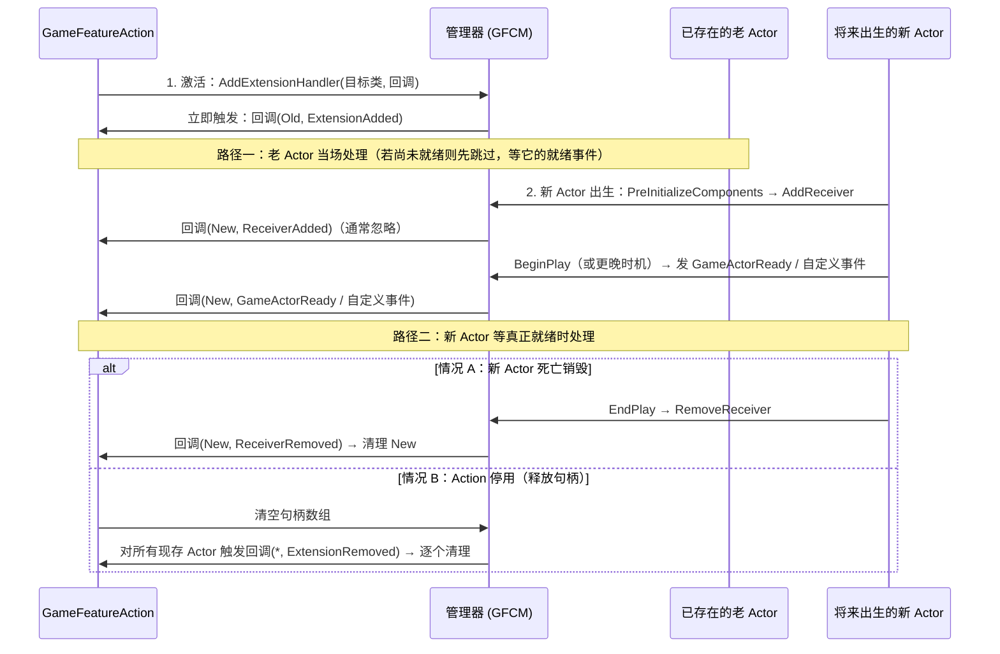

# 第 7 章　组件注入：Modular Actor 与 GameFrameworkComponentManager

## 一个问题：插件怎么给一个“不属于它”的类塞东西？

在编辑器里打开 `ShooterCore` 插件的 `GameFeatureData` 资产（`/ShooterCore/ShooterCore`），展开第一项 `Add Components`，你会看到这样几条配置：

- 给 `ALyraCharacter` 挂上装备管理组件 `ULyraEquipmentManagerComponent`；
- 给 `AController` 挂上背包管理组件 `ULyraInventoryManagerComponent`；
- 给 `ALyraPlayerController`（仅客户端）挂上指示器管理组件 `ULyraIndicatorManagerComponent`。

换句话说，只要当前 Experience 激活了 `ShooterCore`，场上所有角色身上就会多出一个管装备的组件，所有控制器（包括人类玩家和 AI Bot）身上都会多出一个管背包的组件；一旦离开这局、`ShooterCore` 停用，这些组件又会干干净净地消失。

可是 `ALyraCharacter` 和 `AController` 都在核心模块或引擎里，不属于 `ShooterCore`。回忆第 5 章立下的铁律：**核心 C++ 绝不引用插件内容**。`ALyraCharacter` 的源码里没有一行提到“装备”，`ShooterCore` 也不能反过去改核心类的头文件。这件事到底是怎么做到的？

先想想如果由你来实现，需要同时满足哪四个条件：

1. **既管现在的，也管将来的**：插件激活时场上可能已经有几个 Pawn；之后死亡重生的 Pawn、中途连进来的玩家的 Pawn、新刷出来的 Bot，也必须拿到组件。
2. **可对称撤销**：插件或 Experience 停用时，加进去的东西必须全部拆掉，不能残留。
3. **可叠加（引用计数）**：如果两个插件（或一个插件加一个 ActionSet）都要求给 `ALyraCharacter` 加同一个组件，只应该创建一份；其中一个停用时，只要另一个还在用，组件就不能被拆掉。
4. **按网络端区分**：有的组件只需要服务器有（比如刷 Bot 规则），有的只需要客户端有（比如 HUD 指示器），还有的组件自身开启了网络复制。

按直觉想到的几种写法，都会在上面某一条栽跟头：

- **做法 A：插件激活时遍历世界里所有 Pawn，`NewObject` + `RegisterComponent`。** 之后重生的 Pawn 全部漏掉；停用时还得自己记账拆组件，多插件叠加更要手写引用计数。
- **做法 B：在 `ALyraCharacter::BeginPlay` 里加。** 核心类被迫依赖插件类，直接违反依赖方向。
- **做法 C：直接挂进 Pawn 蓝图。** 变成硬引用，所有模式（甚至主菜单展示模型）都被迫加载它，回到第 5 章的老问题。
- **做法 D：监听 `World->AddOnActorSpawnedHandler`，每生成一个 Actor 就塞组件。** 最接近正确答案，但回调发生得太早或太晚都容易错乱组件初始化生命周期，而且所有无关 Actor（特效、子弹、静态摆件）生成都会触发回调，去重与撤销依然要自己造轮子。

UE 引擎的 **ModularGameplay** 插件给出的解法非常干净——在插件和 Actor 中间放一个“婚介所”，叫 **`UGameFrameworkComponentManager`**（简称 **GFCM**，组件管理器）：

- **Actor 这一侧**：想要支持被扩展的 Actor 类，在出生和销毁时主动向管理器“登记/销户”（只用三行静态调用）；
- **插件（Action）这一侧**：激活时向管理器提交一张“订阅单”，拿到一个 RAII 句柄；句柄一释放，订阅自动撤销。

管理器内部其实只提供**两套扩展手段**，由浅入深分别解决两类需求：



以前读这一章容易晕，往往是因为把“自动挂组件（机制一）”和“监听事件跑回调（机制二）”混在了一起。本章我们把它们彻底拆开：**先看 Actor 怎么登记，再走通最简单的机制一（回答开头 `Add Components` 的问题），接着升级到机制二（看懂 `Add Widgets`、`Add Abilities` 为什么都长一个样），最后亲手写一个自己的 Action。**

## 读完本章你能……

- 说出 Actor 成为“接收者（Receiver）”需要哪三行调用，以及漏写它们会出现什么诡异症状；
- 讲清楚**机制一（`AddComponentRequest` + `Add Components`）**怎么同时覆盖现有与未来的 Actor、怎么靠引用计数叠加，以及服务器/客户端/复制组件三者如何配合；
- 讲清楚**机制二（`AddExtensionHandler` + 扩展事件）**为什么需要同时处理 `ExtensionAdded`、就绪事件和移除事件（“双路径 + 清理”标准模板）；
- 解释为什么每个 Action 都要继承 `UGameFeatureAction_WorldActionBase`，用 `ContextData` 按世界分账；
- 照着标准骨架写出自己的 `UGameFeatureAction`。

## 需要先知道的 UE 概念

**游戏实例子系统（`UGameInstanceSubsystem`）。** 第 2 章讲过子系统是引擎自动管理生命周期的单例。游戏实例子系统跟着 `UGameInstance` 同生共死，**跨越地图切换**。本章主角 `UGameFrameworkComponentManager` 就是这种子系统。请牢记一个关键边界：**它是“每个 GameInstance 一份”，不是整个操作系统进程一份。** 当你在编辑器里用 `Play As Client` 开 1 个服务器 + 2 个客户端跑 PIE 时，同一个编辑器进程里有 3 个 `GameInstance`，因此有 **3 个彼此独立的管理器**。Epic 官方文档说明，这个管理器专门服务于模块化玩法，内部包含两半功能：一半是本章讲的**组件请求与扩展处理器**，另一半是下一章讲的**初始化状态链（InitState）**。

**ModularGameplay 的四个组件基类。** 引擎的 `ModularGameplay` 插件还顺带提供了 `UPawnComponent`、`UControllerComponent`、`UPlayerStateComponent`、`UGameStateComponent` 四个基类。它们本质上就是普通的 `UActorComponent`，只多了一点小便利（比如提供 `GetPawn<T>()`、`GetController<T>()` 这样的类型转换辅助函数，以及接收宿主的部分转发调用）。

**软类引用（`TSoftClassPtr`）与两条 Action 执行路径。** 管理器记录“给哪个 Actor 类加东西”用的是软类引用（[第 4 章](04-DataAndAssets.md)），目标蓝图还没加载进内存也能提前登记。而触发 Action 的两条路径已在 [第 6 章](06-Experience.md) 讲过：既可以放在插件自己的 `GameFeatureData` 里（插件激活时对所有世界生效），也可以放在 Experience / ActionSet 里（Experience 加载到阶段 4 时只对当前世界生效）。两条路径最终调用的都是下面同一套管理器接口。

---

## 第一步：Actor 怎么“举手”成为接收者（Receiver）

管理器不会去全图扫描成千上万个静态网格体、灯光和粒子。一个 Actor 想要被插件扩展，必须自己主动举手（opt-in），告诉管理器：“我是接收者”。

引擎在 `ModularGameplayActors` 插件（本工程位于 `Plugins/ModularGameplayActors/`）里提供了一组打包好这项工作的基类：`AModularCharacter`、`AModularPawn`、`AModularPlayerController`、`AModularAIController`、`AModularPlayerState`、`AModularGameStateBase`。打开 `Plugins/ModularGameplayActors/Source/ModularGameplayActors/Private/ModularCharacter.cpp`，全部代码只有三个函数：

```cpp
// 来自 Plugins/ModularGameplayActors/.../Private/ModularCharacter.cpp 的 AModularCharacter
void AModularCharacter::PreInitializeComponents()
{
    Super::PreInitializeComponents();
    // ① 出生早期的“组件初始化之前”：举手登记
    // 管理器此刻就会把订阅单里匹配的组件创建出来，让新组件赶上后续正常的 InitializeComponent 和 BeginPlay！
    UGameFrameworkComponentManager::AddGameFrameworkComponentReceiver(this);
}

void AModularCharacter::BeginPlay()
{
    // ② 赶在 Super::BeginPlay（含蓝图 Event BeginPlay）之前，广播“我已基本就绪”事件（供机制二使用）
    UGameFrameworkComponentManager::SendGameFrameworkComponentExtensionEvent(
        this, UGameFrameworkComponentManager::NAME_GameActorReady);
    Super::BeginPlay();
}

void AModularCharacter::EndPlay(const EEndPlayReason::Type EndPlayReason)
{
    // ③ 销毁或离开世界时：销户，管理器会自动拆掉它加过的组件，并通知处理器清理
    UGameFrameworkComponentManager::RemoveGameFrameworkComponentReceiver(this);
    Super::EndPlay(EndPlayReason);
}
```

就这么三行静态调用，支撑起了整个模块化注入的被扩展端。（唯一的微调在 `AModularPlayerController`：它把第 ② 步的 `NAME_GameActorReady` 放在 `ReceivedPlayer()` 里也发了一次，因为控制器要绑定到玩家后才算真正可用。）

理解接收者只需要记住两条规则：

1. **按继承链向上匹配。** 当一个 `B_Hero_ShooterMannequin` 实例调用 `AddReceiver` 时，管理器会顺着它的类继承链一路往上查（`B_Hero_ShooterMannequin` → `B_Hero_Default` → `Character_Default` → `ALyraCharacter` → …，直到 `AActor` 之前）。所以 `ShooterCore` 写“给 `ALyraCharacter` 加装备组件”，所有英雄蓝图实例都会命中；写“给 `AController` 加背包组件”，人类玩家的 `ALyraPlayerController` 和 AI 的 `ALyraPlayerBotController` 都会命中。
2. **`Modular*` 基类只是语法糖，不是硬门槛。** 如果你的类因为引擎继承关系没法继承 `Modular*`，自己把上面那三行抄进去效果完全一样。比如 `ALyraHUD` 必须继承引擎的 `AHUD`，它就在 `Source/LyraGame/UI/LyraHUD.cpp` 里原封不动写了这三行，因此照样能接收 UI 注入。

---

## 机制一：自动挂组件——组件请求与 `Add Components`

现在直接回答本章开头的问题：`ShooterCore` 的 `Add Components` 是怎么把装备组件挂到每个 `ALyraCharacter` 身上、又在停用时拆掉的？

答案是管理器的第一个核心接口：**`AddComponentRequest(ReceiverClass, ComponentClass)`**（提交组件请求）。它完全**不需要**写任何回调函数，也不涉及后面要讲的扩展事件。

### 管理器内部做了什么

读一下引擎 `UGameFrameworkComponentManager::AddComponentRequest` 的简化逻辑：

```cpp
// 简化自 Engine/Plugins/Runtime/ModularGameplay 的 UGameFrameworkComponentManager::AddComponentRequest（引擎源码）
int32& RequestCount = RequestTrackingMap.FindOrAdd(NewRequest); // 以 (目标 Actor 类, 组件类) 为键
RequestCount++;                                                 // 引用计数 +1

if (RequestCount == 1)                                          // 首次请求才真正动手；第 2 次只加计数
{
    // ① 记入请求表：将来新出生的接收者在 PreInitializeComponents 调 AddReceiver 时，查这张表自动创建组件
    ReceiverClassToComponentClassMap.FindOrAdd(ReceiverClassPath).Add({ ComponentClassPtr, AdditionFlags });

    // ② 补齐当前世界里“已经存在且初始化完”的同类型 Actor
    for (TActorIterator<AActor> ActorIt(LocalWorld, ReceiverClassPtr); ActorIt; ++ActorIt)
    {
        if (ActorIt->IsActorInitialized())
        {
            CreateComponentOnInstance(*ActorIt, ComponentClass, AdditionFlags);
        }
    }
}

// ③ 返回 RAII 句柄：当句柄引用归零析构时，自动执行 RemoveComponentRequest
return MakeShared<FComponentRequestHandle>(this, ReceiverClass, ComponentClass);
```

回头对照开头的前三个难题，这十几行代码一次性全解决了：

- **现在的 + 将来的**：步骤 ② 遍历世界补齐**现有的** Actor；步骤 ① 写入请求表，**将来出生的** Actor 在 `PreInitializeComponents` 里调 `AddReceiver` 时查表命中，当场挂上组件，赶得上正常的初始化生命周期。
- **可叠加**：靠 `RequestCount` 引用计数。两个插件同时请求给 `ALyraCharacter` 挂同一个组件，计数变为 2，组件只建一份。
- **可对称撤销**：返回的 `TSharedPtr<FComponentRequestHandle>` 是标准的 **RAII 句柄（句柄存活 = 请求有效，句柄析构 = 自动撤销）**。每析构一个句柄，计数减 1；减到 0 时，管理器把当初记在账本上的那些组件实例逐个 `DestroyComponent()`。Action 的代码只需要把句柄存进成员变量数组，停用时 `Empty()` 清空数组，清理就自动完成了。（顺带一提，目标类不能直接填 `AActor` 本身，引擎有 `ensure` 拦截，因为范围太宽会影响性能。）

### 网络分端：第四个难题怎么解？

剩下一个问题：在多人游戏里，组件到底创建在服务器还是客户端？这由**两道关卡先后配合**决定。

**第一关：引擎的 `UGameFeatureAction_AddComponents` 决定“在哪个端提交请求”。**

你在编辑器里展开 `Add Components` 时，每个条目除了 `ActorClass` 和 `ComponentClass`，还有两个勾选框：`Client`（`bClientComponent`）和 `Server`（`bServerComponent`），默认都勾选。引擎激活这个 Action 时的判断非常直观：

```cpp
// 简化自 Engine/Plugins/Runtime/GameFeatures 的 UGameFeatureAction_AddComponents::AddToWorld（引擎源码）
const ENetMode NetMode = World->GetNetMode();
const bool bIsServer = (NetMode != NM_Client);          // 专用服务器、主机服务器(Listen)、单机，都算 Server
const bool bIsClient = (NetMode != NM_DedicatedServer); // 客户端、主机服务器(Listen)、单机，都算 Client

for (const FGameFeatureComponentEntry& Entry : ComponentList)
{
    if ((bIsServer && Entry.bServerComponent) || (bIsClient && Entry.bClientComponent))
    {
        TSubclassOf<UActorComponent> CompClass = Entry.ComponentClass.LoadSynchronous();
        Handles.ComponentRequestHandles.Add(GFCM->AddComponentRequest(Entry.ActorClass, CompClass, Entry.AdditionFlags));
    }
}
```

注意**主机服务器（Listen Server）既是服务器又是客户端**（`bIsServer` 和 `bIsClient` 同为真），所以两个框只要勾了一个，主机服务器上就会提交请求。此外，`Add Components` 还会根据这两个布尔值自动把组件类塞进 `"Client"` / `"Server"` 资产包（Bundle），配合第 6 章的阶段 2 提前异步加载，让専用服务器根本不去加载纯客户端组件。

**第二关：管理器的 `CreateComponentOnInstance` 检查“组件自身是否开启了网络复制”。**

请求提交进管理器后，真正创建组件前还有一条关键判断：

```cpp
// 简化自 UGameFrameworkComponentManager::CreateComponentOnInstance（引擎源码）
const bool bCompReplicates = ComponentClass->GetDefaultObject<UActorComponent>()->GetIsReplicated();
if (!bCompReplicates || ActorInstance->GetLocalRole() == ROLE_Authority)
{
    UActorComponent* NewComp = NewObject<UActorComponent>(ActorInstance, ComponentClass, NewComponentName);
    ComponentClassToComponentInstanceMap.FindOrAdd(*ComponentClass).Add(NewComp); // 记账供日后撤销销毁
    NewComp->RegisterComponent();
    return EGameFrameworkAddComponentResult::Success;
}
return EGameFrameworkAddComponentResult::Failed;
```

读懂这行 `if` 就彻底通透了：**如果组件类自身开启了复制（`SetIsReplicatedByDefault(true)` 或蓝图勾选了 `Component Replicates`），那么只有权威端（服务器）会真正 `NewObject` 创建它；客户端即使勾选了 `Client`，客户端管理器也会拒绝本地创建，静静等服务器把组件复制过来！**

把两道关卡合起来，你在配置 `Add Components` 时只要查这张速查表（表中例子均核对自 `ShooterCore` 与 `B_ShooterGame_Elimination` 资产）：

| 你的组件是什么性质？ | 组件开复制吗？ | `Add Components` 怎么勾？ | 实际运行结果 |
|---|---|---|---|
| **纯服务器逻辑**（如 `B_ShooterBotSpawner` 刷 Bot、`B_TeamSetup_TwoTeams` 分队） | 否 | 只勾 **Server** | 只在服务器创建，专用服务器与主机服务器生效，客户端完全不存在 |
| **纯客户端表现/UI**（如 `LyraIndicatorManagerComponent`、`B_MusicManagerComponent_*`） | 否 | 只勾 **Client** | 只在有画面的客户端/主机服务器创建，专用服务器不加载也不创建 |
| **需要网络同步的玩法组件**（如 `LyraEquipmentManagerComponent`、第 22 章的规则组件） | **是** | 只勾 **Server**（全勾效果相同，但只勾 Server 意图最清晰且省客户端预加载包） | 服务器权威创建 1 份，通过 UE 复制机制自动同步到客户端对应 Actor 上 |
| **两端各自独立运行的非复制组件** | 否 | **Server + Client 都勾** | 服务器和客户端各自的管理器独立创建 1 份，两边互不通信 |

### 踩坑现场：如果自定义 Actor 忘了继承 `Modular*` 会怎样？

刚看完 `AddComponentRequest` 的源码，你现在可以直接推理出一个新手最高频的“灵异 bug”。

假设你自己写了一个 `AMyTurret : public AActor`（忘了在 `PreInitializeComponents` 里调 `AddReceiver`），然后在地图里摆了一座炮塔，又写逻辑在游戏第 10 秒动态生成第二座炮塔，并用 `Add Components` 给 `AMyTurret` 注入一个组件。会发生什么？

回看上面 `AddComponentRequest` 的两步：
- 步骤 ② 用 `TActorIterator` 遍历现有 Actor 时，**并没有检查它是不是 Receiver**，只要 `IsActorInitialized()` 就直接挂组件——所以**开局摆在地图里的第一座炮塔，组件挂上了**！
- 第 10 秒动态生成的第二座炮塔，因为没调 `AddReceiver`，管理器压根不知道它出生了——所以**之后新生成的所有炮塔（以及死后重生的新 Pawn），身上全都没有组件，而且运行时没有任何报错**！（只有在编辑器构建下，当目标类不是抽象类时，`AddComponentRequest` 才会弹一条 `ensureMsgf` 警告你目标类没调过 `AddReceiver`。）

记住这个症状：**“开局场上的有组件，重生或后刷出来的没有组件” = 你的 Actor 类继承链上漏了那三行 Receiver 调用。** 在 Lyra 自带的类里，`ALyraCharacter`、`ALyraPlayerController`（经由 `ACommonPlayerController`）、`ALyraPlayerState`、`ALyraGameState` 都继承了对应的 `Modular*` 基类；只有你自己从 `AActor` 或 `APawn` 新建类时，记得继承 `Modular*` 或照抄上一节 `AModularCharacter` 的那三个函数。

---

## 机制二：在对的时机干活——扩展处理器与扩展事件

`AddComponentRequest` 很好用，但它只会干一件事：`NewObject` 创建一个默认组件挂上去。

很多时候，插件激活时想干的是**另一类事**：
- 往 `ALyraPlayerState` 的 ASC 里**授予一组技能**（`Add Abilities`）；
- 往本地玩家的 `ALyraHUD` 上**压入一套界面布局和槽位控件**（`Add Widgets`）；
- 往本地玩家 Pawn 的 `ULyraHeroComponent` 里**追加一套按键绑定**（`Add Input Binding`）。

这些事没法靠“塞一个空组件”解决，需要执行一段自定义代码。而且它们比挂组件多了一个棘手的要求：**必须等目标 Actor“准备好”了才能动手**。

举个例子：刚走到 `PreInitializeComponents` 的 `ALyraPlayerState`，连 `PawnData` 是什么都还不知道；刚出生的 `APawn`，本地输入组件还没创建、`ULyraHeroComponent` 还没初始化完核心输入。如果这时急着去绑输入，必败无疑。

于是管理器的第二个核心接口登场了：**`AddExtensionHandler(ReceiverClass, 回调委托)`**。它的语义是：“凡是 `ReceiverClass` 类型的接收者身上发生了扩展事件，就调用我的函数 `void(AActor* Actor, FName EventName)`。”同样返回一个 `FComponentRequestHandle` RAII 句柄，句柄一释放，处理器自动注销。

### 关键前提：扩展事件是“无状态”的

在看有哪些事件之前，先记住 Epic 官方文档点明的一条核心性质：**扩展事件是无状态的（Stateless）。**

调用 `SendGameFrameworkComponentExtensionEvent(Actor, EventName)` 就像在房间里喊一嗓子——只有**喊的那一刻已经在场**的处理器听得到；管理器不会替你记下“这个 Actor 5 秒前喊过 `GameActorReady`”。（下一章讲的 InitState 才是有状态的。）

正是因为“事件过时不候”，一个后注册的处理器如果只傻等 `GameActorReady`，就会漏掉所有在它之前早就出生并喊完 `GameActorReady` 的老 Actor；反过来，如果它只在激活那一刻处理一遍老 Actor，又会漏掉将来才出生的 Actor。

### 5 个内置事件 + 自定义事件 = 标准“双路径”模板

为了把“老 Actor”和“新 Actor”无缝合拢，管理器内置了 4 个自动事件、1 个约定俗成的就绪事件，并允许游戏发送任意**自定义事件**：

| 事件名 | 谁发出、什么时候发出？ | 用途 |
|---|---|---|
| `ExtensionAdded` | **管理器自动发**：新处理器刚注册进去的那一刻，对场上**已存在且 `IsActorInitialized()`** 的匹配接收者逐个触发 | **路径一（覆盖老 Actor）** |
| `ReceiverAdded` | **管理器自动发**：新 Actor 在 `PreInitializeComponents` 里调 `AddReceiver` 时触发 | 太早（组件还没初始化），很少直接干活 |
| `GameActorReady` | **Actor 自己发**：`Modular*` 基类和 `ALyraHUD` 在 `BeginPlay` 开头发出 | **路径二（覆盖新 Actor 的通用就绪时机）** |
| *自定义事件名* | **业务代码自己发**：调 `SendGameFrameworkComponentExtensionEvent` | **路径二变体（需要比 `BeginPlay` 更晚的专属就绪时机）** |
| `ExtensionRemoved` | **管理器自动发**：处理器句柄被释放（插件/Experience 停用）时，对现存匹配接收者逐个触发 | **清理路径 A（插件卸载）** |
| `ReceiverRemoved` | **管理器自动发**：Actor 在 `EndPlay` 里调 `RemoveReceiver` 时触发 | **清理路径 B（Actor 自己销毁）** |

把这张表画成时序图，你就明白为什么 Lyra 里**几乎所有自定义 Action 的回调函数都长得一模一样**了：



归纳成一句话口诀——每个扩展处理器的回调永远由**三个要素**组成：
1. **收尾分支**：收到 `ExtensionRemoved` 或 `ReceiverRemoved` → 执行清理/卸载；
2. **干活分支**：收到 `ExtensionAdded`（抓老 Actor）**或** `某个就绪事件`（抓新 Actor）→ 检查就绪条件，满足就执行注入；
3. **幂等保护（防重入）**：记录哪些 Actor 已经处理过，避免同一个 Actor 被处理两遍。

> **为什么同一个 Actor 可能触发两次干活分支？**
> 5.8 引擎源码里，`ExtensionAdded` 的筛选条件是 `IsActorInitialized()`（即 `PostInitializeComponents` 已走完）。如果某个 Actor 恰好处在“`PostInitializeComponents` 已完成、但 `BeginPlay` 还没跑”的极窄窗口里，处理器注册时它会先吃一次 `ExtensionAdded`，紧接着它跑 `BeginPlay` 时又会发一次 `GameActorReady`（或者稍后发自定义事件）。所以干活函数必须写成**幂等**的——要么在开头发现“还没彻底就绪”直接 `return` 留给后面的就绪事件处理，要么用集合记账“处理过了就跳过”。

---

## 跨世界记账：为什么每个 Action 都继承 `WorldActionBase`？

在打开 Lyra 的真实 Action 源码前，只剩最后一个小机关要先看破：为什么每个 Action 里都有一个看起来很绕的 `TMap<FGameFeatureStateChangeContext, FPerContextData> ContextData`？

原因在于**对象数量不对称**：

```
进程内存中只有 1 份 Action 实例（挂在 Experience CDO 或 GameFeatureData 资产上）
        │
        ├──▶ PIE 服务器 World ──▶ Server GameInstance ──▶ Server 的 GFCM（句柄组 #1）
        ├──▶ PIE 客户端 1 World ─▶ Client1 GameInstance ─▶ Client1 的 GFCM（句柄组 #2）
        └──▶ PIE 客户端 2 World ─▶ Client2 GameInstance ─▶ Client2 的 GFCM（句柄组 #3）
```

Action 是资产里的子对象，整个编辑器进程共享同一份；而 `GameInstance` 和它的 `GFCM` 在多人 PIE 里有好几份！如果你在 Action 类里直接写一个成员变量 `TArray<TSharedPtr<FComponentRequestHandle>> Handles;`，客户端 1 停用清空数组时，顺手就把服务器和客户端 2 的句柄也全释放了。

所以 Lyra 写了一个极薄的公共基类 `Source/LyraGame/GameFeatures/GameFeatureAction_WorldActionBase.cpp`，帮所有子类处理“遍历世界”：

```cpp
// 简化自 Source/LyraGame/GameFeatures/GameFeatureAction_WorldActionBase.cpp
void UGameFeatureAction_WorldActionBase::OnGameFeatureActivating(FGameFeatureActivatingContext& Context)
{
    // ① 将来才启动的 GameInstance（例如稍后新连入的 PIE 窗口）：监听启动委托，到时补调 AddToWorld
    GameInstanceStartHandles.FindOrAdd(Context) = FWorldDelegates::OnStartGameInstance.AddUObject(
        this, &UGameFeatureAction_WorldActionBase::HandleGameInstanceStart,
        FGameFeatureStateChangeContext(Context));

    // ② 现在已经存在的世界：逐个检查上下文是否匹配，匹配就调子类重写的 AddToWorld
    for (const FWorldContext& WorldContext : GEngine->GetWorldContexts())
    {
        if (Context.ShouldApplyToWorldContext(WorldContext))
        {
            AddToWorld(WorldContext, Context); // 纯虚函数，交给子类去向该世界的 GFCM 提请求
        }
    }
}
```

看，又是熟悉的“现有的 + 将来的”双路径，只不过这次针对的是 `GameInstance`！同时注意 `Context.ShouldApplyToWorldContext(WorldContext)` 这一句——它正好把 [第 6 章](06-Experience.md) 讲的两条执行路径接上了：
- 如果是 **Experience 激活的 Action**，第 6 章在阶段 4 调用了 `Context.SetRequiredWorldContextHandle(...)` 限定了世界，因此 `ShouldApplyToWorldContext` 只对当前这一个世界返回 `true`，绝不串扰同进程的其他 PIE 窗口；
- 如果是 **插件 `GameFeatureData` 里的 Action**，上下文未限定，就会对所有游戏世界生效。

而子类只要用 `TMap<FGameFeatureStateChangeContext, FPerContextData> ContextData` 把句柄和状态按 `Context` 分开装进各自的抽屉，多个世界就井水不犯河水了。

---

## 源码走读：三个真实 Action 如何套用同一套模板

有了上面的铺垫，现在读 Lyra 的三个核心 Action 就像填空题一样轻松。我们先完整走读最短的 `Add Widgets`，再看另外两个只在“就绪事件”和“权限检查”上做了微调的变奏。

### 标准模板：`UGameFeatureAction_AddWidgets`

打开 `Source/LyraGame/GameFeatures/GameFeatureAction_AddWidget.h` 和 `Source/LyraGame/GameFeatures/GameFeatureAction_AddWidget.cpp`。比如 `LAS_ShooterGame_StandardHUD` 就是用它把 `W_ShooterHUDLayout` 压进 `UI.Layer.Game` 层，并把准星、快捷栏、击杀播报塞进各个 `HUD.Slot.*` 槽位的。

**1. 成员变量：配置 + 按世界分账的抽屉**

```cpp
// 简化自 Source/LyraGame/GameFeatures/GameFeatureAction_AddWidget.h
UPROPERTY(EditAnywhere, Category=UI)
TArray<FLyraHUDLayoutRequest> Layout;   // 编辑器里填：要把哪个主布局压入哪个 UI.Layer.*
UPROPERTY(EditAnywhere, Category=UI)
TArray<FLyraHUDElementEntry> Widgets;   // 编辑器里填：要把哪个小控件塞进哪个 HUD.Slot.*

struct FPerContextData
{
    TArray<TSharedPtr<FComponentRequestHandle>> ComponentRequests; // RAII 句柄抽屉
    TMap<FObjectKey, FPerActorData> ActorData;                     // 记录在每个 HUD 实例上创建了哪些控件句柄
};
TMap<FGameFeatureStateChangeContext, FPerContextData> ContextData; // 每个激活上下文（世界）各管各的账
```

**2. 激活（`AddToWorld`）：向当前世界的管理器注册 `ALyraHUD` 处理器**

```cpp
// 简化自 UGameFeatureAction_AddWidgets::AddToWorld
if ((GameInstance != nullptr) && (World != nullptr) && World->IsGameWorld()) // 排除编辑器预览视口世界
{
    if (UGameFrameworkComponentManager* ComponentManager =
            UGameInstance::GetSubsystem<UGameFrameworkComponentManager>(GameInstance))
    {
        // 监听 ALyraHUD 上的所有扩展事件，把返回的 RAII 句柄塞进当前世界的抽屉
        TSharedPtr<FComponentRequestHandle> ExtensionRequestHandle = ComponentManager->AddExtensionHandler(
            ALyraHUD::StaticClass(),
            UGameFrameworkComponentManager::FExtensionHandlerDelegate::CreateUObject(
                this, &ThisClass::HandleActorExtension, ChangeContext));
        ActiveData.ComponentRequests.Add(ExtensionRequestHandle);
    }
}
```

这里藏着一个很妙的“天然分端”：专用服务器上根本不会为任何玩家生成 `AHUD` 实例，所以这段代码哪怕在服务器上注册了处理器，也永远不会有任何 `ALyraHUD` 来触发回调，一行网络判断都不用写。

**3. 事件回调（`HandleActorExtension`）：一字不差的标准三分支**

```cpp
// 简化自 UGameFeatureAction_AddWidgets::HandleActorExtension
void UGameFeatureAction_AddWidgets::HandleActorExtension(
    AActor* Actor, FName EventName, FGameFeatureStateChangeContext ChangeContext)
{
    FPerContextData& ActiveData = ContextData.FindOrAdd(ChangeContext);
    // 分支一（清理）：插件停用（ExtensionRemoved）或这个 HUD 自身销毁（ReceiverRemoved）
    if ((EventName == UGameFrameworkComponentManager::NAME_ExtensionRemoved) ||
        (EventName == UGameFrameworkComponentManager::NAME_ReceiverRemoved))
    {
        RemoveWidgets(Actor, ActiveData);
    }
    // 分支二（干活）：老 HUD（ExtensionAdded）或新出生的 HUD 走到 BeginPlay（GameActorReady）
    else if ((EventName == UGameFrameworkComponentManager::NAME_ExtensionAdded) ||
             (EventName == UGameFrameworkComponentManager::NAME_GameActorReady))
    {
        AddWidgets(Actor, ActiveData);
    }
}
```

**4. 真正干活（`AddWidgets`）与对称撤销（`Reset`）**

```cpp
// 简化自 UGameFeatureAction_AddWidgets::AddWidgets
ALyraHUD* HUD = CastChecked<ALyraHUD>(Actor);
if (!HUD->GetOwningPlayerController())
{
    return; // 还没挂上所属的 PlayerController，条件不够，等后续事件再来
}

if (ULocalPlayer* LocalPlayer = Cast<ULocalPlayer>(HUD->GetOwningPlayerController()->Player))
{
    FPerActorData& ActorData = ActiveData.ActorData.FindOrAdd(HUD);
    for (const FLyraHUDLayoutRequest& Entry : Layout)
    {
        if (TSubclassOf<UCommonActivatableWidget> ConcreteWidgetClass = Entry.LayoutClass.Get())
        {
            ActorData.LayoutsAdded.Add(
                UCommonUIExtensions::PushContentToLayer_ForPlayer(LocalPlayer, Entry.LayerID, ConcreteWidgetClass));
        }
    }
    UUIExtensionSubsystem* ExtensionSubsystem = HUD->GetWorld()->GetSubsystem<UUIExtensionSubsystem>();
    for (const FLyraHUDElementEntry& Entry : Widgets)
    {
        ActorData.ExtensionHandles.Add(
            ExtensionSubsystem->RegisterExtensionAsWidgetForContext(Entry.SlotID, LocalPlayer, Entry.WidgetClass.Get(), -1));
    }
}
```

开头的 `if (!HUD->GetOwningPlayerController()) return;` 解释了为什么不能在 `ReceiverAdded` 时动手：刚走到 `PreInitializeComponents` 的对象往往还没装配好外围关联。等到 `GameActorReady`（新 HUD）或 `ExtensionAdded`（老 HUD）时，`LocalPlayer` 已经在手，就可以安全推入布局和槽位了（UI 层与槽位的后半段机制见 [第 18 章](18-UIFramework.md) 与 [第 19 章](19-HUDAndLoading.md)）。

不过顺手挑一个原版源码的小瑕疵：注意看 `AddWidgets` 里用的是 `ActorData.FindOrAdd(HUD)`，**并没有检查这个 HUD 是不是已经推过一次控件**。如果在前面提过的极窄时间窗里同一个 HUD 先收到 `ExtensionAdded` 又收到 `GameActorReady`，就会重复推入两份控件。相比之下，下面要看的 `Add Abilities` 就把幂等去重做得很严谨。

至于停用时的 `Reset`：只要一句 `ActiveData.ComponentRequests.Empty();` 释放句柄，管理器就会立刻反过来对现存每个 HUD 发送 `ExtensionRemoved`，触发 `RemoveWidgets` 把压入的布局停用、把注册的槽位注销——加与撤完全对称。

### 变奏一：`Add Abilities`——等自定义事件 `LyraAbilitiesReady` + 严格幂等

打开 `Source/LyraGame/GameFeatures/GameFeatureAction_AddAbilities.cpp`。比如团队死斗 `B_ShooterGame_Elimination` 用它给 `ALyraPlayerState` 授予 `AbilitySet_Elimination`（里面装着自动复活技能 `GA_AutoRespawn` 和记分板技能 `GA_ShowLeaderboard_TDM`）。

它和 `Add Widgets` 只有三处不同：

1. **只许服务器干活**：技能授予是服务器权威操作，所以 `AddActorAbilities` 第一句就是 `if (!Actor->HasAuthority()) return;`。
2. **把 `GameActorReady` 换成了自定义事件 `ALyraPlayerState::NAME_LyraAbilityReady`**：
   ```cpp
   // 简化自 UGameFeatureAction_AddAbilities::HandleActorExtension
   else if ((EventName == UGameFrameworkComponentManager::NAME_ExtensionAdded) ||
            (EventName == ALyraPlayerState::NAME_LyraAbilityReady))
   {
       AddActorAbilities(Actor, Entry, *ActiveData);
   }
   ```
   （读源码时留神一个小拼写细节：C++ 静态常量名叫 `NAME_LyraAbilityReady`，没有复数 s，但它在 `LyraPlayerState.cpp` 里绑定的字符串值是 `"LyraAbilitiesReady"`。）这个事件由 `ALyraPlayerState::SetPawnData` 在授予完角色自带的 `PawnData` 基础技能后发出。为什么要等它而不是 `BeginPlay`？因为 `PlayerState` 在 `BeginPlay` 时 Experience 可能还没加载完，基础技能还没授，等 `SetPawnData` 发信号才能确保模式附加技能排在基础技能之后到位（设计意图推断）。
3. **严格的幂等去重与 ASC 兜底**：`AddActorAbilities` 开头检查 `if (ActiveData.ActiveExtensions.Find(Actor) != nullptr) return;`，确保同一个 `PlayerState` 哪怕先后收到 `ExtensionAdded` 和 `LyraAbilitiesReady` 也绝不重复授予。此外它的辅助函数 `FindOrAddComponentForActor` 还会检查目标身上有没有 ASC：没有就调 `AddComponentRequest` 动态加一个；如果已有的 ASC 是别的插件通过管理器动态加的（通过检查 `CreationMethod == Native` 且原型带 `RF_ClassDefaultObject` 识别），它也会补提一次 `AddComponentRequest`，保证引用计数不漏算。

### 变奏二：`Add Input Binding`——就绪判断权在被扩展者手里

打开 `Source/LyraGame/GameFeatures/GameFeatureAction_AddInputBinding.cpp`。它监听 `APawn`，把额外的 `ULyraInputConfig` 追加给 Pawn 身上的 `ULyraHeroComponent`。

Pawn 什么时候才算“准备好绑定额外输入”？既不是 `PreInitializeComponents`，也不是 `BeginPlay`——下一章你会看到，客户端的 Pawn 要等 `PawnData`、`PlayerState`、`Controller`、本地 `InputComponent` 全部凑齐，走到 InitState 的 `DataInitialized` 时，`HeroComponent` 才会绑定核心输入，把内部标志 `bReadyToBindInputs` 设为 `true`，并主动广播自定义事件 **`ULyraHeroComponent::NAME_BindInputsNow`**。

所以 `Add Input Binding` 的干活分支完美展示了“老对象查状态、新对象等信号”的配合：
- 收到 `ExtensionAdded`（老 Pawn）时：问一句 `HeroComponent->IsReadyToBindInputs()`——如果已经就绪了，当场追加；如果还没就绪，什么都不做，安心退回；
- 等稍后 `HeroComponent` 准备好了，自己喊一嗓子 `BindInputsNow`：回调第二次进来，此时 `IsReadyToBindInputs()` 为真，顺利完成追加！

> **版本提示**：如果你读 Epic 5.0～5.3 时期的官方文档或早期社区文章，会看到一个叫 `UGameFeatureAction_AddInputConfig` 的类。在 UE 5.8 的 Lyra 源码中它已不存在，职责被拆成了两个类：`UGameFeatureAction_AddInputBinding`（追加 `InputConfig` 动作与 Tag 绑定）和 `UGameFeatureAction_AddInputContextMapping`（添加增强输入的按键映射上下文 IMC，详见 [第 11 章](11-Input.md)）。

---

## 配方：写你自己的 `GameFeatureAction`

现在轮到你动手扩展了。假设你要写一个自己的 Action：在激活期间，给指定类的每个就绪 Actor 执行一段挂载逻辑，并在停用或 Actor 销毁时对称清理。

先注意**代码放哪个模块**：查看 `Source/LyraGame/GameFeatures/GameFeatureAction_WorldActionBase.h` 会发现，它的 `UCLASS()` 没有带 `LYRAGAME_API` 导出宏（工程里目前只有 `LyraGame` 模块内部的 Action 继承它）。因此：
- 如果你的 Action 放在 `Source/LyraGame/GameFeatures/` 下，直接继承 `UGameFeatureAction_WorldActionBase` 最省事；
- 如果你想把 Action 放在独立的 GameFeature 插件 C++ 模块里，要么给基类补上 `LYRAGAME_API`，要么直接继承引擎的 `UGameFeatureAction` 并把 `WorldActionBase` 那二十行世界遍历抄过去。

下面是一份可直接复用的生产级骨架（带按世界分账、标准三分支和幂等去重）：

```cpp
// GameFeatureAction_MyCustomAction.h（教学模板，仿照 AddWidgets / AddAbilities）
UCLASS(MinimalAPI, meta = (DisplayName = "My Custom Action"))
class UGameFeatureAction_MyCustomAction final : public UGameFeatureAction_WorldActionBase
{
    GENERATED_BODY()

public:
    virtual void OnGameFeatureDeactivating(FGameFeatureDeactivatingContext& Context) override;

private:
    UPROPERTY(EditAnywhere, Category = "Custom")
    TSoftClassPtr<AActor> TargetActorClass;

    struct FPerContextData
    {
        TArray<TSharedPtr<FComponentRequestHandle>> ExtensionHandles; // RAII 句柄
        TSet<FObjectKey> ActiveActors;                                // 幂等记账：已处理过的 Actor
    };
    TMap<FGameFeatureStateChangeContext, FPerContextData> ContextData;

    virtual void AddToWorld(const FWorldContext& WorldContext,
                            const FGameFeatureStateChangeContext& ChangeContext) override;
    void HandleActorExtension(AActor* Actor, FName EventName, FGameFeatureStateChangeContext ChangeContext);
    void ApplyToActor(AActor* Actor, FPerContextData& ActiveData);
    void RemoveFromActor(AActor* Actor, FPerContextData& ActiveData);
};
```

```cpp
// GameFeatureAction_MyCustomAction.cpp（教学模板）
void UGameFeatureAction_MyCustomAction::AddToWorld(
    const FWorldContext& WorldContext, const FGameFeatureStateChangeContext& ChangeContext)
{
    UWorld* World = WorldContext.World();
    UGameInstance* GameInstance = WorldContext.OwningGameInstance;
    FPerContextData& ActiveData = ContextData.FindOrAdd(ChangeContext);

    if (GameInstance && World && World->IsGameWorld() && !TargetActorClass.IsNull())
    {
        if (UGameFrameworkComponentManager* GFCM =
                UGameInstance::GetSubsystem<UGameFrameworkComponentManager>(GameInstance))
        {
            ActiveData.ExtensionHandles.Add(GFCM->AddExtensionHandler(
                TargetActorClass,
                UGameFrameworkComponentManager::FExtensionHandlerDelegate::CreateUObject(
                    this, &ThisClass::HandleActorExtension, ChangeContext)));
        }
    }
}

void UGameFeatureAction_MyCustomAction::HandleActorExtension(
    AActor* Actor, FName EventName, FGameFeatureStateChangeContext ChangeContext)
{
    FPerContextData* ActiveData = ContextData.Find(ChangeContext);
    if (!ActiveData) { return; }

    if (EventName == UGameFrameworkComponentManager::NAME_ExtensionRemoved ||
        EventName == UGameFrameworkComponentManager::NAME_ReceiverRemoved)
    {
        RemoveFromActor(Actor, *ActiveData);
    }
    else if (EventName == UGameFrameworkComponentManager::NAME_ExtensionAdded ||
             EventName == UGameFrameworkComponentManager::NAME_GameActorReady)
    {
        ApplyToActor(Actor, *ActiveData);
    }
}

void UGameFeatureAction_MyCustomAction::ApplyToActor(AActor* Actor, FPerContextData& ActiveData)
{
    if (ActiveData.ActiveActors.Contains(Actor)) { return; } // 幂等保护：处理过就跳过
    ActiveData.ActiveActors.Add(Actor);
    UE_LOG(LogLyra, Log, TEXT("[MyCustomAction] Applied to %s"), *GetNameSafe(Actor));
}

void UGameFeatureAction_MyCustomAction::RemoveFromActor(AActor* Actor, FPerContextData& ActiveData)
{
    if (ActiveData.ActiveActors.Remove(Actor) > 0)
    {
        UE_LOG(LogLyra, Log, TEXT("[MyCustomAction] Removed from %s"), *GetNameSafe(Actor));
    }
}

void UGameFeatureAction_MyCustomAction::OnGameFeatureDeactivating(FGameFeatureDeactivatingContext& Context)
{
    Super::OnGameFeatureDeactivating(Context); // 先让基类解绑 OnStartGameInstance
    if (FPerContextData* ActiveData = ContextData.Find(Context))
    {
        // 释放句柄会自动对所有现存匹配 Actor 触发 ExtensionRemoved → RemoveFromActor
        ActiveData->ExtensionHandles.Empty();
        ActiveData->ActiveActors.Empty();
    }
}
```

写完自定义 Action 后，用这 5 条自检：
1. **分世界记账了吗？** 所有句柄和状态都放在 `TMap<FGameFeatureStateChangeContext, FPerContextData>` 里，绝不写成裸成员变量。
2. **三条事件路径齐了吗？** `ExtensionAdded`（老 Actor）+ 就绪事件（新 Actor）+ `ExtensionRemoved` / `ReceiverRemoved`（清理）。
3. **幂等吗？** 同一个 Actor 连收两次事件不会重复挂载或崩溃。
4. **软引用标了 AssetBundles 吗？** 如果你的 Action 新增了软引用资产属性，记得标上 `meta=(AssetBundles="Client")` 或 `"Server"`（保存 Experience / GameFeatureData 资产时 AssetManager 会自动递归收集），否则第 6 章的预加载阶段不会加载它。
5. **加了编辑器校验吗？** 重写 `IsDataValid` 检查空指针或空 Tag，让配表错误在保存资产时就报错。

---

## 动手实验

### 实验 1：亲眼验证“双端创建 vs 服务器复制”

**目标**：验证 `Add Components` 对现有和将来的 Pawn 生效，并亲眼对比“非复制组件”与“复制组件”在管理器账本里的差别。

**步骤**：

1. 在内容浏览器的 `ShooterCore 内容` 下任选目录，右键新建蓝图类，父类选 **Actor Component**，命名为 `BP_HelloComponent`。
2. 打开 `BP_HelloComponent`，在事件图表中从 `Event BeginPlay` 连出 `Print String`（勾选 `Print to Log`），打印字符串拼成：`Get Owner → Get Display Name` + `" | HasAuthority="` + `Get Owner → Has Authority`。
3. 打开 `ShooterCore 内容/Experiences/`，把 `B_ShooterGame_Elimination` 复制一份命名为 `B_MyElimination`（留在原目录以便 AssetManager 扫描到）。打开 `B_MyElimination`，在 `Actions` 数组新增一项 **Add Components**：`Actor Class` 选 `LyraCharacter`，`Component Class` 选 `BP_HelloComponent`，`Client` 和 `Server` 都保持勾选，保存。
4. 打开 **编辑 → 编辑器偏好设置**（注意是编辑器偏好设置，不是项目设置），在左侧 `LyraStarterGame → Lyra Developer Settings` 中把 `Experience Override` 设为 `B_MyElimination`。
5. 网络模式选 **Play As Client**，玩家数设为 **2**，在地图 `L_Expanse` 运行 PIE。

**先写下你的预测**：
- 开局时输出日志里，`HasAuthority=true` 和 `HasAuthority=false` 的打印各会出现多少次？
- 在世界大纲视图选中一个角色，除了你的 `BP_HelloComponent_C`，还能在它身上看到哪个由 `ShooterCore` 注入的组件？

**预期结果**：
- 服务器世界里，场上每个角色（2 名玩家 + Bot）各打印一行 `HasAuthority=true`；两个客户端世界里，各自视野内同步过来的每个角色各打印一行 `HasAuthority=false`。
- 在大纲视图选中任一 `B_Hero_ShooterMannequin`，组件列表里既能看到 `BP_HelloComponent_C`，也能看到 `LyraEquipmentManagerComponent`——后者正是 `ShooterCore` 的 `GameFeatureData` 通过同一个 `Add Components` 机制注入的。
- 打开控制台输入 `ModularGameplay.DumpGameFrameworkComponentManagers`（开发构建可用），在输出日志里能看到 3 个 GameInstance 各自的管理器账本，此刻服务器和两个客户端的管理器名下都记录着由它们各自创建的 `BP_HelloComponent_C` 实例。

**进阶对比（最关键的一步）**：
打开 `BP_HelloComponent` 的类默认值，勾选 **`Component Replicates`（组件复制）**，编译保存后再跑一次 PIE，再次输入 `ModularGameplay.DumpGameFrameworkComponentManagers`。
- **先预测**：客户端管理器账本里的 `BP_HelloComponent_C` 实例数变成了多少？客户端角色身上还有这个组件吗？
- **结果与原理**：客户端管理器账本里的创建数量变成了 **0**（`CreateComponentOnInstance` 发现组件开启了复制，拒绝在非权威端本地创建）；但客户端角色身上**依然有** `BP_HelloComponent_C`，也照样打印了 `HasAuthority=false`——因为服务器权威创建的那一份通过网络复制同步到了客户端！测试完毕后记得清空 `Experience Override` 并删掉测试资产。

### 实验 2：死亡重生后的新 Pawn 自动命中订阅

**目标**：确认组件请求是持续生效的“订阅”，而不是激活瞬间的一次性遍历。

**步骤**：沿用实验 1 的环境运行 PIE，打开控制台输入 `Cheat DamageSelfDestruct` 自杀一次（联网模式下加 `Cheat` 前缀才会通过 Server RPC 发往服务器执行），等待两秒后自动复活。

**先写下你的预测**：复活生成的新角色身上，`BP_HelloComponent` 会再次打印日志吗？

**预期结果与原理**：会，服务器与客户端都会为新出生的 Pawn 再打印一轮。旧 Pawn 销毁时在 `EndPlay` 调用 `RemoveReceiver` 清理了旧组件；新 Pawn 在 `FinishSpawning` 走 `PreInitializeComponents` 时调用 `AddReceiver`，当场命中请求表里的订阅单，自动挂上新组件。

---

## 常见误区

**误区 1：以为 `Add Components` 只在插件激活那一刻遍历一遍场上的 Actor。**
它是长期订阅。现有的靠 `TActorIterator` 补齐，将来出生的靠 `PreInitializeComponents` 里的 `AddReceiver` 查表命中，停用时靠 RAII 句柄析构统一拆除。

**误区 2：自己新建的 Actor 类忘了继承 `Modular*`（或漏写三行调用）。**
症状极其隐蔽：开局已在场上的实例有组件，之后生成或重生的实例全都没组件，且运行时不报错。凡是需要被 GameFeature 扩展的自定义 Actor，务必继承 `Modular*` 或手动补齐 `PreInitializeComponents` / `BeginPlay` / `EndPlay` 三处调用。

**误区 3：写扩展处理器时只监听 `ExtensionAdded`，或者只监听 `GameActorReady`。**
扩展事件是无状态的：只监听 `ExtensionAdded` 会漏掉之后新出生的 Actor；只监听 `GameActorReady` 会漏掉处理器注册前早就出生完的老 Actor。两者必须一起处理，并在 `ExtensionRemoved` 和 `ReceiverRemoved` 里对称清理。

**误区 4：给开启了复制的组件勾选 `Client`，以为客户端管理器会自己创建一份。**
只要组件类开启了 `Component Replicates`，`CreateComponentOnInstance` 就只在 `ROLE_Authority`（服务器）创建，客户端上的实例来自网络复制。对复制组件，配置 `Add Components` 时只勾 `Server` 最清晰。

**误区 5：在自定义 Action 里直接用普通成员变量存句柄，不按 `Context` 分账。**
Action 是资产子对象，同进程多窗口 PIE 下服务器和多个客户端共享同一个 Action 对象。不按 `FGameFeatureStateChangeContext` 分账会导致不同世界的句柄互相覆盖或提前误删。

**误区 6：把 `UGameFrameworkComponentManager` 当成整个进程唯一的全局单例。**
它是 `UGameInstanceSubsystem`，每个 `GameInstance` 各有一份。获取它时永远从当前世界的 `GameInstance` 取，或直接调静态辅助函数 `UGameFrameworkComponentManager::GetForActor(Actor)`。

---

## 本章小结

为了在不让核心代码依赖插件的前提下，把组件、技能、UI、输入动态装配到 Actor 身上并支持随时卸载，UE 的 `ModularGameplay` 引入了按 `GameInstance` 划分的中心媒人 `UGameFrameworkComponentManager`：

- **被扩展的 Actor** 只做三件事：`PreInitializeComponents` 登记成为接收者、`BeginPlay` 发 `GameActorReady`、`EndPlay` 销户；
- **只想挂组件时（机制一）**：用 `AddComponentRequest`（编辑器里即 `Add Components`），引用计数、自动覆盖现有与未来 Actor、自动区分复制与非复制组件；
- **想在对的时机跑自定义逻辑时（机制二）**：用 `AddExtensionHandler`，遵循“老对象走 `ExtensionAdded` + 新对象走就绪事件 + 卸载/销毁走 Removed + 内部做幂等保护”的标准模板；
- **所有请求都返回 `FComponentRequestHandle`**：句柄析构即自动撤销，配合 `UGameFeatureAction_WorldActionBase` 的按世界分账，保证多人 PIE 与动态装卸滴水不漏。

```
               GameFeatureAction（由 WorldActionBase 按世界上下文 Context 分账）
                       │                                      │
        机制一：只挂组件 │ AddComponentRequest                  │ 机制二：跑自定义逻辑 AddExtensionHandler
        （引用计数 + RAII 句柄）                                │ （无状态事件回调 + RAII 句柄）
                       ▼                                      ▼
    ┌────────────────────── UGameFrameworkComponentManager（每 GameInstance 一份）──────────────────────┐
    │  组件请求表：(目标类, 组件类) → 引用计数               扩展处理器表：目标类 → 委托回调              │
    │  · 非复制组件：按 Client/Server 勾选各端自建           · 老 Actor：注册时立即发 ExtensionAdded      │
    │  · 复制组件：仅 Authority 创建，客户端靠网络复制       · 新 Actor：出生后等 GameActorReady / 自定义 │
    │  · 句柄析构归零 → 自动销毁当初创建的组件               · 停用 / Actor 销毁 → 发 Extension/ReceiverRemoved │
    └──────────────────────────────────────────▲────────────────────────────────────────────────────────┘
                                               │
                 PreInitializeComponents: AddReceiver  │  BeginPlay: GameActorReady  │  EndPlay: RemoveReceiver
                                   ┌───────────┴───────────┐
                                   │  Receiver Actor       │
                                   │ （Modular* 或手动三行）│
                                   └───────────────────────┘
```

回到第 5 章的 12 步主干时序：本章讲透了**步骤 6**（Experience 与插件的 Action 向管理器提交订阅）和**步骤 9**（Pawn 出生登记为接收者，瞬间领走所有订阅给它的组件）。下一章我们把镜头推近到刚领完组件的这个 Pawn 身上，看管理器的**另一半本领——InitState 初始化状态链**，怎么解决网络环境下各个零件“乱序到货”的组装难题。

---

## 自测题

1. 管理器里的“组件请求（`AddComponentRequest`）”和“扩展处理器（`AddExtensionHandler`）”各自适合什么场景？各举一个 Lyra 中的真实资产例子。

<details><summary>答案</summary>

组件请求只做“给匹配类的 Actor 自动挂载指定组件并在停用时销毁”，适合把独立功能封装成组件注入的场景，例如 `ShooterCore` 的 `Add Components` 给 `ALyraCharacter` 挂 `ULyraEquipmentManagerComponent`、给 `AController` 挂 `ULyraInventoryManagerComponent`。扩展处理器是在匹配 Actor 触发特定事件时执行任意 C++ 回调，适合“需要等待特定就绪时机”或“做的不是挂组件”的场景，例如 `LAS_ShooterGame_StandardHUD` 用 `Add Widgets` 往 `ALyraHUD` 推界面、`B_ShooterGame_Elimination` 用 `Add Abilities` 给 `ALyraPlayerState` 授予 `AbilitySet_Elimination`。
</details>

2. 为什么扩展处理器的回调几乎都要同时监听 `ExtensionAdded` 和 `GameActorReady`（或自定义就绪事件）？只写其中一个会漏掉谁？

<details><summary>答案</summary>

因为扩展事件是无状态的，过去发过的事件不会重播。`ExtensionAdded` 只在处理器刚注册那一刻对场上**已存在**（`IsActorInitialized()`）的老 Actor 发出；之后才出生的新 Actor 不会收到 `ExtensionAdded`，只会在初始化后发出 `GameActorReady`（或自定义就绪事件）。只监听 `ExtensionAdded` 会漏掉所有后来出生或重生的 Actor；只监听就绪事件则会漏掉插件激活前早已就绪的老 Actor。
</details>

3. 插件 A 和插件 B 都通过 `Add Components` 请求给 `ALyraCharacter` 挂载 `ULyraEquipmentManagerComponent`。运行中停用插件 A，角色身上的装备管理组件会被销毁吗？为什么？

<details><summary>答案</summary>

不会。`AddComponentRequest` 以 `(目标类, 组件类)` 为键做引用计数：两次请求使计数变为 2，但组件实例只创建 1 份；插件 A 停用释放它的 `FComponentRequestHandle` 时，计数减为 1，组件继续保留；只有插件 B 也停用、计数归零时，管理器才会销毁它创建的组件实例。
</details>

4. 你新建了一个 `AMyVehicle : public APawn`（没有继承 `AModularPawn`），在地图里预先摆了一辆，又在运行中动态 Spawn 了第二辆，并用 `Add Components` 给 `AMyVehicle` 注入某组件。结果第一辆车有组件，第二辆车没有，且没有任何报错日志。为什么？怎么修？

<details><summary>答案</summary>

`AddComponentRequest` 激活时用 `TActorIterator` 遍历场上已有 Actor，不检查对方是否调过 `AddReceiver`，因此预先摆在地图里的第一辆车拿到了组件；但动态生成的第二辆车没有在 `PreInitializeComponents` 里调用 `AddGameFrameworkComponentReceiver`，管理器不知道它的出生，请求表不会对它生效。修复方法：把父类改为 `AModularPawn`，或者像 `ALyraHUD` 一样在 `PreInitializeComponents`、`BeginPlay`、`EndPlay` 中手动补齐那三个静态调用。
</details>

5. 一个开启了 `Component Replicates` 的组件，在 `Add Components` 里把 `Client` 和 `Server` 都打上了勾。在“1 个专用服务器 + 1 个客户端”环境下，客户端的 `GFCM` 会调用 `NewObject` 创建它吗？客户端的 Actor 身上最终有没有这个组件？

<details><summary>答案</summary>

客户端的 `GFCM` **不会**本地创建它——`CreateComponentOnInstance` 检查发现组件默认开启了复制且当前端不是 `ROLE_Authority`，会直接跳过创建。但专用服务器的 `GFCM` 权威创建了该组件后，UE 的网络复制系统会把它同步到客户端对应的 Actor 上，所以客户端最终依然拥有这个组件。
</details>

6. 为什么 `UGameFeatureAction_WorldActionBase` 的子类必须把运行时句柄存进 `TMap<FGameFeatureStateChangeContext, FPerContextData>`，而不能直接写成类的普通成员变量？

<details><summary>答案</summary>

Action 实例保存在 Experience CDO 或 `GameFeatureData` 资产上，整个进程只有一份；而在编辑器多人 PIE 下，服务器和多个客户端跑在同一进程的不同 `World` / `GameInstance` 中，各自拥有独立的 `GFCM`。如果不按 `FGameFeatureStateChangeContext`（世界上下文）分账，后激活的世界会覆盖前一个世界的记录，或者某一个世界停用时把其他世界的句柄误释放掉。
</details>

7. 设计题：你想做一个 `ALyraSupplyDrop : public AActor`（空投补给箱），希望将来的不同玩法插件能通过 `Add Abilities` 给空投箱授予不同的被动技能。在 `ALyraSupplyDrop` 这一侧需要准备什么？

<details><summary>答案</summary>

需要准备两件事：
1. **成为接收者**：`ModularGameplayActors` 插件里没有现成的 `AModularActor`，所以直接在 `ALyraSupplyDrop` 里重写 `PreInitializeComponents` 调 `AddGameFrameworkComponentReceiver`、`BeginPlay` 调 `SendGameFrameworkComponentExtensionEvent(..., NAME_GameActorReady)`、`EndPlay` 调 `RemoveGameFrameworkComponentReceiver`；同时在服务器准备好接收技能时发出 `ALyraPlayerState::NAME_LyraAbilityReady`（因为 Lyra 的 `Add Abilities` 只监听 `ExtensionAdded` 与 `NAME_LyraAbilityReady`，不监听 `GameActorReady`！）。
2. **具备并初始化 ASC**：要么自带 `ULyraAbilitySystemComponent` 并在 `PostInitializeComponents` 调用 `InitAbilityActorInfo(this, this)`，要么让 `Add Abilities` 的 `FindOrAddComponentForActor` 动态挂载 `ULyraAbilitySystemComponent`；注意技能只会在权威端（服务器）授予。
</details>

---

## 继续深入

**参考手册**：
- 管理器、Action 与初始化链的函数级调用链：[参考手册 10 §3.3、§8.6](../Reference/10-CoreFramework.md)；
- Lyra 全部自定义 `GameFeatureAction` 一览与设计意图：[参考手册 10 §2.2、§10.7](../Reference/10-CoreFramework.md)；
- 各个 Experience 与 `ShooterCore` 实际注入了哪些组件和控件：[参考手册 70 §3](../Reference/70-GameFeatures-Content.md)。

**官方资料**（写于 UE 5.0～5.3 时期，API 细节以当前 5.8 源码为准）：
- [Game Framework Component Manager](https://dev.epicgames.com/documentation/en-us/unreal-engine/game-framework-component-manager-in-unreal-engine)：官方详解接收者、扩展处理器、“扩展事件是无状态的”、`AddComponentRequest` 以及下一章的 InitState；
- [Game Features and Modular Gameplay](https://dev.epicgames.com/documentation/en-us/unreal-engine/game-features-and-modular-gameplay-in-unreal-engine)：介绍 GameFeature 插件与 `Add Components` 的配合方式。

**社区资料**：
- Epic 社区学习区：[Modular Game Features: What you need to know](https://dev.epicgames.com/community/learning/tutorials/dz7/unreal-engine-modular-game-features-what-you-need-to-know)；
- X157：[Modular Gameplay 概览](https://x157.github.io/UE5/ModularGameplay/) 与 Core567：[Game Features and Modular Gameplay](https://www.core567.com/blog/unreal-engine-game-features-and-modular-gameplay/)。

**本书内部衔接**：
- 上一章：[第 6 章　Experience 与 GameFeature：玩法即数据](06-Experience.md)——Action 在哪个阶段被谁触发；
- 下一章：[第 8 章　组装一个角色：PawnData 与初始化状态链](08-PawnAssembly.md)——管理器的另一半功能 InitState 如何协调乱序到达的网络数据；
- 相关后续章节：输入类 Action 细节见 [第 11 章](11-Input.md)，HUD 槽位与 UI 扩展系统后半段见 [第 18 章](18-UIFramework.md)、[第 19 章](19-HUDAndLoading.md)。
