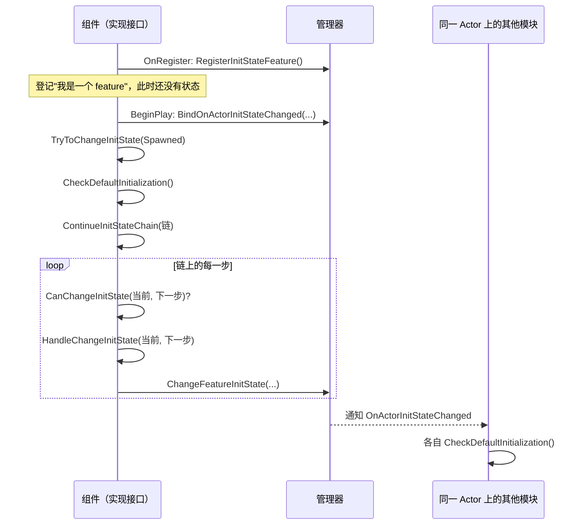
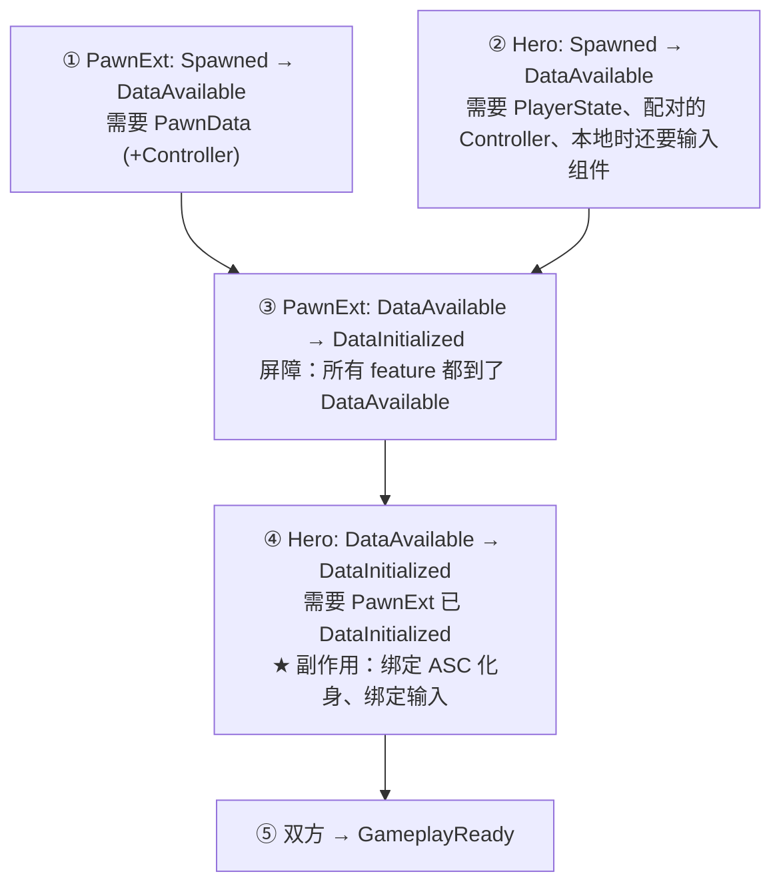
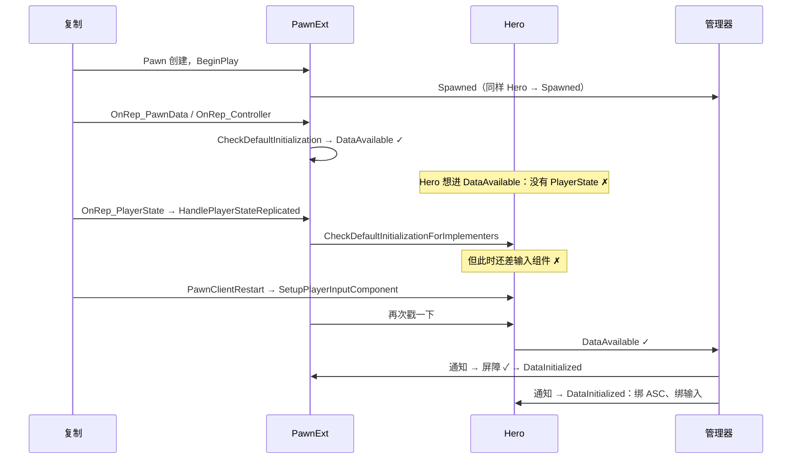

# 第 8 章　组装一个角色：PawnData 与初始化状态链

## 一个问题：一个角色出现在屏幕上，需要凑齐多少东西？

你的玩家 A 在团队死斗里被打死，两秒后自动复活。从他的视角看，新角色“咚”地一下出现在出生点，能跑能跳，按左键能开枪，血条和弹药都正常。这背后到底凑齐了多少样东西？

- **角色类**：用哪个 Pawn 蓝图；
- **角色配置**：它能做什么技能、用哪套输入、用什么相机；
- **PlayerState 上的 ASC**：技能和属性的家，要把这个新 Pawn 设为它的化身；
- **Controller**：谁在控制这个 Pawn；
- **输入组件**：本地玩家的按键要有地方接；
- **被注入的组件**：上一章里 Action 加进来的那些。

在服务器上这些东西的到达顺序还算确定：GameMode 一行行往下执行。但在**客户端**上，它们是通过网络一件件“到货”的，顺序随链路和负载而变——这次 Pawn 先到、PlayerState 后到，下次可能反过来。

现在请你想一个问题：如果由你来写“在合适的时机初始化 ASC 和绑定输入”这段代码，你会写在哪里？写在 `BeginPlay`？写在 `OnRep_PlayerState`？写在 `PossessedBy`？在读下去之前，先选一个，并想想它在“PlayerState 最后一个到达”的场景下会怎样。这一章会用一个具体的失败例子，告诉你为什么这些答案都不够。

## 读完本章你能……

- 说出 `ULyraPawnData` 里的五个字段和它们各自驱动哪个系统，并解释角色配置为什么要和 Pawn 类分开；
- 解释“延迟生成 + 在 `FinishSpawning` 之前设置 PawnData”这个小动作避免了什么问题；
- 说清 PawnData 为什么同时存在于 PlayerState 和 Pawn 的 PawnExtension 组件上；
- 对着 `ULyraPawnExtensionComponent` 和 `ULyraHeroComponent` 的 `CanChangeInitState`，写出四个状态的精确转换条件，并在“PlayerState 最后到达”的客户端场景下推演一遍；
- 照着模板写出自己的 InitState 组件，并知道它写错一步会让整个 Pawn 卡住；
- 正确回答“怎么让某个 Experience 不生成 Pawn”。

## 需要先知道的 UE 概念

**Possess（附身 / 占有）。** Controller 通过 `Possess(Pawn)` 控制一个 Pawn，之后 Pawn 的 `GetController()` 和 Controller 的 `GetPawn()` 互相指向对方；`PossessedBy` 是 Pawn 在被附身（占有）时调用的回调（[第 2 章](02-GameplayFramework.md)）。服务器上 Possess 的那一刻，客户端还什么都不知道，要等复制。

**网络角色（Role）。** 同一个 Pawn 在不同机器上扮演不同角色：服务器上是权威端（Authority）；拥有它的玩家的客户端上是自主代理（Autonomous Proxy）；其他玩家的客户端上是模拟代理（Simulated Proxy）。`GetLocalRole()` 告诉你“我这一端是哪种”（第 3 章）。

**延迟生成（Deferred Spawn）。** 用 `SpawnActor` 并设置 `bDeferConstruction = true` 生成 Actor 时，Actor 对象和它的默认子对象已经创建，但**构造脚本、`PreInitializeComponents`、`BeginPlay` 都还没有发生**，要等你显式调用 `FinishSpawning`。这个“中间状态”的窗口，让你可以在 Actor 正式启动之前往里面塞数据（第 2 章第 4、5 节已经见过一次）。

**ASC 的拥有者与化身（Owner / Avatar）。** ASC（能力系统组件，第 5 章提过）区分“谁拥有它”和“它在替谁行动”：拥有者（Owner）是存放它的 Actor，Lyra 里是 PlayerState；化身（Avatar）是它当前在场景里的身体，Lyra 里是当前的 Pawn。第 9、10 章会详讲，本章只需要知道“把 ASC 绑定到新 Pawn”就是“把新 Pawn 设为它的化身”。

这一章的主角——初始化状态接口 `IGameFrameworkInitStateInterface`——是新概念，会在正文里逐步展开。

## PawnData：角色是什么

先从“角色配置”这份数据看起。看 `Source/LyraGame/Character/LyraPawnData.h`，`ULyraPawnData` 是一个继承自 `UPrimaryDataAsset` 的数据资产（所以它能被 AssetManager 按 ID 找到），类上标了 `Const`，运行时不可修改。它有五个字段：

| 字段 | 作用 |
|---|---|
| `PawnClass` | 出生时实例化哪个 Pawn 类（通常是 `ALyraCharacter` 或 `ALyraPawn` 的蓝图子类） |
| `AbilitySets` | 授予这个玩家的 ASC 的技能组（技能、效果、属性集） |
| `TagRelationshipMapping` | 技能之间的 Tag 关系：谁激活时阻止谁、取消谁（第 10 章） |
| `InputConfig` | 输入配置：哪个输入动作对应哪个 `InputTag`（第 11 章） |
| `DefaultCameraMode` | 玩家控制的 Pawn 默认使用的相机模式（第 16 章） |

### 为什么要和 Pawn 类分开

你可能会想：这些东西为什么不直接配在 Pawn 蓝图的默认值里？分开有三个理由。

第一，**Pawn 蓝图、技能组、输入和相机可以自由混搭，同一个 Pawn 蓝图也能扮演不同角色。** 对照项目里的三份资产就能看清：`HeroData_ShooterGame`（`B_Hero_ShooterMannequin` + `AbilitySet_ShooterHero` + `InputData_Hero` + `CM_ThirdPerson`）和用于测试原型背包/交互的 `HeroData_Explorer`（换成 `B_Hero_Explorer` 与 `InputData_InventoryTest`，却原封不动复用了同一套 `AbilitySet_ShooterHero`、`TagRelationships_ShooterHero` 和 `CM_ThirdPerson`，两个 Pawn 蓝图又共同继承 `B_Hero_Default`）；而俯视角竞技场的 `HeroData_Arena` 则换成了全新的 `B_Hero_Arena`、`AbilitySet_Arena`、`InputData_Arena` 和 `CM_ArenaFramingCamera`（完整字段见[参考手册 70 §3](../Reference/70-GameFeatures-Content.md)）。你在自己的玩法里甚至可以让两份 PawnData 指向完全同一个 `PawnClass`，只靠切换技能组和输入配置造出两个不同职业。

第二，**PlayerState 在 Pawn 之前就存在，却要用到这份数据。** 回忆第 5 章：技能授予发生在步骤 7a——Experience 加载完成时，Pawn 还没有出生。如果技能组配在 Pawn 蓝图上，那时根本没有 Pawn 可以去读它。

第三，**输入配置为空时，整套玩家输入根本不会绑定。** `InitializePlayerInput` 里只有 PawnData 的 `InputConfig` 非空才会去绑定输入（后面会看到）。想要一个“没有游戏输入”的角色配置，在 PawnData 层面留空就够了。`DefaultGame.ini` 里配置的兜底 `DefaultPawnData_EmptyPawn` 就是这样一份五个字段全为空的 PawnData。

这是第 5 章讲的“定义/实例分离”模式：PawnData 是定义，Pawn 和 ASC 里的技能是实例。

### PawnData 从哪里来

GameMode 要决定“这个玩家用哪份 PawnData”，逻辑在 `ALyraGameMode::GetPawnDataForController`：

```cpp
// 简化自 Source/LyraGame/GameModes/LyraGameMode.cpp 的 ALyraGameMode::GetPawnDataForController
const ULyraPawnData* ALyraGameMode::GetPawnDataForController(const AController* InController) const
{
    // ① 优先用 PlayerState 上已经存的（重生时走这条）
    if (const ALyraPlayerState* LyraPS = InController ? InController->GetPlayerState<ALyraPlayerState>() : nullptr)
    {
        if (const ULyraPawnData* PawnData = LyraPS->GetPawnData<ULyraPawnData>()) { return PawnData; }
    }

    // ② 没有就用当前 Experience 的默认 PawnData（首次出生走这条）
    ULyraExperienceManagerComponent* ExperienceComponent = GameState->FindComponentByClass<ULyraExperienceManagerComponent>();
    if (ExperienceComponent->IsExperienceLoaded())
    {
        const ULyraExperienceDefinition* Experience = ExperienceComponent->GetCurrentExperienceChecked();
        if (Experience->DefaultPawnData != nullptr) { return Experience->DefaultPawnData; }

        // ③ Experience 加载了却没配：用 AssetManager 里配置的兜底（全空的 EmptyPawnData）
        return ULyraAssetManager::Get().GetDefaultPawnData();
    }

    // Experience 还没加载：没有 PawnData 可给
    return nullptr;
}
```

这是一个三级回退：玩家自己的 → Experience 的 → 全局兜底。“玩家自己的”是什么时候写进去的，下一节会讲。注意最后一个 `return nullptr`：Experience 没加载完时，任何人来问都得不到答案——这是第 6 章“玩家在 Experience 加载前不会出生”的另一面。

决定了 PawnData，Pawn 的类也就定了：

```cpp
// 简化自 ALyraGameMode::GetDefaultPawnClassForController_Implementation
if (const ULyraPawnData* PawnData = GetPawnDataForController(InController))
{
    if (PawnData->PawnClass) { return PawnData->PawnClass; }
}
return Super::GetDefaultPawnClassForController_Implementation(InController);   // 回退到 DefaultPawnClass
```

记住 `Super` 这一行。`PawnClass` 留空**并不会**让游戏不生成 Pawn，而是回退到 GameMode 的 `DefaultPawnClass`（`ALyraGameMode` 构造函数与 `B_LyraGameMode` 蓝图默认值里它都是 `ALyraCharacter`）。这个坑在本章最后一节会用到。

## 延迟生成：让 PawnData 赶在一切之前

### 要解决的问题

Pawn 的各个组件在 `BeginPlay` 时会去读 PawnData（比如读 `TagRelationshipMapping`、输入配置）。所以 PawnData 必须在**任何组件的 `BeginPlay` 之前**就放进 Pawn 里。

### 最直观的做法与它的问题

```cpp
APawn* Pawn = World->SpawnActor<APawn>(PawnClass, Transform);   // 一出生，BeginPlay 就跑完了
PawnExt->SetPawnData(PawnData);                                  // 太晚了
```

`SpawnActor` 返回时，Pawn 已经走完了构造、组件初始化和 `BeginPlay`。所有在 `BeginPlay` 里读 PawnData 的代码，拿到的都是空。你会看到各种“只在服务器上偶发”的怪问题：这是因为同一份代码在服务器上读到空，在客户端上又因为复制的时序读到了值，两端行为不一致。

### Lyra 的做法

```cpp
// 简化自 Source/LyraGame/GameModes/LyraGameMode.cpp 的 ALyraGameMode::SpawnDefaultPawnAtTransform_Implementation
FActorSpawnParameters SpawnInfo;
SpawnInfo.Instigator = GetInstigator();
SpawnInfo.ObjectFlags |= RF_Transient;     // 玩家 Pawn 永远不存进地图
SpawnInfo.bDeferConstruction = true;       // 关键：生成但暂不启动

if (UClass* PawnClass = GetDefaultPawnClassForController(NewPlayer))
{
    if (APawn* SpawnedPawn = GetWorld()->SpawnActor<APawn>(PawnClass, SpawnTransform, SpawnInfo))
    {
        if (ULyraPawnExtensionComponent* PawnExtComp = ULyraPawnExtensionComponent::FindPawnExtensionComponent(SpawnedPawn))
        {
            if (const ULyraPawnData* PawnData = GetPawnDataForController(NewPlayer))
            {
                PawnExtComp->SetPawnData(PawnData);    // 在 Pawn 启动之前，先把数据塞进去
            }
        }

        SpawnedPawn->FinishSpawning(SpawnTransform);   // 现在才启动：构造脚本、PreInitializeComponents、BeginPlay
        return SpawnedPawn;
    }
}
```

对应第 5 章的**步骤 8**。有三个要点：

**一，`bDeferConstruction` 打开了“已创建但未启动”的窗口。** 在这个窗口里，`PawnExt` 作为默认子对象已经存在，所以能 `FindPawnExtensionComponent` 并调用 `SetPawnData`。

**二，这是服务器独有的优势。** GameMode 只在服务器上，所以服务器上的所有组件 `BeginPlay` 时 PawnData 一定在。**客户端没有这个机会**：客户端的 Pawn 是复制过来的，PawnData 是 PawnExtension 组件上一个被复制的属性，要等 `OnRep_PawnData` 才有。所以任何要在客户端读 PawnData 的代码，都不能假设 `BeginPlay` 时它已经在——这正是引出下面 InitState 的原因之一。

**三，`FinishSpawning` 之后，上一章讲的注入也同时发生。** `PreInitializeComponents` 里 Modular 基类调用 `AddGameFrameworkComponentReceiver`（第 5 章的**步骤 9**），所有已激活的 Action 在这一刻给这个新 Pawn 加组件。

**代价**：必须有人负责在 `FinishSpawning` 之前调用 `SetPawnData`，这个责任落在 GameMode 的出生函数上。如果有人绕过它（比如用别的方式 `SpawnActor` 一个 `ALyraCharacter`），Pawn 就没有 PawnData，InitState 会永远停在 `Spawned`。

## PawnData 为什么存了两份

打开 `Source/LyraGame/Player/LyraPlayerState.h` 和 `Source/LyraGame/Character/LyraPawnExtensionComponent.h`，你会发现两处都有一个 `PawnData` 属性：PlayerState 上一份，Pawn 的 PawnExtension 组件上一份。为什么要存两遍？

关键在于**生命周期不同、可用的端不同**。

**PlayerState 上的那份**回答的是“这个玩家用什么角色”。它由 `ALyraPlayerState::OnExperienceLoaded` 在 Experience 加载完成时，调用 `GetPawnDataForController` 取得并通过 `SetPawnData` 保存。`SetPawnData` 只在服务器执行、**只能设置一次**，并在这一刻把 PawnData 里的 AbilitySets 授予 PlayerState 上的 ASC，然后发出第 7 章讲过的 `LyraAbilitiesReady` 事件。它跨越 Pawn 的生死，所以 Pawn 死了，ASC 里的技能还在，也不会重复授予。

这里官方文档和当前源码有一处出入，值得知道。Epic 的 Abilities in Lyra 文档（5.0 到 5.1 时期）把技能授予描述成：`ULyraHeroComponent` 和 `ULyraPawnExtensionComponent` 在有效的 Controller 占有 Pawn 时，把一组技能授予 PlayerState 的 ASC，Pawn 被淘汰或取消占有时自动撤销；同一页也写到 Experience 加载完成后由 `ALyraPlayerState::SetPawnData()` 授予。当前 5.8 源码里，**授予只发生在 `SetPawnData`（Experience 加载完成时一次）**；Hero 和 PawnExt 在占有之后做的是“把 ASC 绑定到新 Pawn（设为化身）”，死亡时撤销的也是化身绑定和进行中的技能，而不是已授予的技能本身。以源码为准。

**Pawn 上的那份**回答的是“这个 Pawn 实例用什么输入、什么相机、什么 Tag 关系”。它由出生函数在 `FinishSpawning` 前设置，并被复制到客户端。**客户端没有 GameMode，调用不了 `GetPawnDataForController`**，所以 Pawn 必须自己携带这份数据，客户端上的组件才能读到。此外，PawnData 是 PawnExt 进入 `DataAvailable` 的必要条件（后面会看到），所以这份数据的到达本身就是 InitState 链的一个触发事件。

用一条时间线来看一个玩家的两次生命：

```
PlayerState 生命周期 ═══════════════════════════════════════════════════════════▶
  PawnData：Experience 加载后设置一次，此后不变；ASC 里的技能一次授予

  Pawn #1（第一条命）           Pawn #2（重生）
  ┌──────────────────┐          ┌──────────────────┐
  │ PawnExt.PawnData │          │ PawnExt.PawnData │   ← 每次出生，GameMode 取 PlayerState 的那份，
  │ 出生时设置，被复制│  死亡    │ 出生时再设置一次  │     重新设置并复制
  └──────────────────┘  销毁    └──────────────────┘
```

两份数据在正常流程里永远来自同一个 `GetPawnDataForController` 的结果，所以内容一致。但这个设计带来一个限制：**PlayerState 的 PawnData 只能设置一次**，源码里重复设置会打 Error 日志并返回。想在一局中途让玩家换英雄（换 PawnData），现有代码不支持，需要你自己重新设计这一步。

## InitState：对付“随机到货”

现在进入本章的核心。先把问题钉死，再看 Lyra 的解法。

### 问题：到货顺序不确定

玩家 A 的客户端上，他自己的 Pawn 要变成“可玩”，需要这些东西到齐：

- Pawn 这个 Actor 本身；
- PawnExtension 组件上复制过来的 `PawnData`；
- Pawn 的 `Controller`（`APawn::Controller` 复制到拥有者客户端，触发 `OnRep_Controller`）；
- Pawn 的 `PlayerState`（触发 `OnRep_PlayerState`；这是对另一个 Actor 的引用，如果那个 Actor 还没到，指针先是空，等它到了才会触发回调）；
- 本地的输入组件（服务器 Possess 之后通过 `ClientRestart` 通知客户端，客户端在 `APawn::PawnClientRestart` 里才为本地控制的 Pawn 创建输入组件，这是引擎行为）。

这五件事互相独立，到达顺序随网络状况而变，每一种排列都可能发生。

### 最直观的做法与具体失败

```cpp
void AMyCharacter::BeginPlay()
{
    Super::BeginPlay();
    ALyraPlayerState* PS = GetPlayerState<ALyraPlayerState>();     // 客户端上可能还是空
    ASC = PS->GetLyraAbilitySystemComponent();                     // 失败 1：PS 为空，直接崩溃
    ASC->InitAbilityActorInfo(PS, this);
    BindInputs();
}
```

失败 1：高延迟玩家的 Pawn 先于 PlayerState 到达，`BeginPlay` 里 `PS` 是空指针，客户端崩溃。

你会改成“空就返回”：

```cpp
if (!PS) { return; }       // 失败 2：之后 PlayerState 到了，没有任何人再来调一次
```

失败 2：玩家没崩，但永远没有技能栏，因为初始化函数只在 `BeginPlay` 里调用了一次。

你会再改成“在 `OnRep_PlayerState` 里也尝试一次”。失败 3：PlayerState 到了，但输入组件可能还没创建，`BindInputs()` 失败；输入组件创建的时候你又得再试一次。最终你会发现，**每一个到货事件的处理函数里，都得写一遍“看看是不是都到齐了，到齐了才初始化，而且只初始化一次”**。这段检查逻辑重复、易漏、顺序依赖，而且每个需要这些数据的组件（技能、输入、相机……）都得各写一遍。

InitState 做的，就是把这段“是否到齐”的检查抽象成统一的协议。

### Lyra 的解法：每个模块自报家门，任何到货都触发重新检查

先看官方对这套机制的定位（Epic 的 Game Framework Component Manager 文档，转述）：初始化状态系统“跟踪由组件实现的 feature 在 Actor 上的初始化与生命周期”，它**不是通用的玩法状态机**；状态是**全局定义**、**线性排列**的，所有 Actor 共用同一条链；每个 feature 状态变化时必须向管理器汇报，因为管理器会存着状态供之后查询——这正是它和第 7 章“无状态的扩展事件”的区别。官方文档还点名了 Lyra：`ULyraPawnExtensionComponent` 实现 `IGameFrameworkInitStateInterface`，通过 `ALyraCharacter` 基类加到每个 Character 上，是这套机制的参考实现。

一个 Pawn 上有若干个需要协调初始化的**功能模块（feature）**。每个模块自己声明：

1. 我的名字（`GetFeatureName`，比如 `"PawnExtension"`、`"Hero"`）；
2. “从状态 X 到状态 Y，需要满足什么条件”（`CanChangeInitState`）；
3. “真正进入状态 Y 时，我要做什么”（`HandleChangeInitState`）。

所有模块共享同一条状态链，在 `ULyraGameInstance::Init` 里注册（第 5 章的**步骤 2**）：

```cpp
// 简化自 Source/LyraGame/System/LyraGameInstance.cpp 的 ULyraGameInstance::Init
UGameFrameworkComponentManager* ComponentManager = GetSubsystem<UGameFrameworkComponentManager>(this);
// 参数：新状态、是否插在已有状态之前、已有状态
ComponentManager->RegisterInitState(LyraGameplayTags::InitState_Spawned,         false, FGameplayTag());
ComponentManager->RegisterInitState(LyraGameplayTags::InitState_DataAvailable,   false, LyraGameplayTags::InitState_Spawned);
ComponentManager->RegisterInitState(LyraGameplayTags::InitState_DataInitialized, false, LyraGameplayTags::InitState_DataAvailable);
ComponentManager->RegisterInitState(LyraGameplayTags::InitState_GameplayReady,   false, LyraGameplayTags::InitState_DataInitialized);
```

四个状态，用 GameplayTag 表示（第 4 章的 Tag 作为契约）。`Source/LyraGame/LyraGameplayTags.cpp` 里它们的注释很准确地说出了含义：

- `InitState.Spawned`：Actor/组件已经创建，可以被扩展；
- `InitState.DataAvailable`：所有需要的数据都已经加载、复制到位，可以开始初始化；
- `InitState.DataInitialized`：已有的数据已经被初始化（比如 ASC 已绑定），但还没准备好进入完整玩法；
- `InitState.GameplayReady`：完全就绪，可以进行正常玩法。

注意区分前两个：`DataAvailable` 是“**材料齐了**”，`DataInitialized` 是“**材料已经加工过了**”。

### 接口的工作方式

这套协议由引擎的 `IGameFrameworkInitStateInterface` 接口实现（第 7 章讲过的同一个管理器）。一个组件实现这个接口，生命周期大致是这样：



核心是 `ContinueInitStateChain`，它拿着一条状态链，从当前状态开始，逐步尝试前进：

```cpp
// 简化自 Engine/Plugins/Runtime/ModularGameplay 的 IGameFrameworkInitStateInterface::ContinueInitStateChain（引擎源码）
FGameplayTag CurrentState = Manager->GetInitStateForFeature(MyActor, MyFeatureName);

for (int32 ChainIndex = 0; ChainIndex < InitStateChain.Num() - 1; ChainIndex++)
{
    if (CurrentState == InitStateChain[ChainIndex])                 // 我现在在链的这一格
    {
        FGameplayTag DesiredState = InitStateChain[ChainIndex + 1];
        if (CanChangeInitState(Manager, CurrentState, DesiredState)) // 问：条件满足吗？
        {
            HandleChangeInitState(Manager, CurrentState, DesiredState);                    // 做该做的副作用
            Manager->ChangeFeatureInitState(MyActor, MyFeatureName, ThisObject, DesiredState); // 记录并通知
            CurrentState = Manager->GetInitStateForFeature(MyActor, MyFeatureName);        // 更新，循环继续
        }
    }
}
return CurrentState;
```

读这段代码，要抓住它的**幂等性**：每次调用，它都从“当前状态”出发，能走几步走几步，走不动就停下，下次再来。所以你可以放心地在**任何**到货事件里调用 `CheckDefaultInitialization()`，不用担心重复初始化：已经走过的状态不会再走。

另一个设计是通知的**排队**。`ChangeFeatureInitState` 内部不是立刻递归调用所有监听者，而是把状态变化放进一个队列，按顺序处理。因为一个模块的状态变化会触发另一个模块的 `OnActorInitStateChanged`，后者可能又触发状态变化，如果递归调用，调用栈和执行顺序会很难推理。队列保证了“一次处理一个变化，按发生顺序”。

## 两个参与者，各自的条件

Lyra 里实现这套接口的是两个组件：`ULyraPawnExtensionComponent`（feature 名 `PawnExtension`）和 `ULyraHeroComponent`（feature 名 `Hero`）。PawnExtension 是每个 Lyra Pawn 都有的协调者，在 `ALyraCharacter` 构造函数里就创建了；Hero 负责玩家输入和相机，挂在英雄蓝图基类 `B_Hero_Default` 上（`B_Hero_ShooterMannequin` 继承它）。

### PawnExtension 的条件

```cpp
// 简化自 Source/LyraGame/Character/LyraPawnExtensionComponent.cpp 的 CanChangeInitState
if (!CurrentState.IsValid() && DesiredState == InitState_Spawned)
{
    return Pawn != nullptr;                              // 只要 Owner 是个有效的 Pawn
}
if (CurrentState == InitState_Spawned && DesiredState == InitState_DataAvailable)
{
    if (!PawnData) { return false; }                     // ① 必须有 PawnData

    if (Pawn->HasAuthority() || Pawn->IsLocallyControlled())
    {
        if (!GetController<AController>()) { return false; }   // ② 权威端或本地控制端，还须有 Controller
    }
    return true;
}
if (CurrentState == InitState_DataAvailable && DesiredState == InitState_DataInitialized)
{
    // ③ 这个 Pawn 上所有已注册的 feature 都到了 DataAvailable（含 Hero）
    return Manager->HaveAllFeaturesReachedInitState(Pawn, InitState_DataAvailable);
}
if (CurrentState == InitState_DataInitialized && DesiredState == InitState_GameplayReady)
{
    return true;
}
```

注意条件 ②：只有“权威端或本地控制的客户端”才要求有 Controller；其他玩家的 Pawn 在你这台客户端上（模拟代理）没有 Controller，不应该被卡住。条件 ③ 是一道**屏障**：PawnExt 自己进入 `DataInitialized` 要等所有 feature 都就位。

### Hero 的条件

```cpp
// 简化自 Source/LyraGame/Character/LyraHeroComponent.cpp 的 CanChangeInitState
if (CurrentState == InitState_Spawned && DesiredState == InitState_DataAvailable)
{
    if (!GetPlayerState<ALyraPlayerState>()) { return false; }     // ① 必须有 PlayerState

    if (Pawn->GetLocalRole() != ROLE_SimulatedProxy)               // ② 权威端/自主代理：Controller 必须存在，
    {                                                              //    且 Controller 与 PlayerState 已配对
        AController* Controller = GetController<AController>();
        const bool bPaired = Controller && Controller->PlayerState && (Controller->PlayerState->GetOwner() == Controller);
        if (!bPaired) { return false; }
    }

    if (Pawn->IsLocallyControlled() && !Pawn->IsBotControlled())   // ③ 本地真人玩家：还得有输入组件和 LocalPlayer
    {
        ALyraPlayerController* LyraPC = GetController<ALyraPlayerController>();
        if (!Pawn->InputComponent || !LyraPC || !LyraPC->GetLocalPlayer()) { return false; }
    }
    return true;
}
if (CurrentState == InitState_DataAvailable && DesiredState == InitState_DataInitialized)
{
    // ④ 有 PlayerState，且 PawnExtension 已经 DataInitialized
    return GetPlayerState<ALyraPlayerState>() &&
           Manager->HasFeatureReachedInitState(Pawn, ULyraPawnExtensionComponent::NAME_ActorFeatureName, InitState_DataInitialized);
}
// DataInitialized → GameplayReady：恒为真（源码里有 TODO：加 Ability 初始化检查）
```

### 把两份条件合起来

看起来很多条件，但它们合起来的顺序其实很清楚：



①和②可以按任意顺序发生，它们之间没有依赖；③是屏障：PawnExt 会一直等到 Hero（以及你将来加的其他 feature）也到了 `DataAvailable`；④是 Hero 去做真正的初始化，此时所有数据都已经就位。**所有副作用（绑定 ASC、绑定输入）都放在 ④，是因为那时所有材料都齐了，只会执行一次。**

### 谁来触发“重新检查”

条件写好了，谁来在合适的时候调用 `CheckDefaultInitialization`？答案是：**每一个到货事件**。来看 `ALyraCharacter` 里那几个转发函数：

```cpp
// 简化自 Source/LyraGame/Character/LyraCharacter.cpp
void ALyraCharacter::PossessedBy(AController* NewController)          // 服务器：被占有
{   Super::PossessedBy(NewController);  PawnExtComponent->HandleControllerChanged();   /* ...队伍相关省略 */ }

void ALyraCharacter::OnRep_Controller()                               // 客户端：Controller 复制到达
{   Super::OnRep_Controller();          PawnExtComponent->HandleControllerChanged(); }

void ALyraCharacter::OnRep_PlayerState()                              // 客户端：PlayerState 复制到达
{   Super::OnRep_PlayerState();         PawnExtComponent->HandlePlayerStateReplicated(); }

void ALyraCharacter::SetupPlayerInputComponent(UInputComponent* PlayerInputComponent)   // 本地：输入组件创建
{   Super::SetupPlayerInputComponent(PlayerInputComponent);  PawnExtComponent->SetupPlayerInputComponent(); }
```

这几个函数最终都落到 `PawnExt::CheckDefaultInitialization()`。加上 `SetPawnData` / `OnRep_PawnData`（PawnData 到达）和 `ALyraPlayerState::ClientInitialize`，一共六七个触发点，覆盖了五件“货”的每一个到达事件。

而 `PawnExt::CheckDefaultInitialization` 的第一行是 `CheckDefaultInitializationForImplementers()`——**先去戳一下同一个 Actor 上所有其他 feature，让它们先检查一遍自己，然后才推进自己的链**。所以 Hero 不需要每个到货事件都自己监听：PawnExt 作为协调者，把所有事件“转发”给同伴。

另一条触发路径是 `OnActorInitStateChanged`：PawnExt 监听所有 feature 的状态变化，任何一个 feature 到了 `DataAvailable` 就重新检查自己（因为屏障 ③ 可能满足了）；Hero 监听 PawnExt，PawnExt 到了 `DataInitialized` 就重新检查自己（因为 ④ 的条件满足了）。

## DataInitialized：真正干活的一步

看 Hero 在 `DataAvailable → DataInitialized` 转换里做了什么：

```cpp
// 简化自 Source/LyraGame/Character/LyraHeroComponent.cpp 的 HandleChangeInitState
if (CurrentState == InitState_DataAvailable && DesiredState == InitState_DataInitialized)
{
    APawn* Pawn = GetPawn<APawn>();
    ALyraPlayerState* LyraPS = GetPlayerState<ALyraPlayerState>();

    if (ULyraPawnExtensionComponent* PawnExtComp = ULyraPawnExtensionComponent::FindPawnExtensionComponent(Pawn))
    {
        PawnData = PawnExtComp->GetPawnData<ULyraPawnData>();
        // ① 把 PlayerState 上的 ASC 绑定到这个 Pawn：Owner = PlayerState，Avatar = Pawn
        PawnExtComp->InitializeAbilitySystem(LyraPS->GetLyraAbilitySystemComponent(), LyraPS);
    }

    if (GetController<ALyraPlayerController>() && Pawn->InputComponent != nullptr)
    {
        InitializePlayerInput(Pawn->InputComponent);        // ② 绑定输入（只有本地玩家的 Pawn 才有输入组件）
    }

    if (PawnData)
    {
        // ③ 相机模式的决定权交给 Hero
        CameraComponent->DetermineCameraModeDelegate.BindUObject(this, &ThisClass::DetermineCameraMode);
    }
}
```

这就是第 5 章的**步骤 10**：

**①`InitializeAbilitySystem`** 调用 ASC 的 `InitAbilityActorInfo(PlayerState, Pawn)`，让 ASC 知道“我的拥有者是 PlayerState，化身是这个 Pawn”；设置 Tag 关系映射；然后广播 `OnAbilitySystemInitialized`，`ALyraCharacter` 在这个回调里初始化生命值组件（让它开始监听 ASC 里的生命属性）。从这一刻起，`ALyraCharacter::GetAbilitySystemComponent()` 才会返回非空。

**②`InitializePlayerInput`** 做了一连串绑定：清掉旧的映射，加入 Hero 配置的输入映射上下文，用 PawnData 的 `InputConfig` 把每个技能输入绑定到 `InputTag`，再绑定移动、视角、蹲下等原生输入；最后把 `bReadyToBindInputs` 置真，并向 PlayerController 和 Pawn 发出第 7 章讲过的 `BindInputsNow` 事件（第 5 章的**步骤 11**）。这一段是第 11 章的主题。

**为什么只有本地玩家才有输入组件？** 因为输入组件是 `APawn::PawnClientRestart` 为“本地控制的 PlayerController”创建的。专用服务器上别人的 Pawn 没有输入组件，所以 `Pawn->InputComponent != nullptr` 的判断自然把服务器上远程玩家的 Pawn 排除了，而不需要再写 `IsLocallyControlled`。

## 三个角色的走读

现在把整条链放到三个不同的“端”上走一遍。

### 专用服务器上的玩家 Pawn

服务器的顺序是确定的，但有一个“先出生、后占有”的间隔：

1. 出生函数 `SpawnDefaultPawnAtTransform` 生成并 `SetPawnData`，`FinishSpawning`；
2. PawnExt 和 Hero 的 `BeginPlay`：各自 `TryToChangeInitState(Spawned)`，然后 `CheckDefaultInitialization`；
3. PawnExt 想进 `DataAvailable`：有 PawnData，但是权威端必须有 Controller，**此时还没有 Possess，失败**；Hero 想进 `DataAvailable`：没有 PlayerState，失败；
4. `FinishRestartPlayer` → `Possess` → `ALyraCharacter::PossessedBy` → `HandleControllerChanged` → `CheckDefaultInitialization`：PawnExt `DataAvailable` ✓，通知触发 Hero 重新检查，Hero `DataAvailable` ✓，PawnExt 屏障 ✓ 进入 `DataInitialized`，通知 Hero，Hero ④ ✓ 进入 `DataInitialized`（ASC 绑定），双方 `GameplayReady`。

整条链在 `PossessedBy` 这一次调用栈里就全部走完了。专用服务器上没有本地玩家，`InitializePlayerInput` 不会执行（没有输入组件）。

### 拥有者客户端：以“PlayerState 最后到”为例

客户端的顺序不确定。我们取一种典型的坏情况：Pawn、PawnData 和 Controller 先到，PlayerState 最后到。



重点不是这一种顺序，而是：**不管最后到的是谁，它到达时都会触发 `CheckDefaultInitialization`，于是整条链会在“最后一块拼图到位”的那一刻自动完成。** 把顺序换成“输入组件先到、PlayerState 最后到”，流程图上的节点位置会变，结论不变。

### 其他玩家的 Pawn（模拟代理）

在你的客户端上，别人的 Pawn 是模拟代理：Hero 的条件②（Controller 配对）因 `Role == SimulatedProxy` 被跳过，条件③（输入组件）因为不是本地控制被跳过。所以它只需要 PlayerState 和 PawnData 就能到 `DataAvailable`，然后同样走到 `DataInitialized`：`InitializeAbilitySystem` 照样执行（别人的 Pawn 也要有 ASC 化身，血条、状态才对得上），只是 `InitializePlayerInput` 不执行。

## 死亡与重生：ASC 化身的交接

最后看一个玩家死亡、重生时 ASC 的化身怎么换。

死亡走到销毁阶段，`ALyraCharacter::UninitAndDestroy` 调用 `PawnExt::UninitializeAbilitySystem`：取消技能（带 `Ability.Behavior.SurvivesDeath` Tag 的技能除外）、清空技能输入、移除所有 GameplayCue（GAS 里的视听表现提示，比如特效和音效，第 9 章讲）、把 ASC 的化身设为空。`ALyraPlayerController::OnUnPossess` 还会兜底清一次化身。ASC 本身——属于 PlayerState，里面的技能、属性、冷却——毫发无伤。

顺便澄清一个容易混淆的点：`ALyraGameMode::RequestPlayerRestartNextFrame` 在 `bForceReset` 为真时会先调 `Controller->Reset()`，但引擎的 `APlayerController::Reset` 只做两件事：对当前 Pawn 执行 `PawnPendingDestroy` 并 `UnPossess`，它**不会**调用 `ALyraCharacter::Reset`（已核对 5.8 源码）。`ALyraCharacter::Reset`（里面执行 `UninitAndDestroy`）只由 `ULyraGameplayAbility_Reset` 这个技能调用。读重生流程时别把这两个“Reset”当成一条调用链。

新 Pawn 出生，整条 InitState 链再走一遍（步骤 8 到 11），在 ④ 里 `InitializeAbilitySystem` 把新 Pawn 设为化身。这里有一段值得读的防御代码：

```cpp
// 简化自 ULyraPawnExtensionComponent::InitializeAbilitySystem
AActor* ExistingAvatar = InASC->GetAvatarActor();

if ((ExistingAvatar != nullptr) && (ExistingAvatar != Pawn))
{
    // 已经有另一个 Pawn 是化身：这在客户端延迟高时会发生——
    // 新 Pawn 已经出生并被占有，而旧的已死 Pawn 还没来得及被销毁
    ensure(!ExistingAvatar->HasAuthority());      // 权威端不应出现这种情况

    if (ULyraPawnExtensionComponent* OtherExtensionComponent = FindPawnExtensionComponent(ExistingAvatar))
    {
        OtherExtensionComponent->UninitializeAbilitySystem();     // 把旧化身“踢出去”
    }
}
AbilitySystemComponent = InASC;
AbilitySystemComponent->InitAbilityActorInfo(InOwnerActor, Pawn);
```

这个“踢出旧化身”的分支只会在客户端出现：服务器上旧 Pawn 的清理发生在新 Pawn 出生之前，但在客户端，复制的先后不保证，新旧 Pawn 可能短暂并存。这是一个典型的“服务器上从不发生、客户端上偶尔发生”的情况。

## 如何写自己的 InitState 组件

假设你想写一个 `UMyFeatureComponent`：它要等 ASC 初始化完成之后，才能去读属性。照着 Hero 的模式写，头文件和实现骨架如下（注意加上 `BlueprintSpawnableComponent` 元数据，这样 `Add Components` 的下拉框里才能选到它）：

```cpp
// MyFeatureComponent.h（教学示例，结构仿照 ULyraHeroComponent）
UCLASS(Blueprintable, Meta = (BlueprintSpawnableComponent))
class UMyFeatureComponent : public UPawnComponent, public IGameFrameworkInitStateInterface
{
    GENERATED_BODY()
public:
    UMyFeatureComponent(const FObjectInitializer& ObjectInitializer = FObjectInitializer::Get()) : Super(ObjectInitializer) {}
    static inline const FName NAME_ActorFeatureName = TEXT("MyFeature");
    virtual FName GetFeatureName() const override { return NAME_ActorFeatureName; }
    virtual bool CanChangeInitState(UGameFrameworkComponentManager* Manager, FGameplayTag CurrentState, FGameplayTag DesiredState) const override;
    virtual void HandleChangeInitState(UGameFrameworkComponentManager* Manager, FGameplayTag CurrentState, FGameplayTag DesiredState) override {}
    virtual void OnActorInitStateChanged(const FActorInitStateChangedParams& Params) override;
    virtual void CheckDefaultInitialization() override;
protected:
    virtual void OnRegister() override;
    virtual void BeginPlay() override;
    virtual void EndPlay(const EEndPlayReason::Type EndPlayReason) override;
};
```

```cpp
// MyFeatureComponent.cpp（教学示例）
void UMyFeatureComponent::OnRegister()
{
    Super::OnRegister();
    RegisterInitStateFeature();                    // 尽早登记，PawnExt 的屏障才会把我算进去
}

void UMyFeatureComponent::BeginPlay()
{
    Super::BeginPlay();
    // 监听 Hero 的状态变化：Hero 到了 DataInitialized（ASC 已绑定）之后我才能往前走
    BindOnActorInitStateChanged(ULyraHeroComponent::NAME_ActorFeatureName, FGameplayTag(), false);
    ensure(TryToChangeInitState(LyraGameplayTags::InitState_Spawned));
    CheckDefaultInitialization();
}

bool UMyFeatureComponent::CanChangeInitState(UGameFrameworkComponentManager* Manager, FGameplayTag CurrentState, FGameplayTag DesiredState) const
{
    if (!CurrentState.IsValid() && DesiredState == LyraGameplayTags::InitState_Spawned) { return GetPawn<APawn>() != nullptr; }
    if (CurrentState == LyraGameplayTags::InitState_Spawned && DesiredState == LyraGameplayTags::InitState_DataAvailable)
    {
        return true;       // 我自己的数据不依赖别人：马上就“材料齐了”。别漏掉这一步！
    }
    if (CurrentState == LyraGameplayTags::InitState_DataAvailable && DesiredState == LyraGameplayTags::InitState_DataInitialized)
    {
        // 等 Hero 完成 ASC 绑定：状态是在 HandleChangeInitState 执行完之后才被管理器记录的，
        // 所以看到 Hero 已是 DataInitialized，就说明 InitializeAbilitySystem 已经跑过了
        return Manager->HasFeatureReachedInitState(GetPawn<APawn>(), ULyraHeroComponent::NAME_ActorFeatureName, LyraGameplayTags::InitState_DataInitialized);
    }
    if (CurrentState == LyraGameplayTags::InitState_DataInitialized && DesiredState == LyraGameplayTags::InitState_GameplayReady) { return true; }
    return false;
}

void UMyFeatureComponent::OnActorInitStateChanged(const FActorInitStateChangedParams& Params)
{
    if (Params.FeatureName == ULyraHeroComponent::NAME_ActorFeatureName && Params.FeatureState == LyraGameplayTags::InitState_DataInitialized)
    {
        CheckDefaultInitialization();      // 上游到位，重新检查
    }
}

void UMyFeatureComponent::CheckDefaultInitialization()
{
    static const TArray<FGameplayTag> StateChain = { LyraGameplayTags::InitState_Spawned, LyraGameplayTags::InitState_DataAvailable, LyraGameplayTags::InitState_DataInitialized, LyraGameplayTags::InitState_GameplayReady };
    ContinueInitStateChain(StateChain);
}

void UMyFeatureComponent::EndPlay(const EEndPlayReason::Type EndPlayReason)
{
    UnregisterInitStateFeature();          // 对称撤销
    Super::EndPlay(EndPlayReason);
}
```

（`HandleChangeInitState` 里做“进入某状态时的副作用”，比如在你自己的 `DataInitialized` 时通过 `ULyraPawnExtensionComponent::FindPawnExtensionComponent(Pawn)->GetLyraAbilitySystemComponent()` 读 ASC 属性。示例里省略。）

这个示例没有死锁：PawnExt 的屏障要你到 `DataAvailable`（你的条件恒真），Hero 的 `DataInitialized` 要 PawnExt 先到，你的 `DataInitialized` 要 Hero 先到，依赖是一条直线。如果你把依赖写成环（A 等 B，B 等 A），所有人都会停在原地。

四条要点：

1. **在 `OnRegister` 里登记，在 `EndPlay` 里撤销**。登记得晚，PawnExt 的屏障就可能漏掉你。
2. **`BeginPlay` 里三件事的顺序**：绑定监听 → `TryToChangeInitState(Spawned)` → `CheckDefaultInitialization()`。
3. **你的 `DataAvailable` 条件一定要有出口。** PawnExt 的屏障要求“所有已登记的 feature 都到了 `DataAvailable`”。如果你的组件登记了、却因为条件写错永远到不了 `DataAvailable`，那整个 Pawn 就会永远卡在 PawnExt 的 `DataAvailable`：能出生，但没有 ASC 化身、没有输入。这是 InitState 设计最大的代价，也是新手最常见的 bug。
4. **你只需要对“你依赖的状态变化”调用 `CheckDefaultInitialization`。** 不需要每个到货事件都监听，监听上游 feature 就行。

如果你不需要参与 PawnExt 的屏障，而只想“等 ASC 就绪后做点事”，有更轻的办法：`PawnExt->OnAbilitySystemInitialized_RegisterAndCall(Delegate)`，已经初始化就立刻调用，否则排队，这是第 5 章讲的“注册并等待”模式。

## 动手实验

### 实验 1：看清楚真实的转换顺序（日志版）

**目标**：在一次真实的多人 PIE 里，看到 InitState 链上每个 feature 卡在哪、怎么前进。

**步骤**：

1. 点击 Play **之前**，先在输出日志底部的控制台命令输入框里输入 `Log LogModularGameplay Verbose`，把这个日志类别调到 Verbose（非发布版本可用），并在过滤框里输入 `ContinueInitStateChain`（需要同时看 `Spawned` 那一步时，再加上 `TryToChangeInitState`）。
2. 网络模式选 Play As Client，玩家数 2，在 `L_Expanse` 运行 PIE。
3. 开局的链看完后，在客户端窗口控制台输入 `Cheat DamageSelfDestruct` 让自己死一次，观察重生时那条新链；实验做完后输入 `Log LogModularGameplay Log` 恢复默认日志级别。

**先写下你的预测**：在拥有者客户端上，Hero 第一次尝试 `Spawned → DataAvailable` 时，会因为哪个条件失败？PawnExtension 和 Hero 谁先到 `DataAvailable`？

**预期结果**：你会看到类似 `ContinueInitStateChain: Cannot transition B_Hero_..._C_0:Hero (role 2) from InitState.Spawned to InitState.DataAvailable` 的行（失败行），以及 `ContinueInitStateChain: Transitioning ...` 的成功行。每行里的 `role` 是数字：3 是权威端（服务器），2 是拥有者客户端，1 是模拟代理。把三个 role 的行分开看：同一个 Pawn 在三个世界里的链是各自独立推进的。你还会注意到：失败行出现的次数，远多于成功行，因为每个到货事件都会让所有 feature 重新检查一次。

**原理**：这些日志来自引擎 `ContinueInitStateChain` 的 Verbose 输出（成功时打 `Transitioning`，条件不满足时打 `Cannot transition`）。日志里的 `role` 是 `GetLocalRole()` 的数值。

### 实验 2：用断点定位“哪个条件没满足”（IDE 版）

**目标**：精确回答“客户端上 Hero 第一次从 `Spawned` 尝试进入 `DataAvailable` 时，到底是哪个条件卡住了”。

**步骤**：

1. 用 IDE 以调试方式启动编辑器（或附加到已运行的编辑器）。
2. 在 `Source/LyraGame/Character/LyraHeroComponent.cpp` 的 `ULyraHeroComponent::CanChangeInitState` 里，`Spawned → DataAvailable` 分支中的每一个 `return false;` 上各设一个断点（共三处：没有 PlayerState、Controller 没配对、缺输入组件或 LocalPlayer）。在 `ULyraPawnExtensionComponent::CanChangeInitState` 的两处 `return false;`（缺 PawnData、缺 Controller）也各设一个。
3. 网络模式选 Play As Client，玩家数 2，运行 PIE，每次命中断点，记下：命中的是哪个断点、调用栈里最近的几个函数是谁（`OnRep_PlayerState`？`SetupPlayerInputComponent`？`BeginPlay`？）、Pawn 的 `GetLocalRole()` 是多少。

**先写下你的预测**：三个条件各命中几次？谁是最后一个满足的？

**预期结果**：你会得到一张记录表，格式类似：

```
序号 | 断点               | 调用栈入口                 | Role
 1   | Hero: 没有 PlayerState | Hero::BeginPlay            | 2
 2   | PawnExt: 缺 Controller | PawnExt::BeginPlay         | 2
 ...
```

具体命中的顺序取决于你这次运行时复制的到达顺序；多跑几次，对比不同运行之间的差异——这就是“顺序随机、结果收敛”的亲身体会。

### 实验 3（需要 C++）：故意让一个 feature 永远到不了 DataAvailable

**目标**：亲眼看到“InitState 最大的代价”：一个 feature 卡住，整个 Pawn 都卡住。

**步骤**：

1. 按上一节的模板写一个 `UMyFeatureComponent`，但把它的 `Spawned → DataAvailable` 条件改成 `return false;`。
2. 把它用 Add Components 加到 `LyraCharacter` 上（第 7 章的方法）。
3. 运行 PIE，尝试移动、开火，再执行 `Cheat DamageSelfDestruct`。

**先写下你的预测**：能不能移动？能不能开火？自杀命令有效吗？

**预期结果**：Pawn 能出生，但不能移动、不能开火（输入没绑定、ASC 没有化身）。`DamageSelfDestruct` 也无效，因为它在源码里要求 PawnExtension 已到达 `GameplayReady`。日志里（打开 `LogModularGameplay Verbose` 后）会反复出现 PawnExtension 从 `DataAvailable` 到 `DataInitialized` 的 `Cannot transition`，因为屏障等不到你的 feature。把那个 `return false` 改回 `return true`，一切恢复。

## 怎么让某个 Experience 不生成 Pawn

这是一个经典问题：前端主菜单、旁观者模式、纯 UI 玩法，都不想要玩家 Pawn。新手第一反应是“把 PawnData 的 `PawnClass` 留空”。读完前面的内容，你应该能立刻指出问题：

`GetDefaultPawnClassForController_Implementation` 在 `PawnClass` 为空时，回退到 `Super`，也就是 `DefaultPawnClass`。`ALyraGameMode` 的构造函数把它设为 `ALyraCharacter`。所以 `PawnClass` 留空**不会**阻止出生，反而会生成一个默认的 `ALyraCharacter`。

要真正阻止出生，需要拦截“能不能出生”这个判断。回顾第 6 章讲的出生路径：

- 玩家刚登录：引擎的 `HandleStartingNewPlayer` 会问 `PlayerCanRestart`；
- Experience 刚加载完：`ALyraGameMode::OnExperienceLoaded` 对没有 Pawn 的玩家问 `PlayerCanRestart`；
- 死亡重生失败后重试：`FailedToRestartPlayer` 问 `PlayerCanRestart`；
- Bot：`ALyraPlayerBotController::ServerRestartController` 直接问 `GameMode->ControllerCanRestart`。

这些路径最终都汇聚到同一个虚函数：

```cpp
// 简化自 Source/LyraGame/GameModes/LyraGameMode.cpp
bool ALyraGameMode::PlayerCanRestart_Implementation(APlayerController* Player)
{
    return ControllerCanRestart(Player);          // 玩家版转发给通用版
}

bool ALyraGameMode::ControllerCanRestart(AController* Controller)   // 头文件里声明为 virtual
{
    // ...引擎的基本检查，Bot 的等价检查...
    if (ULyraPlayerSpawningManagerComponent* PlayerSpawningComponent = GameState->FindComponentByClass<ULyraPlayerSpawningManagerComponent>())
    {
        return PlayerSpawningComponent->ControllerCanRestart(Controller);   // 转给出生管理组件
    }
    return true;
}
```

所以**正确答案是让 `ALyraGameMode::ControllerCanRestart` 返回 false**。它是虚函数（头文件里声明了 `virtual`），可以重写或直接修改，对玩家和 Bot 同时生效。

这里有两种做法，取舍不同：

**做法一：直接在 `ALyraGameMode` 里改。** 在 `ControllerCanRestart` 里加一个判断条件（比如读 Experience 里的一个标志位），为“这个 Experience 不要 Pawn”开一个口子。这是最直接的做法，但它修改了核心 GameMode。按第 5、6 章的原则，“出生/重启”这类所有玩法共用的底层流程，正是 `ALyraGameMode` 本来就负责的地方，在这里改是合理的；但新建 GameMode 子类来写玩法规则则不合理。

**做法二：让 Experience 来决定。** 你可能已经注意到 `ControllerCanRestart` 最后转给了 `ULyraPlayerSpawningManagerComponent`，而这个组件正是各个 Experience 通过 `Add Components` 注入到 GameState 上的（“每个 Experience 自定义自己的出生系统”，头文件里的注释是这么写的）。但它的 `ControllerCanRestart` 目前是**私有的非虚函数**，并且恒返回 true（源码里写着 `TODO Can they restart?`），子类没法重写。想走这条路，你需要把它改成虚函数，然后在 Experience 里注入你的子类。这是对核心代码的一处小改动，换来的是“是否生成 Pawn”这个规则从此可以由 Experience 数据驱动。

无论哪种做法，之后玩家都是**没有 Pawn 的 PlayerController**，你需要自己处理相机和 UI。UI 的注入方式和前面一样，用 `Add Components` 和 `Add Widgets`。（顺带一提，Lyra 自己的前端主菜单 `B_LyraFrontEnd_Experience` 其实偷了个懒：它没有改 `ControllerCanRestart`，而是把 `DefaultPawnData` 留空，回退到全空的 `DefaultPawnData_EmptyPawn`，在场景角落里照样生成了一个没有任何技能和输入的空 `ALyraCharacter`，再靠关卡蓝图把视角锁死在一台固定的 `CameraActor` 上。）

## 常见误区

**误区 1：在 `BeginPlay` 里初始化 ASC 或绑定输入。**
客户端上那时 PlayerState、输入组件很可能还没到。应放进 InitState 的 `DataInitialized` 转换，或使用 `OnAbilitySystemInitialized_RegisterAndCall`。

**误区 2：在 `SpawnActor` 之后再调用 `SetPawnData`。**
`SpawnActor` 返回时 `BeginPlay` 已经跑完。必须用 `bDeferConstruction`，在 `FinishSpawning` 之前设置。

**误区 3：把 PawnData 的 `PawnClass` 留空，以为就不会生成 Pawn。**
会回退到 `DefaultPawnClass`。阻止出生要拦截 `ControllerCanRestart`。

**误区 4：以为 PawnData 在 PlayerState 和 Pawn 上是同一个对象的引用，改一个就够了。**
它们是两份独立的属性，分别在服务器出生流程里被设置。PlayerState 上的只能设置一次，运行时换角色需要重新设计。

**误区 5：新写一个 InitState 组件，却忘了让它到达 `DataAvailable`。**
PawnExtension 的屏障会把你的 feature 算进去，你不到，整个 Pawn 就卡死。症状：能出生，没输入、没技能、没生命值初始化。调试方法：对所有 `CanChangeInitState` 下断点，或用 `Log LogModularGameplay Verbose` 看谁一直 `Cannot transition`。

**误区 6：认为 InitState 状态在服务器和客户端上是同步的。**
状态由各端各自推进，不复制。服务器上 Hero 是 `GameplayReady`，不代表某个客户端上也是。`DamageSelfDestruct` 只检查它所在那一端的状态。

## 本章小结

角色由两样东西决定：Pawn 类和 PawnData。PawnData 是数据资产，包含 Pawn 类、技能组、Tag 关系映射、输入配置和相机模式，它让同一个 Pawn 蓝图能扮演不同角色，也让 PlayerState 在 Pawn 出生之前就能授予技能。GameMode 出生函数用延迟生成，在 `FinishSpawning` 之前先把 PawnData 塞进 Pawn 的 PawnExtension 组件；PlayerState 另存一份，跨越 Pawn 的生死。

客户端上 Pawn、PlayerState、Controller、输入组件的到货顺序随机，所以 Lyra 不在 `BeginPlay` 里初始化，而是用 InitState 链：PawnExtension 和 Hero 各自声明条件，每个到货事件都触发重新检查。PawnExt 先到 `DataAvailable`，Hero 到 `DataAvailable`，PawnExt 越过“所有 feature 都到位”的屏障到 `DataInitialized`，Hero 随后到 `DataInitialized` 并在那里绑定 ASC 化身和输入，最后双方 `GameplayReady`。

```
 服务器：SpawnActor(deferred) → SetPawnData → FinishSpawning → [注入] → Possess ─┐
                                                                                  │ 到货事件：
 客户端：复制 → OnRep_PawnData / OnRep_Controller / OnRep_PlayerState /           │ 每一个都调用
         PawnClientRestart(输入组件) ────────────────────────────────────────────┘ CheckDefaultInitialization

   PawnExt:  Spawned ─(PawnData+Controller)→ DataAvailable ─(所有 feature 都 DA)→ DataInitialized ─→ GameplayReady
   Hero:     Spawned ─(PlayerState+Controller配对+输入)→ DataAvailable ─(PawnExt 已 DI)→ DataInitialized ─→ GameplayReady
                                                                             └─ ★ 绑定 ASC 化身 + 绑定输入 + 发 BindInputsNow
```

对照第 5 章的主干：本章讲的是**步骤 8**（延迟生成与 SetPawnData）、**步骤 10**（InitState 推进到 DataInitialized）和**步骤 11**（BindInputsNow）。

## 自测题

1. `ULyraPawnData` 的五个字段是什么？为什么把它们配在数据资产里，而不是 Pawn 蓝图的默认值里？

<details><summary>答案</summary>

`PawnClass`、`AbilitySets`、`TagRelationshipMapping`、`InputConfig`、`DefaultCameraMode`。分开的原因：同一个 Pawn 蓝图可以扮演不同角色；PlayerState 在 Pawn 之前就存在，授予技能时没有 Pawn 可读；`InputConfig` 为空就能表达“没有游戏输入”，前端不需要专门的 Pawn 类。
</details>

2. 为什么 GameMode 要用 `bDeferConstruction` 生成 Pawn，再在 `FinishSpawning` 之前 `SetPawnData`？不这么做会怎样？

<details><summary>答案</summary>

为了让 PawnData 赶在任何组件的 `BeginPlay` 之前就位。如果 `SpawnActor` 之后再设置，`SpawnActor` 返回时 `BeginPlay` 已经跑完，所有在 `BeginPlay` 里读 PawnData 的代码拿到的都是空，且服务器和客户端行为不一致。
</details>

3. PawnData 为什么同时存在于 PlayerState 和 PawnExtension？各自负责什么？

<details><summary>答案</summary>

PlayerState 上的那份跨越 Pawn 生死，只设置一次，在 Experience 加载完成时授予 AbilitySets，并作为重生时 `GetPawnDataForController` 的优先来源。PawnExtension 上的那份属于具体的 Pawn 实例，服务器出生时设置并复制到客户端，客户端没有 GameMode，必须靠它读到数据；它也是 PawnExt 进入 `DataAvailable` 的必要条件。
</details>

4. 在拥有者客户端上，PlayerState 最后一个到达。描述 InitState 链如何推进，以及“最后一块拼图”到达时发生了什么。

<details><summary>答案</summary>

PawnExt 在 PawnData（以及已有的 Controller）到齐后进入 `DataAvailable`；Hero 因缺 PlayerState 暂时失败。PlayerState 复制到达时 `OnRep_PlayerState` 调用 `PawnExt::HandlePlayerStateReplicated`，进而 `CheckDefaultInitialization`，先戳其他 feature 重新检查，Hero 的条件满足（如果输入组件也已就绪）进入 `DataAvailable`；管理器通知 PawnExt，屏障满足，PawnExt 进入 `DataInitialized`；管理器通知 Hero，Hero 进入 `DataInitialized`，在副作用里绑定 ASC 化身和输入；然后双方进入 `GameplayReady`。每个到货事件都重新检查，所以最后到达的那一个会让整条链收敛。
</details>

5. 为什么 PawnExtension 的 `DataAvailable → DataInitialized` 要求“所有 feature 都到了 `DataAvailable`”？

<details><summary>答案</summary>

这是一道屏障：Hero 在 `DataInitialized` 时做 ASC 绑定、输入绑定等副作用，需要所有数据都已就位。让 PawnExt 等所有 feature 都 `DataAvailable` 后才放行，保证这些副作用在材料齐全时只发生一次。代价是任何一个 feature 到不了 `DataAvailable`，整个 Pawn 都会卡住。
</details>

6. 你写了 `UMyFeatureComponent` 并加到 Pawn 上，结果 Pawn 能出生却没有输入和技能。首先该怀疑什么？怎么排查？

<details><summary>答案</summary>

首先怀疑你的 feature 没有到达 `DataAvailable`，导致 PawnExt 的屏障没放行。排查：打开 `Log LogModularGameplay Verbose`，找 `Cannot transition` 的行里 feature 名是你的；或在各个 `CanChangeInitState` 下断点，看哪个条件一直返回 false；检查你有没有在 `OnRegister` 里 `RegisterInitStateFeature`、在 `BeginPlay` 里 `TryToChangeInitState(Spawned)` 和 `CheckDefaultInitialization`，以及 `Spawned → DataAvailable` 的条件是否可达。
</details>

7. 设计题：前端 Experience 不想要任何玩家 Pawn。写出你的方案，并说明为什么“`PawnClass` 留空”行不通。

<details><summary>答案</summary>

`PawnClass` 留空时 `GetDefaultPawnClassForController_Implementation` 会回退到 `Super`，即 `DefaultPawnClass`（`ALyraCharacter`），仍会生成 Pawn。正确做法是让 `ALyraGameMode::ControllerCanRestart` 对这个 Experience 返回 false，它会同时拦截玩家登录出生、Experience 加载后补发出生、重生重试和 Bot 重生。可以直接在 `ALyraGameMode` 里读一个由 Experience 提供的标志位，或把出生管理组件的 `ControllerCanRestart` 改成虚函数，让 Experience 注入子类来决定。之后还要为没有 Pawn 的 PlayerController 提供相机和 UI。
</details>

8. 玩家死亡重生后，为什么 AbilitySets 不会被重复授予？ASC 的“化身”是怎么交接的？

<details><summary>答案</summary>

AbilitySets 在 `ALyraPlayerState::SetPawnData` 里授予，且该函数只允许设置一次，重生时不会再调用；ASC 属于 PlayerState，里面的技能、冷却、属性不随 Pawn 销毁。化身交接：旧 Pawn 销毁时 `UninitializeAbilitySystem` 取消技能（`SurvivesDeath` 除外）并把化身设为空，`OnUnPossess` 也兜底清一次；新 Pawn 走完 InitState 链，在 `DataInitialized` 里 `InitializeAbilitySystem` 把自己设为新化身，客户端延迟时如果旧化身还在，会被踢出。
</details>

## 继续深入

参考手册：

- InitState 的完整函数级调用链（服务器、拥有者客户端、模拟代理）：[参考手册 10 §3.3、§8.3、§8.4](../Reference/10-CoreFramework.md)；
- 重生与 ASC 化身交接的调用链：[参考手册 10 §8.5](../Reference/10-CoreFramework.md)；
- InitState 的设计意图与朴素做法的失败场景：[参考手册 10 §10.4 ~ §10.6、§10.8](../Reference/10-CoreFramework.md)。

官方资料（写于 5.0 到 5.1 时期，与 5.8 有出入时以源码为准）：

- [Game Framework Component Manager](https://dev.epicgames.com/documentation/en-us/unreal-engine/game-framework-component-manager-in-unreal-engine)：初始化状态系统的官方定位（不是通用状态机，状态全局、线性），并点名 Lyra 的 `ULyraPawnExtensionComponent` 为参考实现；
- [Abilities in Lyra](https://dev.epicgames.com/documentation/unreal-engine/abilities-in-lyra-in-unreal-engine)：技能授予到 PlayerState 的 ASC、`SetPawnData` 的官方描述（本章已说明它与 5.8 源码的出入）；
- [Lyra Sample Game 总览页](https://dev.epicgames.com/documentation/en-us/unreal-engine/lyra-sample-game-in-unreal-engine)：官方 Tech Talk 提纲里把 Game Feature Plugins、Actions、Pawn Data、Ability Sets 并列为 Experience 的组成。

社区资料（多写于 5.0 到 5.5）：

- X157，[Lyra Input](https://x157.github.io/UE5/LyraStarterGame/Input/)：玩家 Pawn 要收输入，必须有 `ULyraHeroComponent` 和 `ULyraPawnExtensionComponent`，`InitializePlayerInput` 在 InitState 迁到 `DataInitialized` 时调用，与本章一致；
- X157，[Deep Dive: Lyra's Shooter Mannequin](https://x157.github.io/UE5/LyraStarterGame/ShooterMannequin)：角色蓝图继承链和死亡处理的解析（基于 5.1，资产名以 5.8 编辑器为准，比如本书的工程里中间一层叫 `Character_Default`）。

本书内部：

- 上一章：[第 7 章　组件注入](07-ModularGameplay.md)，管理器与 InitState 共用同一个子系统；
- 下一章：[第 9 章　GAS 入门](09-GASConcepts.md)，我们终于要正式认识 ASC、技能、效果和属性，看看 `InitializeAbilitySystem` 绑定的那个对象到底是什么；
- 输入的完整链路（`InitializePlayerInput` 之后发生的事）：[第 11 章　从按键到技能](11-Input.md)。
