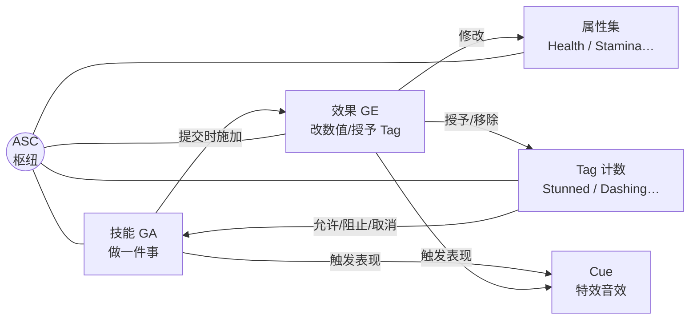
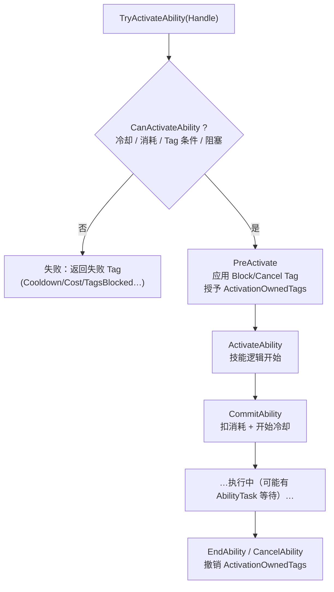
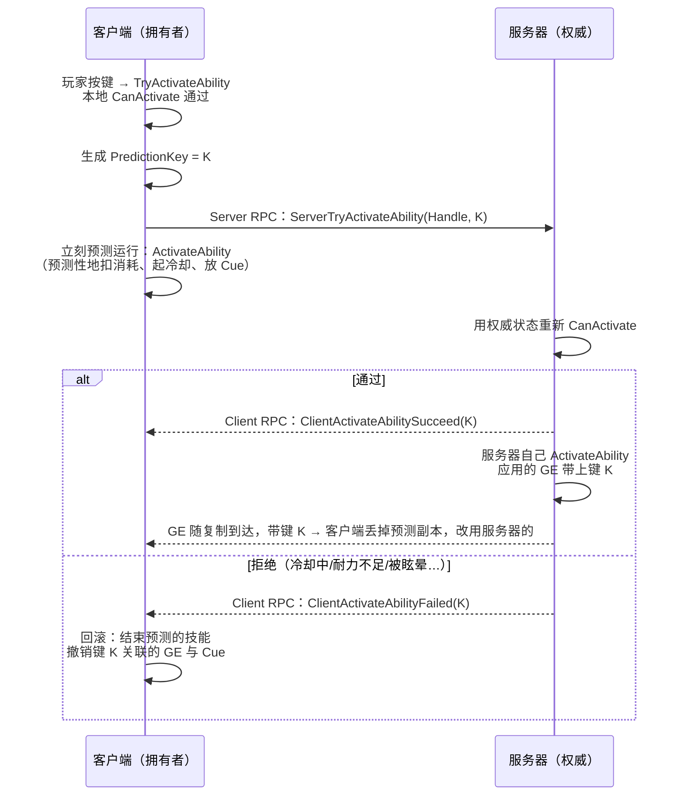
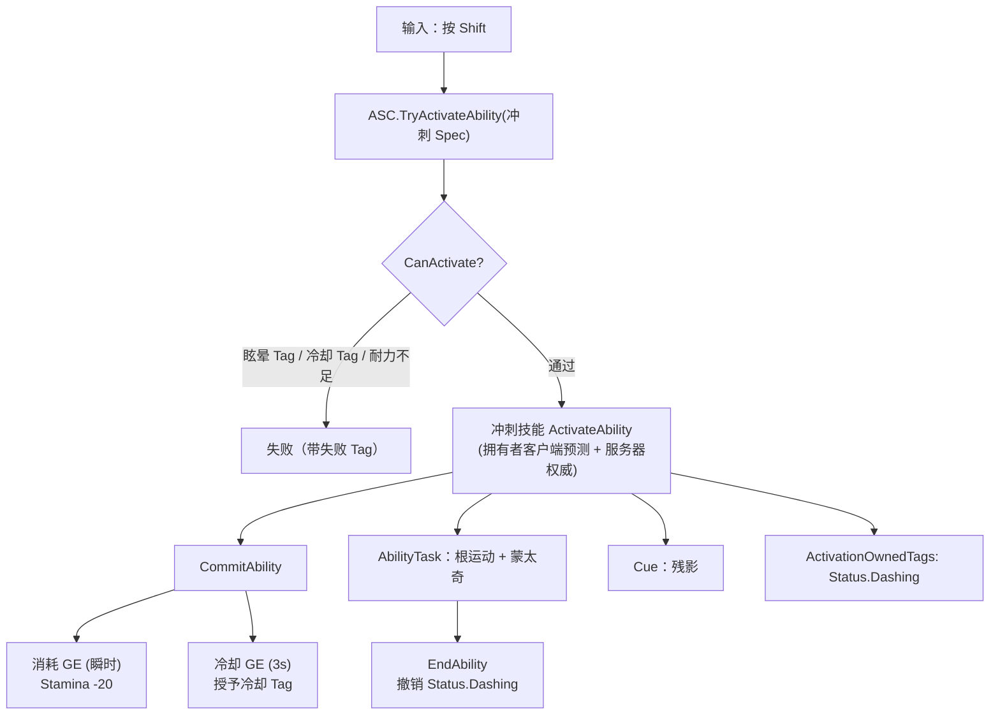
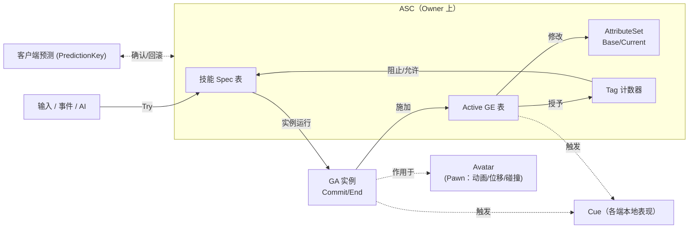

# 第 9 章　GAS 入门：ASC、技能、效果、属性、Tag、Cue 与预测

## 一个问题：一个“冲刺”技能，为什么会写成一座屎山？

策划给你一张需求单：按 Shift 向前冲刺 0.3 秒；消耗 20 点耐力；冷却 3 秒；眩晕时不能冲刺；换弹时不能冲刺；冲刺中被击晕要立刻中断；冲刺时播放残影特效；网络对战里不能作弊，但手感还要像单机一样跟手。

按 UE 入门教程的习惯，你大概会这么写：

```cpp
// 反面教材：冲刺的“朴素写法”（示意代码，不是 Lyra 源码）
void AMyCharacter::Dash()
{
    if (bIsDashing || bDashOnCooldown || bStunned || bReloading) { return; }
    if (Stamina < 20.f) { return; }

    Stamina -= 20.f;
    bIsDashing = true;
    bDashOnCooldown = true;
    LaunchCharacter(GetActorForwardVector() * 1500.f, true, true);

    GetWorldTimerManager().SetTimer(DashEndTimer, this, &AMyCharacter::EndDash, 0.3f);
    GetWorldTimerManager().SetTimer(DashCooldownTimer, this, &AMyCharacter::ResetDashCooldown, 3.f);
}
```

第一个技能这样写没问题。但需求会长大，这几个麻烦几乎是必然会出现的：

- **互斥关系爆炸。** 冲刺要检查 `bStunned`、`bReloading`；以后加了“攀爬”“投掷”“表情”，每个技能都要回头去检查所有别的技能的 bool，再把自己的 bool 告诉所有别的技能。N 个技能，N² 条规则，散落在 N 个函数里。
- **中断要手工清理。** 眩晕要打断冲刺，你得在 `Stun()` 里 `ClearTimer(DashEndTimer)`、`bIsDashing = false`、停掉残影特效。漏掉任何一项就留下“冲刺状态卡死”的 bug。
- **Buff 叠加难以撤销。** “加速药水 +20% 移速，持续 10 秒”和“冲刺鞋 +10% 移速，永久”同时存在，药水到期时你把移速设回哪个值？你只能记录一堆来源，自己重新计算。
- **冷却会被意外重置。** 冷却用的是 Actor 上的 Timer。角色死亡重生后 Actor 是新的——冷却被重置了，玩家学会了“死一次重置冷却”。
- **网络。** 客户端按下 Shift，如果等服务器回复再冲刺，延迟 100ms 的玩家会觉得操作发黏；如果客户端直接冲刺，服务器又得校验冷却和耐力，校验不过就要“把客户端拉回来”——可冲刺已经播放了动画、扣了耐力、放了特效，这些都要一一撤销。

这些问题的共同点是：**“技能”不只是一个函数，它是一段有生命周期、有前置条件、有代价、会被打断、会产生持续影响、还要同步到网络上的东西。** UE 官方为此提供了一整套框架，叫游戏玩法能力系统（Gameplay Ability System，简称 GAS）。Lyra 的战斗、移动技能、受伤、死亡、复活，全部建在它上面。

这一章是纯概念章：不看 Lyra 的实现，只讲 GAS 本身有哪些零件、各自解决什么问题、怎么协同。下一章再看 Lyra 怎么把这些零件拼起来。

## 读完本章你能……

- 画出 GAS 的六个零件（ASC、技能、效果、属性、Tag、Cue）及它们的关系；
- 说出 Owner 和 Avatar 的区别，以及为什么要把它们分开；
- 区分“技能（Ability）”和“技能规格（Spec）”、“效果（GE）”和“效果规格（GE Spec）”，并说出一个技能从被授予到结束经过哪几步；
- 解释属性的 BaseValue 与 CurrentValue 为什么是两个值，以及元属性（Meta Attribute）为什么存在；
- 用一张时序图讲清楚“客户端预测、服务器确认或拒绝”，并说出哪些东西可以预测、哪些不行。

## 需要先知道的 UE 概念

GAS 是 UE 自带的一个插件（插件名 GameplayAbilities），**本章出现的 `UAbilitySystemComponent`、`UGameplayAbility`、`UGameplayEffect`、`UAttributeSet`、`FGameplayAbilitySpec`、`FPredictionKey` 都是引擎类，不在 Lyra 项目目录里**。引擎源码里它们在 `Engine/Plugins/Runtime/GameplayAbilities/` 下。我们只讲读懂 Lyra 需要的那部分，不会面面俱到。

本章的引擎行为（预测范围、复制模式、修改器聚合公式、GE 组件的引入版本）都对照过 UE 5.8 的引擎源码；凡是与旧教程可能不一致的地方，会明确写出“以 5.8 源码为准”。

本章还会用到前几章的这些概念，请确认你熟悉：

- **GameplayTag**：层级化的标签，如 `Status.Death.Dying`，在 ini 里注册。见 [第 4 章 §GameplayTag](04-DataAndAssets.md)。
- **类默认对象（CDO）**：每个类有一个默认实例。GAS 大量使用“拿 CDO 当模板”的做法，见 [第 1 章 §CDO](01-UObject.md)。
- **复制与 OnRep、FastArray、权威端/自主代理/模拟代理**：见 [第 3 章](03-Networking.md)。
- **PlayerState 在整个会话期间一直存在，Pawn 会死会换**：见 [第 2 章](02-GameplayFramework.md)。

GAS 里有三个容易混淆的“规格”概念，先放在这里，后面会反复出现：

- **类**（比如 `UGA_Dash`）：定义“这个技能是什么”，它的 CDO 存放默认配置；
- **规格（Spec）**：定义“这个 ASC 拥有这个技能，等级几，由谁授予”，是一条记录；
- **实例（Instance）**：技能真正跑起来时的运行时对象，存放这一次执行的临时变量。

先记住这个三层，第 5 节会展开。

## 六个零件，一张小地图

在逐个展开之前，先建立整体印象。GAS 把“技能这件事”拆成六个角色，每个角色只管一件事：

- **能力系统组件（Ability System Component，ASC）**：挂在 Actor 上的组件，是整套系统的枢纽，保存这个角色拥有的技能、正在生效的效果、属性集、标签计数。
- **技能（Gameplay Ability，GA）**：一件“要做的事”，有激活、提交、结束的生命周期。
- **效果（Gameplay Effect，GE）**：对数值或状态的一次“修改请求”，可以是瞬间的（扣血）、持续的（加速 10 秒）、永久的（被动加成）。
- **属性与属性集（Attribute / AttributeSet）**：数值本身，比如 Health、MaxHealth。
- **GameplayTag**：状态本身，比如“眩晕中”“正在冲刺”。
- **GameplayCue**：纯表现（特效、音效），不影响游戏结果。



注意图里有一个环：技能施加效果，效果授予 Tag，Tag 又反过来决定别的技能能不能激活。**把“互斥、打断、冷却、Buff”全部统一成“Tag 的有无”**，就是 GAS 解决朴素写法里 N² 问题的办法。后面每一节会把环上的一条边讲清楚。

## ASC：枢纽，以及 Owner 和 Avatar

### 它解决什么问题

朴素写法里，冷却在 Timer 里，耐力在 `float Stamina` 里，状态在一堆 bool 里，它们散落在角色类的各处。GAS 要求你把这些全部放进一个统一的容器，由这个容器负责复制、查询、广播变化。这个容器就是 ASC。

可以把 ASC 想成这个角色的“战斗数据库 + 事件总线”：

- 一张**技能表**（`ActivatableAbilities`）：这个角色拥有哪些技能，每条是一个 Spec；
- 一张**效果表**（`ActiveGameplayEffects`）：当前正在生效的持续/永久效果；
- 若干**属性集**（`SpawnedAttributes`）：数值；
- 一个**Tag 计数器**：当前拥有的每个 Tag 出现了几次。

这个类比有边界：数据库是被动的，而 ASC 会在激活技能时主动检查 Tag、应用效果、取消冲突的技能，是一个有行为的组件。

### Owner 与 Avatar

ASC 里有两个 Actor 引用，GAS 称为 **Owner（拥有者）** 和 **Avatar（化身）**，通过 `InitAbilityActorInfo(Owner, Avatar)` 设置：

- Owner 是“逻辑上拥有这套技能和数据的 Actor”——ASC 的复制、所有权、Mixed 复制模式的“拥有者客户端”判断，都基于 Owner；
- Avatar 是“在世界里表现这些技能的 Actor”——播动画、位移、挂载特效、碰撞检测，都作用在 Avatar 上。

大多数教程让两者是同一个 Actor：ASC 挂在 Character 上，`InitAbilityActorInfo(this, this)`。这是最简单的做法。但如果你想让**角色死亡重生后保留冷却、弹药、属性**呢？Pawn 一死就销毁了，ASC 挂在它身上就跟着没了。GAS 允许你把 ASC 挂在一个更长寿的 Actor（比如 PlayerState）上，作为 Owner，而把当前存活的 Pawn 设为 Avatar；Pawn 换了，只换 Avatar。这正是 Lyra 的做法（第 10 章），也是 Epic 官方文档和 tranek 的 GASDocumentation 共同给出的推荐：ASC 放在 Pawn 上会随 Pawn 一起销毁，已授予的技能、Buff、冷却都会丢；放在 PlayerState 上则能活过重生。它有一个需要记住的代价：引擎的 `APlayerState` 构造函数把 `NetUpdateFrequency` 设成了 1（每秒最多同步一次），而 ASC 上的 Tag、GE 变化需要及时复制，所以放 PlayerState 时必须把它调高——Lyra 设成 100，细节见第 10 章。

这里隐藏着一个很重要的使用规则：**从技能里取“角色”要取 Avatar，取“玩家/控制器”要沿着 Owner 找**。GAS 把这些缓存在 `FGameplayAbilityActorInfo` 里（`OwnerActor`、`AvatarActor`、`PlayerController`、`AnimInstance`、`MovementComponent` 等），技能里通过 `GetActorInfo()` 和 `GetAvatarActorFromActorInfo()` 取。

### 三种复制模式

ASC 是被复制的组件。但如果每个客户端都要收到所有角色的全部效果、全部冷却，带宽会很吓人。所以 ASC 有三种复制模式（`EGameplayEffectReplicationMode`）：

| 模式 | 完整的 GE 复制给谁 | 其余客户端得到什么 |
|---|---|---|
| Full | 所有客户端 | —（大家都有完整 GE） |
| Mixed | 只有拥有者客户端 | 只收到精简的 Tag 与 Cue |
| Minimal | 没有人 | 只收到精简的 Tag 与 Cue |

多人游戏里的玩家角色通常用 Mixed：自己需要看到全部（UI 要显示冷却、Buff 图标），别人只需要知道你身上有哪些 Tag、播放哪些 Cue。Full 适合单人游戏，Minimal 适合 AI 小兵这种没有“拥有者客户端”的对象。官方文档与 tranek 的 GASDocumentation 给出的推荐一致：玩家控制的 Actor 用 Mixed，AI 用 Minimal。

“精简的 Tag 与 Cue”在 5.8 源码里的实现是：`FActiveGameplayEffectsContainer::GetReplicationCondition` 对 Minimal 返回 `COND_Never`、对 Mixed 在服务器端返回 `COND_OwnerOnly`；另有两个属性 `MinimalReplicationTags` 与 `MinimalReplicationGameplayCues`，复制条件是 `COND_SkipOwner`——发给**除拥有者以外**的客户端。所以 Mixed 的准确含义是：拥有者拿到完整的 GE（冷却、Buff 的细节），其他客户端只拿到 Tag 和 Cue。引擎在枚举上的注释还特别提醒：Minimal 对“有拥有者的 ASC”不适用，玩家用 Mixed。

“拥有者”是靠网络所有权判断的，所以 Mixed 要求 ASC 的 Owner Actor 的所有权链能通到一个 PlayerController（Owner 的 Owner 是 Controller）——PlayerState 的 Owner 恰好就是玩家的 Controller，满足这个条件。

另外，技能的授予记录（Spec 列表 `ActivatableAbilities`）的复制条件是 `COND_ReplayOrOwner`，只发给拥有者客户端，别人的客户端不知道你有哪些技能——这也合理：别人不需要。这会在第 11 章的排错里再次出现。

### 怎么找到一个 Actor 的 ASC

引擎约定：想让别人能找到你的 ASC，让你的 Actor 实现接口 `IAbilitySystemInterface`，重写 `GetAbilitySystemComponent()`。然后任何地方都可以用 `UAbilitySystemGlobals::GetAbilitySystemComponentFromActor(Actor)` 取。在 Lyra 里，`ALyraCharacter` 实现了这个接口，但它的 ASC 并不是自己的成员，而是转手去问 `PawnExtComponent`（见第 10 章）。

## GameplayTag：用“有无”表达一切状态

### 为什么 Tag 是核心

回到冲刺的问题：“眩晕时不能冲刺”。GAS 的做法是：

- 眩晕效果存在时，给角色授予 Tag `Status.Stunned`；
- 冲刺技能上配置“激活被阻止的 Tag（Activation Blocked Tags）”包含 `Status.Stunned`。

技能不需要知道“眩晕”这个概念，只需要知道一个 Tag 名。以后加“冰冻”“睡眠”，让它们也授予 `Status.Stunned`（或者它的子 Tag `Status.Stunned.Frozen`），所有技能自动适配。

### Tag 是怎么挂到 ASC 上的

一个 Tag 有三种来源，都会累加到 ASC 的 Tag 计数器里：

1. **效果授予**：持续/永久 GE 配置了“授予 Tag”，GE 生效时计数 +1，GE 移除时 -1。这是主力来源，会随 GE 的复制自动同步（Mixed 模式下，Tag 同步给所有端）。
2. **技能激活期间授予**：技能上配置的 `ActivationOwnedTags`，在技能激活时加上，结束时去掉。引擎的开发者设置 `ReplicateActivationOwnedTags` 默认为 true，所以这些 Tag 也会复制出去；设为 false 时它们只在本地生效（引擎注释说那只该用于依赖旧行为的遗留代码）。
3. **松散 Tag（Loose Gameplay Tag）**：代码里直接 `AddLooseGameplayTag(Tag)` / `RemoveLooseGameplayTag(Tag)` / `SetLooseGameplayTagCount(Tag, N)`。**它不会自动复制**——每一端都要自己设置。

Tag 带计数：两个来源同时授予 `Status.Stunned`，计数为 2，其中一个移除后依然为 1，角色仍然眩晕。这解决了朴素写法里“两个 buff 同时设置一个 bool，一个到期把另一个也关了”的问题。

查询用 `ASC->HasMatchingGameplayTag(Tag)`、`HasAnyMatchingGameplayTags(Container)`、`HasAllMatchingGameplayTags(Container)`。匹配是**层级的**：如果身上有 `Status.Death.Dying`，那么 `HasMatchingGameplayTag(Status.Death)` 为真，反过来不成立。Lyra 里有一处刻意使用精确匹配（`HasTagExact`），第 11 章会遇到。

### 技能与 Tag 的五种关系

一个 `UGameplayAbility` 上有几组 Tag 配置，它们定义了这个技能和 Tag 世界的关系：

- **技能标签（Ability Tags，编辑器里新版叫 Asset Tags，Lyra 的 C++ 里用 `GetAssetTags()` 读取）**：这个技能“是什么”，比如 `Ability.Type.Action.Dash`。别的技能和规则用它来指代这个技能。
- **取消带这些标签的技能（Cancel Abilities With Tag）**：我激活时，把身上带这些标签的技能取消掉。
- **阻止带这些标签的技能（Block Abilities With Tag）**：我运行期间，带这些标签的技能无法激活。
- **激活所需 / 被阻止的 Tag（Activation Required / Blocked Tags）**：ASC 身上必须有（或不能有）这些 Tag，我才能激活。
- **激活期间拥有的 Tag（Activation Owned Tags）**：我运行期间，把这些 Tag 加到 ASC 身上。

注意前三个比较绕：“技能标签”标记的是**技能的类别**，“取消/阻止”配置的是**对别的类别的技能**的影响，它们都作用于“技能”层面；而“激活所需/被阻止”和“激活期间拥有”作用于**状态 Tag**层面。两层是分开的：技能类别 Tag 用来管技能之间的关系，状态 Tag 用来管角色当前的状态。

举一个完整的小例子：冲刺技能，技能标签 `Ability.Type.Action.Dash`，激活被阻止 Tag 包含 `Status.Stunned`，取消带 `Ability.Type.Action.Reload` 的技能，激活期间拥有 `Status.Dashing`。眩晕被施加时，冲刺自动无法使用；冲刺启动时，换弹自动被打断；冲刺期间任何人（比如 AI 的判定逻辑）查 `Status.Dashing` 都能知道你在冲刺。**以后加任何新技能，只要它带上 `Ability.Type.Action.Reload` 标签，就自动被冲刺打断，不用改冲刺的任何代码。**

Lyra 在此基础上又加了一层“关系映射表”，把“A 类技能阻止/取消 B 类技能”这类规则从每个技能里抽出来集中到一张 DataAsset 里。那是第 10 章的内容。

## 技能：从被授予到结束

### 三层：类、Spec、实例

一个技能要真正在角色身上能用，要经历“授予”。授予的结果不是一个新对象，而是在 ASC 的技能表里新增一条 **`FGameplayAbilitySpec`**，里面记录：

- 技能类的 CDO 指针（技能“是什么”）；
- 等级（Level）；
- 一个句柄 `FGameplayAbilitySpecHandle`（以后用来引用这条记录：激活、移除都用它）；
- `SourceObject`（谁授予的，Lyra 里用来记录“这是哪把武器的技能”）；
- `DynamicSpecSourceTags`（这条记录自己携带的 Tag，Lyra 用它存输入 Tag，第 11 章）。

授予在代码里是 `ASC->GiveAbility(FGameplayAbilitySpec(CDO, Level))`，返回句柄；移除是 `ASC->ClearAbility(Handle)`。授予必须在权威端（服务器）做，Spec 通过 FastArray 复制给拥有者客户端。

技能真正运行时，才会按**实例化策略（Instancing Policy）**产生运行时对象：

- `InstancedPerActor`：每个 Spec 一个实例，反复激活时重复使用同一个对象。适合绝大多数技能，可以存放成员变量，但要记得每次激活时重置。
- `InstancedPerExecution`：每次激活新建一个实例，用完即弃。适合每次都要全新状态的技能，开销更大。
- `NonInstanced`：不创建实例，直接在 CDO 上运行，不能存状态。引擎从 5.5 起已把它标记为弃用（枚举上有 `UE_DEPRECATED_FORGAME(5.5, ...)`），Lyra 在代码里对它打了 `ensure`，要求所有技能都是实例化的。

### 激活流程：Try → Activate → Commit → End

一个技能从“有人想用它”到“用完”的路径，是 GAS 里最值得背下来的流程：



逐步说明：

1. **`TryActivateAbility`**：入口，参数是 Spec 的句柄。可以来自输入、来自事件、来自 AI。
2. **`CanActivateAbility`**：检查一切前置条件——技能是否被阻塞（别的技能的 Block Tag）、冷却是否结束、消耗是否够、ASC 的 Tag 是否满足 Required/Blocked。任何一项不满足就失败，并返回一个或多个“失败原因 Tag”。
3. **`ActivateAbility`**：技能开始。这是你重写、写技能逻辑的地方（蓝图里就是 `Event ActivateAbility`）。
4. **`CommitAbility`**：提交。扣除消耗、开始冷却。**激活和提交是两个分开的步骤**——这样你可以先做一些准备动作，确认技能真的“生效”了才扣代价。Lyra 的射击就是在拿到命中数据后才提交（所以没子弹时不扣其他东西）。
5. **`EndAbility`**：结束。你必须在逻辑结束的地方调用它，否则技能永远处于“激活中”，永远无法再次激活（这是新手最常见的 bug 之一）。`CancelAbility` 是被外部打断时的结束路径，会走 `EndAbility(bWasCancelled=true)`。

下面是一个最小的 C++ 技能骨架（示意代码，不是 Lyra 源码，但用到的函数都是引擎里真实存在的）：

```cpp
// 教学示意：最小的 GA
void UGA_Dash::ActivateAbility(const FGameplayAbilitySpecHandle Handle,
    const FGameplayAbilityActorInfo* ActorInfo,
    const FGameplayAbilityActivationInfo ActivationInfo,
    const FGameplayEventData* TriggerEventData)
{
    // 提交失败（比如消耗不够）就直接结束；成功则扣消耗并开始冷却
    if (!CommitAbility(Handle, ActorInfo, ActivationInfo))
    {
        EndAbility(Handle, ActorInfo, ActivationInfo, /*bReplicateEndAbility=*/true, /*bWasCancelled=*/true);
        return;
    }

    // …… 这里做真正的冲刺（位移、播蒙太奇）……

    // 逻辑结束了，必须手动结束技能
    EndAbility(Handle, ActorInfo, ActivationInfo, true, false);
}
```

### 冷却和消耗其实是 GE

`CommitAbility` 里到底是怎么“扣消耗、开始冷却”的？答案是：**冷却和消耗都只是 GE**。

- 技能上有一个属性 `CostGameplayEffectClass`，指向一个瞬时 GE，GE 里把 Stamina 减 20；提交时 ASC 应用它，不够扣则 `CanActivateAbility` 的消耗检查失败。
- 技能上有一个属性 `CooldownGameplayEffectClass`，指向一个“持续 3 秒”的 GE，这个 GE 授予一个“冷却中”Tag；`CanActivateAbility` 的冷却检查只是在问“ASC 身上有没有这些冷却 Tag”。

这就是为什么朴素写法里“重生重置冷却”在 GAS 里不会发生：冷却是 ASC 上的一个 GE，只要 ASC 活着，冷却就走自己的时间。Lyra 里冲刺技能就配了冷却 GE（`GE_HeroDash_Cooldown`），你在本章实验 1 里可以打开看看。

### 技能的网络执行策略

技能激活涉及“谁来跑”的问题，由**网络执行策略（Net Execution Policy）**控制：

| 策略 | 谁运行 | 典型用途 |
|---|---|---|
| LocalOnly | 只有拥有者客户端本地跑，服务器不知道 | 纯本地表现（开关 UI 面板） |
| LocalPredicted | 拥有者客户端先跑（预测），同时通知服务器，服务器确认或拒绝 | 绝大多数玩家主动技能（跳跃、冲刺、射击） |
| ServerOnly | 只在服务器跑 | 纯服务器逻辑 |
| ServerInitiated | 服务器发起，并通知拥有者客户端同步运行 | 由服务器事件触发的技能（死亡） |

最常用的是 LocalPredicted。它就是下面“预测”一节要讲的机制。另外还有一个正交的**网络安全策略（Net Security Policy）**，决定客户端能不能“请求激活/请求结束”这个技能，本章略过，Lyra 的默认值是 `ClientOrServer`（都可以）。

### 技能任务（Ability Task）

技能里常常需要“等一会儿”：等一段蒙太奇播完、等 0.3 秒、等玩家松开按键、等目标数据。如果每个技能都自己写 Timer 和委托绑定，就回到朴素写法。GAS 提供了**技能任务（`UAbilityTask`）**：一种和技能绑定的异步节点，常见的有：

- `PlayMontageAndWait`：播蒙太奇（Anim Montage，一种可以分段、可被代码触发播放的动画资产），等它结束；
- `WaitDelay`：等一段时间；
- `WaitInputRelease`：等玩家松开技能的按键（做“按住蓄力，松开释放”）；
- `WaitGameplayEvent`：等一个 Gameplay Event；
- `ApplyRootMotionConstantForce`：给角色施加持续的根运动力（可用来实现冲刺位移）。

它们的共同点是**生命周期与技能绑定**：技能结束时，所有还在等待的任务自动被销毁，不会出现“技能结束了回调还在跑”。蓝图里它们显示为带时钟图标的节点，任务只能在实例化的技能里用。

Lyra 的冲刺技能 `GA_Hero_Dash`（`/ShooterCore/Game/Dash/GA_Hero_Dash`）就是一个典型例子：在 `Event ActivateAbility` 里选好冲刺方向并调用 `CommitAbility` 后，它并行启动 `PlayMontageAndWait`（播四向冲刺蒙太奇）和 `ApplyRootMotionConstantForce`（施加 0.25 秒、强度 1850 的根运动推力）两个技能任务，等推力任务结束再补足剩余技能时长（总长 0.55 秒）后调用 `EndAbility`。

### Gameplay Event 与触发器

除了“输入触发”，技能还能被**事件**触发。`ASC->HandleGameplayEvent(EventTag, &Payload)` 会广播一个带 Tag 和载荷（`FGameplayEventData`：谁触发的、目标是谁、数值等）的事件。技能上可以配置 `AbilityTriggers`：“当收到 `GameplayEvent.Death` 事件时，自动激活我”。事件由 Tag 标识，载荷由发送者填写。Lyra 的死亡技能就是这么触发的（第 12 章）。

这就把“谁决定技能该不该激活”和“技能做什么”分开了：血量组件只需要发一个事件，不需要知道死亡技能的存在。

## 效果（GE）：对数值和状态的“修改请求”

### 三层：类、Spec、Active

GE 和技能一样有三层，名字很相似，必须分清：

- **`UGameplayEffect`（类/CDO）**：纯数据，描述“这个效果是什么”。通常是一个蓝图类，**只配置，不写逻辑**。
- **`FGameplayEffectSpec`（Spec）**：这个效果的“一次具体应用的参数包”：等级、施加者的 Context、SetByCaller 数值、动态附加的 Tag、捕获的属性快照。
- **`FActiveGameplayEffect`（Active）**：持续/永久效果被施加后，在 ASC 的效果表里的那一条“生效中”记录，用 `FActiveGameplayEffectHandle` 引用。

流程是：拿 GE 类 → 创建 Spec（`ASC->MakeOutgoingSpec(GEClass, Level, Context)`，需要时塞入 SetByCaller 值）→ 应用到目标 ASC（`ApplyGameplayEffectSpecToSelf`/`ToTarget`）→ 如果是持续/永久的，得到一个 Active 句柄，将来可以用句柄移除它。

这和 C++ 里“类 → 实例化对象 → 对象在容器里的位置”是相同的结构，只是名字都叫 Spec。**本书凡是只写“Spec”而没有前缀，默认指技能 Spec；效果 Spec 会写成“GE Spec”。**

### 三种持续类型

`DurationPolicy` 决定一个 GE 的生命周期：

- **Instant（瞬时）**：应用的那一刻修改一次属性的 BaseValue，然后就“消失”了，不会成为 Active。扣血、治疗、扣消耗用它。
- **HasDuration（有持续时间）**：生效一段时间，到期自动移除。加速药水、冷却、眩晕用它。
- **Infinite（无限）**：一直生效，直到被显式移除。被动加成、装备给的属性、“是玩家”的标记用它。

此外，持续/永久的 GE 可以设置**周期（Period）**：每隔 N 秒“执行”一次，每次相当于施加一次 Instant 修改。中毒（每秒扣血）、回血光环用它。

### 修改器：怎么改属性

一个 GE 里有若干**修改器（Modifier）**，每个修改器说：对哪个属性、做什么运算、数值是多少：

- 运算（`ModifierOp`）：编辑器里显示为 Add (Base)、Multiply (Additive)、Multiply (Compound)、Divide (Additive)、Add (Final) 和 Override。引擎代码里还保留着旧名字 `Additive`、`Multiplicitive`（对，引擎里就是这个拼写）、`Division` 作为别名，读源码时会遇到。它们如何组合，见下面“属性”一节的聚合公式；
- 数值来源（Magnitude Calculation）：固定的 `ScalableFloat`（可以随等级查曲线）；`AttributeBased`（取另一个属性的值，按系数换算）；`CustomCalculationClass`（自定义计算类，全称 Modifier Magnitude Calculation，简称 MMC）；`SetByCaller`（由施加者在创建 Spec 时用一个 Tag 填入）。

SetByCaller 值得单独讲：它让“效果的数值由运行时决定”。比如“伤害 GE”只是一个模板，具体伤害多少，由应用它的代码用 Tag `SetByCaller.Damage` 塞进 Spec。Lyra 的作弊命令 `DamageSelf`、治疗命令 `HealSelf` 就是这么做的，第 12 章会看到。

### 执行（Execution）：当修改器不够用

修改器只能表达“某属性 += 常数”这种简单关系。如果伤害公式是 `基础伤害 × 距离衰减 × 部位倍率 × (队友?0:1)`，需要读取很多外部信息，就要用**执行（`UGameplayEffectExecutionCalculation`）**：一个你自己写的计算类，它声明要“捕获”哪些属性（`RelevantAttributesToCapture`），然后在 `Execute_Implementation` 里做任意计算，最后输出若干修改（`OutExecutionOutput.AddOutputModifier(...)`）。Lyra 的伤害计算就是一个执行（`ULyraDamageExecution`）。

“捕获”有两个关键选项：来源（`Source` 施加者，或 `Target` 被施加者），以及是否快照（`bSnapshot`：在 Spec 创建时取值，还是在应用时取值）。

### 叠加与授予 Tag（简述）

- **叠加（Stacking）**：同一个 GE 被重复应用时怎么办——各自独立，还是合并成一层并累计层数？可配置层数上限、刷新持续时间的规则。冷却一般不叠加，中毒一般叠层数。
- **授予 Tag**：持续/永久 GE 在生效期间给目标 ASC 授予 Tag。UE 5.3 起，GE 被重构成“GE 组件（Gameplay Effect Components）”——引擎源码 `GameplayEffect.h` 开头的注释写得很明确：“Since Unreal 5.3, we have deprecated the Monolithic UGameplayEffect”。授予 Tag、资产 Tag、阻止技能 Tag、免疫、按概率应用、附加其他效果等原先写在 GE 上的配置，现在是 GE 面板下方可以增删的一个个组件（5.8 里有 Target Tags、Asset Tags、Block Ability Tags、Immunity、Chance To Apply、Additional Effects 等）。旧资产里的 `InheritableOwnedTagsContainer` 等字段是迁移前的旧数据，仍保留在类里供升级用。

### 同一个机制，五种用途

到这里可以回头看看 GE 一个类型承担了多少事：

- **伤害/治疗**：瞬时 GE，修改 Damage/Healing；
- **消耗**：瞬时 GE，扣 Stamina；
- **冷却**：持续 GE，授予冷却 Tag；
- **Buff/Debuff**：持续 GE，带修改器；
- **永久被动/状态标记**：无限 GE，授予 Tag 或加属性。

统一表示的好处是：复制、过期、撤销、叠加、调试（`showdebug abilitysystem` 一眼看到所有 Active GE）全都不用重新发明。代价是：**一切都要写成 GE，一个简单的“把 bool 设成 true”也要走一遍 Spec → 应用的流程**，需要习惯。

## 属性：BaseValue 与 CurrentValue

### 为什么一个属性有两个值

GAS 里的属性不是 `float`，而是 `FGameplayAttributeData`，里面有两个值：

- **BaseValue（基础值）**：永久性的修改写在这里。比如“受到 20 点伤害”永久地改变了 Health 的基础值。
- **CurrentValue（当前值）**：`BaseValue` 加上所有**临时修改**之后的结果。比如“移速 +20%，持续 10 秒”不改 BaseValue，而是挂一个临时修改器；CurrentValue = f(BaseValue, 当前所有临时修改器)。

```
  移速:  Base = 600
          ├─ 加速药水 (+20%，10 秒)   → Multiply (Additive) 修改器，数值 1.2
          └─ 冲刺鞋  (+10%，永久)     → Multiply (Additive) 修改器，数值 1.1
  Current = 600 × (1 + 0.2 + 0.1) = 780      ← 注意：加成是“相加”后再乘，不是 1.2 × 1.1
  药水到期 → 临时修改器被移除 → Current 自动回到 600 × 1.1 = 660，Base 始终是 600
```

这就解决了朴素写法里“药水到期设回哪个值”的问题：**修改器是可撤销的清单，而不是对一个数的覆盖。**

规则是：瞬时 GE（和周期 GE 的每次执行）修改 BaseValue；持续/永久 GE 的修改器进入聚合器，影响 CurrentValue。聚合公式在 5.8 的 `GameplayEffectAggregator.cpp`（`FAggregatorModChannel::EvaluateWithBase`）里是这样的：

```
Current = ((Base + ΣAdd(Base)) × ΣMultiply(Additive) ÷ ΣDivide(Additive) × ΠMultiply(Compound)) + ΣAdd(Final)
```

三个细节。第一，Multiply (Additive) 和 Divide (Additive) 的“Additive”指的是**同类修改器先相加**：引擎内部把每个乘数减去 1 再累加、最后加回 1，所以 1.2 与 1.1 合起来是 `1 + 0.2 + 0.1 = 1.3`（引擎注释里的例子：两个 1.5 合成 2.0）。想让加成真正“连乘”，要用 Multiply (Compound)，它才是 1.2 × 1.1 = 1.32。第二，只要有一个满足条件的 Override 修改器，就直接以它的值为结果，其余全部忽略。第三，同一个属性还可以按“评估通道（Channel）”分段计算，每个通道的结果作为下一个通道的 Base；绝大多数项目只用默认的 Channel0，本书略过。

### 属性集与 ATTRIBUTE_ACCESSORS

属性住在**属性集（`UAttributeSet`）**里。一个属性集是一个 UObject，里面声明若干 `FGameplayAttributeData` 属性；它通过 ASC 注册（挂到 ASC 上）。同一个 ASC 可以有多个属性集（Lyra 的 PlayerState 上有 `ULyraHealthSet` 和 `ULyraCombatSet`）。

声明一个属性、访问它，有一堆重复的样板代码。引擎提供了 4 个宏，Lyra 把它们打包成了 `ATTRIBUTE_ACCESSORS`：

```cpp
// 简化自 Source/LyraGame/AbilitySystem/Attributes/LyraAttributeSet.h
// 对 ATTRIBUTE_ACCESSORS(ULyraHealthSet, Health) 生成：
//   static FGameplayAttribute GetHealthAttribute();   // 属性的“引用”，GE 修改器、Execution 里用它指代属性
//   float GetHealth() const;                          // 读 CurrentValue
//   void  SetHealth(float NewVal);                    // 直接写（绕过 GE，慎用）
//   void  InitHealth(float NewVal);                   // 初始化 Base 和 Current
#define ATTRIBUTE_ACCESSORS(ClassName, PropertyName) \
    GAMEPLAYATTRIBUTE_PROPERTY_GETTER(ClassName, PropertyName) \
    GAMEPLAYATTRIBUTE_VALUE_GETTER(PropertyName) \
    GAMEPLAYATTRIBUTE_VALUE_SETTER(PropertyName) \
    GAMEPLAYATTRIBUTE_VALUE_INITTER(PropertyName)
```

属性在 ASC 眼里是靠 `FGameplayAttribute`（由 `GetXxxAttribute()` 返回）来指代的，GE 的修改器里选的“属性”就是它。

### 属性要复制

属性是被复制的，写法有固定套路（看 Lyra 的 `ULyraHealthSet`）：

```cpp
// 简化自 Source/LyraGame/AbilitySystem/Attributes/LyraHealthSet.h / .cpp
UPROPERTY(BlueprintReadOnly, ReplicatedUsing = OnRep_Health, Category = "Lyra|Health",
          Meta = (HideFromModifiers, AllowPrivateAccess = true))
FGameplayAttributeData Health;

void ULyraHealthSet::GetLifetimeReplicatedProps(TArray<FLifetimeProperty>& OutLifetimeProps) const
{
    Super::GetLifetimeReplicatedProps(OutLifetimeProps);
    // REPNOTIFY_Always：即使值没变也触发 OnRep，保证预测回滚后能被服务器值“覆盖”
    DOREPLIFETIME_CONDITION_NOTIFY(ULyraHealthSet, Health, COND_None, REPNOTIFY_Always);
}

void ULyraHealthSet::OnRep_Health(const FGameplayAttributeData& OldValue)
{
    GAMEPLAYATTRIBUTE_REPNOTIFY(ULyraHealthSet, Health, OldValue);   // 让 ASC 的聚合器同步新的 Base 值
    // ……（Lyra 在这里还触发了血量变化委托）
}
```

有两个要点。第一，OnRep 里的 `GAMEPLAYATTRIBUTE_REPNOTIFY` 是必须的，它通知 ASC“这个属性的 Base 被服务器改了，请重新计算 Current”。第二，`Meta = (HideFromModifiers)` 的意思是：GE 编辑器里的修改器下拉菜单不会列出这个属性，**普通 GE 不能直接改它**，只能由代码或执行来改。这个设计在第 12 章会派上大用场。

### 元属性：不是“状态”，是“中转站”

这里要引入 GAS 里一个很有用的约定：**元属性（Meta Attribute）**。看 `ULyraHealthSet`，除了 `Health` 和 `MaxHealth`，还有 `Damage` 和 `Healing`。它们不被复制，也不代表“状态”，值永远是 0——它们只是 GE 到属性集之间的“传话筒”：

- 伤害 GE 不直接扣 `Health`，而是往 `Damage` 里加一个正数（比如 20）；
- 属性集在 `PostGameplayEffectExecute` 里看到 `Damage` 被改了，就执行 `Health = Clamp(Health - Damage)`，然后把 `Damage` 清零。

这样做的好处是：**所有伤害都经过属性集里的同一个入口**，在这里统一做免疫判断、无敌、死亡判定、发消息。如果允许 GE 直接改 `Health`，每个 GE 都能绕过这些规则。这是一个典型的“把策略收到一个咽喉点”的设计，朴素做法（GE 直接对 Health 做 Additive 负值）则会把逻辑散落各处。Epic 的《Abilities in Lyra》文档介绍属性集时也是这个思路：属性集里既有 Health 这样的“资源”，也有 Applied Damage 这样不保存状态的“无状态量”（本书统一叫元属性）。

还有一个由引擎注释确认的限制：元属性只对瞬时 GE 有意义，因为它依赖的 `PreGameplayEffectExecute`/`PostGameplayEffectExecute` 钩子只在瞬时/周期执行时调用；`GameplayPrediction.h` 里明说“无法预测地应用元属性”。这也是 Lyra 的伤害只在服务器上算的另一个理由，下面“预测”一节会回到这里。

### 属性集的钩子

`UAttributeSet` 提供了几个虚函数，让属性集在属性变化的前后插手：

- `PreAttributeChange` / `PreAttributeBaseChange`：属性的 Current/Base 值**即将**改变，可以用来钳制范围（Lyra 里把 Health 夹在 0 到 MaxHealth）；
- `PreGameplayEffectExecute`：一个瞬时/周期 GE 的修改**即将**执行，返回 false 可以拒绝这次修改（Lyra 的免疫判断）；
- `PostGameplayEffectExecute`：修改**已经**执行，可以做“Damage 转成 -Health”这样的二次处理，以及触发委托；
- `PostAttributeChange`：属性变化之后的通知。

钳制范围的例子（简化自 Lyra 的 `ULyraHealthSet::ClampAttribute`）：

```cpp
// 简化自 Source/LyraGame/AbilitySystem/Attributes/LyraHealthSet.cpp 的 ULyraHealthSet::ClampAttribute
if (Attribute == GetHealthAttribute())
{
    // 血量不能为负，也不能超过最大血量
    NewValue = FMath::Clamp(NewValue, 0.0f, GetMaxHealth());
}
else if (Attribute == GetMaxHealthAttribute())
{
    // 最大血量不能低于 1
    NewValue = FMath::Max(NewValue, 1.0f);
}
```

要记住这些钩子的执行端：**它们跑在各自的 ASC 所在的那一端**——也就是说，服务器上应用 GE 时服务器执行，客户端预测应用 GE 时客户端也会执行（只在预测发生时）。属性集里写逻辑时，要区分“服务器权威逻辑”和“客户端表现”。后面 Lyra 在 `OnRep_Health` 里触发委托时就特意标注了“客户端上没有施加者信息”。

## GameplayCue：纯表现，不影响结果

冲刺要有残影，受伤要有血雾，开火要有枪口火焰。如果把这些写进技能或 GE 的逻辑里，会有两个问题：专用服务器没有屏幕，也不该加载特效资源；而且表现逻辑和游戏结果混在一起，换一套特效要改技能。

GAS 的做法是 **GameplayCue（表现提示）**：

- 每个 Cue 由一个以 `GameplayCue.` 开头的 Tag 标识，如 `GameplayCue.Character.Dash`；
- 触发 Cue 的方式有：GE 里配置“Cue Tag”（GE 生效/移除时自动触发）；或在代码/蓝图里调用 ASC 的 `ExecuteGameplayCue`（一次性）、`AddGameplayCue` / `RemoveGameplayCue`（持续型，要成对）；
- Cue 的接收者是一个**通知（Cue Notify）**资产，蓝图里选 Tag，实现 `OnActive`/`WhileActive`/`OnExecute`/`OnRemove` 之类的事件，里面生成粒子、播声音。一次性表现用 Burst 一类的父类，持续表现用 Looping 一类。注意文件名前缀只是命名习惯，并不可靠：在编辑器里打开本项目资产核对就会发现，`Content/GameplayCueNotifies/` 下的 `GCNL_Test_Looping` 父类确实是 `GameplayCueNotify_Looping`，但带 `GCNL_` 前缀的 `GCNL_Character_DamageTaken`（受击表现）、`GCNL_Dash`（冲刺残影与音效）以及 `GCN_Character_Heal` 的实际父类都是 `GameplayCueNotify_BurstLatent`（一次性触发、但允许内部有延迟节点或持续粒子生命周期的 Actor 版通知）。

最关键的一条规则：**Cue 是“各端本地播放的表现”，不是游戏逻辑。** Cue 通过 ASC 广播到相关的客户端，每个客户端在本地播放，并不保证和服务器的游戏状态严格同步，因此 Cue 里不要修改会影响游戏结果的状态（不要在 Cue 里扣血、改属性、移动角色）。反过来，因为 Cue 不影响结果，它可以放心地被预测——客户端不必等服务器，就可以先播放特效。

在编辑器中核对 Lyra 的真实资产，刚好能看到触发 Cue 的两种典型方式：
- **由 GE 自动触发**：基础伤害父类 `GameplayEffectParent_Damage_Basic` 在 `Display → Gameplay Cues` 数组里配了 `GameplayCue.Character.DamageTaken`，基础治疗父类 `GameplayEffectParent_Heal` 配了 `GameplayCue.Character.Heal`；
- **由技能主动调用触发**：冲刺技能 `GA_Hero_Dash` 在权威端调用 `ExecuteGameplayCueWithParamsOnOwner` 触发 `GameplayCue.Character.Dash`，死亡技能触发 `GameplayCue.Character.Death`。

（留神一个很容易看走眼的命名“假象”：项目标签表里虽然有一个叫 `GameplayCue.Character.Dash.Cooldown` 的 Tag，但打开冲刺冷却 `GE_HeroDash_Cooldown` 会发现它的 `Gameplay Cues` 数组其实是 **0 个元素**——这个 Tag 被填在了“授予目标的 Tag”里充当冷却状态标记，下面实验 1 会亲眼看到。）Cue 资产怎么被按需加载（Lyra 的 `ULyraGameplayCueManager`）是第 10 章的内容。

## 预测：为什么客户端敢“先斩后奏”

### 问题

回到开场的网络问题。服务器权威（第 3 章）意味着：重要的结果由服务器说了算。但如果客户端按下 Shift 要等一个往返（RTT）才能看到角色动，在 100ms 延迟下手感会很糟。

直观做法有两种：

1. **等服务器**：手感差。
2. **客户端直接做，服务器事后校验**：校验失败时，客户端已经播了动画、扣了耐力、触发了特效，需要“撤销”。如果这些撤销都靠你手写，复杂度会爆炸。

GAS 的方案是**预测（Prediction）**：让客户端先做（为了手感），同时用一个“预测键（Prediction Key）”给这次行动打上标记。服务器确认后，客户端什么都不用做；服务器拒绝时，GAS 根据这个键，**自动撤销**与之关联的一切预测行为。

### 机制

预测键（`FPredictionKey`）是客户端生成的一个轻量标识，在一个**预测窗口**（`FScopedPredictionWindow`）里创建。可以把它想成“这一次预测行动的流水号”。客户端在窗口内做的所有“可预测”的事（激活技能、应用 GE、触发 Cue），都会记下这个流水号。



几个关键点：

- 客户端预测期间，应用的 GE 带着键 K。服务器后来复制回来的 GE 也带着 K，客户端据此知道“这就是我刚才预测的那一个”，丢掉自己的预测副本，用服务器的那份——这样不会重复叠加。如果服务器拒绝，带 K 的预测 GE 和预测 Cue 被撤销。
- 预测性的属性修改是“临时覆盖”：服务器的权威值通过属性复制到达后，会把它替换掉。（还记得 `REPNOTIFY_Always` 吗？即使数值恰好相同也要触发回调，才能完成“预测副本 → 权威值”的替换。）
- 并非所有东西都能预测。`GameplayPrediction.h` 开头的注释是权威清单（5.8 源码核对）。**能预测**的：技能激活（带条件的链式激活）、由技能触发的事件、GE 的应用（其中的属性修改器与 Tag；例外：**Execution 目前不预测，只有修改器预测**）、GameplayCue 事件、蒙太奇，以及 `UCharacterMovement` 内置的角色移动。**目前不预测**的：GE 的移除，以及周期性 GE 的每次跳动（比如中毒扣血）。注释还补充了一句：这些“不预测”的多数理论上可以做，只是引擎没做。
- 预测键只在一个很短的**预测窗口**里有效：从 `ActivateAbility` 被调用开始，到它的调用栈返回为止。窗口里产生的副作用才会挂上这个键；一旦技能进入 Timer、延迟节点或 AbilityTask 的等待，原来的键就失效了，后续副作用不再受它保护。需要在等待之后继续预测（比如“松开按键时立刻放出蓄力”），要用 `FScopedPredictionWindow` 开一个新窗口——引擎自带的 `WaitInputRelease` 任务就是这样做的。另外，预测键只会复制回**发起它的那个客户端**，其他客户端看到的永远是无效键。

对别人造成的效果要不要预测，是一个**可配置项**：`PredictTargetGameplayEffects`。引擎的默认值是 true（客户端会尝试预测对目标施加的 GE）；Lyra 把它设成 false。

为什么？因为你不能在客户端“假装”扣了别人的血，万一服务器否决，对方的血条就闪烁了。Lyra 在 `Config/DefaultGame.ini` 的 `[/Script/GameplayAbilities.AbilitySystemGlobals]` 小节下设了 `PredictTargetGameplayEffects=False`（UE 5.5 起这个选项挪到了项目设置的 “Gameplay Abilities Settings” 里，但 5.8 的 `UGameplayAbilitiesDeveloperSettings` 仍然读写 ini 里这个旧小节，所以 Lyra 的配置依然有效）。再加上两条引擎层面的事实：Execution 本来就不预测，元属性（Damage）也无法预测地应用；以及 Lyra 的伤害计算 `ULyraDamageExecution` 整个包在 `#if WITH_SERVER_CODE` 里，客户端根本不会计算伤害。客户端“开枪”时看到的命中反馈，来自第 14 章要讲的另一套机制。

### 预测对写技能的人意味着什么

- `LocalPredicted` 技能的 `ActivateAbility` 会在**拥有者客户端和服务器各跑一次**，且客户端先跑。你在技能里写的逻辑要能在两端运行：只在服务器做的事要判断 `HasAuthority()`，只在客户端做的事（比如表现）要判断 `IsLocallyControlled()`。
- 技能里要“把客户端算好的数据交给服务器”（比如射击的命中结果），靠的是专门的 TargetData 通道，用同一个预测键对上号：`CallServerSetReplicatedTargetData`。服务器要不要校验这份数据，是你的责任（第 14 章会指出 Lyra 原版没校验的缺陷）。

## 把六个零件拼成一张图

现在回到开场的需求，用 GAS 的方式重新实现“冲刺”：



对照朴素写法：

- 互斥关系 → Tag：眩晕只需授予 `Status.Stunned`，冲刺的 Blocked Tags 里列出它；
- 中断清理 → `CancelAbilitiesWithTag` + 技能结束自动撤销 `ActivationOwnedTags` 与 AbilityTask；
- Buff → GE 修改器，到期自动撤销；
- 冷却 → 持续 GE 授予冷却 Tag，跟着 ASC 走，不随 Pawn 重置；
- 网络 → `LocalPredicted`，由预测键自动回滚。

这套机制的代价也要摆明：**学习曲线陡，样板代码多，错误不显眼**（比如忘了 `EndAbility`，技能永远卡在激活中）。Lyra 在其上做了很多封装（第 10 章）来降低使用成本。

## 动手实验

### 实验 1：把 GE 分分类

**目标**：用眼睛确认“冷却、状态标记、伤害”都是 GE，只是配置不同。

**步骤**：在内容浏览器里依次打开（按名称搜索即可）：

1. `GE_HeroDash_Cooldown`（`Content/GameplayEffects/`）；
2. `GE_BlockAbilityInput`（同目录）；
3. `GE_IsPlayer`（同目录）；
4. `GE_Damage_Basic_SetByCaller`（`Content/GameplayEffects/Damage/`）。

对每一个，依次展开检查它的 **Duration Policy**、**Components**（有没有 `Target Tags (Granted to Actor)` 或 `Asset Tags`）、**Modifiers / Executions**，以及 **Display → Gameplay Cues** 数组有几个元素。

**先写下你的预测**：它们分别是 Instant / HasDuration / Infinite 中的哪一种？哪一个真的配了 GameplayCue？

**预期结果**（已在编辑器中逐项核实）：

- **`GE_HeroDash_Cooldown`**：`Duration Policy` 为 `Has Duration`（`Scalable Float` 为 `1.5` 秒）；`Modifiers` 和 `Executions` 均为空；注意看下方的 **`Display → Gameplay Cues`，实际是 `0 Array elements`（空的！）**，而在 `Components` 区域的 **`Target Tags (Granted to Actor)`** 组件里，添加了一个名字叫 `GameplayCue.Character.Dash.Cooldown` 的 Tag。
  - *为什么名字叫 `GameplayCue.*`，Gameplay Cues 数组却是 0 个元素？* 这是一个非常值得记住的实战细节：GAS 检查技能是否在冷却中（`UGameplayAbility::CheckCooldown`），唯一看的就是冷却 GE **授予目标 Actor 的 Tag（Granted Tags）**，完全不管这个 Tag 起名叫 `Cooldown.*` 还是 `GameplayCue.*`。Epic 制作冲刺（以及手雷冷却 `GE_Grenade_Cooldown`）时，直接借用了 `GameplayCue.*` 命名空间下的 Tag 塞进 `Target Tags` 当作冷却锁使用，并没有为冷却期配置任何 GameplayCue 表现通知（HUD 上的冲刺冷却扇形条其实是由 `GA_Hero_Dash` 广播 `Ability.Dash.Duration.Message` 消息驱动 `W_DashCooldown` 控件的）。看别人配的 GE 时，**一定要看 Tag 填在哪个槽位里，别被 Tag 名字的前缀骗了！**
- **`GE_BlockAbilityInput`**：`Duration Policy` 为 `Infinite`，通过 `Target Tags (Granted to Actor)` 组件授予 `Gameplay.AbilityInputBlocked`，其余全空。
- **`GE_IsPlayer`**：`Duration Policy` 为 `Infinite`，通过 `Target Tags (Granted to Actor)` 组件授予 `Lyra.Player`，其余全空。
- **`GE_Damage_Basic_SetByCaller`**（父类 `GameplayEffectParent_Damage_Basic`）：`Duration Policy` 为 `Instant`；`Executions` 里有 1 项 `LyraDamageExecution`（内部捕获 Source 的 `BaseDamage`，并用 `SetByCaller.Damage` 做 `Add (Base)`）；**`Display → Gameplay Cues` 从父类继承了 `1 Array elements`：`GameplayCue.Character.DamageTaken`**（幅度属性绑定 `LyraHealthSet.Damage`）；`Components` 里挂的是 `Asset Tags`（标记该 GE 自身属于 `GameplayEffect.DamageType.Basic` 与 `GameplayEffect.DamageTrait.Instant`，注意它描述的是 GE 自己，不会授予目标 Actor）。

**原理**：Infinite 的 GE 是“只要它在，Tag 就在”的最简单的状态标记；冷却就是带持续时间的 `Target Tags` 状态标记；伤害则是瞬时的 `Execution` 数值计算外加一条受击 `GameplayCue`。GAS 的统一就体现在，它们是同一种资产，只是面板上组合的积木不同。

### 实验 2：用 showdebug 看见 ASC

**目标**：看到 ASC 里真正装了什么，并把它和本章的概念对号入座。

**步骤**：

1. 打开地图 `L_Expanse`，确保使用 `B_ShooterGame_Elimination`（`L_Expanse` 的 World Settings 默认就是它；若之前在 **编辑 → 编辑器偏好设置 → Lyra Developer Settings** 里改过 `Experience Override`，清空即可），运行 PIE。
2. 在控制台输入 `showdebug abilitysystem`。
3. 输入 `AbilitySystem.Debug.NextCategory`（Lyra 的 `CycleAbilitySystemDebug` 作弊命令内部也是调用它）切换显示分类，依次看 Attributes、Gameplay Effects、Abilities 三页。
4. 按冲刺键（键盘默认 **Left Shift**，鼠标侧键也可，详见 `IMC_Default`）并同时按住方向键冲刺一次（原地不按方向键时 `GA_Hero_Dash` 检测到方向为零会直接 `CancelAbility`，不会进入冷却），再观察面板变化。

**先写下你的预测**：冲刺之后，哪个列表会多出内容？冷却 GE 在 Gameplay Effects 页里初始显示多长的剩余时间？Owned Tags 一栏会先后出现哪两个跟冲刺有关的 Tag？

**预期结果**：Abilities 页能看到 `GA_Hero_Dash` 等条目，冲刺进行的 `0.55` 秒内显示为激活状态，同时 Owned Tags 出现 `Event.Movement.Dash`（来自 `GA_Hero_Dash` 的 `Activation Owned Tags`）；提交技能的瞬间，Gameplay Effects 页多出一条 `GE_HeroDash_Cooldown`，从 `1.50` 秒开始倒计时，Owned Tags 同步出现 `GameplayCue.Character.Dash.Cooldown`（正是实验 1 里看到的那个 `Target Tags` 冷却标记），倒计时归零后自动消失。Attributes 页能看到 `LyraHealthSet` 的 Health/MaxHealth，以及 `LyraCombatSet` 的 BaseDamage/BaseHeal。

**原理**：这些信息全部来自 ASC 里的三张表和一个 Tag 计数器。调试 GAS 时，第一反应应该是先 `showdebug abilitysystem`，而不是加 `UE_LOG`。

### 实验 3：用一个 Tag 禁掉所有技能

**目标**：亲手体会“Tag 的有无就是行为”。

**步骤**：

1. 在 PIE 里打开控制台（编辑器里 CheatManager 默认可用），输入 `Cheat AddTagToSelf Gameplay.AbilityInputBlocked`。
2. 试试：跳跃、冲刺、开火、移动、转视角。
3. 输入 `Cheat RemoveTagFromSelf Gameplay.AbilityInputBlocked`，再试一次。

**先写下你的预测**：哪些操作会失效？移动呢？解除之后，之前一直按住的开火键还会继续开火吗？

**预期结果**：跳跃、冲刺、开火、换弹这类通过技能触发的操作全部失效，而移动、转视角依然正常（它们不经过 ASC）。解除后需要重新按键才能触发技能。

**原理**：`AddTagToSelf` 会应用一个无限 GE（`GE_DynamicTag`），给 ASC 授予这个 Tag。Lyra 的 `ProcessAbilityInput` 一开头就检查 `Gameplay.AbilityInputBlocked`，有则清空输入缓冲并直接返回。这个机制在第 11 章会逐行看。移动不走 ASC 是因为它是“原生输入”。

## 常见误区

**误区 1：忘了调用 `EndAbility`。**
技能一旦激活，只要没结束，Spec 就一直处于激活状态，`InstancedPerActor` 的技能就无法再次激活（Lyra 的 `TryActivateAbilityOnSpawn` 也依赖 `!Spec.IsActive()`）。表现是“用过一次就再也按不出来了”。每一条逻辑分支的末尾都要能走到 `EndAbility`，包括失败分支。

**误区 2：直接 `SetHealth(…)` 改属性。**
访问器里的 `SetXxx` 直接写属性，绕过 GE：没有 `PreGameplayEffectExecute`/`PostGameplayEffectExecute`、没有免疫判断、没有预测、不会通知任何人。想改属性，用 GE。`SetXxx` 只适合属性集内部和初始化。

**误区 3：把逻辑写进 GameplayCue。**
Cue 是各端本地播的表现，专用服务器上不一定执行（也不该加载资源），逻辑放进去会在不同端表现不一致，甚至根本不执行。Cue 里只放特效、音效、相机抖动。

**误区 4：以为 Loose Tag 会自动复制。**
`AddLooseGameplayTag` 只改本机的计数。想让所有端都有这个 Tag，要么用 GE 授予（会复制），要么像 Lyra 的 `ULyraHealthComponent` 那样，在每一端都执行同样的代码（它靠复制 `DeathState` 触发每一端各自设置 Dying/Dead 松散 Tag，第 12 章）。

**误区 5：混淆“技能 Spec”和“GE Spec”。**
两者都叫 Spec，但一个是“ASC 里拥有这个技能的记录”，一个是“一次效果应用的参数包”。Spec 里放的是技能“有什么”，实例里放的是技能“这一次在做什么”。技能的临时状态放实例（成员变量），别放 Spec，更别放 CDO。

**误区 6：在 `BeginPlay` 里用 ASC。**
ASC 的 Owner/Avatar 信息要等 `InitAbilityActorInfo` 之后才有效，而什么时候做这一步取决于 Actor 的生命周期设计（Lyra 里等 InitState 的 `DataInitialized`）。过早访问 `GetAvatarActor()` 会得到空指针。这条和第 8 章的结论一致。

## 本章小结

GAS 把“技能”这件事拆成六个零件：ASC 是枢纽，装着技能表、效果表、属性集和 Tag 计数；技能（GA）负责“做一件事”，有 Try、Activate、Commit、End 的生命周期；效果（GE）负责“修改数值和状态”，统一承担伤害、消耗、冷却、Buff；属性集保存数值，并用 Base/Current 两个值让临时修改可撤销；Tag 用“有无”表达状态，并让互斥、阻止、取消变成数据；Cue 只负责表现。

这些零件通过一个环连接：技能施加效果，效果改属性并授予 Tag，Tag 决定别的技能能不能激活。预测让客户端先执行、服务器随后确认或拒绝，用预测键回滚。ASC 的 Owner 与 Avatar 分开，使得“拥有技能的东西”和“表现技能的东西”可以有不同的寿命。



## 自测题

1. Owner 和 Avatar 分别是什么？为什么要把它们分开？

<details><summary>答案</summary>

Owner 是逻辑上拥有技能、属性、效果的 Actor，ASC 的复制和拥有者客户端判断基于它；Avatar 是在世界里表现技能的 Actor，动画、位移、碰撞作用在它身上。分开后，Owner 可以是 PlayerState 这种长寿的对象，Avatar 是会死会换的 Pawn，这样 Pawn 死亡重生后技能、属性、冷却不丢。
</details>

2. 一个“加速药水”GE（持续 10 秒，移速乘 1.2）和一个“冲刺鞋”GE（无限，移速乘 1.1）同时作用在一个角色身上，药水到期时角色的移速是多少？这体现了属性的什么设计？（基础移速 600）

<details><summary>答案</summary>

660（600 × 1.1）。持续/永久 GE 的修改器进入聚合器，影响 CurrentValue 而不改 BaseValue，药水到期时它的修改器被移除，CurrentValue 重新由 BaseValue 与剩余修改器计算得出。这就是 Base 与 Current 分离的意义：修改器是可撤销的清单，而不是对一个数的覆盖。顺带一问：药水生效期间呢？如果两个都是 Multiply (Additive)，聚合器算 600 × (1 + 0.2 + 0.1) = 780，不是 792；要得到 792，药水和鞋子都得用 Multiply (Compound)。
</details>

3. 为什么 `CommitAbility` 要和 `ActivateAbility` 分成两步？冷却是怎么实现的？

<details><summary>答案</summary>

分开后技能可以先做准备（比如射击要先拿到命中数据），确认真的“生效”了再扣消耗、起冷却，不会出现“还没生效就扣了代价”。冷却是一个持续 GE：提交时应用，GE 在生效期间授予冷却 Tag，`CanActivateAbility` 的冷却检查就是看 ASC 身上有没有这些冷却 Tag。
</details>

4. 客户端预测了一次冲刺，服务器因为“实际上还在冷却”拒绝了。客户端会发生什么？这个过程依赖什么机制？

<details><summary>答案</summary>

服务器通过 Client RPC 通知客户端激活失败，客户端根据当初生成的预测键，回滚与这次预测关联的行为：结束预测运行的技能，撤销用该键应用的预测 GE 和预测 Cue（扣的耐力、起的冷却、放的特效）。依赖预测键（`FPredictionKey`）和预测窗口。
</details>

5. 为什么 Lyra 不预测对别人的伤害？它在项目里是怎么配置的？

<details><summary>答案</summary>

预测别人的扣血，一旦服务器否决，对方客户端上就会出现“先掉血又回血”的错误表现，而且客户端无权决定别人的血量。引擎的 `PredictTargetGameplayEffects` 默认是 true，Lyra 在 `Config/DefaultGame.ini` 里把它设成了 `False`；并且 Execution 与元属性本来就无法预测，`ULyraDamageExecution` 又整个包在 `#if WITH_SERVER_CODE` 里，伤害计算只在服务器进行。
</details>

6. 为什么 GameplayCue 里不能写会影响游戏结果的逻辑？

<details><summary>答案</summary>

Cue 是各端本地播放的表现，不保证和服务器状态同步，专用服务器也不一定执行（也不该加载表现资源）。在 Cue 里改属性、位移、判定会导致各端表现和结果不一致，甚至服务器根本不执行。结果相关的逻辑应该放在技能或 GE 里，Cue 只放特效和音效。
</details>

7. 设计题：策划要求“被击中时有 30% 概率触发 2 秒的短暂无敌，且无敌期间不能再触发”。用本章的零件，设计这个机制放在哪里。

<details><summary>答案</summary>

用一个持续 2 秒的 GE（无敌 GE）授予 Tag `Status.Invulnerable`，属性集在 `PreGameplayEffectExecute` 里检查目标是否有这个 Tag，有就拒绝伤害（Lyra 的 `Gameplay.DamageImmunity` 就是这种做法）。触发判定写成一个被动技能，监听“受伤”（比如通过 Gameplay Event 或属性变化委托）后随机，命中则对自己应用无敌 GE；让无敌 GE 同时授予一个“无敌冷却”Tag，被动技能把它配成 Activation Blocked Tag，这样无敌期间就不会再次触发。整个机制都由 GE 和 Tag 组成，不用写 Timer 和 bool。
</details>

## 继续深入

- Lyra 对这些零件的封装、函数级调用链：[参考手册 20 §3、§8](../Reference/20-AbilitySystem-Input.md)
- GAS 在 Lyra 里的设计意图（为什么这么封装）：[参考手册 20 §9](../Reference/20-AbilitySystem-Input.md)
- 官方文档：[Understanding the Unreal Engine Gameplay Ability System](https://dev.epicgames.com/documentation/en-us/unreal-engine/understanding-the-unreal-engine-gameplay-ability-system)（ASC、Owner/Avatar、三种复制模式的官方定义；偏概念，预测一节篇幅有限）；[Abilities in Lyra](https://dev.epicgames.com/documentation/unreal-engine/abilities-in-lyra-in-unreal-engine)（Lyra 对 ASC、属性集、GE 的简明介绍，写于 5.0–5.1 前后，细节以 5.8 源码为准）。
- 引擎源码里最值得读的两段注释：`GameplayPrediction.h` 开头（预测键、预测窗口、哪些东西能预测，一篇完整的设计说明）和 `GameplayEffect.h` 开头（GE 的生命周期、GE 组件）。
- 社区：tranek 的 [GASDocumentation](https://github.com/tranek/GASDocumentation)——GAS 最完整的社区手册，预测、TargetData、复制模式、Execution 都有专节（写于 UE 4.x–5.x 早期，行为细节请以 5.8 为准）；Unreal Directive 的 [GAS 参考](https://unrealdirective.com/resources/cpp-reference/gas/)。
- 上一章：[第 8 章　组装一个角色：PawnData 与初始化状态链](08-PawnAssembly.md)
- 下一章：[第 10 章　Lyra 怎么用 GAS](10-LyraGAS.md)——ASC 为什么放在 PlayerState，AbilitySet 如何成组授予技能，激活策略与激活组怎么选。
