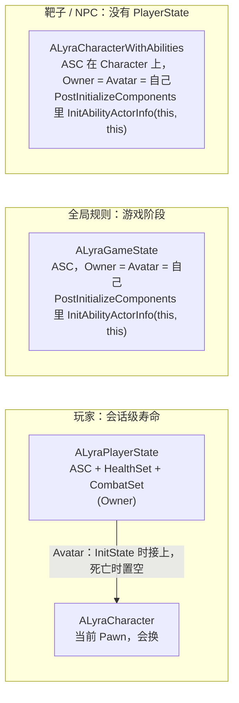
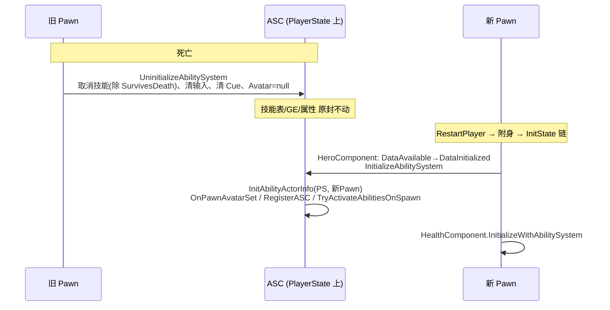
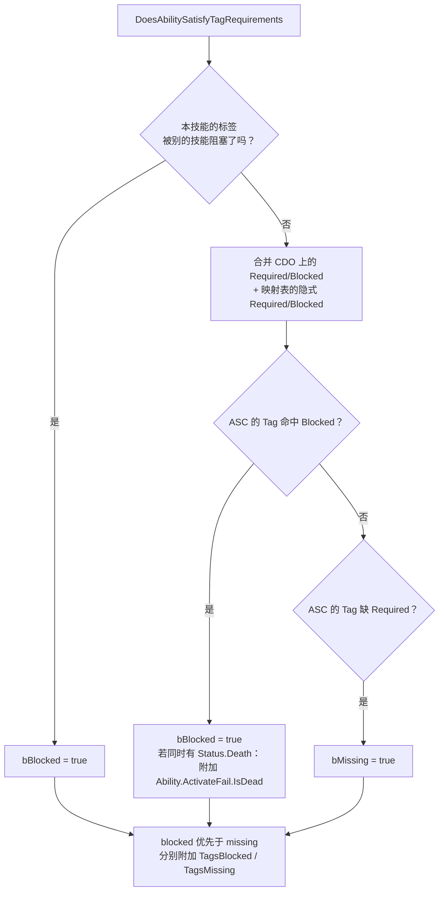

# 第 10 章　Lyra 怎么用 GAS：ASC 在 PlayerState、AbilitySet、激活策略与 Tag 关系

## 一个问题：玩家死了，他的技能、冷却和输入去哪儿了？

上一章我们把 GAS 当成一套通用零件学完了。现在你接到的需求是：

> 玩家被打死后几秒重生。重生后，他的所有技能都要还在，他刚才开的“冲刺冷却”不能因为死一次就被清掉，身上的赛前保护或全局增益效果也不能莫名丢失；同时，死亡动画播放期间，其他玩家依然能看到他身上的状态；重生出来的新角色，按下 Shift 要能立刻冲刺。

按上一章学到的最简单的方式——ASC 作为组件挂在 `ACharacter` 上，`InitAbilityActorInfo(this, this)`——会怎样？

- **Pawn 一死就销毁，ASC 随之销毁。** 技能表、冷却 GE、持续型 Buff、属性集全部消失。重生后不仅要重新授予一遍技能，冷却也会被清零（玩家很快就会发现“自杀可以重置冷却”）。
- **死亡动画期间，ASC 还是活的（Pawn 没销毁），但死亡技能要在这时运行**，而 Pawn 一旦开始销毁，技能就在一个即将消失的 Owner 上运行，生命周期纠缠不清。
- **输入绑定在 Pawn 的输入组件上，Pawn 换了，每个技能的输入绑定也要重来。**
- **客户端上，新 Pawn 和旧 Pawn 可能同时存在一小段时间**（新 Pawn 先被复制过来，旧 Pawn 的销毁消息稍后到），这时 ASC 到底属于谁？

这一章讲 Lyra 怎么回答这些问题。它的答案是：ASC 和属性集住在**PlayerState**（寿命等于整场会话）上，当前存活的 Pawn 只是它的 Avatar；技能不是在代码里 `GiveAbility`，而是用数据资产成组授予；技能本身在原生技能类上增加了“激活策略、激活组、额外消耗、失败反馈”等一批能让设计师直接配置的属性。

## 读完本章你能……

- 说出 Lyra 的 ASC 创建在哪个类的哪个函数里、用了什么复制模式、为什么 `NetUpdateFrequency` 设成 100；
- 画出新 Pawn 出生后，“ASC 的 Avatar 被切换到它身上”的触发链（落在第 8 章的 InitState 哪一步）；
- 说出 `ULyraAbilitySet` 里有哪三类东西、授予的顺序、以及为什么需要“句柄”才能撤销；
- 能为一个新技能选对激活策略（三种）和激活组（三种），并解释 `Exclusive_Blocking` 的典型用法；
- 说出 Tag 关系映射表解决了什么问题，并读懂一张真实的映射资产；
- 说出 `FLyraGameplayEffectContext` 比引擎版多了什么、哪些字段不会复制。

## 需要先知道的 UE 概念

本章几乎没有新的 UE 概念，主要用到前面章节的内容，请对照确认：

- GAS 的六个零件、Owner/Avatar、技能 Spec 与实例、Commit/End、预测键：上一章 [第 9 章](09-GASConcepts.md)。
- PawnData 与 InitState 链（`Spawned → DataAvailable → DataInitialized → GameplayReady`）：[第 8 章](08-PawnAssembly.md)。
- 向 Actor 注入组件的机制与 GameFeature Action：[第 6 章](06-Experience.md)、[第 7 章](07-ModularGameplay.md)。

## 一、ASC 放在 PlayerState

### 构造函数里发生了什么

打开 `Source/LyraGame/Player/LyraPlayerState.cpp`，构造函数里藏着整个 GAS 架构里最重要的一个决定：

```cpp
// 简化自 Source/LyraGame/Player/LyraPlayerState.cpp 的 ALyraPlayerState::ALyraPlayerState
AbilitySystemComponent = ObjectInitializer.CreateDefaultSubobject<ULyraAbilitySystemComponent>(this, TEXT("AbilitySystemComponent"));
AbilitySystemComponent->SetIsReplicated(true);
AbilitySystemComponent->SetReplicationMode(EGameplayEffectReplicationMode::Mixed);

// 属性集作为默认子对象创建；ASC 在初始化组件时会自动发现它们
HealthSet = CreateDefaultSubobject<ULyraHealthSet>(TEXT("HealthSet"));
CombatSet = CreateDefaultSubobject<ULyraCombatSet>(TEXT("CombatSet"));

// ASC 需要高频更新
SetNetUpdateFrequency(100.0f);
```

逐行解释：

- ASC 是 PlayerState 的默认子对象，这意味着 **ASC 随 PlayerState 创建**。PlayerState 在服务器上为每个玩家生成一个，并复制给所有客户端（见第 2、3 章），所以服务器和所有客户端上都有每个玩家的 ASC。
- `SetIsReplicated(true)` 让 ASC 作为组件参与复制。
- **`Mixed` 复制模式**（[第 9 章](09-GASConcepts.md)讲过）：拥有者客户端拿到完整的 GE，别的客户端只拿到 Tag 和 Cue。玩家 A 的客户端能看到自己所有的冷却和 Buff，也能看到玩家 B 身上是否有“眩晕”Tag，但不知道 B 的冷却还剩几秒，带宽省下来了。PlayerState 的 Owner 正是玩家的 Controller，满足 Mixed 对所有权链的要求。
- 两个属性集（`ULyraHealthSet`、`ULyraCombatSet`）直接创建在 PlayerState 上。代码注释说得很清楚：这些属性集会被 `UAbilitySystemComponent::InitializeComponent` 检测到并注册；同时要在 PlayerState 里留一个成员引用，防止它们被垃圾回收。
- `SetNetUpdateFrequency(100.0f)`：引擎的 `APlayerState` 构造函数把更新频率设成 1（每秒最多一次，因为它通常只存分数、名字这类很少变的数据）。而 ASC 上的 Tag、GE 变化要及时复制，所以 Lyra 把它提高到每秒最多 100 次（这是上限，只有真有变化才会发包）。tranek 的 GASDocumentation 也特别提醒过：不提高它，属性和 Tag 的变化会迟到。

### 这个决定换来了什么，付出了什么

换来的是：ASC 的寿命等于玩家的会话寿命。Pawn 死了，技能表、冷却 GE、持续型 Buff、属性集（包括 `BaseDamage`）以及 PlayerState 上的比赛统计 `StatTags`（击杀/死亡数等）都留在 PlayerState 上，重生后不用恢复；死亡技能也能在一个稳定的 Owner 上运行，Pawn 销毁的过程不会拖垮它。（至于枪里的弹药，Lyra 把它存在 Controller 的物品实例上，同样跨死亡存活，见 [第 13 章](13-Inventory.md)。）

付出的是：必须处理“Avatar 切换”（新 Pawn 接管 ASC、旧 Pawn 让出 ASC，这是下一节的内容，也是 InitState 机制存在的原因之一）；Owner 与 Avatar 不是同一个 Actor，技能里取“控制器”要沿着 Owner 链查（`GetControllerFromActorInfo`）；PlayerState 的更新频率被调高，网络开销略增。

### ASC 在 Lyra 里的三处落脚点

- **`ALyraPlayerState`**：玩家的 ASC，Owner = PlayerState，Avatar = 当前 Pawn。
- **`ALyraGameState`**：GameState 上也有一个 ASC，同样是 Mixed。它在 `PostInitializeComponents` 里用 `InitAbilityActorInfo(this, this)`，Owner 和 Avatar 都是 GameState 自己。它不属于任何玩家，用来跑“游戏阶段（Game Phase）”这类全局技能（热身、比赛中、赛后……）。因为它的 Avatar 不是 Pawn，所以不会被登记进本章后面讲的全局技能系统。
- **`ALyraCharacterWithAbilities`**：`Source/LyraGame/Character/LyraCharacterWithAbilities.cpp` 这个类的构造函数与 PlayerState 里几乎一样，但 ASC 直接放在 Character 上，`PostInitializeComponents` 里 `InitAbilityActorInfo(this, this)`。这就是上一章里“最简单做法”，适合**没有 PlayerState 的东西**。在项目里它被 `B_ShootingTarget`（`Content/Weapons/Tests/` 下的射击靶子）使用，靶子被打、被治疗时需要 HealthSet，但它不是玩家，没必要再造一个 PlayerState。

三处的 Owner 与 Avatar 关系放在一起看，差别一目了然：



## 二、把 Avatar 接上：谁、什么时候调用 InitAbilityActorInfo

### 问题：PlayerState 创建时，Pawn 还不存在

`ALyraPlayerState::PostInitializeComponents` 里有这样一行：

```cpp
// 简化自 Source/LyraGame/Player/LyraPlayerState.cpp 的 ALyraPlayerState::PostInitializeComponents
AbilitySystemComponent->InitAbilityActorInfo(this, GetPawn());
```

这时 `GetPawn()` 通常是空的（PlayerState 比 Pawn 先创建，新 Pawn 以后才会被附身），所以这一步只确定了 Owner，真正的 Avatar 要等 Pawn 就绪。这个“就绪”不是靠一句 `BeginPlay` 就能说清的：服务器和客户端上，Pawn、PlayerState、Controller、PawnData 到达的先后顺序不同（第 8 章讲过）。Lyra 把“接上 Avatar”这件事挂在**第 8 章的 InitState 链**上。

### 在 InitState 的哪一步

`ULyraHeroComponent`（挂在 Pawn 上的英雄组件）是链上的一环。当它从 `DataAvailable` 推进到 `DataInitialized` 时（此时 PlayerState 和 PawnData 都已就绪），会执行：

```cpp
// 简化自 Source/LyraGame/Character/LyraHeroComponent.cpp 的 ULyraHeroComponent::HandleChangeInitState
if (CurrentState == LyraGameplayTags::InitState_DataAvailable && DesiredState == LyraGameplayTags::InitState_DataInitialized)
{
    ALyraPlayerState* LyraPS = GetPlayerState<ALyraPlayerState>();
    ULyraPawnExtensionComponent* PawnExtComp = ULyraPawnExtensionComponent::FindPawnExtensionComponent(Pawn);

    // PlayerState 持有跨越多次死亡的持久数据：ASC 与属性集都在它上面
    PawnExtComp->InitializeAbilitySystem(LyraPS->GetLyraAbilitySystemComponent(), LyraPS);

    // 本地控制的 Pawn 有输入组件时，接着初始化输入（第 11 章）
    if (Pawn->InputComponent != nullptr) { InitializePlayerInput(Pawn->InputComponent); }
    // ……（相机模式委托略）
}
```

这一步在**服务器和所有客户端**都会发生（每个 Pawn 的副本都有英雄组件），但输入部分只在本地控制的客户端有意义。你可能会好奇：既然 `PawnExtensionComponent` 是初始化协调者，为什么不是它自己去取 ASC，反而要 `HeroComponent` 从 `LyraPlayerState` 取出 ASC 再喂给它？因为 `PawnExtensionComponent` 是通用的 Pawn 扩展底座，不假设所有 Pawn 的 ASC 都住在 `PlayerState` 上（比如某些 AI 或特殊载具可能自带 ASC）；只有代表“玩家控制英雄”的 `HeroComponent` 才明确知道去 `ALyraPlayerState` 拿 ASC。对第 8 章的主干来说，这就是“DataInitialized 阶段”做的核心接线。

### InitializeAbilitySystem 做了什么

真正干活的是 `Source/LyraGame/Character/LyraPawnExtensionComponent.cpp`：

```cpp
// 简化自 Source/LyraGame/Character/LyraPawnExtensionComponent.cpp 的 ULyraPawnExtensionComponent::InitializeAbilitySystem
if (AbilitySystemComponent == InASC) { return; }                 // 已经绑过了
if (AbilitySystemComponent) { UninitializeAbilitySystem(); }     // 换了一个 ASC，先清理旧的

APawn* Pawn = GetPawnChecked<APawn>();
AActor* ExistingAvatar = InASC->GetAvatarActor();

if ((ExistingAvatar != nullptr) && (ExistingAvatar != Pawn))
{
    // 已经有另一个 Pawn 是这个 ASC 的 Avatar：把它踢出去。
    // 客户端卡顿时会发生：新 Pawn 已经生成并附身，死掉的旧 Pawn 还没被移除
    ensure(!ExistingAvatar->HasAuthority());
    if (ULyraPawnExtensionComponent* Other = FindPawnExtensionComponent(ExistingAvatar))
    {
        Other->UninitializeAbilitySystem();
    }
}

AbilitySystemComponent = InASC;
AbilitySystemComponent->InitAbilityActorInfo(InOwnerActor, Pawn);   // Owner = PlayerState, Avatar = Pawn

if (ensure(PawnData))
{
    InASC->SetTagRelationshipMapping(PawnData->TagRelationshipMapping);  // 本章第六节
}

OnAbilitySystemInitialized.Broadcast();   // 通知 ALyraCharacter：HealthComponent 等该初始化了
```

三个要点：

- “踢走旧 Avatar”那一段正是开篇问题 4 的答案：一个 ASC 同一时刻只能有一个 Avatar，新来的 Pawn 会让旧的 Pawn 先 `UninitializeAbilitySystem`。注释说明这只发生在客户端（服务器上不会同时存在两个）。
- `SetTagRelationshipMapping(PawnData->TagRelationshipMapping)`：**Tag 关系映射表是跟着 PawnData 走的**，换 PawnData 就换了规则。
- `OnAbilitySystemInitialized`：`ALyraCharacter` 订阅了它，收到后调用 `HealthComponent->InitializeWithAbilitySystem(LyraASC)`，把血量组件接到 ASC 上（第 12 章）。

### Lyra 的 ASC 在“新 Avatar”时额外做的四件事

`ULyraAbilitySystemComponent` 重写了 `InitAbilityActorInfo`，当“Avatar 是一个新的 Pawn”时多做四件事：

```cpp
// 简化自 Source/LyraGame/AbilitySystem/LyraAbilitySystemComponent.cpp 的 ULyraAbilitySystemComponent::InitAbilityActorInfo
const bool bHasNewPawnAvatar = Cast<APawn>(InAvatarActor) && (InAvatarActor != ActorInfo->AvatarActor);
Super::InitAbilityActorInfo(InOwnerActor, InAvatarActor);

if (bHasNewPawnAvatar)
{
    // ① 通知每个已授予技能的实例：新 Avatar 到了（蓝图事件 OnPawnAvatarSet）
    for (const FGameplayAbilitySpec& AbilitySpec : ActivatableAbilities.Items) { /* …实例->OnPawnAvatarSet() */ }

    // ② 向全局技能系统登记，补发“对所有人生效”的技能与效果（第七节）
    GlobalAbilitySystem->RegisterASC(this);

    // ③ 让动画蓝图拿到 ASC（比如用 Tag 驱动动画状态）
    LyraAnimInst->InitializeWithAbilitySystem(this);

    // ④ 激活所有“OnSpawn”策略的技能（被动技能的自动启动点）
    TryActivateAbilitiesOnSpawn();
}
```

这是整个“重生后被动技能自动重新启动”的关键：每次有新 Pawn 成为 Avatar，所有 `OnSpawn` 技能都会被重新尝试激活（已经在运行的会被 `!Spec.IsActive()` 跳过）。

### Pawn 离开时

旧 Pawn 死亡/销毁时，会走 `UninitializeAbilitySystem`：

```cpp
// 简化自 ULyraPawnExtensionComponent::UninitializeAbilitySystem
if (AbilitySystemComponent->GetAvatarActor() == GetOwner())      // 我还是 Avatar 才清理，否则别的 Pawn 已经接管了
{
    FGameplayTagContainer AbilityTypesToIgnore;
    AbilityTypesToIgnore.AddTag(LyraGameplayTags::Ability_Behavior_SurvivesDeath);

    AbilitySystemComponent->CancelAbilities(nullptr, &AbilityTypesToIgnore);  // 取消技能，除了带 SurvivesDeath 的
    AbilitySystemComponent->ClearAbilityInput();                                // 清输入缓冲
    AbilitySystemComponent->RemoveAllGameplayCues();                            // 移除持续 Cue（特效不能留在尸体上）
    AbilitySystemComponent->SetAvatarActor(nullptr);                            // Avatar 置空，Owner 保留
    OnAbilitySystemUninitialized.Broadcast();
}
```

注意它**没有移除 GE，也没有清技能表**：冷却、Buff、属性、已授予的技能都留在 ASC 里。被取消的只是“正在运行的技能”。带 `Ability.Behavior.SurvivesDeath` Tag 的技能会幸存，比如自动重生技能（第 12 章）。

把两个方向放在一起看一次完整的“换 Pawn”：



## 三、AbilitySet：成组授予，带句柄撤销

### 问题

怎么把技能给角色？最直白的方式是在代码里 `ASC->GiveAbility(FGameplayAbilitySpec(UGA_Dash::StaticClass()))`，一个一个写。这样的代码散布在各处时，想给“某个模式的玩家”加一个技能要改核心代码；装备武器时给的射击、换弹技能，卸下时要撤销，你得自己记住每个句柄，漏掉一个就泄漏；技能绑定哪个按键，还要另写一份。

### Lyra 的做法：`ULyraAbilitySet`

`Source/LyraGame/AbilitySystem/LyraAbilitySet.h` 定义了一个只读的数据资产（`UPrimaryDataAsset`，标 `Const`），里面是三张列表：

```cpp
// 简化自 Source/LyraGame/AbilitySystem/LyraAbilitySet.h
struct FLyraAbilitySet_GameplayAbility
{
    TSubclassOf<ULyraGameplayAbility> Ability;                   // 技能类
    int32 AbilityLevel = 1;                                      // 等级
    UPROPERTY(EditDefaultsOnly, Meta = (Categories = "InputTag"))
    FGameplayTag InputTag;                                       // 绑定到哪个输入 Tag（可以为空）
};
struct FLyraAbilitySet_GameplayEffect { TSubclassOf<UGameplayEffect> GameplayEffect; float EffectLevel = 1.0f; };
struct FLyraAbilitySet_AttributeSet   { TSubclassOf<UAttributeSet> AttributeSet; };

class ULyraAbilitySet : public UPrimaryDataAsset
{
    TArray<FLyraAbilitySet_GameplayAbility> GrantedGameplayAbilities;
    TArray<FLyraAbilitySet_GameplayEffect>  GrantedGameplayEffects;
    TArray<FLyraAbilitySet_AttributeSet>    GrantedAttributes;
    void GiveToAbilitySystem(ULyraAbilitySystemComponent* LyraASC, FLyraAbilitySet_GrantedHandles* OutGrantedHandles, UObject* SourceObject = nullptr) const;
};
```

技能的 `InputTag` 带 `Categories = "InputTag"`，所以编辑器的下拉只列出 `InputTag.*`。这是 Lyra 把“技能”和“按键”接起来的唯一桥梁，下一章再讲。

### 授予：GiveToAbilitySystem

```cpp
// 简化自 Source/LyraGame/AbilitySystem/LyraAbilitySet.cpp 的 ULyraAbilitySet::GiveToAbilitySystem
if (!LyraASC->IsOwnerActorAuthoritative()) { return; }          // 只在权威端授予

// ① 属性集：NewObject 到 ASC 的 Owner 上，再注册进 ASC
UAttributeSet* NewSet = NewObject<UAttributeSet>(LyraASC->GetOwner(), SetToGrant.AttributeSet);
LyraASC->AddAttributeSetSubobject(NewSet);

// ② 技能：拿 CDO 做 Spec，记下来源对象，把输入 Tag 存进 Spec 的动态来源 Tag
ULyraGameplayAbility* AbilityCDO = AbilityToGrant.Ability->GetDefaultObject<ULyraGameplayAbility>();
FGameplayAbilitySpec AbilitySpec(AbilityCDO, AbilityToGrant.AbilityLevel);
AbilitySpec.SourceObject = SourceObject;
AbilitySpec.GetDynamicSpecSourceTags().AddTag(AbilityToGrant.InputTag);
const FGameplayAbilitySpecHandle Handle = LyraASC->GiveAbility(AbilitySpec);

// ③ 效果：对自己应用（无限类的会成为 Active GE）
LyraASC->ApplyGameplayEffectToSelf(GameplayEffectCDO, EffectToGrant.EffectLevel, LyraASC->MakeEffectContext());
```

几个值得停下来想的设计：

- **授予顺序是属性集 → 技能 → 效果。** 效果可能要修改刚加进来的属性集里的属性，所以属性集必须先于效果。
- **只在权威端执行。** 在客户端调用它什么也不会发生，也不会有日志（这是一个常见的“怎么没效果”的原因）。授予的结果通过 ASC 的复制到达客户端。
- **输入 Tag 存在 Spec 里，不存在技能里。** `DynamicSpecSourceTags` 是 Spec 自己携带的 Tag，所以**同一个技能类在不同的 AbilitySet 里可以绑到不同的输入**，技能本身不含任何输入信息。
- **`SourceObject`** 记录“谁授予的”。装备系统授予武器技能时传入武器实例，技能后来能把它转成 `ILyraAbilitySourceInterface`，让伤害计算知道“这发子弹来自哪把枪”（第 12 章）。

### 撤销：`FLyraAbilitySet_GrantedHandles`

授予时如果传入一个 `FLyraAbilitySet_GrantedHandles*`，函数会把授予出去的所有技能句柄、GE 句柄、属性集指针都记进去。以后调用 `TakeFromAbilitySystem(ASC)` 就能一键撤销：

```cpp
// 简化自 FLyraAbilitySet_GrantedHandles::TakeFromAbilitySystem
if (!LyraASC->IsOwnerActorAuthoritative()) { return; }
for (const FGameplayAbilitySpecHandle& Handle : AbilitySpecHandles)       { LyraASC->ClearAbility(Handle); }
for (const FActiveGameplayEffectHandle& Handle : GameplayEffectHandles)   { LyraASC->RemoveActiveGameplayEffect(Handle); }
for (UAttributeSet* Set : GrantedAttributeSets)                           { LyraASC->RemoveSpawnedAttribute(Set); }
```

如果传 `nullptr`，就等于“永不撤销”。下一节你会看到，PawnData 授予的就是这样。

## 四、谁来授予 AbilitySet

AbilitySet 是一份数据，谁来把它交给 ASC 呢？Lyra 里有三条路径，对应三种生命周期：

**路径 A：PawnData（跟着“角色配置”走，永不撤销）。** 在 `ALyraPlayerState::SetPawnData` 里：

```cpp
// 简化自 Source/LyraGame/Player/LyraPlayerState.cpp 的 ALyraPlayerState::SetPawnData
if (GetLocalRole() != ROLE_Authority) { return; }               // 仅服务器
// …… PawnData 只能设一次 ……
PawnData = InPawnData;

for (const ULyraAbilitySet* AbilitySet : PawnData->AbilitySets)
{
    AbilitySet->GiveToAbilitySystem(AbilitySystemComponent, nullptr);   // nullptr = 不记录句柄 = 永不撤销
}
UGameFrameworkComponentManager::SendGameFrameworkComponentExtensionEvent(this, NAME_LyraAbilityReady);
```

这条路径在第 8 章讲过：Experience 加载完成后，PlayerState 用 Experience 的默认 PawnData 调用它。`HeroData_ShooterGame` 引用的 `AbilitySet_ShooterHero` 就是这样给玩家的。**给 PlayerState 而不是给 Pawn**，所以重生后不用再授予一遍。

**路径 B：Experience 的 GameFeature Action（跟着“玩法”走）。** 上面的 `SendGameFrameworkComponentExtensionEvent(this, NAME_LyraAbilityReady)` 是一个信号：“PlayerState 的技能系统就绪了”。`UGameFeatureAction_AddAbilities`（编辑器里显示为 “Add Abilities”）订阅了它：

```cpp
// 简化自 Source/LyraGame/GameFeatures/GameFeatureAction_AddAbilities.cpp
// HandleActorExtension：收到“扩展已添加”或 NAME_LyraAbilityReady 就执行 AddActorAbilities
void UGameFeatureAction_AddAbilities::AddActorAbilities(AActor* Actor, const FGameFeatureAbilitiesEntry& AbilitiesEntry, FPerContextData& ActiveData)
{
    if (!Actor->HasAuthority()) { return; }                     // 只在服务器授予
    // ……（可直接授予裸技能 / 属性集；这里只看 AbilitySet）
    for (const TSoftObjectPtr<const ULyraAbilitySet>& SetPtr : AbilitiesEntry.GrantedAbilitySets)
    {
        if (const ULyraAbilitySet* Set = SetPtr.Get())
        {
            Set->GiveToAbilitySystem(LyraASC, &AddedExtensions.AbilitySetHandles.AddDefaulted_GetRef());  // 记录句柄！
        }
    }
}
```

这里传了句柄：Action 停用或目标 Actor 移除时，会用它们撤销。所以“只属于某个玩法的技能”应该走这条路。比如在编辑器里打开团队死斗的 `AbilitySet_Elimination`，里面装着自动重生技能 `GA_AutoRespawn` 和记分板技能 `GA_ShowLeaderboard_TDM`；占点模式的 `AbilitySet_ControlPoint` 里则是 `GA_AutoRespawn` 和 `GA_ShowLeaderboard_CP`。两个玩法共用同一个自动重生技能，各自的 AbilitySet 按需组合。

**路径 C：装备（跟着“手里的东西”走）。** 在 `FLyraEquipmentList::AddEntry` 里：

```cpp
// 简化自 Source/LyraGame/Equipment/LyraEquipmentManagerComponent.cpp 的 FLyraEquipmentList::AddEntry
for (const TObjectPtr<const ULyraAbilitySet>& AbilitySet : EquipmentCDO->AbilitySetsToGrant)
{
    // 传入装备实例作为 SourceObject，并把句柄存在这条装备记录里
    AbilitySet->GiveToAbilitySystem(ASC, /*inout*/ &NewEntry.GrantedHandles, Result);
}
```

`RemoveEntry` 里对应调用 `Entry.GrantedHandles.TakeFromAbilitySystem(ASC)`。所以换枪时，旧枪的射击、换弹技能被撤销，新枪的授予；`SourceObject` 就是枪的实例。

在资产层面，手枪和步枪各有一个 AbilitySet（`AbilitySet_ShooterPistol`、`AbilitySet_ShooterRifle`）。资产里能看到：手枪集合把 `GA_Weapon_Fire_Pistol` 绑到 `InputTag.Weapon.Fire`，把 `GA_Weapon_Reload_Pistol` 绑到 `InputTag.Weapon.Reload`；步枪集合把 `GA_Weapon_Fire_Rifle_Auto` 绑到 `InputTag.Weapon.FireAuto`，换弹同样用 `InputTag.Weapon.Reload`；两者都带了一个没有输入 Tag 的被动技能 `GA_Weapon_AutoReload`。因为同一时刻只有一把枪的集合被授予，两个换弹技能不会冲突。

### 三条路径，一张对照

三条路径用的是同一个 `GiveToAbilitySystem`，区别只有“谁来调用”和“要不要留句柄”。选哪条，问自己这组技能的寿命该跟着谁：

| 路径 | 调用者 | 句柄 | 寿命跟随 | 典型内容 |
|---|---|---|---|---|
| A：PawnData | `ALyraPlayerState::SetPawnData` | 不记录（`nullptr`） | 角色配置，永不撤销 | 跳跃、冲刺、死亡等英雄通用技能 |
| B：Experience Action | `UGameFeatureAction_AddAbilities` | 记录在 Action 的数据里 | 玩法，Experience 停用时撤销 | 自动重生、记分板 |
| C：装备 | `ULyraEquipmentManagerComponent` | 记录在装备条目里 | 手里的东西，卸下时撤销 | 射击、换弹，`SourceObject` = 武器实例 |

## 五、激活策略与激活组：何时激活、谁能打断谁

所有 Lyra 技能（包括蓝图技能）都继承 `Source/LyraGame/AbilitySystem/Abilities/LyraGameplayAbility.h` 里的 `ULyraGameplayAbility`（它继承引擎的 `UGameplayAbility`，是 `Abstract` 的）。它的构造函数先定下默认值：

```cpp
// 简化自 Source/LyraGame/AbilitySystem/Abilities/LyraGameplayAbility.cpp 的 ULyraGameplayAbility::ULyraGameplayAbility
ReplicationPolicy = EGameplayAbilityReplicationPolicy::ReplicateNo;     // 技能实例本身不复制，状态靠 ASC 复制
InstancingPolicy  = EGameplayAbilityInstancingPolicy::InstancedPerActor;
NetExecutionPolicy = EGameplayAbilityNetExecutionPolicy::LocalPredicted; // 默认：拥有者客户端预测
NetSecurityPolicy  = EGameplayAbilityNetSecurityPolicy::ClientOrServer;

ActivationPolicy = ELyraAbilityActivationPolicy::OnInputTriggered;
ActivationGroup  = ELyraAbilityActivationGroup::Independent;
```

前四行是引擎属性的默认值（[第 9 章](09-GASConcepts.md)讲过：实例化到 Actor、本地预测）；后两行是 Lyra 新增的两个核心策略，设计师在蓝图技能的“类默认值”里直接选择。Epic 的《Abilities in Lyra》文档（5.0–5.1 时期）描述与源码一致：`On Input Triggered` 是“输入标签触发时激活一次”（官方例子是 ADS、手雷）；激活组里 `Independent` 不阻塞也不替换其他技能，**大多数技能默认都应该用它**；`Exclusive_Blocking` 表示运行期间其他 Exclusive 技能无法激活。

### 激活策略：什么时候“尝试”激活

`ELyraAbilityActivationPolicy` 回答“谁来按下发令枪”：

- **`OnInputTriggered`**：按键触发的那一帧尝试激活。**一次按键一次尝试。** 例子：跳跃、冲刺、手雷、近战、表情——大多数“按一下做一件事”的技能。它是默认值。
- **`WhileInputActive`**：按住期间，只要技能没在运行，就每帧尝试激活。例子：手枪、步枪、霰弹枪的开火技能（`GA_Weapon_Fire_Pistol`、`GA_Weapon_Fire_Rifle_Auto`、`GA_Weapon_Fire_Shotgun` 全部配成了 `WhileInputActive`）。按住扳机，开完一枪、技能结束，下一帧又尝试，形成连发，射速由技能内部的延迟定时器控制，不需要在蓝图里写循环。
- **`OnSpawn`**：被授予、或者 Avatar 切换到新 Pawn 时自动尝试激活，不需要任何输入。例子：`GA_AutoRespawn`（自动重生）、`GA_SpawnEffect`（出生特效）、`GA_QuickbarSlots`（快捷栏监听）、`GA_Weapon_AutoReload`（空仓自动换弹）。被动技能都用它。

下面是 `OnSpawn` 的核心，其中隐藏着一个很重要的网络问题——“被动技能由谁激活”：

```cpp
// 简化自 Source/LyraGame/AbilitySystem/Abilities/LyraGameplayAbility.cpp 的 ULyraGameplayAbility::TryActivateAbilityOnSpawn
if (ActorInfo && !Spec.IsActive() && (ActivationPolicy == ELyraAbilityActivationPolicy::OnSpawn))
{
    // Avatar 已被 TearOff（Actor 被“撕下”：不再接受服务器复制）或即将死亡（有 LifeSpan）时不要激活，等新 Avatar 来了再说
    if (ASC && AvatarActor && !AvatarActor->GetTearOff() && (AvatarActor->GetLifeSpan() <= 0.0f))
    {
        const bool bIsLocalExecution  = (NetExecutionPolicy == LocalPredicted) || (NetExecutionPolicy == LocalOnly);
        const bool bIsServerExecution = (NetExecutionPolicy == ServerOnly)     || (NetExecutionPolicy == ServerInitiated);

        const bool bClientShouldActivate = ActorInfo->IsLocallyControlled() && bIsLocalExecution;
        const bool bServerShouldActivate = ActorInfo->IsNetAuthority()      && bIsServerExecution;

        if (bClientShouldActivate || bServerShouldActivate) { ASC->TryActivateAbility(Spec.Handle); }
    }
}
```

这个函数会在**每个端**被调用（授予时、新 Avatar 时），但只有“该激活的那一端”才真的去激活：配成 `LocalPredicted/LocalOnly` 的技能只在本地控制的那一端激活，配成 `ServerOnly/ServerInitiated` 的只在权威端激活。例如 `GA_SpawnEffect` 是 `ServerInitiated`，由服务器发起；`GA_Weapon_AutoReload` 是 `LocalOnly`，只在玩家自己的客户端运行。

### 激活组：技能之间的“硬规则”

`ELyraAbilityActivationGroup` 回答“和别的技能是什么关系”，这是 Lyra 在 Tag 机制之外加的**一条代码里写死的简单规则**：

- **`Independent`（默认）**：不影响别的技能，也不被别的技能影响。例子：记分板技能 `GA_ShowLeaderboard_TDM`——按住键看记分板，不应该打断你开枪。
- **`Exclusive_Replaceable`**：同一时刻最多一个“独占技能”在运行；新的独占技能激活时，**把正在运行的 `Exclusive_Replaceable` 技能取消并替换掉**。这类技能不允许 `SetCanBeCanceled(false)`（会报错）。当前工程的内容资产里没有技能使用它，你可以把它想象成“举盾”“架枪”这类可被其他独占动作顶掉的持续状态。
- **`Exclusive_Blocking`**：运行期间，**阻止任何独占技能激活**。最典型的例子是死亡技能：`ULyraGameplayAbility_Death` 激活时先取消其他技能，然后调用 `ChangeActivationGroup` 把自己切到 `Exclusive_Blocking`，确保死亡期间没有任何独占技能能再插进来。此外弹窗辅助技能 `GAB_ShowWidget_WhenInputPressed` 与 `GAB_ShowWidget_WhileInputHeld` 也配成了 `Exclusive_Blocking`。

实现非常朴素：ASC 里有一个计数数组，记录每个组里有几个技能正在运行：

```cpp
// 简化自 Source/LyraGame/AbilitySystem/LyraAbilitySystemComponent.cpp
bool ULyraAbilitySystemComponent::IsActivationGroupBlocked(ELyraAbilityActivationGroup Group) const
{
    switch (Group)
    {
    case ELyraAbilityActivationGroup::Independent:
        return false;                                           // 独立技能永不被阻塞
    case ELyraAbilityActivationGroup::Exclusive_Replaceable:
    case ELyraAbilityActivationGroup::Exclusive_Blocking:
        return ActivationGroupCounts[(uint8)ELyraAbilityActivationGroup::Exclusive_Blocking] > 0;   // 有 Blocking 在跑就阻塞
    }
}

void ULyraAbilitySystemComponent::AddAbilityToActivationGroup(ELyraAbilityActivationGroup Group, ULyraGameplayAbility* LyraAbility)
{
    ActivationGroupCounts[(uint8)Group]++;
    if (Group == Exclusive_Replaceable || Group == Exclusive_Blocking)
    {
        // 新的独占技能激活：取消所有 Replaceable 的（除了自己）
        CancelActivationGroupAbilities(ELyraAbilityActivationGroup::Exclusive_Replaceable, LyraAbility, /*bReplicateCancelAbility=*/false);
    }
}
```

`NotifyAbilityActivated` 调 `AddAbilityToActivationGroup`，`NotifyAbilityEnded` 调 `RemoveAbilityFromActivationGroup`；`ULyraGameplayAbility::CanActivateAbility` 里则调用 `IsActivationGroupBlocked`，被阻塞时返回 false 并把失败 Tag `Ability.ActivateFail.ActivationGroup` 放进失败原因。

**回头看这个设计：** 激活组的好处是简单、便宜，“死亡不可被打断”这种一票否决的规则用它最直接，不会被某个人配漏。代价是它是硬编码的，只有三种。源码里有一句注释 `//@TODO Possibly remove after setting up tag relationships`——作者自己也认为，日常动作之间的灵活互斥应该交给 Tag 关系映射（第七节）。实践中的取舍是：**“不可打断的全局状态”用激活组，“A 类动作互斥 B 类动作”用 Tag 关系。**（设计意图推断。）

## 六、消耗、失败反馈与相机钩子：`ULyraGameplayAbility` 的配套扩展

除了决定何时激活与如何互斥，`ULyraGameplayAbility` 还在技能生命周期前后补齐了三块实战常用的扩展。

### 额外消耗：`ULyraAbilityCost`

引擎自带的消耗只有一种：`CostGameplayEffectClass`——用一个 GE 扣属性。但射击的“消耗”是一颗**子弹**，这颗子弹是装备物品实例上的一个 TagStack（[第 13 章](13-Inventory.md)详讲），不是 ASC 上的属性，GE 改不了它。

Lyra 因此在技能基类上加了一个 `AdditionalCosts` 数组：

```cpp
// 简化自 LyraGameplayAbility.h
UPROPERTY(EditDefaultsOnly, Instanced, Category = Costs)
TArray<TObjectPtr<ULyraAbilityCost>> AdditionalCosts;   // Instanced：数组里的每个元素在资产里直接内联编辑
```

`ULyraAbilityCost`（`Source/LyraGame/AbilitySystem/Abilities/LyraAbilityCost.h`）是抽象基类，只有两个虚函数 `CheckCost`（够不够付）和 `ApplyCost`（付账），加一个开关 `bOnlyApplyCostOnHit`（命中才扣）。`ULyraGameplayAbility` 重写引擎的 `CheckCost`/`ApplyCost`，先走引擎的 GE 消耗，再逐个走 `AdditionalCosts`：

```cpp
// 简化自 ULyraGameplayAbility::CheckCost
if (!Super::CheckCost(Handle, ActorInfo, OptionalRelevantTags)) { return false; }   // 先过引擎 GE 消耗
for (const TObjectPtr<ULyraAbilityCost>& AdditionalCost : AdditionalCosts)
{
    if (!AdditionalCost->CheckCost(this, Handle, ActorInfo, OptionalRelevantTags)) { return false; }
}
return true;
```

项目里有三个子类：

- **`ULyraAbilityCost_ItemTagStack`**：消耗装备物品上的一个 TagStack（弹药）。**要求技能继承自 `ULyraGameplayAbility_FromEquipment`**，否则 `CheckCost` 直接返回 false。在编辑器中打开各把武器的开火技能子类（如 `GA_Weapon_Fire_Pistol`、`GA_Weapon_Fire_Rifle_Auto`、`GA_Weapon_Fire_Shotgun`；注意父类 `GA_Weapon_Fire` 留空，配在具体枪械子类上），可以看到它们的 `AdditionalCosts` 都配了 1 个 `LyraAbilityCost_ItemTagStack`：每次扣除数量 `1` 的 `Lyra.ShooterGame.Weapon.MagazineAmmo`，不够扣时写入失败 Tag `Ability.ActivateFail.Cost`。
- **`ULyraAbilityCost_PlayerTagStack`**：消耗 PlayerState 上的 TagStack。
- **`ULyraAbilityCost_InventoryItem`**：实现被 `#if 0` 注释掉了，`CheckCost` 恒返回 false。**不要用它**，用了的技能永远激活不了。

一个重要的网络细节：`ApplyCost` 在消耗类里只在权威端真正扣（`ActorInfo->IsNetAuthority()`），而 `CheckCost` 在客户端预测时也会执行，所以它读的必须是客户端也能看到的数据（TagStack 是被复制的，所以可以）。

### 失败原因与反馈

技能激活失败时，`CanActivateAbility` 会往 `OptionalRelevantTags` 里加失败原因 Tag：`Ability.ActivateFail.Cooldown / Cost / TagsBlocked / TagsMissing / Networking / ActivationGroup / IsDead`。这些 Tag 的原生定义在 `Source/LyraGame/LyraGameplayTags.cpp`。

怎么把它们变成玩家能感知的反馈？

```cpp
// 简化自 Source/LyraGame/AbilitySystem/Abilities/LyraGameplayAbility.cpp 的 ULyraGameplayAbility::NativeOnAbilityFailedToActivate
for (FGameplayTag Reason : FailedReason)
{
    // 配置了“失败 Tag → 文字”：通过 GameplayMessage 广播，UI 订阅后弹字
    if (const FText* pUserFacingMessage = FailureTagToUserFacingMessages.Find(Reason)) { /* 广播 TAG_ABILITY_SIMPLE_FAILURE_MESSAGE */ }

    // 配置了“失败 Tag → 蒙太奇”：同样广播，动画侧订阅后播放（比如没子弹时的“咔哒”空枪动作）
    if (UAnimMontage* pMontage = FailureTagToAnimMontage.FindRef(Reason)) { /* 广播 TAG_ABILITY_PLAY_MONTAGE_FAILURE_MESSAGE */ }
}
```

也就是说，**技能自己不处理反馈，只发消息**，由 UI、动画系统订阅（第 15 章的消息系统）。例如 `GA_Weapon_Fire_Pistol` 就配了 `Ability.ActivateFail.Cost → "No Ammo!"` 和空枪蒙太奇 `AM_MM_Pistol_DryFire`。

失败的通知还有一个网络细节：`ULyraAbilitySystemComponent::NotifyAbilityFailed` 在失败时，如果 Avatar 不是本地控制的（也就是失败发生在服务器上，而玩家在远端），就通过一个 **Unreliable 的 Client RPC** `ClientNotifyAbilityFailed` 通知拥有者客户端。Unreliable 意味着极端网络下提示可能丢——反馈不是游戏关键数据，丢了无所谓。

### 相机模式钩子

最后一个小扩展：`SetCameraMode(TSubclassOf<ULyraCameraMode>)` 和 `ClearCameraMode()`。技能可以临时覆盖相机模式（比如开镜瞄准时拉近），它们的实现是通知英雄组件：

```cpp
// 简化自 ULyraGameplayAbility::SetCameraMode / ULyraHeroComponent::DetermineCameraMode
HeroComponent->SetAbilityCameraMode(CameraMode, CurrentSpecHandle);   // 记录“谁设置的”（用 Spec 句柄）
// DetermineCameraMode：有技能设置的相机模式就用它，否则用 PawnData 里的 DefaultCameraMode
```

技能在 `EndAbility` 里会自动 `ClearCameraMode`，所以不会忘记还原。例如死亡技能蓝图 `GA_Hero_Death` 在激活时就调用 `SetCameraMode` 切到 `CM_ThirdPerson_Death`（持续 8 秒直到重生）。相机模式本身是第 16 章的内容。

## 七、Tag 关系映射：把“谁阻止谁”集中到一张表

### 问题

上一章讲过，技能自己可以配“取消带这些标签的技能（Cancel）”“阻止带这些标签的技能（Block）”。在一个有 30 个技能的游戏里，你要在每个技能里重复配置这些关系；新加一类动作，要回头改所有旧技能。而且“死亡后不能做任何动作”这种规则，需要在每个技能的“激活被阻止的 Tag”里都列上 `Status.Death`，漏一个就“死着开枪”。

### Lyra 的做法：`ULyraAbilityTagRelationshipMapping`

Epic 的《Abilities in Lyra》文档把这一块叫“Expanded Tag Relationship System”（扩展的 Tag 关系系统），意思就是在引擎自带的 Block/Cancel 之上再叠一层集中式规则。（该页面的这一节，本书写作时只能读到摘要，细节以下面的源码为准。）

`Source/LyraGame/AbilitySystem/LyraAbilityTagRelationshipMapping.h` 定义了一张只有一个数组的数据资产：

```cpp
// 简化自 Source/LyraGame/AbilitySystem/LyraAbilityTagRelationshipMapping.h
struct FLyraAbilityTagRelationship
{
    FGameplayTag          AbilityTag;               // 这条规则是关于哪类技能的
    FGameplayTagContainer AbilityTagsToBlock;       // 带 AbilityTag 的技能运行时，阻止这些类别的技能
    FGameplayTagContainer AbilityTagsToCancel;      // 带 AbilityTag 的技能激活时，取消这些类别的技能
    FGameplayTagContainer ActivationRequiredTags;   // 带 AbilityTag 的技能激活，ASC 上必须有这些 Tag
    FGameplayTagContainer ActivationBlockedTags;    // 带 AbilityTag 的技能激活，ASC 上不能有这些 Tag
};
```

技能只要在自己的技能标签里声明“我是哪一类”（比如冲刺带 `Ability.Type.Action.Dash`），规则就由这张表给出。它是怎么生效的？ASC 重写了两个引擎函数，在引擎原有的 Block/Cancel/Required 流程上**叠加**映射表的结果：

```cpp
// 简化自 Source/LyraGame/AbilitySystem/LyraAbilitySystemComponent.cpp
void ULyraAbilitySystemComponent::ApplyAbilityBlockAndCancelTags(const FGameplayTagContainer& AbilityTags, UGameplayAbility* RequestingAbility,
    bool bEnableBlockTags, const FGameplayTagContainer& BlockTags, bool bExecuteCancelTags, const FGameplayTagContainer& CancelTags)
{
    FGameplayTagContainer ModifiedBlockTags = BlockTags;
    FGameplayTagContainer ModifiedCancelTags = CancelTags;
    if (TagRelationshipMapping)
    {
        // 用映射表把“技能自己的标签”展开成额外的 Block/Cancel 标签
        TagRelationshipMapping->GetAbilityTagsToBlockAndCancel(AbilityTags, &ModifiedBlockTags, &ModifiedCancelTags);
    }
    Super::ApplyAbilityBlockAndCancelTags(AbilityTags, RequestingAbility, bEnableBlockTags, ModifiedBlockTags, bExecuteCancelTags, ModifiedCancelTags);
}
```

激活前的检查在 `ULyraGameplayAbility::DoesAbilitySatisfyTagRequirements`，它整体重写了引擎默认逻辑，流程是：



注意“blocked 优先于 missing”以及那个“死亡时额外附加 `IsDead` 失败 Tag”的小设计：UI 可以据此给出“你已经死亡”的反馈，而不是笼统的“被阻塞了”。

### 映射表是跟着 PawnData 走的

回忆第二节：`InitializeAbilitySystem` 里做了 `SetTagRelationshipMapping(PawnData->TagRelationshipMapping)`。所以**不同的 PawnData 可以配不同的互斥规则**——射击英雄一套，俯视角英雄另一套，不需要改任何技能。

### 看一张真实的映射资产

打开射击英雄使用的 `/ShooterCore/Game/TagRelationships_ShooterHero`，里面一共有 9 条规则，摘出最具代表性的几条如下（编辑器实查）：

| AbilityTag | 阻止（Block） | 取消（Cancel） | 激活被阻止（ActivationBlocked） |
|---|---|---|---|
| `Ability.Type.Action`（父类别） | — | — | `Status.Death.Dead`、`Status.Death.Dying`（死时禁一切动作） |
| `Ability.Type.Action.Dash` | `Ability.Type.Action` | `Ability.Type.Action` | —（冲刺会打断并阻止其他所有动作技能） |
| `Ability.Type.Action.WeaponFire` | `Emote`、`Reload` | `Emote`、`Reload` | —（开火直接打断换弹与跳舞） |
| `Ability.Type.Action.Melee` / `Grenade` / `Drop` | `WeaponFire`、`Emote`、`Reload` | `Emote`、`Reload` | —（近战/手雷/丢枪期间禁开火，并打断换弹与跳舞） |
| `Ability.Type.Action.Emote` | — | — | `Movement.Mode.Falling`（半空中不能做表情） |

这张真实配置表把它的威力展现得淋漓尽致：因为匹配用的是 `HasTag`（层级匹配），给**父类别** `Ability.Type.Action` 配一行“死亡时不可激活”，就一次性管住了它下面所有的动作子类——“死着开枪”靠一行数据彻底杜绝；冲刺配一行取消并阻止 `Ability.Type.Action`，所有动作遇到冲刺自动让路。

编辑这张表时还有一个小坑：`Source/LyraGame/AbilitySystem/LyraAbilityTagRelationshipMapping.h` 里 `AbilityTag` 字段的元数据是 `Categories = "Gameplay.Action"`。`Categories` 只影响编辑器的 Tag 下拉框；而数据里实际使用的是 `Ability.Type.Action.*`（定义在 `Config/DefaultGameplayTags.ini`，在 `Source/`、`Config/`、`Plugins/` 里检索不到任何 `Gameplay.Action` 的定义）。结果是这个字段的下拉里选不到 `Ability.Type.Action.Dash` 这样的 Tag，只能手输或粘贴。它只是元数据不一致，不影响运行时——匹配走的是 `FGameplayTagContainer::HasTag`——但新手第一次填表时容易怀疑“是不是我的 Tag 没注册”。

## 八、全局技能与全局效果

### 问题

“比赛开始前，所有玩家处于赛前大厅限制；比赛结束后，所有人无敌且禁用技能输入。”最直白的做法是遍历当前所有玩家，给每人加一个 GE，阶段结束再遍历一次移除。问题在于：阶段中途**才连进来的玩家**会漏掉这个效果；玩家重生换了 Pawn，效果的状态要不要保留？

### `ULyraGlobalAbilitySystem`

`Source/LyraGame/AbilitySystem/LyraGlobalAbilitySystem.cpp` 是一个世界子系统（Subsystem，第 2 章）。它维护两件东西：已经登记的所有 ASC，以及“对所有人生效”的技能/效果清单。

```cpp
// 简化自 Source/LyraGame/AbilitySystem/LyraGlobalAbilitySystem.cpp
void ULyraGlobalAbilitySystem::ApplyEffectToAll(TSubclassOf<UGameplayEffect> Effect)
{
    if ((Effect.Get() != nullptr) && (!AppliedEffects.Contains(Effect)))     // 同一个 GE 类重复调用会被忽略
    {
        FGlobalAppliedEffectList& Entry = AppliedEffects.Add(Effect);
        for (ULyraAbilitySystemComponent* ASC : RegisteredASCs) { Entry.AddToASC(Effect, ASC); }   // 现有的每个 ASC 都加上
    }
}

void ULyraGlobalAbilitySystem::RegisterASC(ULyraAbilitySystemComponent* ASC)
{
    for (auto& Entry : AppliedAbilities) { Entry.Value.AddToASC(Entry.Key, ASC); }   // 新来的 ASC：补发已经在全局生效的技能
    for (auto& Entry : AppliedEffects)   { Entry.Value.AddToASC(Entry.Key, ASC); }   // 和效果
    RegisteredASCs.AddUnique(ASC);
}
```

“晚到的人”就是靠 `RegisterASC` 补发的：回忆第二节，`ULyraAbilitySystemComponent::InitAbilityActorInfo` 在“新 Pawn Avatar”时调它。这和第 6 章的 `CallOrRegister` 是同一个思路——**让晚到者也能赶上已经发生的事**。授予时用的是等级 1、没有输入 Tag 的简单 Spec；`ApplyXToAll` 是 `BlueprintAuthorityOnly`，只在服务器调用。

在编辑器的游戏阶段蓝图里可以看到它的真实用法：热身阶段 `Phase_Warmup` 激活时调 `ApplyEffectToAll(GE_PregameLobby)`，热身结束时调 `RemoveEffectFromAll(GE_PregameLobby)`；赛后阶段 `Phase_PostGame` 激活时则同时调 `ApplyEffectToAll` 挂上全局免伤 `GE_DamageImmunity_FromGameMode` 和禁用技能输入 `GE_BlockAbilityInput`。第二节的伏笔也在这里：**GameState 上的 ASC 因为 Avatar 不是 Pawn，不会被 `RegisterASC` 登记**，所以它收不到全局技能和效果。

## 九、自定义的 `FLyraGameplayEffectContext`

### 问题

伤害计算需要知道：这发子弹来自哪把武器（做距离衰减）、打到了什么物理材质（做部位倍率）、是不是同一发弹壳里的哪颗弹丸。引擎自带的 `FGameplayEffectContext`（引擎结构，记录这次效果的施加者、造成者、命中结果、来源对象）里没有“武器”和“弹壳 ID”。

用 SetByCaller 传？它只能传 `float`，传不了对象指针。让伤害计算自己去查玩家装备？计算就和装备系统耦合了。

### Lyra 的做法：继承并扩展 Context

```cpp
// 简化自 Source/LyraGame/AbilitySystem/LyraGameplayEffectContext.h
USTRUCT()
struct FLyraGameplayEffectContext : public FGameplayEffectContext
{
    // ……
    UPROPERTY() int32 CartridgeID = -1;                           // 识别同一发弹壳里的多个弹丸
protected:
    UPROPERTY() TWeakObjectPtr<const UObject> AbilitySourceObject; // 伤害来源（应实现 ILyraAbilitySourceInterface）。目前不复制
    // Duplicate() 要深拷贝 HitResult；TStructOpsTypeTraits 开启 WithNetSerializer 与 WithCopy
};
```

怎么让 GAS 创建这个子类而不是引擎默认的？靠 `UAbilitySystemGlobals` 的子类 `Source/LyraGame/AbilitySystem/LyraAbilitySystemGlobals.cpp`，它重写 `AllocGameplayEffectContext` 返回 `new FLyraGameplayEffectContext()`，然后在 `Config/DefaultGame.ini` 里通过 `AbilitySystemGlobalsClassName=/Script/LyraGame.LyraAbilitySystemGlobals` 指定使用。**所以项目里所有 Context 都是这个子类**，计算里用 `FLyraGameplayEffectContext::ExtractEffectContext(Handle)` 把句柄转成子类指针。

字段的填充点有两处：`ULyraGameplayAbility::MakeEffectContext`（填 `AbilitySource`、`AddInstigator(OwnerActor, EffectCauser)`、`AddSourceObject`）和 `FLyraGameplayAbilityTargetData_SingleTargetHit::AddTargetDataToContext`（把 `CartridgeID` 写进去）。注意 Instigator 是 **Owner（PlayerState）**，EffectCauser 是 **Avatar（Pawn）**——这和 Owner/Avatar 的分工是一致的。

### 什么会复制，什么不会

这是一个特别容易踩的坑，直接看 `NetSerialize`：

```cpp
// 简化自 Source/LyraGame/AbilitySystem/LyraGameplayEffectContext.cpp 的 FLyraGameplayEffectContext::NetSerialize
bool FLyraGameplayEffectContext::NetSerialize(FArchive& Ar, class UPackageMap* Map, bool& bOutSuccess)
{
    FGameplayEffectContext::NetSerialize(Ar, Map, bOutSuccess);   // 只序列化引擎基类的字段
    // Not serialized for post-activation use:
    // CartridgeID
    return true;
}
```

`CartridgeID` 和 `AbilitySourceObject` **都不会被复制到客户端**——只有在服务器计算伤害的那一刻才可靠。头文件里的注释也写了 `NOT replicated currently`。如果你以后需要复制新字段，必须同时改 `NetSerialize` 和为 Iris（UE 新一代复制系统）写自定义 `NetSerializer`：这个文件末尾用 `UE_NET_IMPLEMENT_FORWARDING_NETSERIALIZER_AND_REGISTRY_DELEGATES` 把序列化转发给引擎的 Context 序列化器，注释明确说“如果修改了 `NetSerialize`，当前的回退方案就不够用了”。

对比一下：同一个文件夹里的 `FLyraGameplayAbilityTargetData_SingleTargetHit` 的 `NetSerialize` 则会序列化 `CartridgeID`（`Ar << CartridgeID`）——因为 TargetData 要从客户端发给服务器，需要把弹壳 ID 带过去。

## 十、GameplayCue 的加载策略

Cue 是资产（通知蓝图），需要加载。如果游戏里有几千个 Cue，启动时全部加载太慢，运行时按需加载又可能让第一次触发错过表现。`ULyraGameplayCueManager`（`Source/LyraGame/AbilitySystem/LyraGameplayCueManager.cpp`，通过 ini 里的 `GlobalGameplayCueManagerClass` 指定）把这个策略做成一个枚举，默认值写死在文件里：

```cpp
// 简化自 Source/LyraGame/AbilitySystem/LyraGameplayCueManager.cpp
enum class ELyraEditorLoadMode
{
    LoadUpfront,                              // 启动时全部加载：编辑器里首次 PIE 稍慢，但 Cue 不会丢
    PreloadAsCuesAreReferenced_GameOnly,      // 编辑器外：Cue 的 Tag 被注册时异步预加载；编辑器内：触发时才加载
    PreloadAsCuesAreReferenced                // Cue 的 Tag 被注册时就异步预加载
};
static ELyraEditorLoadMode LoadMode = ELyraEditorLoadMode::LoadUpfront;   // 静态变量，不是 CVar，要改得改代码

bool ULyraGameplayCueManager::ShouldSyncLoadMissingGameplayCues()  const { return false; }
bool ULyraGameplayCueManager::ShouldAsyncLoadMissingGameplayCues() const { return true;  }
```

当前是 `LoadUpfront`，所以你在编辑器里一般不会遇到表现延迟。如果把它改成按需加载，就要留心：缺失的 Cue 被触发时只做**异步**加载、不做同步阻塞（`ShouldSyncLoadMissingGameplayCues` 为 false，`ShouldAsyncLoadMissingGameplayCues` 为 true），引擎会把这次触发挂起，等资产异步加载完再补播——因此首次触发可能比动作晚半拍（若加载完前目标已销毁则会跳过）。

Cue 的资产目录：`DefaultGame.ini` 里 `GameplayCueNotifyPaths` 列了 `/Game/GameplayCueNotifies` 和 `/Game/GameplayCues`。GameFeature 插件自己的 Cue 放在插件目录内，需要通过 `UGameFeatureAction_AddGameplayCuePath`（配合 `LyraGameFeaturePolicy` 里的观察者）动态登记扫描路径——例如 `ShooterCore` 的 `GameFeatureData` 里就配置了 `/GameplayCues`、`/Weapons`、`/Items` 三个目录。还有一个调试命令：控制台输入 `Lyra.DumpGameplayCues`（加参数 `Refs` 会列出引用），把已经加载的 Cue 打印到日志。

## 动手实验

### 实验 1：读一遍 AbilitySet_ShooterHero 和 TagRelationships_ShooterHero

**目标**：把“数据资产授予技能”和“Tag 关系映射”落到真实资产上。

**步骤**：

1. 打开 `ShooterCore 内容/Game/AbilitySet_ShooterHero`，逐条看 `Granted Gameplay Abilities` 和 `Granted Gameplay Effects`，记下每个技能的 `Input Tag`。
2. 打开 `HeroData_ShooterGame`（同目录），确认它的 `Ability Sets` 里引用了刚才的 AbilitySet，并记下 `Tag Relationship Mapping` 与 `Input Config` 指向谁。
3. 打开 `TagRelationships_ShooterHero`，把 9 条规则逐行对照第七节的表格读一遍（特别留意 `ADS` 和 `Reload` 行各自的规则）。

**先写下你的预测**：英雄的 AbilitySet 里一共有几个技能条目？多少个带输入 Tag？哪些没有输入 Tag 的技能是 `OnSpawn` 被动激活，哪些是靠事件触发？

**预期结果**：`AbilitySet_ShooterHero` 包含 **11 个技能**和 **1 个无限效果 `GE_IsPlayer`**：
- **7 个带输入 Tag**：`GA_Hero_Jump`（`InputTag.Jump`）、`GA_Hero_Dash`（`InputTag.Ability.Dash`）、`GA_Emote`（`InputTag.Ability.Emote`）、`GA_QuickbarSlots`（`InputTag.Ability.Quickslot`）、`GA_ADS`（`InputTag.Weapon.ADS`）、`GA_Grenade`（`InputTag.Weapon.Grenade`）、`GA_DropWeapon`（`InputTag.Ability.Quickslot.Drop`）、`GA_Melee`（`InputTag.Ability.Melee`）——等等，数一下其实是 **8 个带输入 Tag**！其中 `GA_QuickbarSlots` 既带 `InputTag.Ability.Quickslot`，自身激活策略又是 `OnSpawn`。
- **3 个无输入 Tag**：`GA_Hero_Death`（由 `GameplayEvent.Death` 事件触发）、`GA_SpawnEffect`（`OnSpawn` 出生表现）、原生类 `LyraGameplayAbility_Reset`（由 `GameplayEvent.Reset` 事件触发）。

**原理**：英雄“能做什么”完全是这份数据，没有任何一行 C++ 在写“角色有跳跃”。把它换成另一份 AbilitySet，就是另一种英雄。

### 实验 2：用 showdebug 看 Owner、Avatar 在死亡前后的变化

**目标**：亲眼看到“ASC 不跟着 Pawn 走”。

**步骤**：

1. 用 `B_ShooterGame_Elimination` 运行 PIE（Standalone 或 Listen Server 都行）。
2. 控制台输入 `showdebug abilitysystem`，看 ASC 顶部的信息（Owner、Avatar、Owned Tags），再用 `AbilitySystem.Debug.NextCategory` 切到 Abilities，记下技能列表。
3. 控制台输入 `DamageSelfDestruct`（自杀作弊；它只能在权威端执行，如果你是客户端，改输入 `Cheat DamageSelfDestruct`）。
4. 死亡动画期间和重生之后，各看一次上面的信息。

**先写下你的预测**：Avatar 会怎么变？技能列表会变吗？重生后会不会出现两份相同的技能？

**预期结果**：死亡期间 Avatar 仍是旧 Pawn，随后变空；重生后 Avatar 变成新的 Pawn，Owner 始终是同一个 PlayerState。技能列表没有变化，也没有重复条目（技能没有被重新授予）。

**原理**：技能留在 ASC（PlayerState）上，变的只有 Avatar。`UninitializeAbilitySystem` 清掉的是“运行中的技能”，不是“技能表”。第 12 章会把整个死亡到重生的过程放大看。

### 实验 3：在 Play As Client 里追踪 InitializeAbilitySystem

**目标**：亲眼看到“Avatar 接线”在服务器和每个客户端上、对每个 Pawn 各发生一次，并理解它挂在 InitState 链上。

**步骤**：

1. 在 IDE 里下两个断点：`ULyraPawnExtensionComponent::InitializeAbilitySystem` 的第一行；`ULyraAbilitySystemComponent::InitAbilityActorInfo` 里 `GlobalAbilitySystem->RegisterASC(this)` 那一行（它只在 `bHasNewPawnAvatar` 为真时才会执行到）。
2. 打开 **编辑 → 编辑器偏好设置 → LyraStarterGame → Lyra Developer Settings**，勾选 `Override Num Bots to Spawn` 并设为 `0`（避免默认刷出的 3 个 Bot 额外触发十几次断点；做完实验记得取消勾选）。网络模式选 Play As Client，玩家数 2，保持默认的“在一个进程内运行”（第 3 章），运行 `B_ShooterGame_Elimination`。
3. 每次命中，记下：当前世界的 `GetNetMode()`；`GetPawnChecked<APawn>()->GetLocalRole()`；调用栈里最近几帧；`InOwnerActor` 是哪个玩家的 PlayerState。

**先写下你的预测**：不算 Bot，`InitializeAbilitySystem` 一共会命中几次？同一个玩家的 Pawn，在服务器上、在自己的客户端上、在别人的客户端上，`GetLocalRole()` 各是什么？

**预期结果**：两个玩家、三个世界（专用服务器加两个客户端），每个世界里都有两个 Pawn，合计 6 次。服务器上都是 `ROLE_Authority`；在自己的客户端上，自己的 Pawn 是 `ROLE_AutonomousProxy`，另一个玩家的 Pawn 是 `ROLE_SimulatedProxy`。调用栈里应能看到 `ULyraHeroComponent::HandleChangeInitState` 推进到 `DataInitialized`；它再往上是 InitState 链的 `CheckDefaultInitialization` 一类函数，不同端上触发链的上层不同（服务器靠附身，客户端靠 PlayerState 复制，细节以实际栈为准）。第二个断点同样命中 6 次，且每次都在第一个断点之后。

**原理**：英雄组件在每个端的每个 Pawn 副本上都存在，所以接线在每个端、每个 Pawn 上各做一次。别人的 Pawn 也要有 Avatar，这样它身上的 Tag（眩晕、死亡中）才能在你的客户端上驱动动画和表现，Mixed 模式正是为此只复制 Tag 与 Cue。输入部分则只会在本地控制的那一次真正生效，这也是第 11 章要接着讲的。

## 常见误区

**误区 1：在 Pawn 的 `BeginPlay` 里取 ASC 并授予技能。**
Pawn 的 `BeginPlay` 时 PlayerState、PawnData 往往还没就绪，ASC 的 Avatar 也还没设置。技能应该在服务器上通过 PawnData、GameFeature Action 或装备授予；需要“Avatar 就绪后”做的事，监听 `OnAbilitySystemInitialized` 或用 `OnSpawn` 策略的技能。

**误区 2：在客户端调用 `GiveToAbilitySystem`，没有效果也没有报错。**
`GiveToAbilitySystem`/`TakeFromAbilitySystem` 开头就检查权威端，客户端调用直接返回，没有日志。授予必须在服务器做，客户端靠复制拿到结果。

**误区 3：把“不可打断”写成一堆 Block/Cancel 配置，而不是用激活组或 Tag 关系。**
死亡、重置这类需要“压倒一切”的状态，用 `Exclusive_Blocking` 加映射表里对 `Status.Death.*` 的阻塞，比每个技能各自配置可靠得多。反过来，普通动作之间的互斥交给 Tag 关系映射，别滥用激活组。

**误区 4：以为 `PawnData` 授予的技能可以被撤销。**
`SetPawnData` 传的是 `nullptr` 句柄，没有记录，也就无法用 `TakeFromAbilitySystem` 撤销；`SetPawnData` 也只允许调用一次（第二次会报错）。想要“可撤销”的技能，用 GameFeature Action 或装备。

**误区 5：被动技能忘了加 `Ability.Behavior.SurvivesDeath`。**
Pawn 死亡时 `UninitializeAbilitySystem` 会取消所有运行中的技能（带该 Tag 的除外）。如果一个需要在死亡期间持续运行的被动技能（比如自动重生）没有这个 Tag，它会在 Pawn 死亡时被取消。新 Pawn 出生后 `OnSpawn` 会再次激活它，但中间的状态已经丢了。

**误区 6：给 ASC 授予一个裸的 `UGameplayAbility`，而不是 `ULyraGameplayAbility`。**
`UGameplayAbility` 是引擎类，本章第五节讲的一切——激活策略、激活组、`AdditionalCosts`、失败消息、相机钩子——都长在 `ULyraGameplayAbility` 上。授予一个裸技能，这些属性全都不存在；Lyra 的 ASC 里按策略筛选取消技能的 `CancelAbilitiesByFunc`（例如 `CancelInputActivatedAbilities` 就靠它）遇到非 `ULyraGameplayAbility` 的 Spec，只会打一条 Error 日志然后跳过。容易踩这个坑的地方在 GameFeature Action：`UGameFeatureAction_AddAbilities` 的 `GrantedAbilities` 列表里，每一项（`FLyraAbilityGrant`）的技能类型是引擎的 `TSoftClassPtr<UGameplayAbility>`，数据验证里没有类型限制。正确做法：所有技能都继承 `ULyraGameplayAbility`；需要授予时优先用 `GrantedAbilitySets`，它的技能条目类型本身就是 `TSubclassOf<ULyraGameplayAbility>`，选错会在编辑器里直接被挡住。

## 本章小结

Lyra 把 ASC 放在 PlayerState 上，用 Mixed 复制模式和较高的网络更新频率，让它的寿命与玩家会话同步；当前存活的 Pawn 通过第 8 章的 InitState 链（`DataAvailable → DataInitialized`）调用 `InitializeAbilitySystem`，成为 ASC 的 Avatar；Pawn 离开时只取消运行中的技能，技能表、冷却、属性原封不动。

技能不是在代码里授予，而是用 `ULyraAbilitySet` 数据资产成组授予（属性集 → 技能 → 效果），技能的输入 Tag 存进 Spec，句柄让它们可以被整体撤销；授予者有三类：PawnData（永不撤销）、Experience 的 Action（随玩法）、装备（随手持物）。`ULyraGameplayAbility` 在引擎技能上加了激活策略（何时尝试）、激活组（硬规则）、额外消耗、失败反馈、相机钩子；Tag 关系映射表把“A 类动作阻止/取消 B 类动作”集中成一张可随 PawnData 替换的数据。全局系统负责对所有人（包括晚到的人）施加规则，自定义 Context 把武器和弹壳信息带进伤害计算，但这些信息不会复制。

```
 PlayerState ─────────────  ASC(Mixed) + HealthSet + CombatSet     （跨死亡存活）
     ▲  Owner                    ▲ 技能表/GE/属性
     │                           │ GiveToAbilitySystem
 SetPawnData ──► AbilitySet ─────┤  (PawnData: 永久)
 AddAbilities ─► AbilitySet ─────┤  (Experience: 句柄，可撤销)
 Equipment ────► AbilitySet ─────┘  (装备: 句柄，SourceObject=装备)
     │
     │ Avatar = 当前 Pawn（InitState: DataInitialized → InitializeAbilitySystem）
     ▼
  新 Avatar → OnPawnAvatarSet / RegisterASC(全局) / TryActivateAbilitiesOnSpawn
     技能激活： 策略(何时) ─► 激活组(硬互斥) ─► Tag 关系(软互斥) ─► Cost ─► 失败消息
```

## 自测题

1. Lyra 的 ASC 创建在哪个类里？用的什么复制模式？如果换成 `Full` 会有什么后果？

<details><summary>答案</summary>

创建在 `ALyraPlayerState` 的构造函数里，复制模式是 `Mixed`。换成 `Full`，每个客户端会收到所有玩家完整的 GE 列表（冷却、Buff 等），带宽和 CPU 开销显著增加，且泄露了别的玩家不该知道的细节；`Mixed` 下只有拥有者客户端收到完整 GE，其他人只收到 Tag 和 Cue。
</details>

2. 玩家死亡重生后，他的冲刺冷却会被重置吗？为什么？

<details><summary>答案</summary>

不会。冷却是 ASC 上的一个 GE，而 ASC 在 PlayerState 上，Pawn 死亡时 `UninitializeAbilitySystem` 只取消运行中的技能、清输入和 Cue、把 Avatar 置空，不移除 GE，也不清技能表。冷却 GE 继续按自己的时间走。（实际体验中还要看重生延迟是否比冷却更长。）
</details>

3. 为什么 `ULyraAbilitySet::GiveToAbilitySystem` 的授予顺序是“属性集 → 技能 → 效果”？输入 Tag 为什么存在 Spec 里而不是技能类里？

<details><summary>答案</summary>

效果可能修改刚加入的属性集里的属性，属性集必须先注册；技能和效果的先后没有依赖，但统一放在属性集之后。输入 Tag 存在 `FGameplayAbilitySpec::DynamicSpecSourceTags` 里，所以同一个技能类可以在不同的 AbilitySet 里绑定到不同的输入（手枪的开火绑 `InputTag.Weapon.Fire`，步枪的绑 `InputTag.Weapon.FireAuto`），技能本身不含任何输入信息。
</details>

4. 为下面三个技能各选一个激活策略和一个激活组，并说明理由：(a) 按住键显示记分板；(b) 角色出生后自动开启“出生保护”的服务器逻辑；(c) 死亡。

<details><summary>答案</summary>

(a) `OnInputTriggered`（或按住期间需要持续则用 `WhileInputActive`），`Independent`——不应影响也不应被其他动作影响；资产里记分板技能确实配成 Independent。(b) `OnSpawn`，`Independent`，网络执行策略选 `ServerOnly`/`ServerInitiated`，这样只在服务器激活；不需要输入 Tag。(c) 由 Gameplay Event 触发（不是输入），激活后 `ChangeActivationGroup(Exclusive_Blocking)`，阻止其他独占技能，并先取消其它技能、`SetCanBeCanceled(false)`。
</details>

5. `FLyraGameplayEffectContext` 的 `AbilitySourceObject` 在客户端能读到吗？为什么要设计成这样？如果想让它能复制该怎么办？

<details><summary>答案</summary>

不能，客户端读到的是空。`NetSerialize` 只序列化引擎基类字段，`AbilitySourceObject` 和 `CartridgeID` 都没有被序列化。这样设计是因为它们只在服务器计算伤害的那一刻使用（伤害 Execution 只在服务器跑），复制它们是浪费带宽。要复制，需要修改 `NetSerialize`，并且为 Iris 写自定义的 `NetSerializer`，因为当前文件用的是转发到引擎序列化器的回退方案。
</details>

6. 设计题：你要加一个“举盾”动作：举盾期间不能开枪、不能冲刺，盾牌被打破或再次按键则放下；死亡时必须被强制放下。你会用哪些机制，各负责什么？

<details><summary>答案</summary>

写一个 `ULyraGameplayAbility`（蓝图即可），激活策略 `OnInputTriggered`（再按一次放下可以用 `WaitInputPress` 或另一个 Tag 触发），技能标签 `Ability.Type.Action.Shield`；在 Tag 关系映射表里加一行：`AbilityTag = Ability.Type.Action.Shield`，`AbilityTagsToBlock` 填 `WeaponFire`、`Dash`（举盾期间阻止开枪冲刺），如需激活时打断换弹就加 `AbilityTagsToCancel`。盾牌破碎时由应用盾牌破碎 GE 或 Gameplay Event 触发技能 `EndAbility`。死亡时：死亡技能激活会取消除 `SurvivesDeath` 之外的所有技能，举盾技能自然被取消；`Status.Death.*` 在映射表里已经阻止动作类技能激活，所以死后也举不起盾。最后在对应 AbilitySet 里加上它并绑输入 Tag（下一章讲），通过 PawnData 或 Experience Action 授予。
</details>

7. 比赛热身阶段，服务器对全体玩家调用了 `ULyraGlobalAbilitySystem::ApplyEffectToAll(GE_DamageImmunity_FromGameMode)`。一个玩家在这之后才连进来，他怎么拿到这个免伤效果？这个补发发生在什么时机？GameState 上的 ASC 会被补发吗？

<details><summary>答案</summary>

全局子系统在 `ApplyEffectToAll` 里把这个 GE 类记进 `AppliedEffects`，并对当时已登记的每个 ASC 应用一次。晚到玩家的 ASC 靠 `RegisterASC` 补发：`ULyraAbilitySystemComponent::InitAbilityActorInfo` 在“新 Pawn 成为 Avatar”时调用 `GlobalAbilitySystem->RegisterASC(this)`，它遍历 `AppliedAbilities` 与 `AppliedEffects`，对这个新 ASC 逐个 `AddToASC`，再把它加入 `RegisteredASCs`。所以时机是该玩家的 Pawn 完成 InitState 接线、Avatar 就位的那一刻，而不是 PlayerState 创建时；这样做是因为有些全局效果需要 Avatar 才能应用（源码注释这么写）。每次重生换 Pawn 都会再走一遍，`AddToASC` 会先移除这个 ASC 上已有的同一条记录再重新应用，因此不会叠出两份。GameState 上的 ASC 的 Avatar 不是 Pawn，`bHasNewPawnAvatar` 为假，不会被登记，也就收不到。`ApplyEffectToAll` 本身是 `BlueprintAuthorityOnly`，只在服务器调用，客户端靠 GE 的复制看到结果。
</details>

## 继续深入

- 每个函数的完整调用链（授予、撤销、激活组、取消阻塞）：[参考手册 20 §8.4、§8.5](../Reference/20-AbilitySystem-Input.md)
- 设计意图与朴素做法对照（为什么这样封装）：[参考手册 20 §9](../Reference/20-AbilitySystem-Input.md)，以及常见坑清单 [§7](../Reference/20-AbilitySystem-Input.md)
- 官方：[Abilities in Lyra](https://dev.epicgames.com/documentation/unreal-engine/abilities-in-lyra-in-unreal-engine)（激活策略、激活组、AbilitySet 自动按 InputTag 激活、Tag 关系、Health/Damage 的“必须有 ASC 与 HealthSet”规则；写于 UE 5.0–5.1 前后，与 5.8 源码冲突处以源码为准）；[Understanding the Unreal Engine Gameplay Ability System](https://dev.epicgames.com/documentation/en-us/unreal-engine/understanding-the-unreal-engine-gameplay-ability-system)（Owner/Avatar 与 PlayerState）。
- 社区：tranek 的 [GASDocumentation](https://github.com/tranek/GASDocumentation)（§4.1 讨论 ASC 放 PlayerState 还是 Pawn、必须调高 `NetUpdateFrequency`、Mixed 与所有权；写于 UE 4/5.0 时期）；unrealcode.net 的 Looking into Lyra 系列，如 [Activatable Abilities](https://www.unrealcode.net/LyraGASActivatableAbilities/)、[Action Mappings](https://www.unrealcode.net/LyraGASActionMappings/)（2023）。
- 下一章：[第 11 章　从按键到技能：增强输入与 InputTag](11-Input.md)——AbilitySet 里那个 `InputTag` 是怎么和键盘上的键连起来的；再下一章：[第 12 章](12-DamageAndDeath.md)把 `HealthSet`/`DamageExecution` 放大看。
