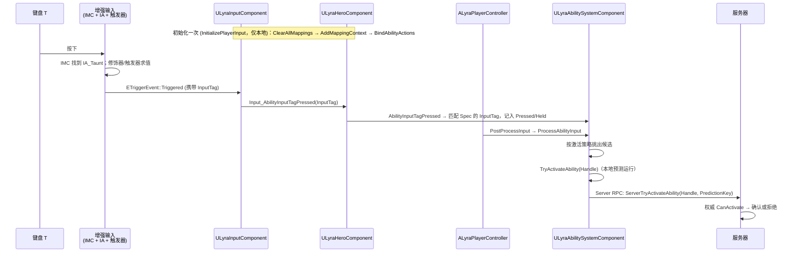

# 第 11 章　从按键到技能：增强输入与 InputTag

## 一个问题：加一个“嘲讽”键，要改几个地方？

策划又来了：按键盘 T（手柄十字键上）让角色做一个嘲讽动作。这是一个技能，有动画，有冷却，将来要能被“眩晕”打断。技能系统你已经会了（第 9、10 章）。现在只剩一件事：**让这个按键触发这个技能。**

如果你只用过 UE 的旧输入系统，大概会这样做：在项目设置里加一个 Action Mapping，名字叫 `Taunt`，键是 T；在 `AMyCharacter::SetupPlayerInputComponent` 里 `BindAction("Taunt", IE_Pressed, this, &AMyCharacter::OnTaunt)`；`OnTaunt` 里 `AbilitySystemComponent->TryActivateAbility(TauntHandle)`。

第一个技能这样没问题。但在 Lyra 这样的项目里，你很快会遇到：

- 射击玩法要有“T”，但**俯视角玩法**里 T 是别的意思。输入映射写在项目设置里，对所有玩法生效，没法“只在某个玩法里启用”。
- 玩家想改键。旧输入系统的改键要自己存、自己读、自己改 ini。
- 手枪和步枪都响应“开火”键，但手枪点按一次开一枪，步枪按住连发。把“按键”和“技能怎么响应”混在一起，换枪就要重绑。
- 玩法是由 GameFeature 插件注入的，插件作者**不能改**你的角色类去加 `BindAction`。

这一章先讲 UE 的新输入系统（增强输入，Enhanced Input）为什么能解决前三个问题，再讲 Lyra 怎样在它之上用 GameplayTag 加一层间接，让技能和按键彻底解耦，并且能由 GameFeature 追加。最后你会亲手加一个“嘲讽”技能和它的按键。

## 读完本章你能……

- 说出输入动作（IA）、映射上下文（IMC）、触发器、修饰器各自负责什么，以及 `Triggered` 和 `Completed` 在什么时候触发；
- 画出从“按下键盘”到 `TryActivateAbility` 之间的 6 个环节，并标出每一环在哪一端、哪个类、哪个函数；
- 解释 Lyra 为什么要用 InputTag 做间接层，以及“IMC → InputConfig → AbilitySet”三环缺一环会怎样；
- 说出 `bRegisterWithSettings` 在英雄组件里的陷阱，以及它在 GameFeature Action 里为什么没有这个陷阱；
- 独立加一个新技能和它的按键，并在它不工作时按三环排错。

## 需要先知道的 UE 概念

### 旧输入系统：键名 → 动作名 → 函数

旧系统里有两层映射：项目设置（`DefaultInput.ini`）里把“键”映射到“动作名/轴名”（`Jump` ← 空格，`MoveForward` ← W/S），代码里把“动作名/轴名”绑到函数（`InputComponent->BindAction("Jump", IE_Pressed, ...)`）。它的局限在于：映射是全局的、静态的；一个键同一时刻只能表达“按下/松开”两种事件；轴值只是一个 float，没有统一的类型。

### 增强输入：把“发生了什么”和“哪个键”拆开

增强输入（Enhanced Input）是 UE 5 的默认输入系统（Lyra 在 `Config/DefaultInput.ini` 的 `[/Script/Engine.InputSettings]` 下把 `DefaultPlayerInputClass` 和 `DefaultInputComponentClass` 分别指向了继承自增强输入的 `LyraPlayerInput` 与 `LyraInputComponent`）。它由四个概念组成：

**输入动作（Input Action，IA）**：一个资产，描述“玩家想做的一件事”，比如 `IA_Jump`、`IA_Move`。它规定这件事的值是什么类型：布尔（按下/没按）、一维轴（油门）、二维轴（移动）、三维轴。IA **不知道**是哪个键触发的。在 Lyra 里你能在 `Content/Input/Actions/` 下看到这些资产：`IA_Move` 是二维轴，`IA_Jump`、`IA_Ability_Dash` 是布尔。

**输入映射上下文（Input Mapping Context，IMC）**：一个资产，说“当这个上下文生效时，哪些键触发哪些 IA”。比如 `IMC_Default` 里 W/A/S/D 和左摇杆都映射到 `IA_Move`，空格映射到 `IA_Jump`。**IMC 是在运行时被“加”到某个玩家身上的**：每个本地玩家有一个 `UEnhancedInputLocalPlayerSubsystem`（子系统，第 2 章），调用 `AddMappingContext(IMC, Priority)` 就生效，`RemoveMappingContext` 就撤销。多个 IMC 可以同时生效，优先级高的先处理；同一个键如果被高优先级的 IMC 里的 IA“消耗”了，低优先级的就收不到。这解决了“不同玩法不同键位”：玩法 A 加一个 IMC，玩法 B 加另一个。Epic 官方《Enhanced Input》文档举的例子很贴切：玩家打开背包时，临时加一个优先级更高的“选择物品”上下文，原来的“移动/开火”上下文还在，只是同一个键被高优先级的先拿走了；关掉背包再移除它。

**修饰器（Modifier）**：在值到达 IA 之前对它做数学处理。WASD 如何变成一个二维移动向量？在 IMC 里，W 映射到 `IA_Move`，加一个“调换轴（Swizzle）”修饰器把 X 轴的值换到 Y 轴；S 再加一个“取反（Negate）”；A 取反；D 什么也不加。死区（Dead Zone）、灵敏度缩放、反转 Y 轴也是修饰器。Lyra 自己写了几个读取玩家设置的修饰器（`ULyraSettingBasedScalar`、`ULyraInputModifierDeadZone` 等，在 `Source/LyraGame/Input/LyraInputModifiers.h`），让鼠标灵敏度可以在设置界面里调。

**触发器（Trigger）**：决定“值满足什么条件才算 IA 被触发”。常见的有：Down（按着就一直触发）、Pressed（只在按下的那一帧触发）、Released（松开那一帧）、Hold（按住满一段时间才触发）、Tap（快速点按才触发）、Pulse（按住期间周期性触发）、Chorded（需要另一个动作同时按着）。没有配触发器的 IA，默认表现得像 Down。

触发器的结果，加上上一帧的状态，决定本帧向绑定的函数发出哪个事件（`ETriggerEvent`）：

- `Started`：开始满足条件的那一帧；
- `Ongoing`：条件还没完全满足、正在进行（比如 Hold 还没按够时间）；
- `Triggered`：条件满足，**每一帧**只要仍满足就再次触发（对 Down，按住期间每帧一次；对 Pressed，只有按下那一帧）；
- `Completed`：之前触发过，现在不再满足（对 Pressed，是触发之后的下一帧）；
- `Canceled`：进行到一半被中断，没来得及触发。

**注意第一个陷阱：`Triggered` 不等于“按下”。** 它的含义是“此刻满足条件”，对一个没配触发器（等价 Down）的 IA，按住期间每一帧都会 `Triggered`。把“玩家按住按键 3 帧、第 4 帧松开”画出来，差别一目了然：

```
帧序号：          第 1 帧(按下)    第 2 帧(按住)    第 3 帧(按住)    第 4 帧(松开)
无触发器 (Down)：   Triggered  ──►  Triggered  ──►  Triggered  ──►  Completed
Pressed 触发器：    Triggered  ──►  Completed       (无事件)        (无事件)
```

后面讲“为什么步枪连发、手枪点射”全靠这两行时序的差别。

### 玩家可改键

增强输入有一个用户设置层（`UEnhancedInputUserSettings`），通过“玩家可映射键设置（Player Mappable Key Settings）”描述某个动作能不能被玩家改键、在设置界面里显示什么名字。UE 5.3 起这套设置支持两层归属：**默认配置挂在 IA 资产上**（例如打开 `Content/Input/Actions/` 下的 `IA_Jump`、`IA_Ability_Dash`，能看到它们各自配了 `PlayerMappableKeySettings`），而 **IMC 里的单条按键映射默认继承 IA 的设置**（`InheritSettingsFromAction`），也可以在映射条目上单独覆盖（例如 `IMC_Default` 里把 `IA_Move` 拆成 W/S/A/D 四个键时，就用了 `OverrideSettings` 为四个方向分别命名）。Lyra 在 `DefaultInput.ini` 里开启了 `bEnableUserSettings=True`，并指定了自己的 `ULyraInputUserSettings` 和 `ULyraPlayerMappableKeyProfile`。要让一个 IMC 参与改键，需要把它**注册（Register）**到用户设置里。设置界面本身是第 20 章的内容。

### 在代码里绑定

最小的绑定长这样：

```cpp
// 教学示意：增强输入的最小绑定
// 在 SetupPlayerInputComponent 里（InputComponent 要是 UEnhancedInputComponent）
EIC->BindAction(IA_Move, ETriggerEvent::Triggered, this, &AMyCharacter::Move);   // 每帧触发
EIC->BindAction(IA_Jump, ETriggerEvent::Started,   this, &AMyCharacter::JumpStart);
EIC->BindAction(IA_Jump, ETriggerEvent::Completed, this, &AMyCharacter::JumpStop);

void AMyCharacter::Move(const FInputActionValue& Value)
{
    const FVector2D V = Value.Get<FVector2D>();   // 值的类型由 IA 决定
    AddMovementInput(GetActorRightVector(), V.X);
    AddMovementInput(GetActorForwardVector(), V.Y);
}
```

### 网络：输入只存在于本地

最后一个与网络有关的事实：**键盘事件只发生在玩家自己的机器上**。专用服务器上不存在“玩家的键盘”，主机服务器（Listen Server）上也只有主机玩家自己的输入。远端玩家的 Pawn 在服务器上根本没有输入组件（`InputComponent` 只为本地控制的 Pawn 创建）。所以输入驱动的技能，一定是**本地客户端先决定激活，再通过 RPC 通知服务器**——这正是上一章 `LocalPredicted` 的由来。Lyra 的整条输入链都只在本地控制的那一端跑。

## 一、为什么 Lyra 还要加一层 InputTag

增强输入已经很好了，为什么 Lyra 不让技能直接引用 IA？

**最直观的做法**有两种：

- 在技能的蓝图里直接写 `EnhancedInputAction` 节点监听某个 IA。技能和具体的 IA 资产硬绑定。
- 用 GAS 原生的做法：技能 Spec 里有一个整型 `InputID`，ASC 提供 `BindAbilityActivationToInputComponent`，用一个枚举把枚举值映射到输入。

**这样做会出问题**：

- 同一个技能类不能在不同场合绑到不同的键。手枪的开火技能和步枪的开火技能是不同的子类，但换枪时它们要共用“开火”这个输入，只是一个按一次开一枪、一个按住连发。
- 原生的 `InputID` 枚举是编译期常量，GameFeature 插件没法扩展它。插件想加一个新技能的输入，就要改核心枚举。
- 输入和授予顺序耦合：武器装备时才授予技能，但绑定要在输入系统里提前做好。

**Lyra 的做法**是在 IA 和技能之间加一个 **InputTag（输入标签，一类以 `InputTag.` 开头的 GameplayTag）**：

```
   键盘 T ──IMC──► IA_Taunt ──InputConfig──► InputTag.Ability.Taunt ──AbilitySet──► GA_Taunt 的 Spec
   (哪个键)        (做什么事)                (中间的“名字”)              (哪个技能响应)
```

每一段都是一份数据：IMC 决定键到 IA，**`ULyraInputConfig`** 决定 IA 到 InputTag，**`ULyraAbilitySet`** 决定 InputTag 到技能（上一章讲过，InputTag 存在技能 Spec 的 `DynamicSpecSourceTags` 里）。技能完全不知道有按键这回事；换键位只改 IMC；换武器只换 AbilitySet；GameFeature 插件追加输入，只需要追加一份 InputConfig 和一个 IMC。

代价是：**要对齐三处数据**，缺任何一环都是“按键没反应，也不报错”。这是本章最重要的排错心法，我们在最后的配方里会用到。

## 二、`ULyraInputConfig`：IA 与 InputTag 的配对表

`Source/LyraGame/Input/LyraInputConfig.h` 很短：

```cpp
// 简化自 Source/LyraGame/Input/LyraInputConfig.h
struct FLyraInputAction
{
    TObjectPtr<const UInputAction> InputAction = nullptr;
    UPROPERTY(Meta = (Categories = "InputTag"))   // 编辑器下拉只列出 InputTag.*
    FGameplayTag InputTag;
};

class ULyraInputConfig : public UDataAsset
{
    // 手动绑定（走 C++ 函数，不经过 ASC）：移动、视角、蹲下、自动跑
    TArray<FLyraInputAction> NativeInputActions;
    // 自动绑定（到 ASC，触发带这个 InputTag 的技能）
    TArray<FLyraInputAction> AbilityInputActions;
};
```

两张表分工明确：**`NativeInputActions`** 里的 IA 不是技能，由 `ULyraHeroComponent` 里的 C++ 函数（`Input_Move`、`Input_LookMouse` 等）处理；**`AbilityInputActions`** 里的 IA 会被统一绑定到“按下/松开 → 通知 ASC”。官方《Abilities in Lyra》文档也是这样描述的：通过 AbilitySet 授予的技能，在 Lyra 输入系统送来匹配的 InputTag 时会自动检查激活，不需要原生 GAS 的数字 InputID，也不用手动写输入事件。顺带一提，原生动作为什么也要用 Tag 去查找（而不是直接在代码里引用 IA 资产），官方没有解释；社区（Core567 的分析）猜测“可能只是少写样板代码”——这只是猜测，请当作旁证。

英雄的 InputConfig 是 `Content/Input/InputData_Hero`。资产里能看到：

- Native：Move、Look.Mouse、Look.Stick、Crouch、AutoRun；
- Ability：Jump（`InputTag.Jump`）、Dash（`InputTag.Ability.Dash`）、Heal（`InputTag.Ability.Heal`）、Weapon.Fire、Weapon.FireAuto、Weapon.Reload。

还有一份是 ShooterCore 插件里的 `InputData_ShooterGame_AddOns`，里面是只属于射击玩法的额外按键：表情、近战、丢枪、记分板、ADS（瞄准）、手雷。它是怎么被加进来的，见第七节。（顺带一提，数字键 1/2/3 与滚轮切枪并不在这两份 `InputConfig` 里，而是 `B_Hero_ShooterMannequin` 蓝图直接监听 `IA_QuickSlot*` 后发 GameplayEvent 驱动 `GA_QuickbarSlots` 的。）

InputTag 的定义有两类：移动这几个原生输入 Tag 在 C++ 里定义（`Source/LyraGame/LyraGameplayTags.cpp` 的 `InputTag_Move`、`InputTag_Look_Mouse`、`InputTag_Look_Stick`、`InputTag_Crouch`、`InputTag_AutoRun`）；技能用的 Tag 写在 ini 里——通用的（`InputTag.Jump`、`InputTag.Weapon.Fire`、`InputTag.Ability.Dash` 等）在 `Config/DefaultGameplayTags.ini`，射击玩法专属的（`InputTag.Ability.Emote`、`InputTag.Ability.Interact` 等）在 ShooterCore 插件自己的 `Config/Tags/ShooterCoreTags.ini`。**C++ 要引用的 Tag 用原生定义，只给内容用的 Tag 写 ini 就够了。**

## 三、`ULyraInputComponent`：把“绑定”写成两个模板函数

`DefaultInput.ini` 里 `DefaultInputComponentClass=/Script/LyraGame.LyraInputComponent` 让所有 Pawn 的输入组件都是 `ULyraInputComponent`（继承引擎的 `UEnhancedInputComponent`）。它的核心是两个模板函数：

```cpp
// 简化自 Source/LyraGame/Input/LyraInputComponent.h
// 手动绑定：按 InputTag 在 NativeInputActions 里查 IA，再绑定到调用者指定的函数
template<class UserClass, typename FuncType>
void ULyraInputComponent::BindNativeAction(const ULyraInputConfig* InputConfig, const FGameplayTag& InputTag,
    ETriggerEvent TriggerEvent, UserClass* Object, FuncType Func, bool bLogIfNotFound)
{
    if (const UInputAction* IA = InputConfig->FindNativeInputActionForTag(InputTag, bLogIfNotFound))
    {
        BindAction(IA, TriggerEvent, Object, Func);
    }
}

// 自动绑定：对 AbilityInputActions 里的每一条，绑定两个事件，并把 InputTag 作为参数传给回调
template<class UserClass, typename PressedFuncType, typename ReleasedFuncType>
void ULyraInputComponent::BindAbilityActions(const ULyraInputConfig* InputConfig, UserClass* Object,
    PressedFuncType PressedFunc, ReleasedFuncType ReleasedFunc, TArray<uint32>& BindHandles)
{
    for (const FLyraInputAction& Action : InputConfig->AbilityInputActions)
    {
        if (Action.InputAction && Action.InputTag.IsValid())     // 无效条目静默跳过！
        {
            if (PressedFunc)  { BindHandles.Add(BindAction(Action.InputAction, ETriggerEvent::Triggered, Object, PressedFunc,  Action.InputTag).GetHandle()); }
            if (ReleasedFunc) { BindHandles.Add(BindAction(Action.InputAction, ETriggerEvent::Completed, Object, ReleasedFunc, Action.InputTag).GetHandle()); }
        }
    }
}
```

要点有三个。

第一，**回调的参数是 InputTag**：`BindAction(IA, Event, Object, Func, Action.InputTag)` 把 Tag 作为额外参数“预先绑定”进去，所以回调函数签名是 `void Input_AbilityInputTagPressed(FGameplayTag InputTag)`。同一个函数服务所有技能输入，靠 Tag 区分。

第二，**用的是 `Triggered`/`Completed`，而不是 `Started`/某个“松开”事件**。回顾前面的事件语义：IA 没配触发器（Down）时，按住期间 `Triggered` 每帧触发一次，所以“按下”回调会被**每帧**调用；IA 配了 Pressed 触发器，则只在按下那一帧 `Triggered`，下一帧 `Completed`。Lyra 把“按下”和“松开”的含义完全交给 IA 上配的触发器决定——这是个很灵活的设计，也是个容易踩的坑（第四节会看到它如何影响激活策略）。

第三，**条目无效时静默跳过**：IA 为空或 Tag 无效，什么日志都没有。`FindAbilityInputActionForTag` 只在被查询时打日志，而自动绑定并不查询。所以“按键没反应”常常查不到任何报错。

`BindHandles` 是绑定句柄的列表，原本是为了以后能解绑；你很快会发现 Lyra 实际没用到它（第七节的坑）。

## 四、`ULyraHeroComponent::InitializePlayerInput`：真正做绑定的地方

### 什么时候调用

回到第 10 章看过的 `ULyraHeroComponent::HandleChangeInitState`：在 `DataAvailable → DataInitialized` 这一步，`InitializeAbilitySystem` 之后，如果 `Pawn->InputComponent != nullptr`，就调用 `InitializePlayerInput`。`InputComponent` 只在本地控制的 Pawn 上存在，所以这个函数实际上只在**本地玩家**的那一端跑（客户端或主机服务器的主机玩家），Bot 和远端玩家的 Pawn 在服务器上不会走到这里。

英雄组件的 `CanChangeInitState` 里也有相应的等待条件：本地控制且不是 Bot 时，必须等到输入组件、控制器、LocalPlayer 都存在，才允许进入 `DataAvailable`。这就是第 8 章说的“InitState 让先后不定的条件汇合”在输入上的体现。

### 函数做了什么

```cpp
// 简化自 Source/LyraGame/Character/LyraHeroComponent.cpp 的 ULyraHeroComponent::InitializePlayerInput
UEnhancedInputLocalPlayerSubsystem* Subsystem = LP->GetSubsystem<UEnhancedInputLocalPlayerSubsystem>();
Subsystem->ClearAllMappings();                                   // ① 清掉这个玩家此前所有的 IMC

if (const ULyraInputConfig* InputConfig = PawnData->InputConfig)  // PawnData 里指定的输入配置
{
    for (const FInputMappingContextAndPriority& Mapping : DefaultInputMappings)   // ② 本组件上配置的默认 IMC
    {
        if (UInputMappingContext* IMC = Mapping.InputMapping.LoadSynchronous())
        {
            if (Mapping.bRegisterWithSettings)                    // ←←← 注意：AddMappingContext 写在这个 if 里面
            {
                Subsystem->GetUserSettings()->RegisterInputMappingContext(IMC);   // 注册到设置（可改键）
                Subsystem->AddMappingContext(IMC, Mapping.Priority, Options);      // 真正生效
            }
        }
    }

    ULyraInputComponent* LyraIC = Cast<ULyraInputComponent>(PlayerInputComponent);
    LyraIC->AddInputMappings(InputConfig, Subsystem);             // 空钩子，留给你加自定义逻辑

    TArray<uint32> BindHandles;                                   // ③ 自动绑定：所有 AbilityInputActions
    LyraIC->BindAbilityActions(InputConfig, this, &ThisClass::Input_AbilityInputTagPressed, &ThisClass::Input_AbilityInputTagReleased, /*out*/ BindHandles);

    LyraIC->BindNativeAction(InputConfig, LyraGameplayTags::InputTag_Move, ETriggerEvent::Triggered, this, &ThisClass::Input_Move, false);   // ④ 手动绑定
    // ……Look_Mouse / Look_Stick / Crouch / AutoRun 同理
}

bReadyToBindInputs = true;
// ⑤ 发出“可以绑定输入了”的信号，让 GameFeature 追加它们的输入
UGameFrameworkComponentManager::SendGameFrameworkComponentExtensionEvent(PC,   NAME_BindInputsNow);
UGameFrameworkComponentManager::SendGameFrameworkComponentExtensionEvent(Pawn, NAME_BindInputsNow);
```

### 两个必须记住的陷阱

**陷阱 1：`bRegisterWithSettings` 为 false 的 IMC 在这里根本不会生效。** 仔细看上面标出的那一行：`AddMappingContext` 写在 `if (Mapping.bRegisterWithSettings)` 的**里面**。这个布尔的字面意思是“要不要注册到玩家设置”，但在英雄组件里它实际上同时决定了“这个 IMC 要不要生效”。把它勾掉，IMC 既不注册也不加入，直接被跳过，而且没有任何日志。另外整个循环嵌在 `if (PawnData->InputConfig)` 里，PawnData 没有 InputConfig 时所有 IMC 都不会被加。（这里要精确一点：**这只是英雄组件的行为**。第七节会看到 GameFeature 的 `Add Input Mapping` 对这个标志的处理是不同的。）

**陷阱 2：`ClearAllMappings` 在函数开头。** 它把这个玩家身上之前所有的 IMC 全部清掉，包括 GameFeature 在此前加的。所以后者必须在之后被**重新**添加——这就是第 ⑤ 步 `NAME_BindInputsNow` 的作用之一（第七节细讲）。

`InitializePlayerInput` 对每个本地 Pawn 的初始化只会执行一次（`ensure(!bReadyToBindInputs)`）。

## 五、ASC 这一侧：缓冲、再在帧末统一处理

### 按下：只记录，不激活

`Input_AbilityInputTagPressed` 非常简单：

```cpp
// 简化自 Source/LyraGame/Character/LyraHeroComponent.cpp
void ULyraHeroComponent::Input_AbilityInputTagPressed(FGameplayTag InputTag)
{
    if (ULyraAbilitySystemComponent* LyraASC = PawnExtComp->GetLyraAbilitySystemComponent())
    {
        LyraASC->AbilityInputTagPressed(InputTag);
    }
}
```

真正的逻辑在 ASC 的两个函数里。**它们只记录，不激活：**

```cpp
// 简化自 Source/LyraGame/AbilitySystem/LyraAbilitySystemComponent.cpp
void ULyraAbilitySystemComponent::AbilityInputTagPressed(const FGameplayTag& InputTag)
{
    for (const FGameplayAbilitySpec& AbilitySpec : ActivatableAbilities.Items)
    {
        // 精确匹配：Spec 的“动态来源 Tag”里存着授予时写入的 InputTag
        if (AbilitySpec.Ability && AbilitySpec.GetDynamicSpecSourceTags().HasTagExact(InputTag))
        {
            InputPressedSpecHandles.AddUnique(AbilitySpec.Handle);   // 本帧按下
            InputHeldSpecHandles.AddUnique(AbilitySpec.Handle);      // 持续按住中
        }
    }
}
// AbilityInputTagReleased：对应地加入 InputReleasedSpecHandles，并从 InputHeldSpecHandles 移除
```

这里用的是 `HasTagExact`（精确匹配）而不是层级匹配，因为 InputTag 是“名字”不是“类别”：`InputTag.Weapon.Fire` 和 `InputTag.Weapon.FireAuto` 必须是两个不同的输入，不能因为前缀相同就互相匹配。`AddUnique` 的作用是去重：IA 没配触发器时，按住期间每帧都调用一次，重复的句柄会被吸收。三个数组都是 `TArray<FGameplayAbilitySpecHandle>`。

### 帧末：ProcessAbilityInput

缓冲好的输入，在什么时候真正激活技能？

```cpp
// 简化自 Source/LyraGame/Player/LyraPlayerController.cpp
void ALyraPlayerController::PostProcessInput(const float DeltaTime, const bool bGamePaused)
{
    if (ULyraAbilitySystemComponent* LyraASC = GetLyraAbilitySystemComponent())
    {
        LyraASC->ProcessAbilityInput(DeltaTime, bGamePaused);   // 本帧所有输入回调都跑完之后
    }
    Super::PostProcessInput(DeltaTime, bGamePaused);
}
```

`PostProcessInput` 是 `APlayerController` 每帧处理输入流程的最后一步（先 `PreProcessInput`，再遍历输入栈、触发所有绑定的回调，最后 `PostProcessInput`），所以到这里时，本帧所有的“按下/松开”回调都已经执行完。ASC 在这一刻统一处理：

```cpp
// 简化自 ULyraAbilitySystemComponent::ProcessAbilityInput
if (HasMatchingGameplayTag(TAG_Gameplay_AbilityInputBlocked)) { ClearAbilityInput(); return; }   // 被阻塞：清空并返回

static TArray<FGameplayAbilitySpecHandle> AbilitiesToActivate;  AbilitiesToActivate.Reset();

// ① 按住中，且策略是 WhileInputActive，且没在运行 → 候选
for (Handle : InputHeldSpecHandles)
    if (!Spec->IsActive() && CDO->GetActivationPolicy() == WhileInputActive) AbilitiesToActivate.AddUnique(Handle);

// ② 本帧按下：技能已在运行 → 把“按下”事件转发给它；没在运行且策略是 OnInputTriggered → 候选
for (Handle : InputPressedSpecHandles)
{
    Spec->InputPressed = true;
    if (Spec->IsActive()) { AbilitySpecInputPressed(*Spec); }           // 转成 InputPressed 复制事件，供 WaitInputPress 任务
    else if (CDO->GetActivationPolicy() == OnInputTriggered) AbilitiesToActivate.AddUnique(Handle);
}

// ③ 统一激活（先收集再激活，避免“刚激活的技能又立刻收到本帧的按下事件”）
for (Handle : AbilitiesToActivate) { TryActivateAbility(Handle); }

// ④ 本帧松开：技能在运行 → 转发“松开”事件（供 WaitInputRelease 任务）
for (Handle : InputReleasedSpecHandles) { Spec->InputPressed = false; if (Spec->IsActive()) AbilitySpecInputReleased(*Spec); }

InputPressedSpecHandles.Reset();  InputReleasedSpecHandles.Reset();    // Held 保留，直到 Released
```

几处细节：

- **`Gameplay.AbilityInputBlocked` 一票否决。** ASC 身上有这个 Tag 时，所有输入缓冲被清空（连 Held 一起），技能输入整体失灵。上一章实验 3 用的就是它；项目里有一个现成的无限 GE `GE_BlockAbilityInput` 授予它。注意：解除后需要重新按键才会触发，因为连 Held 都被清了。
- **“先收集、再统一激活”** 是一个精心的设计：如果在遍历 Pressed 的同时就激活，刚激活的技能紧接着又会被判为“已在运行，转发按下事件”，于是同一次按键既激活了它又给它发了一个 InputPressed。
- **已在运行的技能收到的是事件而不是再次激活**。想做“按住蓄力、松开释放”：技能用 `OnInputTriggered`，在蓝图里 `ActivateAbility` 后开始蓄力，用 `WaitInputRelease` 任务等松开。它能工作，是因为上面第 ④ 步把松开转成了 `InvokeReplicatedEvent(InputReleased)`（引擎的复制事件，客户端触发后会通知服务器）。Lyra 没有支持引擎的 `bReplicateInputDirectly`，所以必须用这类 AbilityTask。
- **`static TArray`**：每帧复用同一块内存，省分配；代价是不可重入——不要在技能里直接调 `ProcessAbilityInput`。

### 之后：TryActivateAbility

`TryActivateAbility(Handle)` 走进第 9 章讲的激活流程：`CanActivateAbility`（冷却、消耗、Tag、激活组）→ 客户端预测、`ServerTryActivateAbility` RPC → 服务器确认 → `ActivateAbility`。本章不再展开，只强调一个事实：这整条链，从键盘到发出 RPC，只在本地客户端发生，**服务器永远不知道玩家按了什么键，它只收到“我要激活这个 Spec”**。

## 六、触发器 × 激活策略：手枪和步枪为什么不同

现在可以解答一个真实的设计问题：手枪点一下开一枪，步枪按住连发，它们的开火技能的激活策略却都是 `WhileInputActive`（从资产里能看到 `GA_Weapon_Fire_Pistol` 和 `GA_Weapon_Fire_Rifle_Auto` 都是）。区别在哪里？

答案藏在 IA 上的触发器。资产里能看到：手枪用的 `IA_Weapon_Fire` 配了 **Pressed** 触发器，步枪用的 `IA_Weapon_Fire_Auto` 没有配触发器（Down）。顺着前面的链条推一遍：

- **步枪（Down）**：按住期间 IA 每帧 `Triggered` → 每帧 `AbilityInputTagPressed` → Held 列表一直在 → `ProcessAbilityInput` 第①步：只要技能没在运行就一直尝试激活 → 连发。射速取决于技能多久结束。
- **手枪（Pressed）**：IA 只在按下那一帧 `Triggered`，下一帧 `Completed` → `AbilityInputTagReleased` 把句柄从 Held 移除。所以 Held 只存在了一帧：技能被尝试激活一次，之后即使你一直按着扳机，也没有第二次。点一下，开一枪。

这里的推理依赖了触发器的事件语义（上面“需要先知道”一节），资产里的触发器类型和激活策略是读出来的，**你可以在实验 2 里用断点亲自验证它**。这个例子的教训是：**激活策略描述的是“ASC 怎么对待输入状态”，而“输入状态长什么样”由 IA 的触发器决定，两者要成对设计。**

同样的道理也说明了为什么做“蓄力技能”时不要给 IA 配 Hold：Hold 在按够时间后才第一次 `Triggered`（按住的过程中只有 `Ongoing`，而 Lyra 只绑了 `Triggered`/`Completed`），技能就丢掉了“开始蓄力”的那一刻，应该用 Down/Pressed 立刻激活，在技能里自己等。（这是根据事件语义做的推论，不是官方建议。）

## 七、GameFeature 追加输入：不改角色，也能加键

玩法插件要追加输入，要做两件事：加一个 IMC（键到 IA），加一份 InputConfig（IA 到 InputTag）。Lyra 为这两件事各提供了一个 GameFeature Action。

### `Add Input Binds`：追加一份 InputConfig

`UGameFeatureAction_AddInputBinding`（编辑器里显示为 “Add Input Binds”）有一个 `TArray<TSoftObjectPtr<const ULyraInputConfig>> InputConfigs`。它在 `AddToWorld` 里向游戏框架组件管理器登记，监听所有 `APawn` 的扩展事件（第 7 章的机制）：

```cpp
// 简化自 Source/LyraGame/GameFeatures/GameFeatureAction_AddInputBinding.cpp
void UGameFeatureAction_AddInputBinding::HandlePawnExtension(AActor* Actor, FName EventName, FGameFeatureStateChangeContext ChangeContext)
{
    if (EventName == NAME_ExtensionRemoved || EventName == NAME_ReceiverRemoved) { RemoveInputMapping(AsPawn, ActiveData); }
    else if (EventName == NAME_ExtensionAdded || EventName == ULyraHeroComponent::NAME_BindInputsNow)
    {
        AddInputMappingForPlayer(AsPawn, ActiveData);
    }
}

void UGameFeatureAction_AddInputBinding::AddInputMappingForPlayer(APawn* Pawn, FPerContextData& ActiveData)
{
    // 只有本地玩家的 Pawn 才有 LocalPlayer；服务器上的远端玩家 Pawn 在这里什么都不会发生
    ULyraHeroComponent* HeroComponent = Pawn->FindComponentByClass<ULyraHeroComponent>();
    if (HeroComponent && HeroComponent->IsReadyToBindInputs())      // 英雄组件的输入已经初始化完了才能绑
    {
        for (const TSoftObjectPtr<const ULyraInputConfig>& Entry : InputConfigs)
        {
            if (const ULyraInputConfig* BindSet = Entry.Get()) { HeroComponent->AddAdditionalInputConfig(BindSet); }
        }
    }
}
```

这又是一个“晚到者也能赶上”的例子，由两个事件覆盖两种先后：

- Action 激活时 Pawn **已经**初始化完输入（`IsReadyToBindInputs()` 为真）：靠 `NAME_ExtensionAdded` 立刻绑定；
- Pawn **还没**初始化完输入时 Action 就激活了：此时 `IsReadyToBindInputs()` 为假，函数什么都不做，等 `InitializePlayerInput` 末尾发出的 `NAME_BindInputsNow` 再绑。

`AddAdditionalInputConfig` 就是再调一次 `BindAbilityActions`。在编辑器里打开 ShooterCore 的共享输入资产 `LAS_ShooterGame_SharedInput`，可以看到它正是用这一个 Action 把 `InputData_ShooterGame_AddOns` 追加进来的，这就是第二节里那些射击专属按键的来路。

### `Add Input Mapping`：追加 IMC

`UGameFeatureAction_AddInputContextMapping`（编辑器里 “Add Input Mapping”）的数据是 `TArray<FInputMappingContextAndPriority> InputMappings`，和英雄组件的 `DefaultInputMappings` 是同一个结构体。它做两件事：

1. **向设置注册**：在 GameFeature 的 `OnGameFeatureRegistering` 阶段，对每个 `bRegisterWithSettings` 为真的条目，对每个本地玩家调用 `RegisterInputMappingContext`，让它能出现在改键界面里；
2. **加入玩家**：在激活阶段监听所有 `APlayerController` 的扩展事件，收到 `NAME_ExtensionAdded` 或 `NAME_BindInputsNow` 时，对该控制器的本地玩家**无条件**调用 `AddMappingContext(IMC, Priority)`。

注意第 2 步：**`bRegisterWithSettings` 在这里只影响“是否注册到设置”，不影响 IMC 是否生效**。这和英雄组件里的行为不同——前面说的陷阱 1 不适用于 GameFeature 的 Action。

现在也能回答“`ClearAllMappings` 清掉了 GameFeature 加的 IMC 怎么办”：因为 `InitializePlayerInput` 在清完、绑完之后，会向 **PlayerController** 发出 `NAME_BindInputsNow`，GameFeature 的 `Add Input Mapping` 正是监听 PlayerController 的这个事件（`HandleControllerExtension`），于是重新把它们的 IMC 加回去——这条因果链已对照源码核实，实验 2 的第 4 步可以用断点亲眼确认。在编辑器中核对资产可以看到：ShooterCore 的 `GameFeatureData` 本身带了一个 `Add Input Mapping`（引用 `IMC_Default` 和 `IMC_ShooterGame`），`LAS_ShooterGame_SharedInput` 里也配了一个（引用 `IMC_ShooterGame`）。

### 注册与激活：两段式，官方文档也是这么说的

把上面两个 Action 放在一起看，会发现 IMC 有“注册”和“激活”两个阶段：`Add Input Mapping` 在 GameFeature 插件**注册（Registered）**时就把 IMC 登记进玩家的用户设置（`RegisterInputMappingContexts`，让键位出现在改键界面），到插件**激活（Active）**、Pawn 就绪时才真正 `AddMappingContext`。Epic 的《Lyra Input Settings》文档描述的正是这个模型：每个 GameFeature 插件注册自己那一套按键绑定，即使玩家不在该 Experience 里（比如在主菜单）也能改键，但这些映射要等 Feature 激活后才会加到玩家身上（该页面 5.3 更新过，细节以 5.8 源码为准）。

> **版本提示：旧文档里的 Action 名字。** 如果你搜到 5.0–5.3 时期的 Epic 文档或教程，会看到一个叫 `UGameFeatureAction_AddInputConfig` 的 Action（用来注册 `PlayerMappableInputConfig`）。5.8 的 Lyra 源码里**没有**这个类：它被拆成了本节讲的 `UGameFeatureAction_AddInputBinding`（追加 `ULyraInputConfig`）和 `UGameFeatureAction_AddInputContextMapping`（登记并加入 IMC）。搜索 `AddInputConfig` 搜不到源码，不是你的问题。

### 一个已知的坑：追加了就撤不掉

`AddAdditionalInputConfig` 里的 `BindHandles` 是局部变量，函数一结束就丢了；`RemoveAdditionalInputConfig` 在源码里是 `//@TODO: Implement me!` 的空函数体。所以**GameFeature 停用后，追加的输入绑定会残留**；重复加会重复绑定。好在残留的绑定回调只是在 ASC 里按 Tag 找 Spec，找不到匹配的 Spec 就什么都不会发生，重复的 Pressed 也被 `AddUnique` 吸收，实际影响很小。但你要知道有这回事（这是已知的原版缺陷，社区没有专门讨论它的帖子，别指望搜到现成补丁）。

## 八、整条链，一张图



对应的“谁在哪一端”：整张图里，从“键盘”到“发出 RPC”都只在**本地控制的客户端**；最后一行才是服务器。

## 动手实验

### 实验 1：读 IA 和 IMC

**目标**：把“IA 触发器类型”和“技能激活策略”对上号。

**步骤**：

1. 在内容浏览器里打开 `Content/Input/Actions/IA_Ability_Dash`、`IA_Weapon_Fire`、`IA_Weapon_Fire_Auto`、`IA_Jump`、`IA_Move`，看每个的值类型和 Triggers 一栏。
2. 打开 `Content/Input/Mappings/IMC_Default`，找到 `IA_Move` 的 W/S/A/D 映射，看每个键上挂了什么修饰器。

**先写下你的预测**：W 和 S 的映射区别在哪个修饰器上？

**预期结果**（已在编辑器中核实）：`IA_Ability_Dash` 和 `IA_Weapon_Fire` 的 `Triggers` 里各配了一个 `Pressed` 触发器；`IA_Weapon_Fire_Auto`、`IA_Jump` 的 `Triggers` 为空（默认等价于 Down）；`IA_Move` 值类型为 `Axis2D`，自身挂了 `Dead Zone` 死区修饰器；`IMC_Default` 里对 `IA_Move` 的四个键盘映射分别是：`W` 挂 `Swizzle Input Axis Values`（把一维键值换到 Y 轴），`S` 挂 `Negate` + `Swizzle`，`A` 挂 `Negate`，`D` 不挂修饰器（直接走 X 正半轴）。

**原理**：这些就是第六节“手枪点射、步枪连发”的数据基础。

### 实验 2：用断点追一次按键

**目标**：验证第五、六节的两个推断——每帧 Pressed 与 Held 的差别。

**步骤**：

1. 在 IDE 里给 `ULyraAbilitySystemComponent::AbilityInputTagPressed` 和 `ULyraAbilitySystemComponent::ProcessAbilityInput` 下断点（或者在函数里临时加日志）。
2. 运行 PIE，先拿手枪，**按住**开火键两秒不放；记录 `AbilityInputTagPressed` 被调用几次。
3. 换成步枪，同样按住两秒，再记录。
4. 额外：在 `UGameFeatureAction_AddInputContextMapping::AddInputMappingForPlayer` 下断点，观察它被触发的时机（Pawn 出生时，在 `InitializePlayerInput` 之后）。

**先写下你的预测**：手枪按住两秒，`AbilityInputTagPressed` 调用几次？步枪呢？

**预期结果**：手枪只有按下那一次；步枪每帧一次。第 4 步里 `AddInputMappingForPlayer` 在 `InitializePlayerInput` 发出 `NAME_BindInputsNow` 之后被触发。

**原理**：Pressed 触发器只在按下那一帧 `Triggered`；没配触发器的 IA 在按住期间每帧 `Triggered`。第 4 步印证了“`ClearAllMappings` 之后由 `BindInputsNow` 重新加回 GameFeature 的 IMC”。（如果结果和预测不一致，以实际为准，并回头检查你的 IA 上的触发器配置。）

### 实验 3（配方）：加一个“嘲讽”技能和它的键

**目标**：不改任何 C++，在第 6 章的 Experience 里加一个由 T 键触发的技能，并用它验证整条链。

**准备**：第 6 章实验 3 里的 `B_MyFirstExperience`（在 ShooterCore 插件内容的 `Experiences` 目录下，包含共享 ActionSet，默认 PawnData 是 `HeroData_ShooterGame`）。下面所有新资产放进 ShooterCore 插件内容里新建的 `Taunt` 目录。

**步骤**：

1. **定义 InputTag**。打开 项目设置 → 项目 → Gameplay Tags，点 “Add New Gameplay Tag”，名称 `InputTag.Ability.Taunt`，保存位置选 `Config/DefaultGameplayTags.ini`。（也可以直接在该 ini 里按已有格式加一行 `+GameplayTagList=(Tag="InputTag.Ability.Taunt",DevComment="Taunt")`，然后重启编辑器。）**Tag 必须在 `InputTag.` 之下**，否则下面的下拉选不到。
2. **建输入动作**。右键 → 输入 → 输入动作，命名 `IA_Taunt`，值类型 Boolean，Triggers 加一个 **Pressed**（这样一次按键触发一次）。
3. **建映射上下文**。右键 → 输入 → 输入映射上下文，命名 `IMC_Taunt`，加一个映射：`IA_Taunt` ← 键盘 T，再加一个 `IA_Taunt` ← 手柄 D-Pad Up。（如果 T 被别的 IMC 占用，换一个键；已有键位可以对照 `IMC_Default` 和 `IMC_ShooterGame`。）
4. **建输入配置**。右键 → 杂项 → 数据资产，选类 `LyraInputConfig`，命名 `InputData_Taunt`，在 `Ability Input Actions` 里加一项：`Input Action = IA_Taunt`，`Input Tag = InputTag.Ability.Taunt`。
5. **建技能**。右键 → 蓝图类，父类选 `LyraGameplayAbility`，命名 `GA_Taunt`。类默认值里：Activation Policy = `On Input Triggered`；技能标签里加 `Ability.Type.Action.Emote`（复用表情类别，这样 `TagRelationships_ShooterHero` 里对 Emote 的规则会自动对嘲讽生效，去那张资产里看看 Emote 那一行写了什么）。事件图里：`Event ActivateAbility` → `Print String`（内容 “Taunt!”）→ `End Ability`。想要更像样，在中间加 `PlayMontageAndWait` 播一段你喜欢的蒙太奇。
6. **建技能集**。右键 → 杂项 → 数据资产，选类 `LyraAbilitySet`，命名 `AbilitySet_Taunt`，在 `Granted Gameplay Abilities` 里加一项：`Ability = GA_Taunt`，`Ability Level = 1`，`Input Tag = InputTag.Ability.Taunt`。
7. **接进 Experience**。打开 `B_MyFirstExperience`，在 `Actions` 里加三个 Action：
   - **Add Abilities**：`Abilities List` 加一项，`Actor Class = LyraPlayerState`，`Granted Ability Sets` 加 `AbilitySet_Taunt`；
   - **Add Input Mapping**：`Input Mappings` 加一项 `IMC_Taunt`（Priority 0，`bRegisterWithSettings` 保持勾选）；
   - **Add Input Binds**：`Input Configs` 加 `InputData_Taunt`。
8. **保存并运行**。先按 `Ctrl+S` 保存 `B_MyFirstExperience`（让新增软引用的资产包刷新），再打开 **编辑 → 编辑器偏好设置 → LyraStarterGame → Lyra Developer Settings**（注意不是第 1 步打开的“项目设置”），设 `Experience Override = B_MyFirstExperience`。网络模式选“以客户端运行”，玩家数 2，运行 PIE，在客户端窗口按 T。（做完实验后记得清空 `Experience Override`。）

**先写下你的预测**：屏幕上会出现几行 “Taunt!”？分别带什么前缀？

**预期结果**：出现两行：一行带 `Client 1:` 前缀，一行带 `Server:` 前缀。

**原理**：`GA_Taunt` 的网络执行策略是默认的 `LocalPredicted`，所以 `ActivateAbility` 在拥有者客户端先跑一次（预测），服务器收到 `ServerTryActivateAbility` 后再跑一次。这是上一章“预测”的最直观演示。技能是 `Add Abilities` 在服务器上授予的（它在 `AddActorAbilities` 里先检查 `HasAuthority()`），Spec 随复制到达客户端。

**如果按 T 没反应——按三环排查**（缺一环都是“没反应也不报错”）：

1. **IMC 有没有生效？** `IMC_Taunt` 是否在 `Add Input Mapping` 里；PIE 日志里搜 `LogGameFeatures` 看有没有报错；`showdebug enhancedinput`（引擎的增强输入调试显示命令）能显示当前生效的 IMC。
2. **InputConfig 有没有绑上？** `InputData_Taunt` 是否在 `Add Input Binds` 里；`Input Action` 和 `Input Tag` 两个字段是否都填了（任何一个为空，`BindAbilityActions` 都会静默跳过）。
3. **Spec 有没有这个 InputTag？** `showdebug abilitysystem` 的 Abilities 页里有没有 `GA_Taunt`；AbilitySet 里的 `Input Tag` 是否是同一个 Tag（拼写一致）。客户端上没有 Spec 通常是授予没发生（Experience 的 Action 没执行），或者 Spec 还没复制到。
4. 技能能不能激活：`CanActivateAbility` 失败时看 `Ability.ActivateFail.*`——被 Tag 关系映射阻塞（`TagsBlocked`）、被激活组阻塞、或者你在死亡状态。
5. ASC 是否带着 `Gameplay.AbilityInputBlocked`。

## 常见误区

**误区 1：以为 `Triggered` 就是“按下”。**
IA 没配触发器时，按住期间每帧都 `Triggered`，Lyra 的 Pressed 回调会每帧被调用。如果你的技能逻辑依赖“只在按下时执行一次”，要么在 IA 上配 Pressed 触发器，要么在技能里自己处理。`AddUnique` 吸收了缓冲里的重复，但已经在运行的技能仍会每帧收到一次 InputPressed 事件。

**误区 2：新增了技能和 IMC，却忘了 InputConfig。**
IMC 里有键位、AbilitySet 里有技能和 Tag，但没有任何 InputConfig 把 IA 和 InputTag 配对，按键就不会通知 ASC。三环缺一环，不报错。

**误区 3：把 IMC 的 `bRegisterWithSettings` 勾掉，放进英雄组件的 `DefaultInputMappings`。**
在英雄组件里，这个标志同时决定 IMC 是否生效，勾掉就等于没加。想让 IMC 生效但不进改键界面，不要用这个办法（在 GameFeature 的 `Add Input Mapping` 里则可以）。

**误区 4：在客户端 `GiveToAbilitySystem` 授予技能，按键永远没反应。**
授予只在服务器做，客户端靠 Spec 复制拿到记录。在 Experience 的 `Add Abilities` 里别忘了它只在权威端授予；Spec 还没复制到客户端时（刚进游戏的短暂时刻），按键是没有目标的。

**误区 5：用 `Hold` 触发器做“按住蓄力”的 IA。**
`Hold` 在满足时间后才第一次 `Triggered`，技能错过了“开始蓄力”的时刻。应该用 Down/Pressed 立刻激活，技能里 `WaitInputRelease` 等松开。

**误区 6：在技能里调用 `ProcessAbilityInput`。**
`ProcessAbilityInput` 用了函数内的 `static TArray`，不可重入；它只该由 `PostProcessInput` 每帧调用一次。

## 本章小结

增强输入把“哪个键”和“做什么事”拆开：IMC 在运行时被加到本地玩家身上，决定键到 IA；IA 带值类型，修饰器与触发器决定值的形状和何时发出 `Triggered`/`Completed`。Lyra 在它之上再加了一层 InputTag：`ULyraInputConfig` 给出 IA 到 InputTag 的配对，`ULyraAbilitySet` 在授予技能时把 InputTag 写进技能 Spec，ASC 只做 Tag 精确匹配，在帧末的 `ProcessAbilityInput` 里按激活策略统一激活。整条链只在本地控制的客户端跑，服务器只收到激活请求。

GameFeature 通过 `Add Input Mapping` 与 `Add Input Binds` 追加按键，不改角色蓝图，靠 `NAME_ExtensionAdded` 与 `NAME_BindInputsNow` 两个事件覆盖早到和晚到。要对齐三份数据：IMC、InputConfig、AbilitySet，缺一环都是“没反应也不报错”。

```
 IMC ──(键→IA)──► IA ──(InputConfig: IA→Tag)──► InputTag ──(AbilitySet: Tag→Spec)──► 技能
  │                │                                │                                   │
  │ AddMappingContext                    BindAbilityActions                  GiveToAbilitySystem
  │ (HeroComponent / GF Add Input Mapping)   (HeroComponent / GF Add Input Binds)  (PawnData / GF Add Abilities / 装备)
  ▼                ▼                                ▼                                   ▼
 [本地]         触发器求值                 ASC.AbilityInputTagPressed(缓冲)      PostProcessInput → ProcessAbilityInput
                                                                                  → TryActivateAbility → (RPC) → 服务器
```

## 自测题

1. `ETriggerEvent::Triggered` 和 `Completed` 分别在什么时候触发？对一个没配触发器的 IA 和一个配了 Pressed 的 IA，按住 1 秒（60 帧），各会触发多少次 `Triggered`？

<details><summary>答案</summary>

`Triggered`：触发器的条件在本帧满足；`Completed`：之前触发过，现在不再满足。没配触发器的 IA 等价 Down，按住 1 秒大约触发 60 次 `Triggered`，松开后一次 `Completed`；配了 Pressed 的 IA 只在按下那一帧 `Triggered` 一次，下一帧 `Completed`，之后按住也不再触发。
</details>

2. Lyra 为什么不直接让技能引用 IA，而要加 InputTag 这一层？

<details><summary>答案</summary>

直接引用会让技能与具体 IA 硬绑定：同一个技能类无法在不同武器/模式里绑到不同输入；原生的 `InputID` 枚举是编译期常量，GameFeature 无法扩展；输入绑定与技能授予的顺序也耦合。InputTag 是一份中间数据：IMC 决定键到 IA，InputConfig 决定 IA 到 Tag，AbilitySet 决定 Tag 到技能，每一段都能独立替换，GameFeature 也能追加。
</details>

3. 一个技能激活的整条链上，哪些环节在服务器上执行？哪些只在本地客户端？

<details><summary>答案</summary>

从键盘事件、IMC/IA 求值、`Input_AbilityInputTagPressed`、`AbilityInputTagPressed`、`PostProcessInput`、`ProcessAbilityInput` 到本地的 `TryActivateAbility`，都只在本地控制的客户端（或主机服务器的主机玩家）上。服务器只收到 `ServerTryActivateAbility` 这个 RPC 并做权威检查与执行，它不知道也不关心玩家按了什么键。
</details>

4. 你新增了一个 IMC 并把它放进英雄组件的 `DefaultInputMappings`，但 `bRegisterWithSettings` 取消勾选，结果按键完全无效。为什么？

<details><summary>答案</summary>

在 `ULyraHeroComponent::InitializePlayerInput` 里，`AddMappingContext` 被写在 `if (Mapping.bRegisterWithSettings)` 里面，标志为 false 时既不注册也不加入，IMC 被整个跳过，没有任何日志。（GameFeature 的 `Add Input Mapping` 对这个标志的处理不同：它只影响是否注册到设置，IMC 始终加入。）
</details>

5. GameFeature 在 Pawn 已经初始化完输入之后才激活，它的 InputConfig 怎么还能绑上？反过来，如果 GameFeature 先激活、Pawn 的输入后初始化呢？

<details><summary>答案</summary>

`UGameFeatureAction_AddInputBinding` 同时处理 `NAME_ExtensionAdded` 和 `NAME_BindInputsNow` 两个事件：GameFeature 后激活时，`ExtensionAdded` 事件到来，此时 `IsReadyToBindInputs()` 为真，直接绑；GameFeature 先激活时，`ExtensionAdded` 到来但 `IsReadyToBindInputs()` 为假，函数什么也不做，等 `InitializePlayerInput` 末尾发出 `BindInputsNow` 时再绑。两种先后都被覆盖。
</details>

6. 设计题：你想做一个“按住 Q 蓄力，松开 Q 丢出手雷，蓄力时间越长丢得越远”的技能。IA 的触发器、技能的激活策略、技能里的逻辑分别怎么设计？为什么？

<details><summary>答案</summary>

IA：布尔，触发器用 Down（不配）或 Pressed，**不要用 Hold**，保证按下时立刻 `Triggered`。技能：激活策略 `OnInputTriggered`，按下时激活，在 `ActivateAbility` 里开始计时/播放蓄力动画，然后用 `WaitInputRelease` 任务等玩家松开（它之所以可用，是因为 ASC 的 `ProcessAbilityInput` 把“松开”转成了 `InvokeReplicatedEvent(InputReleased)`）；松开时根据蓄力时间决定投掷力度，`CommitAbility` 扣除消耗并开始冷却，生成手雷，`EndAbility`。如果用 `WhileInputActive`，按住期间每帧都会尝试激活，反而会和蓄力的“只激活一次”冲突。
</details>

## 继续深入

- 完整的函数级调用链（初始化、运行期、GameFeature 追加、预测键）：[参考手册 20 §8.1](../Reference/20-AbilitySystem-Input.md)
- 输入相关的坑与排错清单：[参考手册 20 §7](../Reference/20-AbilitySystem-Input.md)、[§10 Q4、Q11、Q12](../Reference/20-AbilitySystem-Input.md)
- 官方：[Enhanced Input in Unreal Engine](https://dev.epicgames.com/documentation/en-us/unreal-engine/enhanced-input-in-unreal-engine)（IA / IMC / Modifier / Trigger 的权威定义，通用 5.x 文档）；[Lyra Input Settings](https://dev.epicgames.com/documentation/en-us/unreal-engine/lyra-input-settings-in-unreal-engine)（GameFeature 注册输入、改键，5.3 更新过，但其中的 `AddInputConfig` 名字已与 5.8 源码不符，见本章第七节的版本提示）；[Abilities in Lyra](https://dev.epicgames.com/documentation/unreal-engine/abilities-in-lyra-in-unreal-engine)（InputTag 自动激活）。
- 社区：Core567 的 [Lyra input system explained](https://www.core567.com/blog/lyra-input-system-explained/)（2024-11，整条链的另一种讲法）；unrealcode.net 的 [Action Mappings](https://www.unrealcode.net/LyraGASActionMappings/)、[Input Mapping Contexts](https://www.unrealcode.net/LyraGASInputMappingContexts/)（2023）；X157 的 [Lyra Input 笔记](https://x157.github.io/UE5/LyraStarterGame/Input/) 与 [How to Take Control of the Mouse in Lyra](https://x157.github.io/UE5/LyraStarterGame/Tutorials/How-to-Take-Control-of-the-Mouse)（写于 5.0–5.5 时期；后者提醒：在 CommonUI 项目里要改输入模式必须走 CommonUI 的输入配置，旧的 `SetInputMode` 不起作用，见第 18 章）。
- 上一章：[第 10 章　Lyra 怎么用 GAS](10-LyraGAS.md)（AbilitySet 与 InputTag 的另一半）。
- 下一章：[第 12 章　伤害、生命、死亡与重生](12-DamageAndDeath.md)——一发子弹打中人之后，整条伤害管线如何走完。
