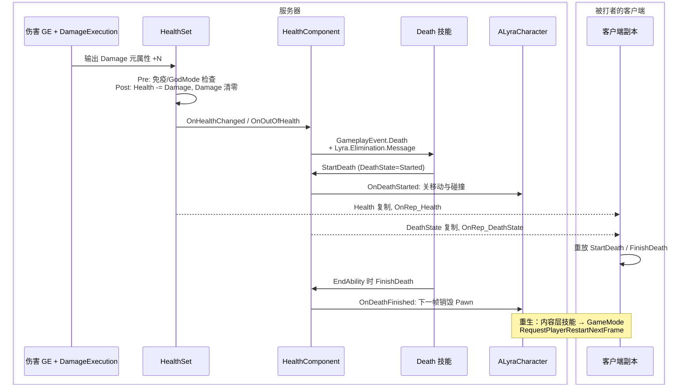
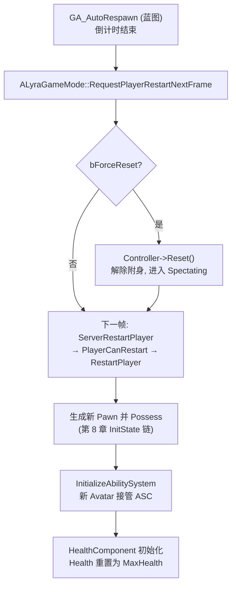

# 第 12 章　伤害、生命、死亡与重生

## 一个问题：一发子弹的旅程

你在 Lyra 里朝一个 Bot 的脑袋开了一枪。半秒之后，Bot 倒地，击杀提示出现在屏幕右上角，记分板上你的分数加一，几秒后 Bot 又从出生点站了起来，血条是满的。

按 UE 入门教程的写法，这条链路大概是：子弹命中时调用 `Target->TakeDamage(Amount, ...)`，`ACharacter` 里有一个 `float Health`，扣完发现小于零就播死亡动画、`Destroy()`，再让 GameMode 调一次 `RestartPlayer`。能跑。但当需求变成下面这些，它会一点点散架：

- 距离越远伤害越低，打头比打腿高，队友之间不能互伤。这些规则写在 `TakeDamage` 里，每种武器都要抄一遍；
- 策划要“热身阶段全员无敌”“作弊命令开无敌”“掉出地图必须能杀死无敌的人”。每加一种例外，`TakeDamage` 就多一个 `if`；
- 死亡动画播放期间，角色已经“死了”但还没消失：技能要被取消、不能再移动、不能再被打，而且所有玩家的客户端都要看到同样的动画；
- 第 10 章刚把 ASC 搬到了 PlayerState 上，血量属性集也在那里，Pawn 只是 Avatar。谁来把两边接起来？
- 这一切发生在服务器上，客户端只是“看到”。哪些代码只能在服务器跑，哪些要在每个客户端重放？

这一章沿着“一发子弹”走完 Lyra 的答案。它把链路拆成了五只手：**执行（Execution）**负责算数，**属性集（HealthSet）**守住“血量只能这样变”的规则，**组件（HealthComponent）**把属性变化翻译成 Pawn 听得懂的事件，**死亡技能**编排死亡流程，**Character** 负责表现和善后。重生则被刻意留给了内容层。

## 读完本章你能……

- 画出一发子弹从“伤害 GE 被应用”到“新 Pawn 站起来”的完整链路，并标出每一步在服务器还是客户端执行；
- 解释为什么伤害要经过 `Damage` 元属性，而不是让 GE 直接修改 `Health`；
- 读懂“基础伤害 × 距离衰减 × 材质衰减 × 队伍许可”这个公式，说出每个因子的数据来源；
- 解释 `DeathState` 为什么用复制 + `OnRep` 重放，而不是只靠 RPC；
- 说出重生由谁触发，以及为什么重生后技能不用重新授予，血量却会回满；
- 动手加一个“护甲”属性，让它减少伤害并显示在 HUD 上。

## 需要先知道的 UE 概念

本章建立在前面章节上，请对照确认：元属性与 `PostGameplayEffectExecute`、执行与捕获、SetByCaller（[第 9 章](09-GASConcepts.md)）；ASC 在 PlayerState、Avatar、`SurvivesDeath`、激活组、`FLyraGameplayEffectContext`（[第 10 章](10-LyraGAS.md)）；OnRep（[第 3 章](03-Networking.md)）；GameplayEvent 触发技能（[第 9 章](09-GASConcepts.md)）。

本章把[第 9 章](09-GASConcepts.md)的元属性（`Damage` 只是中转站）、[第 10 章](10-LyraGAS.md)的 ASC 在 PlayerState / Avatar 切换，和[第 11 章](11-Input.md)刚讲过的“只在本地跑的输入链”之外的另一半——服务器上跑的伤害链——接了起来。新概念只有一个：`WITH_SERVER_CODE`。

### WITH_SERVER_CODE：编译期的“服务器专属代码”开关

它是构建系统为每个目标（Target）定义的宏。构建规则里，只有类型为 `Client` 的目标会把它定义为 0，其余（编辑器、游戏、专用服务器）都是 1（5.8 的 `TargetRules.cs` 里 `bWithServerCode` 默认等于 `Type != TargetType.Client`）。Lyra 的 [`LyraClient.Target.cs`](../../../Source/LyraClient.Target.cs) 就是一个 `Client` 目标。

它解决的问题是：纯客户端的发行包里不应该包含“怎么算伤害”这种逻辑，既省体积，也让作弊者无从反编译。C++ 里写 `#if WITH_SERVER_CODE ... #endif`，客户端包里这段代码就不存在。

类比 `#ifdef SERVER_ONLY`，但要小心边界：**在编辑器里它恒为 1，包括“Play As Client”打开的客户端窗口。** 所以在 PIE 里，一段被它包住的代码能不能在客户端窗口里跑，取决于运行时有没有人调用，不是编译期能挡住的。实验 2 会用到这一点。

## 一、先看全貌：五只手和一条链

下面的时序图把“服务器”和“客户端”分成两个区域，先整体看一遍，后面每一节放大其中一段。



先记住三件事。第一，**所有“决定性”的步骤都在服务器上**：算伤害、改血量、发死亡事件。客户端只收到两样东西——被复制的 `Health` 属性和被复制的 `DeathState`——然后各自重放表现。第二，数据经过三层：GAS 层（GE、Execution、HealthSet）、Pawn 层（HealthComponent、Character）、技能层（Death 技能），每层只认相邻一层的接口，所以换武器、换死亡动画、换重生规则时其余部分不用动。第三，这条链上没有 `TakeDamage`：整个 `Source/` 和 `Plugins/` 里没有任何 `TakeDamage` 调用，伤害就是 GAS 的一次效果应用。

## 二、起点：谁在施加伤害

### 伤害 GE 是“模板 + 上下文”

伤害从一个**即时（Instant）GE** 开始，每把武器有自己的，例如手枪的 `GE_Damage_Pistol`、步枪的 `GE_Damage_RifleAuto`、霰弹枪的 `GE_Damage_Shotgun`。它们的 `Executions` 里都挂着 `LyraDamageExecution`，并在 Execution 条目的“计算修改器（Calculation Modifiers）”里给来源端的 `LyraCombatSet.BaseDamage` 加上武器的基础伤害：手枪 18、步枪 12、霰弹枪每颗弹丸 12。

为什么不直接填常数，而要绕道 `ULyraCombatSet::BaseDamage`？射手 ASC 上的 `BaseDamage` 默认是 0（构造函数里 `BaseDamage(0.0f)`），武器的伤害数值全写在各自的伤害 GE 资产里；`BaseDamage` 之所以仍是个属性，是给 Buff 留钩子——一个“伤害加成”GE 修改射手的 `BaseDamage`，所有武器都会一起受益。“计算修改器”和属性捕获怎样配合，下一节展开。

### 效果上下文：把“谁打的、用什么打的”带进计算

[第 10 章](10-LyraGAS.md)第八节讲过 `FLyraGameplayEffectContext` 多了什么，这里看技能怎么填它：

```cpp
// 简化自 Source/LyraGame/AbilitySystem/Abilities/LyraGameplayAbility.cpp 的 ULyraGameplayAbility::MakeEffectContext
GetAbilitySource(Handle, ActorInfo, /*out*/ SourceLevel, /*out*/ AbilitySource, /*out*/ EffectCauser);
UObject* SourceObject = GetSourceObject(Handle, ActorInfo);
AActor* Instigator = ActorInfo ? ActorInfo->OwnerActor.Get() : nullptr;   // Owner = PlayerState

EffectContext->SetAbilitySource(AbilitySource, SourceLevel);  // 来源对象转成 ILyraAbilitySourceInterface
EffectContext->AddInstigator(Instigator, EffectCauser);       // EffectCauser = Avatar = 开枪的 Pawn
EffectContext->AddSourceObject(SourceObject);
```

`GetAbilitySource` 里，`EffectCauser` 取技能的 Avatar，`AbilitySource` 则是把授予技能时传入的 `SourceObject`（[第 10 章](10-LyraGAS.md)、[第 13 章](13-Inventory.md)：装备授予时就是武器实例）尝试转成 `ILyraAbilitySourceInterface`。转换成功与否，决定后面能不能做距离衰减。另一处是物理材质：`ApplyAbilityTagsToGameplayEffectSpec` 会把命中物理材质（`UPhysicalMaterialWithTags`）的 Tag 追加进 Spec 的 `CapturedTargetTags`，比如标记“弱点/头部”的 Tag。

至于“谁在服务器上真正把 GE 应用到目标”，是[第 14 章](14-Weapons.md)的内容：射击技能 `GA_Weapon_Fire` 是蓝图，C++ 在服务器收到客户端上报的命中数据后触发 `OnRangedWeaponTargetDataReady` 事件，由蓝图在权威端用 `ApplyGameplayEffectToTarget` 应用武器的伤害 GE。本章从 GE 到达服务器上的目标 ASC 之后开始。

### 另一个入口：SetByCaller 版通用伤害 GE

作弊命令、掉出地图、自杀，需要一个“我只想告诉你扣多少”的 GE。[`LyraGameData.h`](../../../Source/LyraGame/System/LyraGameData.h) 里放了两个全局资产引用：

```cpp
// 简化自 Source/LyraGame/System/LyraGameData.h
UPROPERTY(EditDefaultsOnly, Category = "Default Gameplay Effects", meta = (DisplayName = "Damage Gameplay Effect (SetByCaller)"))
TSoftClassPtr<UGameplayEffect> DamageGameplayEffect_SetByCaller;
UPROPERTY(EditDefaultsOnly, Category = "Default Gameplay Effects", meta = (DisplayName = "Heal Gameplay Effect (SetByCaller)"))
TSoftClassPtr<UGameplayEffect> HealGameplayEffect_SetByCaller;
```

`ULyraGameData` 是全局单例数据资产，路径由 `Config/DefaultGame.ini` 的 `LyraGameDataPath=/Game/DefaultGameData.DefaultGameData` 指定，里面配置的就是 `GE_Damage_Basic_SetByCaller` 与 `GE_Heal_SetByCaller`。C++ 先用 `ULyraAssetManager::GetSubclass` 把软引用解析成类，再构造 Spec：

```cpp
// 简化自 Source/LyraGame/Character/LyraHealthComponent.cpp 的 ULyraHealthComponent::DamageSelfDestruct
FGameplayEffectSpecHandle SpecHandle = AbilitySystemComponent->MakeOutgoingSpec(DamageGE, 1.0f, AbilitySystemComponent->MakeEffectContext());
FGameplayEffectSpec* Spec = SpecHandle.Data.Get();

Spec->AddDynamicAssetTag(TAG_Gameplay_DamageSelfDestruct);        // 动态资产 Tag：标记“这是自杀”，HealthSet 会识别
if (bFellOutOfWorld) { Spec->AddDynamicAssetTag(TAG_Gameplay_FellOutOfWorld); }

Spec->SetSetByCallerMagnitude(LyraGameplayTags::SetByCaller_Damage, GetMaxHealth());   // 伤害量 = 最大血量
AbilitySystemComponent->ApplyGameplayEffectSpecToSelf(*Spec);
```

GE 是通用模板，数值由 `SetByCaller.Damage` 在运行时塞进去，还可以通过“动态资产 Tag”给这一次应用贴标签。`GE_Damage_Basic_SetByCaller` 的 Execution 同样是 `LyraDamageExecution`（并在其 Calculation Modifiers 里把 `SetByCaller.Damage` 加到被捕获的 `BaseDamage` 上），所以自杀伤害和子弹伤害走**同一套**计算与同一个血量入口。

## 三、计算：`ULyraDamageExecution`

### 为什么是 Execution，不是修改器

伤害公式能不能用 GE 修改器表达？修改器能做“某属性 加/乘/覆盖 某个数”，数值来自常数、另一个属性、曲线或 SetByCaller。而伤害需要：命中点与射击起点的距离（来自 `FHitResult` 或上下文 Origin）、命中表面的物理材质及“这把武器对它打几折”（来自一个 C++ 接口）、两个人是不是队友（来自队伍子系统），再把它们乘到一起。这些修改器都表达不了。

Execution 就是为此存在的：你自己写的 C++ 计算类，能拿到整个 Spec、Context、两端 ASC，想读什么读什么，最后输出若干个属性修改。代价是它是设计师在 GE 编辑器里拆不开的一段代码，改公式要改 C++。Lyra 的取舍是把公式骨架放 C++，数值（基础伤害、衰减曲线、材质倍率）放数据。

### 捕获基础伤害

```cpp
// 简化自 Source/LyraGame/AbilitySystem/Executions/LyraDamageExecution.cpp
struct FDamageStatics
{
    FGameplayEffectAttributeCaptureDefinition BaseDamageDef;
    FDamageStatics()
    {   // 捕获来源端（射手）的 BaseDamage，bSnapshot = true：Spec 创建时取快照
        BaseDamageDef = FGameplayEffectAttributeCaptureDefinition(
            ULyraCombatSet::GetBaseDamageAttribute(), EGameplayEffectAttributeCaptureSource::Source, true);
    }
};
ULyraDamageExecution::ULyraDamageExecution() { RelevantAttributesToCapture.Add(DamageStatics().BaseDamageDef); }
```

`DamageStatics()` 是 Execution 的惯用写法：函数内静态结构体缓存捕获定义。加进 `RelevantAttributesToCapture` 后，引擎创建 Spec 时会替你把射手 `BaseDamage` 属性的快照存起来。

上一节提到的**计算修改器（Calculation Modifiers）**就接在这里：它写在 GE 资产的 Execution 条目下、只对本次计算生效，会先叠加到这个被捕获属性的快照上（见引擎 `FGameplayEffectCustomExecutionParameters` 构造函数）；随后 C++ 调用 `AttemptCalculateCapturedAttributeMagnitude` 读到的，已经是“射手自身 `BaseDamage` 快照 + GE 里配置的武器基础伤害（或 `SetByCaller.Damage`）”的结果。

### Execute 的主干

整个函数体被 `#if WITH_SERVER_CODE` 包住，纯客户端包里它是个空函数。我们分四段读。

**第一段：确定“谁被打了”。**

```cpp
// 简化自 ULyraDamageExecution::Execute_Implementation（第一段）
FLyraGameplayEffectContext* TypedContext = FLyraGameplayEffectContext::ExtractEffectContext(Spec.GetContext());
float BaseDamage = 0.0f;
ExecutionParams.AttemptCalculateCapturedAttributeMagnitude(DamageStatics().BaseDamageDef, EvaluateParameters, BaseDamage);

const AActor* EffectCauser = TypedContext->GetEffectCauser();
const FHitResult* HitActorResult = TypedContext->GetHitResult();
AActor* HitActor = nullptr;  FVector ImpactLocation = FVector::ZeroVector;
if (HitActorResult) { HitActor = HitActorResult->HitObjectHandle.FetchActor(); /* 同时取 ImpactPoint 等 */ }

if (!HitActor)   // 没有命中结果（直接对 ASC 应用的 GE）：退回到目标的 Avatar
{
    HitActor = TargetAbilitySystemComponent ? TargetAbilitySystemComponent->GetAvatarActor_Direct() : nullptr;
    if (HitActor) { ImpactLocation = HitActor->GetActorLocation(); }
}
```

源码注释说得直白：没经过瞄准、直接加在身上的效果永远没有命中结果，必须有后备信息。作弊命令、自杀走的都是后备路径。

**第二段：队伍许可。**

```cpp
// 简化自 ULyraDamageExecution::Execute_Implementation（第二段）
float DamageInteractionAllowedMultiplier = 0.0f;
if (HitActor)
{
    ULyraTeamSubsystem* TeamSubsystem = HitActor->GetWorld()->GetSubsystem<ULyraTeamSubsystem>();
    if (ensure(TeamSubsystem)) { DamageInteractionAllowedMultiplier = TeamSubsystem->CanCauseDamage(EffectCauser, HitActor) ? 1.0 : 0.0; }
}
```

队伍判断不是提前 `return`，而是算出一个 0 或 1 的**乘数**乘进公式。`CanCauseDamage`（[`LyraTeamSubsystem.cpp`](../../../Source/LyraGame/Teams/LyraTeamSubsystem.cpp)）的规则值得记住，因为“打不掉血”是最常见的 bug 之一：

- 参数 `bAllowDamageToSelf` 默认 true，发起者就是目标（或同一个 PlayerState）时直接放行，所以**打自己是允许的**；
- 否则比较队伍：`DifferentTeams` 才放行，`OnSameTeam` 不行（函数头注释写“考虑友军伤害设置”，但当前实现里没有这样的设置）；
- 有一边没有队伍时，只有**发起者有队伍**且目标有 ASC 才放行（注释说是给没分队的靶子准备的临时规则）；发起者自己没队伍则一律 false。

所以你自己搭的测试场景如果没分配队伍，“怎么打都不掉血”的第一嫌疑是队伍，不是 Execution。队伍系统在第 15 章展开。

**第三段：距离与衰减。**

```cpp
// 简化自 ULyraDamageExecution::Execute_Implementation（第三段）
double Distance = WORLD_MAX;
if (TypedContext->HasOrigin())  { Distance = FVector::Dist(TypedContext->GetOrigin(), ImpactLocation); }
else if (EffectCauser)          { Distance = FVector::Dist(EffectCauser->GetActorLocation(), ImpactLocation); }
// 都没有：打 Error 日志，距离保持 WORLD_MAX

float PhysicalMaterialAttenuation = 1.0f, DistanceAttenuation = 1.0f;
if (const ILyraAbilitySourceInterface* AbilitySource = TypedContext->GetAbilitySource())
{
    if (const UPhysicalMaterial* PhysMat = TypedContext->GetPhysicalMaterial())
    {   PhysicalMaterialAttenuation = AbilitySource->GetPhysicalMaterialAttenuation(PhysMat, SourceTags, TargetTags); }
    DistanceAttenuation = AbilitySource->GetDistanceAttenuation(Distance, SourceTags, TargetTags);
}
DistanceAttenuation = FMath::Max(DistanceAttenuation, 0.0f);
```

这里体现 `ILyraAbilitySourceInterface`（[`LyraAbilitySourceInterface.h`](../../../Source/LyraGame/AbilitySystem/LyraAbilitySourceInterface.h)）的价值：它只有两个纯虚函数，`GetDistanceAttenuation` 和 `GetPhysicalMaterialAttenuation`，都返回倍率。Execution 不知道“武器”是什么，只知道“来源”能回答这两个问题；实现者是谁（远程武器实例、手雷、近战）由上下文里的 `AbilitySource` 决定。远程武器的实现是按曲线取值、按材质 Tag 相乘，第 14 章展开。上下文里没有 `AbilitySource`（比如作弊命令）时两个倍率都是 1。

**第四段：公式与输出。**

```cpp
// 简化自 ULyraDamageExecution::Execute_Implementation（第四段）
// 注释原文：Clamping is done when damage is converted to -health
const float DamageDone = FMath::Max(BaseDamage * DistanceAttenuation * PhysicalMaterialAttenuation * DamageInteractionAllowedMultiplier, 0.0f);

if (DamageDone > 0.0f)
{   // 不直接扣 Health，而是往 Damage 元属性上加；属性集会把它转成 -Health
    OutExecutionOutput.AddOutputModifier(FGameplayModifierEvaluatedData(ULyraHealthSet::GetDamageAttribute(), EGameplayModOp::Additive, DamageDone));
}
```

Execution 唯一的输出就是这一次 `AddOutputModifier`。它不碰 `Health`，不播特效，不发消息，不判断死亡——**只做计算**。这样它是一个可单独测试、单独替换的“纯函数”，所有“伤害落地后怎样”的规则集中在下一个类里。

### 只在服务器算，但不等于安全

函数被 `WITH_SERVER_CODE` 包着，加上 `Config/DefaultGame.ini` 的 `PredictTargetGameplayEffects=False`（第 9 章讲过原因），伤害的计算与落地完全发生在服务器。客户端的血量变化只来自 `Health` 复制；开枪时准星上的命中反馈来自第 14 章的另一套机制。

> 但这不意味着“伤害是安全的”。Execution 在服务器上算得很认真，输入——命中了谁、从哪里打的——却来自客户端上报的数据，而服务器端不校验（`LyraGameplayAbility_RangedWeapon.cpp` 里 `bIsTargetDataValid = true`，已知的原版缺陷）。这条链上服务器权威只做到了“数字由服务器算”，没做到“命中由服务器信”。校验配方见第 14 章。

## 四、守门人：`ULyraHealthSet`

### 为什么是元属性，用 Lyra 的规则再看一眼

此刻 `Damage` 里有了一个正数，还没人动过 `Health`。假如伤害 GE 直接对 `Health` 加负数，“无敌”“GodMode”“只能被打到 1 血”“死亡只触发一次”这些规则要么每个 GE 各自处理，要么塞进一个最终钳制函数。有了 `Damage` 这个中转站，所有伤害——子弹、手雷、自杀、掉出地图——都必须经过 `ULyraHealthSet` 的同一个入口。

[`LyraHealthSet.h`](../../../Source/LyraGame/AbilitySystem/Attributes/LyraHealthSet.h) 里的四个数值属性分两类：有状态的 `Health`、`MaxHealth`（复制，`REPNOTIFY_Always`；`Health` 标了 `HideFromModifiers`，普通 GE 修改器选不到它）；元属性 `Damage`（同样 `HideFromModifiers`）与 `Healing`（没有隐藏，普通 GE 可以直接给它加值），不复制，值始终回到 0。构造函数里 `Health(100.0f)`、`MaxHealth(100.0f)` 是默认初值。

这也给出了一条“什么对象能受伤”的明文规则，Epic 的《Abilities in Lyra》文档把它写成了要求：能掉血的 Actor 必须有**已正确初始化的 ASC**，并且 ASC 上有 `ULyraHealthSet`；`ULyraCombatSet`（基础伤害/治疗值）严格说是可选的，社区（X157）的观察是没有它日志里会报警。所以第 10 章那个挂在 Character 上的靶子（`ALyraCharacterWithAbilities`）也能受伤——它自带 ASC 和两个属性集。

### 落地之前：`PreGameplayEffectExecute`

```cpp
// 简化自 Source/LyraGame/AbilitySystem/Attributes/LyraHealthSet.cpp 的 ULyraHealthSet::PreGameplayEffectExecute
if (Data.EvaluatedData.Attribute == GetDamageAttribute() && Data.EvaluatedData.Magnitude > 0.0f)
{
    // 自杀伤害带动态资产 Tag Gameplay.Damage.SelfDestruct，可以穿透免疫
    const bool bIsDamageFromSelfDestruct = Data.EffectSpec.GetDynamicAssetTags().HasTagExact(TAG_Gameplay_DamageSelfDestruct);

    if (Data.Target.HasMatchingGameplayTag(TAG_Gameplay_DamageImmunity) && !bIsDamageFromSelfDestruct)
    {
        Data.EvaluatedData.Magnitude = 0.0f;   // 免疫：这次修改清零
        return false;                          // 返回 false：引擎放弃应用
    }
#if !UE_BUILD_SHIPPING
    if (Data.Target.HasMatchingGameplayTag(LyraGameplayTags::Cheat_GodMode) && !bIsDamageFromSelfDestruct)
    {   Data.EvaluatedData.Magnitude = 0.0f;  return false; }
#endif
}
HealthBeforeAttributeChange = GetHealth();   // 记下变化前的血量，供 Post 比较
MaxHealthBeforeAttributeChange = GetMaxHealth();
return true;
```

“自杀必须能杀死无敌的人”这条需求就这样落地：不是在 Execution 里特殊处理，也不是另开一条杀人通道，而是**用 Spec 上的动态 Tag 告诉守门人“这次放行”**。无敌也来自 Tag：`Gameplay.DamageImmunity` 由游戏阶段用 GE 授予（[第 10 章](10-LyraGAS.md)提过的 `GE_PregameLobby` 与 `GE_DamageImmunity_FromGameMode`），`Cheat.GodMode` 来自作弊命令，仅限非 Shipping 构建。这条例外规则住在属性集里，Execution 里不存在——Execution 对自杀只做一件事：`CanCauseDamage` 因为 `bAllowDamageToSelf` 而放行。

### 落地之后：`PostGameplayEffectExecute`

这是整条链上最关键的函数，分三步看。

```cpp
// 简化自 ULyraHealthSet::PostGameplayEffectExecute（第一步：最低血量）
float MinimumHealth = 0.0f;
#if !UE_BUILD_SHIPPING
// GodMode 或 UnlimitedHealth：血量最低只能到 1，除非是自杀
if (!bIsDamageFromSelfDestruct &&
    (Data.Target.HasMatchingGameplayTag(LyraGameplayTags::Cheat_GodMode) || Data.Target.HasMatchingGameplayTag(LyraGameplayTags::Cheat_UnlimitedHealth)))
{   MinimumHealth = 1.0f; }
#endif
```

`GodMode` 与 `UnlimitedHealth` 的区别就在这里：前者在 Pre 阶段把伤害清零，后者伤害照扣，只是 `MinimumHealth` 让它扣不到 0。

```cpp
// 简化自 ULyraHealthSet::PostGameplayEffectExecute（第二步：元属性换算）
if (Data.EvaluatedData.Attribute == GetDamageAttribute())
{
    if (Data.EvaluatedData.Magnitude > 0.0f)
    {   // 广播标准化的“伤害”消息 Lyra.Damage.Message，UI 飘字、统计可订阅
        FLyraVerbMessage Message;
        Message.Verb = TAG_Lyra_Damage_Message;
        Message.Instigator = Data.EffectSpec.GetEffectContext().GetEffectCauser();
        Message.Target = GetOwningActor();
        Message.Magnitude = Data.EvaluatedData.Magnitude;
        UGameplayMessageSubsystem::Get(GetWorld()).BroadcastMessage(Message.Verb, Message);
    }
    // 把 Damage 转成 -Health，夹到 [MinimumHealth, MaxHealth]，然后把元属性清零
    SetHealth(FMath::Clamp(GetHealth() - GetDamage(), MinimumHealth, GetMaxHealth()));
    SetDamage(0.0f);
}
else if (Data.EvaluatedData.Attribute == GetHealingAttribute())   // 治疗完全对称：+Health
{   SetHealth(FMath::Clamp(GetHealth() + GetHealing(), MinimumHealth, GetMaxHealth()));  SetHealing(0.0f); }
```

```cpp
// 简化自 ULyraHealthSet::PostGameplayEffectExecute（第三步：通知）
if (GetHealth() != HealthBeforeAttributeChange)
{   OnHealthChanged.Broadcast(Instigator, Causer, &Data.EffectSpec, Data.EvaluatedData.Magnitude, HealthBeforeAttributeChange, GetHealth()); }

if ((GetHealth() <= 0.0f) && !bOutOfHealth)
{   OnOutOfHealth.Broadcast(Instigator, Causer, &Data.EffectSpec, Data.EvaluatedData.Magnitude, HealthBeforeAttributeChange, GetHealth()); }

bOutOfHealth = (GetHealth() <= 0.0f);   // 记住“已经归零”，防止重复触发
```

`bOutOfHealth` 是个小而重要的防抖：血量降到 0 后，同一帧又来一发子弹，`GetHealth() <= 0` 仍成立但 `!bOutOfHealth` 不成立，`OnOutOfHealth` 不会再响。否则同一个人会被“杀死”两次，死亡技能激活两次，击杀消息发两遍。`PostAttributeChange` 里血量重新大于 0 时会把它复位。

### 客户端上的版本

`Health` 在客户端更新时走 `OnRep_Health`：

```cpp
// 简化自 ULyraHealthSet::OnRep_Health
GAMEPLAYATTRIBUTE_REPNOTIFY(ULyraHealthSet, Health, OldValue);
const float CurrentHealth = GetHealth();
const float EstimatedMagnitude = CurrentHealth - OldValue.GetCurrentValue();   // 估算变化量

// 客户端不知道是谁打的：Instigator / Causer / Spec 全是 nullptr
OnHealthChanged.Broadcast(nullptr, nullptr, nullptr, EstimatedMagnitude, OldValue.GetCurrentValue(), CurrentHealth);
if (!bOutOfHealth && CurrentHealth <= 0.0f) { OnOutOfHealth.Broadcast(nullptr, nullptr, nullptr, EstimatedMagnitude, ...); }
bOutOfHealth = (CurrentHealth <= 0.0f);
```

所以 `OnHealthChanged` 在服务器和客户端都会触发，但**客户端触发时没有施加者信息**，头文件注释也明说“some information may be missing on the client”。需要“谁打的我”（受击方向指示器之类），要另找通道：`Lyra.Damage.Message` 或 GameplayCue。

## 五、桥梁：`ULyraHealthComponent`

### 它为什么存在

`OnOutOfHealth` 在属性集上响了，谁来听？

属性集在 PlayerState 的 ASC 上，寿命等于整场会话；“死亡”却是 Pawn 的事——停移动、关碰撞、播动画、销毁。让 Pawn 直接绑属性集的委托，每次换 Pawn 都要重绑，旧 Pawn 销毁时还要记得解绑；让属性集直接操作 Pawn，属性层就依赖了角色层，`ULyraHealthSet` 就没法用在“没有 Pawn 的东西”上（比如第 10 章的靶子之外的场景）。

Lyra 的办法是在 Pawn 上放一个很薄的组件 [`ULyraHealthComponent`](../../../Source/LyraGame/Character/LyraHealthComponent.cpp)（由 `ALyraCharacter` 的构造函数创建）。它只做三件事：以 Pawn 的口吻转发属性集的委托；把“血量归零”翻译成 GAS 事件；维护一个可复制的死亡状态。

### 接上 ASC

第 10 章讲过，`InitializeAbilitySystem` 末尾广播 `OnAbilitySystemInitialized`，`ALyraCharacter` 收到后调用 `HealthComponent->InitializeWithAbilitySystem(LyraASC)`：

```cpp
// 简化自 Source/LyraGame/Character/LyraHealthComponent.cpp 的 ULyraHealthComponent::InitializeWithAbilitySystem
AbilitySystemComponent = InASC;
HealthSet = AbilitySystemComponent->GetSet<ULyraHealthSet>();   // 从 ASC 上找属性集（它住在 PlayerState）

HealthSet->OnHealthChanged.AddUObject(this, &ThisClass::HandleHealthChanged);
HealthSet->OnMaxHealthChanged.AddUObject(this, &ThisClass::HandleMaxHealthChanged);
HealthSet->OnOutOfHealth.AddUObject(this, &ThisClass::HandleOutOfHealth);

// TEMP: Reset attributes to default values.  Eventually this will be driven by a spread sheet.
AbilitySystemComponent->SetNumericAttributeBase(ULyraHealthSet::GetHealthAttribute(), HealthSet->GetMaxHealth());

ClearGameplayTags();   // Status.Death.Dying / Dead 清零
OnHealthChanged.Broadcast(this, HealthSet->GetHealth(), HealthSet->GetHealth(), nullptr);
```

三个细节。其一，属性集是从 ASC 上取的，不是组件自己创建的，这是“属性集在 PlayerState、Pawn 只是 Avatar”的直接体现；Pawn 销毁时 `UninitializeFromAbilitySystem` 会把委托全部摘掉。其二，那行标着 `TEMP` 的代码是**重生后血量满格的真正原因**：属性集活在 PlayerState 上，Pawn 死时它的 `Health` 是 0，没有这一行新 Pawn 出生时还是 0。注释说“将来由表格驱动”，也就是说它并不是有意设计的“出生回满”，而是临时代码。你想做“保留血量重生”或“重生只有半血”，必须改这里。其三，这个函数在服务器和客户端**都会执行**（每个端的 Pawn 副本都走 InitState 链），客户端上的 `SetNumericAttributeBase` 最终会被服务器的复制值覆盖。

### 血量归零：翻译成 GAS 事件

```cpp
// 简化自 ULyraHealthComponent::HandleOutOfHealth
#if WITH_SERVER_CODE
if (AbilitySystemComponent && DamageEffectSpec)      // 客户端 OnRep 触发时 Spec 为空，天然过滤
{
    // ① 发 GameplayEvent.Death，用来触发死亡技能
    FGameplayEventData Payload;
    Payload.EventTag = LyraGameplayTags::GameplayEvent_Death;
    Payload.Instigator = DamageInstigator;
    Payload.Target = AbilitySystemComponent->GetAvatarActor();
    Payload.ContextHandle = DamageEffectSpec->GetEffectContext();
    Payload.EventMagnitude = DamageMagnitude;
    FScopedPredictionWindow NewScopedWindow(AbilitySystemComponent, true);
    AbilitySystemComponent->HandleGameplayEvent(Payload.EventTag, &Payload);

    // ② 广播标准化的“淘汰”消息，Tag = Lyra.Elimination.Message
    FLyraVerbMessage Message;
    Message.Verb = TAG_Lyra_Elimination_Message;
    Message.Instigator = DamageInstigator;
    Message.Target = ULyraVerbMessageHelpers::GetPlayerStateFromObject(AbilitySystemComponent->GetAvatarActor());
    UGameplayMessageSubsystem::Get(GetWorld()).BroadcastMessage(Message.Verb, Message);
}
#endif
```

两个“出口”：一个走 GAS（事件触发技能），一个走第 15 章讲的消息系统（给计分、击杀提示用）。HealthComponent 不决定“死亡之后发生什么”，也不知道有没有计分板，它只公布事实。“只在服务器发”有两层保证：编译期的 `WITH_SERVER_CODE`，和运行时 `DamageEffectSpec` 非空。

两个小提示：淘汰消息的上下文 Tag 没有填，源码留着 `@TODO`（“是敌方击杀、自杀还是队友击杀”都没判断），订阅方需要的话得自己用 Instigator 和 Target 去推；另外两条消息里 `Instigator` 和 `Target` 装的对象类型不对称，订阅转型时很容易踩坑，对照记住：

| 消息频道 | 谁广播 | `Instigator` 装的是谁 | `Target` 装的是谁 |
|---|---|---|---|
| `Lyra.Damage.Message` | `ULyraHealthSet` | `EffectCauser`（通常是开枪的 **Pawn** 或投射物） | 属性集拥有者（通常是受伤者的 **PlayerState**；靶子则是靶子自身） |
| `Lyra.Elimination.Message` | `ULyraHealthComponent` | `DamageInstigator`（上下文 Owner，通常是击杀者的 **PlayerState**） | 被淘汰者的 **PlayerState** |

## 六、死亡的流程：`DeathState` 与死亡技能

### DeathState：一个靠复制重放的小状态机

`ULyraHealthComponent` 里有 `ELyraDeathState`：`NotDead → DeathStarted → DeathFinished`，只能前进，并且是 `ReplicatedUsing = OnRep_DeathState`。

为什么复制？死亡**表现**（停移动、播动画、变布娃娃）要发生在每个端，而死亡技能是 `ServerInitiated`，只在服务器运行。用多播 RPC 看似直接，但 RPC 有个坑：晚加入或刚进入相关范围的客户端收不到过去的 RPC。属性复制天然保证“任何时刻看到的都是最新状态”。

```cpp
// 简化自 ULyraHealthComponent::OnRep_DeathState
const ELyraDeathState NewDeathState = DeathState;
DeathState = OldDeathState;                  // 先退回去：真正的修改交给 StartDeath/FinishDeath，副作用只在一处发生

if (OldDeathState > NewDeathState) { /* 客户端已预测超前于服务器：只打警告 */ return; }

if (OldDeathState == ELyraDeathState::NotDead)
{
    if (NewDeathState == ELyraDeathState::DeathStarted)       { StartDeath(); }
    else if (NewDeathState == ELyraDeathState::DeathFinished) { StartDeath(); FinishDeath(); }   // 跳档：补走两步
}
else if (OldDeathState == ELyraDeathState::DeathStarted && NewDeathState == ELyraDeathState::DeathFinished)
{   FinishDeath(); }
```

`OnRep` 不直接赋值，而是把状态机在本地重新走一遍。`StartDeath()` 设置 `Status.Death.Dying` 松散 Tag、广播 `OnDeathStarted`、`ForceNetUpdate`（让引擎别等下一个更新周期，尽快把这个 Actor 的变化发出去）；`FinishDeath()` 设置 `Status.Death.Dead` 并广播 `OnDeathFinished`；两个函数开头都检查当前状态，所以幂等。一个客户端漏了中间态也能补走。这也回答了第 9 章留下的问题：Loose Tag 不会复制，Dying、Dead 是**每个端各自设置**的，靠的就是同样的 `StartDeath/FinishDeath` 在每个端各跑一遍。

### 死亡技能：`ULyraGameplayAbility_Death`

`GameplayEvent.Death` 触发的是 [`ULyraGameplayAbility_Death`](../../../Source/LyraGame/AbilitySystem/Abilities/LyraGameplayAbility_Death.cpp)，一个 C++ 基类，构造函数里直接写死触发器：

```cpp
// 简化自 Source/LyraGame/AbilitySystem/Abilities/LyraGameplayAbility_Death.cpp 的构造函数
InstancingPolicy = EGameplayAbilityInstancingPolicy::InstancedPerActor;
NetExecutionPolicy = EGameplayAbilityNetExecutionPolicy::ServerInitiated;   // 只在服务器发起
bAutoStartDeath = true;

if (HasAnyFlags(RF_ClassDefaultObject))     // 触发器属于类默认值，只在 CDO 上配置一次（第 1 章）
{
    FAbilityTriggerData TriggerData;
    TriggerData.TriggerTag = LyraGameplayTags::GameplayEvent_Death;        // 收到这个事件就激活
    TriggerData.TriggerSource = EGameplayAbilityTriggerSource::GameplayEvent;
    AbilityTriggers.Add(TriggerData);
}
```

激活时它做三件事：

```cpp
// 简化自 ULyraGameplayAbility_Death::ActivateAbility
FGameplayTagContainer AbilityTypesToIgnore;
AbilityTypesToIgnore.AddTag(LyraGameplayTags::Ability_Behavior_SurvivesDeath);

LyraASC->CancelAbilities(nullptr, &AbilityTypesToIgnore, this);          // ① 取消所有技能（带 SurvivesDeath 的、自己除外）
SetCanBeCanceled(false);                                                 // ② 自己不能被取消
ChangeActivationGroup(ELyraAbilityActivationGroup::Exclusive_Blocking);  // ③ 切到 Exclusive_Blocking：死亡期间任何独占技能都激活不了
if (bAutoStartDeath) { StartDeath(); }                                   // → HealthComponent->StartDeath()
Super::ActivateAbility(Handle, ActorInfo, ActivationInfo, TriggerEventData);
```

[第 10 章](10-LyraGAS.md)的几个概念在这里同时用上：`SurvivesDeath` 决定谁幸存，`Exclusive_Blocking` 保证死亡不被独占技能打断，`SetCanBeCanceled(false)` 让“重置”之类的取消也杀不死它。结束时 `EndAbility` 里会无条件调用 `FinishDeath()`（已经 Start 过才有效）。这给了设计师一份清晰的契约：**死亡持续多久，由技能活多久决定。** 项目里实际用的是蓝图子类 `GA_Hero_Death`：激活时把相机切到 `CM_ThirdPerson_Death`、播放死亡蒙太奇并触发死亡表现，延迟 8 秒后结束技能（从而触发 `FinishDeath` 销毁尸体）。想把尸体停留时间改短或改长，只改蓝图即可，不碰 C++。

**回头看。** 用技能编排死亡，换来的是现成机制：取消与阻塞其他技能、`ServerInitiated` 的网络语义、蓝图时间线、`EndAbility` 兜底。代价是流程拆在三处：HealthSet（谁判定死亡）、Death 技能（流程）、HealthComponent（状态）。调试“角色死不了”时要沿这三处依次排查。

## 七、善后：`ALyraCharacter`

`ALyraCharacter` 在构造函数里订阅了 HealthComponent 的两个委托（[`LyraCharacter.cpp`](../../../Source/LyraGame/Character/LyraCharacter.cpp)）：

```cpp
// 简化自 Source/LyraGame/Character/LyraCharacter.cpp
void ALyraCharacter::OnDeathStarted(AActor*)  { DisableMovementAndCollision(); }   // 立刻：不能动，不能被打，不挡路
void ALyraCharacter::OnDeathFinished(AActor*)
{   GetWorld()->GetTimerManager().SetTimerForNextTick(this, &ThisClass::DestroyDueToDeath); }   // 推迟一帧

void ALyraCharacter::DisableMovementAndCollision()
{
    if (GetController()) { GetController()->SetIgnoreMoveInput(true); }
    CapsuleComp->SetCollisionEnabled(ECollisionEnabled::NoCollision);
    CapsuleComp->SetCollisionResponseToAllChannels(ECR_Ignore);
    LyraMoveComp->StopMovementImmediately();
    LyraMoveComp->DisableMovement();
}
```

为什么推迟一帧？源码没有解释（推断）：`FinishDeath` 是从死亡技能的 `EndAbility` 里同步调用的，如果在同一调用栈里就销毁 Pawn、把 ASC 的 Avatar 置空，技能还在自己的结束流程中，可能踩到“结束到一半 Avatar 没了”的边界。销毁本身：

```cpp
// 简化自 ALyraCharacter::DestroyDueToDeath / UninitAndDestroy
void ALyraCharacter::DestroyDueToDeath()
{
    K2_OnDeathFinished();       // 蓝图事件：设计师在这里放布娃娃、淡出、掉落物等
    UninitAndDestroy();
}

void ALyraCharacter::UninitAndDestroy()
{
    if (GetLocalRole() == ROLE_Authority)
    {
        DetachFromControllerPendingDestroy();   // 仅服务器：脱离 Controller
        SetLifeSpan(0.1f);                      // 0.1 秒后销毁，复制给客户端
    }
    // 我还是 ASC 的 Avatar 才反初始化（新 Pawn 可能已经接管了）
    if (LyraASC->GetAvatarActor() == this) { PawnExtComponent->UninitializeAbilitySystem(); }
    SetActorHiddenInGame(true);
}
```

`UninitializeAbilitySystem` 就是第 10 章那一套：取消技能、清输入、清 Cue、Avatar 置空，再广播 `OnAbilitySystemUninitialized`；`ALyraCharacter` 收到后让 HealthComponent 断开委托，其中会清掉 Dying/Dead Tag，所以这两个 Tag 只在“尸体存在”期间存在。

还有两处会走到相同的收尾。`FellOutOfWorld`：Pawn 掉出世界边界时引擎调用它，Lyra 的实现是 `HealthComponent->DamageSelfDestruct(true)`——第二节展示的自杀伤害——所以掉出地图也是一次完整的伤害管线，最终走到同一个死亡技能，而不是直接销毁。`ALyraCharacter::Reset()`：先 `DisableMovementAndCollision()`、`K2_OnReset()`，再 `UninitAndDestroy()`；它由强制重置技能 `ULyraGameplayAbility_Reset`（`GameplayEvent.RequestReset` 触发）调用，不是由 `Controller->Reset()` 调用的，下一节会说明区别。

## 八、重生：刻意留给内容层的一步

### C++ 里没有人调用它

旧 Pawn 的故事到 `UninitAndDestroy` 讲完。新 Pawn 从哪来？[`ALyraGameMode`](../../../Source/LyraGame/GameModes/LyraGameMode.cpp) 提供了一个函数：

```cpp
// 简化自 Source/LyraGame/GameModes/LyraGameMode.cpp 的 ALyraGameMode::RequestPlayerRestartNextFrame
void ALyraGameMode::RequestPlayerRestartNextFrame(AController* Controller, bool bForceReset)
{
    if (bForceReset && (Controller != nullptr)) { Controller->Reset(); }

    if (APlayerController* PC = Cast<APlayerController>(Controller))
    {   GetWorldTimerManager().SetTimerForNextTick(PC, &APlayerController::ServerRestartPlayer_Implementation); }
    else if (ALyraPlayerBotController* BotController = Cast<ALyraPlayerBotController>(Controller))
    {   GetWorldTimerManager().SetTimerForNextTick(BotController, &ALyraPlayerBotController::ServerRestartController); }
}
```

关键是：整个 `Source/` 和 `Plugins/` 里，除了这个函数自己的定义和 `FailedToRestartPlayer` 里的重试，没有任何 C++ 调用点。谁来调？内容层的蓝图技能 `GA_AutoRespawn`。它的 `ActivationPolicy` 设为 `OnSpawn`，带着 `Ability.Type.Passive.AutoRespawn` 与 `Ability.Behavior.SurvivesDeath` 标签，放在团队死斗（`AbilitySet_Elimination`）和占点（`AbilitySet_ControlPoint`）的技能集里，通过 Experience 的 `AddAbilities` 授予 `LyraPlayerState`（[第 10 章](10-LyraGAS.md)第四节路径 B）。授予后技能常驻运行，因为带 `SurvivesDeath`，Pawn 死亡时不会被取消；它在当前 Avatar 的 `ULyraHealthComponent` 上绑定 `OnDeathStarted`（同时监听 `GameplayEvent.Reset`），一旦角色开始死亡，就在本地向 `HUD.Slot.Reticle` 推入倒计时控件 `W_RespawnTimer`、广播 `Ability.Respawn.Duration.Message` 消息，延迟 `RespawnDelayDuration` 秒后，在服务器权威端调用 `ALyraGameMode::RequestPlayerRestartNextFrame(Controller, bForceReset = true)`。

含义很重要：**重生是一条玩法规则，不是引擎的默认行为。** 团队死斗授予了它，所以会复活；做“最后存活者”（[第 22 章](22-Capstone.md)）时不授予它，死者就不会回来。

### 重生的链路，和引擎设下的门槛



`ServerRestartPlayer` 是引擎 `APlayerController` 的函数，有一道门槛（引擎源码）：只有控制器处于 `Inactive` 状态，或处于 `Spectating` 且 `bPlayerIsWaiting` 时才会重生；如果它还握着一个 Pawn、又不在这两个状态里，引擎只会 `ClientRetryClientRestart`，不会生成新 Pawn。正常死亡路径里，`UninitAndDestroy` 的 `DetachFromControllerPendingDestroy` 会触发 `PawnPendingDestroy`，把控制器切到 `Inactive`，门槛就过了。`bForceReset=true` 则是另一条路：`APlayerController::Reset()` 自己解除附身并切到 `Spectating` + `bPlayerIsWaiting`。顺带澄清一个容易想错的点：按 5.8 的引擎源码，`APlayerController::Reset` 只做 `PawnPendingDestroy` 和 `UnPossess` 这类控制器侧的事，**不会**调用 Pawn 的 `Reset()`；`ALyraCharacter::Reset` 只会被上一节提到的 `ULyraGameplayAbility_Reset` 调用。

门槛过了之后，`PlayerCanRestart` 被 Lyra 重写为 `ControllerCanRestart`（交给 `ULyraPlayerSpawningManagerComponent` 再判断一次），然后走引擎标准的 `RestartPlayer`：选出生点、生成、Possess（第 2、5 章）。生成失败时，`FailedToRestartPlayer` 会在条件允许时再次调用 `RequestPlayerRestartNextFrame`，所以出生点被堵时它会不停重试。

### 新 Pawn 接上的是同一个 ASC

新 Pawn 的 HeroComponent 走到 `DataInitialized`，调用 `InitializeAbilitySystem(PlayerState 的 ASC)`；ASC 的 `InitAbilityActorInfo` 发现 Avatar 是新 Pawn，触发 `OnPawnAvatarSet`、全局系统登记、`TryActivateAbilitiesOnSpawn`（第 10 章第二节）；接着 `OnAbilitySystemInitialized` → `HealthComponent.InitializeWithAbilitySystem` → 血量回满。三条不对称的规则，写代码前要记牢：

- **技能不会重新授予。** `SetPawnData` 只在第一次授予 PawnData 的 AbilitySet，技能表本来就留在 ASC 里，从没丢过；
- **冷却和 Buff 保留，血量回满。** 前者因为 GE 在 ASC 上，后者因为 `InitializeWithAbilitySystem` 里的 `TEMP`；
- **`OnSpawn` 技能会再激活一遍**，已经在运行的（如带 `SurvivesDeath` 的 `GA_AutoRespawn`）被跳过。

## 九、治疗与作弊命令

### 治疗：对称的另一半

`ULyraHealExecution` 是 `ULyraDamageExecution` 的极简版：构造函数捕获来源端的 `ULyraCombatSet::BaseHeal`，`Execute_Implementation` 取出它，`Max(0, BaseHeal)` 之后往 `ULyraHealthSet::Healing` 上加一个 Additive 修改，仅此而已。没有距离、材质、队伍，也就是说**治疗不检查队友**：想让医疗枪只能治疗队友，得自己加规则。它同样输出到元属性，由属性集转成 `+Health` 并钳制在 `MaxHealth`。治疗拾取物（`GE_InstantHeal_*`）与 `HealSelf` 作弊命令用的 `GE_Heal_SetByCaller` 都走这条路。

### 作弊命令一览

[`ULyraCheatManager`](../../../Source/LyraGame/Player/LyraCheatManager.cpp) 的这组命令是调试伤害链路最好的“手柄”：

- `DamageSelf <数值>` / `HealSelf <数值>`：用 `ULyraGameData` 里的 SetByCaller GE 对自己应用伤害/治疗，Tag 分别是 `SetByCaller.Damage`、`SetByCaller.Heal`；`DamageTarget` / `HealTarget` 同理，对象是准星指向的 Actor；
- `DamageSelfDestruct`：调用 `HealthComponent->DamageSelfDestruct()`，带 `SelfDestruct` Tag，可穿透无敌；Pawn 到达 `GameplayReady` 才执行；
- `God` 切换 `Cheat.GodMode`，`UnlimitedHealth` 切换 `Cheat.UnlimitedHealth`。两者都是通过 `AddDynamicTagGameplayEffect` 应用 `ULyraGameData::DynamicTagGameplayEffect`（通用的“授予动态 Tag”GE），属性集再按 Tag 判断。

一个容易踩的坑：**`DamageTarget` 和 `God` 会在客户端自动转发给服务器，而 `DamageSelf`、`HealSelf`、`HealTarget`、`UnlimitedHealth` 不会。** 在客户端窗口直接输入 `DamageSelf 30`，作弊函数在客户端本地执行，`ApplyGameplayEffectSpecToSelf` 没有有效预测键，而客户端又不是该 ASC 的权威端，引擎在 `HasNetworkAuthorityToApplyGameplayEffect` 里直接拒绝（引擎源码），什么也不会发生。解决办法是在命令前加 `Cheat`，借 Lyra 的 `ServerCheat` RPC 在服务器上执行。

## 动手实验

### 实验 1：用作弊命令驱动整条血量链路

**目标**：亲眼看到 `Damage → Health` 的转换、钳制、无敌与自杀穿透。

**步骤**：

1. 打开 `GE_Damage_Basic_SetByCaller`（`Content/GameplayEffects/Damage/`）和 `GE_Damage_Pistol`，看 `Executions` 与 Calculation Modifiers，对照第二、三节。
2. 先打开 `编辑 → 编辑器偏好设置 → LyraStarterGame → Lyra Developer Settings`，勾选 `Override Num Bots to Spawn` 并设为 `0`（免得观察数字时被机器人打扰；做完实验记得取消勾选）。然后用 `B_ShooterGame_Elimination` 运行 PIE，网络模式选 Play As Listen Server（你就是服务器）。
3. 输入 `showdebug abilitysystem`，用 `AbilitySystem.Debug.NextCategory` 切到 Attributes 页，找到 `LyraHealthSet` 的 Health。
4. 依次输入 `DamageSelf 30`、`HealSelf 20`、`HealSelf 50`、`God`、`DamageSelf 50`、`DamageSelfDestruct`，每一步看 Health 和 Owned Tags。

**先写下你的预测**：每步之后 Health 是多少？`God` 之后再 `DamageSelf` 会怎样？`DamageSelfDestruct` 能杀死开着 God 的自己吗？重生后的血量是多少？

**预期结果**：100 → 70 → 90 → 100（第二次治疗被钳制在 `MaxHealth`）；`God` 后 Owned Tags 出现 `Cheat.GodMode`，`DamageSelf 50` 后仍是 100；`DamageSelfDestruct` 照样致死，死亡期间能看到 `Status.Death.Dying`、`Status.Death.Dead`（松散 Tag，留意出现和消失的时机）；重生后血量回到 100，`Cheat.GodMode` 仍在，因为它是 ASC 上的 GE。若恰好处在赛后阶段，可能因全员免伤（`Gameplay.DamageImmunity`）看不到掉血。

**原理**：`DamageSelf` 把 SetByCaller 数值塞进通用伤害 GE，走 `DamageExecution`（目标就是自己，`CanCauseDamage` 的“允许自伤”放行，无衰减），再到 HealthSet 的 Pre/Post。God 在 Pre 阶段拦截，自杀带 `SelfDestruct` Tag 绕过拦截。

### 实验 2：断点看伤害在哪个进程算

**目标**：验证“伤害只在服务器计算”。

**步骤**：

1. 在 `ULyraDamageExecution::Execute_Implementation` 函数体第一行下断点（它在 `#if WITH_SERVER_CODE` 之内）。
2. 网络模式选 Play As Client，玩家数 2，保持默认的“在一个进程内运行”，这样断点能命中服务器和客户端的世界（第 3 章）。
3. 在一个客户端窗口输入 `Cheat DamageSelf 10`，命中后在监视窗口看 `ExecutionParams.GetTargetAbilitySystemComponent()->GetOwner()->GetNetMode()`。再重复几次，也可以让另一个玩家打你一枪。

**先写下你的预测**：断点命中一次还是两次？是 `NM_DedicatedServer` 还是 `NM_Client` 的世界？

**预期结果**：每次伤害命中一次，`GetNetMode()` 是 `NM_DedicatedServer`。客户端窗口里的血条照样会变，但那是 `Health` 复制后触发 `OnRep_Health`，调用栈完全不同。

**原理**：`Cheat` 让 `ServerCheat` RPC 在服务器上执行 `DamageSelf`，GE 只应用在服务器的 ASC 上。再强调一次，编辑器里客户端窗口的 `WITH_SERVER_CODE` 也是 1，编译期没有挡住它，是运行时没人在客户端应用这个 GE，断点才不会命中。直接在客户端输入 `DamageSelf`（不加 `Cheat`）同样不会命中，原因见上一节。

## 配方：给角色加一个“护甲”属性

> 以下是**本书新写的示例代码**，不是 Lyra 原有代码，也没有在工程里编译过。把它当路线图：新属性 → 计算里使用 → 授予 → 显示到 HUD，细节以你的工程为准。

需求：护甲越高受到的伤害越低（减伤比例 = Armor / (Armor + 100)）；护甲像血量一样跨重生保留；HUD 能显示当前护甲。

### 第一步：定义属性集

```cpp
// 新增示例：MyArmorSet.h
UCLASS(BlueprintType)
class UMyArmorSet : public ULyraAttributeSet     // 继承 Lyra 的基类，拿到 GetLyraAbilitySystemComponent 等便利函数
{
    GENERATED_BODY()
public:
    UMyArmorSet() : Armor(0.0f) {}
    ATTRIBUTE_ACCESSORS(UMyArmorSet, Armor);     // 第 9 章讲过的 4 个访问器

    virtual void GetLifetimeReplicatedProps(TArray<FLifetimeProperty>& OutLifetimeProps) const override
    {   Super::GetLifetimeReplicatedProps(OutLifetimeProps);
        DOREPLIFETIME_CONDITION_NOTIFY(UMyArmorSet, Armor, COND_None, REPNOTIFY_Always); }
protected:
    UFUNCTION() void OnRep_Armor(const FGameplayAttributeData& OldValue) { GAMEPLAYATTRIBUTE_REPNOTIFY(UMyArmorSet, Armor, OldValue); }
private:
    // 护甲是“状态”，不是元属性；不加 HideFromModifiers，护甲拾取、Buff 这类普通 GE 可以直接加减它
    UPROPERTY(BlueprintReadOnly, ReplicatedUsing = OnRep_Armor, Category = "Lyra|Armor", Meta = (AllowPrivateAccess = true))
    FGameplayAttributeData Armor;
};
```

套路与 `ULyraCombatSet` 相同。想让护甲不为负，可像 `ULyraHealthSet` 那样重写 `PreAttributeChange` 钳制，这里省略。

### 第二步：在伤害计算里读取护甲

护甲属于**被打者**，所以捕获来源是 `Target`；护甲随时在变，我们要算伤害那一刻的当前值，所以不快照。`ULyraDamageExecution` 的 `DamageStatics` 是 .cpp 里的静态结构体，没法从子类扩展，最直接的办法是复制一份 Execution，只改下面这些地方：

```cpp
// 新增示例：UMyArmorDamageExecution（复制自 ULyraDamageExecution，仅列出新增部分）
struct FArmorDamageStatics
{
    FGameplayEffectAttributeCaptureDefinition BaseDamageDef;   // 与原版相同，略
    FGameplayEffectAttributeCaptureDefinition ArmorDef;
    FArmorDamageStatics()
    {
        ArmorDef = FGameplayEffectAttributeCaptureDefinition(
            UMyArmorSet::GetArmorAttribute(), EGameplayEffectAttributeCaptureSource::Target, /*bSnapshot=*/false);
    }
};
static const FArmorDamageStatics& ArmorDamageStatics()
{
    static FArmorDamageStatics Statics;
    return Statics;
}
// 构造函数里加 RelevantAttributesToCapture.Add(ArmorDamageStatics().ArmorDef);

// 在原版算出 DamageDone 之后、AddOutputModifier 之前：
float Armor = 0.0f;   // 目标没有这个属性集时保持 0：该函数返回 bool，失败时不会改写 Armor
ExecutionParams.AttemptCalculateCapturedAttributeMagnitude(ArmorDamageStatics().ArmorDef, EvaluateParameters, Armor);
DamageDone *= 100.0f / (100.0f + FMath::Max(Armor, 0.0f));      // 护甲 100 → 减伤 50%
```

然后把武器伤害 GE（或它们共同的父类 GE）`Executions` 里的 `LyraDamageExecution` 换成新类。队伍、衰减、`Damage` 元属性、免疫、死亡——全部原样复用，这就是第四节“咽喉点”设计的红利。不改 Execution 还有另一条路：在 `ULyraHealthSet::PreGameplayEffectExecute` 的 `Damage` 分支里读目标护甲、改 `Data.EvaluatedData.Magnitude`。改动更小，但把“护甲公式”塞进了血量守门人，还改了核心代码，上面独立 Execution 的做法更干净。

### 第三步：授予

属性集走第 10 章的 `ULyraAbilitySet`：新建 `AbilitySet_Armor`，在 `Granted Attributes` 里加 `UMyArmorSet`，在 `Granted Gameplay Effects` 里加一个即时 GE（对 `Armor` 做 Override，初值 25）。授予顺序是属性集 → 技能 → 效果，初值 GE 能找到刚加进来的属性集（第 10 章第三节）。再把这个 AbilitySet 加进 PawnData 的 `AbilitySets`（永不撤销），或用 Experience 的 `AddAbilities`（可随玩法撤销）。

属性集挂在 PlayerState 的 ASC 上，所以护甲和血量不同：血量被 `TEMP` 那行重置，护甲会**保留**。希望重生后重置，需要自己在合适的时机再应用一次初值 GE，这是个设计决策，不是 Bug。

### 第四步：显示到 HUD

仿照 HealthComponent，写一个很薄的 Pawn 组件，把属性变化翻译成蓝图可绑定的委托：

```cpp
// 新增示例：UMyArmorComponent
DECLARE_DYNAMIC_MULTICAST_DELEGATE_ThreeParams(FMyArmorChanged, UMyArmorComponent*, Comp, float, OldValue, float, NewValue);

UCLASS(Blueprintable, Meta = (BlueprintSpawnableComponent))
class UMyArmorComponent : public UGameFrameworkComponent
{
    GENERATED_BODY()
public:
    UPROPERTY(BlueprintAssignable) FMyArmorChanged OnArmorChanged;
private:
    TWeakObjectPtr<ULyraAbilitySystemComponent> AbilitySystemComponent;   // 缓存 ASC 弱指针，供反初始化或 EndPlay 安全解绑
    FDelegateHandle ArmorChangedHandle;
    // ...
};

// BeginPlay 里对 PawnExt 调用 OnAbilitySystemInitialized_RegisterAndCall(HandleASCInitialized)
// 并调用 OnAbilitySystemUninitialized_Register(HandleASCUninitialized)
void UMyArmorComponent::HandleASCInitialized()
{
    ULyraPawnExtensionComponent* PawnExt = ULyraPawnExtensionComponent::FindPawnExtensionComponent(GetOwner());
    AbilitySystemComponent = PawnExt ? PawnExt->GetLyraAbilitySystemComponent() : nullptr;
    if (!AbilitySystemComponent.IsValid()) { return; }

    // 引擎 API：属性当前值每次变化都回调；服务器改动与客户端 OnRep 都会触发
    ArmorChangedHandle = AbilitySystemComponent->GetGameplayAttributeValueChangeDelegate(UMyArmorSet::GetArmorAttribute())
        .AddUObject(this, &ThisClass::HandleArmorChanged);
    OnArmorChanged.Broadcast(this, 0.0f, AbilitySystemComponent->GetNumericAttribute(UMyArmorSet::GetArmorAttribute()));   // 先推一次初值
}

void UMyArmorComponent::HandleASCUninitialized()   // EndPlay 里也调一次同一段解绑逻辑兜底
{
    if (AbilitySystemComponent.IsValid() && ArmorChangedHandle.IsValid())
    {
        AbilitySystemComponent->GetGameplayAttributeValueChangeDelegate(UMyArmorSet::GetArmorAttribute()).Remove(ArmorChangedHandle);
    }
    ArmorChangedHandle.Reset();
    AbilitySystemComponent.Reset();
}

void UMyArmorComponent::HandleArmorChanged(const FOnAttributeChangeData& Data) { OnArmorChanged.Broadcast(this, Data.OldValue, Data.NewValue); }
```

这里没有自己在属性集里写委托，而是用引擎自带的 `GetGameplayAttributeValueChangeDelegate`：5.8 引擎源码里属性被本地修改和被复制更新（`SetBaseAttributeValueFromReplication`）时它都会触发，所以服务器、拥有者客户端、模拟代理都能用。注意两点细节：一是组件必须缓存 `AbilitySystemComponent` 弱指针，并在 `OnAbilitySystemUninitialized` 与 `EndPlay` 两处用 `ArmorChangedHandle` 解绑——因为 Pawn 销毁时先反初始化 Avatar（把 `PawnExt` 上的 ASC 指针清空）再走 `EndPlay`，如果只到 `EndPlay` 才去 `PawnExt` 查 ASC，拿到的已经是空指针，委托就会残留在 PlayerState 的 ASC 上；二是组件本身不要塞进 Pawn 蓝图，用 Experience 的 `AddComponents` 注入（[第 7 章](07-ModularGameplay.md)），HUD 控件用 `FindComponentByClass<UMyArmorComponent>` 取组件并绑定 `OnArmorChanged`（HUD 注入见[第 19 章](19-HUDAndLoading.md)）。

## 常见误区

**误区 1：绕过 `Damage` 元属性，直接给 `Health` 加负数。**
`Health` 对修改器隐藏，就是为了堵这条路。自己的 C++ 直接 `SetHealth` 虽然也会被 `PreAttributeChange` 钳制，但不会触发 `OnHealthChanged` 和死亡判定（那是 `PostGameplayEffectExecute` 的职责），角色会“血量为 0 却没死”。所有伤害都应走往 `Damage` 里加值的 GE。

**误区 2：以为血量跟着 Pawn 走，或以为重生回满血是 GAS 的特性。**
`Health` 活在 PlayerState 的属性集里，Pawn 死后它仍是 0。重生后满格，是因为 `InitializeWithAbilitySystem` 里标着 `TEMP` 的 `SetNumericAttributeBase`。改血量重生规则要改这里，不是改 GE。

**误区 3：在客户端的 `OnHealthChanged` 里使用 `Instigator`。**
服务器广播时有施加者、Causer 和 Spec，客户端 `OnRep_Health` 广播时这三个全是 `nullptr`，变化量只是估算。受击方向、击杀者名字这类信息，订阅 `Lyra.Damage.Message`、`Lyra.Elimination.Message` 或 GameplayCue。

**误区 4：以为重生是 GameMode 的默认行为，或在 `OnOutOfHealth` 里直接 `Destroy()` Pawn。**
C++ 里没有任何地方在死后自动调用 `RequestPlayerRestartNextFrame`，重生来自内容层的 `GA_AutoRespawn`；不授予它，死者不会回来。而死亡动画、技能取消、客户端重放、Avatar 反初始化都依赖死亡技能与 `DeathState` 的顺序，直接销毁会让这些全部失序。

**误区 5：调试“打不掉血”只盯着 Execution，或把例外规则塞进 Execution。**
先查四件事：射手有没有队伍（没有则一律 0 伤害）、目标有没有 `Gameplay.DamageImmunity`、有没有 `Cheat.GodMode`、伤害 GE 里 `BaseDamage` 的 Calculation Modifier 是不是 0；再用 `showdebug abilitysystem` 看目标的 Owned Tags。新增规则时先问它属于“怎么算”还是“能不能落地”：前者放 Execution，后者放属性集。

## 本章小结

一发子弹的旅程：伤害 GE（模板 + 带 HitResult 与 `AbilitySource` 的上下文）在服务器到达目标 ASC；`ULyraDamageExecution` 把基础伤害乘上距离衰减、材质衰减和队伍许可，往 `Damage` 元属性上加一个数；`ULyraHealthSet` 作为唯一的守门人，Pre 阶段处理免疫与 GodMode，Post 阶段把 `Damage` 换成 `-Health`、钳制、广播并记住“已归零”；`ULyraHealthComponent` 把 `OnOutOfHealth` 翻译成 `GameplayEvent.Death` 与淘汰消息，触发 `ULyraGameplayAbility_Death`，后者取消其他技能、切到 `Exclusive_Blocking`，驱动 `DeathState` 前进；`DeathState` 复制到每个客户端，在 `OnRep` 里重放 `StartDeath/FinishDeath`；`ALyraCharacter` 关闭移动碰撞，下一帧销毁并反初始化 Avatar。重生由内容层技能调用 `RequestPlayerRestartNextFrame` 触发，新 Pawn 接上同一个 ASC，技能原封不动，血量由 `TEMP` 代码回满。

```
 GE(Damage) ─► DamageExecution ──► HealthSet.Damage (+N)        [S: 只做计算]
                (BaseDamage × 距离 × 材质 × 队伍)
                                  │ Pre: 免疫/God   Post: Health-=Damage, Damage=0
                                  ▼
                       OnHealthChanged / OnOutOfHealth            [S 全信息; C: OnRep 估算, 无施加者]
                                  ▼
            HealthComponent ─► GameplayEvent.Death + Elimination.Message
                                  ▼
            Death Ability (ServerInitiated, Exclusive_Blocking)
                 │ StartDeath ─► DeathState=Started ═复制═► OnRep 重放        [每个端各跑一遍]
                 │ EndAbility ─► FinishDeath ─► Character: 下一帧销毁、Avatar 置空
                                  ▼
       GA_AutoRespawn(内容层) ─► GameMode.RequestPlayerRestartNextFrame ─► 新 Pawn
                                  ▼
          同一个 ASC(技能/冷却/护甲保留)  +  HealthComponent 初始化时 Health←Max (TEMP)
```

## 自测题

1. 为什么伤害 GE 不直接对 `Health` 做 Additive 负值，而要经过 `Damage` 元属性？举出至少两条“只有一个入口”的好处。

<details><summary>答案</summary>

这样所有伤害都必须经过 `ULyraHealthSet` 的 Pre/Post。好处：免疫与 GodMode 只在一处判断；自杀通过动态资产 Tag 在同一处获得“穿透”；`Lyra.Damage.Message` 只在一处广播；钳制、`OnHealthChanged`、`OnOutOfHealth` 与 `bOutOfHealth` 防抖集中在一处，不会有 GE 绕过死亡判定。

</details>


2. `DamageSelfDestruct` 为什么能杀死开着 GodMode 的玩家？这个例外写在 Execution 还是 HealthSet？

<details><summary>答案</summary>

`DamageSelfDestruct` 给 Spec 加了动态资产 Tag `Gameplay.Damage.SelfDestruct`。HealthSet 的 Pre 与 Post 都检查 `bIsDamageFromSelfDestruct`，有则不拦截免疫/GodMode，也不抬高 `MinimumHealth`。例外写在 HealthSet；Execution 只是因为 `CanCauseDamage` 默认允许自伤而放行。

</details>

3. 客户端的 `OnHealthChanged` 与服务器上的有何区别？为什么 `HandleOutOfHealth` 不会在客户端发出 `GameplayEvent.Death`？

<details><summary>答案</summary>

服务器在 `PostGameplayEffectExecute` 里广播，带施加者、Causer 和 Spec；客户端在 `OnRep_Health` 里广播，这三项是 `nullptr`，变化量为估算。`HandleOutOfHealth` 被 `#if WITH_SERVER_CODE` 包住，并要求 `DamageEffectSpec` 非空；客户端 `OnRep_Health` 触发 `OnOutOfHealth` 时 Spec 为空，进不了该分支。客户端的死亡表现靠 `DeathState` 复制与 `OnRep_DeathState` 重放。

</details>

4. 重生后，角色的技能、冷却和血量分别是什么状态？原因各是什么？

<details><summary>答案</summary>

技能保留，不重新授予：技能表在 PlayerState 的 ASC 上，`SetPawnData` 只授予一次。冷却保留：冷却 GE 在 ASC 上，Pawn 死亡只取消运行中的技能，不移除 GE。血量回满：新 Pawn 的 `ULyraHealthComponent::InitializeWithAbilitySystem` 里有一行标注 `TEMP` 的 `SetNumericAttributeBase(Health, MaxHealth)`，不是 GAS 自动恢复。

</details>

5. 死亡状态为什么用复制 `DeathState` + `OnRep` 重放，而不是服务器发一个多播 RPC？

<details><summary>答案</summary>

属性复制保证任何客户端任何时刻看到的都是最新状态，包括晚加入或刚进入相关范围的客户端；RPC 只对发出那一刻在场的客户端有效。`OnRep_DeathState` 把值退回再调用 `StartDeath/FinishDeath`，让副作用（设 Dying/Dead 松散 Tag、广播委托、关闭移动碰撞）只在这两个函数里发生，漏掉中间态也能补走。Loose Tag 不会复制，也正是靠每个端各跑同样的代码来设置的。

</details>

6. 设计题：做一个“最后存活者”模式，死了不能复活，而是变成观战者。要改哪里，哪里保持不动？

<details><summary>答案</summary>

不授予 `GA_AutoRespawn`（不在该模式的 AbilitySet 里引用它），死者就不会被重新生成。伤害、HealthSet、HealthComponent、Death 技能、Character 的销毁流程都保持不变。另需一个 GameState/Controller 组件（用 `AddComponents` 注入），订阅 `Lyra.Elimination.Message` 或 `OnDeathFinished` 统计存活人数、判定胜负，并让死者的 Controller 进入观战。新规则写成组件，不新建 GameMode 子类。

</details>

## 继续深入

- 伤害到重生的函数级调用链（含行号定位）：[参考手册 20 §8.3](../Reference/20-AbilitySystem-Input.md)；设计意图：[§9.8、§9.9](../Reference/20-AbilitySystem-Input.md)；扩展配方“新增伤害类型 / 新 Execution”：[§6.3](../Reference/20-AbilitySystem-Input.md)；“为什么我的伤害是 0”：[§10 Q21](../Reference/20-AbilitySystem-Input.md)。
- 重生与出生的框架侧调用链：[参考手册 10 §8.5](../Reference/10-CoreFramework.md)（该节已按 5.8 引擎源码更正：`Controller->Reset` 不会调用 `ALyraCharacter::Reset`，见本章第八节）。
- 武器如何产生命中数据、客户端上报与“信任客户端”的补强：[第 14 章](14-Weapons.md)；`SourceObject` 与装备：[第 13 章](13-Inventory.md)；队伍判定与消息系统：[第 15 章](15-TeamsInteractionMessages.md)；用本章的组件模式从零做一个模式：[第 22 章](22-Capstone.md)。
- 官方：[Abilities in Lyra](https://dev.epicgames.com/documentation/unreal-engine/abilities-in-lyra-in-unreal-engine) 的 Health / Damage 小节——能掉血的 Actor 必须有已正确初始化的 ASC 与 `ULyraHealthSet`，伤害通过给 `Damage` 属性加值的 GE 实现（官方示例 `GE_Damage_Basic_Instant`；本仓库对应的通用版是 `GE_Damage_Basic_SetByCaller`）；官方没有专门解释死亡与重生，这部分来自源码。该页写于 UE 5.0–5.1 前后，与 5.8 源码冲突处以源码为准。
- 社区：X157 的 [Lyra Health and Damage](https://x157.github.io/UE5/LyraStarterGame/Health-and-Damage/)（让任何 Actor 能受伤至少需要 `ULyraAbilitySystemComponent` 与 `ULyraHealthSet`；`ULyraCombatSet` 严格说可选，但缺了日志里会报警；作者还写了一个“血量最低为 1”的靶子属性集，可作练习灵感；写于 5.0–5.5 时期）；Epic 论坛上的社区教程 [Lyra Health and Damage System](https://forums.unrealengine.com/t/community-tutorial-lyra-health-and-damage-system/688383)（社区作者，非 Epic）；tranek 的 [GASDocumentation](https://github.com/tranek/GASDocumentation)（`Gameplay Effect Execution Calculations` 与 `Meta Attributes` 两节对应本章的 Execution 与 `Damage` 元属性）。
- 本章对设计意图的解释优先来自源码注释（如 `TEMP`、`Clamping is done when damage is converted to -health`），标有“（推断）”的是仅从代码推测的意图。
- 上一章：[第 11 章　增强输入与输入路由](11-Input.md)
- 下一章：[第 13 章　物品、装备与快捷栏：定义/实例与片段](13-Inventory.md)
