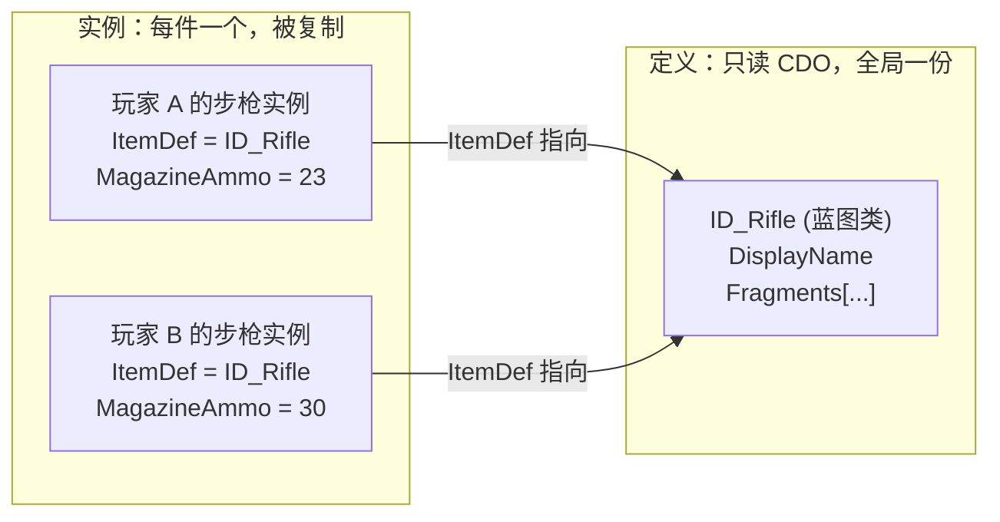
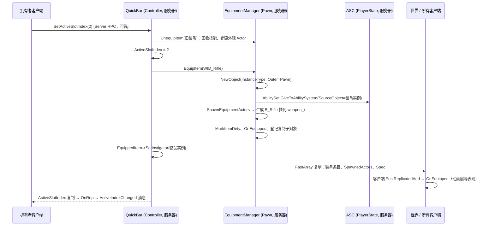
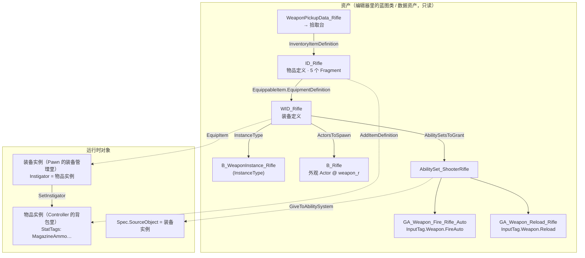

# 第 13 章　物品、装备与快捷栏：定义/实例与片段

## 一个问题：一把步枪，到底是什么？

策划说：“给玩家加一把步枪，地图上有拾取台，捡了放进快捷栏，按 2 切到它，按住左键连发，屏幕右下角显示弹药，准星换成步枪的准星。”

你会怎么设计“步枪”这个东西？按 UE 入门教程的习惯，大概是写一个 `ARifle : public AActor`：里面放骨骼网格、弹药数、射击函数、射速、散布……玩家捡到时把它 Spawn 出来挂到手上。

这个设计在单机里能跑，但几个需求一叠加就开始漏水：

- 玩家背包里还有一把没拿在手上的手枪。它在背包里时，世界里没有一个“手枪 Actor”（至少不该有），可它的弹药数还得记着，切回来时子弹不能凭空回满。
- 快捷栏的图标、HUD 的弹药图标、拾取台上转圈的模型，这些“跟这把枪有关的数据”在枪不存在于手里时也要能读到。
- 步枪能给玩家带来“开火”“换弹”两个技能，而且只有拿着它的时候才有。收起来技能要精确地消失，不能残留。
- 两个玩家各捡了一把步枪，策划改了步枪的名字或图标，要改一处；但两人的弹药互不影响。
- 联网：弹药数要同步给拥有者，别人的步枪模型要显示在别人手上，而且玩家死亡重生后，背包里的东西要保留。

所以“步枪”其实同时扮演了五个角色：**背包里的一件物品**、**手里拿着的装备**、**一组技能的来源**、**一个挂在骨骼上的外观 Actor**、**HUD 上的一个图标**。把它们塞进一个类里，每个角色的生命周期、复制范围、持有者都不一样，就会互相拖累。

这一章讲 Lyra 怎么把这五个角色拆开，又怎么用几条很细的“线”重新连起来。

## 读完本章你能……

- 说出“定义（Definition）”和“实例（Instance）”各装什么、为什么定义必须是只读的类默认对象（CDO）；
- 默画出 `ID_Rifle → WID_Rifle → AbilitySet → GA_Weapon_Fire` 这条资产链，并在编辑器里对着 `ID_Pistol` 逐个打开验证；
- 说出背包组件、快捷栏组件、装备管理组件分别挂在 Controller 还是 Pawn 上，以及为什么；
- 追踪一次“按 2 切枪”从 Server RPC 到技能被授予、外观 Actor 出现的全过程，并标出每一步在服务器还是客户端执行；
- 新增一个自定义物品片段（Fragment），并在运行时读出它；
- 列出原版这套系统里 4 个“半成品”缺口，判断自己的需求会不会踩到。

## 需要先知道的 UE 概念

### 复制一个“不是 Actor 的 UObject”

[第 3 章](03-Networking.md) 讲过，网络复制的基本单位是 Actor。Actor 上的组件跟着 Actor 走，但**普通的 UObject**（既不是 Actor 也不是组件）默认不会被复制，即使它有 `UPROPERTY(Replicated)`。

要让它被复制，需要三件事：这个 UObject 重写 `IsSupportedForNetworking()` 返回 true；它的属性有 `GetLifetimeReplicatedProps`；并且**某个会被复制的 Actor 或组件把它登记为“被复制的子对象”**，也就是调用 `AddReplicatedSubObject`（或者在 `ReplicateSubobjects` 里手动让通道复制它）。没有登记，客户端就永远收不到。

后面你会看到，物品实例和装备实例都是这种“登记在组件名下的 UObject”。选择它们是 UObject 而不是 Actor，是因为物品和装备不需要世界坐标、碰撞、Tick，用 Actor 太重。

### Instanced 子对象与 EditInlineNew

[第 6 章](06-Experience.md) 里 Experience 的 `Actions` 数组用过 `Instanced`。这一章的“片段”是同一个机制：一个 `UPROPERTY(Instanced)` 的对象数组，数组里每个元素都是**属于这个资产自己的子对象**，在编辑器里点开下拉框就能选类型并直接编辑它的属性。类上标 `EditInlineNew` 才允许在编辑器里这样“就地新建”。

可以把它想成“组合模式 + 序列化”：宿主对象持有一个组件列表，列表内容由数据决定，而不是由代码里的 `new` 决定。

### 标签栈（TagStack）

`FGameplayTagStackContainer` 是 Lyra 的一个小工具（[`GameplayTagStack.h`](../../../Source/LyraGame/System/GameplayTagStack.h)）：一张 “GameplayTag → 整数” 的表，内部是一个 FastArray，所以只复制变化的项，并且只能在服务器上增减。Lyra 拿它存“弹匣里还有几发”“备弹有几发”这类**会变化的整数状态**，比如标签 `Lyra.ShooterGame.Weapon.MagazineAmmo` 对应的值就是当前弹匣子弹数。它比自己写一个 `int32 Ammo` 的好处是：加一种新的数值状态只需要新建一个 Tag，不用改类定义。

## 一、先看朴素做法为什么不行

假设我们仍然坚持“一个类搞定”，例如 `UWeaponItem : UObject` 里既有 `DisplayName`、`Icon`、`AbilitySetToGrant`，又有 `int32 CurrentAmmo`。把它放进玩家的背包数组里复制。

两个玩家都拿了“步枪”，这时要么两人共用同一个 `UWeaponItem` 对象（弹药互相影响），要么每人 `NewObject` 一份。后者的问题是：`DisplayName`、`Icon`、`AbilitySetToGrant` 这些**永远不会变的配置**也跟着对象一起被创建、被复制。你把 100 个玩家的背包复制一遍，等于把同一张图标引用复制了 100 遍；策划想改个名字，要改每一个运行时对象；存档时更是要在“配置”和“状态”之间硬拆。

另一个失败场景：物品直接带技能。玩家背包里有手枪、步枪、霰弹枪，如果“拥有物品”就等于“拥有技能”，那玩家同时拥有三个 `Fire` 技能，全部绑在同一个输入标签上，按下左键会同时激活三个。

Lyra 的拆法是两刀：

1. **配置和状态分开**：配置放进“定义”，状态放进“实例”；
2. **“拥有”和“拿在手上”分开**：物品在背包里是“拥有”，装备在 Pawn 身上才是“拿在手上”，技能、外观 Actor 都跟着“拿在手上”走。

## 二、定义与实例：配置只存一份，状态每件一份

### 物品定义

```cpp
// 简化自 Source/LyraGame/Inventory/LyraInventoryItemDefinition.h
UCLASS(Blueprintable, Const, Abstract)
class ULyraInventoryItemDefinition : public UObject
{
    UPROPERTY(EditDefaultsOnly, BlueprintReadOnly, Category=Display)
    FText DisplayName;

    // 一组“片段”，每个片段是定义的私有子对象
    UPROPERTY(EditDefaultsOnly, BlueprintReadOnly, Category=Display, Instanced)
    TArray<TObjectPtr<ULyraInventoryItemFragment>> Fragments;

    const ULyraInventoryItemFragment* FindFragmentByClass(TSubclassOf<ULyraInventoryItemFragment> FragmentClass) const;
};
```

注意两点。第一，它是 `Const` 的 `UObject` 子类，而且 `Blueprintable`。你在编辑器里“新建一个物品”，其实是**新建了一个蓝图类**（`ID_Pistol`、`ID_Rifle` 都是这样的蓝图类），填的值保存在这个蓝图类的 CDO 上，和第 6 章的 Experience 完全同一套路。运行时没有人 `NewObject` 一个定义，大家都通过 `TSubclassOf<ULyraInventoryItemDefinition>` 引用它的类，再用 `GetDefault<>` 读 CDO。Epic 官方的《Lyra Inventory and Equipment》文档对这个类的评价很直白：它**几乎没有功能，只是数据**——核心就是一个显示名加一组片段。

第二，`Const` 的含义是“运行时不应该改它”。因为 CDO 是全局共享的，改了它就等于改了所有玩家手里所有同类物品。这条规则会反复救你：**任何会变的东西都不能写进定义**。

### 物品实例

```cpp
// 简化自 Source/LyraGame/Inventory/LyraInventoryItemInstance.h
UCLASS(BlueprintType)
class ULyraInventoryItemInstance : public UObject
{
    virtual bool IsSupportedForNetworking() const override { return true; }  // 允许作为被复制的子对象

    void AddStatTagStack(FGameplayTag Tag, int32 StackCount);      // 仅服务器
    void RemoveStatTagStack(FGameplayTag Tag, int32 StackCount);   // 仅服务器
    int32 GetStatTagStackCount(FGameplayTag Tag) const;

private:
    UPROPERTY(Replicated) FGameplayTagStackContainer StatTags;       // 会变的数值状态
    UPROPERTY(Replicated) TSubclassOf<ULyraInventoryItemDefinition> ItemDef;  // 我是哪种物品
};
```

实例只有两样东西：**我是哪种物品**（`ItemDef`，一个类引用，复制它只是复制一个类的路径/索引）和**我身上有哪些会变的数值**（`StatTags`）。网络上传的就是“这是 `ID_Rifle`，MagazineAmmo=23，SpareAmmo=60”，而不是整份配置。



回头看这个设计：它像“类与对象”的关系——定义是类，实例是对象。但和 C++ 的类不同，这个“类”本身是**数据**，可以被策划在编辑器里随便拼；而且“实例读取配置”的代价是一次 `GetDefault<>`，几乎免费。

## 三、片段：用组合代替继承

一个物品有哪些能力，由它的 `Fragments` 数组决定。

```cpp
// 简化自 Source/LyraGame/Inventory/LyraInventoryItemDefinition.h
UCLASS(MinimalAPI, DefaultToInstanced, EditInlineNew, Abstract)
class ULyraInventoryItemFragment : public UObject
{
public:
    // 实例刚被创建时调用，片段可以借此往实例里写初始状态
    virtual void OnInstanceCreated(ULyraInventoryItemInstance* Instance) const {}
};
```

基类只有一个钩子 `OnInstanceCreated`。官方文档对片段的设计哲学是：不要给每个物品配上所有属性，而是**按需往定义里加片段**，你也可以继承 `ULyraInventoryItemFragment` 写自己的片段。Lyra 自带的几个片段（都在 `Source/LyraGame/Inventory` 和 `Weapons` 里，类名以 `UInventoryFragment_` 开头）各管一件事：

- `UInventoryFragment_EquippableItem`：只有一个属性 `EquipmentDefinition`，指向“这件物品拿在手上时对应的装备定义”。有它，物品才“可装备”；
- `UInventoryFragment_SetStats`：一张 `TMap<FGameplayTag, int32> InitialItemStats`，实例创建时把它们转成标签栈；
- `UInventoryFragment_QuickBarIcon`：快捷栏和 HUD 用的图标（`Brush`、`AmmoBrush`）和装备时的显示名；
- `UInventoryFragment_PickupIcon`：拾取显示用的骨骼网格、名字和底座颜色；
- `UInventoryFragment_ReticleConfig`：这件物品装备时要用的准星控件类列表（它在 `Weapons` 目录里，但本质是物品片段）。

看 `SetStats` 是怎么用那个钩子的：

```cpp
// 简化自 Source/LyraGame/Inventory/InventoryFragment_SetStats.cpp
void UInventoryFragment_SetStats::OnInstanceCreated(ULyraInventoryItemInstance* Instance) const
{
    for (const auto& KVP : InitialItemStats)
    {
        Instance->AddStatTagStack(KVP.Key, KVP.Value);   // 把“初始弹药”写成实例上的标签栈
    }
}
```

这就是“配置 → 状态”的转换点：**定义里写“弹匣容量 30、初始备弹 60”，实例创建的那一刻把它们变成每件独有的、可变的标签栈**。方法是 `const` 的，片段自己不能被修改，只能改传进来的实例。

读取片段则统一用 `FindFragmentByClass`：

```cpp
// 简化自 Source/LyraGame/Equipment/LyraQuickBarComponent.cpp 的 EquipItemInSlot
if (const UInventoryFragment_EquippableItem* EquipInfo =
        SlotItem->FindFragmentByClass<UInventoryFragment_EquippableItem>())
{
    TSubclassOf<ULyraEquipmentDefinition> EquipDef = EquipInfo->EquipmentDefinition;
    // 没有这个片段（比如一块“钥匙”物品）就根本不会进入这里：它不可装备
}
```

`ULyraInventoryItemInstance::FindFragmentByClass` 内部就是 `GetDefault<ULyraInventoryItemDefinition>(ItemDef)->FindFragmentByClass(...)`：先用实例的 `ItemDef` 找到定义 CDO，再在 CDO 的 `Fragments` 里按类查找。蓝图里对应的是 `FindItemDefinitionFragment` 节点（定义侧）和实例上的 `Find Fragment By Class`。

回头看这个设计换来了什么：物品种类再多也不会有继承树爆炸（“可装备且可堆叠且有图标且有耐久”的物品只是勾选了四个片段）；UI 只想显示图标，就只查 `QuickBarIcon`，没有就不显示，不用处理一堆空字段。付出的代价是**弱类型**：片段之间没有编译期约束，你可以做出一个有 `EquippableItem` 却没有 `QuickBarIcon` 的物品，运行时 UI 默默不显示。这类问题只能靠数据校验和约定来防。

## 四、背包：挂在 Controller 上的 FastArray

物品放在哪里？`ULyraInventoryManagerComponent` 是一个普通的 `UActorComponent`。它不在 Pawn 的构造函数里，也不在 Controller 的构造函数里创建，而是 `ShooterCore` 这个 GameFeature 插件一激活，就由插件数据资产 `ShooterCore` 的 `AddComponents` Action 注入（[第 7 章](07-ModularGameplay.md)）。打开 `ShooterCore` 数据资产核对，它的 `AddComponents` 一共注入了 7 项组件，其中与武器/背包直接相关的三项分工如下：

- 目标类 `AController`（人类 `ALyraPlayerController` 与 AI `ALyraPlayerBotController` 的共同基类）：注入 `ULyraInventoryManagerComponent`（Client + Server）和 `ULyraWeaponStateComponent`（Client + Server）——正因为挂在 `AController` 上，AI 机器人也天然拥有背包；
- 目标类 `ALyraCharacter`：注入 `ULyraEquipmentManagerComponent`（Client + Server）；
- 其余 4 项分别是往 `ALyraPlayerController` 注入指示器管理与回放组件（仅客户端）、往 `AGameStateBase`/`ALyraGameState` 注入击杀播报中继与辅助瞄准目标管理。

所以没有激活 `ShooterCore` 的玩法（比如 TopDownArena），根本没有背包。

它内部有一个 `FLyraInventoryList`，是 [第 3 章](03-Networking.md) 讲过的 FastArraySerializer：

```cpp
// 简化自 Source/LyraGame/Inventory/LyraInventoryManagerComponent.h
USTRUCT()
struct FLyraInventoryEntry : public FFastArraySerializerItem
{
    UPROPERTY() TObjectPtr<ULyraInventoryItemInstance> Instance = nullptr;
    UPROPERTY() int32 StackCount = 0;
    UPROPERTY(NotReplicated) int32 LastObservedCount = INDEX_NONE;   // 客户端本地记账，用来算 Delta
};

USTRUCT()
struct FLyraInventoryList : public FFastArraySerializer
{
    UPROPERTY() TArray<FLyraInventoryEntry> Entries;
    // PostReplicatedAdd / PreReplicatedRemove / PostReplicatedChange：客户端收到增删改时回调
};
```

添加一件物品发生在服务器：

```cpp
// 简化自 FLyraInventoryList::AddEntry(TSubclassOf<ULyraInventoryItemDefinition> ItemClass, int32 StackCount)
check(OwningActor->HasAuthority());                              // 只能在权威端

FLyraInventoryEntry& NewEntry = Entries.AddDefaulted_GetRef();
NewEntry.Instance = NewObject<ULyraInventoryItemInstance>(OwnerComponent->GetOwner());  // Outer 用 Actor，不用组件
NewEntry.Instance->SetItemDef(ItemClass);
for (ULyraInventoryItemFragment* Fragment : GetDefault<ULyraInventoryItemDefinition>(ItemClass)->Fragments)
{
    if (Fragment) { Fragment->OnInstanceCreated(NewEntry.Instance); }   // 此刻 SetStats 写入初始弹药
}
NewEntry.StackCount = StackCount;
MarkItemDirty(NewEntry);                                         // 告诉 FastArray：这一项脏了，下次要发
```

Outer 用 Actor 而不是组件，源码里的注释写的是为了绕开一个引擎问题（UE-127172），你不用深究，只要知道“实例的 Outer 是 Controller”。

随后组件再把这个实例登记为被复制的子对象：

```cpp
// 简化自 ULyraInventoryManagerComponent::AddItemDefinition
Result = InventoryList.AddEntry(ItemDef, StackCount);
if (IsUsingRegisteredSubObjectList() && IsReadyForReplication() && Result)
{
    AddReplicatedSubObject(Result);     // 不登记，客户端永远收不到这个实例
}
```

组件同时还重写了 `ReplicateSubobjects`，在旧的复制路径里手动让通道复制每个实例，并在 `ReadyForReplication` 里补登记已有的实例。两条路径 Lyra 都写了，所以不管引擎选哪一条，实例都会被复制。

客户端这一侧，FastArray 的 `PostReplicatedAdd` 会在新条目到达时触发，然后 Lyra 往消息系统广播一条 `Lyra.Inventory.Message.StackChanged`（载荷 `FLyraInventoryChangeMessage`，带 Instance、NewCount、Delta），UI 监听这条消息刷新背包界面。消息系统本身是第 15 章的主题，这里只需要知道它是“一个解耦的广播”。

这里有个很容易忽略的**细节**：`AddEntry` 在服务器上**不广播**这条消息（只有 `FLyraInventoryList` 的 `PostReplicatedAdd`、`PreReplicatedRemove`、`PostReplicatedChange` 三个复制回调才广播，源码核对）。也就是说，在专用服务器上、或者主机服务器自己的那个本地玩家身上（本地权威端不走复制回调），“服务器本地加物品”不会触发 `StackChanged`。社区的 Garashka 在《Fixing Lyra's Inventory System》里把它列为原型背包的已知坑之一：Listen Server/单机上背包变更消息不触发。实验 2 会让你亲眼看到这一点。

### 谁在哪端执行

| 操作 | 在哪端 | 说明 |
|---|---|---|
| `AddItemDefinition` / `RemoveItemInstance` | 仅服务器 | 蓝图标了 `BlueprintAuthorityOnly` |
| 创建 `ULyraInventoryItemInstance` | 仅服务器 | 在 `AddEntry` 里 `NewObject` |
| `OnInstanceCreated` 写初始标签栈 | 仅服务器 | 标签栈只能服务器改 |
| 实例与 `StatTags` 到达 | 拥有者客户端 | 背包挂在 Controller 上，Controller 只复制给拥有者 |
| 广播 `StackChanged` | 仅客户端的 `PostReplicatedAdd/Change` | 服务器本地添加不广播 |

## 五、物品不等于装备

现在玩家的背包里躺着一个“步枪物品实例”。它有名字、图标、弹药，但它还**什么都做不了**。让它能开火的，是另一套对象：装备。

为什么再分一层？回忆开头的场景：背包里有三把枪，但同一时刻只有一把“拿在手上”。外观 Actor、技能这些东西只跟“拿在手上”绑定。如果让物品直接带技能和模型，三把枪就同时授予三套技能，输入冲突。所以 Lyra 在物品和世界表现之间插了一层 **装备定义（`ULyraEquipmentDefinition`）**。

```cpp
// 简化自 Source/LyraGame/Equipment/LyraEquipmentDefinition.h
UCLASS(Blueprintable, Const, Abstract, BlueprintType)
class ULyraEquipmentDefinition : public UObject
{
    // 装备时创建什么类型的运行时对象（默认 ULyraEquipmentInstance，武器会换成自己的子类）
    UPROPERTY(EditDefaultsOnly) TSubclassOf<ULyraEquipmentInstance> InstanceType;

    // 装备时授予哪些技能集合（AbilitySet，第 10 章）
    UPROPERTY(EditDefaultsOnly) TArray<TObjectPtr<const ULyraAbilitySet>> AbilitySetsToGrant;

    // 装备时在 Pawn 身上生成哪些外观 Actor，挂在哪个骨骼插槽
    UPROPERTY(EditDefaultsOnly) TArray<FLyraEquipmentActorToSpawn> ActorsToSpawn;
};
```

`FLyraEquipmentActorToSpawn` 是一个三元组：要生成的 Actor 类、挂点插槽名（`AttachSocket`）、相对变换（`AttachTransform`）。在编辑器里打开步枪的 `WID_Rifle` 就能看到这三项：`InstanceType` 是 `B_WeaponInstance_Rifle`，`AbilitySetsToGrant` 是 `AbilitySet_ShooterRifle`，`ActorsToSpawn` 里是 `B_Rifle`，挂在右手骨骼插槽 `weapon_r`。

物品与装备之间只有**唯一一座桥**：物品上的 `UInventoryFragment_EquippableItem`。一个没有这个片段的物品永远不能被装备（官方文档也明确写了：没有 `EquippableItem` 片段的物品能存进背包但不能装备）；一个有这个片段的物品，通过它指向的 `EquipmentDefinition` 决定“拿在手上时是什么样”。

和物品定义一样，官方文档说装备定义“只是数据”。但有一处不同：物品没有“实例子类”这个配置项（背包里永远是 `ULyraInventoryItemInstance`），而**装备定义里的 `InstanceType` 是必需的**——装备时要创建这个类的运行时对象来承载逻辑，武器就是靠它换成自己的子类。

### 官方的对照：背包与装备到底差在哪

Epic 的《Lyra Inventory and Equipment》用四个维度把两者摆在一起（5.0–5.1 时期的文档，与 5.8 源码核对过，没有冲突）：

| 维度 | 背包（Inventory） | 装备（Equipment） |
|---|---|---|
| 谁拥有 | Controller（`InventoryManagerComponent`） | Pawn（`EquipmentManagerComponent`） |
| 生命周期 | 持有期间一直存在，丢弃才销毁 | 装备时创建，卸下时销毁 |
| 状态存在哪 | GameplayTag 标签栈（弹药等） | 装卸之间不保留状态；装备期间可授予技能集 |
| 复制给谁 | 只复制到服务器和拥有者（自主代理） | 还复制到模拟代理（别人要看到你手里的枪） |

这张表其实把本章开头的“五个角色”和后面的组件归属都预告了一遍，读完整章再回来看会更有体会。官方文档有两处**没有交代**：一是 `FLyraInventoryList::AddEntry(Instance)` 是 `unimplemented()`、`ULyraAbilityCost_InventoryItem` 被 `#if 0`（见后面“原版的缺口”），页面的口吻会让人以为功能都是完整的；二是 Quickbar 只被提到有一个“图标片段”，它“是唯一调用装备/卸下的地方”只见于社区分析（下面会再提到）。

## 六、装备管理：Pawn 身上的“手”

`ULyraEquipmentManagerComponent` 挂在 **Pawn** 上（ShooterCore 的 GameFeature 把它加到 `LyraCharacter`），它的职责是：装备时创建装备实例、授予技能、生成外观 Actor；卸下时精确回收。

```cpp
// 简化自 Source/LyraGame/Equipment/LyraEquipmentManagerComponent.cpp 的 FLyraEquipmentList::AddEntry
const ULyraEquipmentDefinition* EquipmentCDO = GetDefault<ULyraEquipmentDefinition>(EquipmentDefinition);

FLyraAppliedEquipmentEntry& NewEntry = Entries.AddDefaulted_GetRef();
NewEntry.EquipmentDefinition = EquipmentDefinition;
// 注意 Outer 是 Pawn（OwnerComponent->GetOwner()），装备实例的 GetWorld()/GetPawn() 靠它
NewEntry.Instance = NewObject<ULyraEquipmentInstance>(OwnerComponent->GetOwner(), EquipmentCDO->InstanceType);
Result = NewEntry.Instance;

if (ULyraAbilitySystemComponent* ASC = GetAbilitySystemComponent())
{
    for (const TObjectPtr<const ULyraAbilitySet>& AbilitySet : EquipmentCDO->AbilitySetsToGrant)
    {
        // 第三个参数是关键：把“装备实例”设为每个技能 Spec 的 SourceObject
        AbilitySet->GiveToAbilitySystem(ASC, /*out*/ &NewEntry.GrantedHandles, Result);
    }
}

Result->SpawnEquipmentActors(EquipmentCDO->ActorsToSpawn);   // 服务器生成外观 Actor
MarkItemDirty(NewEntry);
```

这段代码有三件事值得停下来想。

**第一，授予技能的 `GrantedHandles` 是 `NotReplicated` 的，只有服务器持有。** [第 10 章](10-LyraGAS.md) 讲过 AbilitySet 授予会返回一组句柄（技能 Spec 句柄、效果句柄、属性集），卸下时凭这组句柄精确回收。句柄存在装备条目里，装备被移除时 `GrantedHandles.TakeFromAbilitySystem(ASC)` 一次性撤销，不会漏。这就解决了开头的“技能残留”问题。

**第二，`SourceObject = 装备实例`。** 这是整章最重要的一根线，后面“技能怎么知道自己属于哪把枪”一节专门讲。

**第三，ASC 是通过 Pawn 找的，而 ASC 其实在 PlayerState 上。** `GetAbilitySystemComponent()` 通过 `UAbilitySystemGlobals::GetAbilitySystemComponentFromActor(Pawn)` 取得 ASC，Pawn 再通过 PawnExtension 组件转发（[第 8 章](08-PawnAssembly.md)、[第 10 章](10-LyraGAS.md)）。如果装备发生在 ASC 还没绑定到 Pawn 之前，这里会静默地拿到空指针，**技能没授予，也没有任何警告**（源码里留着一条 `//@TODO: Warning logging?`）。这就是为什么起手装备的蓝图要等“背包就绪”才开始发物品，而不是在 `BeginPlay` 里直接装。

外观 Actor 的生成：

```cpp
// 简化自 Source/LyraGame/Equipment/LyraEquipmentInstance.cpp 的 SpawnEquipmentActors
USceneComponent* AttachTarget = OwningPawn->GetRootComponent();
if (ACharacter* Char = Cast<ACharacter>(OwningPawn)) { AttachTarget = Char->GetMesh(); }   // 角色挂在骨骼网格上

for (const FLyraEquipmentActorToSpawn& SpawnInfo : ActorsToSpawn)
{
    AActor* NewActor = GetWorld()->SpawnActorDeferred<AActor>(SpawnInfo.ActorToSpawn, FTransform::Identity, OwningPawn);
    NewActor->FinishSpawning(FTransform::Identity, /*bIsDefaultTransform=*/ true);
    NewActor->SetActorRelativeTransform(SpawnInfo.AttachTransform);
    NewActor->AttachToComponent(AttachTarget, FAttachmentTransformRules::KeepRelativeTransform, SpawnInfo.AttachSocket);
    SpawnedActors.Add(NewActor);                   // SpawnedActors 是被复制的数组
}
```

这个函数**只在服务器执行**（它由 `AddEntry` 调用，而 `AddEntry` 有 `HasAuthority` 检查）。客户端不会自己生成枪的模型：服务器生成的 Actor 如果是可复制的（`bReplicates = true`），就会作为普通 Actor 复制到所有客户端，连同它的附着关系。于是“别人手里的枪”对所有人都可见。这也提醒你一条隐含约定：`ActorsToSpawn` 里的 Actor 蓝图必须开启复制，否则客户端看不到枪（编辑器里 `B_Pistol`、`B_Rifle` 的 Class Defaults 都开启了 `Replicates`）。

那装备实例在客户端怎么出现？它本身也是 `EquipmentManager` 登记的被复制子对象，条目通过另一个 FastArray（`FLyraEquipmentList`）复制，客户端的 `PostReplicatedAdd` 触发实例的 `OnEquipped()`，卸下时 `PreReplicatedRemove` 触发 `OnUnequipped()`。`OnEquipped` 转成蓝图事件 `K2_OnEquipped`，武器实例蓝图可以在里面做**纯客户端的表现**，比如切换动画层（[第 17 章](17-AnimCosmeticsEffects.md)）。

### 武器是装备实例的一个子类

`ULyraWeaponInstance` 继承 `ULyraEquipmentInstance`，`ULyraRangedWeaponInstance` 再继承它。所以你在 `WID_Rifle` 的 `InstanceType` 里填 `B_WeaponInstance_Rifle`（一个继承自 `LyraRangedWeaponInstance` 的蓝图），装备时创建出来的就是一个带散布模型的步枪实例。武器实例的内部下一章讲。这里要抓住的结构是：**装备实例是“拿在手上的那一份运行时状态和逻辑”，武器只是它的特化**。

## 七、快捷栏：玩家有哪三把枪，当前拿哪把

`ULyraQuickBarComponent` 挂在 **Controller** 上（`LAS_ShooterGame_StandardComponents` 用 `AddComponents` 把蓝图子类 `B_QuickBarComponent` 加到 `AController`，Client + Server 都勾选，所以人类玩家和 AI 机器人的 Controller 都会挂上它）。它很小：

```cpp
// 简化自 Source/LyraGame/Equipment/LyraQuickBarComponent.h
UPROPERTY(ReplicatedUsing=OnRep_Slots)
TArray<TObjectPtr<ULyraInventoryItemInstance>> Slots;       // 固定 3 格，每格放一个物品实例或空

UPROPERTY(ReplicatedUsing=OnRep_ActiveSlotIndex)
int32 ActiveSlotIndex = -1;                                 // 当前拿的是哪格，-1 表示空手

UPROPERTY()
TObjectPtr<ULyraEquipmentInstance> EquippedItem;            // 当前已装备的装备实例（不复制！）
```

注意槽里放的是**物品实例**而不是装备。快捷栏只负责“选中哪个物品”，装备由它在切换时调用 EquipmentManager 完成。切换入口是一个 Server RPC：

```cpp
// 简化自 Source/LyraGame/Equipment/LyraQuickBarComponent.cpp
void ULyraQuickBarComponent::SetActiveSlotIndex_Implementation(int32 NewIndex)
{
    if (Slots.IsValidIndex(NewIndex) && (ActiveSlotIndex != NewIndex))   // 同一格重复选会被忽略
    {
        UnequipItemInSlot();        // 先卸旧的：回收技能、销毁外观 Actor
        ActiveSlotIndex = NewIndex;
        EquipItemInSlot();          // 再装新的
        OnRep_ActiveSlotIndex();    // 服务器手动调一次，保证服务器/主机本地也收到消息
    }
}

void ULyraQuickBarComponent::EquipItemInSlot()
{
    if (ULyraInventoryItemInstance* SlotItem = Slots[ActiveSlotIndex])
    {
        if (const UInventoryFragment_EquippableItem* EquipInfo = SlotItem->FindFragmentByClass<UInventoryFragment_EquippableItem>())
        {
            if (ULyraEquipmentManagerComponent* EquipmentManager = FindEquipmentManager())   // Controller → 当前 Pawn → 找组件
            {
                EquippedItem = EquipmentManager->EquipItem(EquipInfo->EquipmentDefinition);
                if (EquippedItem) { EquippedItem->SetInstigator(SlotItem); }   // 建立 装备实例 → 物品实例 的反向链接
            }
        }
    }
}
```

`SetInstigator(SlotItem)` 这一行把装备实例和它来自哪个物品实例连了起来，后面 `GetAssociatedItem()` 靠它回到物品实例读弹药。

顺带一个源码与蓝图都核对过的事实：无论 C++ 还是蓝图（`B_Hero_ShooterMannequin` 的起手发放与 `B_WeaponSpawner` 的拾取发放），`EquipItem` / `UnequipItem` 全工程都只在快捷栏组件内部被调用。也就是说，“想让一件东西拿到手上，就得先放进快捷栏”是这套代码的实际约束。官方文档没有说明这是不是有意的设计；社区（X157）对此不太满意——AI 机器人基本用不上快捷栏切换，却因为组件挂在 `AController` 上而每个机器人都背着一个——这是社区评价，不是官方立场。

把整个流程画成时序图（注意每一步在哪端）：



切枪**不做客户端预测**：客户端调用的是 Server RPC，要等一个往返才看到新枪。对于射击游戏这是可以接受的，因为大多数游戏的“拔枪”本来就有动画前摇。

### 为什么快捷栏在 Controller，装备在 Pawn

这是个很典型的“生命周期决定归属”的问题。Pawn 会死、会销毁、会换；Controller（和 PlayerState）活得久。“我有哪三把枪、现在选中了哪格”是玩家的东西，应该跟着 Controller。而“手里这把枪此刻带来的技能和模型”是**身体**的东西：外观 Actor 要挂在 Pawn 的骨骼上，ASC 的化身（Avatar）是 Pawn，所以装备实例的 Outer 是 Pawn，它的 `GetWorld()`、`GetPawn()` 都靠这个。

想象玩家被击杀：旧 Pawn 销毁，`ULyraEquipmentManagerComponent::UninitializeComponent` 把所有装备卸下（技能和枪模型随之消失）；新 Pawn 出生时，Controller 上的 QuickBar 仍然存着那三个物品实例（弹药都还在），只需要再对当前格调一次 `SetActiveSlotIndex` 就能重新装上。注意前面代码里的 `ActiveSlotIndex != NewIndex` 判断：如果你的重生流程想重新装备“同一格”，必须先把 `ActiveSlotIndex` 置回 -1，否则会被当成“没变”直接忽略。Lyra 默认的重生做法更干脆：英雄蓝图 `B_Hero_ShooterMannequin` 在死亡清理时调用 `ClearInventory`，新 Pawn 出生就绪时再走 `AddInitialInventory`，遍历类默认值 `InitialInventoryItems`（默认只有一项 `ID_Pistol`），重新创建起手武器实例、放进第 0 格并调用 `SetActiveSlotIndex(0)`。

## 八、技能怎么知道自己属于哪把枪

装备实例作为 `SourceObject` 被塞进了每个技能 Spec。这根线让下面几件事成为可能：

```cpp
// 简化自 Source/LyraGame/Equipment/LyraGameplayAbility_FromEquipment.cpp
ULyraEquipmentInstance* ULyraGameplayAbility_FromEquipment::GetAssociatedEquipment() const
{
    if (FGameplayAbilitySpec* Spec = UGameplayAbility::GetCurrentAbilitySpec())
    {
        return Cast<ULyraEquipmentInstance>(Spec->SourceObject.Get());   // 技能从 Spec 里读到“我是哪个装备授予的”
    }
    return nullptr;
}

ULyraInventoryItemInstance* ULyraGameplayAbility_FromEquipment::GetAssociatedItem() const
{
    if (ULyraEquipmentInstance* Equipment = GetAssociatedEquipment())
    {
        return Cast<ULyraInventoryItemInstance>(Equipment->GetInstigator());   // 再沿反向链接回到物品
    }
    return nullptr;
}
```

`ULyraGameplayAbility_FromEquipment` 是“由装备授予的技能”的基类（武器射击技能 `ULyraGameplayAbility_RangedWeapon` 继承它）。整条反向查找链只有四跳，分别跨过三个宿主对象：

```
GA Spec (PlayerState 的 ASC) ──SourceObject──▶ 装备实例 (Pawn) ──Instigator──▶ 物品实例 (Controller) ──StatTags──▶ 弹药数
```

最直接的用途是扣弹药。射击技能的 `AdditionalCosts` 里挂一个 `ULyraAbilityCost_ItemTagStack`：

```cpp
// 简化自 Source/LyraGame/AbilitySystem/Abilities/LyraAbilityCost_ItemTagStack.cpp
bool ULyraAbilityCost_ItemTagStack::CheckCost(const ULyraGameplayAbility* Ability, ...) const
{
    if (const ULyraGameplayAbility_FromEquipment* EquipmentAbility = Cast<const ULyraGameplayAbility_FromEquipment>(Ability))
    {
        if (ULyraInventoryItemInstance* ItemInstance = EquipmentAbility->GetAssociatedItem())
        {
            // 够不够：物品实例上 Tag 对应的栈数 >= 需要消耗的数量
            return ItemInstance->GetStatTagStackCount(Tag) >= NumStacks;
        }
    }
    return false;     // 不是装备授予的技能，或找不到物品 → 付不起代价
}
// ApplyCost 同理，仅权威端调用 ItemInstance->RemoveStatTagStack(Tag, NumStacks)
```

打开 `GA_Weapon_Fire_Pistol` 的类默认值，`Additional Costs` 里有一项 `LyraAbilityCost_ItemTagStack`，Tag 是 `Lyra.ShooterGame.Weapon.MagazineAmmo`，数量 1，失败标签 `Ability.ActivateFail.Cost`。所以开一枪就是：技能激活时 `CommitAbility` → 检查并扣除当前武器物品实例上的一发弹药 → 标签栈变化经 FastArray 复制回客户端 → HUD 的弹药控件刷新。

第二个用途在 [第 12 章](12-DamageAndDeath.md) 出现过：`ULyraGameplayAbility::GetAbilitySource` 把同一个 `SourceObject` 当作 `ILyraAbilitySourceInterface` 放进效果上下文，伤害计算就能问“这把枪的距离衰减是多少”。`ULyraRangedWeaponInstance` 实现了这个接口。一个对象，同时是“技能的来源”“弹药的主人”“伤害衰减的提供者”，这就是 `SourceObject` 这根线的威力。

反过来，也有一个坑：如果你把一套武器 AbilitySet 用别的方式授予（比如在 Experience 里直接 `AddAbilities`），`SourceObject` 是空的，`GetAssociatedEquipment()` 返回空，射击技能的 `CanActivateAbility` 会报错并拒绝激活。**武器技能必须通过 EquipmentManager 授予。**

## 九、拾取：物品是怎么进背包的

物品进背包有两条路。

**第一条是武器拾取台** `ALyraWeaponSpawner`：一个带胶囊碰撞的 Actor，配置在 `ULyraWeaponPickupDefinition`（一个只读的数据资产，包含 `InventoryItemDefinition`、展示用静态网格、冷却秒数、音效和特效）里。流程只在服务器进行：

```cpp
// 简化自 Source/LyraGame/Weapons/LyraWeaponSpawner.cpp
void ALyraWeaponSpawner::OnOverlapBegin(...)
{
    APawn* OverlappingPawn = Cast<APawn>(OtherActor);
    if (GetLocalRole() == ROLE_Authority && bIsWeaponAvailable && OverlappingPawn != nullptr)
    {
        AttemptPickUpWeapon(OverlappingPawn);        // 只有服务器处理拾取
    }
}

void ALyraWeaponSpawner::AttemptPickUpWeapon_Implementation(APawn* Pawn)
{
    if (GetLocalRole() == ROLE_Authority && bIsWeaponAvailable && UAbilitySystemBlueprintLibrary::GetAbilitySystemComponent(Pawn))
    {
        if (GiveWeapon(WeaponItemDefinition, Pawn))   // BlueprintImplementableEvent：由蓝图实现“怎么给”
        {
            bIsWeaponAvailable = false;               // 被复制，客户端 OnRep 里隐藏模型、播特效
            SetWeaponPickupVisibility(false);
            PlayPickupEffects();
            StartCoolDown();                          // 冷却计时结束后重新可拾取
        }
    }
}
```

“怎么给”故意不写在 C++ 里：`GiveWeapon` 是蓝图实现事件，`B_WeaponSpawner` 蓝图里的逻辑是：如果背包里已经有同类武器就补满备弹，没有就调用 `AddItemDefinition` 创建实例 → `GetNextFreeItemSlot` 找快捷栏空位 → `AddItemToSlot` 放入槽位（如果当前空手还会自动装备）。C++ 把“拾取台的状态机”（可用/冷却/复制）做好，把“拾取的规则”留给蓝图。如果你新建拾取台蓝图却没有继承 `B_WeaponSpawner`，`GiveWeapon` 没有实现，默认返回 false，枪永远捡不起来。

**第二条是通用的“可拾取物”接口 `IPickupable`**：

```cpp
// 简化自 Source/LyraGame/Inventory/IPickupable.h
struct FPickupTemplate { int32 StackCount = 1; TSubclassOf<ULyraInventoryItemDefinition> ItemDef; };  // “给我一个这种物品”
struct FPickupInstance { TObjectPtr<ULyraInventoryItemInstance> Item; };                              // “把这个现成的实例给我”
struct FInventoryPickup { TArray<FPickupInstance> Instances; TArray<FPickupTemplate> Templates; };

class IPickupable { virtual FInventoryPickup GetPickupInventory() const = 0; };
```

`UPickupableStatics::AddPickupToInventory` 把 `Templates` 一一转成 `AddItemDefinition`，把 `Instances` 转成 `AddItemInstance`。ShooterCore 里的 `ALyraWorldCollectable` 同时实现了 `IPickupable` 和“可交互目标”接口（第 15 章），是“世界里按键拾取一个物品”的标准样板：看着它按交互键，交互技能在服务器上调用 `AddPickupToInventory`。后一半留到下一节“缺口”再说：`Instances` 这条路在原版里是断的。

## 十、把整条链画出来

现在可以把 `ID_Rifle → WID_Rifle → AbilitySet → GA` 的资产链和运行时对象放在一张图里（对应 `ShooterCore` 插件内容的 `Weapons/Rifle` 目录，`ID_Rifle` 默认配了 `MagazineSize = 30`、`MagazineAmmo = 30`、`SpareAmmo = 60`）：



这张图是后面几章反复要用的地图。第 14 章的射击从 `GA_Weapon_Fire_Rifle_Auto` 出发，第 15 章的拾取交互通向 `ID_Rifle` 的上游，第 17 章的动画层挂在 `B_WeaponInstance_Rifle` 上。

对照第 5 章的 12 步主干：这条链上“物品进背包”发生在 Experience 加载完成、玩家出生之后；“装备”发生在 Pawn 拥有 ASC 之后，是主干之外由玩法触发的支线。

## 十一、原版的缺口：如果你要用这些功能，需要自己补

Lyra 是示例项目，不是成品。物品系统里有几处是明显的半成品，写扩展功能之前要先知道，免得掉进坑里。注意官方的《Lyra Inventory and Equipment》页面并没有标注这些未完成项，社区倒是有不少记录：X157 指出“每次添加都新建物品实例，不会合并堆叠，也没有‘背包已满’的概念”（对 Lyra 本身无影响，因为武器堆叠数恒为 1，弹药是物品实例上的标签栈而不是物品）；Garashka 的《Fixing Lyra's Inventory System》则逐条列出了原型背包的缺口。X157 对它的总体评价是“不坏，但不是好的基类，是好的范例”，建议复制进自己的 GameFeature 插件后再重构（社区观点，作参考）。这里每一条都按“现象 → 为什么 → 怎么补”来读。

**缺口一：不能把现成的物品实例放进背包。** `FLyraInventoryList::AddEntry(ULyraInventoryItemInstance*)` 的函数体是 `unimplemented()`。所以 `AddItemInstance`，以及 `IPickupable` 里 `Instances` 那条路径，调用就直接断言崩溃。目前只有按定义创建（`AddItemDefinition`、`FPickupTemplate`）能用。这意味着“丢弃武器再捡回来保留弹药”做不了：丢弃时物品实例被移除，捡起时只能按定义新建一个满弹药的。要补的话，在这个函数里把传入的实例放进 `Entries`、设好 `StackCount`、`MarkItemDirty`，并且别忘了 `AddItemInstance` 里的 `AddReplicatedSubObject`；还要决定这个实例的 Outer 是否需要换成当前背包的 Actor（因为复制要求 Outer 链稳定）。

**缺口二：用“背包里的物品数量”做技能代价是不可用的。** `ULyraAbilityCost_InventoryItem` 的整个实现被 `#if 0` 包住，`CheckCost` 恒返回 false。弹药走的是 `ItemTagStack`（标签栈），不是背包物品。如果你想做“手雷消耗一枚手雷物品”这种代价，需要自己把 `#if 0` 里的逻辑恢复并配套修复下面的堆叠问题。

**缺口三：没有真正的堆叠。** `StackCount` 记在条目上，但：`GetTotalItemCountByDefinition` 数的是条目个数而不是把 `StackCount` 求和；`ConsumeItemsByDefinition` 每次移除一整个条目；`CanAddItemDefinition` 恒返回 true，没有数量上限，也没有“相同物品合并”。更隐蔽的是，`ConsumeItemsByDefinition` 内部调用 `RemoveEntry`，**不会**对被移除的实例调用 `RemoveReplicatedSubObject`（只有 `RemoveItemInstance` 会），登记的子对象列表里会残留已被移除的实例。如果你想做堆叠，要同时改“添加时合并”“计数时求和”“消耗时扣减”和“移除时注销子对象”四处。

**缺口四：快捷栏的 `EquippedItem` 不被复制。** 它是个普通的 `UPROPERTY()`，客户端上永远为 null；`Slots` 和 `ActiveSlotIndex` 才被复制。所以客户端想知道“我当前拿着什么”，应该读 `GetActiveSlotItem()`（物品实例）或者向 EquipmentManager 要装备实例，**不要读 `EquippedItem`**。

除此之外还有两个时序类的坑，后面“常见误区”里会提到：服务器上 `OnEquipped` 被调用时装备实例的 `Instigator` 还是空的（因为 `SetInstigator` 在 `EquipItem` 返回之后才调用）；以及移除当前激活槽里的物品时 `ActiveSlotIndex` 被置为 -1，但**不会**触发 `OnRep_ActiveSlotIndex`，监听这条消息的 UI 可能不会刷新。

## 动手实验

### 实验 1：在编辑器里追踪 Pistol 的资产链

**目标**：不读一行 C++，顺着引用把 `ID_Pistol` 的整条链走一遍，验证本章的图。

**步骤**：

1. 内容浏览器里勾选“显示插件内容”，找到 ShooterCore 插件内容下的 `Weapons/Pistol` 目录。你会看到 `ID_Pistol`、`WID_Pistol`、`AbilitySet_ShooterPistol`、`B_WeaponInstance_Pistol`、`B_Pistol`、`GA_Weapon_Fire_Pistol` 等资产。
2. 双击 `ID_Pistol`，打开蓝图的 Class Defaults，展开 `Fragments` 数组。

**先写下你的预测**：数组里有几个元素？分别是什么类型？哪一个是“物品和装备之间的桥”？

3. 展开每一个元素。找到 `InventoryFragment_SetStats` 的 `Initial Item Stats`，记下三个标签和各自的数值；找到 `InventoryFragment_EquippableItem`，看它指向哪个资产。
4. 双击进入 `WID_Pistol`，查看 `Instance Type`、`Ability Sets To Grant`、`Actors To Spawn`（含挂点插槽名）。
5. 双击 `AbilitySet_ShooterPistol`，在“Granted Gameplay Abilities”里看每个技能和它的 `Input Tag`。
6. 任选一个资产，右键 → 参考查看器（Reference Viewer），画出的图应当与本章“把整条链画出来”那张图一致。

**预期结果**：`Fragments` 里有 5 个片段：`EquippableItem`、`QuickBarIcon`、`SetStats`、`PickupIcon`、`ReticleConfig`。`SetStats` 里有 `MagazineSize = 12`、`MagazineAmmo = 12`、`SpareAmmo = 48` 三项。`WID_Pistol` 的实例类型是 `B_WeaponInstance_Pistol`，外观 Actor 是 `B_Pistol`，挂在 `weapon_r`。`AbilitySet_ShooterPistol` 授予开火（`InputTag.Weapon.Fire`）、换弹（`InputTag.Weapon.Reload`）和一个没有输入标签的自动换弹技能 `GA_Weapon_AutoReload`（位于 `/Game/Weapons`）。

**原理**：这里没有任何“手枪”的代码，手枪只是一组数据的引用关系。注意手枪的开火输入标签是 `Fire`，而步枪、霰弹枪用的是 `FireAuto`——这个标签差异决定了“按一下一发”还是“按住连发”，输入章节（第 11 章）讲过标签如何路由到技能。

### 实验 2：用消息日志看背包和快捷栏

**目标**：亲眼验证“`AddEntry` 在服务器不广播 `StackChanged`，而 QuickBar 在两端都广播”。

**步骤**：

1. 编辑器里网络模式选“以客户端运行（Play As Client）”，玩家数 2，用 `L_Expanse` 加 `B_ShooterGame_Elimination` 运行 PIE。
2. 在任意窗口按 `` ` `` 打开控制台，输入 `GameplayMessageSubsystem.LogMessages 1`。这个变量会让消息系统把每次广播都写进输出日志，类别是 `LogGameplayMessageSubsystem`。
3. 在输出日志过滤框里输入 `Inventory` 和 `QuickBar` 作为关键词。

**先写下你的预测**：玩家在 `L_Expanse` 里走到一个拾取台上捡一把新枪，日志里会出现哪些消息？它们带的上下文标记是 Server 还是 Client？

4. 捡一把枪，再用快捷栏切换武器。观察日志。

**预期结果**：能看到 `Lyra.Inventory.Message.StackChanged`，但只出现在**客户端**的日志行里（服务器的 `AddEntry` 不广播，只有客户端的 `PostReplicatedAdd` 广播）。`Lyra.QuickBar.Message.SlotsChanged` 和 `ActiveIndexChanged` 则在服务器和客户端的日志里都会出现（因为服务器在 `AddItemToSlot`/`SetActiveSlotIndex` 里手动调用了 `OnRep_...`）。

5. 结束后输入 `GameplayMessageSubsystem.LogMessages 0` 关掉。

**原理**：这就是“消息只在调用它的进程内分发”（第 15 章细讲）在背包里的一个具体例子。如果你的服务器逻辑想监听“背包变了”，不要订阅 `StackChanged`，因为它在服务器永远不会来。

### 实验 3（配方）：新增一个“重量”片段并读出它

**目标**：写一个自定义片段，把它加到 `ID_Pistol` 上，运行时读到它的值。

**步骤**：

1. 在 `Source/LyraGame/Inventory/` 下新建 `InventoryFragment_Weight.h`（照着 `InventoryFragment_SetStats.h` 的样子）：

```cpp
// 新文件：Source/LyraGame/Inventory/InventoryFragment_Weight.h
#pragma once
#include "Inventory/LyraInventoryItemDefinition.h"
#include "InventoryFragment_Weight.generated.h"

UCLASS()
class UInventoryFragment_Weight : public ULyraInventoryItemFragment
{
    GENERATED_BODY()
public:
    // 配置数据：写在定义的 CDO 上，所有实例共享，运行时不要改
    UPROPERTY(EditAnywhere, BlueprintReadOnly, Category=Weight)
    float Weight = 1.0f;
};
```

   `.cpp` 只需要 `#include` 它自己的头文件和 `UE_INLINE_GENERATED_CPP_BY_NAME(InventoryFragment_Weight)`。编译。
2. 重新打开编辑器，打开 `ID_Pistol`，在 `Fragments` 数组末尾点加号，下拉框里选 `Inventory Fragment Weight`，把 `Weight` 设成 3.5。不保存也能在本次 PIE 里生效（编辑器里的改动直接作用于内存中的资产）；做完实验后可以不保存直接关闭，保持项目干净。
3. 为了读出它，在 `ULyraQuickBarComponent::EquipItemInSlot` 里临时加一段日志：

```cpp
// 临时调试代码，加在 EquipItemInSlot 里取到 SlotItem 之后
if (const UInventoryFragment_Weight* W = SlotItem->FindFragmentByClass<UInventoryFragment_Weight>())
{
    UE_LOG(LogTemp, Log, TEXT("装备 %s，重量 %.1f"), *GetNameSafe(SlotItem->GetItemDef()), W->Weight);
}
```

**先写下你的预测**：起手拿着手枪，日志里会打印什么？切到步枪呢（步枪没加这个片段）？

4. 运行 PIE，切换武器。

**预期结果**：装备手枪时打印“重量 3.5”；切到步枪时什么都不打印，因为 `FindFragmentByClass` 返回空，没有任何额外的判空负担。

**原理**：新增一种物品能力 = 新增一个 Fragment 类，既没改 `ULyraInventoryItemDefinition`，也没动 `ID_Pistol` 以外的任何物品。如果你的数值需要运行时变化（比如“耐久”），不要改 `Weight` 这类 CDO 字段，而是在 `OnInstanceCreated` 里 `Instance->AddStatTagStack(耐久Tag, MaxDurability)`，状态放进实例。

**进阶**：写一个函数遍历 `InventoryManager->GetAllItems()`，把每个实例的 `FindFragmentByClass<UInventoryFragment_Weight>()` 求和，得到背包总重量；再想想要在哪里监听背包变化来刷新它（提示：服务器和客户端各用哪条消息？）。做完记得把临时日志删掉。

## 常见误区

**误区 1：在 Fragment 或 Definition 里存运行时状态。**
定义和片段都是 CDO 数据，所有玩家共享。在 `OnInstanceCreated` 之外给片段的成员赋值，等于改了全服所有同类物品。会变的东西一律放进实例的 `StatTags`，或者给实例类加 `UPROPERTY(Replicated)` 并在 `GetLifetimeReplicatedProps` 里注册。

**误区 2：在客户端调用 `AddItemDefinition`，或者自己 `NewObject` 一个实例塞进去。**
背包和装备的修改接口都是 `BlueprintAuthorityOnly`，实例必须由服务器创建并登记为被复制的子对象。客户端看到的物品是复制来的，不是自己创建的。

**误区 3：在 `OnEquipped` 里读 `GetInstigator()` 拿物品信息。**
在服务器上，`OnEquipped` 在 `EquipItem` 里被调用，而 `SetInstigator` 要等 `EquipItem` 返回之后才执行，所以此时 `Instigator` 是空的；客户端上 `Instigator` 也未必已经复制到位。需要物品信息的逻辑放进技能里用 `GetAssociatedItem()`，或者延后一帧。

**误区 4：绕开 EquipmentManager 直接给 ASC 授予武器技能。**
`SourceObject` 为空，`GetAssociatedEquipment()` 返回空，射击技能的 `CanActivateAbility` 会报错拒绝激活。武器的技能必须经 `EquipItem` 授予。

**误区 5：以为重生后装备会自动回来。**
装备在 Pawn 上，Pawn 销毁时被 `UninitializeComponent` 全部卸下；Controller 上的 QuickBar 还记着 `ActiveSlotIndex`，但 `SetActiveSlotIndex` 对“相同索引”是直接忽略的。要重装就得走起手装备流程（`AddInitialInventory`），或者先置 -1。

**误区 6：用 `ConsumeItemsByDefinition` 当成“消耗一格堆叠”。**
它每次移除整个条目，不会扣 `StackCount`，还会残留复制子对象登记。想做堆叠必须自己补（见缺口三）。

## 本章小结

“一把步枪”被拆成了五层：**物品定义**（`ID_*`，只读 CDO，一组 Fragment）、**物品实例**（背包里每件一个，只有 `ItemDef` 和标签栈，由服务器创建并复制）、**装备定义**（`WID_*`，实例类型 + AbilitySet + 外观 Actor 清单）、**装备实例**（Pawn 上拿在手里的那份运行时对象，`Instigator` 反向指回物品实例）、**技能**（AbilitySet 授予，`Spec.SourceObject` 指向装备实例）。物品与装备只通过 `EquippableItem` 片段这一座桥连接；背包和快捷栏在 Controller 上（跟玩家走），装备管理在 Pawn 上（跟身体走），换枪是一次 Server RPC，卸下旧装备再装上新的。

```
  Controller                                Pawn
 ┌──────────────────────────┐             ┌────────────────────────────────┐
 │ InventoryManager         │             │ EquipmentManager               │
 │  Entries: 物品实例×N      │             │  Entries: 装备实例×(0或1)       │
 │   └ StatTags (弹药)       │             │   ├ GrantedHandles (仅服务器)   │
 │ QuickBar                 │ Equip(WID)  │   ├ Instigator ─→ 物品实例      │
 │  Slots[3] → 物品实例      │ ──────────▶ │   └ SpawnedActors (外观, 复制)  │
 │  ActiveSlotIndex         │             └───────────────┬────────────────┘
 └──────────────────────────┘                             │ SourceObject
        ▲   Server RPC SetActiveSlotIndex                 ▼
        │                                  ASC(PlayerState): 技能 Spec
  拥有者客户端                               GetAssociatedEquipment/Item → 弹药、衰减
```

## 自测题

1. 为什么 `ULyraInventoryItemDefinition` 要标成 `Const`？如果在运行时修改了 `ID_Rifle` 的 `DisplayName`，会发生什么？

<details><summary>答案</summary>

定义的实例是蓝图类的 CDO，全局只有一份，被所有玩家的同类物品共享。修改它会影响全服所有玩家所有同类物品，甚至在 PIE 里影响到下一次运行。`Const` 是对“运行时不应该修改”的声明。会变的状态应放进实例的标签栈。
</details>

2. 说出物品实例上有哪两个被复制的属性，各自的作用。为什么网络上传输一件物品很便宜？

<details><summary>答案</summary>

`ItemDef`（我是哪种物品，一个类引用）和 `StatTags`（会变的整数状态，FastArray 标签栈，只复制变化项）。配置数据留在 CDO 里不复制，所以网络上只传类引用和几个整数。
</details>

3. `UInventoryFragment_SetStats` 的 `OnInstanceCreated` 在做“配置 → 状态”的转换，具体怎么转换？这个函数为什么是 `const` 的？

<details><summary>答案</summary>

遍历 `InitialItemStats` 这张 Tag→数值表，对传入的实例调用 `AddStatTagStack`，把初始值写成该实例独有的标签栈。函数是 `const` 是因为片段是 CDO 数据，不能修改自己，只能修改传进来的实例。
</details>

4. 玩家按下“2”切枪，从客户端发出 RPC 到新枪出现在手上，依次经过哪些组件？每一步在哪端执行？

<details><summary>答案</summary>

拥有者客户端调用 `SetActiveSlotIndex` Server RPC → 服务器上 QuickBar 先 `UnequipItemInSlot`（EquipmentManager 回收旧技能、销毁旧外观）→ 更新 `ActiveSlotIndex` → `EquipItemInSlot` 读物品实例的 `EquippableItem` 片段 → 服务器上 EquipmentManager `EquipItem`：创建装备实例、AbilitySet 授予技能（SourceObject=装备实例）、生成并挂接外观 Actor、`MarkItemDirty` → `SetInstigator(物品实例)`。然后装备条目、`SpawnedActors`、技能 Spec、`ActiveSlotIndex` 复制到客户端，客户端的 `PostReplicatedAdd` 触发 `OnEquipped`，`OnRep_ActiveSlotIndex` 触发消息。
</details>

5. 为什么 QuickBar 放在 Controller 上，而 EquipmentManager 放在 Pawn 上？玩家死亡重生时两者的状态各自会怎样？

<details><summary>答案</summary>

QuickBar 记录“玩家有哪三把枪、选了哪格”，是玩家级状态，应当跨 Pawn 生命周期保留；EquipmentManager 管“此刻身体上的装备”，外观 Actor 要挂在 Pawn 骨骼上，ASC 的 Avatar 是 Pawn，所以跟着 Pawn。死亡时旧 Pawn 的 EquipmentManager 在 `UninitializeComponent` 里卸下全部装备（技能和模型消失）；Controller 上的 QuickBar 与物品实例（含弹药）保留，新 Pawn 的 EquipmentManager 是空的，需要重新 `SetActiveSlotIndex`（注意相同索引会被忽略）才能再装备。
</details>

6. 一个新同事把 `AbilitySet_ShooterRifle` 直接通过 Experience 的 `AddAbilities` 授予玩家 PlayerState，不经装备。步枪的开火技能会出什么问题？为什么？

<details><summary>答案</summary>

`ULyraGameplayAbility_RangedWeapon::CanActivateAbility` 要求 `GetWeaponInstance()` 非空，而它来自 `Spec->SourceObject` 转成的装备实例。直接授予时 `SourceObject` 为空，会打错误日志并拒绝激活；即便绕过，`GetAssociatedItem()` 也找不到物品实例，弹药代价永远检查失败。武器技能必须通过 `EquipItem` 授予，才能带着装备实例作为 SourceObject。
</details>

7. 设计题：策划要一个“医疗包”物品，能放进快捷栏，装备后按开火键给自己回血，用完消失。你需要哪些 Fragment？哪些是新写的？还会踩到本章哪个缺口？

<details><summary>答案</summary>

物品定义 `ID_Medkit`：需要 `EquippableItem`（指向 `WID_Medkit`）、`QuickBarIcon`（快捷栏图标）、可选 `PickupIcon`、`SetStats`（初始用量，比如 `Charges=1`）。装备定义里 `AbilitySetsToGrant` 授予一个“使用医疗包”技能（继承 `ULyraGameplayAbility_FromEquipment`，在服务器应用治疗 GE，并用 `ULyraAbilityCost_ItemTagStack` 扣 `Charges`）。多数可以复用现成片段，不需要新片段；若想“用完自动消失”需要在用量归零时 `RemoveItemFromSlot` + `RemoveItemInstance`。会踩到的缺口：没有堆叠（“背包里 3 个医疗包”只能是 3 个条目），以及 `RemoveItemFromSlot` 在移除激活槽时不触发 `OnRep_ActiveSlotIndex`，UI 可能不刷新。
</details>

## 继续深入

- 函数级调用链（拾取 → 入包 → 快捷栏 → 装备 → 技能 → 动画层）：[参考手册 30 §8.2、§8.3](../Reference/30-GameplaySystems.md)
- 设计意图（为什么 Definition/Instance、为什么物品与装备再分一层）：[参考手册 30 §10.1–10.5](../Reference/30-GameplaySystems.md)
- 新增 Fragment 的配方与完整坑列表：[参考手册 30 §6.2、§7](../Reference/30-GameplaySystems.md)
- 武器资产链的具体数值与目录：[参考手册 70 §9.6](../Reference/70-GameFeatures-Content.md)
- 官方：[Lyra Inventory and Equipment](https://dev.epicgames.com/documentation/en-us/unreal-engine/lyra-inventory-and-equipment-in-unreal-engine)（定义/实例/片段、内置片段列表、背包 vs 装备对照表，写于 5.0–5.1 前后；未标注原版的半成品，见本章“原版的缺口”）。
- 社区：X157 的 [Inventory](https://x157.github.io/UE5/LyraStarterGame/Inventory/) 与 [Equipment](https://x157.github.io/UE5/LyraStarterGame/Equipment/)（设计意图、对 QuickBar 与 Controller 归属的批评，以及 5.1 把“整个数组复制”改成“每个条目作为组件的子对象复制”的说明；写于 5.0–5.5）；Garashka 的 [Fixing Lyra's Inventory System](https://garashka.github.io/LyraDocs/lyra/fixing-inventory-system)（一串可复现的缺口与修法）。
- 上一章：[第 12 章　伤害、生命、死亡与重生](12-DamageAndDeath.md)（`SourceObject` 如何进入伤害上下文）。
- 下一章：[第 14 章　武器与射击](14-Weapons.md)，我们会打开装备实例里的那个 `B_WeaponInstance_Rifle`，看散布、热量和客户端检测是怎么回事。
