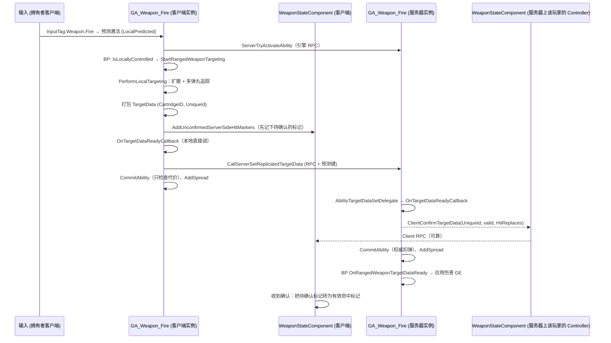

# 第 14 章　武器与射击：客户端检测、服务器确认、扩散与热度

## 一个问题：延迟 120 毫秒，你怎么打中一个正在奔跑的人？

想象一场联机对战。你的网络延迟是 120ms，对面的玩家正在横向冲刺。你把准星压在他身上，按下开火——

如果“打没打中”由服务器来判定，服务器看到的是什么？它收到你的开火请求时，已经过去了大约 60ms（单程），你屏幕上的敌人比服务器上的位置“旧”了一截。你瞄的是你眼前的他，服务器用的却是他“现在”的位置。结果是：你明明对准了，却什么都没打中。想要补救，你得学会“预判提前量”，而这在射击游戏里是灾难性的手感。

反过来，如果由客户端判定“我打中了”，再告诉服务器“请扣他的血”，手感就好了：你看到打中，就是打中。但代价是服务器要**相信客户端**。一个作弊者发送“我打中了地图另一头的人”，服务器如果照单全收，游戏就完了。

这一章讲 Lyra 在这道经典难题上做的选择，它的实现，以及它留下的安全缺口。顺带还会讲到射击手感里的另一半：连发越打越散、站着不动更准、霰弹枪一发九颗，这些都是怎么算的。

## 读完本章你能……

- 画出一次开火的时序：输入 → 本地追踪 → TargetData 发送 → 服务器回调 → 命中确认 → 扣弹药 → 应用伤害，并标出每一步在哪端执行；
- 解释热量（Heat）-扩散（Spread）模型里三条曲线和四个乘子的作用，并手算一个例子；
- 说出 `FLyraGameplayAbilityTargetData_SingleTargetHit` 比引擎版本多了什么、`CartridgeID` 和 `UniqueId` 分别有什么用；
- 指出原版服务器校验缺失的具体位置，并写出一个最小可用的服务器端校验；
- 在编辑器里调射速和扩散，借助 `lyra.Weapon.*` 变量把弹道画出来；
- 列出新增一把武器需要的所有资产，说出做投射物武器要改哪几处。

## 需要先知道的 UE 概念

### 命中扫描与投射物

**命中扫描（hitscan）**：开火的瞬间，沿一条射线（或扫掠的球体）在场景里做一次碰撞查询，命中谁就是谁，没有“子弹在飞”。步枪、手枪、霰弹枪在 Lyra 里都是这种。**投射物（projectile）**：开火时生成一个有速度的 Actor，它自己飞、自己碰撞（手雷、火箭筒）。两种的网络处理差别很大，本章主体讲前者，最后给投射物变体一份提纲。

### GAS 的 TargetData 与预测窗口

[第 9 章](09-GASConcepts.md) 讲过预测：客户端先做，服务器再确认。技能里“我瞄准了谁”这类信息叫做**目标数据（TargetData）**，类型是 `FGameplayAbilityTargetDataHandle`，里面装若干个目标数据对象（例如“一次命中，带一个 `FHitResult`”）。ASC 提供了现成的通道：客户端调用 `CallServerSetReplicatedTargetData`，把 TargetData 连同预测键通过 RPC 发给服务器；服务器上的同一个技能事先订阅了 `AbilityTargetDataSetDelegate`，数据一到，回调就被触发。你不用自己写 RPC，也不用处理预测键、技能结束时的清理。

### 曲线属性

`FRuntimeFloatCurve` 是可以在蓝图类默认值里直接编辑的曲线（X 轴是输入、Y 轴是输出）。本章的热量模型用三条这样的曲线，在运行时用 `Eval(x)` 求值。

## 一、武器的两层：状态在实例，行为在技能

回忆 [第 13 章](13-Inventory.md) 的结构：玩家装备武器时，会创建一个**装备实例**，同时授予一组**技能**。武器系统就是这两样东西的特化：

- `ULyraWeaponInstance` → `ULyraRangedWeaponInstance`：继承装备实例，存放武器的**状态和参数**（热量、扩散、射程、伤害衰减曲线……）；
- `ULyraGameplayAbility_RangedWeapon`：继承 `ULyraGameplayAbility_FromEquipment`，实现**行为**（本地追踪、发送 TargetData、服务器接收、扣弹药）；
- `ULyraWeaponStateComponent`：挂在 Controller 上，驱动扩散的每帧更新，管理命中标记。

还有一块重要的内容在蓝图里：`GA_Weapon_Fire`（`/Game/Weapons/`）继承自 `ULyraGameplayAbility_RangedWeapon`，各武器的 `GA_Weapon_Fire_Pistol`、`GA_Weapon_Fire_Rifle_Auto` 再继承它。**开火是 C++ 与蓝图四步接力完成的**，先记住这张分工表，后面读代码就不会迷路：

```
① C++ ActivateAbility（两端）        向 ASC 订阅 TargetData 回调，然后调 Super 进入蓝图事件
② BP Event ActivateAbility           判 IsLocallyControlled → 调 C++ StartRangedWeaponTargeting 做本地射线
③ C++ OnTargetDataReadyCallback      客户端发 RPC + 预测加热；服务器发命中确认 + 权威扣弹 + 调蓝图事件
④ BP OnRangedWeaponTargetDataReady   遍历命中，HasAuthority 时施加伤害 GE + 播 Cue，按 FireDelayTimeSecs 控制射速/连发
```

`ULyraWeaponInstance` 本身只做三件小事：记录装备/开火时间（`TimeLastEquipped`、`TimeLastFired`）；装备时激活手柄震动之类的设备属性（Epic 的《Upgrading the Lyra Starter Game》5.2 条目提到过：武器实例装备时可以给手柄附带设备属性，比如霰弹枪在 DualSense 上有更重的扳机阻力），卸下或死亡时撤销；按“外观标签”挑一个动画层（`PickBestAnimLayer`）。动画层的部分[第 17 章](17-AnimCosmeticsEffects.md)讲，这里只提一句：每把武器有自己的动画层 ABP（共同继承 `ABP_ItemAnimLayersBase`），`EquippedAnimSet` 是一张“外观标签 → 动画蓝图类”的选择表，比如 `Cosmetic.AnimationStyle.Feminine` 对应 `ABP_PistolAnimLayers_Feminine`；C++ 里没有任何地方调用 `PickBestAnimLayer`，而是由武器实例蓝图基类 `B_WeaponInstance_Base` 在 `OnEquipped` / `OnUnequipped` 里调用 `ActivateAnimLayerAndPlayPairedAnim` 选出动画层并挂到角色 Mesh 上。

## 二、热量与扩散：一把枪的“后坐力”怎么算

### 问题与朴素做法

你希望连发越打越散，停火后慢慢恢复；站着不动更准，蹲着更准，跳起来奇差，开镜更准。最直观的写法是：

```cpp
float Spread = BaseSpread;
if (bIsCrouching) Spread *= 0.8f;
if (bIsAiming)    Spread *= 0.7f;
if (bIsFalling)   Spread *= 2.0f;
Spread += ConsecutiveShots * 0.5f;     // 连发累加
```

问题有三个。切换是瞬间的：蹲下的一帧散布突然变小，画面里的准星会跳。连发累加没有恢复，要自己再写一套计时器。最后，策划想让“前几发散得慢、后面越来越散”或者“过热惩罚”，每一种曲线形状都要改代码。

### Lyra 的做法：一个“热量”变量加三条曲线

`ULyraRangedWeaponInstance` 抽象出一个叫 **热量（Heat）** 的标量，所有“越打越散”都是热量的函数：

```cpp
// 简化自 Source/LyraGame/Weapons/LyraRangedWeaponInstance.h
FRuntimeFloatCurve HeatToSpreadCurve;          // 热量 → 扩散角（度，是整个锥的直径）
FRuntimeFloatCurve HeatToHeatPerShotCurve;     // 当前热量 → 打一发要加多少热量
FRuntimeFloatCurve HeatToCoolDownPerSecondCurve; // 当前热量 → 每秒散掉多少热量
```

热量的合法范围（最小/最大）不单独配置，而是取三条曲线 X 轴范围的并集（`ComputeHeatRange`）。装备时：

```cpp
// 简化自 ULyraRangedWeaponInstance::OnEquipped
CurrentHeat = (MinHeatRange + MaxHeatRange) * 0.5f;                       // 热量从正中间开始
CurrentSpreadAngle = HeatToSpreadCurve.GetRichCurveConst()->Eval(CurrentHeat);
// 所有乘子复位为 1
```

每开一枪（成功提交技能代价之后）调用 `AddSpread`；每帧调用 `Tick` 里的 `UpdateSpread` 散热：

```cpp
// 简化自 ULyraRangedWeaponInstance::AddSpread
const float HeatPerShot = HeatToHeatPerShotCurve.GetRichCurveConst()->Eval(CurrentHeat);
CurrentHeat = ClampHeat(CurrentHeat + HeatPerShot);
CurrentSpreadAngle = HeatToSpreadCurve.GetRichCurveConst()->Eval(CurrentHeat);

// 简化自 ULyraRangedWeaponInstance::UpdateSpread（每帧）
const float TimeSinceFired = GetWorld()->TimeSince(LastFireTime);
if (TimeSinceFired > SpreadRecoveryCooldownDelay)          // 停火超过延迟后才开始散热
{
    const float CooldownRate = HeatToCoolDownPerSecondCurve.GetRichCurveConst()->Eval(CurrentHeat);
    CurrentHeat = ClampHeat(CurrentHeat - (CooldownRate * DeltaSeconds));
    CurrentSpreadAngle = HeatToSpreadCurve.GetRichCurveConst()->Eval(CurrentHeat);
}
```

用曲线而不是常数的好处是**形状可以任意**：每发加热的曲线是平的就是匀速变散，是陡的就是“过热惩罚”；散热曲线在高热量处变小就是“热了更难凉”。曲线的构造函数默认值是每发加热 1、每秒散热 2（只在曲线没被覆盖时生效）。

### 四个乘子：玩家状态怎么影响扩散

热量只解决“枪的状态”。“人的状态”由四个乘子处理，在 `UpdateMultipliers` 里每帧更新：

- 站定（`SpreadAngleMultiplier_StandingStill`）：速度不超过 `StandingStillSpeedThreshold`（默认 80 cm/s）时完全生效，速度超过 80 之后在 `StandingStillToMovingSpeedRange`（默认 20）内线性淡出到 1；
- 蹲伏（`SpreadAngleMultiplier_Crouching`）和跳跃/下落（`SpreadAngleMultiplier_JumpingOrFalling`）：目标值用 `FInterpTo` 平滑过渡，速度由 `TransitionRate_*` 决定，避免准星跳变；
- 开镜（`SpreadAngleMultiplier_Aiming`）：读取相机组件当前混合栈顶的标签，如果是 `Lyra.Weapon.SteadyAimingCamera`，就按该相机模式的混合权重在 1 和目标值之间插值（相机模式栈是第 16 章的内容）。

最终合成：

```cpp
// 简化自 ULyraRangedWeaponInstance::UpdateMultipliers
const float CombinedMultiplier = AimingMultiplier * StandingStillMultiplier * CrouchingMultiplier * JumpFallMultiplier;
CurrentSpreadAngleMultiplier = CombinedMultiplier;
```

还有一个“首发精准”的特例：如果 `bAllowFirstShotAccuracy` 打开，并且所有乘子都在目标值、热量也已降到最小，`bHasFirstShotAccuracy` 为真，`GetCalculatedSpreadAngleMultiplier()` 直接返回 0，也就是完美精度。

### 一个手算的例子

下面的数字是**为了演示编造的**，不是任何 Lyra 武器的真实参数。设一把枪：

- `HeatToSpreadCurve`：热量 0 对应 1°，热量 10 对应 5°，中间线性（所以热量范围是 [0, 10]，扩散 = 1 + 0.4 × 热量）；
- 每发加热 2，每秒散热 4；
- 站定乘子 0.6、开镜乘子 0.7、蹲伏 0.8、跳跃 2.0。

**装备时**：热量取中点 5，扩散角 1 + 0.4×5 = 3.0°。

**连续开火**。注意顺序：先用“当前”的扩散追踪，开枪成功之后才加热。

| 第几发 | 追踪时的基础扩散 | 开枪后的热量 |
|---|---|---|
| 第 1 发 | 3.0° | 7（扩散变 3.8°） |
| 第 2 发 | 3.8° | 9（扩散变 4.6°） |
| 第 3 发 | 4.6° | 11，被截断到 10（扩散 5.0°） |
| 第 4 发及以后 | 5.0° | 保持 10 |

如果是每秒 8 发左右的连射，每个间隔只能散热 4×0.125 = 0.5，而每发加 2，所以热量很快顶到上限 10，扩散稳定在 5.0°。停火后散热：10 → 5 需要 1.25 秒（扩散回到 3.0°），10 → 0 需要 2.5 秒（扩散回到 1.0°）。

**再套上乘子**。热量顶满（基础扩散 5.0°）时：

- 站定不开镜：5.0° × 0.6 = 3.0°，半角 1.5°。20 米（2000 cm）外落点圆的半径 = 2000 × tan(1.5°) ≈ 52 cm；
- 站定开镜：5.0° × (0.7×0.6) = 2.1°，半角 1.05°，半径约 37 cm；
- 跑动不开镜：乘子 1，5.0°，半角 2.5°，半径约 87 cm；
- 跳起来：5.0° × 2.0 = 10°，半角 5°，半径约 175 cm——差不多是一个人的身高，20 米外基本打不中。

追踪时 Lyra 把总扩散角取一半转成弧度，作为圆锥的半角：`ActualSpreadAngle = 基础扩散 × 乘子`，`HalfAngle = ActualSpreadAngle × 0.5`。

### 谁在每帧驱动它

武器实例是普通 UObject，没有 Tick。驱动者是挂在 **Controller** 上的 `ULyraWeaponStateComponent`：

```cpp
// 简化自 Source/LyraGame/Weapons/LyraWeaponStateComponent.cpp 的 TickComponent
if (APawn* Pawn = GetPawn<APawn>())
{
    if (ULyraEquipmentManagerComponent* EquipmentManager = Pawn->FindComponentByClass<ULyraEquipmentManagerComponent>())
    {
        if (ULyraRangedWeaponInstance* CurrentWeapon =
                Cast<ULyraRangedWeaponInstance>(EquipmentManager->GetFirstInstanceOfType(ULyraRangedWeaponInstance::StaticClass())))
        {
            CurrentWeapon->Tick(DeltaTime);          // 只驱动 Pawn 身上“第一把”远程武器
        }
    }
}
```

这带来两个事实。扩散状态在“本地控制的 Pawn”所在的机器上最有意义：在拥有者客户端上，Controller 在，Tick 在，射击的追踪也在这里发生。别的玩家在你机器上的 Pawn 没有 Controller，所以它们的武器实例不会更新扩散，也不应该用它。其次，Pawn 同时装备多把远程武器时，只有第一把会被 Tick。

### 一个原版缺陷：`SpreadRecoveryCooldownDelay` 实际无效

看上面 `UpdateSpread` 的判断 `TimeSince(LastFireTime) > SpreadRecoveryCooldownDelay`。全工程搜索 `LastFireTime`，只有两处：声明（初值 0.0）和这一处读取，**从来没有人给它赋值**。`ULyraWeaponInstance::UpdateFiringTime` 写的是另一个私有变量 `TimeLastFired`。结果是 `TimeSince(0)` 等于当前世界时间，只要游戏运行的时间超过延迟，条件就永远成立，“停火后等一会再散热”的设置不生效。

如果你需要这个功能，在 `AddSpread` 里补一行 `LastFireTime = GetWorld()->GetTimeSeconds();` 就可以。这是“看到参数名但改了没效果”的典型陷阱，调手感前先确认你调的参数真的有人读。

## 三、一发子弹怎么追踪

现在进入技能。`ULyraGameplayAbility_RangedWeapon` 在本地做的第一件事是确定射线起点和方向：

```cpp
// 简化自 ULyraGameplayAbility_RangedWeapon::PerformLocalTargeting
APawn* const AvatarPawn = Cast<APawn>(GetAvatarActorFromActorInfo());
ULyraRangedWeaponInstance* WeaponData = GetWeaponInstance();
if (AvatarPawn && AvatarPawn->IsLocallyControlled() && WeaponData)    // 只有本地控制者才追踪（含服务器上的 AI）
{
    // 起点基于相机视线，并前推到角色所在平面：保证“准星指哪打哪”且不打中背后物体
    const FTransform TargetTransform = GetTargetingTransform(AvatarPawn, ELyraAbilityTargetingSource::CameraTowardsFocus);
    InputData.AimDir = TargetTransform.GetUnitAxis(EAxis::X);
    InputData.StartTrace = TargetTransform.GetTranslation();
    TraceBulletsInCartridge(InputData, /*out*/ OutHits);
}
```

`IsLocallyControlled` 这个判断很关键：它保证追踪只在“拿着这个 Pawn 的那台机器”上进行。玩家的 Pawn 在拥有者客户端上是本地控制的；机器人的 Pawn 在服务器上是本地控制的（所以机器人在服务器上自己追踪）；服务器上别人玩家的 Pawn 不是，所以服务器在处理远端客户端的开火时**不会自己追踪**。

起点基于相机而不是枪口，是故意的：枪口可能偏在一侧，沿相机视线出发才能保证屏幕中心的准星和落点一致。但第三人称相机悬在角色身后两三米，如果直接从相机坐标打射线，会把玩家后背和相机之间的柱子打中；所以 `GetTargetingTransform` 先取相机位置和朝向 `AimDir`，再沿 `AimDir` 把起点前推到与 Pawn 平齐的平面上（`CamLoc = FocalLoc + (((WeaponLoc - FocalLoc) | AimDir) * AimDir)`）。代价是角色正脸贴死薄墙射击时，前推后的起点可能探到墙的另一侧，源码里留着 `@TODO`。另外，`ELyraAbilityTargetingSource` 枚举里虽然预留了 `WeaponTowardsFocus` 等选项，但 `GetWeaponTargetingSourceLocation` 目前只返回 Pawn 的位置，还没有读取真正的枪口插槽。

然后对一发“弹壳（cartridge）”里的每颗弹丸分别追踪：

```cpp
// 简化自 ULyraGameplayAbility_RangedWeapon::TraceBulletsInCartridge
for (int32 BulletIndex = 0; BulletIndex < WeaponData->GetBulletsPerCartridge(); ++BulletIndex)
{
    const float ActualSpreadAngle = WeaponData->GetCalculatedSpreadAngle() * WeaponData->GetCalculatedSpreadAngleMultiplier();
    const float HalfSpreadAngleInRadians = FMath::DegreesToRadians(ActualSpreadAngle * 0.5f);

    // 在圆锥里随机一个方向；SpreadExponent 越大越向中心聚集
    const FVector BulletDir = VRandConeNormalDistribution(InputData.AimDir, HalfSpreadAngleInRadians, WeaponData->GetSpreadExponent());
    const FVector EndTrace = InputData.StartTrace + (BulletDir * WeaponData->GetMaxDamageRange());

    FHitResult Impact = DoSingleBulletTrace(InputData.StartTrace, EndTrace, WeaponData->GetBulletTraceSweepRadius(), false, AllImpacts);
    // ……把命中加入 OutHits；没命中也要塞一个“打到射程尽头”的假命中，供弹道特效用
}
```

`VRandConeNormalDistribution` 把圆锥想成两次旋转：一次“远离中心线”（角度 = `Pow(FRand(), Exponent) × 半角`），一次“绕中心线转圈”（随机 0–360°）。指数是 1 时，偏离角在 [0, 半角] 内均匀分布，落点在平面上会比较集中于中心（因为同样的角度范围，靠近中心的圆环面积小）；指数 > 1 时更集中。

`DoSingleBulletTrace` 先做一次**射线**，如果没打到任何 Pawn 且 `BulletTraceSweepRadius > 0`，再做一次**球形扫掠**作为“宽容命中”。扫掠结果只在“扫掠到的 Pawn 之前没有被射线已经确认的阻挡物挡住”时才采用，避免子弹隔着墙打到人。碰撞通道是专用的 `Lyra_TraceChannel_Weapon`；`LyraPawnMesh` 碰撞预设对它阻挡，所以子弹打到的是有物理材质的骨骼 Mesh（能区分头部/躯干），而不是胶囊体。

### 霰弹枪：一发多颗

`BulletsPerCartridge` 就是“一发子弹里有几颗弹丸”。霰弹枪 `B_WeaponInstance_Shotgun` 把它设成 `9`，每颗弹丸各自走一遍上面的循环，各自随机一个方向；`GE_Damage_Shotgun` 里每颗弹丸基础伤害 `12`（弱点倍率 `1.75x`，射速间隔 `0.5` 秒），贴脸全中可达上百点伤害，扩散更大、射程更短。同一发的所有弹丸共享一个 `CartridgeID`，下一节解释它有什么用。

## 四、客户端追踪，服务器信任：TargetData 的旅程

### 全流程



### 客户端：打包

```cpp
// 简化自 ULyraGameplayAbility_RangedWeapon::StartRangedWeaponTargeting
TArray<FHitResult> FoundHits;
PerformLocalTargeting(/*out*/ FoundHits);                   // 本地追踪

FGameplayAbilityTargetDataHandle TargetData;
TargetData.UniqueId = WeaponStateComponent ? WeaponStateComponent->GetUnconfirmedServerSideHitMarkerCount() : 0;

const int32 CartridgeID = FMath::Rand();                    // 同一发的弹丸共享这个随机数
for (const FHitResult& FoundHit : FoundHits)
{
    FLyraGameplayAbilityTargetData_SingleTargetHit* NewTargetData = new FLyraGameplayAbilityTargetData_SingleTargetHit();
    NewTargetData->HitResult = FoundHit;                    // 客户端说“我打中了这个”
    NewTargetData->CartridgeID = CartridgeID;
    TargetData.Add(NewTargetData);
}

WeaponStateComponent->AddUnconfirmedServerSideHitMarkers(TargetData, FoundHits);   // 先登记待确认的命中标记
OnTargetDataReadyCallback(TargetData, FGameplayTag());      // 本地立刻处理，不等任何网络
```

`FLyraGameplayAbilityTargetData_SingleTargetHit` 是引擎 `FGameplayAbilityTargetData_SingleTargetHit` 的子类，只多了一个 `int32 CartridgeID`，并重写了 `NetSerialize`（把它序列化进去）和 `AddTargetDataToContext`（把它写进伤害的效果上下文，`FLyraGameplayEffectContext` 里有同名字段）。它的意义是让伤害侧能识别“这几次命中其实是同一发霰弹”；在原版代码里，C++ 没有哪处读取 `CartridgeID`，它是留给蓝图和你自己的统计逻辑（比如“一发霰弹打中三个人”算一次多杀）的接口。

`UniqueId` 则属于 `FGameplayAbilityTargetDataHandle`，用来配对“客户端记下的待确认标记批次”和“服务器回来的确认”。

### 回调：客户端和服务器共用的一个函数

最有意思的是，`OnTargetDataReadyCallback` 是**同一个函数**，客户端在本地调用一次，服务器在收到 RPC 后再调用一次，函数里靠角色判断走不同分支：

```cpp
// 简化自 ULyraGameplayAbility_RangedWeapon::OnTargetDataReadyCallback
FScopedPredictionWindow ScopedPrediction(MyAbilityComponent);
FGameplayAbilityTargetDataHandle LocalTargetDataHandle(MoveTemp(const_cast<FGameplayAbilityTargetDataHandle&>(InData)));

// ① 本地控制且不是权威端：把数据发给服务器
const bool bShouldNotifyServer = CurrentActorInfo->IsLocallyControlled() && !CurrentActorInfo->IsNetAuthority();
if (bShouldNotifyServer)
{
    MyAbilityComponent->CallServerSetReplicatedTargetData(CurrentSpecHandle, CurrentActivationInfo.GetActivationPredictionKey(),
                                                          LocalTargetDataHandle, ApplicationTag, MyAbilityComponent->ScopedPredictionKey);
}

const bool bIsTargetDataValid = true;     // ← 服务器校验本应发生的地方，原版写死为 true

#if WITH_SERVER_CODE
// ② 权威端：确认命中标记
if (Controller->GetLocalRole() == ROLE_Authority)
{
    // 收集“被替换”的命中索引 HitReplaces
    WeaponStateComponent->ClientConfirmTargetData(LocalTargetDataHandle.UniqueId, bIsTargetDataValid, HitReplaces);
}
#endif

// ③ 两端都做：提交技能（扣代价）、加热、让蓝图应用效果
if (bIsTargetDataValid && CommitAbility(CurrentSpecHandle, CurrentActorInfo, CurrentActivationInfo))
{
    WeaponData->AddSpread();
    OnRangedWeaponTargetDataReady(LocalTargetDataHandle);   // BlueprintImplementableEvent
}
else
{
    K2_EndAbility();
}
```

分支①的条件是 `IsLocallyControlled && !IsNetAuthority`：纯客户端上的本地玩家。分支②只在权威端：专用服务器上收到客户端 RPC 之后，或者主机服务器（Listen Server）上房主自己开火时。分支③在两端都跑，所以 `CommitAbility` 和 `AddSpread` 在客户端也会预测地执行。

客户端的 `CommitAbility` 实际上只**检查**代价能不能付（`CheckCost`），不扣。`ULyraAbilityCost_ItemTagStack::ApplyCost` 里有一句 `if (ActorInfo->IsNetAuthority())`，所以真正的扣弹药只在权威端发生，客户端的弹药数是等服务器复制回来才减少的。这意味着 HUD 上的弹药数会比开火晚一个往返；Lyra 选择了“权威”而不是“预测”。

### 服务器：它到底验证了什么

回头看那一行 `const bool bIsTargetDataValid = true;`。它的含义是：只要客户端把 TargetData 发过来，服务器就认为这次射击有效，然后确认命中标记、扣弹药、让蓝图去应用伤害。服务器**不重新追踪**，不检查射程、起点是否在玩家附近、是否隔墙，也不检查两次开火的间隔。实际约束只有：

- 技能能不能激活（`CanActivateAbility`，包括 `Ability.Weapon.NoFiring` 这类阻挡标签、代价检查）；
- `CommitAbility` 的弹药代价；
- 蓝图 `GA_Weapon_Fire` 里用 `SetTimerByEvent` 按 `FireDelayTimeSecs` 控制射速与连发循环，但那是技能自己的计时节奏；C++ 在 TargetData 到达时并不检查它和上一发的时间间隔，所以一个绕过正常开火流程、直接发送数据的恶意客户端不受这层蓝图计时器约束；
- 伤害执行里的队伍许可判断（友军不能互伤，第 15 章）。

一个作弊的客户端因此可以：把 `HitResult` 里的命中 Actor 填成地图另一头的人、把 `TraceStart` 填在人家脸上、在子弹耗尽前以任意频率发送数据。这就是 [第 12 章](12-DamageAndDeath.md) 里你已经见过的“信任客户端”问题在射击里的具体位置。本章后面会给一个可用的校验配方。

不过先要看清一件事：这在 Lyra 里是一个**设计选择还是疏忽**，需要分开说。能确定的事实有两个：一，源码里 `bProjectileWeapon` 这个局部变量和 `bIsTargetDataValid` 的位置都写好了，校验的“槽位”是留出来的，但没有实现；二，整个工程里没有任何地方调用 `ReplaceHitWith`（引擎 `FGameplayAbilityTargetData_SingleTargetHit` 上用来“让服务器纠正命中”的接口），所以服务器永远不会改写客户端的命中。至于**为什么**这样做，Epic 官方没有任何说明；本书认为这是示例工程为了演示“客户端权威命中 + GAS 的 TargetData 通道”而做的简化，但这一点只是**（推断）**。

社区的说法可以做旁证（不是官方立场）：Epic 论坛上一个讨论这件事的帖子（《Is Lyra doing bullet hit detection incorrectly/incompletely?》，2024-02）里，楼主逐步追踪出和上面一样的结论，有回复者称这是已知的“客户端权威”设计、Epic 的视频里明说过，并提到视频里说“代码某处有注释说想做服务器校验就在这里做”——但回复者自己也没能在代码里找到这条注释，我们的 5.8 源码里同样没有，所以请不要把它当作“代码里有这样的注释”来引用。SnapNet 的博客同样写道：UE 本身不提供延迟补偿，许多游戏（包括 ShooterGame 和 Lyra）使用客户端权威的命中判定。tranek 的 GASDocumentation 则给出了一般性建议：把 TargetData 发给服务器时，应该在服务器上做合理性校验以防作弊（同时指出 Fortnite 的做法是把激活、TargetData、结束合并成一个专用 RPC）。

无论动机如何，对你的项目而言结论一致：`bIsTargetDataValid = true` 是**已知的原版缺陷，不要依赖它**。你要上线一个竞技游戏，这是必须补的课。

## 五、命中确认与命中标记

命中标记（HitMarker）是玩家打中人时准星上出现的那个小 X。它为什么要经过服务器确认，而不是本地一命中就显示？

最直观的做法是本地追踪到一个敌人就立刻亮标记。问题是：客户端看到的“敌人”可能其实已经死了，或者因为各种原因伤害没生效，你满屏都是“命中”，实际敌人一滴血没掉，玩家会怀疑游戏是不是坏了。

Lyra 的做法是两段式：

1. 本地开火时调用 `AddUnconfirmedServerSideHitMarkers`：把每个命中点用 `ProjectWorldToScreen` 投影成屏幕坐标，连同“按队伍规则这次命中算不算成功”（`ShouldShowHitAsSuccess` 调用 `ULyraTeamSubsystem::CanCauseDamage`，对敌人才是成功，友军和自己不是）一起存成一个**待确认批次**，批次的 ID 就是 TargetData 的 `UniqueId`；
2. 服务器处理 TargetData 时调用 `ClientConfirmTargetData`，它是 `UFUNCTION(Client, Reliable)`；客户端收到后按 `UniqueId` 找到批次，如果 `bSuccess` 为真，才把批次里 `bShowAsSuccess` 的那些点加进 `LastWeaponDamageScreenLocations`，并更新“上次造成伤害的时间”。准星上的命中标记控件每帧读这些位置绘制。

```cpp
// 简化自 ULyraWeaponStateComponent::ClientConfirmTargetData_Implementation
for (int i = 0; i < UnconfirmedServerSideHitMarkers.Num(); i++)
{
    FLyraServerSideHitMarkerBatch& Batch = UnconfirmedServerSideHitMarkers[i];
    if (Batch.UniqueId == UniqueId)                          // 按 UniqueId 配对
    {
        if (bSuccess && (HitReplaces.Num() != Batch.Markers.Num()))
        {
            for (const FLyraScreenSpaceHitLocation& Entry : Batch.Markers)
            {
                if (!HitReplaces.Contains(HitLocationIndex) && Entry.bShowAsSuccess)
                {
                    ActuallyUpdateDamageInstigatedTime();    // 距上次 > 0.1s 就清空旧位置，重新累积
                    LastWeaponDamageScreenLocations.Add(Entry);
                }
            }
        }
        UnconfirmedServerSideHitMarkers.RemoveAt(i);
        break;
    }
}
```

为什么 `ULyraWeaponStateComponent` 放在 Controller 上，而不是武器实例上？下面的理由是从代码结构推出来的（推断，官方没有说明）：需要一个“每个玩家一份、换枪也不丢”的地方存待确认批次，换枪时武器实例被销毁，迟到的确认包就找不到批次了；更重要的是 Client RPC 只能由被该玩家拥有的 Actor 发送，武器实例是普通 UObject，没有 RPC 能力；Controller 只存在于服务器和拥有者客户端，所以也不会为每个模拟代理都 Tick 武器。

几个值得知道的小细节：

- 注意顺序：服务器是先 `ClientConfirmTargetData` 再 `CommitAbility`。所以当玩家弹药已空、Commit 失败时，确认包已经发出去了，命中标记依然可能亮，只是伤害不会应用（因为 `OnRangedWeaponTargetDataReady` 不会被调用）。命中标记表示“服务器收下了你的数据且按队伍规则你有权伤害对方”，**不等于对方真的掉血了**；
- `UniqueId` 其实是“当前待确认批次的数量”，不是单调递增序号；批次结构体里存成 `uint8`，而 RPC 参数是 `uint16`。高射速加上确认乱序时，ID 可能重复，匹配到错误的批次。影响的只有 UI 标记，不影响伤害；
- 屏幕外的命中点 `ProjectWorldToScreen` 会失败，被直接跳过，没有标记。

## 六、伤害在哪里应用

回到服务器上的分支③：`CommitAbility` 成功后，C++ 调用的是 `OnRangedWeaponTargetDataReady`，一个 `BlueprintImplementableEvent`。**伤害完全由蓝图施加。** 打开 `/Game/Weapons/GA_Weapon_Fire` 的 Event Graph 可以看到完整连线：`Event ActivateAbility` 先检查 `IsLocallyControlled`，为真才调用 `StartRangedWeaponTargeting`；`Event OnRangedWeaponTargetDataReady` 遍历 TargetData 里的每个命中，在 `HasAuthority` 为真时调用 `ApplyGameplayEffectToTarget` 施加该武器的伤害 GE（如手枪 `18`、步枪 `12`），接着触发开火与受击的 GameplayCue，最后用 `SetTimerByEvent` 按 `FireDelayTimeSecs`（和连发 `AutoRate`）等待下一发或结束技能。

这个分工看起来是有意的（推断，源码和官方都没有明说）：C++ 里写“怎么追踪、怎么发送、怎么确认”这些**所有武器共通**的骨架；而射速、动画、特效、伤害数值这些**因武器而异**的东西全部留在蓝图和数据里。

伤害效果走的是 [第 12 章](12-DamageAndDeath.md) 讲过的 `ULyraDamageExecution`：

```
DamageDone = max(BaseDamage × 距离衰减 × 物理材质衰减 × 队伍许可(0或1), 0)
```

“距离衰减”和“物理材质衰减”从哪里来？来自 [第 13 章](13-Inventory.md) 末尾提到的那根线：技能的 `SourceObject` 是武器实例，`ULyraRangedWeaponInstance` 实现了 `ILyraAbilitySourceInterface`：

```cpp
// 简化自 ULyraRangedWeaponInstance
float GetDistanceAttenuation(float Distance, ...) const
{
    const FRichCurve* Curve = DistanceDamageFalloff.GetRichCurveConst();
    return Curve->HasAnyData() ? Curve->Eval(Distance) : 1.0f;     // 曲线 X 是厘米，Y 是倍率；没数据就恒为 1
}

float GetPhysicalMaterialAttenuation(const UPhysicalMaterial* PhysicalMaterial, ...) const
{
    float CombinedMultiplier = 1.0f;
    if (const UPhysicalMaterialWithTags* PhysMatWithTags = Cast<const UPhysicalMaterialWithTags>(PhysicalMaterial))
    {
        for (const FGameplayTag MaterialTag : PhysMatWithTags->Tags)
        {
            if (const float* pTagMultiplier = MaterialDamageMultiplier.Find(MaterialTag))
            {
                CombinedMultiplier *= *pTagMultiplier;       // 多个命中的 Tag，倍率相乘
            }
        }
    }
    return CombinedMultiplier;
}
```

爆头加成就是这么做的：头部骨骼的物理材质是 `UPhysicalMaterialWithTags`，带 `Gameplay.Zone.WeakSpot` 标签，武器实例的 `MaterialDamageMultiplier` 里这个标签对应一个倍率（比如 2.0）。**同一个“距离”还有一点值得提防**：衰减用的距离在 `ULyraDamageExecution` 里由效果上下文的原点（有的话）或者效果施加者的位置，与 `HitResult.ImpactPoint` 算出，而 `ImpactPoint` 来自客户端。作弊客户端可以谎报命中点来规避衰减，这是下面校验配方要覆盖的点之一。

## 七、服务器校验配方：把 `bIsTargetDataValid` 补上

好消息是，原版代码已经把管道铺好了：`bIsTargetDataValid` 为假时，`ClientConfirmTargetData` 会收到失败、`CommitAbility` 会被跳过、技能会被结束。你只需要在服务器上把这个变量算对。

下面是一个**最小可用**的实现思路。它不做延迟补偿（lag compensation，把目标倒回客户端开火时的位置再判定），所以判定必须“宽进”，主要拦截明显的作弊，而不是追求像素级精确。

第一步，在技能类里新增一个校验函数（头文件里在 `protected:` 下声明）：

```cpp
// 新增到 LyraGameplayAbility_RangedWeapon.cpp
bool ULyraGameplayAbility_RangedWeapon::ValidateTargetDataOnServer(const FGameplayAbilityTargetDataHandle& Data) const
{
    const APawn* Pawn = Cast<APawn>(GetAvatarActorFromActorInfo());
    const ULyraRangedWeaponInstance* Weapon = GetWeaponInstance();
    if (!Pawn || !Weapon) { return false; }

    // 以下三个阈值请按你的游戏调整
    const float MaxStartDrift = 500.f;          // 追踪起点（相机）离 Pawn 的最远合理距离，第三人称相机臂要算进去
    const float RangeSlack    = 100.f;          // 射程容差
    const int32 MaxHitsPerCartridge = Weapon->GetBulletsPerCartridge() * 8;   // 每颗弹丸可能穿过多个目标，给个宽松上限

    if (Data.Num() > MaxHitsPerCartridge) { return false; }

    for (int32 i = 0; i < Data.Num(); ++i)
    {
        const FGameplayAbilityTargetData* Raw = Data.Get(i);
        if (!Raw || !Raw->HasHitResult()) { return false; }
        const FHitResult* Hit = Raw->GetHitResult();

        // 1) 起点必须在玩家附近：防止“隔空开枪”
        if (FVector::Dist(Hit->TraceStart, Pawn->GetActorLocation()) > MaxStartDrift) { return false; }

        // 2) 命中点不能超出射程
        if (FVector::Dist(Hit->TraceStart, Hit->ImpactPoint) > Weapon->GetMaxDamageRange() + RangeSlack) { return false; }

        // 3) 服务器重新从起点打一条线到命中点：如果中途被“非 Pawn”的静态物挡住，就是穿墙
        FHitResult Check;
        FCollisionQueryParams Params(SCENE_QUERY_STAT(ServerValidateShot), /*bTraceComplex=*/ true, Pawn);
        const FVector Dir = (Hit->ImpactPoint - Hit->TraceStart).GetSafeNormal();
        const FVector End = Hit->ImpactPoint - Dir * 50.f;      // 留出一点余量，避免目标本身挡住自己
        if (GetWorld()->LineTraceSingleByChannel(Check, Hit->TraceStart, End, Lyra_TraceChannel_Weapon, Params))
        {
            if (!Cast<APawn>(Check.GetActor())) { return false; }
        }
    }
    return true;
}
```

第二步，在 `OnTargetDataReadyCallback` 里把那一行写死的 `true` 换成真正的计算，**只在服务器上**：

```cpp
// 替换 const bool bIsTargetDataValid = true;
bool bIsTargetDataValid = true;
#if WITH_SERVER_CODE
if (CurrentActorInfo->IsNetAuthority())
{
    bIsTargetDataValid = ValidateTargetDataOnServer(LocalTargetDataHandle);
    if (!bIsTargetDataValid)
    {
        UE_LOG(LogLyraAbilitySystem, Warning, TEXT("Rejected suspicious weapon target data from %s"), *GetNameSafe(GetAvatarActorFromActorInfo()));
    }
}
#endif
```

后面的分支原样适用：失败时 `ClientConfirmTargetData(UniqueId, false, ...)`，`bIsTargetDataValid && CommitAbility(...)` 为假，进入 `K2_EndAbility()`。

第三步，如果你还想限制射速，在武器实例里加一个仅服务器使用的 `LastAcceptedShotTime`，每次校验通过后记录时间，下一次到达的间隔小于配置射速的 80% 就判无效。射速参数现在在蓝图里（`FireDelayTimeSecs`），你需要把它暴露给 C++。

要提醒你几件事：移动的目标需要延迟补偿才能做到精确判定，没有它，上面第 3 条只拦截“被静态物挡住”的情况，故意不去判断目标 Pawn 的位置是否吻合；`MaxStartDrift` 要覆盖你所有相机模式的最远距离；AI 机器人在服务器上走同一条路径，起点在眼睛高度附近，会通过校验。

## 动手实验

### 实验 1：改射速和扩散

**目标**：亲手改两类参数，分清“节奏”由谁决定、“散布”由谁决定。

**步骤**：

1. 打开 ShooterCore 插件内容 `Weapons/Rifle/GA_Weapon_Fire_Rifle_Auto`，在类默认值里找 `Fire Delay Time Secs`（默认 `0.12` 秒）和 `Auto Rate`。
2. 打开同目录下的 `B_WeaponInstance_Rifle`，在类默认值里找 `Heat To Spread Curve`、`Heat To Heat Per Shot Curve`、`Heat To Cool Down Per Second Curve`、`Spread Angle Multiplier_*`、`Bullets Per Cartridge`。

**先写下你的预测**：把 `Fire Delay Time Secs` 从 0.12 改到 0.4，射速会怎么变？扩散会变吗？再把 `Heat To Heat Per Shot Curve` 的值调大三倍呢？

3. 先只改射速：把 `Fire Delay Time Secs` 改成 0.4，编译，运行 PIE，用步枪连续射击一面墙。再把它改回来。
4. 再改扩散：把 `Heat To Heat Per Shot Curve` 的值调大三倍，编译，运行 PIE 连射。

**预期结果**：改射速后每秒发数明显减少，但单发的散布范围没有变化；调大每发加热后，扩散角很快到达上限，连射的弹着点迅速变成一大片。

**原理**：射速由技能（行为）决定，扩散由武器实例（状态）决定，这是前面“两层”的直接体现。PIE 使用编辑器内存里的版本，实验结束后不保存直接还原即可，不需要提交任何资产改动。

### 实验 2：把弹道画出来

**目标**：用 Lyra 自带的调试变量直接看到扩散锥和乘子的效果。

**步骤**：

1. 运行 PIE，打开控制台，输入：
   - `lyra.Weapon.DrawBulletTraceDuration 5`：画出每发子弹的追踪线，持续 5 秒；
   - `lyra.Weapon.DrawBulletHitDuration 5`：在冲击点画红点；
   - `lyra.Weapon.DrawBulletHitRadius 6`：冲击点的大小（厘米）。

   这三个变量在 `LyraGameplayAbility_RangedWeapon.cpp` 里定义，同时也映射到 `编辑 → 编辑器偏好设置 → LyraStarterGame → Lyra Weapon Debug Settings`（`ULyraWeaponDebugSettings`）中，可以直接在界面勾选。
2. 对一面远处的墙，依次做四次射击：站定单发、站定连发 20 发、边跑边连发 20 发、跳起来连发。

**先写下你的预测**：四种情况下弹着点的范围大小排序是什么？站定连发时，第一发和第二十发谁更集中？

**预期结果**：排序大致是 站定单发 < 站定连发 < 跑动连发 < 跳跃连发。站定连发的前几发弹着点还挤在中心，随着热量上升，后面的散得越来越开，直到顶到上限后范围不再扩大。

**原理**：这就是热量曲线和乘子的组合：连发抬高热量，跑动取消站定乘子，跳起来触发 `JumpingOrFalling` 乘子。

**一个小细节**：源码里画冲击点的那行把 `DrawBulletHitRadius` 同时当成了“点大小”和“持续时间”传入，所以红点总是显示 `DrawBulletHitRadius` 秒，而不是 `DrawBulletHitDuration` 秒；`DrawBulletHitDuration` 只充当“是否开启”的开关。这是个无伤大雅的小笔误，看到现象不一致别怀疑自己。

### 实验 3：命中标记比火光慢一个往返

**目标**：亲眼看到“命中标记需要服务器确认”。

**步骤**：

1. 网络模式选“以客户端运行（Play As Client）”，玩家数 2，运行 PIE。
2. 在客户端窗口的控制台输入 `NetEmulation.PktLag 200`（200 毫秒的包延迟；也可以用编辑器多人游戏选项里的网络模拟）。
3. 对着一个机器人或另一个窗口的玩家开枪。

**先写下你的预测**：枪口火光、命中标记各在什么时候出现？

**预期结果**：枪口火光这类由技能在本地触发的表现通常立刻出现（请以实际观察为准），命中标记则比开火晚了大约一个往返延迟（几百毫秒）。

4. 把延迟改回 0：`NetEmulation.PktLag 0`。

**原理**：命中标记只在 `ClientConfirmTargetData` 到达后才被加入显示列表，而这个 RPC 要等服务器收到 TargetData 之后才发出。

### 实验 4（配方）：新增一把武器

**目标**：不写 C++，加一把“Rifle2”。下面的清单对照 ShooterCore 的 `Weapons/Rifle` 目录，在内容浏览器里复制整套资产再改。

1. 武器实例：复制 `B_WeaponInstance_Rifle` 为 `B_WeaponInstance_Rifle2`，调三条曲线、乘子、`MaxDamageRange`、`DistanceDamageFalloff`、`MaterialDamageMultiplier`、`EquippedAnimSet`。
2. 外观 Actor：复制 `B_Rifle` 为 `B_Rifle2`，换网格，检查它是可复制的（Replicates）。
3. 开火技能：复制 `GA_Weapon_Fire_Rifle_Auto` 为 `GA_Weapon_Fire_Rifle2`，改 `FireDelayTimeSecs`、`Additional Costs`（`ULyraAbilityCost_ItemTagStack`，Tag 用 `Lyra.ShooterGame.Weapon.MagazineAmmo`）、蒙太奇、GameplayCue 标签。换弹技能复制 `GA_Weapon_Reload_Rifle`。
4. 伤害效果：复制 `GE_Damage_RifleAuto`，在 Executions 里改 `BaseDamage`。注意步枪的 GE 在 ShooterCore 里，手枪的在 `/Game/Weapons/Pistol`。
5. AbilitySet：复制 `AbilitySet_ShooterRifle`，把上面的技能换进去，保持 `InputTag.Weapon.FireAuto` / `InputTag.Weapon.Reload`，这样不用改输入映射。
6. 装备定义：复制 `WID_Rifle`，`InstanceType` / `AbilitySetsToGrant` / `ActorsToSpawn`（插槽 `weapon_r`）换成新的。
7. 物品定义：复制 `ID_Rifle`，`EquippableItem` 指向新的 `WID`，`SetStats` 设弹匣/备弹初值，图标和准星（`W_Reticle_Rifle2`、`W_AmmoCounter_Rifle2`）按需复制。
8. 拾取：复制 `WeaponPickupData_Rifle`，指向新的 `ID`；地图里放 `B_WeaponSpawner`，设置 `Weapon Definition`。
9. 验证：用实验 2 的变量看弹道；再在场景里放一个靶子 `B_ShootingTarget`（`ALyraCharacterWithAbilities` 子类，ASC 挂在自己身上），给它加上 `LyraDamageLogDebuggerComponent`。对着靶子连射几枪后**停火等待 1 秒**（`SecondsBetweenDamageBeforeLogging` 默认 1.0 秒），输出日志的 `LogLyra` 分类就会打印这段连射的命中次数、帧间隔和 DPS 汇总（注意组件内部只匹配 `Payload.Target == GetOwner()`，普通玩家角色的 `Target` 是 `PlayerState`，挂在玩家 Pawn 上不会触发；另外原版代码累加的是 `-Payload.Magnitude`，所以日志里的总伤害和 DPS 带负号，属正常现象）。

整个过程**没有一行 C++**，武器完全是数据，这就是第 13 章那条资产链带来的回报。GameplayCue 资产要放在 GameFeature 数据资产的 `AddGameplayCuePath` 覆盖的目录（ShooterCore 是 `/Weapons` 等）里才会被找到。

### 投射物武器：提纲

投射物（火箭筒、手雷）无法复用上面这条路径，因为投射物在开火时还不存在“命中”。思路是：

1. 新技能继承 `ULyraGameplayAbility_FromEquipment`（拿到弹药和武器实例），或者继承 `ULyraGameplayAbility_RangedWeapon` 复用 `GetTargetingTransform`、`GetWeaponInstance()` 等 protected 工具；
2. 服务器用 `SpawnActorDeferred` 生成投射物 Actor，把 **Instigator**（不是 Owner）设成发射者 Pawn，这样 `ULyraTeamSubsystem::FindTeamFromObject` 才能通过 Instigator 找到队伍（第 15 章）；
3. 投射物在服务器命中时对目标应用伤害 GE，`EffectCauser` 设为投射物；
4. 命中标记：投射物发射时无法确认，可以在服务器命中后对发射者的 `ULyraWeaponStateComponent` 调 `UpdateDamageInstigatedTime(EffectContext)`（public）；
5. 弹药扣除同样走 `ULyraAbilityCost_ItemTagStack`。

ShooterCore 里的手雷（`Weapons/Grenade`，含 `GE_Damage_Grenade`、`Curve_GrenadeDamage`）就是这样的蓝图实现，可以作为参照。

## 常见误区

**误区 1：以为服务器会重新追踪来验证命中。**
它不会，`bIsTargetDataValid` 被写死为 true。需要反作弊就按上一节补校验，并明白没有延迟补偿的校验只能拦明显作弊。

**误区 2：改了 `SpreadRecoveryCooldownDelay` 却没有效果。**
`LastFireTime` 从未被赋值，这个延迟不生效。先修复再调参。

**误区 3：把扩散看成每把枪一个固定数。**
扩散是状态（热量）加上人的状态（乘子）的合成结果，只在本地控制的 Pawn 所在机器上有意义；服务器上的数值与客户端不一致，也不参与服务器侧的命中判定。

**误区 4：以为命中标记亮了就代表敌人掉血了。**
确认在 `CommitAbility` 之前发出，只代表服务器收下了数据且队伍规则允许伤害，与伤害 GE 是否真的施加（比如对方无敌）没有关系。

**误区 5：在 `GA_Weapon_Fire` 的蓝图里去掉 `IsLocallyControlled` 的分支。**
`PerformLocalTargeting` 在非本地控制的机器上返回空，服务器上若仍调用 `StartRangedWeaponTargeting`，会拿一份空 TargetData 走一遍回调，白白提交一次技能（扣一发弹药）并加一次热量。改这个蓝图时务必保留该分支。

**误区 6：想重写 `Tick` 或 `AddSpread` 做新的扩散模型，直接继承就好。**
`AddSpread` 和 `Tick` 在 `ULyraRangedWeaponInstance` 里**不是 `virtual`**，子类重写不会生效，需要先改基类签名。

**误区 7：在 C++ 里找“施加伤害”的代码。**
没有。伤害由 `GA_Weapon_Fire` 蓝图在 `OnRangedWeaponTargetDataReady` 里施加。想改伤害公式去 `ULyraDamageExecution`，想改数值去 `GE_Damage_*`。

## 本章小结

射击的核心矛盾是“手感”和“可信”。Lyra 的代码走的是手感优先：**客户端追踪，服务器信任**（社区也把它描述为客户端权威的命中判定；官方没有解释动机）。本地控制的玩家根据武器实例当前的扩散（热量曲线 × 四个状态乘子）在圆锥内随机追踪，把结果打包成带 `CartridgeID` 的 TargetData，通过 GAS 的 `CallServerSetReplicatedTargetData` 一次发给服务器，同时在本地先记下待确认的命中标记。服务器的同一个回调函数收到数据，确认命中标记、提交技能代价（扣弹药，仅权威）、加热，再让蓝图应用伤害 GE，由 `ULyraDamageExecution` 乘上距离衰减、物理材质衰减和队伍许可。代价是 `bIsTargetDataValid` 被写死为 true。

```
  拥有者客户端                                 服务器
 ┌───────────────────────────┐             ┌──────────────────────────────┐
 │ 输入 → GA 预测激活          │ ─激活请求─▶ │ GA 激活，订阅 TargetData 回调  │
 │ PerformLocalTargeting     │             │                              │
 │  热量×乘子 → 圆锥 → 追踪   │             │                              │
 │ 打包 TargetData(Cartridge)│ ─TargetData▶│ OnTargetDataReadyCallback     │
 │ 记待确认标记               │             │  ① [应校验] bIsTargetDataValid│
 │ CommitAbility(只检查)     │             │  ② ClientConfirmTargetData ──┼─▶ 命中标记亮
 │ AddSpread                 │             │  ③ CommitAbility(权威扣弹)    │
 │                           │             │  ④ AddSpread                 │
 │                           │             │  ⑤ BP: 应用 GE_Damage_*       │
 └───────────────────────────┘             │      → DamageExecution       │
                                           └──────────────────────────────┘
        WeaponStateComponent(Controller)：每帧驱动热量散热 + 命中标记批次
```

## 自测题

1. Lyra 的代码为什么是客户端追踪、而不是服务器追踪？（动机官方没说，请从这种做法的收益来回答。）这个选择的代价是什么？

<details><summary>答案</summary>

服务器追踪时目标位置已经“过时”（客户端画面落后于服务器一个单程延迟），高延迟下“对准了却打不中”，需要玩家自己预判提前量，手感很差。客户端追踪保证“看到打中就是打中”。代价是服务器必须信任客户端发来的命中数据，原版没有校验（`bIsTargetDataValid` 写死 true），存在作弊风险。
</details>

2. 说出热量-扩散模型里三条曲线各自的 X 轴、Y 轴含义，以及热量的范围从哪里来。

<details><summary>答案</summary>

`HeatToSpreadCurve`：X 热量，Y 扩散角（度，整个锥的直径）；`HeatToHeatPerShotCurve`：X 当前热量，Y 打一发增加的热量；`HeatToCoolDownPerSecondCurve`：X 当前热量，Y 每秒散掉的热量。热量范围不单独配置，取三条曲线 X 轴范围的并集。
</details>

3. 一把枪热量范围 [0, 10]，扩散 = 1 + 0.4×热量，每发加热 2。装备后第一发和第三发追踪用的基础扩散分别是多少？站定乘子 0.6，第三发在站定时的实际扩散角是多少？

<details><summary>答案</summary>

装备时热量取中点 5，扩散 3.0°，第一发追踪用 3.0°（开枪后热量才变成 7）。第二发用 3.8°，第三发用 4.6°。第三发站定时实际扩散角 = 4.6° × 0.6 = 2.76°，半角约 1.38°。
</details>

4. `OnTargetDataReadyCallback` 在客户端和服务器各被调用一次，它靠什么区分该走哪个分支？客户端的 `CommitAbility` 会扣弹药吗？

<details><summary>答案</summary>

靠 `CurrentActorInfo->IsLocallyControlled() && !IsNetAuthority()`（决定要不要发 RPC）和 `Controller->GetLocalRole() == ROLE_Authority`（决定要不要确认命中标记）。客户端的 `CommitAbility` 只做 `CheckCost`，`ApplyCost` 里有 `IsNetAuthority()` 判断，扣弹药只在权威端发生，客户端的弹药数是复制回来的。
</details>

5. 为什么 `ULyraWeaponStateComponent` 挂在 Controller 而不是武器实例上？

<details><summary>答案</summary>

需要一个“每个玩家一份、换枪也不丢”的地方存待确认的命中标记批次；需要一个能收 Client RPC（`ClientConfirmTargetData`）的被该玩家拥有的 Actor/组件，武器实例是普通 UObject 没有 RPC 能力；Controller 只存在于服务器和拥有者客户端，避免为每个模拟代理都 Tick 武器和存标记。
</details>

6. 你要给一款竞技游戏补服务器校验。请列出至少三条检查，并说明为什么不能简单地“服务器重新追踪并要求结果完全一致”。

<details><summary>答案</summary>

至少：追踪起点必须在 Pawn 附近（防隔空开枪）；起点到命中点的距离不超过 `MaxDamageRange`（加容差）；服务器从起点到命中点重新追踪，中途被静态阻挡物挡住则判无效（防穿墙）；每发间隔不低于射速的合理比例；TargetData 条目数量上限。不能要求完全一致，因为服务器没有延迟补偿：客户端开火时看到的目标位置已经与服务器上“现在”的位置不同，要求精确一致会误伤正常玩家。严格的做法需要服务器保存历史位置并把目标倒回开火时刻再判定。
</details>

7. 设计题：策划想做“蓄力弓箭”：按住蓄力越久，箭越快、伤害越高，箭是飞行物体。说出你会复用 Lyra 武器系统的哪些部分，哪些必须新写。

<details><summary>答案</summary>

复用：物品/装备链（`ID_Bow` → `WID_Bow` → `AbilitySet`），技能继承 `ULyraGameplayAbility_FromEquipment`，箭数用 `ItemTagStack` 代价；武器实例可以用 `ULyraWeaponInstance` 或其子类；输入标签和 AbilitySet 授予机制。必须新写：蓄力计时（技能内部，按住输入时累计）、服务器 `SpawnActorDeferred` 生成箭（Instigator 设为发射者以便队伍判定）、箭的飞行与命中（服务器权威碰撞，命中时按蓄力值应用伤害 GE，EffectCauser 为箭）；命中标记可手动调用 `UpdateDamageInstigatedTime`。不适合复用命中扫描的 TargetData 路径，因为箭在发射时没有命中结果。
</details>

## 继续深入

- 开火完整调用链（带服务器/客户端标记）：[参考手册 30 §8.1](../Reference/30-GameplaySystems.md)
- 命中扫描细节、命中确认与热量模型：[参考手册 30 §3.3–3.5](../Reference/30-GameplaySystems.md)
- 新增武器、近战和投射物变体：[参考手册 30 §6.1、§6.5、§6.6](../Reference/30-GameplaySystems.md)
- 设计意图（为什么客户端追踪、为什么 WeaponState 在 Controller）：[参考手册 30 §10.6、§10.7](../Reference/30-GameplaySystems.md)
- 武器数值表（Pistol / Rifle / Shotgun）：[参考手册 70 §9.6](../Reference/70-GameFeatures-Content.md)
- 官方：Epic **没有**射击、命中判定、扩散与热量的专页；只在《[Lyra Inventory and Equipment](https://dev.epicgames.com/documentation/en-us/unreal-engine/lyra-inventory-and-equipment-in-unreal-engine)》里提到 `ULyraWeaponInstance` / `ULyraRangedWeaponInstance` 特化装备实例，在《[Upgrading the Lyra Starter Game](https://dev.epicgames.com/documentation/en-us/unreal-engine/upgrading-the-lyra-starter-game-to-the-latest-engine-release-in-unreal-engine)》里提到 5.2 的手柄设备属性，在《[Animation in Lyra Sample Game](https://dev.epicgames.com/documentation/en-us/unreal-engine/animation-in-lyra-sample-game-in-unreal-engine)》里提到每把武器的动画层 ABP（均写于 5.1–5.3 前后）。
- 社区：X157 的 [Weapon System](https://x157.github.io/UE5/LyraStarterGame/Weapons/)（开火流程、`ULyraWeaponStateComponent` 的职责、`ULyraWeaponDebugSettings` 是 `UDeveloperSettingsBackedByCVars` 的好范例；对 `GA_Melee` 不继承 `FromEquipment` 的批评；写于 5.0–5.5）；Epic 论坛 [Is Lyra doing bullet hit detection incorrectly/incompletely?](https://forums.unrealengine.com/t/is-lyra-doing-bullet-hit-detection-incorrectly-incompletely/1665779)（2024，客户端权威命中的追踪与讨论）；tranek 的 [GASDocumentation](https://github.com/tranek/GASDocumentation)（§4.11 Target Data：服务器应校验客户端 TargetData）；SnapNet 的 [Performing Lag Compensation in Unreal Engine 5](https://snapnet.dev/blog/performing-lag-compensation-in-unreal-engine-5/)（延迟补偿入门，本章校验配方里“目标倒回开火时刻”的更完整做法）。
- 上一章：[第 13 章　物品、装备与快捷栏](13-Inventory.md)
- 下一章：[第 15 章　队伍、交互与消息系统](15-TeamsInteractionMessages.md)，这一章里多次出现的 `CanCauseDamage` 和 `Lyra.Damage.Message` 都在那里展开。
