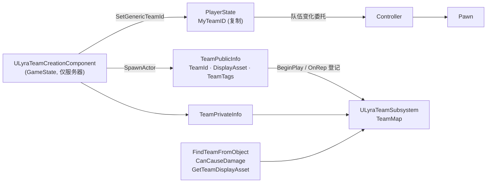
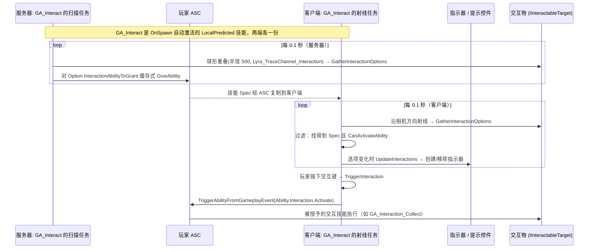
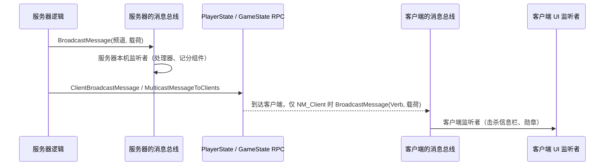
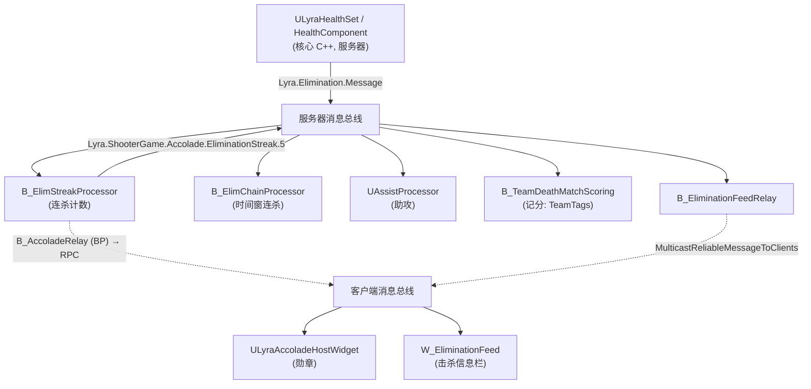

# 第 15 章　队伍、交互与消息系统

## 一个问题：玩家 A 打死了玩家 B，接下来要发生多少件事？

在团队死斗里，A 的最后一枪让 B 的生命值归零。此刻游戏要做的事情清单是这样的：

- 右上角的击杀信息栏要多一行“A 击杀了 B”；
- 记分板上 A 的击杀数加一、B 的死亡数加一，A 所在队伍的比分加一；
- 如果 A 在 4.5 秒内连杀，屏幕中上方要弹出“双杀”勋章；
- 在 B 身上造成过伤害但没拿到人头的玩家，要记一次助攻；
- 音乐系统可能想在某队即将获胜时切曲子。

而最开始，这一枪能不能造成伤害，取决于 A 和 B 是不是同一队。

如果你按“谁要知道就让谁被调用”的直觉来写，生命值组件的死亡函数里会长出一串：`KillFeed->Add(...)`、`ScoreBoard->AddKill(...)`、`AccoladeSystem->OnKill(...)`……生命值组件在核心模块里，这些系统却分散在不同的 GameFeature 插件里，核心模块**不能**反向引用插件内容。更糟的是，TopDownArena 玩法根本没有记分板，它要怎么办？

同样的矛盾还出现在另一类场景：地图上有成百上千个可交互的东西（拾取物、椅子、门），每个对应不同的行为；玩家走近，屏幕出现“按 E 拾取”，按下去要在联机里生效。你肯定不希望玩家身上一开局就挂着几百个技能，也不希望每个门都写一套 RPC。

这一章讲三个看起来不相干、实际同属一个套路的系统：

- **队伍**：回答“谁是自己人”，一个被所有人查询的真相来源；
- **交互**：回答“玩家怎么和世界里的东西互动”，让世界对象只描述“我能做什么”；
- **消息**：回答“怎么通知一群你不认识的监听者”，让发送者不必知道谁在听。

## 读完本章你能……

- 说出队伍 ID 存在哪个对象上，Pawn 和 Controller 怎样拿到它，以及为什么还需要单独的“队伍信息 Actor”；
- 解释 `CanCauseDamage` 对五种情况的判定结果，并写出加一个友军伤害开关的最小改动；
- 画出一次“走近 → 出现提示 → 按键 → 技能执行”的交互流程，标出服务器和客户端各做什么；
- 说清 `UGameplayMessageSubsystem` 的频道、载荷、监听句柄是什么，为什么它**不**自动联网，以及 Lyra 用哪几条路把消息送到客户端；
- 在蓝图里监听 `Lyra.Elimination.Message`，并做出一个“每连杀 3 人补弹药”的奖励。

## 需要先知道的 UE 概念

`FGenericTeamId` 是引擎自带的一个很小的结构体，里面就是一个 `uint8`，`FGenericTeamId::NoTeam` 是 255。引擎还有一个接口 `IGenericTeamAgentInterface`（获取/设置队伍 ID、`GetTeamAttitudeTowards` 判断对另一个 Actor 的态度），AI 感知系统用它判断敌友。Lyra 的队伍系统建立在它之上，所以有效队伍号是 0 到 254。

另外，`AInfo` 是引擎里一类“不在世界中占位置”的 Actor（`AGameStateBase`、`AGameModeBase` 都是它的子类）：没有网格、没有碰撞，纯粹用来承载数据并参与复制。需要“一个可以被所有客户端看到、与任何玩家无关”的数据载体时，常用它。

第三个概念是事件总线（Event Bus）。如果你在后端做过消息队列，下面的“消息系统”你会觉得熟悉：发布者往一个**主题**发一条**消息**，订阅者订阅这个主题，双方不互相引用。和后端的区别是：它是**进程内同步调用**，没有持久化、没有重放，也不跨网络。

## 第一部分　队伍：谁是自己人

### 队伍 ID 放在哪里？

假设队伍 ID 存成每个 Pawn 上的一个整数。看起来最直接：Pawn 的 `TeamId`，复制出去，大家都能查。

但玩家死亡重生的那一瞬间，Pawn 是新的，它还没来得及被设置队伍，这一刻的伤害判定、出生点选择、颜色应用全部拿不到队伍。再比如玩家还在“等待出生”的状态，没有 Pawn 却已经有队伍。

Lyra 的做法是让**队伍 ID 跟着玩家的 PlayerState 走**：PlayerState 活得比 Pawn 久，重生不丢，并且在网络上是权威的。

```cpp
// 简化自 Source/LyraGame/Player/LyraPlayerState.cpp
void ALyraPlayerState::SetGenericTeamId(const FGenericTeamId& NewTeamID)
{
    if (HasAuthority())                                    // 只有服务器能改队伍
    {
        const FGenericTeamId OldTeamID = MyTeamID;
        MARK_PROPERTY_DIRTY_FROM_NAME(ThisClass, MyTeamID, this);
        MyTeamID = NewTeamID;
        ConditionalBroadcastTeamChanged(this, OldTeamID, NewTeamID);   // 通知本机上的监听者
    }
    else
    {
        UE_LOG(LogLyraTeams, Error, TEXT("Cannot set team for %s on non-authority"), *GetPathName(this));
    }
}

void ALyraPlayerState::OnRep_MyTeamID(FGenericTeamId OldTeamID)    // 客户端收到复制后
{
    ConditionalBroadcastTeamChanged(this, OldTeamID, MyTeamID);
}
```

Pawn 和 Controller 只是**镜像**。它们同样实现 `ILyraTeamAgentInterface`（继承自引擎的 `IGenericTeamAgentInterface`，多了一个“队伍变化”委托）。Controller 监听 PlayerState 的队伍变化并转发；Pawn 在被 Controller 附身时采用 Controller 的队伍，并继续监听之后的变化。`ALyraCharacter::SetGenericTeamId` 在有 Controller 时会直接拒绝并报错，因为队伍是由 Controller 驱动的。

```cpp
// 简化自 Source/LyraGame/Teams/LyraTeamAgentInterface.h/.cpp
DECLARE_DYNAMIC_MULTICAST_DELEGATE_ThreeParams(FOnLyraTeamIndexChangedDelegate, UObject*, ObjectChangingTeam, int32, OldTeamID, int32, NewTeamID);

inline int32 GenericTeamIdToInteger(FGenericTeamId ID)
{
    return (ID == FGenericTeamId::NoTeam) ? INDEX_NONE : (int32)ID;     // 无队伍统一表示成 -1
}

void ILyraTeamAgentInterface::ConditionalBroadcastTeamChanged(TScriptInterface<ILyraTeamAgentInterface> This, FGenericTeamId OldTeamID, FGenericTeamId NewTeamID)
{
    if (OldTeamID != NewTeamID)       // 真的变了才广播
    {
        This.GetInterface()->GetTeamChangedDelegateChecked().Broadcast(This.GetObject(), GenericTeamIdToInteger(OldTeamID), GenericTeamIdToInteger(NewTeamID));
    }
}
```

这个“真相在 PlayerState，Pawn/Controller 镜像并传播变化”的结构，和第 10 章的“ASC 在 PlayerState、Pawn 是化身”是同一类思路：把长寿命的状态放在长寿命的对象上。

### 谁来创建队伍：ULyraTeamCreationComponent

队伍本身要在比赛开始前创建好，玩家进来时再被分配。这件事不是 GameMode 的职责（Lyra 只有一个 GameMode，不认识“队伍”），而是一个**GameState 组件**，由 Experience 通过 `Add Components` 注入（[第 6 章](06-Experience.md)、[第 7 章](07-ModularGameplay.md)）。ShooterCore 里的 `B_TeamSetup_TwoTeams` 就是它的蓝图子类，TopDownArena 有 `B_TeamSetup_FourTeams`。队伍系统没有 Epic 官方专页，下面关于“为什么这样设计”的说明，除特别注明来自社区的以外，都是从代码读出来的（推断）。

```cpp
// 简化自 Source/LyraGame/Teams/LyraTeamCreationComponent.cpp
void ULyraTeamCreationComponent::BeginPlay()
{
    Super::BeginPlay();
    // 对应第 5 章 12 步主干的第 7 步：用高优先级回调，保证在普通等待者（出生点选择等）之前先把队伍建好
    ExperienceComponent->CallOrRegister_OnExperienceLoaded_HighPriority(
        FOnLyraExperienceLoaded::FDelegate::CreateUObject(this, &ThisClass::OnExperienceLoaded));
}

void ULyraTeamCreationComponent::OnExperienceLoaded(const ULyraExperienceDefinition* Experience)
{
#if WITH_SERVER_CODE
    if (HasAuthority())
    {
        ServerCreateTeams();             // 按 TeamsToCreate 生成队伍信息 Actor
        ServerAssignPlayersToTeams();    // 给已有玩家分队，并订阅“后来的玩家”
    }
#endif
}
```

分队规则在 `GetLeastPopulatedTeamID` 里：先把每个要创建的队伍计数置 0，再遍历 `PlayerArray` 统计（未分队的和已断线的玩家不计入），最后挑人数最少的队伍，人数相同取编号最小的。

纯旁观者（`IsOnlyASpectator`）会被设成 `NoTeam`。你想要别的规则（比如按段位平衡、固定编队），继承这个组件重写 `ServerChooseTeamForPlayer`，不用改 GameMode。

有一个来自社区（X157 的 Teams 笔记）、同时能从上面的代码对上号的细节：队伍只存在于某个 Experience 的世界里（`ULyraTeamSubsystem` 是 World 子系统），而队伍是在**高优先级**的 `OnExperienceLoaded` 回调里创建的。所以如果你自己的逻辑也要在 Experience 加载完成时读取队伍，千万不要也用高优先级回调——同一档优先级里先后顺序不确定，你可能赶在队伍创建之前执行；用普通优先级的 `CallOrRegister_OnExperienceLoaded` 才是安全的（第 6 章讲过三档优先级）。

### 队伍信息 Actor：没有主人的数据

队伍的颜色、得分这类“队伍级”的数据放在哪里？它们不属于任何一个玩家，也不应该放进 GameState 的一个大数组（任何一项变化都要整数组 diff）。

Lyra 为**每个队伍生成两个 Actor**：`ALyraTeamPublicInfo` 和 `ALyraTeamPrivateInfo`，它们继承自 `ALyraTeamInfoBase`（一个 `AInfo`）：

```cpp
// 简化自 Source/LyraGame/Teams/LyraTeamInfoBase.cpp
ALyraTeamInfoBase::ALyraTeamInfoBase(...)
{
    bReplicates = true;
    bAlwaysRelevant = true;            // 所有客户端始终可见，不受距离裁剪
    NetPriority = 3.0f;
}
// 复制：TeamTags 是复制的标签栈，用来存队伍级数值（例如团队死斗 B_TeamDeathMatchScoring 用 ShooterGame.Score.Eliminations 记录各队击杀分）；TeamId 只在初始复制时发一次
DOREPLIFETIME(ThisClass, TeamTags);
DOREPLIFETIME_CONDITION(ThisClass, TeamId, COND_InitialOnly);
```

公有信息 `ALyraTeamPublicInfo` 额外携带一个 `TeamDisplayAsset`（队伍的配色资产，同样 `COND_InitialOnly`）。私有信息在设计上是“只复制给队友”的预留，但原版的构造函数里只有一行 `//@TODO: Actually make private (using replication graph)`（复制图 Replication Graph 是引擎里一套可自定义“哪个客户端该收到哪些 Actor”的高级复制系统），所以目前它和公有信息一样对所有人可见。如果你的玩法需要“只有队友能看到的数据”（比如队伍标记点），这个预留点需要自己实现。

这两种 Actor 在 `BeginPlay` 和 `OnRep_TeamId`/`OnRep_TeamDisplayAsset` 里调用 `TryRegisterWithTeamSubsystem`，把自己登记到 `ULyraTeamSubsystem`。因为客户端上这些 Actor 和 PlayerState 到达的顺序不确定，所以统一由子系统做“注册表”：不管谁先到，信息齐了就能用。

### 查询入口：ULyraTeamSubsystem

`ULyraTeamSubsystem` 是一个 World 子系统，内部有一张 `TeamMap`（队伍号 → 公有信息、私有信息、DisplayAsset、DisplayAsset 变化委托）。其他所有系统查询队伍都走它。最重要的函数是 `FindTeamFromObject`：

```cpp
// 简化自 Source/LyraGame/Teams/LyraTeamSubsystem.cpp
int32 ULyraTeamSubsystem::FindTeamFromObject(const UObject* TestObject) const
{
    // ① 对象自己就是队伍成员（实现了 ILyraTeamAgentInterface）
    if (const ILyraTeamAgentInterface* Agent = Cast<ILyraTeamAgentInterface>(TestObject))
        return GenericTeamIdToInteger(Agent->GetGenericTeamId());

    if (const AActor* TestActor = Cast<const AActor>(TestObject))
    {
        // ② 它的 Instigator 是队伍成员（投射物、特效、武器 Actor 通过这条路径继承队伍）
        if (const ILyraTeamAgentInterface* InstigatorAgent = Cast<ILyraTeamAgentInterface>(TestActor->GetInstigator()))
            return GenericTeamIdToInteger(InstigatorAgent->GetGenericTeamId());

        // ③ 它本身是队伍信息 Actor
        if (const ALyraTeamInfoBase* TeamInfo = Cast<ALyraTeamInfoBase>(TestActor))
            return TeamInfo->GetTeamId();

        // ④ 通过 Pawn/Controller 找 PlayerState
        if (const ALyraPlayerState* LyraPS = FindPlayerStateFromActor(TestActor))
            return LyraPS->GetTeamId();
    }
    return INDEX_NONE;
}
```

第二条查询路径有个很重要的约定：它看的是 `GetInstigator()`，**不是** `GetOwner()`。所以你做炮塔、投射物，生成时要把 Instigator 设成发射者的 Pawn，它们才会自动属于发射者的队伍。顺带一提，`ULyraEquipmentInstance::SpawnEquipmentActors` 生成武器 Actor 时 Owner 是 Pawn 但没有设置 Instigator，所以武器 Actor 本身直接查不到队伍。

### 谁能伤害谁：CanCauseDamage

所有“能不能伤害”的规则集中在子系统的一个函数里，伤害执行（权威）、命中标记预测（第 14 章）、AI 判断都调用它：

```cpp
// 简化自 ULyraTeamSubsystem::CanCauseDamage
bool CanCauseDamage(const UObject* Instigator, const UObject* Target, bool bAllowDamageToSelf = true) const
{
    if (bAllowDamageToSelf)
    {
        // 同一个对象，或者属于同一个 PlayerState：允许（自伤）
        if ((Instigator == Target) || (FindPlayerStateFromActor(Cast<AActor>(Instigator)) == FindPlayerStateFromActor(Cast<AActor>(Target))))
            return true;
    }

    int32 InstigatorTeamId, TargetTeamId;
    const ELyraTeamComparison Relationship = CompareTeams(Instigator, Target, InstigatorTeamId, TargetTeamId);
    if (Relationship == ELyraTeamComparison::DifferentTeams)
        return true;                                          // 不同队：可以
    else if ((Relationship == ELyraTeamComparison::InvalidArgument) && (InstigatorTeamId != INDEX_NONE))
        return UAbilitySystemGlobals::GetAbilitySystemComponentFromActor(Cast<const AActor>(Target)) != nullptr;
        // 攻击者有队、目标没队：只要目标有 ASC 就可以打（靶子、没分队的假人，源码注释标了临时逻辑）
    return false;                                             // 同队：不可以
}
```

总结成几种情况：不同队可以；同队不可以；攻击者有队、目标无队但有 ASC 可以（靶子）；攻击者无队则谁也伤害不了（除自伤）；自伤默认允许。**没有“友军伤害开关”**：函数注释写着 “taking into account the friendly fire settings”，代码里并没有这样的设置。

两个边界要小心。第一，**没有队伍创建组件的 Experience 里，玩家全部是“无队伍”，攻击者无队，所以谁也打不死谁**。这是新手最常见的“我的新模式里枪打不死人”的原因。第二，`bAllowDamageToSelf` 那个判断里，如果两个对象都没有 PlayerState，`nullptr == nullptr` 会让它们互相“视为同一个玩家”而被允许伤害，这种情况出现在两个都没有 PlayerState 的 Actor 之间。

想加友军伤害开关，在 `Relationship == OnSameTeam` 时多判断一个你自己的开关（比如 GameState 上的 bool 属性或开发者设置）并返回 true 即可。因为伤害执行和命中标记预测都走这个函数，改一处就一致了，不会出现“打友军有命中标记却无伤害”。

### 队伍的视觉：DisplayAsset 与异步观察

队伍颜色不写死在角色里，而是一个数据资产 `ULyraTeamDisplayAsset`：三张 “参数名 → 值” 的表（标量、颜色、贴图）加一个队伍简称。`ApplyToActor` 会遍历目标 Actor（可含子 Actor）的所有组件：网格组件调用 `SetVectorParameterValueOnMaterials` 之类的函数写材质参数，Niagara 组件调用 `SetVariableLinearColor` 之类的函数写系统参数。

这里有个隐含约定：**材质或 Niagara 里的参数名必须和 DisplayAsset 里的键同名**（比如 `TeamColor`），否则静默无效，没有任何报错。

时序问题怎么处理？角色出现在客户端时，队伍 ID 和 DisplayAsset 可能还没到。蓝图里不要“一次性读取再应用”，而要用异步节点 `Observe Team Colors`（`UAsyncAction_ObserveTeamColors`）：

```cpp
// 简化自 UAsyncAction_ObserveTeamColors::Activate
CurrentTeamIndex = GenericTeamIdToInteger(TeamInterface->GetGenericTeamId());
CurrentDisplayAsset = ULyraTeamStatics::GetTeamDisplayAsset(World, CurrentTeamIndex);
TeamInterface->GetTeamChangedDelegateChecked().AddDynamic(this, &ThisClass::OnWatchedAgentChangedTeam);  // 以后换队会再通知

BroadcastChange(CurrentTeamIndex, CurrentDisplayAsset);   // 立刻回调一次当前状态；之后 DisplayAsset 到达/修改也会再回调
```

这是第 6 章 `CallOrRegister` 的又一个变体：**先给当前值，之后有变化再通知**，所以无论你来得早还是晚，最终都能得到正确的颜色。编辑器里修改 `TeamDA_*` 资产时，`PostEditChangeProperty` 会通知子系统，所有观察者即时刷新。

### 队伍相关的整体图



队伍解决了“怎么在不耦合双方具体类的前提下查清敌友关系”。接下来看第二个解耦场景：玩家面对世界里五花八门的物体时，怎么做到玩家不用预装所有交互逻辑、物体也不用自己管网络与输入？

## 第二部分　交互：让世界对象只描述“我能做什么”

### 朴素做法

给门写一个 `AMyDoor`，里面 `OnComponentBeginOverlap` 显示提示、监听输入、按键后发一个 `Server_Open` RPC。拾取物、椅子、开关各写一遍。

这样做有三个问题。每种交互都要重新处理网络（谁拥有 Actor，RPC 能不能发）；它绕开了 GAS 的激活条件、标签阻断（比如“死亡时不能交互”“冲刺时不能坐下”）、取消和预测，这些都要重写；最后是客户端想知道“我现在能不能按 E”，得让每个交互物各自告诉 UI。

### Lyra 的思路：三方各司其职

Epic 官方《Lyra Sample Game Interaction System》的概括是：Lyra 的交互用一个接口加一个专门的技能（`ULyraGameplayAbility_Interact`）实现，在“玩家怎么和对象交互”和“对象怎么和玩家交互”之间建立因果关系。（该页写于 5.0–5.1 前后，下面以 5.8 源码为准。）Lyra 用 GAS 来承载交互，并且把三件事拆开：

- **交互物**（Actor 或组件）实现 `IInteractableTarget`，只回答一个问题：“如果有人想和我交互，有哪些**选项**？”；
- **玩家身上一个长期运行的技能 `GA_Interact`**（继承 `ULyraGameplayAbility_Interact`），负责扫描、选目标、显示提示、响应按键；
- **真正执行交互的技能**（比如 `GA_Interaction_Collect`、`GA_Interaction_Sit`），由交互物的选项指定，在需要时才授予玩家。

```cpp
// 简化自 Source/LyraGame/Interaction/IInteractableTarget.h 和 InteractionOption.h
class IInteractableTarget
{
    // 收集交互选项：往 Builder 里添加即可
    virtual void GatherInteractionOptions(const FInteractionQuery& InteractQuery, FInteractionOptionBuilder& OptionBuilder) = 0;
    // 可选：自定义事件载荷（比如墙上的按钮想把事件的目标改成一扇门）
    virtual void CustomizeInteractionEventData(const FGameplayTag& InteractionEventTag, FGameplayEventData& InOutEventData) { }
};

struct FInteractionOption
{
    TScriptInterface<IInteractableTarget> InteractableTarget;   // 由 Builder 自动回填
    FText Text, SubText;                                        // 提示文字

    // 方式 1：交互物自己没有 ASC，由玩家的 GA 去执行；这里指定“要授予玩家的技能类”
    TSubclassOf<UGameplayAbility> InteractionAbilityToGrant;
    // 方式 2：交互物自带 ASC 和技能（比如椅子自己有技能），这里指定目标 ASC + 技能句柄
    UAbilitySystemComponent* TargetAbilitySystem;
    FGameplayAbilitySpecHandle TargetInteractionAbilityHandle;

    TSoftClassPtr<UUserWidget> InteractionWidgetClass;          // 提示用的控件
};
```

`IInteractableTarget` 标了 `CannotImplementInterfaceInBlueprint`：它只能在 C++ 里实现，Actor 和组件都可以。ShooterCore 里的 `ALyraWorldCollectable` 是标准样板，它同时实现了 `IInteractableTarget` 和 `IPickupable`（[第 13 章](13-Inventory.md)），`GatherInteractionOptions` 里就一句 `InteractionBuilder.AddInteractionOption(Option)`，`Option` 是可在蓝图类默认值里编辑的 `FInteractionOption`。

**两种实现方式怎么选？** 上面结构体里的两组字段对应官方文档里的两种做法。方式 1（`InteractionAbilityToGrant`）：交互物自己没有 ASC，由玩家的 ASC 去执行授予的技能。官方的建议是：**简单逻辑，比如武器拾取 Actor，用这种**，因为它用法最简单。方式 2（`TargetAbilitySystem` + `TargetInteractionAbilityHandle`）：交互物自己有 ASC 和技能（比如一把自带技能的椅子），玩家按键后触发的是交互物那边的技能。官方页面对第二种方式的完整说明，本书写作时只能读到摘要；本书的教学路径和后面的实验都用方式 1，方式 2 的字段在 `UpdateInteractableOptions` 里有处理（见下文代码），你可以顺着读，并请对照官方原页。

### 一次交互的完整流程



分步骤看关键代码。**服务器扫描并按需授予**：

```cpp
// 简化自 Source/LyraGame/Interaction/Tasks/AbilityTask_GrantNearbyInteraction.cpp 的 QueryInteractables
World->OverlapMultiByChannel(OverlapResults, ActorOwner->GetActorLocation(), FQuat::Identity,
                             Lyra_TraceChannel_Interaction, FCollisionShape::MakeSphere(InteractionScanRange), Params);

// 把重叠到的 Actor/组件里实现了 IInteractableTarget 的收集起来，各自 GatherInteractionOptions ……

for (FInteractionOption& Option : Options)
{
    if (Option.InteractionAbilityToGrant)
    {
        FObjectKey ObjectKey(Option.InteractionAbilityToGrant);
        if (!InteractionAbilityCache.Find(ObjectKey))               // 同一个技能类只授予一次
        {
            FGameplayAbilitySpec Spec(Option.InteractionAbilityToGrant, 1, INDEX_NONE, this);
            InteractionAbilityCache.Add(ObjectKey, AbilitySystemComponent->GiveAbility(Spec));
        }
    }
}
```

这就是“按需授予”：世界里有成百上千个可交互物，每个对应的技能不同，如果开局全授予，ASC 会膨胀，所有 Spec 都要复制。现在只在玩家走到离某个交互物 500 厘米以内时，才把它对应的那个技能授予一次。**授予只在服务器做**，因为只有服务器有权限修改 ASC 的技能列表，这同时也是一道安全闸门：玩家够不着的交互物，服务器根本不会授予技能。

这里有一个官方文档特别强调、而参考手册里原先没写的工程原因：**扫描范围必须大于交互范围**。授予发生在服务器，技能还得经过复制才能到达客户端，客户端才能“找到 Spec 且能激活”并显示提示；如果服务器等到玩家站到交互距离之内才授予，复制还没到，玩家按键时客户端上根本没有这个技能。所以服务器上的授予扫描要**提前**——`ULyraGameplayAbility_Interact` 里服务器的 `InteractionScanRange` 默认是 `500` 厘米、`InteractionScanRate` 是 `0.1` 秒，而客户端射线任务（`WaitForInteractableTargets_SingleLineTrace`，真正决定“走到多近能按 E”）在 `GA_Interact` 蓝图里把扫描距离设成了 `200` 厘米（C++ 函数参数默认值是 `100`）。`500` 对 `200` 这 300 厘米的差，就是留给技能 Spec 网络复制的提前量。你如果调小服务器扫描范围，或者把客户端射线加长，都要记得保持“服务器授予半径 > 客户端射线距离”的关系。

**客户端选目标并过滤**。客户端沿相机方向打一条射线（`UAbilityTask_WaitForInteractableTargets_SingleLineTrace`，每 0.1 秒），对命中的 Actor 调 `GatherInteractionOptions`，然后过滤：

```cpp
// 简化自 UAbilityTask_WaitForInteractableTargets::UpdateInteractableOptions
if (Option.TargetAbilitySystem && Option.TargetInteractionAbilityHandle.IsValid())
{
    Spec = Option.TargetAbilitySystem->FindAbilitySpecFromHandle(Option.TargetInteractionAbilityHandle);   // 方式 2
}
else if (Option.InteractionAbilityToGrant)
{
    Spec = AbilitySystemComponent->FindAbilitySpecFromClass(Option.InteractionAbilityToGrant);             // 方式 1
    if (Spec) { Option.TargetAbilitySystem = AbilitySystemComponent.Get(); Option.TargetInteractionAbilityHandle = Spec->Handle; }
}
if (Spec && Spec->Ability->CanActivateAbility(Spec->Handle, AbilitySystemComponent->AbilityActorInfo.Get()))
{
    NewOptions.Add(Option);       // 找得到技能、且当前能激活，才算一个有效选项
}
```

被过滤掉的原因可能是：服务器的授予还没复制到客户端；技能被标签阻断（比如玩家正处于死亡状态）；冷却中。因为 `CanActivateAbility` 会检查这些，所以“能不能交互”的所有规则都复用了 GAS，交互物不需要懂。选项集合变化时，任务广播 `InteractableObjectsChanged`，`GA_Interact` 调 `UpdateInteractions` 为每个选项创建一个指示器（`UIndicatorDescriptor`）交给 `ULyraIndicatorManagerComponent`，屏幕上就出现了“按 E 拾取”（指示器系统第 19 章讲）。

**触发**。按下交互键后蓝图调用 `TriggerInteraction`：

```cpp
// 简化自 ULyraGameplayAbility_Interact::TriggerInteraction
const FInteractionOption& InteractionOption = CurrentOptions[0];      // 固定取第一个选项！

FGameplayEventData Payload;
Payload.EventTag   = TAG_Ability_Interaction_Activate;                // "Ability.Interaction.Activate"
Payload.Instigator = GetAvatarActorFromActorInfo();
Payload.Target     = InteractableTargetActor;
InteractionOption.InteractableTarget->CustomizeInteractionEventData(TAG_Ability_Interaction_Activate, Payload);   // 目标可以改写事件数据

// 把“交互动作”以 GameplayEvent 的方式交给被授予的那个技能
InteractionOption.TargetAbilitySystem->TriggerAbilityFromGameplayEvent(
    InteractionOption.TargetInteractionAbilityHandle, &ActorInfo, TAG_Ability_Interaction_Activate, &Payload, *InteractionOption.TargetAbilitySystem);
```

被授予的交互技能（例如 `GA_Interaction_Collect`）用 `Ability.Interaction.Activate` 作为它的触发标签，被事件激活后在服务器执行真正的逻辑。打开 `GA_Interaction_Collect` 可以看到：它调用 `GetFirstPickupableFromActor` → `AddPickupToInventory` 把物品塞进玩家背包，并在 `HasAuthority` 为真时触发 `GameplayCue.ShooterGame.Interact.Collect`。物品就这样回到了[第 13 章](13-Inventory.md)的背包。

### 在哪里能看到它

有个容易让人意外的事实：**团队死斗（`B_ShooterGame_Elimination`）里根本没有交互系统**。`GA_Interact` 不在 `ShooterCore` 里，它在 `ShooterExplorer` 插件的 `Input/Abilities` 目录下，由 `B_TestInventoryExperience`（`System/Experiences`）及其 ActionSet `LAS_InventoryTest` 授予玩家，输入标签是 `InputTag.Ability.Interact`。团队死斗里捡武器走的是[第 13 章](13-Inventory.md)的拾取台（碰撞重叠即拾取），不是交互。想亲手体验按键交互，直接在编辑器里打开 `/ShooterExplorer/Maps/L_InteractionTestMap` 点击运行（该地图的世界设置直接指定了 `B_TestInventoryExperience`），走近地上的石头或椅子就能看到“按 E”指示器并坐下或拾取。这再次说明 Lyra 的“玩法即数据”：交互是一个按需引入的功能。

### 原版的局限

- **只取第一个选项**：`TriggerInteraction` 固定用 `CurrentOptions[0]`。`IInteractionInstigator` 接口（用来在多个选项里选）是预留的，全工程没有调用者。而且选项排序依据的是接口指针地址（`FInteractionOption::operator<`），顺序不稳定，所以同时面对多个选项时选中哪个是不确定的；
- **只授予，不回收**：`InteractionAbilityCache` 只增不减，玩家走远后，技能仍留在 ASC 上，直到 `GA_Interact` 自己结束；
- **机器人不能用**：`AimWithPlayerController` 里有 `check(PC)`，在 AI 上使用会崩，代码注释标了 `@TODO: Bots?`。

前两部分别解决了“向谁查询敌友”和“玩家与面前单个物体对话”。最后回到本章开头那个问题：当一次击杀已经发生，怎样通知记分板、连杀勋章、击杀播报这一大群互不相识的系统？

## 第三部分　消息：让发送者不必知道谁在听

### 问题

回到开头：生命值系统在核心模块里，击杀信息栏、记分、勋章在 GameFeature 插件里。最直观的办法是**多播委托**：`HealthComponent` 声明一个 `OnKilled` 委托，想听的人去绑。这在“监听者能拿到发送者的引用”时没有问题，本书里的 `OnDeathStarted` 就是这样用的（它在同一个角色内部，各组件互相认识）。

但击杀信息栏没有生命值组件的引用。玩家有几十个，每个都有自己的组件，重生后又换一个；你让 HUD 去订阅“每一个玩家的生命值组件”，要反复处理绑定、解绑、Pawn 重生后的重新绑定。ShooterCore 的连杀处理器要听“任何人被击杀”，它也不应该依赖生命值组件的具体对象。

要的是一种**按主题订阅**的机制：发送方说“有一件叫‘击杀’的事发生了，内容是……”，不关心谁在听；监听方说“我想听‘击杀’”，不关心谁发的。这就是事件总线，Lyra 把它做成了 `GameplayMessageRouter` 插件里的 `UGameplayMessageSubsystem`。官方总览页对这个插件的描述只有一句：通过 GameplayTag 在整个游戏内广播和接收事件，可以附带自定义结构体；消息系统没有 Epic 官方专页，下面的设计解释是从源码读出来的（推断）。

### 核心模型：频道 + 载荷

- **频道（Channel）**：一个 GameplayTag，比如 `Lyra.Elimination.Message`。
- **载荷（Payload）**：一个 `USTRUCT`，比如 `FLyraVerbMessage`。发送方和监听方必须对**频道对应的结构体类型**有共同约定。
- **监听句柄（Listener Handle）**：注册时拿到，用来注销。

```cpp
// 简化自 Plugins/GameplayMessageRouter/Source/GameplayMessageRuntime/Public/GameFramework/GameplayMessageSubsystem.h
class UGameplayMessageSubsystem : public UGameInstanceSubsystem
{
    static UGameplayMessageSubsystem& Get(const UObject* WorldContextObject);
    template <typename T> void BroadcastMessage(FGameplayTag Channel, const T& Message);
    template <typename T, typename TOwner> FGameplayMessageListenerHandle RegisterListener(FGameplayTag Channel, TOwner* Object, void(TOwner::* Function)(FGameplayTag, const T&));
    void UnregisterListener(FGameplayMessageListenerHandle Handle);   // 另有 lambda 与 MatchType 重载
};
```

它是 **GameInstance 子系统**，不是 World 子系统，所以切图后监听还在（你得在 `EndPlay` 里自己注销）。同一个进程里 PIE 的每个窗口有自己的 GameInstance，因此各有各的消息总线。

广播的核心实现很短：

```cpp
// 简化自 GameplayMessageSubsystem.cpp 的 BroadcastMessageInternal
bool bOnInitialTag = true;
for (FGameplayTag Tag = Channel; Tag.IsValid(); Tag = Tag.RequestDirectParent())   // 从频道开始，逐级往父频道找
{
    if (const FChannelListenerList* pList = ListenerMap.Find(Tag))
    {
        TArray<FGameplayMessageListenerData> ListenerArray(pList->Listeners);       // 拷贝一份，回调里注销是安全的
        for (const FGameplayMessageListenerData& Listener : ListenerArray)
        {
            if (bOnInitialTag || (Listener.MatchType == EGameplayMessageMatch::PartialMatch))   // 父频道只通知 PartialMatch 的监听者
            {
                if (StructType->IsChildOf(Listener.ListenerStructType.Get()))       // 结构体类型要兼容
                    Listener.ReceivedCallback(Channel, StructType, MessageBytes);
                else
                    UE_LOG(LogGameplayMessageSubsystem, Error, TEXT("Struct type mismatch on channel %s ..."), ...);
            }
        }
    }
    bOnInitialTag = false;
}
```

几个要点：

- **频道是层级的**。广播到 `Lyra.ShooterGame.Accolade.EliminationStreak.5`，监听 `Lyra.ShooterGame.Accolade.EliminationStreak.5` 的人（精确匹配）收到；监听 `Lyra.ShooterGame.Accolade` 且 `MatchType = PartialMatch` 的人也收到。不写 `PartialMatch` 默认是精确匹配；
- **类型不匹配只会打错误日志，不会投递**。这是最常见的“监听了却收不到”的原因，因为它悄无声息；
- **调用顺序不保证**，且可能随时间变化。不要依赖监听者之间的先后；
- **没有重放**：监听者只能收到注册之后的广播。这和第 6 章的 `CallOrRegister`（“已经发生就立刻给你”）正好相反，所以总线适合“事件”，不适合“状态”；
- 想看所有广播，开控制台变量 `GameplayMessageSubsystem.LogMessages 1`，每一条都会以 `LogGameplayMessageSubsystem` 打印出来。

蓝图里对应的是自定义异步节点 `Listen For Gameplay Messages`（底层由 `UK2Node_AsyncAction_ListenForGameplayMessages` 包装 `UAsyncAction_ListenForGameplayMessage`）：你在节点上选好 `Channel`、`Payload Type` 和 `Match Type` 后，节点会自动把自己的 **`Payload` 输出引脚**变成你选的结构体类型（内部的 `GetPayload` 已由编译器节点自动生成并隐藏），直接在 `On Message Received` 后面把 `Payload` 引脚拖出去 `Break` 即可。发送则是 `Broadcast Message` 节点。

### 它为什么不自动联网

`UGameplayMessageSubsystem` 只在**调用它的那个进程内**同步分发。服务器上广播的击杀消息，客户端的监听者收不到（这是源码可以确认的事实：子系统里没有任何复制代码）。为什么不自动联网，官方没有说明，本书的推断是：如果总线自动复制，每条消息都要付网络代价，还要处理可靠性、对象引用的可复制性等一堆问题，不如让它保持最简单的进程内模型（推断）。

那客户端的击杀信息栏怎么亮？Lyra 在总线之上提供了几条**手动联网**的路：

- `ALyraPlayerState::ClientBroadcastMessage(FLyraVerbMessage)`：一个 `Client` RPC，服务器对某个玩家的 PlayerState 调用，只发给这个玩家；
- `ALyraGameState::MulticastMessageToClients(FLyraVerbMessage)`（还有可靠版 `MulticastReliableMessageToClients`）：多播 RPC，发给所有客户端；
- `FLyraVerbMessageReplication`：一个 FastArray，嵌在你自己的 Actor 里，服务器 `AddMessage`，客户端 `PostReplicatedAdd` 里重新广播（需要 `SetOwner` 指向一个能解析到 World 的对象）。

```cpp
// 简化自 Source/LyraGame/Player/LyraPlayerState.cpp
void ALyraPlayerState::ClientBroadcastMessage_Implementation(const FLyraVerbMessage Message)
{
    if (GetNetMode() == NM_Client)       // 只在纯客户端重广播，避免单机/主机服务器本地重复触发
    {
        UGameplayMessageSubsystem::Get(this).BroadcastMessage(Message.Verb, Message);   // 用消息的 Verb 当频道
    }
}
```

注意那个 `NM_Client` 判断：在单机或者主机服务器上，服务器自己的本地监听者已经在原始广播时收到了，如果 RPC 再广播一遍，就重复了。

整个路径可以画成：



### 通用载荷：FLyraVerbMessage

多数事件都是“某人对某人做了某事”的形状。Lyra 提供了一个通用结构体，避免为每个事件新建一个结构体：

```cpp
// 简化自 Source/LyraGame/Messages/LyraVerbMessage.h
USTRUCT(BlueprintType)
struct FLyraVerbMessage
{
    FGameplayTag Verb;                   // 做了什么（也常直接当频道用）
    TObjectPtr<UObject> Instigator;      // 谁
    TObjectPtr<UObject> Target;          // 对谁
    FGameplayTagContainer InstigatorTags, TargetTags, ContextTags;   // 双方当时的标签、场景标签
    double Magnitude = 1.0;              // 数值（伤害量、连杀数……）
};
```

Instigator 和 Target 是 `UObject`，经 RPC 发送时依赖这些对象本身可复制（PlayerState、Pawn 可以）。`ULyraVerbMessageHelpers::GetPlayerStateFromObject` 可以把 PlayerController、PlayerState、Pawn 统一转成 PlayerState。

### Lyra 里现成的消息

下面列出的是代码里真实存在的频道和载荷，你写扩展时可以直接监听：

- `Lyra.Damage.Message`（`FLyraVerbMessage`）：`ULyraHealthSet` 处理伤害属性时发出，Instigator 是造成伤害的 Actor，Target 是受伤者，Magnitude 是伤害量。仅服务器；
- `Lyra.Elimination.Message`（`FLyraVerbMessage`）：`ULyraHealthComponent::HandleOutOfHealth` 里发出，Instigator 是击杀者（通常是 PlayerState），Target 是被击杀者的 PlayerState。仅服务器；
- `Lyra.Assist.Message`、`Lyra.ShooterGame.Accolade.*`：ShooterCore 的处理器基于上面两条产生的衍生消息；
- `Lyra.AddNotification.Message`（`FLyraNotificationMessage`）：发往 UI 的通知（击杀信息、勋章），带目标频道、目标玩家、文本、标签；
- `Lyra.Inventory.Message.StackChanged`、`Lyra.QuickBar.Message.SlotsChanged`、`Lyra.QuickBar.Message.ActiveIndexChanged`：第 13 章的背包和快捷栏变化；
- `Ability.UserFacingSimpleActivateFail.Message`、`Ability.PlayMontageOnActivateFail.Message`：技能激活失败的提示；
- `Ability.Interaction.Duration.Message`：交互持续时间（进度条）。

看看击杀消息是怎么发出的：

```cpp
// 简化自 Source/LyraGame/Character/LyraHealthComponent.cpp 的 HandleOutOfHealth（仅服务器）
FLyraVerbMessage Message;
Message.Verb = TAG_Lyra_Elimination_Message;                 // "Lyra.Elimination.Message"
Message.Instigator = DamageInstigator;                       // 原始施加者：ASC 的拥有者，也就是击杀者的 PlayerState
Message.InstigatorTags = *DamageEffectSpec->CapturedSourceTags.GetAggregatedTags();
Message.Target = ULyraVerbMessageHelpers::GetPlayerStateFromObject(AbilitySystemComponent->GetAvatarActor());
Message.TargetTags = *DamageEffectSpec->CapturedTargetTags.GetAggregatedTags();

UGameplayMessageSubsystem& MessageSystem = UGameplayMessageSubsystem::Get(GetWorld());
MessageSystem.BroadcastMessage(Message.Verb, Message);
```

整个函数体包在 `#if WITH_SERVER_CODE` 里，并且伤害 GE 只在服务器执行，所以击杀消息只出现在服务器进程里。

### 处理器：基于消息的服务器端逻辑

如果你想写一个“监听一些消息，产出新消息”的逻辑，Lyra 提供基类 `UGameplayMessageProcessor`，它就是一个普通的 `UActorComponent`：

```cpp
// 简化自 Source/LyraGame/Messages/GameplayMessageProcessor.cpp
void UGameplayMessageProcessor::BeginPlay()  { Super::BeginPlay(); StartListening(); }   // 子类重写 StartListening 去注册

void UGameplayMessageProcessor::EndPlay(const EEndPlayReason::Type EndPlayReason)
{
    Super::EndPlay(EndPlayReason);
    StopListening();
    for (FGameplayMessageListenerHandle& Handle : ListenerHandles) { MessageSubsystem.UnregisterListener(Handle); }   // 自动注销登记过的句柄
}
```

子类用 `AddListenerHandle(...)` 登记句柄，组件销毁时自动清理，省去手动注销。头文件注释特意强调：这些处理器在服务器上**只创建一份**（不是每个玩家一份），需要自己按玩家过滤。

看 ShooterCore 的“不死连杀”处理器：

```cpp
// 简化自 Plugins/GameFeatures/ShooterCore/.../MessageProcessors/ElimStreakProcessor.cpp
void UElimStreakProcessor::StartListening()
{
    UGameplayMessageSubsystem& MessageSubsystem = UGameplayMessageSubsystem::Get(this);
    AddListenerHandle(MessageSubsystem.RegisterListener(TAG_Lyra_Elimination_Message, this, &ThisClass::OnEliminationMessage));
}

void UElimStreakProcessor::OnEliminationMessage(FGameplayTag Channel, const FLyraVerbMessage& Payload)
{
    if (Payload.Instigator != Payload.Target)                                       // 自杀不算
    {
        if (APlayerState* InstigatorPS = Cast<APlayerState>(Payload.Instigator))
        {
            int32& StreakCount = PlayerStreakHistory.FindOrAdd(InstigatorPS);       // 每个击杀者一个计数
            StreakCount++;
            if (FGameplayTag* pTag = ElimStreakTags.Find(StreakCount))              // 5/10/15/20 命中配置才发
            {
                UGameplayMessageSubsystem& MessageSubsystem = UGameplayMessageSubsystem::Get(this);
                FLyraVerbMessage ElimStreakMessage;
                ElimStreakMessage.Verb = *pTag;                                     // 新消息的 Verb 就是勋章标签
                ElimStreakMessage.Instigator = InstigatorPS;
                ElimStreakMessage.Magnitude = StreakCount;
                MessageSubsystem.BroadcastMessage(ElimStreakMessage.Verb, ElimStreakMessage);
            }
        }
    }
    if (APlayerState* TargetPS = Cast<APlayerState>(Payload.Target)) { PlayerStreakHistory.Remove(TargetPS); }   // 死亡中断连杀
}
```

它从来不引用生命值组件，也没有谁引用它。`ElimStreakTags` 是一张 “击杀数 → 勋章标签” 的可编辑表，蓝图子类 `B_ElimStreakProcessor` 里配了 5、10、15、20 四档。`UElimChainProcessor` 是时间窗口版（`ChainTimeLimit` 内连续击杀，默认 4.5 秒），`UAssistProcessor` 同时听 `Lyra.Damage.Message` 累计伤害、听 `Lyra.Elimination.Message` 时给“造成过伤害但不是击杀者”的玩家发 `Lyra.Assist.Message`。

这些处理器是怎么到游戏里的？不是 GameMode，而是 ShooterCore 的 ActionSet `EAS_BasicShooterAcolades` 用 `Add Components` 把它们加到 `GameState` 上，**仅服务器**（[第 7 章](07-ModularGameplay.md)）。

### 把一次击杀串起来



勋章这条路径值得把客户端那一半说清楚。打开 `B_AccoladeRelay`（`ShooterCore` 的 `Accolades` 目录），它是 `GameplayMessageProcessor` 的蓝图子类：用 `Listen For Gameplay Messages` 以 `PartialMatch` 监听 `Lyra.ShooterGame.Accolade` 这个父频道（所以 5/10/15/20 连杀和 2x/3x/4x/5x 时间窗连杀的所有子频道都收到），然后组装 `LyraNotificationMessage` 并调用击杀者 `PlayerState` 上的 `ClientBroadcastMessage` 把通知送到对应玩家的客户端。客户端上，C++ 写的 `ULyraAccoladeHostWidget` 在 `NativeConstruct` 里监听 `Lyra.AddNotification.Message`：

```cpp
// 简化自 Plugins/GameFeatures/ShooterCore/.../Accolades/LyraAccoladeHostWidget.cpp
ListenerHandle = MessageSubsystem.RegisterListener(TAG_Lyra_AddNotification_Message, this, &ThisClass::OnNotificationMessage);

void ULyraAccoladeHostWidget::OnNotificationMessage(FGameplayTag Channel, const FLyraNotificationMessage& Notification)
{
    if (Notification.TargetChannel == TAG_Lyra_ShooterGame_Accolade)       // 只处理“勋章”频道的通知
    {
        // 忽略发给其他玩家的通知
        if (Notification.TargetPlayer != nullptr && GetOwningPlayer()->PlayerState != Notification.TargetPlayer) return;
        // 用 PayloadTag 去数据注册表（DataRegistry：引擎里“按 ID 异步查询数据表行”的系统）里异步加载勋章的图标、音效、显示时长，排队展示
    }
}
```

勋章的图标、音效、时长这些数据在 DataTable `DT_BasicShooterAccolades` 里（经 `AccoladeDataRegistry` 访问），Tag 是键。加一种新勋章就是：声明 Tag、在 DataTable 加一行、在处理器的阈值表里把某个计数映射到这个 Tag，一行 C++ 不用写。

### 什么时候不该用消息

总线是弱类型的（结构体不匹配只有运行时报错）、不保证顺序、不联网、难以静态追踪“谁在听”。Lyra 的实际用法（推断出的约定）是：**高频、强耦合、同一对象内部的交互用普通委托**（例如 `OnDeathStarted`、`OnHealthChanged`），**跨模块、一对多、监听者可选**的事件才用总线。UI 刷新每帧都在发生的数据（比如血条数值），应当由 UI 自己去读，而不是靠消息推送。

## 动手实验

### 实验 1：换队与友军伤害

**目标**：感受队伍系统如何决定“能不能伤害”。

**步骤**：

1. 在 `L_Expanse` 上以单人模式（网络模式 Standalone）用 `B_ShooterGame_Elimination` 运行 PIE（团队死斗默认会生成机器人）。
2. 打开控制台，输入 `ListTeams`。
3. 观察一个机器人的颜色，输入 `CycleTeam` 或 `SetTeam 0`、`SetTeam 1` 切换队伍。

**先写下你的预测**：切换之后，你自己（角色颜色、武器颜色）会变吗？对着“现在变成同队”的机器人开枪，会掉血吗？命中标记会怎样？

4. 对同队机器人和异队机器人各开几枪，对比。

**预期结果**：`ListTeams` 在输出日志里列出创建出来的队伍 ID（团队死斗用的是两队）；换队之后你的队伍颜色改变（颜色由 `ObserveTeamColors` 在队伍变化时重新应用）；对同队机器人开枪不掉血，命中标记也不显示为成功的那一种（因为 `ShouldShowHitAsSuccess` 和伤害执行都走 `CanCauseDamage`），对异队机器人正常。

**原理**：`CycleTeam`、`SetTeam`、`ListTeams` 是 `ULyraTeamCheats` 里的控制台命令，由子系统初始化时注册到作弊管理器；换队调用 `ChangeTeamForActor`，它会优先找到 PlayerState 并调用 `SetGenericTeamId`，只能在权威端执行，所以实验要用单机或主机服务器模式。

### 实验 2：在蓝图里监听击杀消息

**目标**：用一个纯蓝图组件听到 `Lyra.Elimination.Message`，并在屏幕上打印出谁杀了谁。

**步骤**：

1. 在内容浏览器新建蓝图类，父类选 `GameplayMessageProcessor`，命名 `B_MyElimListener`。
2. 打开事件图。从 `Event BeginPlay` 出发，拖出 `Listen For Gameplay Messages` 节点：`Channel` 选 `Lyra.Elimination.Message`，`Payload Type` 选 `LyraVerbMessage`，`Match Type` 保持 `Exact Match`。
3. 当 `Payload Type` 选好后，节点右侧的 `Payload` 输出引脚会自动变成 `LyraVerbMessage` 类型（**不需要、也搜不到单独的 `Get Payload` 节点**）：在 `On Message Received` 执行引脚后，直接把 `Payload` 引脚拖出来接 `Break LyraVerbMessage`，把 `Instigator` 和 `Target` 的名字（`Get Display Name`）拼成一句话，用 `Print String` 打印。
4. 按[第 6 章](06-Experience.md)实验 3 的做法，检查你的 `B_MyFirstExperience`：
   - 确保 `Actions` 的 `Add Components` 里已经有往 `LyraGameState` 注入的 `B_ShooterBotSpawner`（仅 Server）、**`B_TeamSetup_TwoTeams`（仅 Server——千万别漏，否则全员无队伍，`CanCauseDamage` 恒为 false，一枪也打不死人！）**，以及往 `Controller` 注入的 `B_PickRandomCharacter`（仅 Server，让角色长出可见网格）；
   - 在 `Actions` 里再加一项 `Add Abilities`：目标选 `LyraPlayerState`，授予 `AbilitySet_Elimination`（提供 `GA_AutoRespawn`，这样机器人被打死后会自动复活，方便实验 3 刷连杀）；
   - 最后在 `Add Components` 里把刚建的 `B_MyElimListener` 加到 `LyraGameState` 上，Client 和 Server 先**两个都勾上**。
5. 打开 `编辑 → 编辑器偏好设置 → LyraStarterGame → Lyra Developer Settings`，把 `Experience Override` 设为 `B_MyFirstExperience`（同时确认 `Override Num Bots to Spawn` 未勾选，或大于 0），在 `L_Expanse` 上运行 PIE，网络模式选“以客户端运行（Play As Client）”，玩家数 2。

**先写下你的预测**：击杀一个机器人，服务器窗口和客户端窗口，哪边会打印？

6. 打死一个机器人，观察屏幕上带 `Server:` 和 `Client 1:` 前缀的打印。同时开 `GameplayMessageSubsystem.LogMessages 1` 对照日志。

**预期结果**：只有 `Server:` 那一侧会打印——消息只在广播它的进程（服务器）里分发，客户端的监听者什么也收不到。

7. 进阶：要让客户端也能收到，需要在服务器上把它手动送过去。因为 `B_MyElimListener` 是组件，先拖出 `Get Owner → Switch Has Authority`：在 `Authority` 分支里 `Get Game State → Cast To LyraGameState → Multicast Message To Clients`（消息参数直接连刚才那个 `Payload` 引脚）。多播到达客户端后，会在客户端自己的消息总线上重新广播，客户端窗口里的同一个监听组件（第 4 步我们两端都勾了）也会打印出来；服务器这一侧因为 RPC 实现里有 `NM_Client` 判断，不会被重复触发。

**原理**：这个实验把“总线不联网”变成亲眼可见的事实。前面读过的 `ClientBroadcastMessage` 里那个 `NM_Client` 判断，现在你知道它为什么存在了。

### 实验 3（配方）：连杀奖励——每连杀 3 人补 30 发备弹

**目标**：用一个蓝图处理器，把“消息 → 玩法逻辑 → 物品系统”三章串起来。

**设计**：沿用实验 2 的 `B_MyElimListener`，把打印换成“数击杀、到数就给奖励”。它在服务器上只有一份，所以要按击杀者自己计数。

1. 变量：`StreakCounts`（Map：PlayerState → 整数）、`KillsPerReward`（整数，3）、`BonusAmmo`（整数，30）、`SpareAmmoTag`（GameplayTag，选 `Lyra.ShooterGame.Weapon.SpareAmmo`）。
2. 在 `On Message Received` 里：
   - 分支：`Instigator` 不等于 `Target`，并且 `Instigator` 能转成 `PlayerState`；
   - 把击杀者的计数加一，写回 Map；如果 `计数 % KillsPerReward == 0` 就发奖励；
   - 无论如何，把 `Target`（被击杀者）从 Map 里移除，实现“死亡打断连杀”。
3. 发奖励：`PlayerState → Get Owner → Cast To Controller → Get Component By Class（LyraQuickBarComponent）→ Get Active Slot Item → Add Stat Tag Stack（Tag=SpareAmmoTag，Stack Count=BonusAmmo）`。
4. 组件只需要在服务器上存在：在 Experience 的 `Add Components` 里把 Client 勾去掉，只勾 Server。

**先写下你的预测**：当前拿手枪，连续击杀三个机器人，备弹会增加多少？切到步枪呢？

5. 运行 PIE 验证，用 HUD 上的弹药数，配合 `GameplayMessageSubsystem.LogMessages 1` 看消息。

**预期结果**：第 3、6、9 次击杀时，**当前拿着的那把枪**的备弹增加 30，被击杀后重新计数。

**原理**：处理器听的是 `Lyra.Elimination.Message`，对核心 C++ 没有任何改动；奖励借助第 13 章的物品实例标签栈（`AddStatTagStack` 仅服务器），ShooterCore 的弹药 HUD 读的是同一个标签，所以界面会自动更新。你只写了一个玩法组件，用 Experience 注入，这正是第 6 章推荐的新玩法写法。

**为什么用蓝图而不是 C++**：`ULyraQuickBarComponent` 和 `ULyraInventoryItemInstance` 的类声明上没有 `LYRAGAME_API`/`UE_API` 导出宏，别的模块的 C++ 直接调用它们的非内联函数可能链接失败，蓝图通过反射调用没有这个问题。

**数据化的替代**：如果你只想要“某个击杀数弹出勋章”，一行代码也不用写：在 `B_ElimStreakProcessor` 的 `ElimStreakTags` 里改阈值，在 `DT_BasicShooterAccolades` 里补一行勋章数据，Tag 在 ShooterCore 的 `Config/Tags` 里声明。

## 常见误区

**误区 1：在新模式里忘了加队伍创建组件，然后疑惑为什么枪打不死人。**
没有 `ULyraTeamCreationComponent`，所有玩家都是无队伍，攻击者无队时 `CanCauseDamage` 一律返回 false。解决：在 Experience 里加 `B_TeamSetup_*`，或者自己写一个。

**误区 2：武器、炮塔、投射物 Actor 用 `Owner` 表示归属。**
队伍查询看的是 `GetInstigator()`，不是 `GetOwner()`。生成时记得 `SpawnActorDeferred` 并设置 Instigator。

**误区 3：一次性读取队伍颜色。**
队伍 ID 和 DisplayAsset 到达客户端的时机不确定，一次性读取可能拿到空。用 `Observe Team Colors`，它会先回调当前状态，之后随变化再回调。

**误区 4：以为消息会自动同步到客户端。**
总线只在本进程分发。服务器广播的消息，客户端的监听者收不到；要送到客户端，用 `ClientBroadcastMessage`、`MulticastMessageToClients` 或 `FLyraVerbMessageReplication`。

**误区 5：监听了却收不到，却没发现是结构体类型不对。**
广播和监听的结构体类型必须兼容（监听者的结构体必须是发送者结构体的同类型或父类型），否则只在日志里报 Error。收不到消息，先搜 `LogGameplayMessageSubsystem`。

**误区 6：依赖消息监听者的先后顺序，或者期望晚到的监听者能收到以前的消息。**
顺序不保证，也没有重放。要“状态”用 `CallOrRegister` 这类模式；要“事件”才用总线。

## 本章小结

三个系统，一个共同的套路：把“谁在乎”和“谁发生”分开。**队伍**把队伍 ID 放在长寿命的 PlayerState 上，Pawn 和 Controller 通过 `ILyraTeamAgentInterface` 镜像，用 `ULyraTeamSubsystem` 做统一查询入口，`CanCauseDamage` 集中伤害规则，颜色通过 DisplayAsset 和异步观察者应用。**交互**让世界对象只实现 `IInteractableTarget` 报告选项，服务器按需授予交互技能，客户端射线选目标并显示指示器，触发时以 GameplayEvent 交给被授予的技能，一切规则复用 GAS。**消息**用“频道标签 + 载荷结构体”做进程内的事件总线，核心代码只管广播，监听者随插件来去；联网要靠 RPC 手动中转，处理器基类让服务器端的衍生逻辑（助攻、连杀）简洁。

```
        队伍                      交互                       消息
 PlayerState.MyTeamID      IInteractableTarget        UGameplayMessageSubsystem
   ├→ Controller ├→ Pawn     └ GatherInteractionOptions   Channel(Tag) + Payload(USTRUCT)
 TeamInfo(Public/Private)   服务器: 扫描 → 授予交互技能    Broadcast ─▶ Listeners
 ULyraTeamSubsystem          客户端: 射线 → 过滤 → 指示器   不联网 ─▶ ClientBroadcastMessage
   FindTeamFromObject        触发: GameplayEvent            MulticastMessageToClients
   CanCauseDamage ─┐         Ability.Interaction.Activate   FLyraVerbMessageReplication
 DisplayAsset ─▶ ObserveTeamColors                         Processor: 听 → 算 → 再广播
         ▲ 被伤害执行/命中标记/AI 共用                        击杀 ─▶ 连杀 ─▶ 勋章 ─▶ UI
```

## 自测题

1. 队伍 ID 为什么存在 PlayerState 上，而不是 Pawn 上？Pawn 是怎么知道自己队伍的？

<details><summary>答案</summary>

PlayerState 活得比 Pawn 久，重生不丢，并且在服务器上权威复制；如果存在 Pawn 上，重生的一瞬间新 Pawn 还没有队伍，伤害判定、出生点选择、颜色应用都会出错。Controller 监听 PlayerState 的队伍变化并转发，Pawn 在被附身（`PossessedBy`）时采用 Controller 的队伍，并监听之后的变化；有 Controller 时 `ALyraCharacter::SetGenericTeamId` 会拒绝直接设置。
</details>

2. 已知攻击者 A 在 0 队，目标分别是：B（1 队，有 ASC）、C（0 队）、D（无队伍，有 ASC）、E（无队伍，无 ASC）。`CanCauseDamage(A, X)` 各返回什么？如果攻击者 A 无队伍呢？

<details><summary>答案</summary>

B：true（不同队）；C：false（同队）；D：true（攻击者有队、目标无队但有 ASC，靶子逻辑）；E：false。如果 A 无队伍：除了自伤（`bAllowDamageToSelf` 的同一对象/同一 PlayerState 判断）外，A 对谁都返回 false，所以没有队伍创建组件的模式里玩家互相打不死。
</details>

3. 画出“玩家走近一把椅子并坐下”涉及的角色分工：谁实现什么，谁在服务器做什么，谁在客户端做什么。

<details><summary>答案</summary>

椅子 Actor 实现 `IInteractableTarget`，在 `GatherInteractionOptions` 里返回一个选项（文本、`InteractionAbilityToGrant = GA_Interaction_Sit`、提示控件）。服务器上 `GA_Interact` 的 `GrantNearbyInteraction` 任务每 0.1 秒球形重叠扫描，发现椅子后把 `GA_Interaction_Sit` 授予玩家（缓存，只授予一次）。Spec 复制到客户端后，客户端 `GA_Interact` 的射线任务每 0.1 秒射线检测，命中椅子后过滤出“Spec 存在且可激活”的选项，更新指示器。按交互键时 `TriggerInteraction` 取第一个选项，以 `Ability.Interaction.Activate` 事件触发被授予的坐下技能，由它执行真正的逻辑。
</details>

4. `UGameplayMessageSubsystem` 为什么是 GameInstance 子系统？它为什么不自动复制消息？带来了什么好处和代价？

<details><summary>答案</summary>

它的定位是进程内的轻量事件总线，GameInstance 级别让监听在切图时保留（需要自己在 EndPlay 注销）。不自动联网是为了避免每条消息都有网络代价，也避免处理可靠性、对象引用能否复制等问题：好处是简单、同步、快；代价是需要联网时开发者要自己用 `ClientBroadcastMessage` / `MulticastMessageToClients` / `FLyraVerbMessageReplication` 中转，并注意在 `NM_Client` 里重广播避免主机重复触发。
</details>

5. 你在客户端的 UI 里监听 `Lyra.Elimination.Message`，却什么都收不到。至少说出三种可能的原因。

<details><summary>答案</summary>

（1）击杀消息只在服务器进程广播，客户端本来就收不到，需要 `MulticastMessageToClients` 或类似机制中转；（2）监听使用的结构体类型和广播的不兼容，只会打 Error 日志；（3）频道不匹配（要监听子频道但没用 `PartialMatch`）；（4）监听注册晚于广播，没有重放；（5）监听对象已被销毁（弱引用回调被跳过）。用 `GameplayMessageSubsystem.LogMessages 1` 可以看到广播是否发生在你期望的那个进程。
</details>

6. 为什么 ShooterCore 的连杀、助攻处理器可以写在插件里，而核心的生命值代码不需要知道它们存在？这对“TopDownArena 没有记分板”意味着什么？

<details><summary>答案</summary>

核心代码只往总线上广播 `Lyra.Damage.Message` / `Lyra.Elimination.Message`，不引用任何监听者；处理器是 ShooterCore 通过 Experience 的 `Add Components` 注入的 GameState 组件，在插件里监听这些频道。TopDownArena 没有注入这些处理器和 UI，消息发出后没人听，核心代码完全不受影响。
</details>

7. 设计题：策划想要“队伍内共享视野标记点”，只有同队玩家能看到别人放的标记。你会把数据放在哪里？Lyra 现有的什么设施可以复用？有什么要补？

<details><summary>答案</summary>

队伍级的、只给队友的数据，最自然的位置是 `ALyraTeamPrivateInfo`（每队一个、`bAlwaysRelevant` 的 Info Actor），可以在里面加复制的标记数组（或用 `TeamTags`）。但原版 `ALyraTeamPrivateInfo` 并不真的私有，它和公有信息一样对所有人可见（构造函数里只有 `@TODO`），需要自己用复制图或自定义相关性（`IsNetRelevantFor`）把它限制为只复制给同队玩家。放标记的操作用交互或技能走服务器，队伍查询用 `ULyraTeamSubsystem::FindTeamFromObject`，客户端显示可以复用指示器系统。
</details>

## 继续深入

- 队伍分配、伤害规则与友军伤害开关：[参考手册 30 §3.6、§6.4、§7（坑 24–31）](../Reference/30-GameplaySystems.md)
- 交互全流程与限制：[参考手册 30 §3.7、§6.3、§8.4](../Reference/30-GameplaySystems.md)
- 消息系统的实现与联网：[参考手册 60 §3.6、§6.4、§8.4、§10.5](../Reference/60-Presentation.md)
- 勋章/击杀信息的 ShooterCore 实现：[参考手册 70 §2.3](../Reference/70-GameFeatures-Content.md)
- 官方：只有交互有专页——《[Lyra Sample Game Interaction System](https://dev.epicgames.com/documentation/en-us/unreal-engine/lyra-sample-game-interaction-system-in-unreal-engine)》（接口 + `GA_Interact`、两种实现方式、“扫描范围要大于交互范围”，写于 5.0–5.1 前后；第二种方式的细节本书只读到摘要，请自行打开原页）。队伍、消息系统（GameplayMessageRouter）、勋章/击杀信息**没有 Epic 官方专页**，本章对它们设计意图的说明都来自源码或社区，凡是推测都已标“（推断）”。
- 社区：X157 的 Teams 笔记（[Teams](https://x157.github.io/UE5/LyraStarterGame/Teams/)、`LyraTeamSubsystem`、`LyraTeamCreationComponent` 各一篇：队伍只在 Experience 的世界里存在、高优先级回调里不能依赖队伍、`CanCauseDamage` 防友伤、默认分到人最少的队）和 [Interactions](https://x157.github.io/UE5/LyraStarterGame/Interactions/)（含“如何体验原型背包”的编辑器快速修复；本书只读了摘要）；unrealcode.net 的 [HUD 与 Message Router 文章](https://www.unrealcode.net/HUD/)（写于 5.x 早期）。这些笔记大多写于 5.0–5.5 时期，行为细节以 5.8 源码为准。
- 上一章：[第 14 章　武器与射击](14-Weapons.md)；
- 下一部分：表现层。下一章 [第 16 章　相机：相机模式栈与混合](16-Camera.md) 会讲第 14 章里“开镜”乘子依赖的相机模式标签。
