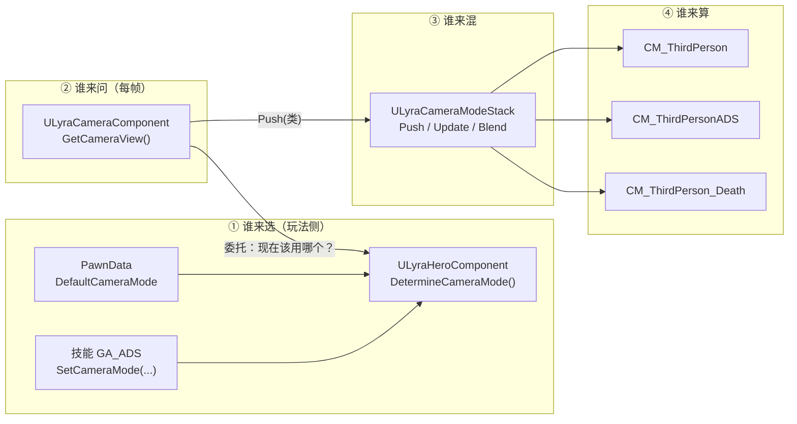

# 第 16 章　相机：相机模式栈与混合

## 一个问题：按住右键，镜头怎么“平滑地”拉近？

假设你在 Lyra 里按住鼠标右键开镜（ADS，Aim Down Sights）。你看到的是：镜头在大约半秒内从“角色背后偏上”滑到“肩膀旁边更近的位置”，视野（FOV）同时收窄；中途松开，镜头会从当前位置顺滑地退回去，而不是先跳到终点再退；如果你在开镜的同时被打死，镜头又会平滑过渡到死亡视角。

现在换成你来实现。UE 入门教程的做法大概是这样：在 Character 里放一个 SpringArm（引擎的弹簧臂组件，一根自带碰撞的相机吊臂）加一个 Camera，`Tick` 里写 `if (bAiming) { TargetArmLength = FInterpTo(...); FOV = FInterpTo(...); }`。

这个做法在第一个需求上没问题，之后会遇到这些麻烦：

- ADS 是个技能（第 9~10 章讲过，它由输入触发，在服务器和本地客户端都会运行），而相机逻辑写在 Character 里。技能要改相机，就得持有 Character 的引用、知道它有个 SpringArm，技能和角色蓝图开始互相依赖。
- 死亡镜头、冲刺镜头、投掷镜头……每加一种就多一个 `bool` 和一段插值，多个 `bool` 同时为真时谁说了算，没有规则。
- 按住 ADS 时松手，再按下，每个 `FInterpTo` 各自追各自的目标值，位置、FOV、俯仰各自有一套手感，很难保证“从当前画面继续”。
- 另一个玩法（比如本书后面提到的俯视角 TopDownArena）根本不要弹簧臂，要的是固定在竞技场上空的镜头。要么在 Character 里写满 `if`，要么复制一个 Character。

这一章讲 Lyra 怎么解决这件事。它的答案是：**把“选哪个相机模式”、“这个模式怎么算视角”、“多个模式怎么混合”拆成三件互不认识的事，并且让技能只通过一个窄接口说“我想要这个模式”。**

## 读完本章你能……

- 画出“每一帧，一个视角是怎么从 PlayerController 一路算出来的”这条链（引擎部分 + Lyra 部分）；
- 说出相机模式的选择优先级（技能覆盖 > PawnData 默认），以及技能结束后为什么一定会还原；
- 手算一次模式栈的混合：给定一串“按下 / 松开 ADS”的事件，写出每一步栈里每个模式的权重；
- 说清 `ULyraCameraMode_ThirdPerson` 的三个输入：俯仰角曲线、蹲伏偏移、防穿墙，并改动曲线观察效果；
- 新建一个相机模式（第一人称 / 左右肩切换），并说出它在什么场合会和别的技能“打架”。

## 需要先知道的 UE 概念

这一节只讲读懂本章必需的相机基础。如果你已经熟悉 `APlayerCameraManager`，可以跳到“朴素做法”。

### 视角（View）本质上就是一个小结构

渲染器每帧需要知道“从哪里、朝哪里、用多大视野看世界”。引擎把它封装成一个结构体 `FMinimalViewInfo`（引擎类型），最重要的字段是：位置（`Location`）、旋转（`Rotation`）、水平视野角（`FOV`），此外还有后处理设置、正交投影参数等。你可以把它理解成“一帧里的相机参数快照”。

### 相机组件（UCameraComponent）：一个“能回答视角”的组件

`UCameraComponent` 是引擎提供的组件，挂在 Actor 上。它的核心函数是虚函数 `GetCameraView(DeltaTime, FMinimalViewInfo& DesiredView)`：被问到“你现在想怎么看”时，往 `DesiredView` 里填位置、旋转、FOV。默认实现就是把组件自己的世界位置、旋转、`FieldOfView` 属性抄进去。

### 视角目标（View Target）与相机管理器（APlayerCameraManager）

谁来问？每个本地 PlayerController 都有一个 `APlayerCameraManager`（引擎类，简称相机管理器）。它保存一个“视角目标”（View Target，一个 Actor），每帧做这件事：

```text
APlayerController::UpdateCameraManager
  └─ APlayerCameraManager::UpdateCamera
       └─ DoUpdateCamera
            └─ UpdateViewTarget(ViewTarget)            // 虚函数，Lyra 重写了它
                 └─ UpdateViewTargetInternal           // 先问蓝图 BlueprintUpdateCamera，没人处理就……
                      └─ ViewTarget Actor 的 CalcCamera // 默认实现：找到 Actor 上第一个激活的 UCameraComponent
                           └─ UCameraComponent::GetCameraView(...)   // 填 FMinimalViewInfo
       → 得到最终的 POV（Point Of View），交给渲染
```

这条链是对 5.8 引擎源码（`PlayerCameraManager.cpp`、`Actor.cpp`）逐层核对过的。`AActor::CalcCamera` 里有个开关 `bFindCameraComponentWhenViewTarget`（默认 true），打开时才会去找激活的相机组件；没找到时退回 `GetActorEyesViewPoint`（眼睛位置加 `GetViewRotation()`）。另外，`UpdateViewTarget` 的引擎实现在算完视角后还会 `ApplyCameraModifiers`，所以相机抖动（Camera Shake）这类“后处理式”的效果走的是另一条路，不经过 Lyra 的模式栈。

默认情况下视角目标就是当前控制的 Pawn；切换观战对象、过场动画，本质上都是 `SetViewTarget` 换一个 Actor（并可以指定一个混合过渡）。

这条链是本章的“地基”。Lyra 要做的事情很集中：**在 `GetCameraView` 这一环换掉实现。**

### 控制旋转（Control Rotation）与 Pawn 的朝向

第 2 章讲过，Controller 是“意志”，Pawn 是“身体”。相机里这个区别很重要：

- **控制旋转**（Control Rotation）是 Controller 持有的一个 `FRotator`，代表“玩家想朝哪看/瞄哪”。鼠标输入改的是它（通过 `AddControllerYawInput` / `AddControllerPitchInput`）。
- **Pawn 的朝向**是 Actor 自己的旋转，代表“身体朝哪”。

两者怎么联系，取决于 Character 的几个开关。`ALyraCharacter` 的构造函数里设置了：

```cpp
// 简化自 Source/LyraGame/Character/LyraCharacter.cpp 的 ALyraCharacter::ALyraCharacter
bUseControllerRotationPitch = false;   // 身体不跟着抬头低头
bUseControllerRotationYaw = true;      // 身体的偏航角永远跟着控制旋转（射击游戏的“扫射式”转向）
bUseControllerRotationRoll = false;
```

所以在 Lyra 里，你转鼠标，角色的身体立刻朝同一个方向转；抬头低头只改变相机和瞄准方向，不让整个胶囊体后仰。`APawn::GetViewRotation()`（引擎函数）的规则很简单：**只要 Pawn 有 Controller，就返回它的控制旋转**（不要求是本地控制）；没有 Controller 的话，先看是否正被某个本地玩家观战，否则退回 Actor 自己的旋转。别的客户端上的模拟代理没有 Controller（Controller 不复制，第 3 章），所以它们走后两个分支。下面的相机模式正是从这里取“朝哪看”。

### 相机只在“有屏幕的那一端”运行

第 3 章强调过：讲任何运行时逻辑都要说它在哪一端跑。相机的答案很简单：**每帧的视角计算只发生在本地玩家所在的进程**（客户端，以及主机服务器上的主机玩家）。引擎在 `APlayerCameraManager::UpdateCamera` 里就是这样判断的：只有本地 PlayerController 才执行 `DoUpdateCamera`，除非你把 `bUseClientSideCameraUpdates` 关掉（默认是 true；客户端会把自己的视角用 `ServerUpdateCamera` 报给服务器，供服务器用，但服务器并不会替它重新算）。专用服务器上没有本地玩家，也就不会有人去调用相机组件的 `GetCameraView`。

这有一个后果，本章后面会再遇到：**服务器上的相机栈是“空转”的**。技能在服务器上激活时也会“设置相机模式”，但没人读它；凡是想靠相机状态做玩法判断（比如 ADS 加精度）的代码，在服务器上读到的是默认值。

## 朴素做法：在角色里直接写

先把朴素做法写成伪代码（这不是 Lyra 的代码，是我们要避免的写法）：

```cpp
// 伪代码：典型的"相机逻辑塞在 Character 里"
void AMyCharacter::Tick(float Dt)
{
    const float TargetArm = bAiming ? 120.f : 300.f;
    const float TargetFov = bAiming ? 60.f  : 90.f;
    SpringArm->TargetArmLength = FMath::FInterpTo(SpringArm->TargetArmLength, TargetArm, Dt, 8.f);
    Camera->SetFieldOfView(FMath::FInterpTo(Camera->FieldOfView, TargetFov, Dt, 8.f));
    if (bDead) { /* 又一段...*/ }
}
```

它会在这些具体场景里出问题：

1. **跳变。** 切换瞬间如果任何一个量不是插值而是直接赋值（比如死亡镜头直接 `SetRelativeLocation`），画面会硬切。
2. **互相覆盖。** 按住 ADS 的同时被击杀：`bAiming` 和 `bDead` 都为真，`Tick` 里后写的赢。没有“谁优先”的规则，只有代码顺序。
3. **中途反向。** 开镜到一半松手，`FInterpTo` 的指数衰减曲线是“距离越近越慢”，但“从中途松开后的回退速度”和“从头开镜的速度”是同一条曲线的不同位置，手感很难统一，也无法按模式单独配置“淡入多久”。
4. **复制粘贴与耦合。** 防穿墙、蹲伏下沉这类逻辑每多一套相机配置就要重写一遍；技能必须“认识”Character 的相机成员，换成没有 SpringArm 的 Pawn（俯视角玩法），技能就没法用了。

## Lyra 的拆分：谁选、谁算、谁混

Lyra 把这件事拆成四个角色：



- **选择方**（`ULyraHeroComponent::DetermineCameraMode`）只回答一个问题：“现在我想要哪个模式类？”它不知道相机怎么算。
- **宿主**（`ULyraCameraComponent`）是引擎相机管线里那个被询问视角的组件。它每帧把“想要的模式”交给栈，求值，回写结果。
- **栈**（`ULyraCameraModeStack`）管理一组模式实例和它们的混合权重，不知道每个模式内部怎么算。
- **模式**（`ULyraCameraMode` 的子类）只回答“如果只让我说了算，我想从哪里、朝哪里、用多大 FOV 看”，不知道自己在栈的哪一层。

技能想改相机时，只需要对 `ULyraGameplayAbility` 说 `SetCameraMode(某个类)`，不需要知道栈、权重、过渡时间。过渡的快慢属于“模式自己的属性”（`BlendTime`），写在模式资产里。

下面按这条链从外到内走一遍。

## 宿主：ULyraCameraComponent 每帧做三件事

`ALyraCharacter` 在构造函数里创建了一个 `ULyraCameraComponent`（引擎 `UCameraComponent` 的子类）。每帧引擎问它要视角，它的 `GetCameraView` 是这样的：

```cpp
// 简化自 Source/LyraGame/Camera/LyraCameraComponent.cpp 的 ULyraCameraComponent::GetCameraView
void ULyraCameraComponent::GetCameraView(float DeltaTime, FMinimalViewInfo& DesiredView)
{
    UpdateCameraModes();                                     // ① 问"现在要哪个模式"，Push 进栈

    FLyraCameraModeView CameraModeView;
    CameraModeStack->EvaluateStack(DeltaTime, CameraModeView); // ② 更新每个模式、混合出一个视角

    // ③ 把结果回写：
    if (APawn* TargetPawn = Cast<APawn>(GetTargetActor()))
        if (APlayerController* PC = TargetPawn->GetController<APlayerController>())
            PC->SetControlRotation(CameraModeView.ControlRotation);   // 控制旋转被相机反向覆盖！

    CameraModeView.FieldOfView += FieldOfViewOffset;          // 一帧有效的 FOV 附加量
    FieldOfViewOffset = 0.0f;

    SetWorldLocationAndRotation(CameraModeView.Location, CameraModeView.Rotation);
    FieldOfView = CameraModeView.FieldOfView;

    DesiredView.Location = CameraModeView.Location;           // 填引擎要的 FMinimalViewInfo
    DesiredView.Rotation = CameraModeView.Rotation;
    DesiredView.FOV      = CameraModeView.FieldOfView;
    // ……后面是正交参数、后处理等，照抄组件自己的属性
}
```

**控制旋转被反向覆盖了。** 第 ③ 步 `SetControlRotation` 意味着：相机模式算出的 `ControlRotation`（对第三人称来说就是夹过俯仰的瞄准方向）会写回 Controller。结果是模式里的 `ViewPitchMin/Max` 成为一道真正的限位，同时也意味着**不要在别处直接设置控制旋转**——下一帧会被相机覆盖。

**问“要哪个模式”的方式是一个委托。** `UpdateCameraModes` 的实现：

```cpp
// 简化自 LyraCameraComponent.cpp 的 ULyraCameraComponent::UpdateCameraModes
if (CameraModeStack->IsStackActivate())
{
    if (DetermineCameraModeDelegate.IsBound())
    {
        if (const TSubclassOf<ULyraCameraMode> CameraMode = DetermineCameraModeDelegate.Execute())
        {
            CameraModeStack->PushCameraMode(CameraMode);   // 每帧都 Push "当前想要的"模式
        }
    }
}
```

注意“每帧都 Push”。这不是事件（“切换到 ADS”只发生一次），而是**每帧声明期望状态**：我现在想要 X。栈负责保证 X 在最上面，并且已经在最上面时 Push 什么都不做（下面会看到）。这种“声明式”写法让选择方不需要记住上一次选了什么。

这个委托绑定在哪？看下一节。

## 选择方：技能覆盖优先，其次 PawnData 默认

`DetermineCameraModeDelegate` 是 `ULyraCameraComponent` 上的一个单播委托（`DECLARE_DELEGATE_RetVal`）。绑定它的是 `ULyraHeroComponent`，也就是第 8 章讲过的、在 Pawn 初始化链里负责输入和相机的那个组件：

```cpp
// 简化自 Source/LyraGame/Character/LyraHeroComponent.cpp 的 ULyraHeroComponent::HandleChangeInitState 末尾
// Hook up the delegate for all pawns, in case we spectate later
if (PawnData)
{
    if (ULyraCameraComponent* CameraComponent = ULyraCameraComponent::FindCameraComponent(Pawn))
    {
        CameraComponent->DetermineCameraModeDelegate.BindUObject(this, &ThisClass::DetermineCameraMode);
    }
}
```

它的实现只有几行：

```cpp
// 简化自 Source/LyraGame/Character/LyraHeroComponent.cpp 的 ULyraHeroComponent::DetermineCameraMode
TSubclassOf<ULyraCameraMode> ULyraHeroComponent::DetermineCameraMode() const
{
    if (AbilityCameraMode)                 // ① 有技能临时指定的，就用它
    {
        return AbilityCameraMode;
    }
    // ② 否则取 PawnData 里配置的默认模式
    if (ULyraPawnExtensionComponent* PawnExtComp = ULyraPawnExtensionComponent::FindPawnExtensionComponent(Pawn))
        if (const ULyraPawnData* PawnData = PawnExtComp->GetPawnData<ULyraPawnData>())
            return PawnData->DefaultCameraMode;
    return nullptr;
}
```

**优先级是 技能覆盖 > PawnData 默认。** [第 8 章](08-PawnAssembly.md)说过，PawnData 是“一个角色长什么样、有什么配置”的数据资产，其中 `DefaultCameraMode` 就是这个角色平时用的相机模式；`HeroData_ShooterGame` 里填的是 `CM_ThirdPerson`（`FOV = 80`、`BlendTime = 0.5` 秒）。

这里有一个容易忽略的前提：绑定发生在 `if (PawnData)` 里。**没有 HeroComponent、或者没有 PawnData 的 Pawn，委托永远是空的，相机栈永远没有模式，输出的是 `FLyraCameraModeView` 的默认值**（位置在原点）。想给 AI 或观战 Pawn 做相机，得自己保证有这条绑定。

### 技能怎么设置模式

`ULyraGameplayAbility`（第 10 章的项目技能基类）提供了一对窄接口：

```cpp
// 简化自 Source/LyraGame/AbilitySystem/Abilities/LyraGameplayAbility.cpp
void ULyraGameplayAbility::SetCameraMode(TSubclassOf<ULyraCameraMode> CameraMode)
{
    ENSURE_ABILITY_IS_INSTANTIATED_OR_RETURN(SetCameraMode, );   // 只允许"每个Actor实例化一份"的技能
    if (ULyraHeroComponent* HeroComponent = GetHeroComponentFromActorInfo())
    {
        HeroComponent->SetAbilityCameraMode(CameraMode, CurrentSpecHandle);  // 记下"谁设的"
        ActiveCameraMode = CameraMode;
    }
}

void ULyraGameplayAbility::ClearCameraMode()
{
    if (ActiveCameraMode)
    {
        if (ULyraHeroComponent* HeroComponent = GetHeroComponentFromActorInfo())
            HeroComponent->ClearAbilityCameraMode(CurrentSpecHandle);
        ActiveCameraMode = nullptr;
    }
}

void ULyraGameplayAbility::EndAbility(/*...*/)
{
    ClearCameraMode();                     // 技能结束，无论如何都清理
    Super::EndAbility(/*...*/);
}
```

HeroComponent 一侧：

```cpp
// 简化自 LyraHeroComponent.cpp
void ULyraHeroComponent::SetAbilityCameraMode(TSubclassOf<ULyraCameraMode> CameraMode, const FGameplayAbilitySpecHandle& OwningSpecHandle)
{
    if (CameraMode)
    {
        AbilityCameraMode = CameraMode;
        AbilityCameraModeOwningSpecHandle = OwningSpecHandle;   // 单个槽位：后设的覆盖先设的
    }
}

void ULyraHeroComponent::ClearAbilityCameraMode(const FGameplayAbilitySpecHandle& OwningSpecHandle)
{
    if (AbilityCameraModeOwningSpecHandle == OwningSpecHandle)  // 只有"当前占着槽位的那个技能"才能清
    {
        AbilityCameraMode = nullptr;
        AbilityCameraModeOwningSpecHandle = FGameplayAbilitySpecHandle();
    }
}
```

三个设计点：

- **`EndAbility` 里自动清理。** 技能无论正常结束还是被取消、被打断，都会走 `EndAbility`，所以相机一定会还原，不需要每个技能蓝图记得“结束时清除”。这正是朴素做法里 `bAiming` 容易忘记置回 `false` 的那类 bug 的解法。
- **用 SpecHandle 做“所有权”。** 两个技能先后设置相机，后者覆盖；先设的那个技能结束时，句柄对不上，不会把后者的设置清掉。
- **但它只有一个槽位，没有层级。** 这看起来是 Lyra 的简化（官方没有说明动机，推断）。ADS 在“左肩模式”之上激活，ADS 结束时槽位被清成空，回到 PawnData 默认，而不是回到“左肩模式”。这个坑在本章配方里会再遇到。

### 谁在哪一端跑

`SetCameraMode` 在技能激活时被调用。第 9 章讲过，被预测的技能会在**拥有它的客户端**和**服务器**各激活一次，所以两端的 HeroComponent 都会记录 `AbilityCameraMode`。但只有本地客户端有人读它（相机每帧求值）；服务器上这个变量是写给没人看的。

## 模式：一个模式只回答“我想看哪里”

先看基类 `ULyraCameraMode` 的几个数据成员，它们都是 `EditDefaultsOnly`，也就是在蓝图资产的“类默认值”里配置：

| 属性 | 含义 | 默认 |
|---|---|---|
| `FieldOfView` | 水平视野角 | 80 |
| `ViewPitchMin/Max` | 俯仰角上下限 | -89 / 89 |
| `BlendTime` | 淡入这个模式要多久（秒） | 0.5 |
| `BlendFunction` / `BlendExponent` | 淡入的曲线形状 | EaseOut / 4 |
| `CameraTypeTag` | 供玩法查询“当前是哪一类相机” | 空 |

基类对外只有一个核心虚函数 `UpdateView`，它的默认实现已经是一个完整的“第一人称式”视角：

```cpp
// 简化自 Source/LyraGame/Camera/LyraCameraMode.cpp 的 ULyraCameraMode::UpdateView
void ULyraCameraMode::UpdateView(float DeltaTime)
{
    FVector PivotLocation = GetPivotLocation();       // 眼睛的位置
    FRotator PivotRotation = GetPivotRotation();      // 朝哪看（来自 Pawn->GetViewRotation()）
    PivotRotation.Pitch = FMath::ClampAngle(PivotRotation.Pitch, ViewPitchMin, ViewPitchMax);

    View.Location = PivotLocation;
    View.Rotation = PivotRotation;
    View.ControlRotation = View.Rotation;
    View.FieldOfView = FieldOfView;
}
```

`View` 是模式的“输出”（`FLyraCameraModeView`）。模式每帧只做一件事：往 `View` 里写。它不关心自己是不是最终画面，不关心前后有没有别的模式。

“枢轴”（Pivot）是模式求位置的起点。`GetPivotLocation` 对 Character 做了一个细节处理：

```cpp
// 简化自 LyraCameraMode.cpp 的 ULyraCameraMode::GetPivotLocation（Character 分支）
const float DefaultHalfHeight = CapsuleCompCDO->GetUnscaledCapsuleHalfHeight();  // 站立时的胶囊半高
const float ActualHalfHeight  = CapsuleComp->GetUnscaledCapsuleHalfHeight();     // 当前（蹲伏时更小）
const float HeightAdjustment  = (DefaultHalfHeight - ActualHalfHeight) + TargetCharacterCDO->BaseEyeHeight;
return TargetCharacter->GetActorLocation() + (FVector::UpVector * HeightAdjustment);
```

按这段代码推断：蹲下时胶囊缩小、Actor 位置（胶囊中心）下沉，这里的 `(Default - Actual)` 正好把下沉补回来，让枢轴不因胶囊缩小而突然掉下去；“蹲下时眼睛降低”由具体模式自己平滑地加（ThirdPerson 有，见后面）。这是我们后面做第一人称配方时需要注意的一点。

另外，`GetPivotRotation` 对 Pawn 返回 `GetViewRotation()`，即前面说的控制旋转（有 Controller 时）。

### 混合曲线怎么来的

模式用 `BlendAlpha`（线性 0→1）加一个曲线函数得到 `BlendWeight`：

```cpp
// 简化自 LyraCameraMode.cpp 的 ULyraCameraMode::UpdateBlending
if (BlendTime > 0.0f)
{
    BlendAlpha += (DeltaTime / BlendTime);      // 线性推进，BlendTime 秒走完
    BlendAlpha = FMath::Min(BlendAlpha, 1.0f);
}
else
{
    BlendAlpha = 1.0f;                           // BlendTime=0：立即完成（硬切）
}
// 再按 BlendFunction 把 alpha 映射成 weight：Linear / EaseIn / EaseOut / EaseInOut，指数是 BlendExponent
BlendWeight = FMath::InterpEaseOut(0.0f, 1.0f, BlendAlpha, Exponent);   // 默认是 EaseOut
```

按引擎 `FMath::InterpEaseOut` 的定义（已对照 5.8 的 `UnrealMathUtility.h`），它就是 `Lerp(A, B, 1 - (1 - α)^指数)`；对应的 `InterpEaseIn` 是 `Lerp(A, B, α^指数)`。EaseOut 开头冲得快，快到终点时变慢。默认指数 4 时，走完 25% 的时间，权重 = 1 − 0.75⁴ ≈ 0.68。所以默认的淡入手感是“反应迅速、落点柔和”。头文件里 `BlendFunction` 各枚举上的英文注释容易让人读反，建议用后面的实验直接观察。

模式还有一个反向函数 `SetBlendWeight(权重)`：直接设定权重，并用曲线的反函数反推出对应的 `BlendAlpha`（例如 EaseOut 指数 4 的反函数恰好是指数取 `1/4` 的幂函数，源码里写的就是 `1.0f / BlendExponent`），这样下一帧继续往前推进时，进度条不会跳变。这是下一节“中途松手不跳变”的关键。

## 栈：Push、Update、Blend

终于来到本章的核心。`ULyraCameraModeStack` 里有两个数组：

- `CameraModeInstances`：按**类**缓存的模式实例（每个类只创建一次，以相机组件为 Outer）；
- `CameraModeStack`：当前参与混合的模式，**下标 0 是最顶（最新），最后一个是栈底**。

### Push：把“我想要的”放到最上面

读下面这段代码之前，先把栈想成**一叠半透明胶片**：排在上面的每一层都会挡掉一部分画面（权重 `w` 意味着它占掉 `w`，只给下面留 `1 - w` 的透光率）。因此，栈中间某一层此刻真正能透到屏幕上的画面占比（`ExistingStackContribution`），等于“它自己的权重 × 压在它上面的每一层剩下的透光率 `(1 - 上层权重)`”：

```cpp
// 简化自 LyraCameraMode.cpp 的 ULyraCameraModeStack::PushCameraMode
void ULyraCameraModeStack::PushCameraMode(TSubclassOf<ULyraCameraMode> CameraModeClass)
{
    ULyraCameraMode* CameraMode = GetCameraModeInstance(CameraModeClass);   // 按类取缓存实例
    int32 StackSize = CameraModeStack.Num();

    if ((StackSize > 0) && (CameraModeStack[0] == CameraMode))
        return;                                  // ① 已经在最上面：什么都不做

    // ② 如果它已经在栈里（比如正在淡出），算出它"现在对最终画面贡献了多少"
    int32 ExistingStackIndex = INDEX_NONE;
    float ExistingStackContribution = 1.0f;
    for (int32 StackIndex = 0; StackIndex < StackSize; ++StackIndex)
    {
        if (CameraModeStack[StackIndex] == CameraMode)
        {
            ExistingStackIndex = StackIndex;
            ExistingStackContribution *= CameraMode->GetBlendWeight();       // 自己的权重
            break;
        }
        else
        {
            ExistingStackContribution *= (1.0f - CameraModeStack[StackIndex]->GetBlendWeight()); // 压在它上面的每层"挡掉"一部分
        }
    }
    if (ExistingStackIndex != INDEX_NONE) { CameraModeStack.RemoveAt(ExistingStackIndex); StackSize--; }
    else                                  { ExistingStackContribution = 0.0f; }

    // ③ 决定起始权重：要淡入且栈非空 → 从"现有贡献"开始；否则直接 1
    const bool bShouldBlend = (CameraMode->GetBlendTime() > 0.0f) && (StackSize > 0);
    CameraMode->SetBlendWeight(bShouldBlend ? ExistingStackContribution : 1.0f);

    CameraModeStack.Insert(CameraMode, 0);       // ④ 放到最顶
    CameraModeStack.Last()->SetBlendWeight(1.0f); // ⑤ 栈底永远 100%

    if (ExistingStackIndex == INDEX_NONE) CameraMode->OnActivation();
}
```

读这段代码需要抓住三点。

第一，**已经在栈里的模式被重新 Push 时，保留的是它“当前对画面的贡献”，而不是从头开始。** 这是整章最重要的一个细节，下面用数字走一遍。

第二，**栈底权重永远是 1。** 这样不管栈里是什么状态，总有一个“完整的底图”可以让上面的层往上叠加，不会出现“所有层权重加起来不到 1，画面是半透明的”这种情况。

第三，**同一个模式已经在最上面时，Push 是空操作。** 配合前面“每帧都 Push”，平时（栈里只有一个模式）每帧的 Push 几乎没有代价。

### 求值：先更新，再从栈底往上混

```cpp
// 简化自 LyraCameraMode.cpp 的 ULyraCameraModeStack::UpdateStack
for (int32 StackIndex = 0; StackIndex < StackSize; ++StackIndex)    // 从最顶往下
{
    ULyraCameraMode* CameraMode = CameraModeStack[StackIndex];
    CameraMode->UpdateCameraMode(DeltaTime);                         // UpdateView + UpdateBlending

    if (CameraMode->GetBlendWeight() >= 1.0f)
    {
        // 这一层已经完全盖住下面所有层 → 下面的全部作废并移除
        RemoveIndex = StackIndex + 1;
        RemoveCount = StackSize - RemoveIndex;
        break;
    }
}
// 对被移除的层调用 OnDeactivation，然后 RemoveAt
```

```cpp
// 简化自 ULyraCameraModeStack::BlendStack
const ULyraCameraMode* CameraMode = CameraModeStack[StackSize - 1];       // 从栈底开始
OutCameraModeView = CameraMode->GetCameraModeView();
for (int32 StackIndex = (StackSize - 2); StackIndex >= 0; --StackIndex)   // 往上一层层叠
{
    CameraMode = CameraModeStack[StackIndex];
    OutCameraModeView.Blend(CameraMode->GetCameraModeView(), CameraMode->GetBlendWeight());
}
```

`FLyraCameraModeView::Blend(Other, Weight)` 的规则：权重 ≤ 0 不变；权重 ≥ 1 直接整个替换为 `Other`；中间值时，位置和 FOV 线性插值，旋转用“归一化的差值”按权重叠加（避免 359° 到 1° 绕远路）。

注意两个细节：**更新是从最顶往下，混合是从栈底往上**。而且 `UpdateStack` 的循环会一直更新到第一个“权重满了”的层——也就是说，被淡出中的旧模式**仍然在每帧 `UpdateView`**，它会继续跟着目标移动，所以淡出过程中不会出现“旧画面冻住”的现象。

### 手算一遍：按下、中途松开、再按下

假设 `CM_ThirdPerson`（TP）是默认模式，`CM_ThirdPersonADS`（ADS）的 `BlendTime` 设为 0.5 秒（资产里实际配的是 `0.22` 秒、`FOV = 70`，这里取 `0.5` 方便口算）。为了让数字好算，把权重当作“已经过曲线后的值”来写。

| 时刻 | 事件 | Push 后的栈（顶 → 底） | 说明 |
|---|---|---|---|
| t0 | 只有 TP | `[TP(1.0)]` | 每帧 Push(TP) 都是空操作 |
| t1 | 按下右键，技能设置 ADS | `[ADS(0.0), TP(1.0)]` | ADS 不在栈里，贡献记 0；栈非空，起始权重 0 |
| t2 | 淡入到 ADS = 0.4 | `[ADS(0.4), TP(1.0)]` | 混合结果 = 0.4×ADS + 0.6×TP |
| t3 | 此刻松手，选择结果变回 TP | `[TP(0.6), ADS(1.0)]` | Push(TP)：TP 在下标 1，贡献 = (1-0.4)×1 = 0.6，被移到最顶，起始权重 0.6；ADS 变成栈底，权重强制为 1 |
| t4 | TP 继续淡入到 0.8 | `[TP(0.8), ADS(1.0)]` | 此时若再次按下右键，Push(ADS)：贡献 = (1-0.8)×1 = 0.2 |
| t5 | TP 权重到 1.0 | `[TP(1.0)]` | `UpdateStack` 发现 TP 权重满，移除 ADS（`OnDeactivation`） |

关键在 t3：**松手前的画面是 0.4×ADS + 0.6×TP；松手后是 0.6×TP + 0.4×ADS（ADS 成为底图）。两者完全相同，所以画面不跳。**之后 TP 从 0.6 往 1 走，也就是“从当前位置回去”，剩余时间自然比从头走短一些（因为用 `SetBlendWeight` 反推了 `BlendAlpha`，进度是连续的）。

这就是前面朴素做法第 3 点（中途反向）的答案：权重作为“每个模式对画面的贡献”被保存在栈里，反向时不是重新开始，而是角色互换。

栈在 `ULyraCameraComponent::OnRegister` 里创建，模式实例以相机组件为 Outer（所以模式对象不能脱离相机组件单独创建）。实例按类缓存，因此同一个模式的内部状态（ThirdPerson 的蹲伏插值进度、防穿墙的当前遮挡比例）在两次激活之间会保留。

## 第三人称模式：偏移曲线、蹲伏、防穿墙

`ULyraCameraMode_ThirdPerson` 是 `Abstract, Blueprintable` 的：你不会直接用它，而是在编辑器里基于它建蓝图（`CM_ThirdPerson`、`CM_ThirdPersonADS`、`CM_ThirdPerson_Death`）。它的 `UpdateView` 分三块。

### 一：用俯仰角采样偏移曲线

```cpp
// 简化自 Source/LyraGame/Camera/LyraCameraMode_ThirdPerson.cpp 的 ULyraCameraMode_ThirdPerson::UpdateView
UpdateForTarget(DeltaTime);                 // 蹲伏时设置目标偏移
UpdateCrouchOffset(DeltaTime);              // 把当前偏移平滑推向目标

FVector PivotLocation = GetPivotLocation() + CurrentCrouchOffset;
FRotator PivotRotation = GetPivotRotation();
PivotRotation.Pitch = FMath::ClampAngle(PivotRotation.Pitch, ViewPitchMin, ViewPitchMax);

View.Location = PivotLocation;
View.Rotation = PivotRotation;
View.ControlRotation = View.Rotation;
View.FieldOfView = FieldOfView;

if (TargetOffsetCurve)
{
    // 曲线的横轴是"俯仰角"，输出是一个局部偏移向量 (X前后, Y左右, Z上下)
    const FVector TargetOffset = TargetOffsetCurve->GetVectorValue(PivotRotation.Pitch);
    View.Location = PivotLocation + PivotRotation.RotateVector(TargetOffset);   // 旋转到枢轴朝向再叠加
}

UpdatePreventPenetration(DeltaTime);        // 最后做防穿墙
```

曲线是一个 `UCurveVector`（引擎的三通道曲线资产，X/Y/Z 各一条）。为什么横轴是俯仰角？因为第三人称射击里，**抬头和低头时你想要的相机偏移不一样**：平视时相机在肩后偏上；大幅俯视（看脚下）时，相机应该更高更靠后，否则角色的头会挡住准星；大幅仰视时又要拉近避免穿地。把“偏移 = f(俯仰角)”画成曲线，美术直接拖点就能调手感，不用改代码。

偏移向量先被 `PivotRotation.RotateVector` 转到枢轴的朝向，再加到枢轴位置上。所以 X 为负表示在枢轴“身后”，Y 为正偏右肩，Z 往上。具体数值在资产 `ThirdPersonOffsetCurve`（`Content/Characters/Cameras/`）里，ADS 的是 ShooterCore 里的 `ThirdPersonADSOffsetCurve`。

另有一对互斥选项：`bUseRuntimeFloatCurves` 打开后改用 `TargetOffsetX/Y/Z` 三条 `FRuntimeFloatCurve`。源码注释（UE-103986）说明了原因：`FRuntimeFloatCurve` 在 PIE 里无法实时编辑，而曲线资产可以，所以默认用曲线资产。

### 二：蹲伏偏移

`UpdateForTarget` 发现角色处于蹲伏时，把目标偏移设成 `(0, 0, CrouchedEyeHeight - BaseEyeHeight)`（负值，往下），`UpdateCrouchOffset` 用 `InterpEaseInOut` 在 `CrouchOffsetBlendMultiplier`（默认 5）控制的速度下平滑过渡。这就是前面说的“蹲下时眼睛降低”。注意这里是对枢轴的偏移，所以它也被防穿墙等后续步骤考虑进去。

### 三：防穿墙（penetration avoidance）

想象你背靠墙站着，相机要放在你身后 3 米，但那里是一堵墙。如果不处理，相机会钻进墙里看到模型背面。解决办法是“相机碰撞”：Lyra 在 `UpdatePreventPenetration` 里这样做：

1. 找一个“安全点”（`SafeLocation`）：大致是角色胶囊体里离瞄准线最近的点，保证它在角色身体内部，不会被墙挡；
2. 从安全点向“期望的相机位置”发射探测，用 `ECC_Camera` 碰撞通道做球体扫掠（`SweepSingleByChannel`）；
3. 如果被挡住，把相机位置拉近到“碰撞点之前一点点”（再往回推 `CollisionPushOutDistance`）。

这套探测不止一根“射线”（feeler）。构造函数里放了 7 根：

```cpp
// 简化自 LyraCameraMode_ThirdPerson.cpp 的 ULyraCameraMode_ThirdPerson::ULyraCameraMode_ThirdPerson
// FLyraPenetrationAvoidanceFeeler(偏转角 AdjustmentRot, WorldWeight, PawnWeight, 球半径 Extent, TraceInterval)
Add(FRotator(  0,   0, 0), 1.00f, 1.00f, 14.f, 0);   // [0] 主射线：正对期望位置，球半径 14
Add(FRotator(  0, +16, 0), 0.75f, 0.75f,  0.f, 3);   // [1..] 预测射线：向左右/上下偏转，探测"如果玩家转过去会不会撞墙"
Add(FRotator(  0, -16, 0), 0.75f, 0.75f,  0.f, 3);
// …… 还有 ±32 度、俯仰 ±20 度几根
```

可以这样理解：**主射线是“眼前的墙”，必须马上处理；预测射线像猫的胡须，探测周围，提前一点把相机往里收，这样转身时相机是“被轻轻推进来”，而不是“突然弹进来”。** 主射线（下标 0）命中时相机立刻吸附过去（硬阻挡），预测射线命中时按 `PenetrationBlendInTime`（默认 0.1 秒）平滑拉近；障碍物消失后，用 `PenetrationBlendOutTime`（默认 0.15 秒）平滑放回。`TraceInterval` 决定预测射线隔几帧才扫一次（没命中时），节省开销。

一些实用的规则（都在这个函数里）：带 Actor Tag `IgnoreCameraCollision` 的物体被忽略；位于视角目标前方的 `ACameraBlockingVolume`（专门用来挡相机的体积）被忽略，在身后的才起作用；视角目标自己被忽略。

读代码时有一个小发现：命中时先按 `Weight`（`WorldWeight`/`PawnWeight`）算了一次 `NewBlockPct`，但紧接着这个变量被重新赋值覆盖（“Recompute blocked pct taking into account pushout distance”）。按代码阅读，这两个权重字段目前并不影响最终结果；调手感时改半径、角度、间隔和混合时间更有效。

最后，如果相机被推得太近（遮挡比例小于 `ReportPenetrationPercent`），模式会通知实现了 `ILyraCameraAssistInterface` 的对象调用 `OnCameraPenetratingTarget`。`ALyraPlayerController` 实现了它：设置 `bHideViewTargetPawnNextFrame = true`，下一帧在 `UpdateHiddenComponents` 里把视角目标 Pawn 的所有组件隐藏——相机贴脸时角色“消失”，避免挡住镜头。不过 `CM_ThirdPerson` 里 `ReportPenetrationPercent` 保持了默认值 `0`（而遮挡比例不会小于 0），所以默认并没有启用“贴墙隐藏自身”，需要时把它调成正数（如 `0.15`）即可开启。

## 玩家相机管理器：很薄的一层

`ALyraPlayerController` 在构造函数里把 `PlayerCameraManagerClass` 设成 `ALyraPlayerCameraManager`。这个类做的事不多：

```cpp
// 简化自 Source/LyraGame/Camera/LyraPlayerCameraManager.cpp
// 构造函数里设了 DefaultFOV=80、ViewPitchMin/Max=-89/89，并创建 UICamera 子对象
void ALyraPlayerCameraManager::UpdateViewTarget(FTViewTarget& OutVT, float DeltaTime)
{
    if (UICamera->NeedsToUpdateViewTarget())     // UI 想抢镜头时优先给 UI
    {
        Super::UpdateViewTarget(OutVT, DeltaTime);
        UICamera->UpdateViewTarget(OutVT, DeltaTime);
        return;
    }
    Super::UpdateViewTarget(OutVT, DeltaTime);   // 否则走引擎默认：最终调到 ULyraCameraComponent::GetCameraView
}
```

它设了默认 FOV 和俯仰上下限（引擎在处理输入对控制旋转的增量时用到俯仰限位），并提供一个“UI 相机”的挂点和 `showdebug camera` 的调试输出。**但这个 UI 相机组件在原版 Lyra 里是空壳**：`NeedsToUpdateViewTarget()` 恒为 `false`，`UpdateViewTarget` 什么都不做。所以别指望它帮你接管相机，它只是个扩展点。

## 玩法反读相机：CameraTypeTag 与 GetBlendInfo

相机模式有个 `CameraTypeTag` 属性。它的用意（推断，源码没有注释说明）是：**玩法代码想知道“玩家现在是不是在瞄准”，不应该去比较“当前模式是不是 `CM_ThirdPersonADS` 这个具体类”，而应该问“当前是不是 `Lyra.Weapon.SteadyAimingCamera` 这一类”。** 这样新增一个“狙击镜”模式时，只要它也带这个 Tag，武器的精度加成自动生效。

`CM_ThirdPersonADS` 的 `CameraTypeTag` 设的就是 `Lyra.Weapon.SteadyAimingCamera`（资产里可以看到）。武器侧读取的地方：

```cpp
// 简化自 Source/LyraGame/Weapons/LyraRangedWeaponInstance.cpp 的散布更新
if (const ULyraCameraComponent* CameraComponent = ULyraCameraComponent::FindCameraComponent(Pawn))
{
    float TopCameraWeight;
    FGameplayTag TopCameraTag;
    CameraComponent->GetBlendInfo(/*out*/ TopCameraWeight, /*out*/ TopCameraTag);
    AimingAlpha = (TopCameraTag == TAG_Lyra_Weapon_SteadyAimingCamera) ? TopCameraWeight : 0.0f;
}
// AimingAlpha 在 [0,1] 间映射到散布倍率：1.0 → SpreadAngleMultiplier_Aiming
```

这里有一个值得验证的细节。`ULyraCameraModeStack::GetBlendInfo` 的头文件注释写“top layer”，但实现取的是 `CameraModeStack.Last()`，也就是**栈底**。按前面的栈规则推演：

- 开镜淡入期间栈是 `[ADS(w), TP(1)]`，栈底是 TP：返回的 Tag 不是 SteadyAiming，`AimingAlpha = 0`；淡入完成、TP 被移除后，栈底变成 ADS，权重 1，`AimingAlpha` 跳到 1。
- 松手淡出期间栈是 `[TP(w), ADS(1)]`，栈底是 ADS：`AimingAlpha` 保持 1，直到 TP 完全盖住后才降为 0。

也就是说，按当前代码，ADS 精度加成更像是“相对镜头过渡延迟了一个 BlendTime 的开关”，而不是和镜头同步的渐变（武器代码的注释写的是后者）。如果你的玩法需要严格和镜头混合同步的精度过渡，应当把 `GetBlendInfo` 改成检查栈顶层 `CameraModeStack[0]`。

另一件事：因为相机栈只在本地求值，**服务器上这个栈是空转的**——专用服务器上的武器实例读到的是默认值（Tag 为空、权重 1），ADS 精度加成本质上是一个客户端表现。[第 14 章](14-Weapons.md)讲过，Lyra 的射击是客户端检测、服务器基本信任，这一点和那里的结论一致。

## ADS 在资产里的样子

在编辑器里打开 `ShooterCore` 插件下的蓝图技能 `Input/Abilities/GA_ADS`，可以看到上面这套接口的标准用法：`Event ActivateAbility` 调用 `SetCameraMode(CM_ThirdPersonADS)`，同时挂上减速输入映射上下文 `IMC_ADS_Speed`（优先级 11）并广播瞄准状态消息；随后用 `WaitInputRelease` 等待松开右键，松开后调用 `ClearCameraMode` 并 `EndAbility`（若中途被死亡或换枪打断，基类的 `EndAbility` 也会兜底调用 `ClearCameraMode`）。死亡镜头同理：`GA_Hero_Death` 在激活时调用 `SetCameraMode(CM_ThirdPerson_Death)`，直到角色销毁才结束。

## 动手实验

### 实验 1：用 showdebug 看栈的变化

**目标**：亲眼看到栈里的权重在 ADS 按下 / 松开时怎么变。

**步骤**：

1. 打开 `L_Expanse`，用 PIE 运行（单人即可）。
2. 打开控制台（默认 `~` 键），输入 `showdebug camera`。屏幕上会出现 `LyraPlayerCameraManager`，下面有 `--- Camera Modes (Begin) ---` 到 `(End)` 之间的若干行，每行是一个模式的名字和权重。
3. 拿起武器，按住鼠标右键（ADS 的默认按键，以编辑器里的输入映射为准），再松开。

**先写下你的预测**：按住的瞬间，栈里有几个模式？松开后呢？权重数字会怎么变化？

**预期结果**：平时只有一行 `CM_ThirdPerson`（名字后面会带实例编号），权重 1.0。按下后出现两行：上面一行是 ADS，权重从 0 往 1 涨；ADS 权重到 1 时，下面的 TP 行消失。松开时又出现两行，这次上面是 TP（起始权重等于松手时的贡献），下面是 ADS（权重显示为 1）。

**原理**：就是上一节表格里 t1~t5 的过程。注意“栈底权重永远显示 1”。

结束后再输入一次 `showdebug camera` 关闭显示。

### 实验 2：改曲线，观察偏移

**目标**：理解“偏移 = f(俯仰角)”。

**步骤**：

1. 在内容浏览器打开 `Content/Characters/Cameras/ThirdPersonOffsetCurve`（`CurveVector` 资产）。**先截图或记下原始曲线**。
2. 保持这个资产窗口打开，PIE 运行。
3. 在运行中直接拖动曲线上的点：先把 Y 通道在俯仰 0 附近的值整体改成一个较大的正值（比如 +80），然后改 X 通道（前后）。
4. 上下转动鼠标，看相机相对角色的位置随俯仰变化。

**先写下你的预测**：Y 变大后，角色会跑到屏幕哪一侧？低头时曲线 X 值变小会怎样？

**预期结果**：Y 为正，相机往角色的右侧偏，所以角色出现在屏幕左侧。拖动其他点会让相机在不同俯仰角下前后、上下移动。

**原理**：曲线资产（不同于 `FRuntimeFloatCurve`）支持 PIE 里实时编辑，`UpdateView` 每帧重新采样，所以改动立即生效。偏移被 `RotateVector` 转到枢轴朝向，所以 Y 永远是“你的右手边”。记得最后把曲线恢复原样，且不要保存这次改动。

### 实验 3：调 ADS 的淡入，观察“中途松手”

**目标**：验证“中途松手不跳变”。

**步骤**：

1. 打开 `Plugins/GameFeatures/ShooterCore/Content/Camera/CM_ThirdPersonADS`（在内容浏览器里需要打开“显示插件内容”），把类默认值里的 `BlendTime` 改成 2.0。
2. **重新启动 PIE**（模式实例在第一次被 Push 时才从类默认值创建，PIE 中途改类默认值不会影响已经缓存的实例）。
3. 打开 `showdebug camera`，按住右键约 1 秒后松开，观察镜头与权重数字。再试：按住 → 松开 → 在回退一半时再次按住。

**先写下你的预测**：松手后回到默认镜头需要 2 秒还是更短？回退一半时再按住，是从 0 重新开始吗？

**预期结果**：松手后回退的时间比 2 秒短（因为 TP 的起始权重就是松手时的贡献，不是 0）；回退一半时再次按住，ADS 的起始权重 = 当时 ADS 的贡献，镜头继续往 ADS 方向走，不会先弹回默认再重新来。

**原理**：`PushCameraMode` 的 `ExistingStackContribution` + `SetBlendWeight` 反推 `BlendAlpha`。**注意，实验完把 `BlendTime` 改回原值，且不要保存。**

## 配方

### 配方 A：第一人称模式

**需求**：做一个第一人称视角，可以作为角色默认模式，也可以由技能临时切换。

观察基类 `ULyraCameraMode::UpdateView` 已经是“枢轴位置 + 控制旋转方向 + FOV”，天然就是第一人称——所以这个模式几乎不需要新代码。唯一要补的是蹲伏：前面看到基类枢轴把胶囊缩小的下沉补回去了，所以蹲下时眼睛不会自己降低。

下面是一个**新写的示例**（不是 Lyra 源码；使用的 API 都来自上文读过的 `ULyraCameraMode`）：

```cpp
// 示例：LyraGame 模块里新建 Camera/LyraCameraMode_FirstPerson.h / .cpp
UCLASS(Blueprintable)                       // 基类是 NotBlueprintable，子类自己声明 Blueprintable 才能在编辑器里建蓝图
class ULyraCameraMode_FirstPerson : public ULyraCameraMode
{
    GENERATED_BODY()
public:
    ULyraCameraMode_FirstPerson();
protected:
    virtual void UpdateView(float DeltaTime) override;
};

ULyraCameraMode_FirstPerson::ULyraCameraMode_FirstPerson()
{
    FieldOfView = 90.f;
    BlendTime = 0.15f;                      // 第一人称切换要快
}

void ULyraCameraMode_FirstPerson::UpdateView(float DeltaTime)
{
    Super::UpdateView(DeltaTime);           // 位置=枢轴，旋转=控制旋转(夹俯仰)，FOV

    if (const ACharacter* Character = Cast<ACharacter>(GetTargetActor()))
    {
        if (Character->IsCrouched())        // 简化：不做平滑；要平滑可抄 ThirdPerson 的 UpdateCrouchOffset
        {
            const ACharacter* CDO = Character->GetClass()->GetDefaultObject<ACharacter>();
            View.Location.Z += CDO->CrouchedEyeHeight - CDO->BaseEyeHeight;
        }
    }
}
```

然后：

1. 编译后在编辑器里基于它新建蓝图 `CM_FirstPerson`；
2. 想让某个角色默认第一人称：把它填进该角色 PawnData 的 `Default Camera Mode`；
3. 想做成“按键切换”：新建一个继承 `ULyraGameplayAbility` 的技能蓝图，`ActivateAbility` 里调用 `Set Camera Mode(CM_FirstPerson)`，不要立刻结束，等再次按键时 `End Ability`（`EndAbility` 会自动清理）。

**还没做完的部分**：第一人称要隐藏自己的身体，否则相机在脑袋里会看到模型内部。下一章会讲 `ULyraPawnComponent_CharacterParts::GetCharacterPartActors()`，可以拿到所有外观部件 Actor，对其网格组件和 Pawn 自己的 Mesh 调用 `SetOwnerNoSee(true)`；第一人称下武器和手臂模型通常也要单独处理。

### 配方 B：左右肩切换（几乎纯数据）

**需求**：按一个键，让相机从右肩换到左肩。

1. 在内容浏览器复制 `CM_ThirdPerson`，命名 `CM_ThirdPerson_LeftShoulder`；
2. 复制它引用的偏移曲线，把 Y 通道取反，改引用；
3. 新建一个继承 `ULyraGameplayAbility` 的技能蓝图（技能的输入绑定见[第 11 章](11-Input.md)），激活时 `Set Camera Mode(CM_ThirdPerson_LeftShoulder)`，再次按键时结束；
4. 把这个技能放进 PawnData 的某个 AbilitySet。

**两个会咬人的地方**：

- **技能相机覆盖只有一个槽位**。左肩技能还没结束时按下 ADS，ADS 会把槽位覆盖成 `CM_ThirdPersonADS`；ADS 松开结束时槽位被清空，镜头会直接回到 PawnData 默认的右肩，不会退回左肩。如果要让 ADS 保持在左肩，需要给 ADS 做一个左肩版本，或者改造 `HeroComponent` 让它维护一个“技能相机栈”。
- **曲线资产必须先复制再改引用**。如果在 `CM_ThirdPerson_LeftShoulder` 里直接双击打开原曲线把 Y 取反，改的是共享资产 `ThirdPersonOffsetCurve`，默认右肩模式也会跟着变成左肩。

## 常见误区

**误区 1：以为 `CameraComponent` 的相对位置还能调相机。**
`GetCameraView` 每帧 `SetWorldLocationAndRotation` 覆盖它。相机位置完全由模式决定，改偏移请改模式资产里的曲线。

**误区 2：在别处直接 `SetControlRotation` 或改俯仰。**
相机每帧把模式算出的 `ControlRotation` 写回 Controller，你的修改会在下一帧被覆盖，俯仰还会被 `ViewPitchMin/Max` 夹住。需要“后坐力”这类效果，应该做成输入层面的增量或相机模式的一部分。

**误区 3：在服务器逻辑里依赖相机状态。**
服务器没有被求值的相机栈。`GetBlendInfo` 在专用服务器上返回的是默认值。需要服务器可信的“是否在瞄准”，应该用 GameplayTag（技能授予的状态）之类被复制的数据，参见第 9~10 章。

**误区 4：给 Pawn 加了相机组件就以为有视角。**
没有 HeroComponent（或 PawnData 为空）时委托没有被绑定，栈为空，视角是原点。给 AI 或观战 Pawn 做相机时，要自己保证“有人回答 `DetermineCameraMode`”。另外基类 `ULyraCameraMode` 是 `NotBlueprintable`，要建蓝图只能基于 `ThirdPerson` 或自己的 `Blueprintable` C++ 子类。

## 本章小结

Lyra 的相机把“选哪个模式（HeroComponent）”“模式怎么算视角（CameraMode）”“多个模式怎么混（CameraModeStack）”“谁每帧回答引擎（CameraComponent）”拆成四件事。技能只通过 `SetCameraMode / ClearCameraMode` 这一对窄接口说“我想要这个”，`EndAbility` 保证还原。栈用“每个模式对画面的贡献”来保存权重：重新 Push 已在栈里的模式时保留这个贡献，所以中途反向不跳变；栈底永远 100%，权重满的层会让下面的层被移除。

```
 技能 GA_ADS ──SetCameraMode──▶ ┐
 PawnData.DefaultCameraMode ───▶ ├─ HeroComponent::DetermineCameraMode()  (技能覆盖 > 默认)
                                 ┘            │ 每帧 Push（已在栈顶则空操作）
                                              ▼
       PlayerCameraManager::UpdateViewTarget → CameraComponent::GetCameraView
                                              │
                      ┌───────────────────────┴───────────────────────┐
                      │ CameraModeStack  [顶 … 栈底(权重恒为1)]         │
                      │ UpdateStack：顶→底 UpdateView+UpdateBlending     │
                      │              第一个权重≥1的层之下全部移除        │
                      │ BlendStack ：底→顶 Blend(权重)                  │
                      └───────────────────────┬───────────────────────┘
                                              ▼
           回写 ControlRotation · 叠加FOV偏移 · 填 FMinimalViewInfo
           （仅本地端运行；服务器上相机栈空转）
```

## 自测题

1. 说出一帧里从 `APlayerCameraManager` 到 `ULyraCameraModeStack` 的调用顺序，哪一环是 Lyra 替换掉的？

<details><summary>答案</summary>

`APlayerController::UpdateCameraManager` → `APlayerCameraManager::UpdateCamera` → `DoUpdateCamera` → `ALyraPlayerCameraManager::UpdateViewTarget`（UI 相机不接管时直接走 `Super`）→ `UpdateViewTargetInternal`（先问蓝图 `BlueprintUpdateCamera`）→ 视角目标 Actor 的 `CalcCamera`（找第一个激活的相机组件）→ `ULyraCameraComponent::GetCameraView` → `UpdateCameraModes`（委托问 `DetermineCameraMode` 并 Push）→ `EvaluateStack`（`UpdateStack` + `BlendStack`）。Lyra 替换的是 `GetCameraView` 这一环（并在管理器上加了 UI 相机的挂点）。
</details>

2. `DetermineCameraMode` 的优先级是什么？如果两个技能先后调用 `SetCameraMode`，先设的那个技能先结束，会发生什么？

<details><summary>答案</summary>

技能设置的 `AbilityCameraMode` 优先，其次才是 `PawnData->DefaultCameraMode`。槽位只有一个，后设的覆盖先设的，并记录后者的 SpecHandle。先设的技能结束时 `ClearAbilityCameraMode` 的句柄对不上，不会清掉后者的设置；后者结束时才清空，回到默认。
</details>

3. 栈为 `[ADS(0.5), TP(1.0)]` 时玩家松手，Push(TP) 之后栈和权重是什么？画面会不会跳？

<details><summary>答案</summary>

TP 在下标 1，贡献 = (1 − 0.5) × 1 = 0.5。TP 被移除后以起始权重 0.5 插到最顶，ADS 成为栈底权重被强制为 1：`[TP(0.5), ADS(1.0)]`。松手前画面是 0.5×ADS + 0.5×TP，松手后是 0.5×TP + 0.5×ADS，完全一样，所以不跳。
</details>

4. 为什么说“每帧都 Push 同一个模式”不会造成问题？如果模式的 `BlendTime` 为 0 会怎样？

<details><summary>答案</summary>

`PushCameraMode` 开头判断“栈顶已经是它就直接返回”，所以重复 Push 是空操作。`BlendTime` 为 0 时 `bShouldBlend` 为假，起始权重直接为 1；下一次 `UpdateStack` 发现它权重满，会把它下面的所有层移除，效果是硬切。
</details>

5. `GetBlendInfo` 返回的是“栈顶”还是“栈底”？这对 ADS 精度加成有什么后果？

<details><summary>答案</summary>

实现取的是 `CameraModeStack.Last()`，即栈底（头文件注释写的是 top layer）。淡入期间栈底还是旧模式，Tag 不匹配，`AimingAlpha` 为 0；淡入完成后才变成 1；淡出期间栈底仍是 ADS，直到完全退出才回到 0。因此按当前代码，加成更像延迟了一个 BlendTime 的开关，而不是和镜头同步的渐变。
</details>

6. 设计题：产品要求“被击中时镜头抖动 0.3 秒”，不允许修改 Character。你会怎么做？要注意什么？

<details><summary>答案</summary>

可行方案之一：做一个带抖动的相机模式（重写 `UpdateView`，在 `Super` 的结果上叠加按时间衰减的噪声），受击时由一个技能（或 GameplayEffect 触发的技能）`SetCameraMode`，0.3 秒后结束技能。要注意：抖动只在本地端有意义；该技能和 ADS 共用同一个技能相机槽位，受击打断 ADS 的镜头需要产品确认；并且模式淡入时间要短，否则抖动被混合削弱。
</details>

## 继续深入

- 函数级调用链（带行号）：[参考手册 60 §8.1](../Reference/60-Presentation.md)；设计意图：[参考手册 60 §10.1](../Reference/60-Presentation.md)。
- 本章用到的源码：`Source/LyraGame/Camera/LyraCameraComponent.cpp`、`Source/LyraGame/Camera/LyraCameraMode.cpp`、`Source/LyraGame/Camera/LyraCameraMode_ThirdPerson.cpp`、`Source/LyraGame/Camera/LyraPlayerCameraManager.cpp`、`Source/LyraGame/Character/LyraHeroComponent.cpp`。
- 一个“不基于第三人称”的相机模式示例：TopDownArena 插件里的 `Plugins/GameFeatures/TopDownArena/Source/TopDownArenaRuntime/Private/LyraCameraMode_TopDownArenaCamera.cpp`（只重写 `UpdateView`，把相机固定在竞技场上空）。
- **官方资料**：Epic 没有 Lyra 相机的专页，本章的设计意图来自源码阅读（凡无法直接证实的动机已标“推断”）。想补引擎侧的背景，可以读 Epic 文档站上 `APlayerCameraManager`、`UCameraComponent` 的 API 参考页（在 [dev.epicgames.com/documentation](https://dev.epicgames.com/documentation/en-us/unreal-engine/) 搜类名即可），以及 Camera Shake / View Target 相关的引擎文档，行为细节以 5.8 引擎源码为准。
- **社区**：[ModularCameraSystem](https://github.com/Solessfir/ModularCameraSystem)——把 Lyra 的相机模式栈移植成独立插件，README 解释了栈与混合，适合对照本章的 `PushCameraMode` / `BlendStack`（移植时间早于 5.8）。中文社区有若干 Lyra 学习系列（知乎搜“Lyra 相机”），质量参差，建议只当旁证。
- 前面章节讲过的技能与武器：[第 14 章 武器与射击](14-Weapons.md)；Pawn 初始化链里 HeroComponent 的位置：[第 8 章](08-PawnAssembly.md)。
- 上一章：[第 15 章　队伍、交互与消息系统](15-TeamsInteractionMessages.md)；下一章：[第 17 章　动画、外观部件与表面特效](17-AnimCosmeticsEffects.md)，我们回到角色身上，看动画怎么读 GameplayTag、换装怎么复制、脚步声怎么随地面变化。
