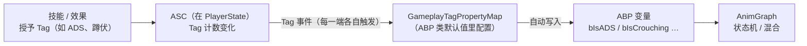
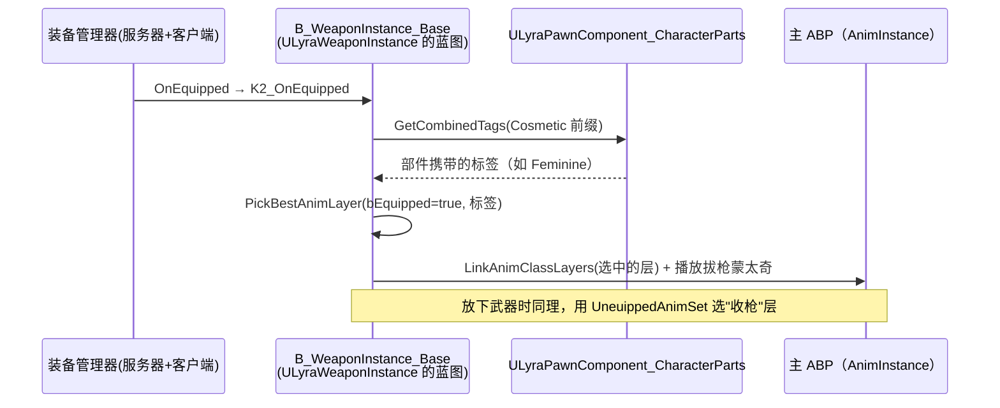
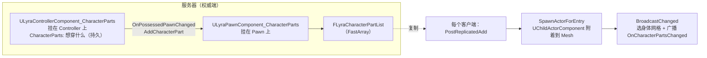
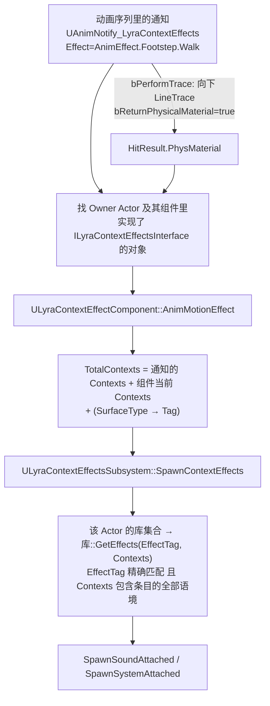

# 第 17 章　动画、外观部件与表面特效

## 一个问题：同一个角色，要有四种“看起来不一样”

策划给你提了四个需求：

1. 角色要有冲刺、蹲伏、开镜的动画，动画蓝图要知道角色现在处于哪种状态；
2. 玩家可以选 Manny 或 Quinn 两个造型，而且持枪姿势要随造型走（男女动画风格不同）；
3. 脚踩混凝土和踩玻璃，脚步声不一样，以后还要加“金属”“木头”，而且不要每加一种地面就去改几百个动画；
4. 打中敌人时，在命中点弹出伤害数字。

用入门教程的方式写，大概是：动画蓝图的 `EventGraph` 里 `Cast To MyCharacter`，读 `bIsAiming`、`bIsCrouching` 赋给动画变量；Pawn 蓝图里直接挂一个骨骼网格体；脚步动画通知里直接引用一个声音资产，再写一段 `switch(SurfaceType)`；伤害数字用 UMG 控件在屏幕上飘。

这些做法在小项目里都能跑，但放到一个“多人联机 + 多玩法 + 多团队并行开发”的项目里，会遇到这些麻烦：

- 动画蓝图依赖具体的 Character 类。换一个 Pawn（比如俯视角玩法里的角色），动画蓝图就编译不过；而且这些状态变量在模拟代理（别人屏幕上的你）身上怎么保持同步，要自己想办法。
- 造型写死在 Pawn 蓝图里，玩家选哪个就要有多少个 Pawn 蓝图；联机时别的玩家怎么看到你的造型，也要自己写复制。
- 脚步声被“焊死”在动画里，新增一种地面要改所有脚步动画；音频师想换个声音，要找程序员。
- 伤害数字只属于“正在看的那个玩家”，不应该让每个客户端都创建一份给别人看的控件。

这一章把 Lyra 的“表现层”四块拆开讲：**动画怎么读状态**、**造型怎么复制并驱动动画风格**、**脚步声怎么按地面查表**、**伤害数字怎么弹**。它们共用的思路是：**用 GameplayTag 或数据资产当“约定”，让生产数据的一方和消费数据的一方互不认识。**

## 读完本章你能……

- 说出 `ULyraAnimInstance` 怎么把 ASC 里的 Tag 变成动画变量，以及为什么初始化会被调用两次；
- 画出“装备武器 → 选动画层”的链路，并指出哪一段是 C++、哪一段是蓝图；
- 解释控制器上的“想穿什么”和 Pawn 上的“现在穿着什么”为什么要拆成两个组件，以及专用服务器上为什么读不到 `Cosmetic.*` 标签；
- 走完“动画通知 → 追踪物理材质 → 表面 Tag → 查库 → 播声音”整条链，说出每一环的数据在哪配置，以及“新增表面却没声音”的所有可能原因；
- 动手给项目新增一种“金属”表面的脚步声，并新建一个外观部件。

## 需要先知道的 UE 概念

这一章涉及的 UE 基础概念比较多，下面只讲读懂本章需要的部分。

### 动画蓝图与 AnimInstance

骨骼网格体（Skeletal Mesh）要动起来，需要一个**动画实例**（`UAnimInstance`，引擎类）在每帧计算出骨骼的姿势。你在编辑器里建的**动画蓝图**（Animation Blueprint，简称 ABP）就是一个 `UAnimInstance` 的蓝图子类，里面有两部分：

- **事件图（EventGraph）**：每帧执行一次的普通蓝图逻辑，通常用来更新变量；
- **动画图（AnimGraph）**：描述“姿势怎么算”的图，里面有状态机、混合空间、各种姿势节点，最后输出一个姿势。

C++ 里可以写 `UAnimInstance` 的子类，重写 `NativeInitializeAnimation`（初始化时调用一次）和 `NativeUpdateAnimation`（每帧调用）来更新变量，再让 ABP 继承它。ABP 通过读这些变量决定状态机怎么走。本章的 `ULyraAnimInstance` 就是这样的 C++ 基类。

### 链接动画层（Linked Anim Layers）

一个角色的“待机、跑动、转身”在持步枪和持手枪时是不同的动画。如果都画在同一张动画图里，状态机会爆炸。UE 的解决办法是**链接动画层**：

1. 先定义一个**动画层接口**（Animation Layer Interface，资产类型），里面声明几个“层”的名字（比如“Locomotion 层”“待机层”）；
2. 主 ABP 里放 **Linked Anim Layer** 节点，只写“这里放某某层”，不写具体怎么动；
3. 每种武器各做一个实现了这个接口的 ABP（比如“步枪层”“手枪层”），里面画具体的动画；
4. 运行时对主动画实例调用 `LinkAnimClassLayers(某个ABP类)`（引擎函数），所有层的实现就被换成这个 ABP 里的对应图。

可以把它理解成“依赖注入”：主 ABP 依赖一个接口，运行时注入具体实现。类比不成立的地方是：每个被链接的层是一个**独立的动画实例**，它想读主实例里的变量，需要走属性访问之类的机制，而不是直接共享成员。

### 线程安全的动画更新与属性访问（Property Access）

还有一个背景要先交代，因为它决定了 Lyra 的动画蓝图为什么长成那样。传统做法是在事件图里每帧算变量，这部分在游戏线程上跑，动画多了就是性能瓶颈。UE5 允许把变量更新搬到**工作线程**：ABP 里有专门的 “Blueprint Thread Safe Update Animation” 函数，里面只能做线程安全的事；要读别的对象的数据，用**属性访问**（Property Access）——一种在动画图里声明“我要读某个对象的某个属性”的机制，引擎会在合适的时机替你安全地取值。这需要在 项目设置 → 引擎 → 通用设置 → Anim Blueprints 里开启 `Allow Multi Threaded Animation Update`。

这是 Epic 官方《Animation in Lyra Sample Game》一文的说法（该文写于 UE 5.1 前后，官方文中的主 ABP 叫 `AnimBP_Mannequin_Base`，当前 5.8 工程里叫 `ABP_Mannequin_Base`）。官方还说，Lyra 的动画几乎完全用蓝图实现，设计上受 Paragon 和 Fortnite 启发。本章后面的 `ULyraAnimInstance` 只负责 C++ 里的一小部分（Tag 映射、离地距离）。

### 动画通知（AnimNotify）

动画通知是挂在动画序列时间轴上的一个“标记”：播放到那一帧时，引擎会回调这个标记对象的 `Notify` 函数。脚步声、挥拳判定、特效触发都靠它。注意：通知只在**动画真的在被计算**的那一端触发；不渲染的专用服务器上，骨骼网格体通常不需要完整更新动画，是否触发取决于网格体的 Tick 设置。

### 物理材质与表面类型

**物理材质**（`UPhysicalMaterial`，引擎类）是一个小资产，里面有摩擦力、弹性，还有一个叫 **Surface Type** 的枚举字段（`EPhysicalSurface`）。引擎预留了 `SurfaceType1` 到 `SurfaceType62` 这些槽位，你在“项目设置 → 物理 → Physical Surface”里给槽位起名字（保存在 `DefaultEngine.ini` 的 `[/Script/Engine.PhysicsSettings]` 里）。本项目里定义了三个：`SurfaceType1=Character`、`SurfaceType2=Concrete`、`SurfaceType3=Glass`。

做射线检测时，把查询参数的 `bReturnPhysicalMaterial` 设成 `true`，命中结果 `FHitResult::PhysMaterial` 里就会带着被命中处的物理材质。于是“我踩在什么上”这个问题，就变成“向下打一条射线，读命中点的 Surface Type”。

### Niagara 与声音

Niagara 是 UE 的粒子/特效系统，一个特效是一个 `UNiagaraSystem` 资产，可以用 `SpawnSystemAttached` 生成并附着到某个组件或骨骼上。声音资产的基类是 `USoundBase`（SoundCue、MetaSound 都是它的子类），用 `SpawnSoundAttached` 播放。本章只用到“生成并附着”这两个调用，不深入特效或音频本身。

### 子 Actor 组件（UChildActorComponent）

`UChildActorComponent`（引擎类）是一种特殊的组件：它自己并不画任何东西，而是在注册时**生成一个独立的 Actor 实例**，并把它附着在父 Actor 上。可以把它理解成“一个能装 Actor 的插座”。Lyra 用它来把“部件”（一个自带网格体、动画蓝图和标签的小 Actor）挂到角色身上。

## 动画怎么读状态：标签而不是类型转换

### 朴素做法

```cpp
// 伪代码：ABP 的 EventGraph / NativeUpdateAnimation 里的常见写法
void UMyAnimInstance::NativeUpdateAnimation(float Dt)
{
    if (AMyCharacter* C = Cast<AMyCharacter>(GetOwningActor()))
    {
        bIsAiming   = C->bIsAiming;
        bIsCrouched = C->bIsCrouched;
        bIsDead     = C->bIsDead;      // 每加一个状态，Character 和 ABP 各加一个字段
    }
}
```

问题有三个：动画依赖具体的 `AMyCharacter`，换 Pawn 就坏；每个状态要在玩法代码里存一份布尔值，再被复制到所有客户端，否则模拟代理的动画不对；每帧轮询（哪怕值没变）也是白做功。

### Lyra 的做法：状态本来就在 ASC 的 Tag 里

第 9~10 章讲过，ADS、冲刺、死亡这些状态在 Lyra 里通常表现为“ASC 上多了一个 GameplayTag”（由技能或效果授予）。**既然权威状态已经在 Tag 里了，动画蓝图为什么不直接订阅这些 Tag？**这就是 `ULyraAnimInstance` 的核心：

```cpp
// 简化自 Source/LyraGame/Animation/LyraAnimInstance.h
// Gameplay tags that can be mapped to blueprint variables. The variables will automatically
// update as the tags are added or removed. These should be used instead of manually querying for the gameplay tags.
UPROPERTY(EditDefaultsOnly, Category = "GameplayTags")
FGameplayTagBlueprintPropertyMap GameplayTagPropertyMap;
```

`FGameplayTagBlueprintPropertyMap` 是 GAS 模块里的一个结构体（引擎类型）。它保存一组“Tag → 蓝图变量”的映射，初始化时（`Initialize(Owner, ASC)`）向 ASC 注册 Tag 变化的监听，之后每当 Tag 增减，就自动把对应的变量写好（常见用法是映射到 `bool`）。映射关系在动画蓝图的**类默认值 → GameplayTags** 里配置，而不是在 C++ 里。官方动画文档也特别点出了这一点：Gameplay Tag 属性映射是 GAS 通往动画系统的桥梁。在编辑器里打开 `Content/Characters/Heroes/Mannequin/Animations/ABP_Mannequin_Base`，展开类默认值里的 `Gameplay Tag Property Map`，可以看到预配的 5 条映射：`Event.Movement.ADS → GameplayTag_IsADS`、`Event.Movement.WeaponFire → GameplayTag_IsFiring`、`Event.Movement.Reload → GameplayTag_IsReloading`、`Event.Movement.Dash → GameplayTag_IsDashing`、`Event.Movement.Melee → GameplayTag_IsMelee`。

绑定动作：

```cpp
// 简化自 Source/LyraGame/Animation/LyraAnimInstance.cpp
void ULyraAnimInstance::InitializeWithAbilitySystem(UAbilitySystemComponent* ASC)
{
    check(ASC);
    GameplayTagPropertyMap.Initialize(this, ASC);   // 注册监听并同步一次当前值
}

void ULyraAnimInstance::NativeInitializeAnimation()
{
    Super::NativeInitializeAnimation();
    if (AActor* OwningActor = GetOwningActor())
        if (UAbilitySystemComponent* ASC = UAbilitySystemGlobals::GetAbilitySystemComponentFromActor(OwningActor))
            InitializeWithAbilitySystem(ASC);       // 入口 ①：动画实例自己初始化时试一次
}
```

入口 ② 在 ASC 一侧：

```cpp
// 简化自 Source/LyraGame/AbilitySystem/LyraAbilitySystemComponent.cpp 的 ULyraAbilitySystemComponent::InitAbilityActorInfo
if (ULyraAnimInstance* LyraAnimInst = Cast<ULyraAnimInstance>(ActorInfo->GetAnimInstance()))
{
    LyraAnimInst->InitializeWithAbilitySystem(this);   // 入口 ②：ASC 拿到新 Avatar 时通知动画实例
}
```

**为什么要调两次？**[第 10 章](10-LyraGAS.md)说过，Lyra 的 ASC 放在 PlayerState 上，Pawn 只是它的化身（Avatar）。Pawn 的动画实例创建时，ASC 可能还没有把这个 Pawn 设为 Avatar（`GetAbilitySystemComponentFromActor` 找不到或找到的还没就绪）；反过来，ASC 绑定 Avatar 时动画实例也可能还没创建。两边谁先谁后不确定，所以各写一个入口，先到的那一方完成绑定，后到的那一方再绑一次。重复调用是安全的：对照 5.8 引擎源码（`GameplayEffectTypes.cpp`），`FGameplayTagBlueprintPropertyMap::Initialize` 在 Owner 和 ASC 都没变时会直接返回（日志里是 “Already initialized.”），换了 Owner 或 ASC 才会先注销旧监听再重新注册；注册时用的是 `RegisterAndCallGameplayTagEvent`，所以会立即按当前 Tag 数量刷一次变量。换 Pawn（重生）时，新 Pawn 的动画实例也会走同样的路。



### 回头看：这个设计换来了什么

- **解耦**：玩法只管授予 Tag，动画只管声明“Tag 对应哪个变量”，没有任何一方认识对方的类。给 Lyra 加“冲刺”，不需要改 C++：技能授予一个 Tag，在 ABP 里加一条映射。
- **多端一致**：Tag 本身由 ASC 负责在各端维护（具体的复制模式见第 10 章），所以每一端的动画实例拿到的都是那一端 ASC 里的同一份状态，不需要为动画单独设计一套复制。
- **提前发现错误**：`ULyraAnimInstance::IsDataValid` 会调用映射表的校验，如果 ABP 里映射的变量被删掉了，保存/校验阶段就会报错，而不是运行时悄悄失效。

代价是：映射关系藏在蓝图资产里，C++ 读者看不到。**所以排查“动画没切换”时，先去 ABP 类默认值看映射表。**

### 连续的量不走 Tag：GroundDistance

“离地多高”是一个连续的浮点数，没法用 Tag 表示。`ULyraAnimInstance` 每帧自己取：

```cpp
// 简化自 LyraAnimInstance.cpp 的 ULyraAnimInstance::NativeUpdateAnimation
const ALyraCharacter* Character = Cast<ALyraCharacter>(GetOwningActor());
if (!Character) { return; }
ULyraCharacterMovementComponent* CharMoveComp = CastChecked<ULyraCharacterMovementComponent>(Character->GetCharacterMovement());
const FLyraCharacterGroundInfo& GroundInfo = CharMoveComp->GetGroundInfo();
GroundDistance = GroundInfo.GroundDistance;     // BlueprintReadOnly，ABP 里用它判断“快落地了”
```

`GetGroundInfo` 在移动组件里：站在地面上（`MOVE_Walking`）直接用当前地面信息，距离为 0；否则向下做一次射线检测（距离由 CVar `LyraCharacter.GroundTraceDistance` 控制，默认 100000，只在 Cheat 模式下可改），`GroundDistance = 命中距离 - 胶囊半高`。结果按帧缓存（`GFrameCounter`），同一帧里多次调用不会重复射线。这里确实 `Cast` 了 `ALyraCharacter`——Tag 解决的是“离散状态”的解耦，连续数值仍然从移动组件读，这是务实的取舍。

另一个值得知道的相关设计：别人屏幕上的你（模拟代理）没有本地输入，也就没有加速度，起步/转身动画没法驱动。`ALyraCharacter` 把加速度量化成几个字节复制给模拟代理（`ReplicatedAcceleration`，`COND_SimulatedOnly`），`ULyraCharacterMovementComponent::SimulateMovement` 在模拟时保留这个复制来的值，供动画蓝图使用。

## 动画层：武器决定持枪姿势，造型决定风格

### 问题

主动画蓝图里的“待机、跑动”应该随手里拿的东西变化：空手、手枪、步枪、霰弹枪各一套；同一把步枪，Manny 和 Quinn 的姿势又略有不同。

最直观的做法是主 ABP 里 `switch(武器类型)`。每新增一种武器就要打开主 ABP 加分支，主 ABP 成了所有人的冲突热点。

### Lyra 的做法：武器自带“动画层 + 选择规则”

Lyra 用上面讲的链接动画层。资产层面：

- `ALI_ItemAnimLayers` 是动画层接口，规定了哪些位置可以被覆盖（待机/移动状态、瞄准相关的全身层等）；同目录（`Content/Characters/Heroes/Mannequin/Animations/LinkedLayers/`）下的 `ABP_ItemAnimLayersBase` 是所有武器层 ABP 共同继承的基础层（官方《Animation in Lyra Sample Game》明确写了这一点）。官方还提到，基础层里有一个自定义函数 `Get Main Anim BP ThreadSafe`，用属性访问读主 ABP 的数据，这样每个武器层不必各自重复计算速度、加速度；
- 每种武器有自己的层 ABP，放在 `Content/Characters/Heroes/Mannequin/Animations/Locomotion/<武器>/` 下，例如 `Rifle/ABP_RifleAnimLayers` 和 `Rifle/ABP_RifleAnimLayers_Feminine`，空手有 `Unarmed/ABP_UnarmedAnimLayers`。

官方这页写于 5.1 前后，没有涉及 Motion Matching（5.4 起引擎提供），本章也不讨论；5.8 里这些 ABP 内部是否改过，请以编辑器为准。

“选哪个层”的规则放在武器实例（第 13~14 章的 `ULyraWeaponInstance`）上，是两个数据结构：

```cpp
// 简化自 Source/LyraGame/Cosmetics/LyraCosmeticAnimationTypes.h / .cpp
USTRUCT(BlueprintType)
struct FLyraAnimLayerSelectionEntry
{
    TSubclassOf<UAnimInstance> Layer;           // 满足条件时用这个动画层
    FGameplayTagContainer RequiredTags;         // 需要的 Cosmetic 标签（必须全部具备）
};

USTRUCT(BlueprintType)
struct FLyraAnimLayerSelectionSet
{
    TArray<FLyraAnimLayerSelectionEntry> LayerRules;   // 按顺序匹配，第一个命中的生效
    TSubclassOf<UAnimInstance> DefaultLayer;           // 一个都没命中时用它

    TSubclassOf<UAnimInstance> SelectBestLayer(const FGameplayTagContainer& CosmeticTags) const
    {
        for (const FLyraAnimLayerSelectionEntry& Rule : LayerRules)
            if ((Rule.Layer != nullptr) && CosmeticTags.HasAll(Rule.RequiredTags))
                return Rule.Layer;
        return DefaultLayer;
    }
};
```

规则是“从上到下，第一个标签全满足的赢”，所以**更具体的规则要放在前面，`DefaultLayer` 兜底**。打开步枪的 `B_WeaponInstance_Rifle` 就能看到它的 `EquippedAnimSet`：规则 1 是 `Cosmetic.AnimationStyle.Feminine → ABP_RifleAnimLayers_Feminine`；`DefaultLayer` 是 `ABP_RifleAnimLayers`。

`ULyraWeaponInstance` 持有两套规则，一套装备时用，一套“放下”时用（注意源码里放下那套的变量名拼写就是 `UneuippedAnimSet`，少了一个 `q`，搜索时别搜错）：

```cpp
// 简化自 Source/LyraGame/Weapons/LyraWeaponInstance.h / .cpp
UPROPERTY(EditAnywhere, BlueprintReadOnly, Category=Animation)
FLyraAnimLayerSelectionSet EquippedAnimSet;
UPROPERTY(EditAnywhere, BlueprintReadOnly, Category=Animation)
FLyraAnimLayerSelectionSet UneuippedAnimSet;

// protected，BlueprintCallable：给蓝图子类调用
TSubclassOf<UAnimInstance> ULyraWeaponInstance::PickBestAnimLayer(bool bEquipped, const FGameplayTagContainer& CosmeticTags) const
{
    const FLyraAnimLayerSelectionSet& SetToQuery = (bEquipped ? EquippedAnimSet : UneuippedAnimSet);
    return SetToQuery.SelectBestLayer(CosmeticTags);
}
```

### 谁真正调用 LinkAnimClassLayers？是蓝图

这是容易被忽略的一点：**C++ 只提供了“选择函数”，真正调用 `LinkAnimClassLayers` 的是蓝图。**`ULyraWeaponInstance::OnEquipped` 的 C++ 部分只记录装备时间、应用输入设备属性（手柄震动之类）。打开 `ShooterCore` 插件里的武器实例基类蓝图 `B_WeaponInstance_Base`（`Weapons/` 目录），可以看到 `K2_OnEquipped` 和 `K2_OnUnequipped` 调了辅助函数 `DetermineCosmeticTags` → `ActivateAnimLayerAndPlayPairedAnim`，内部选出最佳动画层挂接并播放掏枪/收枪蒙太奇：



注意标签来自**外观部件**（下一节）：武器根本不知道“这是男角色还是女角色”，它只知道“角色身上有哪些 `Cosmetic.*` 标签”。**这就是为什么本章把动画和外观放在一起讲：外观部件是动画风格的“数据源”。**

### 回头看

武器自带层和规则，新增一把武器不需要碰主 ABP；风格差异由 Tag 驱动，新增一种风格（比如“Cosmetic.AnimationStyle.Heavy”）只需要在各武器的规则里加一条。代价是规则分散在每个武器实例蓝图里，新增风格要逐个改；而且选择只发生在**装备/放下的那一刻**，所以装备后再换外观，动画层不会自动更新（见实验 2）。

## 外观部件：想穿什么，与现在穿着什么

### 问题与朴素做法

“造型”如果直接写进 Pawn 蓝图，每种造型就要一个 Pawn 类。更麻烦的是死亡重生：玩家选了 Quinn，死亡后生成一个新 Pawn，造型要保持。

### Lyra 的拆分：控制器保存意图，Pawn 保存现状

（Epic 没有这部分的官方文档，下面对“为什么这样拆”的解释是根据代码行为做的推断。）



两个组件各管一件事：

- **控制器组件**（`ULyraControllerComponent_CharacterParts`）：`CharacterParts` 是一个可在蓝图里配置的数组（`EditAnywhere`），表示这个玩家（或这个机器人）“自然”想穿的部件。它活在 Controller 上，Pawn 死了它还在。
- **Pawn 组件**（`ULyraPawnComponent_CharacterParts`）：真正持有“当前身上有哪些部件”，并把它们生成成 Actor。它活在 Pawn 上，Pawn 没了它也没了。

“部件”本身是一个很小的请求结构：

```cpp
// 简化自 Source/LyraGame/Cosmetics/LyraCharacterPartTypes.h
USTRUCT(BlueprintType)
struct FLyraCharacterPart
{
    TSubclassOf<AActor> PartClass;      // 要生成的部件 Actor 类
    FName SocketName;                   // 挂到哪个骨骼插槽（可为空）
    ECharacterCustomizationCollisionMode CollisionMode = ECharacterCustomizationCollisionMode::NoCollision;
};
```

注意 `CollisionMode` 默认是 `NoCollision`：部件 Actor 生成后会被 `SetActorEnableCollision(false)`。因为角色的碰撞由胶囊体和物理资产负责，让每个部件自己再带一份碰撞既浪费又会互相干扰。

### 控制器端：换 Pawn 时重新穿上

```cpp
// 简化自 Source/LyraGame/Cosmetics/LyraControllerComponent_CharacterParts.cpp
void ULyraControllerComponent_CharacterParts::BeginPlay()
{
    Super::BeginPlay();
    if (HasAuthority())                                    // 只在服务器上监听
    {
        if (AController* OwningController = GetController<AController>())
        {
            OwningController->OnPossessedPawnChanged.AddDynamic(this, &ThisClass::OnPossessedPawnChanged);
            if (APawn* ControlledPawn = GetPawn<APawn>())
                OnPossessedPawnChanged(nullptr, ControlledPawn);   // 已经有 Pawn 就立刻处理
        }
        ApplyDeveloperSettings();                          // 编辑器里的外观作弊设置（仅 PIE）
    }
}

void ULyraControllerComponent_CharacterParts::OnPossessedPawnChanged(APawn* OldPawn, APawn* NewPawn)
{
    // 从旧 Pawn 上摘掉
    if (auto* OldCustomizer = OldPawn ? OldPawn->FindComponentByClass<ULyraPawnComponent_CharacterParts>() : nullptr)
        for (auto& Entry : CharacterParts) { OldCustomizer->RemoveCharacterPart(Entry.Handle); Entry.Handle.Reset(); }

    // 穿到新 Pawn 上
    if (auto* NewCustomizer = NewPawn ? NewPawn->FindComponentByClass<ULyraPawnComponent_CharacterParts>() : nullptr)
        for (auto& Entry : CharacterParts)
            if (!Entry.Handle.IsValid() && Entry.Source != ECharacterPartSource::NaturalSuppressedViaCheat)
                Entry.Handle = NewCustomizer->AddCharacterPart(Entry.Part);   // 返回的句柄用来以后移除
}
```

要点：整个过程都在服务器上（`HasAuthority()`）。控制器上的 `CharacterParts` 数组**不复制**，客户端不需要知道玩家“想穿什么”，只需要看到 Pawn 上“已经穿着什么”。每次 Possess 新 Pawn，都把数组里的部件重新加到新 Pawn 上——这就是重生后造型不丢的原因。`ECharacterPartSource` 区分部件来源（自然的、被作弊覆盖的、开发者设置添加的），调试时可以临时替换而不污染真实配置（本章实验 2 用到）。

那这个控制器组件是谁加到 Controller 上的？不是写死在 PlayerController 里，而是由 Experience 的 Action 用 `Add Components` 加到 `AController` 上的（[第 7 章](07-ModularGameplay.md)）。以 `B_ShooterGame_Elimination` 使用的 `Content/Characters/Cosmetics/B_PickRandomCharacter` 为例：它的静态 `CharacterParts` 数组其实留空，而是在 `Event BeginPlay` 里用 `RandomBool` + `Select` 从 `B_Manny` 和 `B_Quinn` 中随机挑一个，调用 `AddCharacterPart` 登记到控制器组件里——这样该玩家本局每次重生都会保持开局抽到的那一套造型。

### Pawn 端：FastArray 复制，每个客户端各自生成

`ULyraPawnComponent_CharacterParts` 里是一个被复制的 `FLyraCharacterPartList`。它是第 13 章在背包里见过的 `FFastArraySerializer`：增删改按条目（而不是整个数组）同步，客户端在 `PostReplicatedAdd` 等回调里收到变化。

```cpp
// 简化自 Source/LyraGame/Cosmetics/LyraPawnComponent_CharacterParts.cpp 的 FLyraCharacterPartList::AddEntry（仅服务器）
FLyraCharacterPartHandle Result;
Result.PartHandle = PartHandleCounter++;
if (ensure(OwnerComponent && OwnerComponent->GetOwner() && OwnerComponent->GetOwner()->HasAuthority()))
{
    FLyraAppliedCharacterPartEntry& NewEntry = Entries.AddDefaulted_GetRef();
    NewEntry.Part = NewPart;
    NewEntry.PartHandle = Result.PartHandle;
    if (SpawnActorForEntry(NewEntry))        // 服务器自己（非专用）也要生成，主机玩家要看得见
        OwnerComponent->BroadcastChanged();
    MarkItemDirty(NewEntry);                 // 标脏 → 复制给客户端
}
return Result;
```

```cpp
// 简化自 FLyraCharacterPartList::SpawnActorForEntry（服务器和客户端都会调用）
if (ensure(OwnerComponent) && !OwnerComponent->IsNetMode(NM_DedicatedServer))   // 专用服务器不生成！
{
    if (USceneComponent* ComponentToAttachTo = OwnerComponent->GetSceneComponentToAttachTo())  // ACharacter 的 Mesh，否则根组件
    {
        UChildActorComponent* PartComponent = NewObject<UChildActorComponent>(OwnerComponent->GetOwner());
        PartComponent->SetupAttachment(ComponentToAttachTo, Entry.Part.SocketName);
        PartComponent->SetChildActorClass(Entry.Part.PartClass);
        PartComponent->RegisterComponent();                 // 注册时才真正生成部件 Actor
        // ……NoCollision 时 SetActorEnableCollision(false)；给部件根组件加 Tick 前置依赖，保证先算完 Mesh 的姿势
        Entry.SpawnedComponent = PartComponent;
    }
}
```

条目里的字段分工值得看一眼：`Part` 被复制；`PartHandle`（只有服务器需要，用于移除）和 `SpawnedComponent`（每一端自己生成的本地对象）都是 `NotReplicated`。这就是“**只复制意图，不复制 Actor 实例**”：每个客户端拿到“要有一个 B_Quinn”这条数据，各自在本地生成。

对应地，`PostReplicatedChange`（条目内容变了）的处理是“销毁再重建”，不做原地更新，简单但粗暴。

### 部件的标签：选身体、选动画风格

部件 Actor 生成完后，Pawn 组件的 `BroadcastChanged` 做两件事：

```cpp
// 简化自 ULyraPawnComponent_CharacterParts::BroadcastChanged
if (USkeletalMeshComponent* MeshComponent = GetParentMeshComponent())   // ACharacter::GetMesh()
{
    const FGameplayTagContainer MergedTags = GetCombinedTags(FGameplayTag());    // 收集所有部件 Actor 的标签
    USkeletalMesh* DesiredMesh = BodyMeshes.SelectBestBodyStyle(MergedTags);   // 规则表：标签 → 身体骨架网格
    MeshComponent->SetSkeletalMesh(DesiredMesh, /*bReinitPose=*/ true);          // 没变时是空操作
    // ForcedPhysicsAsset 若有，则强制使用
}
OnCharacterPartsChanged.Broadcast(this);   // 通知订阅者（比如蓝图里给部件染队伍色）
```

标签从哪来？`CollectCombinedTags` 遍历每个部件 Actor，只处理实现了 `IGameplayTagAssetInterface` 的那些，调用 `GetOwnedGameplayTags` 收集：

```cpp
// 简化自 FLyraCharacterPartList::CollectCombinedTags
for (const FLyraAppliedCharacterPartEntry& Entry : Entries)
    if (Entry.SpawnedComponent != nullptr)
        if (IGameplayTagAssetInterface* TagInterface = Cast<IGameplayTagAssetInterface>(Entry.SpawnedComponent->GetChildActor()))
            TagInterface->GetOwnedGameplayTags(/*inout*/ Result);
```

所以**部件 Actor 要想贡献标签，必须实现 `IGameplayTagAssetInterface`**（蓝图 Actor 也可以实现这个接口）。`Config/DefaultGameplayTags.ini` 里注册了 `Cosmetic`、`Cosmetic.AnimationStyle.Feminine/Masculine`、`Cosmetic.BodyStyle.Medium`：`B_Manny` 在静态标签里带了 `Masculine` + `Medium`，`B_Quinn` 带了 `Feminine` + `Medium`。

注意 `BodyMeshes` 的作用：在这个项目里，Pawn 自带的 Mesh 是一个**不可见的驱动骨架**（`B_MannequinPawnCosmetics` 按男女标签选用 `SKM_Manny_Invis` 或 `SKM_Quinn_Invis`），而可见的网格体在部件 Actor（`B_Manny`/`B_Quinn`）里，用 `ABP_Mannequin_CopyPose` 复制父骨架的姿势。这个架构的好处（推断，官方没有外观部件专页）是：所有动画逻辑只需要在“驱动骨架”上跑一份，部件只是“跟着做动作的皮肤”。（回想[第 6 章](06-Experience.md)实验 3 里不装 `B_PickRandomCharacter` 时“隐身人悬着一把枪”的现象，原因就在这里！）

于是整条链清楚了：**控制器配置部件 → 部件携带 Cosmetic 标签 → 标签选身体骨架 + 选武器动画层。**

### 专用服务器上读不到标签

`SpawnActorForEntry` 在专用服务器上直接跳过，`SpawnedComponent` 永远为空，所以 `CollectCombinedTags` 只会返回空容器。顺带，`AddEntry` 只有在 `SpawnActorForEntry` 成功时才调用 `BroadcastChanged`，所以专用服务器上选身体网格这一步也不会发生。结论：**不要在服务器逻辑里依赖 `Cosmetic.*` 标签。**需要服务器可信的信息（队伍、角色类型）请用别的被复制的数据（PawnData、PlayerState、队伍组件）。动画层选择只发生在“有表现”的那一端，这也解释了为什么武器实例的“选层”可以放心地放在蓝图里。

## 脚步声：动画通知、物理材质、查表

### 问题与朴素做法

朴素做法是：脚步动画的通知里直接引用一个声音，再写 `switch(SurfaceType)`。新增一种地面要改所有脚步动画；声音设计师换个声音要找程序；一个表面类型只能一个维度，没法再叠加“穿重甲”这种额外语境。

### Lyra 的做法：标签对话，数据驱动查表

Lyra 让**动画师**和**音频师**只通过标签沟通：动画师在“脚落地”那一帧放一个“Play Context Effects”通知，填上 `Effect = AnimEffect.Footstep.Walk`（“这是一次走路的脚步”）；音频师在一个库资产里填“（Walk, 混凝土）→ 哪个声音”。中间的“踩在什么地面上”由系统自动查出来。整条管线：



下面分段走一遍。

### 第一步：通知做追踪，把现场交给“实现了接口的人”

```cpp
// 简化自 Source/LyraGame/Feedback/ContextEffects/AnimNotify_LyraContextEffects.cpp 的 Notify
FHitResult HitResult;
FCollisionQueryParams QueryParams;
if (TraceProperties.bIgnoreActor) QueryParams.AddIgnoredActor(OwningActor);
QueryParams.bReturnPhysicalMaterial = true;                       // 要物理材质

if (bPerformTrace)                                                // 不勾就没有 HitResult，也就没有表面语境
{
    FVector TraceStart = bAttached ? MeshComp->GetSocketLocation(SocketName) : MeshComp->GetComponentLocation();
    bHitSuccess = World->LineTraceSingleByChannel(HitResult, TraceStart, TraceStart + TraceProperties.EndTraceLocationOffset,
                      TraceProperties.TraceChannel, QueryParams, FCollisionResponseParams::DefaultResponseParam);
}

// 收集 Actor 自己 + 它的所有组件中，实现了 ILyraContextEffectsInterface 的对象
// 对每个调用 Execute_AnimMotionEffect(Bone, Effect, MeshComp, ..., bHitSuccess, HitResult, Contexts, ...)
```

通知本身不认识任何声音，也不认识“Component”。它只做三件事：（可选地）向下追踪一条线，找出实现了 `ILyraContextEffectsInterface` 的对象，把 `Effect` 标签、命中结果交过去。追踪默认用 `ECC_Visibility` 通道，终点偏移默认是零向量，所以在脚步动画里要把 `EndTraceLocationOffset` 填成朝下（比如 Z = -50）——否则起点和终点重合，什么也打不到。

### 第二步：组件把“语境”凑齐

```cpp
// 简化自 Source/LyraGame/Feedback/ContextEffects/LyraContextEffectComponent.cpp 的 AnimMotionEffect_Implementation
FGameplayTagContainer TotalContexts;
TotalContexts.AppendTags(Contexts);          // 通知上写的语境
TotalContexts.AppendTags(CurrentContexts);   // 组件当前的语境（比如装备带来的）

if (bConvertPhysicalSurfaceToContext)
{
    if (HitResult.PhysMaterial.IsValid())
    {
        TEnumAsByte<EPhysicalSurface> SurfaceType = HitResult.PhysMaterial->SurfaceType;
        if (const FGameplayTag* SurfaceContextPtr = GetDefault<ULyraContextEffectsSettings>()->SurfaceTypeToContextMap.Find(SurfaceType))
            TotalContexts.AddTag(*SurfaceContextPtr);       // 例如 SurfaceType2 → SurfaceType.Concrete
    }
}
// 然后交给子系统：SpawnContextEffects(GetOwner(), MeshComp, Bone, ..., MotionEffect, TotalContexts, ...)
```

“表面类型 → Tag”这张映射表在 `ULyraContextEffectsSettings`（一个 `UDeveloperSettings`，保存在 `Config/DefaultGame.ini`）：

```ini
[/Script/LyraGame.LyraContextEffectsSettings]
SurfaceTypeToContextMap=((SurfaceType3, (TagName="SurfaceType.Glass")),(SurfaceType2, (TagName="SurfaceType.Concrete")),(SurfaceType1, (TagName="SurfaceType.Character")),(SurfaceType_Default, (TagName="SurfaceType.Default")))
```

注意：映射表里查不到的表面类型，就**不会**加任何表面 Tag（`Find` 返回空指针），没有任何报错。

**这里有个引擎层面的细节要小心**：命中结果里的物理材质从哪来？通知里的追踪没有勾“追踪复杂碰撞”（`bTraceComplex` 默认 false），所以走的是**简单碰撞**。对照 5.8 引擎源码 `BodyInstance.cpp`（`GetSimplePhysicalMaterial`），简单碰撞整个形状只有**一个**物理材质，按优先级从高到低依次是：BodyInstance 自己的 `Phys Material Override` → 组件的 `Phys Material Override` → 静态网格资产里 Body Setup 的物理材质 → 组件第 0 号材质槽材质上的 Physical Material → 引擎默认物理材质（表面类型 `Default`）。

只有改用**复杂追踪**（`bTraceComplex = true`），引擎才会按命中三角形所属的材质槽，逐槽读取各自材质上的 Physical Material；而且一旦设置了上面的 Override，所有材质槽都会统一返回那个覆盖材质。另外，查询参数里的 `bReturnPhysicalMaterial` 必须为 true（通知代码里已设好），否则 `HitResult.PhysMaterial` 恒为空。后面实验 3 里我们直接设置地面组件上的 `Phys Material Override`，无论简单还是复杂追踪都能稳定生效。

### 第三步：子系统和库——查表

组件把一堆 Tag 交给子系统（`ULyraContextEffectsSubsystem`，一个 `UWorldSubsystem`）。子系统里有一张 `ActiveActorEffectsMap`（Actor → 该 Actor 的库集合）。库集合是怎么来的？`ULyraContextEffectComponent::BeginPlay` 里把 `DefaultContextEffectsLibraries` 同步加载并登记进子系统，`EndPlay` 时移除。`B_Hero_Default` 上挂着这个组件，库资产是 `Content/ContextEffects/CFX_DefaultSkin`。

库（`ULyraContextEffectsLibrary`，数据资产）里是一个数组，每个条目是 `{EffectTag, Context, Effects}`，`Effects` 是声音/Niagara 的软引用。查表函数：

```cpp
// 简化自 Source/LyraGame/Feedback/ContextEffects/LyraContextEffectsLibrary.cpp 的 GetEffects
if (Effect.IsValid() && Context.IsValid() && EffectsLoadState == EContextEffectsLibraryLoadState::Loaded)
{
    for (const auto& ActiveContextEffect : ActiveContextEffects)
    {
        // Effect 必须"精确"匹配；传入的 Context 必须包含条目里的全部标签；并且两者要么都空要么都非空
        if (Effect.MatchesTagExact(ActiveContextEffect->EffectTag)
            && Context.HasAllExact(ActiveContextEffect->Context)
            && (ActiveContextEffect->Context.IsEmpty() == Context.IsEmpty()))
        {
            Sounds.Append(ActiveContextEffect->Sounds);
            NiagaraSystems.Append(ActiveContextEffect->NiagaraSystems);
        }
    }
}
```

最后子系统对找到的每个声音调 `UGameplayStatics::SpawnSoundAttached`，对每个 Niagara 系统调 `UNiagaraFunctionLibrary::SpawnSystemAttached`，附着到通知指定的网格体/骨骼上。

### “无回退”：新增表面没声音的所有原因

注意上面的匹配是**精确的**：没有“找不到就用 Default 语境”的回退逻辑。本项目的 `CFX_DefaultSkin` 里（从资产字符串能读到）只有 `AnimEffect.Footstep.Walk` 和 `AnimEffect.Footstep.Land` 两类 Effect，语境是 `Concrete`、`Default`、`Glass`，用的是 `sfx_Character_FS_Concrete_nl_meta`、`sfx_Character_FS_Glass_nl_meta`、`sfx_Character_Land_*` 等声音。所以：

- 新增了表面但库里没有对应条目：那个 Effect 在这种地面上无声；
- 表面类型没写进 `SurfaceTypeToContextMap`：没有表面 Tag，`TotalContexts` 里没有对应语境，条目匹配不上；
- 物理材质没赋对（或者追踪读到的是默认物理材质）：读到的表面类型不是你以为的那个；
- 通知没勾 `bPerformTrace`，或者 `EndTraceLocationOffset` 是零：没有 `HitResult`，不会有表面语境；
- 角色没挂 `ULyraContextEffectComponent`，或它的 `DefaultContextEffectsLibraries` 没包含这个库：子系统找不到这个 Actor 的库集合；
- 库的状态是 `Unloaded`：子系统在这种情况下只触发一次加载，**这一次不播放**。

排查“没声音”时，按这个清单从上往下过一遍，基本能定位。

### 回头看

这套设计让动画师、音频师、程序员互不阻塞：新增“木头”表面，只需要加物理表面、加映射、加库条目，不动任何动画或 C++。接口 + 组件的拆分让通知对 Actor 的具体类无感（Actor 或它的任一组件实现接口即可）。代价是：精确匹配没有回退，漏填条目就是静默无声；库是**同步加载**的（源码里写着 `TODO Async`），第一次给大库会有卡顿；通知在哪个端触发取决于哪个端在计算动画，而 `SpawnSoundAttached` 在专用服务器上自然没有输出。

此外，`ULyraContextEffectComponent` 还支持运行时改语境：`UpdateEffectContexts` 可以把比如 `Armor.Heavy` 这类标签加进 `CurrentContexts`，库里的条目写成 `[SurfaceType.Concrete, Armor.Heavy]` 就能匹配“重甲踩混凝土”；`UpdateLibraries` 可以整体替换库。

## 伤害数字：攻击者控制器上的组件

击中目标时，飘出的伤害数字是谁画的？打开 `Content/GameplayCueNotifies/GCNL_Character_DamageTaken`（伤害 GE 触发的 GameplayCue 通知，[第 9 章](09-GASConcepts.md)）的 `OnExecute` 函数，可以看到一条很讲究的查找链：它从 `EffectContext` 里取出**施加者（`GetInstigatorActor`）**，顺着它找到**攻击者的 `PlayerController`**，检查 `IsLocallyControlled` 为真后，再取该控制器上的 `LyraNumberPopComponent` 调用 `AddNumberPop`！注意不是取受击目标的 Controller——如果你打的是一个 AI 机器人，机器人的 `AIController` 根本没有这个组件（`LAS_ShooterGame_StandardComponents` 只把 `B_NiagaraNumberPopComponent` 加到了人类玩家的 `LyraPlayerController` 上，仅客户端），伤害数字之所以能弹在你眼前，正是因为它挂在**开枪者自己**的本地 `PlayerController` 上。基类定义如下：

```cpp
// 简化自 Source/LyraGame/Feedback/NumberPops/LyraNumberPopComponent.h
USTRUCT(BlueprintType)
struct FLyraNumberPopRequest
{
    FVector WorldLocation;          // 在哪里弹
    FGameplayTagContainer SourceTags, TargetTags;   // 伤害来源/目标的标签，用于选样式
    int32 NumberToDisplay = 0;
    bool bIsCriticalDamage = false;
};

UCLASS(Abstract)
class ULyraNumberPopComponent : public UControllerComponent
{
    UFUNCTION(BlueprintCallable)
    virtual void AddNumberPop(const FLyraNumberPopRequest& NewRequest) {}
};
```

为什么做成**控制器**组件而不是挂在角色身上？（推断）伤害数字只服务于“正在看的这位本地玩家”，放在本地 `PlayerController` 上，全场景所有你打出来的数字可以共用同一个渲染组件统一批处理，而且即使你开枪后立刻阵亡、Pawn 销毁，已经飞出去的数字依然能播完。这个基类是 `Abstract` 的，Lyra 提供了两种实现，都是原版自带：

**Niagara 版**（本项目实际使用）：`ULyraNumberPopComponent_NiagaraText`。

```cpp
// 简化自 Source/LyraGame/Feedback/NumberPops/LyraNumberPopComponent_NiagaraText.cpp 的 AddNumberPop
int32 LocalDamage = NewRequest.NumberToDisplay;
if (NewRequest.bIsCriticalDamage) { LocalDamage *= -1; }           // 暴击用负数表示

if (!NiagaraComp)                                                  // 第一次：创建 Niagara 组件
{
    NiagaraComp = NewObject<UNiagaraComponent>(GetOwner());
    if (Style != nullptr) { NiagaraComp->SetAsset(Style->TextNiagara); NiagaraComp->bAutoActivate = false; }
    NiagaraComp->SetupAttachment(nullptr);
    NiagaraComp->RegisterComponent();
}
NiagaraComp->Activate(false);
NiagaraComp->SetWorldLocation(NewRequest.WorldLocation);

// 数据通道：把 (X, Y, Z, 伤害) 打包成 Vector4，追加进 Niagara 里名叫 Style->NiagaraArrayName 的数组
TArray<FVector4> DamageList = UNiagaraDataInterfaceArrayFunctionLibrary::GetNiagaraArrayVector4(NiagaraComp, Style->NiagaraArrayName);
DamageList.Add(FVector4(NewRequest.WorldLocation.X, NewRequest.WorldLocation.Y, NewRequest.WorldLocation.Z, LocalDamage));
UNiagaraDataInterfaceArrayFunctionLibrary::SetNiagaraArrayVector4(NiagaraComp, Style->NiagaraArrayName, DamageList);
```

整个数字的外观完全在 Niagara 系统里（`Content/Effects/Particles/Impacts/NS_DamageNumbers`）。C++ 只负责把“位置 + 数值（负数代表暴击）”送进 Niagara 的数组数据接口，Niagara 里读数组、生成字形。这个组件的蓝图子类是 `Content/Effects/Blueprints/B_NiagaraNumberPopComponent`，由 ShooterCore 里的 `LAS_ShooterGame_StandardComponents` 这个 ActionSet 加到 Controller 上（再一次体现第 6~7 章的组合方式）。

两个坑：`Style` 为空时 `Style->NiagaraArrayName` 会解引用空指针，所以蓝图子类必须配置 `Style`（一个 `ULyraDamagePopStyleNiagara` 数据资产：`NiagaraArrayName` + `TextNiagara`，数组名必须和 Niagara 系统里的 Array 数据接口名字一致）；每次追加都要“读整个数组再整个写回”，数组不会被 C++ 清理，靠 Niagara 自己消耗。

**MeshText 版**：`ULyraNumberPopComponent_MeshText`。把数字拆成每一位，从组件池里取静态网格体组件（用数字网格 + 带世界位置偏移的材质来动画），按 `Styles` 数组里的 `ULyraDamagePopStyle` 选网格和颜色。它在 `AddNumberPop` 开头丢弃“不是本地控制器”的请求，避免主机服务器上重复弹数字。两个坑：`Styles` 都不匹配时 `DetermineStaticMesh` 返回空，什么也不显示；`ULyraDamagePopStyle::bOverrideMesh` 是没有 `EditAnywhere` 的属性，样式资产里它默认是 `false`，而 `DetermineStaticMesh` 只考虑 `bOverrideMesh` 为 `true` 的样式，所以只配 `TextMesh` 不够，还要想办法把它置为 `true`（需要在蓝图或代码里设置，面板上看不到）。

## 移动组件里的几个小定制

在角色表现相关的源码里，`ULyraCharacterMovementComponent` 也顺着本章“只认 Tag、不耦合具体技能”的思路做了两处常被问到的定制：

```cpp
// 简化自 Source/LyraGame/Character/LyraCharacterMovementComponent.cpp
bool ULyraCharacterMovementComponent::CanAttemptJump() const
{
    // Same as UCharacterMovementComponent's implementation but without the crouch check
    return IsJumpAllowed() && (IsMovingOnGround() || IsFalling());
}

float ULyraCharacterMovementComponent::GetMaxSpeed() const
{
    if (UAbilitySystemComponent* ASC = UAbilitySystemGlobals::GetAbilitySystemComponentFromActor(GetOwner()))
        if (ASC->HasMatchingGameplayTag(TAG_Gameplay_MovementStopped))
            return 0;                                    // 带 Gameplay.MovementStopped 时速度为 0
    return Super::GetMaxSpeed();
}
// GetDeltaRotation 同理：带该 Tag 时返回零旋转
```

- **蹲伏中可以直接跳**：重写 `CanAttemptJump`，去掉了引擎版本里的“蹲伏时不能跳”检查。想禁用，把这个重写删掉即可。
- **`Gameplay.MovementStopped`**：只要 ASC 上有这个 Tag，最大速度为 0；`GetDeltaRotation` 也返回零旋转，不过它只作用于经由移动组件完成的转向（`bOrientRotationToMovement`、`bUseControllerDesiredRotation` 那两种）。而 `ALyraCharacter` 把这两项都关了（构造函数里设为 false），改用 `bUseControllerRotationYaw = true`：此时身体偏航由 `APlayerController::UpdateRotation` 调 `APawn::FaceRotation` 直接 `SetActorRotation`（对照 5.8 引擎源码），完全绕过 `GetDeltaRotation`。所以在 Lyra 默认配置下，这个重写**挡不住**鼠标转身。C++ 里没有任何地方授予它；在项目资产里使用它的是 TopDownArena 的 `GE_Warmup`（热身阶段冻结移动）。这又是一个“用 Tag 当约定”的例子：移动组件不认识热身、死亡或定身技能，只认识这个 Tag。

## 动手实验

### 实验 1：用 Tag 冻住自己，再蹲着跳

**目标**：感受“移动组件只认 Tag”，并验证“蹲伏时能跳”。

**步骤**：

1. 打开 `L_Expanse`，PIE 单人运行。
2. 蹲下（默认 C 键，以输入映射为准）后跳跃。
3. 控制台输入 `AddTagToSelf Gameplay.MovementStopped`，尝试移动和转向。再输入 `RemoveTagFromSelf Gameplay.MovementStopped`。

**先写下你的预测**：蹲着能不能跳？加了 Tag 之后还能走吗？还能转头（改视角）吗？身体会不会跟着视角转？

**预期结果**：蹲着能跳（`CanAttemptJump` 没有蹲伏检查）。加 Tag 后无法移动（`GetMaxSpeed` 返回 0）；视角仍然可以转，因为 Tag 不影响控制旋转（第 16 章里相机读的就是控制旋转）。身体也仍然会跟着视角转（依据见上一节：偏航由 `FaceRotation` 直接设置，不经过 `GetDeltaRotation`）；如果你看到身体不转，请回头检查 `bUseControllerRotationYaw` 是否被蓝图改过。

**原理**：`AddTagToSelf` 是 `ULyraCheatManager` 的控制台命令，通过 ASC 的一个动态效果授予 Tag（需要 Cheat Manager 可用，编辑器 PIE 里默认可用）。身体转向的路径是 `APlayerController::UpdateRotation` → `APawn::FaceRotation` → `SetActorRotation`，Tag 拦截的 `GetDeltaRotation` 在另一条路径（`UCharacterMovementComponent::PhysicsRotation`）上，而 Lyra 把那条路径关掉了。

### 实验 2：换造型，看动画层是否更新

**目标**：理解“外观部件 → 标签 → 动画层”这条链，以及“选层只发生在装备时”。

**步骤**：

1. PIE 单人运行，拿起一把步枪，在地上走几步，注意持枪待机姿势。
2. 控制台输入 `ReplaceCharacterPart B_Quinn`（`ULyraCosmeticCheats` 的命令，用 `FindClassByShortName` 按短名找部件蓝图类；作弊只在有 Cheat Manager 的构建里存在）。
3. 观察角色模型。然后：（a）不换武器，观察持枪姿势；（b）切换到别的武器再切回来，观察姿势。
4. 输入 `ClearCharacterPartOverrides` 还原。

**先写下你的预测**：模型变化是立即的吗？持枪姿势也立即变吗？

**预期结果**：模型立刻换成 Quinn（服务器端加部件，经 FastArray 复制，本地生成部件 Actor）。而持枪姿势要等你**切换武器重新触发装备之后**，才会换成 `ABP_RifleAnimLayers_Feminine` 女性风格层，因为选层只发生在 `K2_OnEquipped`。

**原理**：`ReplaceCharacterPart` 命令把部件加到控制器组件上，控制器组件在服务器上直接加给当前 Pawn；`BroadcastChanged` 选身体网格；动画层选择则要等下一次 `OnEquipped`。

### 实验 3（主要实验）：给项目新增“金属”脚步声

**目标**：走完新增一种表面的所有步骤，并亲眼验证“无回退”。

**步骤**：

1. **物理表面**：项目设置 → 物理 → Physical Surface，把 `SurfaceType4` 命名为 `Metal`。（项目现有 `SurfaceType1~3`；这会在 `DefaultEngine.ini` 的 `[/Script/Engine.PhysicsSettings]` 里新增一行 `+PhysicalSurfaces=(Type=SurfaceType4,Name="Metal")`。）
2. **Tag**：打开 `Content/ContextEffects/DT_SurfaceTypes`（GameplayTag 数据表，已通过 `DefaultGameplayTags.ini` 的 `GameplayTagTableList` 注册），新增一行 `SurfaceType.Metal`。
3. **映射**：项目设置里搜索 `LyraContextEffects`，在 `Surface Type To Context Map` 里加一项 `SurfaceType4 → SurfaceType.Metal`（会写进 `DefaultGame.ini` 的 `[/Script/LyraGame.LyraContextEffectsSettings]`）。
4. **物理材质**：复制 `Content/PhysicsMaterials/PM_Concrete` 为 `PM_Metal`，把 `Surface Type` 改成 `Metal`。在场景里放一个静态网格体当“金属地板”，在它的组件细节里把 `Collision → Phys Material Override` 设成 `PM_Metal`。
5. 先**不做第 6 步**，PIE 运行，在金属地板上走、跑、跳。
6. **库**：打开 `Content/ContextEffects/CFX_DefaultSkin`，新增条目：`EffectTag = AnimEffect.Footstep.Walk`，`Context = [SurfaceType.Metal]`，`Effects` 里放一个声音。没有现成的金属声，可以先借用 `Glass` 的脚步声来验证管线通了；再给 `AnimEffect.Footstep.Land` 加一条。保存后再次 PIE。

**先写下你的预测**：第 5 步，金属地板上能听到声音吗？走路和跑步呢？第 6 步之后呢？

**预期结果**：第 5 步，在金属地板上脚步无声（走到混凝土地面时仍然有声）。第 6 步之后，走路和落地有声音了。如果走路有声而某种移动动作仍无声，说明那个动画通知上的 `Effect` 标签在库里还没有对应条目——这正是“精确匹配、无回退”的真实演示，给相应的 Effect 一并补上条目即可。

**原理**：整条链路就是前面的流程图：通知向下追踪 → 读到 `PM_Metal` 的 `SurfaceType4` → 映射成 `SurfaceType.Metal` → 并入 `TotalContexts` → 在库里找 `(Walk, [Metal])` 条目。第 5 步缺的就是最后的库条目。

**排查方法**：在动画序列编辑器里打开一个脚步动画，选中 `Play Context Effects` 通知，细节面板的 `PreviewProperties` 里勾选 `bPreviewInEditor`，设置 `PreviewPhysicalSurface` 和 `PreviewContextEffectsLibrary`，就可以不进游戏直接在预览里验证“某个表面能不能出声”。

## 配方：新建一个外观部件

**需求**：新增一个“红色战甲”造型，Quinn 的动画风格不变，给某个机器人用。

1. 复制 `Content/Characters/Cosmetics/B_Quinn`（这是一个部件 Actor 蓝图：里面是可见的骨骼网格体和 `ABP_Mannequin_CopyPose` 动画蓝图）为 `B_QuinnRed`，换成你的骨骼网格体/材质；
2. 保留它的 `Cosmetic.AnimationStyle.Feminine`、`Cosmetic.BodyStyle.Medium` 标签（部件 Actor 必须实现 `IGameplayTagAssetInterface` 才能提供标签，复制 `B_Quinn` 会自带这套配置）。如果要新增一种身体骨架（比如更大体型），新增标签 `Cosmetic.BodyStyle.Large` 到 `DefaultGameplayTags.ini`，并在 Pawn 上的外观组件 `B_MannequinPawnCosmetics`（`ULyraPawnComponent_CharacterParts` 的蓝图子类）的 `BodyMeshes.MeshRules` 里加 `{Mesh, RequiredTags}`；
3. 如果新体型需要不同的持枪姿势：在每个武器实例的 `EquippedAnimSet`/`UneuippedAnimSet.LayerRules` 里加 `{Layer=..., RequiredTags=...}`，把更具体的规则放在前面；
4. 让某个玩家或机器人使用它：在 Controller 上的 `ULyraControllerComponent_CharacterParts` 的 `CharacterParts` 里添加条目（运行时可以在服务器调用 `AddCharacterPart`，它是 `BlueprintAuthorityOnly`）；
5. 调试：控制台 `AddCharacterPart B_QuinnRed`（叠加）、`ReplaceCharacterPart B_QuinnRed`（替换）、`ClearCharacterPartOverrides`；或在编辑器偏好设置里的 Cosmetic 开发者设置（`ULyraCosmeticDeveloperSettings`，同样是 `config=EditorPerProjectUserSettings`）里配置 `CheatCosmeticCharacterParts`。

要特别注意：部件必须在**服务器**上添加，客户端靠复制自动生成；`RemoveCharacterPart(Handle)` 的句柄只在服务器上有意义。

## 常见误区

**误区 1：在动画蓝图事件图里 `Cast To Character` 读状态。**
这样动画就和具体的 Pawn 绑死。离散状态应当用 Tag：技能授予 Tag，ABP 的 `GameplayTagPropertyMap` 声明映射。连续的数值（`GroundDistance`、速度）才从移动组件或 Pawn 读取。

**误区 2：以为外观数据在服务器上也能读到。**
专用服务器不生成部件 Actor，`GetCombinedTags` 为空。别在服务器逻辑里判断“这个玩家穿的是不是 Quinn”。

**误区 3：给新表面加了物理表面和映射，就以为有声音了。**
库里必须有 `(Effect, Context)` 对应的条目，匹配是精确的，没有回退到 Default。每个会触发的 Effect（Walk、Jog、Land……）都要补。

**误区 4：想在通知里直接引用声音。**
Lyra 的通知只有一个 `Effect` 标签。具体用哪个声音，是库资产的事。这样音频师可以独立工作，也能随语境（重甲、不同地面）变化。

**误区 5：以为换外观后动画层自动更新。**
选层发生在武器装备/放下的那一刻，换外观不会重新选。需要“换装即换姿势”的玩法，要在 `OnCharacterPartsChanged` 里自己重新触发一次选层（比如重新装备）。

**误区 6：新建 Niagara 伤害数字组件忘了配 `Style`。**
`Style` 为空会直接解引用空指针崩溃。MeshText 版则是样式都不匹配时静默不显示。

## 本章小结

表现层的共同模式是“用约定解耦生产者和消费者”。动画：技能授予 Tag，ABP 在类默认值里把 Tag 映射到变量，`ULyraAnimInstance` 从 ASC 初始化映射（两个入口，因为 ASC 和 Pawn 谁先就绪不确定）；连续数值（离地距离）从移动组件取。持枪姿势：武器实例带“标签 → 动画层”的规则表，蓝图在装备时选层并 `LinkAnimClassLayers`。外观：控制器组件保存“想穿什么”（服务器权威、跨重生），Pawn 组件用 FastArray 复制“穿着什么”，每个有表现的端各自生成部件 Actor；部件携带 `Cosmetic.*` 标签，既选身体骨架又选动画风格。脚步声：通知只给 `Effect` 标签，系统追踪物理材质得到表面 Tag，按 `(Effect, Contexts)` 精确查库。伤害数字：控制器上的组件，把位置和数值送进 Niagara 数组。

```
         技能/效果 ──授予──▶ ASC Tag ──映射──▶ ABP 变量 ─▶ 动画图
                                                       ▲
  Controller(想穿什么) ─服务器─▶ Pawn 部件列表(FastArray) ─复制─▶ 各端生成部件Actor
                                                       │ Cosmetic.* 标签
                       ┌───────────────────────────────┤
                       ▼                               ▼
              BodyMeshes → 身体骨架          武器 PickBestAnimLayer → LinkAnimClassLayers
  
  动画通知(Effect Tag) ─追踪→ 物理材质 → SurfaceType → SurfaceType.* Tag
        └──▶ 组件合并 Contexts ──▶ 子系统 ──▶ 库::GetEffects(精确匹配) ──▶ 声音/Niagara
  GameplayCue ─▶ 攻击者本地 Controller 上的 NumberPopComponent ─▶ Niagara 数组 (X,Y,Z,±伤害)
```

## 自测题

1. `ULyraAnimInstance` 为什么有两个入口调用 `InitializeWithAbilitySystem`？

<details><summary>答案</summary>

ASC 在 PlayerState 上，Pawn 只是 Avatar。动画实例初始化时 ASC 可能还没把这个 Pawn 设为 Avatar；反过来 ASC 绑定 Avatar 时动画实例也可能还没创建。所以动画实例的 `NativeInitializeAnimation` 和 ASC 的 `InitAbilityActorInfo` 各调一次，先到的一方绑定，后到的一方再绑一次，保证无论顺序如何都能完成，也覆盖了重生换 Pawn 的情况。
</details>

2. 为什么 ABP 不直接 `Cast To LyraCharacter` 读布尔状态，而是用 `GameplayTagPropertyMap`？有没有必须读 Pawn/移动组件的情况？

<details><summary>答案</summary>

Cast 让动画依赖具体 Pawn 类，每个状态还要在 Character 里存一份并复制。Tag 本来就在 ASC 里被维护，映射表声明“Tag → 变量”，自动更新，解耦且各端一致。连续数值（如 `GroundDistance`）无法用 Tag 表示，仍然从移动组件读取（`NativeUpdateAnimation` 里）。
</details>

3. 一个角色穿着 Quinn 部件，手里拿步枪。画出“拿起步枪 → 选到女性动画层”的数据来源（至少 4 个环节）。

<details><summary>答案</summary>

控制器组件配置 `B_Quinn` → 服务器加到 Pawn 的部件列表并复制 → 每端生成部件 Actor，它带 `Cosmetic.AnimationStyle.Feminine` 标签 → 装备步枪时 `B_WeaponInstance_Base` 的蓝图事件调用 Pawn 组件的 `GetCombinedTags` → `PickBestAnimLayer(bEquipped=true, 标签)`，规则表里 Feminine 命中 `ABP_RifleAnimLayers_Feminine` → `LinkAnimClassLayers`。
</details>

4. 为什么要把“想穿什么”和“穿着什么”拆成控制器组件和 Pawn 组件？控制器组件上的 `CharacterParts` 数组为什么不需要复制？

<details><summary>答案</summary>

“想穿什么”属于玩家，要跨死亡/重生保留；“穿着什么”属于当前 Pawn，Pawn 没了就没了。控制器组件在每次 `OnPossessedPawnChanged` 时把意图重新应用到新 Pawn。客户端只需要看到 Pawn 上已有的部件（通过 FastArray 复制），不需要知道玩家的意图，所以控制器上的数组只在服务器（`HasAuthority()`）里用，不复制。
</details>

5. 你在专用服务器的 GameState 组件里想根据玩家穿着做逻辑（比如“穿 Quinn 的玩家有额外加成”）。为什么行不通？该怎么改？

<details><summary>答案</summary>

专用服务器上 `SpawnActorForEntry` 直接跳过，`SpawnedComponent` 为空，`CollectCombinedTags` 返回空容器，读不到 `Cosmetic.*`。应当使用服务器上本来就有的权威数据（PawnData、PlayerState 里的角色选择、队伍信息等）来做逻辑，外观标签只用于有表现的那一端。
</details>

6. 玩家踩在一块新做的“冰面”上没有脚步声。列出至少 4 个可能原因。

<details><summary>答案</summary>

物理表面里没有为冰添加表面类型或物理材质没赋对（读到的是默认表面）；`SurfaceTypeToContextMap` 没有 `冰 → SurfaceType.Ice` 的映射；库资产里没有 `(AnimEffect.Footstep.Walk, [SurfaceType.Ice])` 条目（精确匹配无回退）；通知没勾 `bPerformTrace` 或 `EndTraceLocationOffset` 为零，所以没有 `HitResult`；角色没挂 `ULyraContextEffectComponent` 或没配这个库；库状态为 `Unloaded` 时第一次只触发加载不播放。
</details>

7. 设计题：产品要求“穿重甲时脚步声更沉闷，不论踩什么地面”。不改 C++，怎么做？

<details><summary>答案</summary>

在角色的 `ULyraContextEffectComponent` 上，当装上重甲时调用 `UpdateEffectContexts` 加入 `Armor.Heavy` 这样的标签（新增 Tag），库里为每个地面新增条目，`Context = [SurfaceType.X, Armor.Heavy]`，指向更沉闷的声音。由于匹配是 `HasAllExact`，同一次脚步中既满足 `[SurfaceType.X]` 也满足 `[SurfaceType.X, Armor.Heavy]` 的条目会同时命中，所以要注意普通条目是否也会同时播放；如果不希望叠加，需要把重甲状态下的语境设计得互斥，或者用 `UpdateLibraries` 整体换成重甲专用库。
</details>

## 继续深入

- 函数级调用链：[参考手册 60 §8.2 外观](../Reference/60-Presentation.md)、[§8.3 通知到特效](../Reference/60-Presentation.md)、[§8.5 伤害数字](../Reference/60-Presentation.md)、[§8.6 动画与移动](../Reference/60-Presentation.md)；设计意图：[参考手册 60 §10.2~10.4](../Reference/60-Presentation.md)。
- 本章用到的源码：[`LyraAnimInstance.cpp`](../../../Source/LyraGame/Animation/LyraAnimInstance.cpp)、[`LyraPawnComponent_CharacterParts.cpp`](../../../Source/LyraGame/Cosmetics/LyraPawnComponent_CharacterParts.cpp)、[`LyraControllerComponent_CharacterParts.cpp`](../../../Source/LyraGame/Cosmetics/LyraControllerComponent_CharacterParts.cpp)、[`LyraContextEffectComponent.cpp`](../../../Source/LyraGame/Feedback/ContextEffects/LyraContextEffectComponent.cpp)、[`LyraContextEffectsLibrary.cpp`](../../../Source/LyraGame/Feedback/ContextEffects/LyraContextEffectsLibrary.cpp)。
- 前面章节：ASC 与 Tag：[第 9 章](09-GASConcepts.md)、[第 10 章](10-LyraGAS.md)；武器装备：[第 13 章](13-Inventory.md)、[第 14 章](14-Weapons.md)；Controller 上组件怎么被加上：[第 7 章](07-ModularGameplay.md)。
- **官方资料**：
  - [Animation in Lyra Sample Game](https://dev.epicgames.com/documentation/en-us/unreal-engine/animation-in-lyra-sample-game-in-unreal-engine)（5.1 前后）：线程安全更新、Linked Layer、`ABP_ItemAnimLayersBase`、Gameplay Tag 属性映射都在这里。注意文中资产名与 5.8 工程略有出入。
  - Epic Tech Blog：[Adapting Lyra animation to your UE5 game](https://www.unrealengine.com/en-US/tech-blog/adapting-lyra-animation-to-your-ue5-game)（约 5.0）：不写代码，用 Compatible Skeletons 和新的 Linked Layer 基类把 Lyra 的 strafing 动画改成朝前移动，对改造角色很有参考价值。
  - Epic 没有外观部件（Cosmetics）、Context Effects（脚步声）和伤害数字的专页；这三块以源码为准，设计意图凡标“推断”的都没有官方说法。
- **社区**（均早于 5.8，细节以源码为准）：
  - Inside Unreal《Analyzing Lyra's Animation》（2022-09，Epic 的 Kiaran Ritchie 与 Jose Villarroel，[视频](https://youtu.be/5O-nTNMB19Y)）：X157 整理的时间点包括“What are Animation Layers”“How switching weapons switches animation layers”。
  - X157 的 [ShooterMannequin 笔记](https://x157.github.io/UE5/LyraStarterGame/ShooterMannequin.html)：外观部件与 Mannequin 相关资产。
  - Jayden Games 的 [Lyra Breakdown：Game Core Animation](https://www.jaydengames.com/posts/ue5-black-magic-game-core-animation/)。
- 上一章：[第 16 章 相机](16-Camera.md)；下一章：[第 18 章　CommonUI 与 Lyra 的 UI 分层](18-UIFramework.md)，表现层的最后一块——屏幕上的控件——从这里开始。
