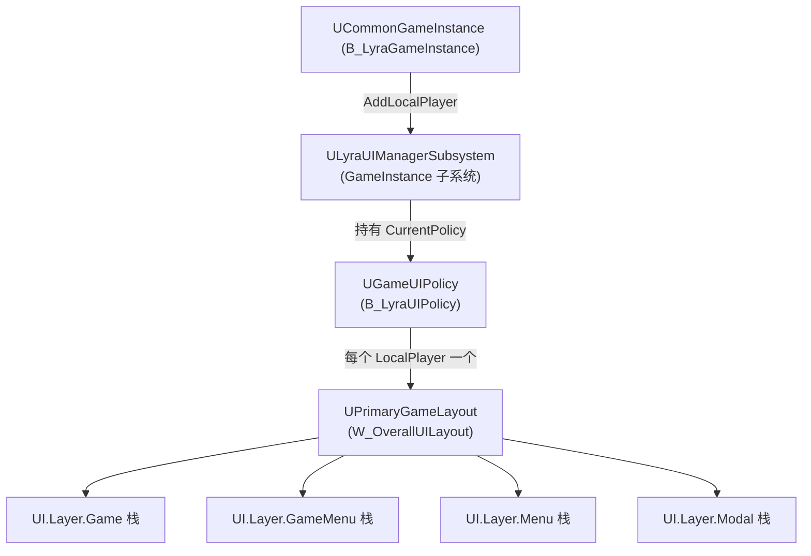
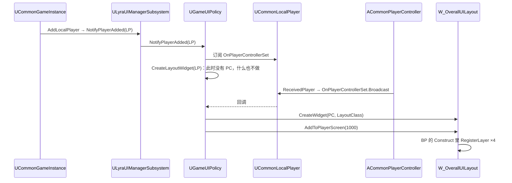
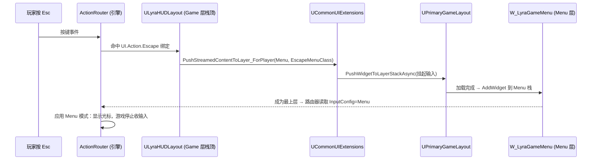
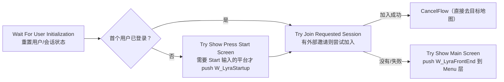

# 第 18 章　CommonUI 与 Lyra 的 UI 分层：谁在屏幕上，谁拿到输入

## 一个问题：按 ESC 弹出暂停菜单，为什么这么难做对？

假设策划提了一个很小的需求：游戏里按 ESC 弹出暂停菜单；菜单里点“退出”，要再弹一个“确定要退出吗？”的确认框；点“否”回到菜单，再按 ESC 回到游戏。手柄玩家按 Start 键（Gamepad 的特殊右键）也要能做同样的事，并且能用摇杆选中按钮。

按 UE 入门教程的写法，你大概会这样做：在 PlayerController 里监听 ESC，`CreateWidget` 创建菜单，`AddToViewport`，再 `SetInputMode(UIOnly)`、`SetShowMouseCursor(true)`；关闭时 `RemoveFromParent`，`SetInputMode(GameOnly)`，`SetShowMouseCursor(false)`。第一版 15 分钟就能跑起来。

然后问题一个接一个地出现：

- 确认框关闭时，你不知道此时“菜单还开着”还是“已经回到游戏”。如果它无脑地 `SetInputMode(GameOnly)`，菜单还在屏幕上，鼠标却消失了。
- HUD 也是 `AddToViewport` 的。菜单和 HUD 谁在上面？靠 ZOrder 的数字吗？那再来一个“断线提示”呢，数字要写多大？
- 分屏时，两个本地玩家的 HUD 都被加到“整个视口”，叠在一起。
- 手柄玩家按下 Start，ESC 的绑定在哪一层处理？菜单已经开着的时候，同一个键应该变成“关闭菜单”，而不是“再开一个菜单”。
- 手柄上没有鼠标，按钮得有“当前焦点”才能被方向键选中。谁来决定菜单打开时焦点落在哪个按钮上？

每个问题单独都有土办法，但它们加在一起，意味着“UI 的叠放顺序、输入模式、焦点、按键绑定”这四件事需要一个**统一的管理者**，而不是散落在每个菜单的 `BeginPlay` 里。这一章讲 UE 的 CommonUI 插件怎么提供这个管理者，以及 Lyra 在它上面搭了怎样的分层结构。

## 读完本章你能……

- 说出“控件树 → 视口”这条链路里 `AddToViewport` 做了什么，以及为什么 Lyra 几乎从不直接调用它；
- 画出从 GameInstance 到“某个本地玩家的四层 UI 栈”的创建链，并说出根布局为什么要等 PlayerController 才能创建；
- 解释 `UI.Layer.Game / GameMenu / Menu / Modal` 四层各放什么，以及同步 push、异步 push（流式）的区别；
- 解释 `ULyraActivatableWidget::InputConfig` 的四个取值，并说出“把菜单推到 Menu 层后鼠标还是不出现”最可能的原因；
- 走通“按 ESC → 弹暂停菜单 → 弹确认框 → 关闭”的完整调用链，并能在蓝图里复现其中两环。

## 需要先知道的 UE 概念

### UMG 控件：UUserWidget 与它背后的 Slate

虚幻的 UI 有两层。底层是 Slate：一套 C++ 的、用 `SNew(SBox)[...]` 声明式写法拼出来的控件树，真正负责布局、绘制和接收鼠标键盘事件，类名都以 `S` 开头。上层是 UMG（Unreal Motion Graphics）：你在编辑器里用“控件蓝图（Widget Blueprint）”拖出来的东西，类名以 `U` 开头，是 UObject，可以有蓝图逻辑、可以被反射和序列化。每个 UMG 控件在需要显示的时候，会通过 `TakeWidget()` / `RebuildWidget()` 生成对应的 Slate 控件。

你需要认识的主角是 `UUserWidget`（引擎类）：一个“可以被你整体放到屏幕上的控件”。它内部有一棵控件树（`WidgetTree`），树上是 `UTextBlock`、`UButton`、`UCanvasPanel` 之类的 `UWidget`。你在编辑器里打开一个 Widget Blueprint 看到的 Designer 面板，编辑的就是这棵树。

把一个 `UUserWidget` 弄到屏幕上，最基础的两步是：

```cpp
// 引擎 API，示意用法
UUserWidget* W = CreateWidget<UUserWidget>(PlayerController, WidgetClass); // ① 实例化（带上“属于哪个玩家”）
W->AddToViewport(/*ZOrder=*/ 0);                                           // ② 加进游戏视口
// ...
W->RemoveFromParent();                                                     // 从视口摘掉
```

`CreateWidget` 的第一个参数是“拥有者”，通常是 PlayerController。这个参数很重要：控件之后调用 `GetOwningPlayer()`、`GetOwningLocalPlayer()` 都靠它。`AddToViewport` 的 `ZOrder` 越大越靠上。Lyra 会用到的另一个版本是 `AddToPlayerScreen`：它把控件加到“某个本地玩家的那一块屏幕区域”，而不是整个窗口。分屏时这个区别就是“每人一块屏”和“大家叠在一起”的区别。

### 输入模式、鼠标光标与焦点

UE 里一次按键要决定“给游戏还是给 UI”。PlayerController 上有 `SetInputMode(...)`，常用三种：只给游戏（`FInputModeGameOnly`）、只给 UI（`FInputModeUIOnly`）、两者都给（`FInputModeGameAndUI`）。鼠标光标是否显示是另一个开关 `bShowMouseCursor`。另外游戏视口还可以“捕获鼠标（Mouse Capture）”：游戏模式下鼠标被锁在窗口里用来转视角，此时 UI 当然点不到。

“焦点（Focus）”是第三个概念：Slate 里同一时刻，每个用户只有一个控件拥有键盘/手柄焦点，方向键和手柄摇杆的“导航”就是在可聚焦的控件之间移动这个焦点。鼠标用户靠指针悬停点击，感觉不到焦点的存在；手柄用户则完全靠它——菜单一打开，如果没有任何控件有焦点，手柄就“点不动”。

### 分屏（Split-screen）与 LocalPlayer

引擎里 `ULocalPlayer` 代表“这台机器上的一个真人玩家”。一台机器可以有多个 LocalPlayer（本地多人、分屏）。每个 LocalPlayer 对应一个 PlayerController、一块视口区域，也应该有自己独立的一套 UI。第 2 章讲过 LocalPlayer 的位置，这里只强调结论：**UI 的“归属”单位是 LocalPlayer，而不是整个游戏**。

### 一个类比，和它不成立的地方

可以把“UI 管理”想成浏览器的页面栈加上操作系统的窗口管理器：栈决定“返回键回到哪里”，窗口管理器决定“谁在最上层、键盘事件发给谁”。但类比到这里就不准了：浏览器里切页面，旧页面的状态通常被保存在后台；而 CommonUI 里被盖住的控件会被“停用（Deactivate）”，并且可能被销毁或回收，你不能指望它还在“后台等着”。

## 朴素做法在哪里崩

回到开场的菜单需求。我们把“朴素做法”的缺陷整理成三个具体的失败场景，后面看 CommonUI 怎么逐个解决。

第一个是**输入模式没人负责恢复**。菜单 A 打开时设置 UIOnly+显示鼠标，A 上又弹出对话框 B，B 关闭时它不知道自己下面还有 A，只能选择“恢复成 GameOnly”（于是鼠标消失，A 点不动）或者“什么都不做”（于是 A 关闭时也没人恢复）。解决这种问题需要一个“栈”：关闭谁，输入模式就回到栈里下一个控件想要的样子。

第二个是**叠放顺序靠魔数**。HUD、暂停菜单、设置页、错误提示、加载屏……每个都硬编码一个 ZOrder，写 UI 的人必须知道所有其他 UI 的数字。我们需要“层”这个抽象：HUD 在“游戏层”，菜单在“菜单层”，对话框在“模态层”，谁在谁上面由层的顺序决定，控件自己不用知道。

第三个是**按键绑定不跟随显示状态**。ESC 在 HUD 上意味着“开菜单”，在菜单上意味着“关菜单”，在确认框上意味着“取消”。如果每个控件都在 `OnKeyDown` 里自己判断“我现在是不是最上层”，你会得到一团 `if`。我们希望绑定只在该控件处于最上层时才生效，并且按键提示图标（“按 [Esc] 返回”或者“按 (B) 返回”）能跟着当前输入设备变。

CommonUI 正是为这三件事设计的。

## CommonUI 的三个想法

CommonUI 是 UE 自带的一个 UI 插件（Lyra 项目里启用了它，`LyraGame.Build.cs` 依赖 `CommonUI`）。它提供的类很多，抓住三个想法就够用。

### 想法一：可激活控件（Activatable Widget）

`UCommonActivatableWidget`（引擎类）是 `UUserWidget` 的子类，多了一个“激活/停用”的生命周期：一个可激活控件被放到屏幕上并处于最上层时是“激活”的；被别的控件盖住，或者被关闭时是“停用”的。你在子类里可以重写 `NativeOnActivated` / `NativeOnDeactivated` 来响应；外部也可以订阅 `OnDeactivated()` 委托（Lyra 的前端流程就这样用，后面会看到）。想让它自己关闭，调 `DeactivateWidget()`。

激活状态也是“输入的开关”：一个可激活控件上用 `RegisterUIActionBinding(FBindUIActionArgs(...))` 注册的按键绑定，只在它激活时才响应。这就解决了上面的第三个失败场景。HUD 布局上绑了 ESC → 开菜单，菜单一旦成为最上层，HUD 上的这个绑定就不再收到输入。

### 想法二：栈容器（Activatable Widget Stack）

`UCommonActivatableWidgetStack`（引擎类，编辑器里叫 Common Activatable Widget Stack）是放可激活控件的容器。往里 `AddWidget` 就是 push，控件 `DeactivateWidget()` 就是 pop。同一个栈里**只有栈顶那个控件是激活并显示的**（引擎头文件注释原话：Only the widget at the top of the stack is displayed and activated. All others are deactivated.），它被弹出之后，下面一个会自动重新激活。这是“返回键回到上一屏”的行为基础。栈还可以配一个 `RootContentWidgetClass`，作为永远不会被弹出的根内容。注意“只有栈顶”是**每个栈**各自的规则：Lyra 有四个独立的栈，所以 Game 层的 HUD 和 Menu 层的菜单可以同时处于激活状态。

还有一个姊妹类 `UCommonActivatableWidgetQueue`，先进先出，一次只激活、显示一个，当前这个停用后才轮到队列里的下一个，用在“一次只显示一个提示、显示完才显示下一个”的场景（这些行为已对照 5.8 的 `CommonActivatableWidgetContainer.h/.cpp` 核实）。Lyra 没有用到它，只用栈。

### 想法三：输入配置与动作路由（Action Router）

每个可激活控件可以声明“我激活时希望输入是什么样”，方法是重写：

```cpp
// 引擎 UCommonActivatableWidget 的虚函数
virtual TOptional<FUIInputConfig> GetDesiredInputConfig() const;
```

返回值里有两部分：输入模式 `ECommonInputMode`（`Menu` 只给 UI、`Game` 只给游戏、`All` 都给）和鼠标捕获方式 `EMouseCaptureMode`。返回“空”表示“我不表态”，注意这**不等于**“保持上一个配置”，下面马上讲它的真正含义。

谁来读这个值、应用它？是 CommonUI 的动作路由器（Action Router，引擎类 `UCommonUIActionRouterBase`，每个 LocalPlayer 一个）。它维护一棵“当前激活控件”的树（只有可激活控件才会成为树上的节点），每当栈顶变化，就找出**最里层（leaf-most）的那个激活节点**，按下面的顺序决定输入配置，并把结果应用到 PlayerController（输入模式、鼠标光标、视口捕获）（对应 5.8 源码 `FActivatableTreeNode::FindDesiredInputConfig` 和 `FActivatableTreeRoot::ApplyLeafmostNodeConfig`）：

1. 先问这个控件自己的 `GetDesiredInputConfig()`；
2. 它不表态，就看它的“动作域（Action Domain）”有没有配置（动作域是 CommonUI 里一组输入规则的分组，Lyra 没有用到），有就用；
3. 还没有，就沿激活树问它的**父节点**，一路问到根；
4. 整棵树都不表态时，如果 `CommonInputSettings` 里的 `bEnableDefaultInputConfig` 为真（默认值是 true，Lyra 没有改它），就应用一个默认的 `FUIInputConfig()`：**Menu 模式、不捕获鼠标**；只有把这个开关关掉，才会保持原有配置不动。

同时它也负责把按键事件派发给最上层控件的 UI 动作绑定。还要注意：栈顶变化时，路由器是**重新计算**新的最里层节点的配置并应用，而不是维护一个“配置栈”然后弹出。

这里还有两个重要的前置条件。第一，**视口类必须是 `UCommonGameViewportClient`**：CommonUI 靠它截获输入再交给路由器（官方 Quickstart 要求把项目设置里的 Game Viewport Client Class 设成它）。Lyra 的 [`DefaultEngine.ini`](../../../Config/DefaultEngine.ini) 里设的是 `GameViewportClientClassName=/Script/LyraGame.LyraGameViewportClient`，也就是 [`ULyraGameViewportClient`](../../../Source/LyraGame/UI/LyraGameViewportClient.h)，它继承自 `UCommonGameViewportClient`，所以满足要求；你自己的项目若换了视口类，要保证它仍然继承自 `UCommonGameViewportClient`。第二，**控件必须是通过 CommonUI 的容器加进来的，才会被路由器看到**。一个直接 `AddToViewport` 的普通控件，路由器不认识它——所以它既不会触发输入配置的切换，也不会享受动作绑定。这是新手最常踩的坑，本章末尾“常见误区”里会再提。

社区里还有一条经验：在 CommonUI 项目里不要再手动调用 `SetInputMode`，它会和路由器争夺输入模式，把 CommonUI 搞乱。

### 配套：UI 动作与 CommonInput

“UI 动作”（UI Action）是 CommonUI 对“语义化按键”的抽象。比如“返回”这个动作，在键盘上可能映射成 Esc，在 Xbox 手柄上映射成 B 键。动作用一个 GameplayTag 标识，映射表在项目的 CommonUI 配置里。打开 [`Config/DefaultInput.ini`](../../../Config/DefaultInput.ini) 能看到 Lyra 自己加了一个：

```ini
[/Script/CommonUI.CommonUIInputSettings]
UIActionProcessingPriority=10000
+InputActions=(ActionTag=UI.Action.Escape, ... KeyMappings=((Key=Escape),(Key=Gamepad_Special_Right)))
```

`UI.Action.Escape` 同时映射到键盘 Esc 和手柄的特殊右键（Start/Menu 键）。另一条 `UIActionProcessingPriority=10000` 设置了 UI 动作处理的优先级，Lyra 把它调得很高，意味着 UI 的按键绑定比游戏自己的输入先处理。

“默认的点击和返回动作”则在 [`Config/DefaultGame.ini`](../../../Config/DefaultGame.ini) 的 `[/Script/CommonInput.CommonInputSettings]` 里通过 `InputData=/Game/UI/B_CommonInputData.B_CommonInputData_C` 指向一个蓝图资产，里面有 Default Click / Default Back 两行数据表引用。Lyra 的 C++ 里通过 `ICommonInputModule::GetSettings().GetDefaultClickAction()` 之类的函数读取它们（后面确认框那一节就会用到）。

最后是 CommonInput（输入类型切换）。CommonUI 会判断玩家“此刻正在用什么设备”：`ECommonInputType` 有 `MouseAndKeyboard`、`Gamepad`、`Touch` 三种，玩家一碰手柄摇杆就切到 Gamepad，一动鼠标又切回键鼠。Lyra 的 CommonGame 插件把它封装成了蓝图可用的函数：

```cpp
// 简化自 Plugins/CommonGame/Source/Private/CommonUIExtensions.cpp
ECommonInputType UCommonUIExtensions::GetOwningPlayerInputType(const UUserWidget* WidgetContextObject)
{
    if (const UCommonInputSubsystem* InputSubsystem = UCommonInputSubsystem::Get(WidgetContextObject->GetOwningLocalPlayer()))
    {
        return InputSubsystem->GetCurrentInputType();   // 当前正在用哪类设备
    }
    return ECommonInputType::Count;
}
```

按钮上显示“Esc”还是“B”，就是根据这个类型决定。Lyra 的 `ULyraActionWidget::GetIcon`（[`LyraActionWidget.cpp`](../../../Source/LyraGame/UI/Foundation/LyraActionWidget.cpp)）更进一步，会按 EnhancedInput 里玩家实际的重绑定键来取图标。

## Lyra 怎么把它们组装起来：CommonGame 插件

CommonUI 给了零件，但没有回答“整个游戏的 UI 谁来创建、放在哪”。这部分在 Lyra 项目里的 `Plugins/CommonGame` 插件里（它是 Epic 随 Lyra 提供的通用插件，不是引擎自带）。先看全貌：



从上到下依次是：GameInstance 把“加了一个本地玩家”通知给 UI 管理器；管理器把事情交给当前的**策略（Policy）**；策略为每个本地玩家创建一个**根布局（Primary Game Layout）**；根布局里放着四个栈，每个栈是一个“层”。

### 管理器子系统：为什么基类是 Abstract

`UGameUIManagerSubsystem` 是 GameInstance 子系统（第 2 章讲过子系统：随 GameInstance 创建、销毁的单例）。它在 CommonGame 里是 `Abstract` 的，注释写明“这个管理器是要被你的游戏替换的”。Lyra 的替换者是 [`ULyraUIManagerSubsystem`](../../../Source/LyraGame/UI/Subsystem/LyraUIManagerSubsystem.h)。基类里的 `ShouldCreateSubsystem` 有一个值得细读的写法：

```cpp
// 简化自 Plugins/CommonGame/Source/Private/GameUIManagerSubsystem.cpp
bool UGameUIManagerSubsystem::ShouldCreateSubsystem(UObject* Outer) const
{
    if (!CastChecked<UGameInstance>(Outer)->IsDedicatedServerInstance())   // 专用服务器没有屏幕，不创建
    {
        TArray<UClass*> ChildClasses;
        GetDerivedClasses(GetClass(), ChildClasses, false);
        // 只有“没有任何子类”时才创建自己
        return ChildClasses.Num() == 0;
    }
    return false;
}
```

这是一个“让位”模式：只要项目里存在子类，基类就不创建，由子类顶上。好处是项目不需要在某个配置里写“用哪个子系统”，只要写一个子类就行。代价是：配置段也要写在子类名下。看 `DefaultGame.ini`：

```ini
[/Script/LyraGame.LyraUIManagerSubsystem]
DefaultUIPolicyClass=/Game/UI/B_LyraUIPolicy.B_LyraUIPolicy_C
```

它用的是 `LyraUIManagerSubsystem`，而不是 `GameUIManagerSubsystem`。`UCommonMessagingSubsystem`（后面的确认框）用的是同一个模式。

`Initialize` 里，管理器同步加载这个软类，并创建策略对象：

```cpp
// 简化自 GameUIManagerSubsystem.cpp 的 UGameUIManagerSubsystem::Initialize
if (!CurrentPolicy && !DefaultUIPolicyClass.IsNull())
{
    TSubclassOf<UGameUIPolicy> PolicyClass = DefaultUIPolicyClass.LoadSynchronous();
    SwitchToPolicy(NewObject<UGameUIPolicy>(this, PolicyClass));
}
```

Lyra 的子类还加了一件事：它在 `Initialize` 里挂了一个每帧的 `FTSTicker`，把根布局的可见性同步到 `AHUD::bShowHUD`（`AHUD` 是引擎的 HUD Actor 类）。控制台命令 `showhud` 切换的就是这个开关，而 Lyra 把它做成了“整个根布局隐藏”，所以会连菜单一起隐藏：

```cpp
// 简化自 Source/LyraGame/UI/Subsystem/LyraUIManagerSubsystem.cpp
const AHUD* HUD = PC->GetHUD();
if (HUD && !HUD->bShowHUD) { bShouldShowUI = false; }
// ...
const ESlateVisibility Desired = bShouldShowUI ? ESlateVisibility::SelfHitTestInvisible : ESlateVisibility::Collapsed;
```

### 策略：根布局长什么样，是它说了算

`UGameUIPolicy` 是一个很薄的 UObject，`Within = GameUIManagerSubsystem`，意思是它的 Outer 必须是管理器。它最重要的两个成员是：

- `LayoutClass`：一个软类引用，指向 `UPrimaryGameLayout` 的子类。Lyra 的 `Content/UI/B_LyraUIPolicy` 蓝图把它设成了 `W_OverallUILayout`；
- `RootViewportLayouts`：一个数组，记录“哪个 LocalPlayer 对应哪个根布局实例”。

为什么要多一层“策略”，而不是管理器直接创建根布局？因为“怎么创建根布局”是一件可以按游戏定制的事：分屏时是每人一个，还是只有主玩家一个、其他人轮流切换？基类里确实留了一个 `ELocalMultiplayerInteractionMode`（`PrimaryOnly` / `SingleToggle`），但 `SingleToggle` 路径的实现大部分被注释掉了，且没有 setter，默认永远是 `PrimaryOnly`。不用管它，知道“这里留了定制空间”就够了。

### 根布局什么时候创建：等 PlayerController

现在到了本章最容易误解的一环：根布局**不是**在 LocalPlayer 一出现就创建的。看 `CreateLayoutWidget`：

```cpp
// 简化自 Plugins/CommonGame/Source/Private/GameUIPolicy.cpp 的 UGameUIPolicy::CreateLayoutWidget
if (APlayerController* PlayerController = LocalPlayer->GetPlayerController(GetWorld()))
{
    TSubclassOf<UPrimaryGameLayout> LayoutWidgetClass = GetLayoutWidgetClass(LocalPlayer);  // LayoutClass.LoadSynchronous()
    if (ensure(LayoutWidgetClass && !LayoutWidgetClass->HasAnyClassFlags(CLASS_Abstract)))
    {
        // 第一个参数是 PlayerController：这个控件“属于”这个玩家
        UPrimaryGameLayout* NewLayoutObject = CreateWidget<UPrimaryGameLayout>(PlayerController, LayoutWidgetClass);
        RootViewportLayouts.Emplace(LocalPlayer, NewLayoutObject, true);
        AddLayoutToViewport(LocalPlayer, NewLayoutObject);
    }
}
```

`CreateWidget` 需要 PlayerController 作为拥有者，所以没有 PC 就没法创建；`if` 不成立时函数什么也不做。那 PC 来了以后谁来补上？答案在 `NotifyPlayerAdded`：它给 `LocalPlayer->OnPlayerControllerSet` 订阅了一个回调。而这个委托是被 `ACommonPlayerController::ReceivedPlayer` 广播的：

```cpp
// 简化自 Plugins/CommonGame/Source/Private/CommonPlayerController.cpp
void ACommonPlayerController::ReceivedPlayer()
{
    Super::ReceivedPlayer();
    if (UCommonLocalPlayer* LocalPlayer = Cast<UCommonLocalPlayer>(Player))
    {
        LocalPlayer->OnPlayerControllerSet.Broadcast(LocalPlayer, this);   // ← 触发根布局创建
        if (PlayerState) { LocalPlayer->OnPlayerStateSet.Broadcast(LocalPlayer, PlayerState); }
    }
}
```

把这条链画成时序图：



这里有三个值得记住的细节。第一，这是服务器和客户端各自独立发生的“本地事情”：UI 只存在于有屏幕的那一端，专用服务器根本没有 UI 管理器（上面 `ShouldCreateSubsystem` 返回 false）。第二，订阅的回调不只触发一次。每次 PlayerController 被重新设置（比如换地图后 PC 重建），回调都会先 `NotifyPlayerRemoved`（把根布局从视口移除），再对已有的根布局重新 `AddLayoutToViewport`，**同一个根布局实例被复用**。所以换地图不会重新创建 `W_OverallUILayout`。第三，`AddToPlayerScreen(1000)` 加的 ZOrder 是 1000；后面会看到加载屏用的是 10000，在它上面。

自己写 PlayerController 的人要注意：这条链依赖 `ACommonPlayerController`。如果你的 PC 继承自普通的 `APlayerController`，`OnPlayerControllerSet` 永远不会被广播，根布局永远不会创建，所有 push 都返回空。Lyra 的 `ALyraPlayerController` 继承自 `ACommonPlayerController`；`DefaultEngine.ini` 里的 `LocalPlayerClassName` 指向 `ULyraLocalPlayer`（继承自 `UCommonLocalPlayer`），`GameInstanceClass` 是继承自 `UCommonGameInstance` 的 `B_LyraGameInstance`。这三个类是一套的。

### 四个层：叠放顺序与语义

根布局本身是一个 `UPrimaryGameLayout`（C++ 里是 `UCommonUserWidget` 的子类，Abstract）。它在 C++ 里只提供一个函数让蓝图把“栈”登记成“层”：

```cpp
// 简化自 Plugins/CommonGame/Source/Private/PrimaryGameLayout.cpp
void UPrimaryGameLayout::RegisterLayer(FGameplayTag LayerTag, UCommonActivatableWidgetContainerBase* LayerWidget)
{
    if (!IsDesignTime())
    {
        LayerWidget->OnTransitioningChanged.AddUObject(this, &UPrimaryGameLayout::OnWidgetStackTransitioning);
        // 转场时长强制为 0：有转场动画的话，手柄焦点总是不能正确转移到新控件
        LayerWidget->SetTransitionDuration(0.0);
        Layers.Add(LayerTag, LayerWidget);
    }
}
```

在编辑器里打开 `Content/UI/W_OverallUILayout`，你会看到 `MainOverlay` 里按从底到顶的顺序叠放着四个 `Common Activatable Widget Stack`（变量名依次为 `GameLayer_Stack`、`GameMenu_Stack`、`Menu_Stack`、`Modal_Stack`），在蓝图的 `Construct` 事件里分别用四个 Tag 调用 `RegisterLayer`。Tag 来自 [`Config/DefaultGameplayTags.ini`](../../../Config/DefaultGameplayTags.ini)：

| Tag | 放什么 |
|---|---|
| `UI.Layer.Game` | HUD 布局（如 `W_ShooterHUDLayout`） |
| `UI.Layer.GameMenu` | 玩法相关的局内浮层（如排行榜技能基类 `GAB_ShowWidget_WhileInputHeld` 推出的计分板） |
| `UI.Layer.Menu` | 前端主菜单、ESC 暂停菜单、设置页、手柄断开提示 |
| `UI.Layer.Modal` | 确认框、错误框 |

这四层没有官方专页，上表是根据源码和资产用法整理的（其中排行榜技能 `GA_ShowLeaderboard_TDM` / `GA_ShowLeaderboard_CP` 继承自 `GAB_ShowWidget_WhileInputHeld`，默认目标层就是 `UI.Layer.GameMenu`）。

四个栈在 `MainOverlay` 里按 `Game → GameMenu → Menu → Modal` 从下到上叠放。关键点是：**不同层之间不会互相隐藏**。暂停菜单推到 Menu 层，Game 层的 HUD 依然在下面显示；但“谁拿到输入”由路由器判断，最上层的一支才拿。

这里把“层”做成 GameplayTag 的好处，和第 4 章讲过的所有 Tag 用法是一回事：调用方只需要说“放到 `UI.Layer.Menu`”，不需要持有任何控件的引用。`FLyraHUDLayoutRequest::LayerID` 甚至用 `meta=(Categories="UI.Layer")` 限制了编辑器里只能选这个命名空间下的 Tag。

### push 与 pop：怎么把控件放上去

面向使用者的入口都在 `UCommonUIExtensions`（一个蓝图函数库，[`CommonUIExtensions.cpp`](../../../Plugins/CommonGame/Source/Private/CommonUIExtensions.cpp)）。同步版本：

```cpp
// 简化自 CommonUIExtensions.cpp 的 UCommonUIExtensions::PushContentToLayer_ForPlayer
UCommonActivatableWidget* UCommonUIExtensions::PushContentToLayer_ForPlayer(
    const ULocalPlayer* LocalPlayer, FGameplayTag LayerName, TSubclassOf<UCommonActivatableWidget> WidgetClass)
{
    if (UGameUIManagerSubsystem* UIManager = LocalPlayer->GetGameInstance()->GetSubsystem<UGameUIManagerSubsystem>())
        if (UGameUIPolicy* Policy = UIManager->GetCurrentUIPolicy())
            if (UPrimaryGameLayout* RootLayout = Policy->GetRootLayout(CastChecked<UCommonLocalPlayer>(LocalPlayer)))
            {
                return RootLayout->PushWidgetToLayerStack(LayerName, WidgetClass);   // → 对应栈的 AddWidget
            }
    return nullptr;   // 根布局还没创建好，静默返回空
}
```

注意三个层层嵌套的 `if`：管理器、策略、根布局，任何一个还没就绪就返回空，而不是崩溃或者报错。所以在游戏很早期（根布局还没创建）调用它会静默失败。

一个“同步 push”的限制是它收的是 `TSubclassOf`，一个**硬引用的已加载类**。如果这个菜单控件很大、只在偶尔才用到，把它硬引用在 C++ 或常驻蓝图里，意味着它和它引用的全部资源常驻内存。于是有了异步版本，收的是 `TSoftClassPtr`（软引用，第 4 章）：

```cpp
// 简化自 Plugins/CommonGame/Source/Public/PrimaryGameLayout.h 的 PushWidgetToLayerStackAsync
const FName SuspendInputToken = bSuspendInputUntilComplete
    ? UCommonUIExtensions::SuspendInputForPlayer(GetOwningPlayer(), NAME_PushingWidgetToLayer) : NAME_None;   // ① 先把输入挂起

TSharedPtr<FStreamableHandle> StreamingHandle = StreamableManager.RequestAsyncLoad(
    ActivatableWidgetClass.ToSoftObjectPath(),
    FStreamableDelegate::CreateWeakLambda(this, [=]()
    {
        UCommonUIExtensions::ResumeInputForPlayer(GetOwningPlayer(), SuspendInputToken);                    // ③ 加载完：恢复输入
        ActivatableWidgetT* Widget = PushWidgetToLayerStack<ActivatableWidgetT>(LayerName,                   //    再 push
            ActivatableWidgetClass.Get(), [StateFunc](auto& W){ StateFunc(EAsyncWidgetLayerState::Initialize, &W); });
        StateFunc(EAsyncWidgetLayerState::AfterPush, Widget);
    }));                                                                                                     // ② 异步加载

StreamingHandle->BindCancelDelegate(/* 取消时也要 ResumeInput，并回调 Canceled */);
```

“挂起输入”做的事情很具体：`SuspendInputForPlayer` 对 MouseAndKeyboard、Gamepad、Touch 三类输入各设置一个类型过滤器，用一个递增编号生成的 Token 作标识；`ResumeInputForPlayer` 用同一个 Token 取消过滤。为什么要这么麻烦？因为异步加载期间玩家如果连按两次 ESC，就会 push 出两个暂停菜单。挂起输入就是在“加载的空档”里吞掉所有输入。注意取消路径也绑定了 `ResumeInput`：任何异步加挂起的代码，都必须保证成对，否则会永久锁住输入。

C++ 里的简版 `PushStreamedContentToLayer_ForPlayer` 就是固定 `bSuspendInputUntilComplete = true` 去调它。蓝图里对应一个异步节点 `UAsyncAction_PushContentToLayerForPlayer`（节点名 Push Content To Layer For Player），带 `BeforePush` 和 `AfterPush` 两个输出，参数是 `OwningPlayer`、`WidgetClass`（软引用）、`LayerName`、`bSuspendInputUntilComplete`（默认 true）。

pop 有两种：控件自己调 `DeactivateWidget()`，或者外部调 `UCommonUIExtensions::PopContentFromLayer(Widget)`，后者让根布局遍历全部层找到并移除它。两种效果一样：控件停用，栈把下一个控件重新激活。

## ULyraActivatableWidget：输入配置怎么落地

现在回到想法三，看 Lyra 怎么表态。所有 Lyra 自己的“屏幕”控件都继承自 [`ULyraActivatableWidget`](../../../Source/LyraGame/UI/LyraActivatableWidget.h)，它的全部关键逻辑只有一个函数：

```cpp
// 简化自 Source/LyraGame/UI/LyraActivatableWidget.cpp
TOptional<FUIInputConfig> ULyraActivatableWidget::GetDesiredInputConfig() const
{
    switch (InputConfig)
    {
    case ELyraWidgetInputMode::GameAndMenu:
        return FUIInputConfig(ECommonInputMode::All,  GameMouseCaptureMode);          // UI 和游戏都收输入
    case ELyraWidgetInputMode::Game:
        return FUIInputConfig(ECommonInputMode::Game, GameMouseCaptureMode);          // 只给游戏
    case ELyraWidgetInputMode::Menu:
        return FUIInputConfig(ECommonInputMode::Menu, EMouseCaptureMode::NoCapture);  // 只给 UI，鼠标不被捕获
    case ELyraWidgetInputMode::Default:
    default:
        return TOptional<FUIInputConfig>();                                           // 不表态
    }
}
```

`InputConfig` 和 `GameMouseCaptureMode` 都是 `EditDefaultsOnly` 的属性，也就是在 Widget 蓝图的类默认值里选。`GameMouseCaptureMode` 默认是 `CapturePermanently`（永久捕获，射击游戏转视角时鼠标不会跑出窗口）。

这四个取值的含义，用你会碰到的场景来记：

- `Menu`：典型的暂停菜单、设置页。鼠标出现，游戏收不到输入；
- `GameAndMenu`：HUD。Lyra 的 `W_DefaultHUDLayout` 设为这个——游戏要收移动/射击，HUD 上的可点击控件（触屏按钮、记分板）也要能收到事件；
- `Game`：纯游戏态，UI 不抢输入；
- `Default`：不表态，交给“继承父级、再不行就用默认菜单配置”的规则（见下一节）。

### `Default` 到底意味着什么

先记结论：**在 Lyra 默认配置下，把一个 `InputConfig = Default` 的独立屏幕直接推到 `UI.Layer.Menu`，结果等价于 `Menu` 模式（光标出现、不捕获鼠标），而不是“保持上一个配置不变”。**

为什么？`Default` 返回空的 `TOptional`，路由器沿激活树往上找父节点；注意**菜单栈和 HUD 栈是平级的兄弟容器，不是父子关系**（栈和根布局本身都不是 `CommonActivatableWidget`），所以这个菜单没有可激活的祖先可继承。整棵分支都不表态时，路由器走到第 4 步：因为 `CommonInputSettings::bEnableDefaultInputConfig` 默认为 `true`，它会套用默认的 `FUIInputConfig()`（`Menu` + `NoCapture`）。

那实战中“菜单打开了却没有鼠标”通常是什么原因？往往是下面三种之一：控件（或其祖先）选了 `Game` / `GameAndMenu` 且保留了默认的 `CapturePermanently`（鼠标仍被锁在视口里转视角）；控件是直接 `AddToViewport` 加的，根本没进 CommonUI 栈，路由器看不见它；或者更上层的 Modal 栈里还有别的激活控件压在上面。写新菜单时建议养成习惯：**需要鼠标就显式选 `Menu`，不要依赖 `Default` 的隐式兜底规则**（实验 1 会带你亲手对比这几个选项）。

编辑器还给了一个提示：`ULyraActivatableWidget` 重写了 `ValidateCompiledWidgetTree`，如果你的蓝图子类没有实现 `GetDesiredFocusTarget`，编译时会给一个警告：“GetDesiredFocusTarget wasn't implemented, you're going to have trouble using gamepads on this screen.” 这对应我们开头说的“焦点”问题：手柄玩家需要一个初始焦点控件，这个函数就是用来告诉 CommonUI“这个屏幕激活时焦点该落到哪个控件上”。

## ESC 菜单：串起整条链

现在把前面所有零件串起来，看“按 ESC 弹出暂停菜单”到底发生了什么。起点是 HUD 布局的基类 [`ULyraHUDLayout`](../../../Source/LyraGame/UI/LyraHUDLayout.h)。它继承 `ULyraActivatableWidget`，在初始化时注册一个 UI 动作绑定：

```cpp
// 简化自 Source/LyraGame/UI/LyraHUDLayout.cpp
UE_DEFINE_GAMEPLAY_TAG_STATIC(TAG_UI_LAYER_MENU,  "UI.Layer.Menu");
UE_DEFINE_GAMEPLAY_TAG_STATIC(TAG_UI_ACTION_ESCAPE, "UI.Action.Escape");

void ULyraHUDLayout::NativeOnInitialized()
{
    Super::NativeOnInitialized();
    // 绑定 UI.Action.Escape；第二个参数 false = 不在“动作栏”里显示提示
    RegisterUIActionBinding(FBindUIActionArgs(FUIActionTag::ConvertChecked(TAG_UI_ACTION_ESCAPE), false,
        FSimpleDelegate::CreateUObject(this, &ThisClass::HandleEscapeAction)));
    // ...（手柄断开处理，见下）
}

void ULyraHUDLayout::HandleEscapeAction()
{
    if (ensure(!EscapeMenuClass.IsNull()))
    {
        // 流式 push：软引用 → 异步加载 → 加到 Menu 层，加载期间挂起输入
        UCommonUIExtensions::PushStreamedContentToLayer_ForPlayer(GetOwningLocalPlayer(), TAG_UI_LAYER_MENU, EscapeMenuClass);
    }
}
```

`EscapeMenuClass` 是 `ULyraHUDLayout` 上的一个 `TSoftClassPtr<UCommonActivatableWidget>` 属性，在 HUD 布局的蓝图里指定。`ShooterCore` 的 `W_ShooterHUDLayout` 把它设成了 `/Game/UI/Hud/W_LyraGameMenu`（`InputConfig = Menu`）。完整流程如下：



最后一步就是本章的主题：路由器看到 Menu 栈顶多了一个控件，读它的 `GetDesiredInputConfig`，得到 `Menu` + `NoCapture`，把 PlayerController 的输入模式、鼠标光标、视口捕获都切换过去。HUD 在下层仍然显示，但已经不是输入上的最上层，所以它的 Escape 绑定不再触发。这就是为什么在菜单里再按 Esc 不会再开一个菜单。

关闭有两条路。菜单内部的“返回”动作（Back，来自 `B_CommonInputData`）绑定到 `DeactivateWidget()`；栈把菜单弹出，HUD 重新成为最上层，路由器重新读到 HUD 的 `GameAndMenu` 配置，鼠标又被捕获。输入模式的恢复不需要任何人写代码，这就是第一个失败场景的解法。

这里的图覆盖了 C++ 与路由器的行为；打开 `Content/UI/Hud/W_LyraGameMenu` 可以看到菜单里的各个按钮和返回动作绑定都在蓝图里完成。

### 顺便：手柄断开提示

`ULyraHUDLayout` 里还有一块代码是处理手柄断开的。它只在平台带有 `Platform.Trait.Input.PrimarlyController` 这个 Tag（注意拼写是 Primarly，源码与 Tag 都是这样，别“修正”）时启用：订阅输入设备连接/配对变化，下一帧检查该玩家名下还有没有连着的手柄，没有就把 `ControllerDisconnectedScreen` 用同步的 `PushContentToLayer_ForPlayer` 推到 Menu 层，有了就 `PopContentFromLayer`。这是一个很好的“非 ESC 触发 push”的例子：任何时候你想中断游戏要求玩家处理某件事，推一个屏幕到 Menu 层就够了，输入路由自动跟着变。

## 确认框：UCommonMessagingSubsystem

回到开场需求：菜单里点“退出”要弹确认框。这件事有三层抽象。

最外面是**调用者的视角**：我只想说“弹一个是/否对话框，告诉我玩家点了什么”。CommonGame 为此提供 `UCommonMessagingSubsystem`（LocalPlayer 子系统）：

```cpp
// 简化自 Plugins/CommonGame/Source/Public/Messaging/CommonMessagingSubsystem.h
UENUM(BlueprintType)
enum class ECommonMessagingResult : uint8
{
    Confirmed,   // “是 / 确定”
    Declined,    // “否”
    Cancelled,   // “忽略 / 取消”
    Killed,      // 对话框被代码强制关闭（没有玩家输入）
    Unknown
};

virtual void ShowConfirmation(UCommonGameDialogDescriptor* DialogDescriptor, FCommonMessagingResultDelegate ResultCallback = ...);
virtual void ShowError(UCommonGameDialogDescriptor* DialogDescriptor, FCommonMessagingResultDelegate ResultCallback = ...);
```

基类的这两个函数是空实现，和 UI 管理器一样是“让位”模式——只要有子类，基类不创建。Lyra 的子类是 [`ULyraUIMessaging`](../../../Source/LyraGame/UI/Subsystem/LyraUIMessaging.cpp)：

```cpp
// 简化自 Source/LyraGame/UI/Subsystem/LyraUIMessaging.cpp
UE_DEFINE_GAMEPLAY_TAG_STATIC(TAG_UI_LAYER_MODAL, "UI.Layer.Modal");

void ULyraUIMessaging::ShowConfirmation(UCommonGameDialogDescriptor* DialogDescriptor, FCommonMessagingResultDelegate ResultCallback)
{
    if (UCommonLocalPlayer* LocalPlayer = GetLocalPlayer<UCommonLocalPlayer>())
        if (UPrimaryGameLayout* RootLayout = LocalPlayer->GetRootUILayout())
        {
            // 把配置里指定的对话框类 push 到 Modal 层，并在“初始化”回调里把描述符交给它
            RootLayout->PushWidgetToLayerStack<UCommonGameDialog>(TAG_UI_LAYER_MODAL, ConfirmationDialogClassPtr,
                [DialogDescriptor, ResultCallback](UCommonGameDialog& Dialog) { Dialog.SetupDialog(DialogDescriptor, ResultCallback); });
        }
}
```

对话框类来自 `DefaultGame.ini`：`[/Script/LyraGame.LyraUIMessaging]` 段里的 `ConfirmationDialogClass=.../W_ConfirmationDefault` 和 `ErrorDialogClass=.../W_ConfirmationError`。注意它在 `Initialize` 里 `LoadSynchronous` 了这两个软类，所以对话框类是常驻内存的——对话框很小，换来的是弹出时没有加载延迟。

中间一层是**描述符**。`UCommonGameDialogDescriptor` 是个纯数据对象：`Header`、`Body` 两段文字，加一个 `ButtonActions` 数组，每项是“这个按钮对应哪种结果 + 可选的显示文字”。它还提供四个静态工厂：`CreateConfirmationOk`、`CreateConfirmationOkCancel`、`CreateConfirmationYesNo`、`CreateConfirmationYesNoCancel`。比如 YesNo 会生成 Confirmed（文字“Yes”）和 Declined（文字“No”）两个按钮。

最里层是**对话框控件**。Lyra 的实现 `ULyraConfirmationScreen` 继承 `UCommonGameDialog`（它又继承 `UCommonActivatableWidget`——所以它能 push 到栈里）：

```cpp
// 简化自 Source/LyraGame/UI/Foundation/LyraConfirmationScreen.cpp
void ULyraConfirmationScreen::SetupDialog(UCommonGameDialogDescriptor* Descriptor, FCommonMessagingResultDelegate ResultCallback)
{
    Text_Title->SetText(Descriptor->Header);
    RichText_Description->SetText(Descriptor->Body);
    EntryBox_Buttons->Reset<ULyraButtonBase>(...);

    for (const FConfirmationDialogAction& Action : Descriptor->ButtonActions)
    {
        FDataTableRowHandle ActionRow;
        switch (Action.Result)
        {
        case ECommonMessagingResult::Confirmed: ActionRow = ICommonInputModule::GetSettings().GetDefaultClickAction(); break;
        case ECommonMessagingResult::Declined:  ActionRow = ICommonInputModule::GetSettings().GetDefaultBackAction();  break;
        case ECommonMessagingResult::Cancelled: ActionRow = CancelAction; break;
        default: ensure(false); continue;           // Killed/Unknown 不支持作为按钮
        }
        ULyraButtonBase* Button = EntryBox_Buttons->CreateEntry<ULyraButtonBase>();
        Button->SetTriggeringInputAction(ActionRow);                     // 按钮绑定到“点击/返回”动作
        Button->OnClicked().AddUObject(this, &ThisClass::CloseConfirmationWindow, Action.Result);
        Button->SetButtonText(Action.OptionalDisplayText);
    }
    OnResultCallback = ResultCallback;
}

void ULyraConfirmationScreen::CloseConfirmationWindow(ECommonMessagingResult Result)
{
    DeactivateWidget();                       // 先把自己从 Modal 栈弹出
    OnResultCallback.ExecuteIfBound(Result);  // 再把结果交给调用者
}
```

读这段代码要抓住两点。一是按钮不是直接绑定“键”，而是绑定“动作”：Confirmed 按钮用默认点击动作，Declined 按钮用默认返回动作，所以键盘玩家按 Back 的键、手柄玩家按 B，天然等价于点“否”。二是点击对话框背后的空白区域（`Border_TapToCloseZone`）等价于 Declined，这是用 `OnMouseButtonDownEvent` 绑的。

对话框的控件树也有强约束：C++ 里用 `BindWidget` 声明了必须存在的控件 `Text_Title`、`RichText_Description`、`EntryBox_Buttons`、`Border_TapToCloseZone`，你的蓝图子类漏了任何一个都会编译失败；`CancelAction` 属性为空时 `ValidateCompiledDefaults` 也会报编译错误。

### 配方：蓝图里弹一个确认框

蓝图中使用的是异步节点 `UAsyncAction_ShowConfirmation`，有三个入口：Show Confirmation (Yes/No)、(Ok/Cancel)，以及传自定义描述符的 Custom。节点有一个 `OnResult` 输出，参数是 `ECommonMessagingResult`。步骤：

1. 在你的 Widget 蓝图的“退出”按钮 `OnClicked` 里，拖出 `Show Confirmation (Yes/No)`，`Title` 填“退出”，`Message` 填“确定要退出吗？”；
2. 从 `OnResult` 输出拖一个 `Switch on ECommonMessagingResult`：`Confirmed` 分支里写退出逻辑；`Declined` 什么也不用接，对话框已经自己关闭了；
3. `World Context Object` 引脚填 `self`。节点内部会按顺序判断：是 UserWidget 就用它的 `OwningLocalPlayer`，是 PlayerController 就用它的 LocalPlayer，否则回落到主玩家。

C++ 里对应的是：

```cpp
// 简化自 40-UI 参考手册 §6.4（与 CommonMessagingSubsystem 的 API 一致）
if (UCommonMessagingSubsystem* Msg = LocalPlayer->GetSubsystem<UCommonMessagingSubsystem>())
{
    UCommonGameDialogDescriptor* Desc = UCommonGameDialogDescriptor::CreateConfirmationYesNo(HeaderText, BodyText);
    Msg->ShowConfirmation(Desc, FCommonMessagingResultDelegate::CreateLambda([](ECommonMessagingResult R)
    {
        if (R == ECommonMessagingResult::Confirmed) { /* 执行退出 */ }
    }));
}
```

需要 `#include "Messaging/CommonGameDialog.h"`，且模块依赖里有 `CommonGame`。

## 前端流程：ULyraFrontendStateComponent

最后一块拼图是游戏启动后的“前端”：从 Press Start 画面到主菜单。它和前面的内容有关系，是因为：前端自己也只是一个 Experience（`B_LyraFrontEnd_Experience`，在 `Content/System/FrontEnd/`），主菜单只是被 push 到 `UI.Layer.Menu` 的一个普通可激活控件。

驱动它的是挂在 GameState 上的组件 [`ULyraFrontendStateComponent`](../../../Source/LyraGame/UI/Frontend/LyraFrontendStateComponent.cpp)。它是 Abstract 的，具体的蓝图子类 `B_LyraFrontendStateComponent` 里填了两个软类属性：`PressStartScreenClass = /Game/UI/Menu/W_LyraStartup`、`MainScreenClass = /Game/UI/Menu/W_LyraFrontEnd`。组件在 `BeginPlay` 里用我们熟悉的 `CallOrRegister` 模式等 Experience 加载完成（[第 6 章](06-Experience.md)），然后搭一条“控制流（Control Flow）”：

```cpp
// 简化自 Source/LyraGame/UI/Frontend/LyraFrontendStateComponent.cpp
void ULyraFrontendStateComponent::OnExperienceLoaded(const ULyraExperienceDefinition* Experience)
{
    FControlFlow& Flow = FControlFlowStatics::Create(this, TEXT("FrontendFlow"))
        .QueueStep(TEXT("Wait For User Initialization"), this, &ThisClass::FlowStep_WaitForUserInitialization)
        .QueueStep(TEXT("Try Show Press Start Screen"),  this, &ThisClass::FlowStep_TryShowPressStartScreen)
        .QueueStep(TEXT("Try Join Requested Session"),   this, &ThisClass::FlowStep_TryJoinRequestedSession)
        .QueueStep(TEXT("Try Show Main Screen"),         this, &ThisClass::FlowStep_TryShowMainScreen);
    Flow.ExecuteFlow();
    FrontEndFlow = Flow.AsShared();
}
```

控制流（`FControlFlow`，来自引擎的 `ControlFlows` 插件）是一种“顺序的、每一步可以异步完成”的流程机制。你把步骤按顺序 `QueueStep` 排好，`ExecuteFlow` 启动后，它依次调用每个步骤函数；每个步骤拿到一个 `SubFlow` 句柄，做完（可能是几帧甚至几秒之后）调用 `SubFlow->ContinueFlow()` 进入下一步，或者 `CancelFlow()` 终止整条流程。这解决的问题是：登录、Press Start、加入邀请、显示主菜单这些步骤有顺序依赖，且各自是异步的、有些平台可以跳过。如果用“回调套回调”写，逻辑会散落各处。



四步里值得精读的是最后一步和第二步，因为它们演示了本章的 API 怎么在 C++ 里组合：

```cpp
// 简化自 LyraFrontendStateComponent.cpp 的 FlowStep_TryShowMainScreen
if (UPrimaryGameLayout* RootLayout = UPrimaryGameLayout::GetPrimaryGameLayoutForPrimaryPlayer(this))
{
    constexpr bool bSuspendInputUntilComplete = true;
    RootLayout->PushWidgetToLayerStackAsync<UCommonActivatableWidget>(FrontendTags::TAG_UI_LAYER_MENU,
        bSuspendInputUntilComplete, MainScreenClass,
        [this, WeakThis, SubFlow](EAsyncWidgetLayerState State, UCommonActivatableWidget* Screen)
        {
            if (!WeakThis.IsValid()) return;
            switch (State)
            {
            case EAsyncWidgetLayerState::AfterPush:
                bShouldShowLoadingScreen = false;   // 主菜单已上屏，加载屏可以撤了（第 19 章）
                SubFlow->ContinueFlow();
                return;
            case EAsyncWidgetLayerState::Canceled:
                bShouldShowLoadingScreen = false;
                SubFlow->ContinueFlow();
                return;
            }
        });
}
```

Press Start 一步则用同一个 API，并利用控件自己的停用事件接力：`Screen->OnDeactivated().AddWeakLambda(this, [SubFlow]{ SubFlow->ContinueFlow(); })`——玩家按了 Start、屏幕关闭，流程就进入下一步。而且在 PC 这类“平台不需要 Start 输入”的情况下（`!UserSubsystem->ShouldWaitForStartInput()`），它根本不会 push 屏幕，而是直接 `TryToInitializeForLocalPlay` 自动登录。

这个组件还有一个身份：它同时实现了加载屏接口 `ILoadingProcessInterface`，`bShouldShowLoadingScreen` 初始为 true。这意味着整条前端流程运行期间，加载屏一直挡着，直到主菜单被 push 上来才放行。这样玩家永远不会看到“空场景一闪而过再出主菜单”。下一章会专门讲这个机制。

最后补一句关于“主菜单怎么开一局”的边界：`ULyraUserFacingExperienceDefinition` 这类主资产描述了“一块磁贴对应哪张地图、哪个 Experience、最大人数”，C++ 里 `CreateHostingRequest` 会把 `ExtraArgs["Experience"]` 设成 Experience 名，最终拼进第 6 章讲过的 `?Experience=` URL。点击磁贴后调用 `CommonSessionSubsystem` 开房的逻辑在蓝图 `W_LyraFrontEnd` / `W_LyraExperienceTileButton` 里，第 21 章会讲。

## 动手实验

### 实验 1：看输入模式随栈变化

**目标**：亲眼验证“关闭菜单后输入自动恢复”，以及 `Default` 与 `GameAndMenu` 对鼠标光标的真实影响。

**步骤**：

1. 打开 `L_Expanse`，用 Lyra 的 Experience 默认配置，以 Standalone 或单玩家 PIE 运行。进入游戏后，用 WASD 和鼠标确认可以正常操作，鼠标光标不显示。
2. 按 Esc。**先写下你的预测**：光标会出现吗？WASD 还会让角色移动吗？再按一次 Esc 会发生什么？
3. 再按一次 Esc，观察。
4. 停止 PIE。在内容浏览器打开 `Content/UI/Hud/W_LyraGameMenu`，在 Class Defaults 里找到 `Input Config`，确认它的默认值是 `Menu`，然后把它**临时**改成 `Default`，编译，**不要保存资产**。
5. 再次运行 PIE，按 Esc。**再预测一次**：这次光标还会出现吗？
6. 继续对比：把 `Input Config` 再临时改成 `GameAndMenu`（`Game Mouse Capture Mode` 保持默认的 `CapturePermanently`），重复一次，看光标有没有出现。

**预期结果**：第 2、3 步，Esc 后菜单出现，光标出现，角色不再响应 WASD；再按 Esc 菜单关闭，光标消失，WASD 恢复。第 5 步，按照本章的分析（5.8 源码），`Default` 的菜单没有父节点可继承，整棵激活树都不表态，路由器会应用默认的 `FUIInputConfig()`——Menu 模式、不捕获鼠标，所以**光标仍然会出现**，行为和 `Menu` 基本一致。第 6 步，`GameAndMenu` + `CapturePermanently` 才会出现“菜单显示了但光标不出现、点不到按钮”的现象。如果你的结果与此不同，以实际为准：先检查项目的 `CommonInputSettings` 里 `bEnableDefaultInputConfig` 是否被改成了 false（那样 `Default` 才会“保持上一个配置”，即沿用 HUD 的 `GameAndMenu`+`CapturePermanently`），再回头看 `ULyraActivatableWidget::GetDesiredInputConfig` 与路由器的关系，也可以用日志 `LogUIActionRouter`（Display 级别会打印 “Applying input config for leaf-most node”）观察路由器每次应用配置的时机。

**原理**：Esc 绑定在 HUD 布局上，推出的菜单落在 Menu 栈；`InputConfig=Menu` 使路由器切到 UI 模式。改成 `Default` 后，菜单不再表态，路由器沿树往上问没有结果，落到“默认输入配置”分支；改成 `GameAndMenu` 则是菜单明确要求 `All` 模式 + 永久捕获鼠标。这个实验的重点是：别再凭印象说“Default 会没有鼠标”，要看源码和实验。实验结束后别忘了撤销改动。

### 实验 2：从蓝图把一个控件 push 到 UI.Layer.Menu

**目标**：写一个最小的可激活控件，并用 `Push Content To Layer For Player` 把它推到 Menu 层，观察输入模式。

**步骤**：

1. 新建控件蓝图 `W_HelloMenu`，父类选 `LyraActivatableWidget`（Lyra 的 C++ 类；它是 Abstract 但标了 Blueprintable，可以选作父类）。
2. 在 Designer 里放一个 **`Common Text`**（写“Hello Menu”——注意 Lyra 在 `Config/DefaultEditor.ini` 里隐藏了原生 UMG 的 `Text` 和 `Button`，强制全项目使用 CommonUI 控件，请在 Palette 里搜 `Common Text` 和 `W_LyraButton`）和一个按钮 `W_LyraButton`（文字设为“关闭”）。在按钮的 `OnClicked` 事件里调用 `Deactivate Widget`（目标 `self`）。
3. 在类默认值里把 `Input Config` 设为 `Menu`。
4. 在 Functions 里重写 `Get Desired Focus Target`（`BP_GetDesiredFocusTarget`），返回你的按钮。这样手柄玩家打开时焦点会落在按钮上，编译也不会再给警告。
5. 新建一个 Actor 蓝图 `BP_HelloMenuOpener`，`BeginPlay` 里接 `Delay`（2 秒，等 HUD 和根布局就绪）→ `Push Content To Layer For Player`：`Owning Player` 用 `Get Player Controller (0)`，`Widget Class` 选 `W_HelloMenu`，`Layer Name` 选 `UI.Layer.Menu`，`Suspend Input Until Complete` 保持 true。
6. 把这个 Actor 拖进 `L_Expanse`，用单玩家 PIE 运行。

**先写下你的预测**：2 秒后屏幕上会出现什么？鼠标和 WASD 的状态如何？点“关闭”后呢？

7. 观察完后，把 `Input Config` 依次改成 `GameAndMenu`、`Game` 各试一次，对比鼠标和 WASD 的差异。

**预期结果**：`Menu` 时光标出现、角色不动；`GameAndMenu` 时角色仍可移动（看你的 `Game Mouse Capture Mode`，鼠标可能仍被捕获）；`Game` 时点不到按钮。点“关闭”后控件被栈弹出，输入回到 HUD 的配置。

**原理**：`Push Content To Layer For Player` 是异步节点，会先异步加载软类、挂起输入，然后加到 Menu 栈；路由器据 `GetDesiredInputConfig` 切换输入。该节点是 BlueprintCosmetic 的，只应在有屏幕的客户端上运行；PIE 里放在关卡里的 Actor 蓝图在服务器端也会跑一遍，单玩家模式下这不是问题，多人 PIE 时请用 Switch Has Authority 之类的方式只在本地玩家上执行。

### 实验 3：配方——在 W_HelloMenu 里加一个确认框

**目标**：把确认框接进实验 2 的控件。

**步骤**：

1. 在 `W_HelloMenu` 里再加一个“退出”按钮，`OnClicked` → `Show Confirmation (Yes/No)`，`World Context Object` 为 self，Title/Message 随便填。
2. `OnResult` → `Switch on ECommonMessagingResult`：`Confirmed` 里 `Print String("Confirmed")`，`Declined` 里 `Print String("Declined")`。
3. 运行，点“退出”。**预测**：对话框落在哪一层？此时按 Esc 或手柄 B 键会发生什么？点对话框外面的空白处呢？

**预期结果**：对话框出现在最上层（Modal），点“是”打印 Confirmed；点“否”、按返回键或点空白处都打印 Declined。对话框关闭后，`W_HelloMenu` 重新成为最上层，输入配置回到 `Menu`。

**原理**：确认框是 Modal 栈上的一个独立可激活控件；返回键触发的是默认返回动作，空白区点击被硬编码映射为 Declined。

### 实验 4：看根布局什么时候创建

**目标**：用日志验证“根布局等 PlayerController”。

**步骤**：输出日志过滤器里输入 `LogCommonGame`，运行 PIE，在日志里找形如 `[...] is adding player [...]'s root layout [...] to the viewport` 的行。再用“以客户端运行”+ 2 个玩家重复一次。

**预测**：单玩家时这行日志出现几次？切换地图（比如从主菜单开一局）后，会再出现几次、对应的是同一个 layout 对象还是新的？

**预期结果**：每个本地玩家（每个客户端进程）会看到根布局被加到视口；地图切换后会再次出现，layout 对象名不变（复用），因为回调里先移除再对已有布局重新添加。

## 常见误区

**误区 1：直接 `AddToViewport` 一个菜单，然后手动 `SetInputMode`。**
这样的控件对路由器不可见：不会触发输入配置切换，也享受不到 UI 动作绑定和手柄焦点管理。关闭它时你得自己恢复一切。正确做法：菜单继承 `ULyraActivatableWidget`，用 `PushContentToLayer` / `PushStreamedContentToLayer` 放进某一层。

**误区 2：新菜单忘了设 `InputConfig`，或者对 `Default` 有误解。**
`Default`（不表态）并不是“保持上一个配置”：没有父节点可继承时，路由器会应用默认的 Menu 模式（`bEnableDefaultInputConfig` 默认为 true）。真正会让鼠标不出现的，是选了 `Game` / `GameAndMenu` 又保留了 `CapturePermanently`，或者控件没走 CommonUI 容器。为了不依赖回退规则，需要鼠标就明确设 `Menu`；还要记得实现 `GetDesiredFocusTarget`，否则手柄玩家进去后“点不动”。

**误区 3：在游戏很早期调用 `PushContentToLayer_ForPlayer`，拿到空指针却没报错。**
根布局要等 PlayerController 才存在，函数在拿不到时静默返回 `nullptr`。要么推迟到根布局就绪后，要么用 `UCommonLocalPlayer::CallAndRegister_OnPlayerControllerSet` 这种“已有就立刻回调、没有就等”的注册函数（与第 6 章的 `CallOrRegister` 同一思路）。

**误区 4：自己的 PlayerController 不继承 `ACommonPlayerController`。**
`OnPlayerControllerSet` 没人广播，根布局永远不创建，所有 UI 无声失败。

**误区 5：在 `UGameUIManagerSubsystem` 或 `UCommonMessagingSubsystem` 下写配置，或者再加一层子类。**
这两个子系统都是“有子类就不创建基类”，配置要写在实际被实例化的子类名下（`LyraUIManagerSubsystem`、`LyraUIMessaging`）。再继承一次，被实例化的类就变了，原来的 ini 段不再生效。

**误区 6：给异步 push 加了挂起输入，却在自己的取消路径里忘了恢复。**
`SuspendInputForPlayer` 返回的 Token 必须被 `ResumeInputForPlayer` 配对，否则输入被永久过滤。直接使用 `PushWidgetToLayerStackAsync` 的话它已经替你绑好了取消委托。

## 本章小结

CommonUI 把“UI 的叠放、输入、焦点、按键绑定”收归到一个统一的管理者：控件是可激活的，放在栈里，栈顶决定输入配置，按键绑定随激活状态启停。CommonGame 插件在这之上建立了“每个本地玩家一个根布局、根布局里四个层”的结构，层用 `UI.Layer.*` Tag 寻址。Lyra 的 `ULyraActivatableWidget` 把输入配置做成一个枚举属性，`ULyraHUDLayout` 用 UI 动作绑定把 Esc 变成“推菜单到 Menu 层”，确认框和前端流程都只是“往某一层推一个控件”的变体。

```
GameInstance ── ULyraUIManagerSubsystem ── UGameUIPolicy (B_LyraUIPolicy)
                                                │  每个 LocalPlayer，等 PlayerController 到了才创建
                                                ▼
                                   UPrimaryGameLayout (W_OverallUILayout) ← AddToPlayerScreen(1000)
         ┌────────────────┬──────────────────┬───────────────┬────────────────┐
         ▼                ▼                  ▼               ▼
   UI.Layer.Game    UI.Layer.GameMenu   UI.Layer.Menu    UI.Layer.Modal
   (HUD 布局)        (局内菜单，少用)     (主菜单/暂停)     (确认框/错误框)
         └── 每层一个 CommonActivatableWidgetStack：栈顶激活 ──┘
                 │
     栈顶变化 → ActionRouter 读 GetDesiredInputConfig → 应用输入模式/光标/捕获
     栈顶控件的 UI 动作绑定生效（Esc → 开菜单 / Back → 关闭）
```

## 自测题

1. `CreateWidget` 的第一个参数为什么重要？Lyra 为什么用 `AddToPlayerScreen` 而不是 `AddToViewport` 加根布局？

<details><summary>答案</summary>

第一个参数是拥有者（通常是 PlayerController），控件之后的 `GetOwningPlayer()`、`GetOwningLocalPlayer()` 都依赖它；根布局也需要靠它判断归属哪个玩家。`AddToPlayerScreen` 把控件加到某个本地玩家的屏幕区域，分屏时每个玩家各有各的一份；`AddToViewport` 则是整个窗口，分屏玩家的 UI 会叠在一起。
</details>

2. 为什么根布局要等 PlayerController 才能创建？如果你的 PlayerController 不是 `ACommonPlayerController` 的子类，会怎样？

<details><summary>答案</summary>

`CreateLayoutWidget` 里用 `CreateWidget<UPrimaryGameLayout>(PlayerController, ...)`，没有 PC 就没有拥有者，所以 `LocalPlayer->GetPlayerController` 为空时函数什么也不做。补上的机制是 `UGameUIPolicy::NotifyPlayerAdded` 订阅 `UCommonLocalPlayer::OnPlayerControllerSet`，而这个委托由 `ACommonPlayerController::ReceivedPlayer` 广播。PC 不继承它，就没人广播，根布局永远不创建，所有 push 静默返回空。
</details>

3. 暂停菜单被推到 `UI.Layer.Menu` 之后，下面 Game 层的 HUD 还会显示吗？HUD 上绑定的 Esc 还会触发吗？为什么？

<details><summary>答案</summary>

HUD 还显示，因为不同层是不同的栈，互相不隐藏。Esc 绑定不再触发，因为 CommonUI 的路由器只把输入派发给最上层那一支的 UI 动作绑定，菜单成为最上层后，HUD 的绑定不再收到输入；菜单自己通过 Back 动作关闭。
</details>

4. 把一个新菜单推出来后，鼠标光标没有出现。列出三个最可能的原因。

<details><summary>答案</summary>

（1）控件（或它的祖先）选了 `Game` / `GameAndMenu`，鼠标捕获模式又是默认的 `CapturePermanently`；（2）控件没有走 CommonUI 容器，而是直接 `AddToViewport` 的，路由器看不见它，输入配置根本没切换；（3）有另一个更靠上的激活控件（如未关闭的 Modal 对话框、或你自己的某个屏幕）在表态，覆盖了你的配置。另外要澄清一个常见误解：`InputConfig = Default` 本身**不会**导致没有鼠标，没有父级可继承时路由器会应用默认的 Menu 模式（前提是 `bEnableDefaultInputConfig` 没被关掉）。
</details>

5. `PushContentToLayer_ForPlayer` 与 `PushStreamedContentToLayer_ForPlayer` 有什么区别？异步版为什么要挂起输入？

<details><summary>答案</summary>

前者收 `TSubclassOf`（已加载的硬引用类），同步 push 并返回控件指针；后者收 `TSoftClassPtr`，先异步加载再 push，不返回控件。异步加载有时间窗口，玩家这期间连按按键会重复 push 同一个屏幕，所以用 `SuspendInputForPlayer` 过滤三类输入，加载完或取消时用同一个 Token 恢复。
</details>

6. 确认框的“是/否”按钮为什么绑定的是“动作”而不是具体按键？点击对话框外面的空白区域会返回什么结果？

<details><summary>答案</summary>

按钮用 `SetTriggeringInputAction` 绑定默认点击/返回动作，这样键盘、手柄、触屏的映射由 CommonInput 数据决定，按键提示图标也会跟着输入设备变。空白区域（`Border_TapToCloseZone`）被映射为 `Declined`。
</details>

7. 设计题：你要做一个“全屏地图”屏幕，按 M 打开，再按 M 关闭，打开时游戏暂停输入但 HUD 继续显示。应该怎么做？用哪个层、什么 `InputConfig`、按键怎么处理？

<details><summary>答案</summary>

写一个继承 `ULyraActivatableWidget` 的屏幕，`InputConfig=Menu`，实现 `GetDesiredFocusTarget`；放在 `UI.Layer.GameMenu`（玩法相关的局内菜单）或 `UI.Layer.Menu`。M 键的“打开”可以由一个能力/输入触发 `PushStreamedContentToLayer_ForPlayer`；“关闭”用 `RegisterUIActionBinding` 在该屏幕上绑定一个 UI 动作（M 键映射到某个 UI 动作 Tag，或复用 Back），回调里 `DeactivateWidget()`。因为 HUD 在 Game 层，不同层互不隐藏，所以 HUD 依然显示。
</details>

## 继续深入

- 函数级调用链：[参考手册 40 §8.1 根布局创建](../Reference/40-UI.md)、[§8.3 异步 push](../Reference/40-UI.md)、[§8.4 ESC 菜单与输入模式](../Reference/40-UI.md)、[§8.6 前端流程](../Reference/40-UI.md)。
- 设计意图与速查问答：[参考手册 40 §9、§10](../Reference/40-UI.md)（Q3“为什么菜单打开后鼠标不出现”、Q6“怎么弹确认框”、Q13“按 ESC 关闭屏幕”）。
- 设置界面如何建立在这套结构上：[第 20 章　设置系统](20-Settings.md)。
- **调试**：控制台命令 `CommonUI.DumpActivatableTree` 会把当前的激活树打印到日志（已确认 5.8 引擎里有这个命令），排查“谁拿着输入”时最直接；配合 `LogUIActionRouter` 日志看路由器何时应用了哪个配置。
- **官方资料**（都写于 UE 5.0 前后，行为以 5.8 源码为准）：
  - [Common UI 概述](https://dev.epicgames.com/documentation/en-us/unreal-engine/overview-of-advanced-multiplatform-user-interfaces-with-common-ui-for-unreal-engine)：CommonUI 最初为 Fortnite 开发，输入路由、Activatable 的基本思想。
  - [CommonUI Input Technical Guide](https://dev.epicgames.com/documentation/en-us/unreal-engine/commonui-input-technical-guide-for-unreal-engine)：`CommonGameViewportClient` 截获输入、最上层已绘制节点优先的路由算法。
  - [Input Fundamentals for CommonUI](https://dev.epicgames.com/documentation/en-us/unreal-engine/input-fundamentals-for-commonui-in-unreal-engine)：默认输入配置与回退机制，与 5.8 源码一致。
  - [Design Guidelines for Using CommonUI](https://dev.epicgames.com/documentation/unreal-engine/design-guidelines-for-using-commonui-in-unreal-engine)：只有需要“开/关”地影响输入路由的控件才该做成 Activatable（例如 Tooltip 不该是）。
  - [Common UI Quickstart](https://dev.epicgames.com/documentation/en-us/unreal-engine/common-ui-quickstart-guide-for-unreal-engine)：视口类要设为 `CommonGameViewportClient`、Input Action Data Table。这篇较老，里面的手动激活、`SetInputMode` 等做法不要照搬。
  - Epic Tech Talk《Lyra Cross-Platform UI Development》（Nick Darnell，2022）：前半讲 Lyra 5.0 的 CommonUI 实现；Epic 对 `UI.Layer.*` 四层没有专页，本章对四层的说明来自源码与社区笔记。
- **社区**：X157 的 [How Common UI is Setup in LyraStarterGame](https://x157.github.io/UE5/LyraStarterGame/CommonUI/)（四层、`UIPolicy`、`UIMessaging` 的配置，写于 5.0–5.5 时期）；benui（现 [Unreal Garden](https://unreal-garden.com/tutorials/common-ui-intro/)）的 CommonUI 系列主要讲按钮与样式，不涉及 Lyra 的输入路由；开源插件 [LyraUINavigation](https://github.com/goncasmage1/LyraUINavigation) 展示了在 Lyra 的 UI 之上扩展导航的做法。
- 上一章：[第 17 章　动画、外观部件与表面特效](17-AnimCosmeticsEffects.md)；下一章：[第 19 章　HUD 注入、指示器与加载屏](19-HUDAndLoading.md)，我们会看 HUD 本身怎么由 GameFeature 往里“注入”内容，以及加载屏是怎么判断什么时候该撤掉的。
