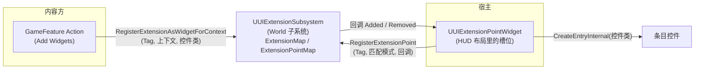
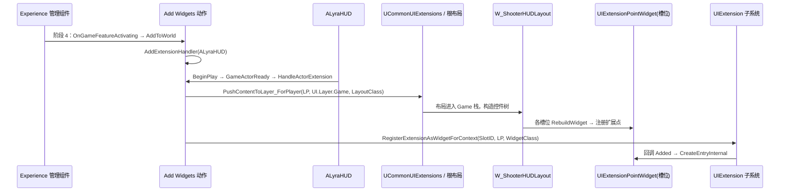
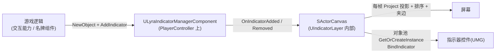

# 第 19 章　HUD 注入、指示器与加载屏：内容从哪来，什么时候露脸

## 一个问题：HUD 不认识任何一种玩法，却要显示每种玩法的东西

接着上一章的 UI 分层，我们遇到一个更具体的需求。Lyra 里有三种体验：团队死斗要在屏幕上方显示两队比分，占点模式要显示每个点位的归属，主菜单则什么游戏内元素也不要。三者共用同一套 HUD 骨架：准星、快捷栏、击杀播报、性能统计……另外，“占点”这个玩法归另一个小组开发，他们不准改核心的 HUD 蓝图。

朴素做法是什么？在 HUD 控件蓝图里把所有可能出现的元素都摆好，各自带一个 `Visibility` 变量，根据当前模式开关。这样做有几个后果：

- HUD 蓝图**硬引用**了所有玩法的控件。第 4 章讲过，硬引用会把被引用的资产连同它的依赖一起加载进内存。结果是主菜单也背着占点模式的全部资源；
- 新增一种玩法，就得改这个核心蓝图，和“不准改核心”直接冲突；
- 玩法对应的 GameFeature 插件被卸载以后，HUD 里还留着指向它的引用，要么悬空要么加载失败。

Lyra 的做法是：**HUD 布局只声明“这里有一个空位”，空位由 GameplayTag 命名；玩法通过数据声明“我要往某个空位里放什么”；空位自己负责把内容创建出来。**这一章依次讲完这条路径（UIExtension 插件、`Add Widgets` 动作），再讲两个同样“HUD 不该直接知道”的话题：世界空间指示器（头顶名牌、交互提示）和加载屏。

## 读完本章你能……

- 说出“扩展点（Extension Point）”“扩展（Extension）”“上下文（Context）”三个概念，并解释精确匹配与部分匹配的区别；
- 从 `ALyraHUD::BeginPlay` 出发，讲清 `Add Widgets` 动作怎样把布局推到 `UI.Layer.Game`、把控件注册到槽位里；
- 解释“控件类必须已经加载”这个坑，以及 `AssetBundles="Client"` 在其中的作用；
- 说出指示器系统的四个部件，以及它为什么比“每个 Actor 挂一个 WidgetComponent”更合适；
- 说出加载屏是“被轮询”而不是“被通知”的，列出 Lyra 里让加载屏保持的几个原因，并能写一个自定义的加载屏阻塞者。

## 需要先知道的 UE 概念

### 扩展点：一种常见的“插件式 UI”思路

“扩展点 / 贡献点（contribution point）”是 IDE 和插件系统里很常见的设计：宿主程序声明一个有名字的位置（比如“菜单栏 → 文件”），插件向这个名字登记自己的内容（“新建项目向导”），宿主在合适的时候把内容渲染出来。宿主不需要知道有哪些插件，插件也不需要知道宿主内部结构，两边只共享那个名字。

可以把本章的 UIExtension 想成这个模式的 UE 版本，名字就是 GameplayTag。不一样的地方有两点：第一，这里的“渲染内容”是 UMG 控件类，由槽位控件在运行时用 `CreateWidget` 创建；第二，UE 版本多了“上下文（Context）”这个概念——同一个槽位名在分屏时有多个实例，内容必须只给对应的玩家，这一点后面细讲。

### 世界子系统与动态入口框

两个小概念先说一句。**世界子系统（World Subsystem）**和第 2 章的 GameInstance 子系统一样是单例，但生命周期跟着 `UWorld`：换地图就销毁重建。`UUIExtensionSubsystem` 就是这样的。**动态入口框（`UDynamicEntryBoxBase`，引擎类）**是 UMG 里的一种容器，特点是“条目由代码在运行时按需创建和移除”，不是在设计器里预先摆好的。`UUIExtensionPointWidget` 继承它，所以天然是个“能往里增减子控件的盒子”。

### 对象池

指示器系统会用到对象池（`FUserWidgetPool`，引擎类）：控件创建一次，用完不销毁，放回池里下次复用。UMG 控件创建开销不小（实例化、构造控件树、生成 Slate），而指示器可能每秒来回出现消失很多次，复用能明显降低开销。代价是：复用意味着控件会带着上一个使用者的状态，所以每次拿出来要“重新绑定”，放回去要“解绑并重置”。

## 第一部分：UIExtension——用 Tag 命名的槽位

### 三个角色

UIExtension 插件（`Plugins/UIExtension`）里只有两个文件夹值得看：[`UIExtensionSystem.cpp`](../../../Plugins/UIExtension/Source/Private/UIExtensionSystem.cpp) 和 [`UIExtensionPointWidget.cpp`](../../../Plugins/UIExtension/Source/Private/Widgets/UIExtensionPointWidget.cpp)。它的概念模型是三个角色：

- **扩展点（Extension Point）**：一个槽位。登记时带着一个 Tag、一个匹配模式、一个“能接受哪些数据类”的列表，以及一个回调；
- **扩展（Extension）**：一条要放进槽位的内容。登记时带着目标 Tag、要放的数据（最常见的是“一个控件类”）、优先级，以及可选的上下文对象；
- **子系统**：`UUIExtensionSubsystem` 居中撮合，每当一边登记或注销，它就去通知另一边。



整个子系统内部就是两张表：`ExtensionPointMap`（Tag → 槽位列表）和 `ExtensionMap`（Tag → 扩展列表）。注册任何一边，都会立刻扫描另一边，把能匹配的配对通知出去。

这里有一个对你来说应该很眼熟的设计。第 6 章讲过 `CallOrRegister`：**不管等待者比事件早还是晚到，都要保证拿到通知**。UIExtension 在这里是对称地做了同一件事：

```cpp
// 简化自 Plugins/UIExtension/Source/Private/UIExtensionSystem.cpp
FUIExtensionPointHandle UUIExtensionSubsystem::RegisterExtensionPointForContext(
    const FGameplayTag& ExtensionPointTag, UObject* ContextObject,
    EUIExtensionPointMatch ExtensionPointTagMatchType, const TArray<UClass*>& AllowedDataClasses,
    FExtendExtensionPointDelegate ExtensionCallback)
{
    // ...（校验：Tag 有效、回调已绑定、AllowedDataClasses 非空，否则警告并返回空句柄）
    TSharedPtr<FUIExtensionPoint>& Entry = ExtensionPointMap.FindOrAdd(ExtensionPointTag).Add_GetRef(MakeShared<FUIExtensionPoint>());
    Entry->ExtensionPointTag = ExtensionPointTag;
    Entry->ContextObject = ContextObject;
    Entry->ExtensionPointTagMatchType = ExtensionPointTagMatchType;
    Entry->AllowedDataClasses = AllowedDataClasses;
    Entry->Callback = MoveTemp(ExtensionCallback);

    NotifyExtensionPointOfExtensions(Entry);   // ← 槽位后来者：回放已经登记的扩展
    return FUIExtensionPointHandle(this, Entry);
}
```

反过来，`RegisterExtensionAsData` 在末尾调用 `NotifyExtensionPointsOfExtension(Added, Entry)`：扩展后来者，通知已经存在的槽位。所以不管是“HUD 先构造、玩法后登记内容”，还是“内容先登记、HUD 后构造”（比如换了一个 HUD 布局），最终槽位都能看到全部内容。这个对称性是整个系统可靠的基础。

### 匹配规则：精确与部分

槽位登记时选择 `EUIExtensionPointMatch`：

- `ExactMatch`：只接收 Tag 完全相同的扩展；
- `PartialMatch`：还接收 Tag 在它之下的子 Tag。登记槽位 `A.B` 能收到 `A.B` 和 `A.B.C`。

通知逻辑是沿着扩展的 Tag 一路 `RequestDirectParent()` 往上爬：

```cpp
// 简化自 UIExtensionSystem.cpp 的 UUIExtensionSubsystem::NotifyExtensionPointsOfExtension
bool bOnInitialTag = true;
for (FGameplayTag Tag = Extension->ExtensionPointTag; Tag.IsValid(); Tag = Tag.RequestDirectParent())
{
    if (const FExtensionPointList* ListPtr = ExtensionPointMap.Find(Tag))
    {
        for (const TSharedPtr<FUIExtensionPoint>& ExtensionPoint : FExtensionPointList(*ListPtr))   // 拷贝一份，回调里可能增删
        {
            // 初始 Tag 上的槽位一定通知；父级 Tag 上的槽位只有 PartialMatch 才通知
            if (bOnInitialTag || ExtensionPoint->ExtensionPointTagMatchType == EUIExtensionPointMatch::PartialMatch)
            {
                if (ExtensionPoint->DoesExtensionPassContract(Extension.Get()))
                {
                    ExtensionPoint->Callback.ExecuteIfBound(Action, CreateExtensionRequest(Extension));
                }
            }
        }
    }
    bOnInitialTag = false;
}
```

Lyra 里的槽位几乎都是默认的 `ExactMatch`（`UUIExtensionPointWidget::ExtensionPointTagMatch` 默认值）。`PartialMatch` 适合做“一个大容器接收所有 `HUD.Slot.Foo.*`”的场景。

### 上下文：解决“这块内容该给谁”

现在讲前面悬着的“上下文”。想象两个玩家分屏。他们各有一个 HUD 布局，各有一个 `HUD.Slot.Reticle` 槽位。`Add Widgets` 动作在为玩家 1 的 HUD 登记准星控件时，不能让它同时出现在玩家 2 的槽位里。

解决办法是给扩展和槽位都带上一个“上下文对象”。`DoesExtensionPassContract` 是配对的关卡：

```cpp
// 简化自 UIExtensionSystem.cpp 的 FUIExtensionPoint::DoesExtensionPassContract
const bool bMatchesContext =
    (ContextObject.IsExplicitlyNull() && Extension->ContextObject.IsExplicitlyNull()) ||   // 都没有上下文
    ContextObject == Extension->ContextObject;                                              // 或者是同一个对象
if (bMatchesContext)
{
    // 数据可以是“类本身”，也可以是“某个类的实例”
    const UClass* DataClass = DataPtr->IsA(UClass::StaticClass()) ? Cast<UClass>(DataPtr) : DataPtr->GetClass();
    for (const UClass* AllowedDataClass : AllowedDataClasses)
    {
        if (DataClass->IsChildOf(AllowedDataClass) || DataClass->ImplementsInterface(AllowedDataClass)) { return true; }
    }
}
return false;
```

两个条件缺一不可：上下文要一致，数据类型要在槽位允许的列表里。`UUIExtensionPointWidget` 永远允许 `UUserWidget`，所以“直接放一个控件类”总是合法的。

槽位控件自己一次注册多份不同上下文的“分身”。看 `RebuildWidget` 里调用的 `RegisterExtensionPoint`：

```cpp
// 简化自 Plugins/UIExtension/Source/Private/Widgets/UIExtensionPointWidget.cpp
ExtensionPointHandles.Add(ExtensionSubsystem->RegisterExtensionPoint(                // ① 无上下文
    ExtensionPointTag, ExtensionPointTagMatch, AllowedDataClasses, Callback));
ExtensionPointHandles.Add(ExtensionSubsystem->RegisterExtensionPointForContext(       // ② 以本地玩家为上下文
    ExtensionPointTag, GetOwningLocalPlayer(), ExtensionPointTagMatch, AllowedDataClasses, Callback));
// 另外：本地玩家的 PlayerState 一旦可用（CallAndRegister_OnPlayerStateSet），再登记 ③ 以 PlayerState 为上下文
```

三份分身分别接三类扩展：不带上下文的、带 LocalPlayer 的、带 PlayerState 的。`Add Widgets` 用 LocalPlayer 做上下文；另一些需求（比如“只给某个队伍的玩家看”）可以用 PlayerState 做上下文。传 null 上下文给蓝图版本 `Register Extension (Widget For Context)` 会报错并返回空句柄。

槽位把收到的回调变成控件条目：

```cpp
// 简化自 UIExtensionPointWidget.cpp 的 UUIExtensionPointWidget::OnAddOrRemoveExtension
if (Action == EUIExtensionAction::Added)
{
    TSubclassOf<UUserWidget> WidgetClass(Cast<UClass>(Request.Data));
    if (WidgetClass)
    {
        UUserWidget* Widget = CreateEntryInternal(WidgetClass);          // DynamicEntryBox 提供的创建函数
        ExtensionMapping.Add(Request.ExtensionHandle, Widget);           // 记下“哪个扩展对应哪个控件”，将来移除时要用
    }
    else if (DataClasses.Num() > 0 && GetWidgetClassForData.IsBound()) { /* 数据驱动模式，见下 */ }
}
else
{
    if (UUserWidget* Extension = ExtensionMapping.FindRef(Request.ExtensionHandle))
    {
        RemoveEntryInternal(Extension);
        ExtensionMapping.Remove(Request.ExtensionHandle);
    }
}
```

“数据驱动模式”是槽位的第二种用法：槽位上配置 `DataClasses`（允许的数据类）和两个可绑定事件 `GetWidgetClassForData` / `ConfigureWidgetForData`。内容方登记的不是控件类而是一个数据对象（`RegisterExtensionAsData`），槽位用你的事件把数据映射成控件类并配置它。Lyra 的 ShooterCore 蓝图里是否使用，需要在编辑器里查；本书的例子都是“直接放控件类”。

槽位的另一个细节是它的生命周期绑定在 Slate 上：`ReleaseSlateResources` 里会 `ResetExtensionPoint`，注销全部槽位登记，下次 `RebuildWidget` 再重新登记并回放。所以 UMG 控件被重建时，槽位里的条目会销毁重建——这是正确的，但意味着条目控件不要持有需要跨重建保留的状态。

还有一个编译期保护：`ValidateCompiledDefaults` 要求每个非 CDO 的槽位实例设置了 `ExtensionPointTag`，否则编译报错。

## 第二部分：Add Widgets——从 Experience 到屏幕上的一个控件

槽位是被动的，需要有人来登记内容。登记者就是 `UGameFeatureAction_AddWidgets`（编辑器里显示名 `Add Widgets`）。回忆第 6、7 章：Action 是挂在 Experience、ActionSet 或 GameFeature 数据里的小对象，由 Experience 管理组件在加载阶段 4 触发。看它的两份数据：

```cpp
// 简化自 Source/LyraGame/GameFeatures/GameFeatureAction_AddWidget.h
USTRUCT()
struct FLyraHUDLayoutRequest
{
    UPROPERTY(EditAnywhere, meta=(AssetBundles="Client"))   TSoftClassPtr<UCommonActivatableWidget> LayoutClass;  // 要推出的布局
    UPROPERTY(EditAnywhere, meta=(Categories="UI.Layer"))   FGameplayTag LayerID;                                  // 推到哪一层
};

USTRUCT()
struct FLyraHUDElementEntry
{
    UPROPERTY(EditAnywhere, meta=(AssetBundles="Client"))   TSoftClassPtr<UUserWidget> WidgetClass;  // 要放的控件
    UPROPERTY(EditAnywhere)                                 FGameplayTag SlotID;                     // 放进哪个槽位
};
```

动作本身有两个数组：`Layout`（布局请求，通常一个）和 `Widgets`（控件条目，可以有很多）。于是一个 `Add Widgets` 动作的含义是：“把这个布局推到这一层，再把这些控件登记到这些槽位里”。

### 触发时机：为什么挂在 HUD 的 BeginPlay

不是每个 Action 都能“激活就生效”。HUD 是 `ALyraHUD`，是每个玩家、每次进图都会重新创建的 Actor，Action 激活时它可能还没出生，也可能已经存在。这正是第 7 章讲的 `UGameFrameworkComponentManager` 的用武之地：Action 不是“对现存对象执行一次”，而是“订阅一类 Actor，对现在的和将来的都处理”。

先看订阅这一步：

```cpp
// 简化自 GameFeatureAction_AddWidget.cpp 的 UGameFeatureAction_AddWidgets::AddToWorld
if ((GameInstance != nullptr) && (World != nullptr) && World->IsGameWorld())
{
    if (UGameFrameworkComponentManager* ComponentManager = UGameInstance::GetSubsystem<UGameFrameworkComponentManager>(GameInstance))
    {
        TSoftClassPtr<AActor> HUDActorClass = ALyraHUD::StaticClass();
        // 订阅“ALyraHUD 类的 Actor”的扩展事件
        TSharedPtr<FComponentRequestHandle> ExtensionRequestHandle = ComponentManager->AddExtensionHandler(
            HUDActorClass,
            UGameFrameworkComponentManager::FExtensionHandlerDelegate::CreateUObject(this, &ThisClass::HandleActorExtension, ChangeContext));
        ActiveData.ComponentRequests.Add(ExtensionRequestHandle);
    }
}
```

`AddToWorld` 来自基类 `UGameFeatureAction_WorldActionBase`：它在 Action 激活时对每个已经存在的游戏世界上下文调用 `AddToWorld`，并订阅 `FWorldDelegates::OnStartGameInstance`，对之后才启动的游戏实例也调用——这是 PIE 里每个客户端各自一个 World 能各干各的事的保证。

另一半在 HUD 这边。[`ALyraHUD`](../../../Source/LyraGame/UI/LyraHUD.cpp) 的 UI 逻辑几乎为零，它的关键就是两个生命周期函数：

```cpp
// 简化自 Source/LyraGame/UI/LyraHUD.cpp
void ALyraHUD::PreInitializeComponents()
{
    Super::PreInitializeComponents();
    UGameFrameworkComponentManager::AddGameFrameworkComponentReceiver(this);   // 声明“我是一个接收者”
}

void ALyraHUD::BeginPlay()
{
    // 先发 GameActorReady，再 Super::BeginPlay
    UGameFrameworkComponentManager::SendGameFrameworkComponentExtensionEvent(this, UGameFrameworkComponentManager::NAME_GameActorReady);
    Super::BeginPlay();
}

void ALyraHUD::EndPlay(const EEndPlayReason::Type EndPlayReason)
{
    UGameFrameworkComponentManager::RemoveGameFrameworkComponentReceiver(this);
    Super::EndPlay(EndPlayReason);
}
```

`NAME_GameActorReady` 是“这个 Actor 准备好了”的事件，由 HUD 在 `BeginPlay` 里主动发出。于是订阅了 `ALyraHUD` 的 `Add Widgets` 动作就会收到回调 `HandleActorExtension`：

```cpp
// 简化自 GameFeatureAction_AddWidget.cpp 的 HandleActorExtension
if (EventName == NAME_ExtensionRemoved || EventName == NAME_ReceiverRemoved)
{
    RemoveWidgets(Actor, ActiveData);      // HUD 要销毁了，或这个 Action 被撤销
}
else if (EventName == NAME_ExtensionAdded || EventName == NAME_GameActorReady)
{
    AddWidgets(Actor, ActiveData);
}
```

> 留意：`AddWidgets` 本身没有“这个 HUD 是否已经处理过”的去重判断，而它同时响应 `ExtensionAdded` 和 `GameActorReady` 两个事件。对照 5.8 引擎 `GameFrameworkComponentManager.cpp`：`AddExtensionHandler` 注册时，会对世界里**已经初始化**（`IsActorInitialized()`）的该类 Actor 立刻回调一次 `ExtensionAdded`。所以常见的两种时序各只会触发一次——Action 先激活、HUD 后出生，只会收到 HUD 之后发的 `GameActorReady`；HUD 先存在且已 `BeginPlay`，只会收到注册时的 `ExtensionAdded`。只有 Action 恰好在 HUD“已经初始化组件、但还没 `BeginPlay`”的窄窗口里激活，才可能先后收到两次进而重复 push 布局。你自己写类似的 Action 时，按[第 7 章](07-ModularGameplay.md)的模板先查是否已处理过这个 Actor（幂等守卫）会更稳妥。

### AddWidgets：把布局推上去，再往槽位里放控件

核心逻辑在 `AddWidgets`，是本章最值得完整读一遍的函数：

```cpp
// 简化自 GameFeatureAction_AddWidget.cpp 的 UGameFeatureAction_AddWidgets::AddWidgets
ALyraHUD* HUD = CastChecked<ALyraHUD>(Actor);
if (!HUD->GetOwningPlayerController()) { return; }               // HUD 还没归属到某个 PC，什么也不做

if (ULocalPlayer* LocalPlayer = Cast<ULocalPlayer>(HUD->GetOwningPlayerController()->Player))
{
    FPerActorData& ActorData = ActiveData.ActorData.FindOrAdd(HUD);

    for (const FLyraHUDLayoutRequest& Entry : Layout)
    {
        if (TSubclassOf<UCommonActivatableWidget> ConcreteWidgetClass = Entry.LayoutClass.Get())     // ← 注意：.Get()，不是 LoadSynchronous
        {
            ActorData.LayoutsAdded.Add(UCommonUIExtensions::PushContentToLayer_ForPlayer(LocalPlayer, Entry.LayerID, ConcreteWidgetClass));
        }
    }

    UUIExtensionSubsystem* ExtensionSubsystem = HUD->GetWorld()->GetSubsystem<UUIExtensionSubsystem>();
    for (const FLyraHUDElementEntry& Entry : Widgets)
    {
        // 用 LocalPlayer 做上下文；优先级恒为 -1
        ActorData.ExtensionHandles.Add(ExtensionSubsystem->RegisterExtensionAsWidgetForContext(Entry.SlotID, LocalPlayer, Entry.WidgetClass.Get(), -1));
    }
}
```

把这段话和前面两章的内容拼起来，整个流程如下：



两个小问题值得停一下。第一，布局和控件是**两种登记**：布局走的是上一章的“push 到某一层”，控件走的是 UIExtension。布局把槽位这个“空位”带到屏幕上，控件被登记后填进去。顺序不是严格的（反正有回放）。第二，这个 Action 是在客户端上有意义的：服务器上没有本地玩家（专用服务器根本没有 UI 管理器），所以 `Cast<ULocalPlayer>(...->Player)` 拿不到东西，函数就静默结束。

### 一个会咬人的坑：类必须“已经加载”

再看上面代码里标出的那两处 `.Get()`。`TSoftClassPtr::Get()` 的语义是：如果这个类已经在内存里，返回它；否则返回 nullptr，**不会触发加载**（要加载得用 `LoadSynchronous()` 或异步加载）。

这意味着，如果 Action 执行的那一刻，布局类或控件类还没有被加载进内存：

- 布局类：`if (... = Entry.LayoutClass.Get())` 不成立，这一项被**静默跳过**，不会有任何日志，HUD 就是不出现；
- 控件类：`Entry.WidgetClass.Get()` 返回 nullptr 传给 `RegisterExtensionAsWidgetForContext`，它最终进入 `RegisterExtensionAsData`，`Data` 为空，打一行 `LogUIExtension` 警告 “Trying to register an invalid extension.”，并返回一个无效句柄。HUD 同样没有这个元素。

那为什么 Lyra 平时是好的？因为这些软引用属性都带着 `meta=(AssetBundles="Client")`。回顾[第 4 章](04-DataAndAssets.md)的资产包与[第 6 章](06-Experience.md)的阶段 2：保存 Experience 或 ActionSet 时，引擎递归扫描 `Instanced` 的 Action 及其结构体数组，把带 `AssetBundles="Client"` 的布局类和控件类登记进主资产的 `AssetBundleData`（`UGameFeatureAction_AddWidgets::AddAdditionalAssetBundleData` 还对 `Widgets` 额外做了一遍幂等补充登记）；运行时客户端在阶段 2 先异步加载完 `Client` 包，再进入阶段 4 执行 Action，所以此刻 `.Get()` 一定能拿到已加载的类，而专用服务器因为不加载 `Client` 包，连这些 UI 类都不会读进内存。

实践结论很明确：**改完 Experience 或 ActionSet 里的 `Add Widgets` 后务必保存资产（`Ctrl+S`）以刷新资产包清单**；如果你自己写 Action 要同步 push 或登记某个软引用类，也必须保证它已被资产包预载，否则改用异步版 `PushStreamedContentToLayer_ForPlayer` 或显式加载。

### 清理：Action 撤销时发生什么

`RemoveWidgets` 在 HUD 销毁（`NAME_ReceiverRemoved`）或扩展被移除时调用：对记录过的每个布局调用 `DeactivateWidget()`，对每个扩展句柄调用 `Unregister()`，最后把这个 HUD 的记录删掉。注销扩展会触发 `NotifyExtensionPointsOfExtension(Removed)`，槽位收到 `Removed` 后调用 `RemoveEntryInternal` 把条目控件移除。

对照之下，GameFeature 停用时走的是 `OnGameFeatureDeactivating → Reset`，它只注销扩展句柄并清空记录，**不会**对布局调用 `DeactivateWidget()`（布局会在 HUD 真正销毁时清理）。这种不对称是原版的现状，写自己的 Action 时可以参照但不必照搬。

### 数据校验

动作在编辑器里有 `IsDataValid`：`Layout` 的 `LayoutClass` 不能为空、`LayerID` 必须有效；`Widgets` 的 `WidgetClass` 不能为空、`SlotID` 必须有效，漏填会在校验时报红。

## 第三部分：走一遍 StandardHUD

理论讲完，来看真实数据。在 `ShooterCore` 插件的内容目录里打开 `Experiences/LAS_ShooterGame_StandardHUD`。这是一个共享 ActionSet（[第 6 章](06-Experience.md)），Experience 通过组合它来得到标准射击 HUD。里面有一个 `Add Widgets` 动作：

`Layout` 只有一条：`W_ShooterHUDLayout` → `UI.Layer.Game`。

`Widgets` 里登记了这些通用条目（控件 → 槽位）：

- `W_EliminationFeed` → `HUD.Slot.EliminationFeed`（右上击杀播报）；
- `W_QuickBar` → `HUD.Slot.Equipment`（右下快捷栏与弹药）；
- `W_WeaponReticleHost` → `HUD.Slot.Reticle`（正中准星与重生倒计时）；
- `W_AccoladeHostWidget` → `HUD.Slot.TopAccolades`（中上连杀勋章）；
- `W_PerfStatContainer_TextOnly` / `_GraphOnly` → `HUD.Slot.PerfStats.Text` / `.Graph`（性能统计）；
- `W_OnScreenJoystick_Left/Right`、`W_TouchRegion_Left/Right`、`W_FireButton` → `HUD.Slot.LeftSideTouchInputs` 等触屏槽位。

再打开布局 `UserInterface/W_ShooterHUDLayout`，它的屏幕槽位分布一目了然：

```
┌──────────────────────────────────────────────────────────┐
│ [PerfStats.Text/Graph]   [TeamScore / ModeStatus]  [EliminationFeed] │
│                            [TopAccolades]                            │
│                                                                      │
│                              [Reticle]                               │
│                    （底层全屏铺着 IndicatorLayer 画布）                │
│ [LeftSideTouchInputs]                          [Equipment: 快捷栏]   │
└──────────────────────────────────────────────────────────┘
```

Designer 里每个槽位都是一个以 `ExtensionPoint_` 开头的 `UIExtensionPointWidget`（`ExtensionPoint_Equipment`、`_Reticle`、`_ModeStatus`、`_TeamScore`、`_TextStats`、`_GraphStats`、`_LeftSide`、`_RightSide` 等），底层还铺着一张 `IndicatorLayer` 作为下一节指示器的画布。

留意两件事。一是 `HUD.Slot.TeamScore` 与 `HUD.Slot.ModeStatus` **不在** `StandardHUD` 里——团队死斗 `B_ShooterGame_Elimination` 自己的 `Actions` 往 `TeamScore` 里放 `W_ScoreWidget_Elimination`，占点 `B_LyraShooterGame_ControlPoints` 则同时往 `TeamScore` 放 `W_CPScoreWidget`、往 `ModeStatus` 放 `W_ControlPointStatusWidget`。这就是本章开头问题的答案：布局共用，槽位里的内容按 Experience 不同而不同。二是这些 `HUD.Slot.*` Tag 的定义位置：有一部分在项目的 [`Config/DefaultGameplayTags.ini`](../../../Config/DefaultGameplayTags.ini)（如 `HUD.Slot.ExtraEquipment`、`LeftSideTouchInputs`、`RespawnTimer`），而 `EliminationFeed`、`Equipment`、`ModeStatus`、`Reticle`、`TeamScore`、`TopAccolades`、`PerfStats.*` 这些定义在 `ShooterCore` 插件自己的 `Config/Tags/ShooterCoreTags.ini` 里。插件自带自己的 Tag 表，随插件启用才注册，这又是 GameFeature “自包含”的一个例子。

## 第四部分：指示器系统——世界里的标记，屏幕上的控件

槽位解决的是屏幕固定位置的 HUD。还有另一类 UI：它的位置取决于世界里的某个东西——敌人头顶的名牌、可交互物体上的提示、任务目标的方向箭头。

### 朴素做法

给每个目标 Actor 挂一个 `UWidgetComponent`（引擎类，在 3D 空间里渲染一个控件）。这样每个名牌都是一个世界里的小面板。在有几十个目标时会出现几个问题：每个 WidgetComponent 有各自的渲染开销；它们是 3D 的，近大远小，遮挡关系由场景深度决定，不好控制“始终在最上面”；要实现“超出屏幕边缘时贴边并显示箭头”几乎没法做；还有，WidgetComponent 属于目标 Actor，目标一销毁（比如 Pawn 死亡），标记就随之消失，状态也丢了。

### Lyra 的做法：四个部件

指示器系统在 [`Source/LyraGame/UI/IndicatorSystem`](../../../Source/LyraGame/UI/IndicatorSystem/)，由四个部件组成：

- `UIndicatorDescriptor`：纯数据，描述“一个指示器”——它跟着哪个场景组件（可选骨骼插槽）、用哪个控件类（软引用）、怎么投影、对齐方式、是否贴边、偏移、优先级；
- `ULyraIndicatorManagerComponent`：**挂在 Controller 上**的组件，持有一个指示器列表，提供 `AddIndicator` / `RemoveIndicator`，并广播 `OnIndicatorAdded` / `OnIndicatorRemoved`；
- `UIndicatorLayer`：一个 UMG 控件，放进 HUD 布局，内部创建 `SActorCanvas`；
- `SActorCanvas`：Slate 画布，真正负责每帧投影、排序、对象池和绘制。



为什么管理器挂在 Controller 上，而不是 Pawn 上？（推断）Pawn 会死、会换（[第 8 章](08-PawnAssembly.md)讲过 Pawn 的重生是销毁旧的创建新的），而 Controller 在玩家整个会话期间存活。指示器的“账本”放在 Controller 上，Pawn 来来去去不会丢。

### 投影：从 3D 点到屏幕坐标

`FIndicatorProjection::Project` 把描述符变成屏幕位置。它有五种模式（`EActorCanvasProjectionMode`）：

- `ComponentPoint`：取场景组件（或其某个骨骼插槽）的世界位置，投影成一个点；
- `ComponentBoundingBox` / `ActorBoundingBox`：取组件/整个 Actor 的包围盒，用 `BoundingBoxAnchor` 在包围盒上选一个点，再投影；
- `ComponentScreenBoundingBox` / `ActorScreenBoundingBox`：把包围盒投影成屏幕矩形，再在屏幕矩形上取锚点（目标离得近时更贴合轮廓）。

当目标在摄像机后面时，`Project` 会把位置推到屏幕边缘。这样配合“贴边夹取（Clamp to Screen）”，就能做出“敌人在你背后时，边缘出现一个指向它的箭头”。

### 每帧更新、排序与对象池

`SActorCanvas` 用一个 Slate 的“活动计时器（Active Timer）”每帧跑 `UpdateCanvas`：对每个指示器，如果它的场景组件已经失效且允许自动移除，就移除；否则调 `Project`，更新屏幕位置，标脏。绘制排序在 `OnArrangeChildren`：

```cpp
// 简化自 Source/LyraGame/UI/IndicatorSystem/SActorCanvas.cpp 的 SActorCanvas::OnArrangeChildren
SortedSlots.StableSort([](const SActorCanvas::FSlot& A, const SActorCanvas::FSlot& B)
{
    // 先按 Priority 升序；同 Priority 内，深度大（远）的先画，近的盖在上面
    return A.GetPriority() == B.GetPriority() ? A.GetDepth() > B.GetDepth() : A.GetPriority() < B.GetPriority();
});
```

控件的创建走第三个机制：

```cpp
// 简化自 SActorCanvas.cpp 的 SActorCanvas::AddIndicatorForEntry
TSoftClassPtr<UUserWidget> IndicatorClass = Indicator->GetIndicatorClass();
AsyncLoad(IndicatorClass, [this, IndicatorPtr, IndicatorClass]()               // ① 通过 AsyncMixin 异步加载控件类
{
    if (UIndicatorDescriptor* Indicator = IndicatorPtr.Get())
    {
        if (!AllIndicators.Contains(Indicator)) { return; }                    // 加载期间可能已经被移除了
        if (UUserWidget* IndicatorWidget = IndicatorPool.GetOrCreateInstance(TSubclassOf<UUserWidget>(IndicatorClass.Get())))  // ② 从池里拿
        {
            if (IndicatorWidget->GetClass()->ImplementsInterface(UIndicatorWidgetInterface::StaticClass()))
            {
                IIndicatorWidgetInterface::Execute_BindIndicator(IndicatorWidget, Indicator);        // ③ 绑定：控件拿到描述符和里面的 DataObject
            }
            // ... 加到画布的一个 slot
        }
    }
});
StartAsyncLoading();
```

`AsyncLoad` / `StartAsyncLoading` 来自项目里的 `AsyncMixin` 插件（`FAsyncMixin`）：它保证异步加载完成的回调按请求顺序执行，并且在拥有者销毁后不会再被调用，所以闭包里捕获 `this` 是安全的。移除时对称地调 `UnbindIndicator` 并把控件放回池里。

于是一个指示器控件的开发约定是：实现 `IIndicatorWidgetInterface`（`BindIndicator` / `UnbindIndicator`），在 `BindIndicator` 里通过 `Indicator->GetDataObject()` 取到目标数据，在 `UnbindIndicator` 里重置状态——因为同一个控件实例之后会被池子拿去给别的指示器用。

这一节顺带有个小观察：`UpdateCanvas` 里 `CurChild.SetDepth(ScreenPositionWithDepth.X)` 存深度时用的是向量的 X 分量，而 `Project` 把真正的距离放在 Z 分量里。看起来像是原版的笔误，会让“同 Priority 按远近排序”的效果不如预期。本书没有在运行时验证它的实际影响，遇到名牌遮挡顺序怪异时可以先往这里查。

### 谁在用：交互提示

最直接的使用者是交互系统（第 15 章）。看 `ULyraGameplayAbility_Interact::UpdateInteractions`：

```cpp
// 简化自 Source/LyraGame/Interaction/Abilities/LyraGameplayAbility_Interact.cpp
if (ULyraIndicatorManagerComponent* IndicatorManager = ULyraIndicatorManagerComponent::GetComponent(PC))
{
    for (UIndicatorDescriptor* Indicator : Indicators) { IndicatorManager->RemoveIndicator(Indicator); }   // 先清掉旧的
    Indicators.Reset();

    for (const FInteractionOption& InteractionOption : InteractiveOptions)
    {
        UIndicatorDescriptor* Indicator = NewObject<UIndicatorDescriptor>();
        Indicator->SetDataObject(InteractableTargetActor);
        Indicator->SetSceneComponent(InteractableTargetActor->GetRootComponent());
        Indicator->SetIndicatorClass(InteractionWidgetClass);          // 选项自带的控件类，没有就用 DefaultInteractionWidgetClass
        IndicatorManager->AddIndicator(Indicator);
        Indicators.Add(Indicator);
    }
}
```

默认的 `ProjectionMode` 就是 `ComponentPoint`，没有设置贴边。要让标记贴边带箭头，需要额外调用 `SetClampToScreen(true)` 和 `SetShowClampToScreenArrow(true)`。

这里前提有两个：目标 Controller 上必须有 `ULyraIndicatorManagerComponent`，否则 `GetComponent` 返回空，什么都不会显示；HUD 布局里必须放有 `UIndicatorLayer`。Lyra 里前者由 `ShooterCore` 的 GameFeature 数据资产通过 `Add Components`（[第 7 章](07-ModularGameplay.md)）加到 `ALyraPlayerController` 上（仅客户端），后者是 `W_ShooterHUDLayout` 里的 `IndicatorLayer` 控件。这又是同一个模式：核心 C++ 提供机制，玩法插件提供配置。

## 第五部分：加载屏——被轮询的接口

### 问题：什么时候可以撤掉加载屏？

回忆第 6 章里的一个现象：Experience 加载完之前，玩家没有 Pawn，屏幕上显示的是加载屏。那么谁决定“现在可以撤掉了”？

决定条件其实相当多：地图加载完成了吗？无缝旅行结束了吗？客户端的 GameState 复制过来了吗？Experience 加载完了吗？前端流程走完了吗？本地 PlayerController 都存在了吗？这些信息分散在引擎和 Lyra 的不同模块，这些模块互不知晓。

朴素做法是事件驱动：每个模块加载完后通知一个“加载屏管理器”。这样需要一个汇总点，而且只要有一个模块漏通知，屏幕就永远卡住，或者提前露出没准备好的画面。更麻烦的是 `PreLoadMap` 到 `PostLoadMap` 之间、无缝旅行期间这种引擎层面的时间窗，很难用事件覆盖。

Lyra 用的 `CommonLoadingScreen` 插件反过来：**加载屏管理器每帧主动问一遍“还有谁需要我挡着吗”**，所有人都答“不需要”，才撤。（推断，Epic 没有这个插件的专页。）

### 管理器：每帧判断

`ULoadingScreenManager`（[`LoadingScreenManager.cpp`](../../../Plugins/CommonLoadingScreen/Source/CommonLoadingScreen/Private/LoadingScreenManager.cpp)）是一个 GameInstance 子系统，同时实现 `FTickableGameObject` 每帧调用。几个事实：

- `ShouldCreateSubsystem` 在专用服务器上返回 false——只有客户端有加载屏；
- `IsTickable` 要求有游戏视口客户端；
- 每帧 `Tick → UpdateLoadingScreen`，根据 `ShouldShowLoadingScreen()` 的结果调用 `ShowLoadingScreen()` 或 `HideLoadingScreen()`。

判断函数 `CheckForAnyNeedToShowLoadingScreen` 就是一长串“只要有一条成立就显示”的检查，按顺序是：

1. CVar `CommonLoadingScreen.AlwaysShow` 打开；
2. 游戏实例没有 WorldContext，或 WorldContext 里没有 World；
3. GameState 为空（客户端还没复制过来）；
4. `bCurrentlyInLoadMap`（`PreLoadMap` 到 `PostLoadMap` 之间）；
5. 有待处理的旅行（`TravelURL` 非空）或正在连接别的服务器（`PendingNetGame`）；
6. World 还没 `BeginPlay`，或者处于无缝旅行中；
7. 问 GameState 本身、GameState 上的每个组件：是否实现 `ILoadingProcessInterface` 并返回 true；
8. 问所有“外部登记的处理者”（`RegisterLoadingProcessor`）；
9. 对每个本地玩家，问它的 PlayerController 和 PC 上的每个组件；
10. 分屏时要求所有本地 PC 都存在；非分屏时至少有一个本地 PC。

每一条成立时，函数都会把原因文字写进 `DebugReasonForShowingOrHidingLoadingScreen`，所以你随时可以知道“是谁在挡着”。

### 接口：只要实现一个函数

任何对象想参与，只要实现 `ILoadingProcessInterface`：

```cpp
// 简化自 Plugins/CommonLoadingScreen/Source/Public/LoadingProcessInterface.h
class ILoadingProcessInterface
{
public:
    // 询问 TestObject 是否实现接口，实现则问它要不要加载屏
    static bool ShouldShowLoadingScreen(UObject* TestObject, FString& OutReason);

    virtual bool ShouldShowLoadingScreen(FString& OutReason) const { return false; }
};
```

返回 true 时**必须**写入非空的 `OutReason`，否则 `ensureMsgf` 失败。Lyra 里有两个实现者，都是 GameState 组件，所以会被自动扫描到（上面检查清单的第 7 条）：

```cpp
// 简化自 Source/LyraGame/GameModes/LyraExperienceManagerComponent.cpp
bool ULyraExperienceManagerComponent::ShouldShowLoadingScreen(FString& OutReason) const
{
    if (LoadState != ELyraExperienceLoadState::Loaded) { OutReason = TEXT("Experience still loading"); return true; }
    return false;
}
```

第二个是上一章的 `ULyraFrontendStateComponent`：`bShouldShowLoadingScreen` 为 true 时返回 true，原因文字取当前控制流步骤的调试名（比如 “Try Show Main Screen”），没有流程时是 “Frontend Flow Pending...”。

所以现在可以把第 6 章的现象完整讲清了：Experience 管理组件在 `LoadState != Loaded` 期间一直回答“我还没好”，加载屏被它挡住；加载完成，回答变成 false。前端 Experience 里，前端状态组件一直回答“还没好”，直到主菜单被 push 上去。

### 显示的时候做了什么

`ShowLoadingScreen` 不只是创建一个控件。它依次做这些事：

- 如果引擎的启动预载屏还在，直接返回（见下文）；
- `StartBlockingInput`：注册一个 Slate 输入预处理器 `FLoadingScreenInputPreProcessor`，吞掉所有键鼠事件。它的 `CanEatInput()` 是 `!GIsEditor`，所以编辑器里不吞输入；
- 广播 `OnLoadingScreenVisibilityChangedDelegate(true)`——Lyra 的音频混音子系统 `ULyraAudioMixEffectsSubsystem` 订阅了它，加载屏可见期间套用一个专用的音频混音（`LoadingScreenMix`，具体效果由该资产决定）；
- 创建加载屏控件。控件类来自 `UCommonLoadingScreenSettings::LoadingScreenWidget`，在 `DefaultGame.ini` 里是 `W_LoadingScreen_Host`；创建失败会退化成一个 `SThrobber` 转圈占位。用 `AddViewportWidgetContent` 加到视口，ZOrder 是设置里的 `LoadingScreenZOrder`，默认 10000，比上一章根布局的 1000 高得多；开了 `bEnablePlayersSplitRT` 时为每个玩家单独创建；
- `ChangePerformanceSettings(true)`：着色器管线缓存切到 Fast 批处理，`bDisableWorldRendering = true`（加载时不画 3D 世界），把世界设置的 `bHighPriorityLoadingLocal` 打开（优先流送关卡），并暂停卡顿检测心跳；
- 非编辑器（或开了 `ForceTickLoadingScreenEvenInEditor`）时，立刻 `FSlateApplication::Tick()` 让加载屏马上上屏。

隐藏 `HideLoadingScreen` 反过来：撤掉输入吞噬，**强制做一次垃圾回收**（`ForceGarbageCollection`，趁加载屏还挡着时把加载期间的垃圾清掉，这样玩家不会撞到 GC 卡顿），移除控件，恢复性能设置，广播可见性变化。

### “最小显示时间”：其实是“多撑 2 秒”

你可能想要“加载屏至少显示 N 秒，免得一闪而过”。`CommonLoadingScreen` 没有这个功能，它有的是另一个相关概念：`HoldLoadingScreenAdditionalSecs`，在所有阻塞者都放行之后**再多撑一会**，默认 2 秒，目的是给纹理流送留出时间，避免撤掉加载屏后画面一片模糊。

```cpp
// 简化自 LoadingScreenManager.cpp 的 ULoadingScreenManager::ShouldShowLoadingScreen
const bool bNeedToShowLoadingScreen = CheckForAnyNeedToShowLoadingScreen();
bool bWantToForceShowLoadingScreen = false;
if (bNeedToShowLoadingScreen)
{
    TimeLoadingScreenLastDismissed = -1.0;       // 还有人挡着，重置计时
}
else
{
    // 编辑器里默认不多撑（迭代太慢），除非设置里打开 HoldLoadingScreenAdditionalSecsEvenInEditor
    const bool bCanHold = (!GIsEditor || Settings->HoldLoadingScreenAdditionalSecsEvenInEditor);
    const double HoldSecs = bCanHold ? LoadingScreenCVars::HoldLoadingScreenAdditionalSecs : 0.0;
    if (TimeLoadingScreenLastDismissed < 0.0) { TimeLoadingScreenLastDismissed = FPlatformTime::Seconds(); }
    if (HoldSecs > 0.0 && (FPlatformTime::Seconds() - TimeLoadingScreenLastDismissed) < HoldSecs)
    {
        GameViewportClient->bDisableWorldRendering = false;     // 多撑期间让 3D 世界渲染起来，纹理才会流进来
        bWantToForceShowLoadingScreen = true;
    }
}
return bNeedToShowLoadingScreen || bWantToForceShowLoadingScreen;
```

这个时长由 CVar `CommonLoadingScreen.HoldLoadingScreenAdditionalSecs` 控制（设置里的同名属性绑定了它）。所以想要真的“至少显示 N 秒”，需要自己在阻塞者里实现——下面的实验就会做这件事。

### 启动屏与 Lyra 的内容宿主

两个相关的细节。第一，`CommonStartupLoadingScreen` 是另一个独立的小插件：它在 `PreEarlyLoadingScreen` 这个很早的加载阶段注册一个预载屏（Slate 控件），用来覆盖引擎刚启动、还没法创建 UMG 的那段时间。它仅在“非编辑器、能渲染”时注册，且在专用服务器上不创建。`ShowLoadingScreen` 发现引擎预载屏还在时会直接返回，不会叠加。注释还提到：如果你想在启动时播放视频，需要禁用这个插件，因为预载阶段要么用控件、要么用视频，二选一。

第二，`W_LoadingScreen_Host` 是个“宿主”，真正的内容会随玩法变化。`ULyraLoadingScreenSubsystem` 是一个很小的 GameInstance 子系统，跨地图保存“当前该显示哪个内容控件类”，`SetLoadingScreenContentWidget` 会广播 `OnLoadingScreenWidgetChanged`。宿主蓝图监听它，换内容。`ULyraUserFacingExperienceDefinition` 里有 `LoadingScreenWidget` 属性，供每个玩法选自己的加载画面。值得注意的是：C++ 里**没有任何地方**调用 `SetLoadingScreenContentWidget`，调用点在蓝图里（前端的蓝图在开局前调用）。

## 第六部分：性能统计 HUD（简述）

HUD 里的帧率、延迟图是 `Add Widgets` 动作的又一个典型用法。局内 `StandardHUD` 把 `W_PerfStatContainer_TextOnly` 与 `_GraphOnly` 分别注册到 `HUD.Slot.PerfStats.Text` 与 `.Graph`，前端 `B_LyraFrontEnd_Experience` 的 `Add Widgets` 动作则往 `HUD.Slot.PerfStats.Text` 注册了前端专用的 `W_PerfStatContainer_FrontEnd`。C++ 部分在 [`UI/PerformanceStats`](../../../Source/LyraGame/UI/PerformanceStats/)：

`ULyraPerfStatWidgetBase` 是显示单个统计项的基类，`StatToDisplay` 指定显示哪一项（`ELyraDisplayablePerformanceStat`，如 ClientFPS、Ping、FrameTime_GameThread 等），`FetchStatValue` 从 `ULyraPerformanceStatSubsystem` 拉取缓存的数值；`ULyraPerfStatGraph` 画折线图；`ULyraPerfStatContainerBase` 是容器，在 `NativeConstruct` 里订阅 `ULyraSettingsLocal::OnPerfStatDisplayStateChanged`，并根据玩家在设置里为每项统计选的显示方式（隐藏 / 仅文字 / 仅图表 / 文字加图表）以及容器自己的过滤条件，决定哪些子控件可见。所以玩家在设置界面（第 20 章）里勾选“显示 FPS”，就能直接让这个 HUD 元素出现，不需要任何 Experience 的参与——Experience 负责“槽位里有这个容器”，玩家设置负责“容器里显示哪些”。

## 动手实验

### 实验 1：只在一个 Experience 里往槽位添加 HUD 元素

**目标**：不改任何 C++ 和现有布局，让某个 Experience 的 HUD 多出一个元素，而其他 Experience 不受影响。

**步骤**：

1. 新建控件蓝图 `W_TestBanner`（父类 `CommonUserWidget`，即 `UCommonUserWidget`），里面放一个 **`Common Text`**（`UCommonTextBlock`），文字写“只在我的 Experience 里出现”，改完保存。
2. 确保你有[第 6 章](06-Experience.md)实验 3 里的 `B_MyFirstExperience`（`Action Sets` 里含 `LAS_ShooterGame_StandardHUD`）。如果没做，先按那个实验建一个。
3. 打开 `B_MyFirstExperience`，在 `Actions` 里点加号，选择 `Add Widgets`。展开后在 `Widgets` 里加一项：`Widget Class` 选 `W_TestBanner`，`Slot ID` 选 `HUD.Slot.ModeStatus`（这个槽位在 `W_ShooterHUDLayout` 里有对应的 `ExtensionPoint_ModeStatus`，团队死斗并不用它）。`Layout` 留空——布局已经由 `StandardHUD` 推出来了。**保存 `B_MyFirstExperience`（`Ctrl+S`）。**
4. 在 编辑器偏好设置（Editor Preferences）的 Lyra Developer Settings 里把 `Experience Override` 设为 `B_MyFirstExperience`。

**先写下你的预测**：运行后 HUD 上有这个横幅吗？换回 `B_ShooterGame_Elimination` 呢？

5. 在 `L_Expanse` 里运行 PIE。观察完成后，在控制台输入 `Log LogUIExtension Verbose`，然后重新开始 PIE，看日志里 `LogUIExtension` 的输出。
6. 把 `Experience Override` 改成空（用默认 Experience）再运行一次。

**预期结果**：用 `B_MyFirstExperience` 时，横幅出现在 `ModeStatus` 槽位的位置；用其他 Experience 时没有。日志里你应该能看到类似 `Extension [W_TestBanner_C] @ [HUD.Slot.ModeStatus] Registered` 的行（`Add Widgets` 总是带 LocalPlayer 上下文注册；源码里“有上下文 / 无上下文”两条日志的措辞是写反的，所以带上下文时打印的是这种较短的形式），以及槽位登记的 `Extension Point [HUD.Slot.ModeStatus] Registered`。具体措辞以你的日志为准。

**原理**：`Add Widgets` 在 Experience 加载阶段 4 被执行，等 HUD 准备好后把控件类登记到 `ModeStatus` 槽位；换成别的 Experience，这个动作根本不存在，槽位里就没有内容。布局没动过，核心代码没动过。

**故障排查**：如果横幅没出现，按这个顺序查——① `LogUIExtension` 里有没有 “Trying to register an invalid extension.”（说明资产包里没有它，回到“类必须已经加载”那一节检查：控件属性上的 `AssetBundles` 元数据是在**保存 Experience / ActionSet 时**收集进资产包的，请确认它已保存）；② 槽位 Tag 是否拼对；③ 该槽位在布局里是否存在；④ 控制台 `showhud` 是否被关掉了。

### 实验 2：自己写一个加载屏阻塞者

**目标**：让加载屏多挡 5 秒，并在日志里看到你自己写的原因。

**步骤**：

1. 新建 Actor 蓝图 `BP_LoadingBlocker`，在 `BeginPlay` 里：`Create Loading Screen Process Task`（`World Context Object` 填 self，`Show Loading Screen Reason` 填 “MyBlocker”）→ 把返回值存到变量 `Task` → `Delay`（5 秒）→ 对 `Task` 调 `Unregister`。
2. 把它放进 `L_Expanse`。
3. 在 Project Settings → Common Loading Screen 里临时勾选 `Hold Loading Screen Additional Secs Even In Editor`（可选，只是为了让加载屏在编辑器里更明显）。控制台输入 `CommonLoadingScreen.LogLoadingScreenReasonEveryFrame 1`，输出日志过滤 `LogLoadingScreen`。

**先写下你的预测**：加载屏会比平时多挡几秒？日志里的 Reason 会依次是什么？

4. 运行 PIE。

**预期结果**：日志里能看到 Reason 在 `Experience still loading` 之类和 `MyBlocker` 之间切换，直到 5 秒后 Unregister，Reason 变成 `(nothing wants to show it anymore)`（如果开了 hold 则再显示 “Keeping loading screen up for an additional ...”），最后出现一行 `LoadingScreen was visible for xx.xxs`。

**原理**：`CreateLoadingScreenProcessTask` 新建一个 `ULoadingProcessTask`（实现了 `ILoadingProcessInterface`，始终回答 true 并给出你填的原因），并通过 `RegisterLoadingProcessor` 登记为外部处理者；管理器每帧在检查的第 8 步问到它。`Unregister` 取消登记。

**变体（C++）**：让一个 GameState 组件继承 `ILoadingProcessInterface`，重写 `ShouldShowLoadingScreen`：

```cpp
// 示意（参考手册 40 §6.5 的写法）
class UMyComp : public UGameStateComponent, public ILoadingProcessInterface
{
    virtual bool ShouldShowLoadingScreen(FString& OutReason) const override
    {
        if (!bReady) { OutReason = TEXT("MyComp not ready"); return true; }   // 必须写原因！
        return false;
    }
};
```

GameState 及其组件、本地 PlayerController 及其组件会被自动扫描，不需要调用 `RegisterLoadingProcessor`。记得实验结束后把 CVar 设回 0、去掉临时勾选。

### 实验 3：看看是谁在挡着

**目标**：养成“加载屏不撤，先看 Reason”的习惯。

**步骤**：运行 PIE 后在控制台输入 `CommonLoadingScreen.AlwaysShow 1`，观察加载屏出现，`LogLoadingScreen` 的 Reason 是 “CommonLoadingScreen.AlwaysShow is true”；再设回 0。也可以用命令行参数 `-NoLoadingScreen`（非 Shipping 构建）启动，看看没有加载屏时 Experience 加载期间的画面。设回 0 后加载屏会立刻消失吗？（提示：编辑器里默认不多撑。）

## 配方：做一个小地图轮廓

**需求**：HUD 左上角显示一个圆形的小地图“轮廓”：一个圆框，里面有一个指北针字母 “N”，随摄像机朝向转动。不要求真的画地形——先把“槽位 + 控件 + 注入”这条通路打通，后续再往里加地形纹理或指示器。

**步骤（全部在蓝图和资产里，不改 C++）**：

1. **新增 Tag**。在编辑器 Project Settings → Gameplay Tags → Manage Gameplay Tags 里新增 `HUD.Slot.Minimap`。保存位置选 ShooterCore 插件自己的 Tag 表（`ShooterCoreTags.ini`），保持与现有 `HUD.Slot.*` 在同一处，这样 Tag 随插件走。
2. **加槽位**。打开 `W_ShooterHUDLayout`，在左上角位置拖入一个 `UIExtensionPointWidget`（Palette 里搜 Extension Point），命名 `ExtensionPoint_Minimap`，把 `Extension Point Tag` 设为 `HUD.Slot.Minimap`，匹配模式保持默认的 `Exact Match`。编译，不设 Tag 会得到编译错误——这是前面提到的保护。
3. **做控件**。新建 `W_MinimapOutline`（父类 `CommonUserWidget`）：根节点 `Overlay`，放一个圆形边框 `Image`（可以用任意圆环贴图或材质）、一个 `Common Text` 写 “N”（外面套一个 `Canvas Panel` 或 `Overlay` 以便旋转）。
4. **让 N 转起来**。在事件图里使用 `Event Tick`：`Get Owning Player` → `Get Player Camera Manager` → `Get Camera Rotation` → 取 `Yaw` → 取负 → 对“N 所在容器”调 `Set Render Transform Angle`。这样摄像机朝哪，N 就相对转到哪（北方向固定，圆框旋转的反向效果）。这里用 `Tick` 只是图方便，这个控件很轻；如果以后要塞很多东西，改用定时器或事件驱动。
5. **登记到 Experience**。在你想要显示小地图的 Experience（例如实验 1 的 `B_MyFirstExperience`）的 `Actions` 里，给 `Add Widgets` 动作再加一项：`Widget Class = W_MinimapOutline`，`Slot ID = HUD.Slot.Minimap`。
6. 运行，对比其他 Experience：只有这一个有小地图。

**怎么扩展**：想在小地图上标出队友或目标，可以让 `W_MinimapOutline` 订阅第 15 章的消息频道，或直接读 GameState；想要世界空间的箭头，则用本章的指示器系统（`UIndicatorDescriptor` + `ULyraIndicatorManagerComponent`），两者是互补的：槽位解决“固定位置的 HUD”，指示器解决“跟着世界物体走的 HUD”。

**注意**：这个配方会修改 ShooterCore 插件里的共享资产 `W_ShooterHUDLayout`。更干净的做法是复制一份布局并在自己的 Experience 的 `Add Widgets` 动作里用它替代 StandardHUD 的 `Layout`，代价是你需要自己复制 StandardHUD 的 `Widgets` 条目。

## 常见误区

**误区 1：以为 `Add Widgets` 的布局和控件类会自动加载。**
它们用的是 `.Get()` 而不是同步加载，所以必须在执行 Action 前已被预载。布局类漏了的话 HUD 静默不出现；控件类漏了的话 `LogUIExtension` 会报 invalid extension。依靠属性上的 `AssetBundles="Client"` 和 `AddAdditionalAssetBundleData`，不要绕过。

**误区 2：在槽位以外，直接对 HUD 布局 `CreateWidget` + `AddToViewport` 添加元素。**
这样既绕过了“Experience 决定 HUD 内容”的机制，也让元素脱离了 Action 的清理逻辑，Experience 换了或 GameFeature 停用后元素残留。该走槽位就走槽位。

**误区 3：槽位 Tag 拼错或槽位类型选错，却以为是代码问题。**
`Exact Match` 的槽位只收完全相同的 Tag。内容不出现时先开 `Log LogUIExtension Verbose`，看扩展和扩展点是否都注册了、Tag 是否一致。

**误区 4：用没有上下文的方式注册扩展，期望出现在玩家的槽位里。**
无上下文的扩展只被无上下文的槽位接收；Lyra 的 `Add Widgets` 总是用 LocalPlayer 做上下文，槽位同时登记了无上下文、LocalPlayer、PlayerState 三份。自己写注册代码时要匹配好。

**误区 5：指示器控件不重置状态。**
控件是池化复用的，`UnbindIndicator` 里要把文字、颜色、可见性等恢复默认，`BindIndicator` 里重新设置，否则新目标会显示上一个目标的残留。

**误区 6：自定义加载屏阻塞者忘了写 Reason，或忘了 Unregister。**
Reason 为空 `ensureMsgf` 报错；`ULoadingProcessTask` 忘了 `Unregister` 则加载屏永远撤不下来。调试用 `CommonLoadingScreen.LogLoadingScreenReasonEveryFrame 1`。另外，自定义 GameMode 没有 GameState、或本地 PlayerController 没就绪，加载屏也会一直显示，这是设计行为，不是 bug。

## 本章小结

HUD 的内容不由 HUD 决定：布局只声明用 Tag 命名的空位（`UIExtensionPointWidget`），`Add Widgets` 动作在 `ALyraHUD` 的 `BeginPlay`（`GameActorReady`）之后把布局推到 `UI.Layer.Game`，再把控件类以 LocalPlayer 为上下文登记到槽位；UIExtension 子系统对称地回放，保证先后顺序无关。控件类必须在 Action 执行时已加载，靠 `AssetBundles="Client"` 在 Experience 加载阶段 2 预载。世界空间的标记走指示器系统：描述符进入 Controller 上的管理器，由 HUD 里的 `UIndicatorLayer`/`SActorCanvas` 投影、排序、池化。加载屏则是被轮询的：每帧问遍 GameState、本地 PC 和它们的组件，全部放行后再多撑 2 秒。

```
Experience / ActionSet / GameFeatureData
        │  Add Widgets { Layout[LayoutClass → UI.Layer.X], Widgets[WidgetClass → HUD.Slot.Y] }
        ▼
  ALyraHUD.BeginPlay → GameActorReady → AddWidgets（客户端本地玩家）
        │ ① PushContentToLayer_ForPlayer(Layer, LayoutClass)  ← 类必须已加载 (AssetBundles="Client")
        │ ② RegisterExtensionAsWidgetForContext(Slot, LocalPlayer, WidgetClass)
        ▼
  UUIExtensionSubsystem (World 子系统) ⇄ UUIExtensionPointWidget (布局里的槽位)
        └→ CreateEntryInternal(WidgetClass) → 条目控件

  世界标记： UIndicatorDescriptor → ULyraIndicatorManagerComponent(Controller) → SActorCanvas(投影/排序/对象池)

  加载屏： ULoadingScreenManager 每帧 Tick
        ← ILoadingProcessInterface（Experience 管理组件、前端状态组件、ULoadingProcessTask、…）
        全部放行 → 再撑 HoldLoadingScreenAdditionalSecs → 隐藏（并强制 GC）
```

## 自测题

1. UIExtension 里“扩展点”“扩展”“上下文”各是什么？为什么需要上下文？

<details><summary>答案</summary>

扩展点是用 Tag 命名的槽位（登记时带匹配模式、允许的数据类和回调）；扩展是要放进槽位的内容（Tag、数据如控件类、优先级、可选上下文对象）；上下文是用来限定“这个扩展只给哪个槽位实例”的对象。分屏时每个玩家都有自己的同名槽位，没有上下文的话，一个玩家的 HUD 元素会被所有玩家的槽位接收。`DoesExtensionPassContract` 要求两边上下文一致（同为空或同一对象）且数据类型在允许列表里。
</details>

2. 槽位 `A.B` 用 `PartialMatch` 登记，扩展登记在 `A.B.C`，槽位能收到吗？如果槽位用 `ExactMatch` 呢？如果扩展先登记、槽位后登记呢？

<details><summary>答案</summary>

PartialMatch 能收到；ExactMatch 收不到，因为只有扩展初始 Tag 上的槽位才无条件被通知，父级 Tag 上的槽位只有 PartialMatch 才被通知。扩展先、槽位后也一样能收到：槽位登记时 `NotifyExtensionPointOfExtensions` 会回放已有扩展（沿槽位 Tag 往上爬，Exact 模式只看自身 Tag）。
</details>

3. 在 `Add Widgets` 的一个 `Layout` 项里，我把 `LayoutClass` 指向了一个没有任何 `AssetBundles` 标注、也没有被别的东西引用的控件蓝图。运行时会发生什么？一个 `Widgets` 项出现同样问题呢？

<details><summary>答案</summary>

`Layout`：`LayoutClass.Get()` 返回 nullptr，该项被静默跳过，不报任何日志，HUD 布局不出现。`Widgets`：`WidgetClass.Get()` 返回 nullptr 传进注册函数，`RegisterExtensionAsData` 打印 `LogUIExtension` 警告 “Trying to register an invalid extension.” 并返回无效句柄，该控件不出现。原因都是软引用的 `Get()` 不触发加载。
</details>

4. `Add Widgets` 动作为什么不能直接在“动作激活”的那一刻推布局、登记控件，而要借助 `ALyraHUD` 的 `GameActorReady` 事件？如果在服务器上（专用服务器）激活了同一个动作，会发生什么？

<details><summary>答案</summary>

HUD 是每个玩家、每次进图重新创建的 Actor，动作激活时它可能还没出生，也可能已存在，所以动作采取“订阅一类 Actor（`AddExtensionHandler(ALyraHUD)`），对现在和将来的都处理”的方式；HUD 在 `BeginPlay` 里发出 `NAME_GameActorReady`，`HandleActorExtension` 收到后调用 `AddWidgets`。专用服务器上没有本地玩家（`Cast<ULocalPlayer>(PC->Player)` 失败，且没有 UI 管理器），`AddWidgets` 什么也做不了，静默结束。
</details>

5. 指示器系统为什么把管理器组件放在 PlayerController 上而不是 Pawn 上？池化控件在复用时最需要小心什么？

<details><summary>答案</summary>

Pawn 会死亡、被销毁、重生，Controller 在整个会话中存活，放在 Controller 上指示器账本不会随 Pawn 丢失。池化控件会被不同指示器复用，`UnbindIndicator` 要重置所有状态，`BindIndicator` 要重新设置，否则会残留上一个目标的显示。
</details>

6. 加载屏的“显示/隐藏”决策是事件驱动还是轮询？写出三个让加载屏保持的原因，以及你要新增一个阻塞者有哪两种方式。

<details><summary>答案</summary>

轮询：`ULoadingScreenManager` 每帧 `Tick` 调 `CheckForAnyNeedToShowLoadingScreen`。原因例如：GameState 尚未复制、`bCurrentlyInLoadMap`、`World->HasBegunPlay()` 为假、Experience 管理组件 `LoadState != Loaded`、前端流程未完成、没有本地 PC。新增阻塞者的方式：让 GameState/PlayerController（或它们的组件）实现 `ILoadingProcessInterface` 并在 `ShouldShowLoadingScreen` 中返回 true 且写 Reason；或者用 `ULoadingProcessTask::CreateLoadingScreenProcessTask` 创建任务，完成后 `Unregister`（其它对象可以调用 `RegisterLoadingProcessor`）。
</details>

7. 设计题：你希望“主菜单进入游戏后，加载屏至少显示 3 秒（品牌展示）”。基于本章的机制，应该怎么做？

<details><summary>答案</summary>

`CommonLoadingScreen` 没有最小显示时间，只有 `HoldLoadingScreenAdditionalSecs`（所有阻塞者放行后多撑一段，目的是让纹理流送）。要做“至少 3 秒”，可以在进入游戏的流程里创建一个 `ULoadingProcessTask`（Reason 如 “BrandMinTime”），用定时器 3 秒后 `Unregister`；或写一个 GameState 组件实现 `ILoadingProcessInterface`，记录开始时间，未满 3 秒返回 true 并写 Reason。如果只想简单拉长，也可以调大 CVar `CommonLoadingScreen.HoldLoadingScreenAdditionalSecs`，但那是“在其它条件都满足之后再多撑”，而不是“从显示开始算起至少”。
</details>

8. 你为占点模式写了一个 `W_ControlPointStatus`，想只在占点 Experience 出现，应该放在哪里？放进 `LAS_ShooterGame_StandardHUD` 会怎样？

<details><summary>答案</summary>

放在占点 Experience 自己的 `Actions` 里的 `Add Widgets` 条目（槽位如 `HUD.Slot.ModeStatus`）。放进 StandardHUD 这个共享 ActionSet，所有组合它的 Experience 都会显示它，团队死斗等模式也会出现占点状态控件。
</details>

## 继续深入

- 函数级调用链：[参考手册 40 §8.2 AddWidgets 到槽位填充](../Reference/40-UI.md)、[§8.5 加载屏每帧决策](../Reference/40-UI.md)、[§8.6 前端流程](../Reference/40-UI.md)。
- 配方与坑：[参考手册 40 §6.1、§6.3、§6.5](../Reference/40-UI.md)，坑清单见 §7（尤其第 3、8、9、10、13、14 条）。
- 速查问答：[参考手册 40 §10](../Reference/40-UI.md)（Q1 小地图、Q9 HUD 元素没出现怎么排查、Q10 精确与部分匹配、Q18 阻塞加载屏、Q19 换加载屏内容、Q20 编辑器里看不到加载屏）。
- 回看 `GameActorReady` 和 `AddExtensionHandler`：[第 7 章　组件注入](07-ModularGameplay.md)；回看交互提示怎么产生数据：[第 15 章](15-TeamsInteractionMessages.md)；UI 分层与输入路由：[第 18 章](18-UIFramework.md)。
- **官方资料**：Epic 没有 UIExtension、HUD 槽位（`HUD.Slot.*`）、指示器系统和 CommonLoadingScreen 的专页，本章对它们设计意图的说明来自源码，凡无法证实的已标“推断”。能引用的官方材料有：
  - [Lyra Sample Game 总览页](https://dev.epicgames.com/documentation/en-us/unreal-engine/lyra-sample-game-in-unreal-engine)里的 “Lyra Framework Systems” 表，按插件目录列出 `UIExtension`、`CommonLoadingScreen`、`GameplayMessageRouter` 等的定位（该页写于 5.0–5.3 时期）；
  - [Game Features and Modular Gameplay](https://dev.epicgames.com/documentation/en-us/unreal-engine/game-features-and-modular-gameplay-in-unreal-engine) 与 [Game Framework Component Manager](https://dev.epicgames.com/documentation/en-us/unreal-engine/game-framework-component-manager-in-unreal-engine)：`Add Widgets` 这类 Action 依赖的扩展事件机制；
  - Epic Tech Talk《Lyra Cross-Platform UI Development》（2022）：讲 CommonUI 与材质驱动的高性能 UI。
- **社区**（早于 5.8，细节以源码为准）：Sabotane 的 [Utilizing Lyra's Indicator System](https://sabotane.itch.io/dev-blog/devlog/1089386/utilizing-lyras-indicator-system-in-ue5)；X157 的 [CommonUI 笔记](https://x157.github.io/UE5/LyraStarterGame/CommonUI/)里也有 UIManager / HUD 布局的配置路径。
- 上一章：[第 18 章　CommonUI 与 Lyra 的 UI 分层](18-UIFramework.md)；下一章：[第 20 章　设置系统](20-Settings.md)，玩家在设置里选的 FPS 显示方式、键位绑定，就是从这里接上 UI 的。
