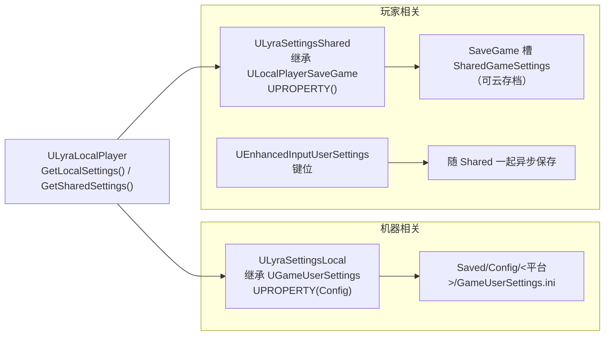
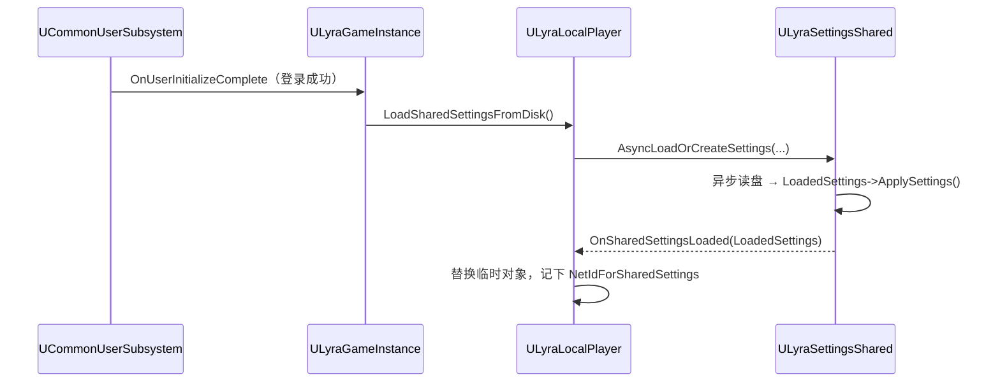
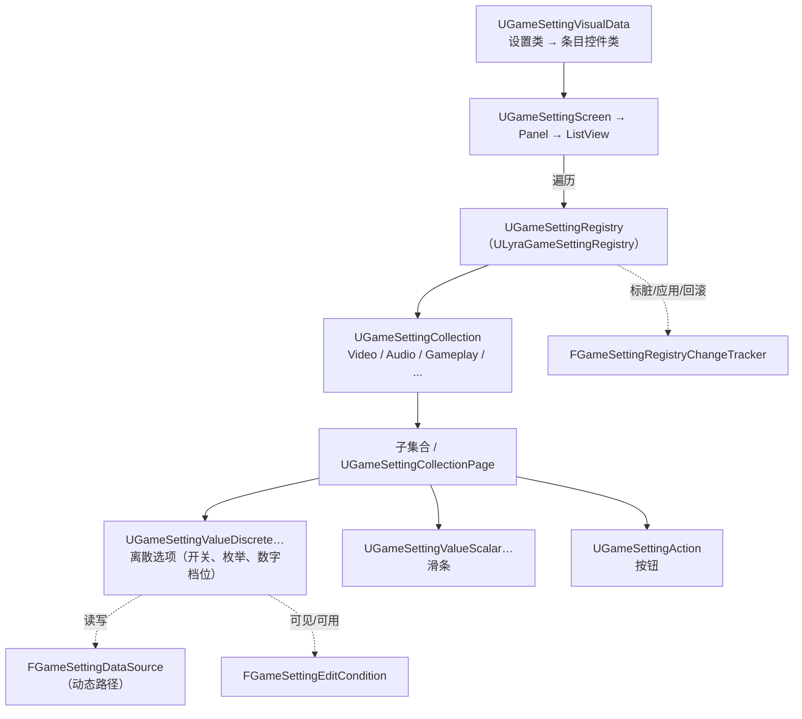
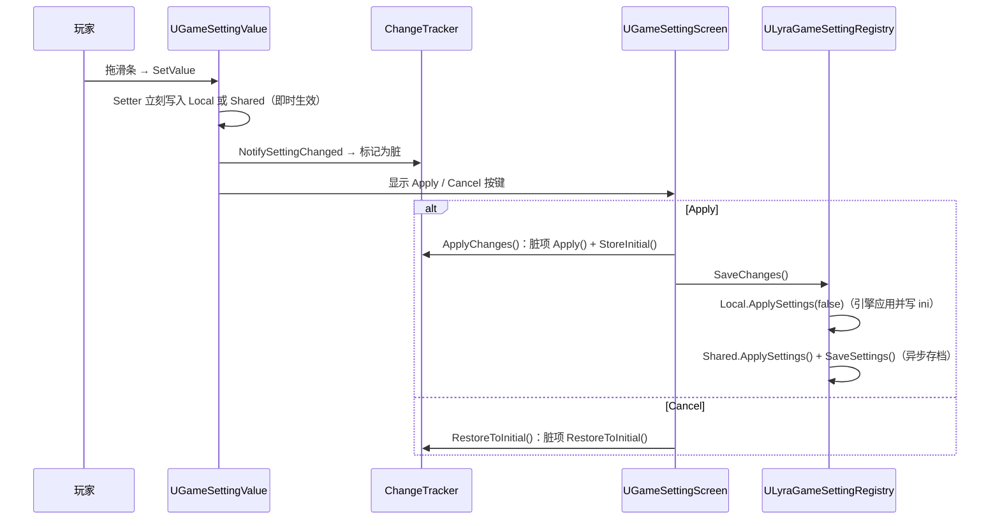

# 第 20 章　设置系统：一个界面，两种存储，一百多个选项

## 一个问题：玩家把灵敏度调到 2.0，这个数该存在哪？

设想设置菜单里有这么几项：窗口分辨率、阴影质量、主音量、鼠标灵敏度、字幕开关、界面语言、“开火”键位。策划还提了几条要求：

- 同一台电脑上，哥哥和妹妹用各自的平台账号登录，两个人的灵敏度和键位不能互相覆盖；
- 玩家换了一台电脑，灵敏度和键位最好能跟着账号走（云存档）；
- 分辨率、画质这类东西是“这台机器”的事——换一台显卡不同的电脑，沿用旧画质没有意义；
- 手机上没有“窗口模式”，主机上没有“帧率上限”，这些选项在对应平台上不能出现；
- 玩家一边拖滑条一边要能立刻看到效果，但如果点了“取消”，一切要回到打开界面时的样子；
- 一百多个选项，不可能每个都手写一个 UMG 控件再手写一份存取代码。

你自己会怎么写？大概是这样：每个设置对应一个 UMG 控件，控件的 `OnValueChanged` 里直接改一个全局的 `USaveGame` 变量，点“应用”时 `SaveGameToSlot`。

这种写法做第一个设置没问题，做到第十个就会撞墙：分辨率和画质的应用逻辑（切全屏、改 Scalability 档位、确认或回滚视频模式）引擎早就写好了，你的 SaveGame 方案要全部重写；哥哥妹妹共用一个存档槽，灵敏度互相串；手机和 PC 的差异散落在每个控件的 `#if` 里；“取消”需要你自己给每个设置记一份旧值……

这一章讲 Lyra 怎么解决这堆问题。核心思路有两条：**把设置按“属于机器还是属于人”拆成两个存储对象；把“有哪些设置、怎么显示、什么时候可用”写成数据（一棵 `UGameSetting` 对象树），UI 只负责遍历这棵树。**

## 读完本章你能……

- 说出 `ULyraSettingsLocal` 和 `ULyraSettingsShared` 各自继承自哪个引擎类、存在哪里，并能判断一个新设置该放哪边；
- 画出“玩家登录 → 共享设置加载 → 设置界面才能显示”的时序，解释为什么主机平台上要先给临时对象；
- 读懂 `GET_SHARED_SETTINGS_FUNCTION_PATH(GetXxx)` 展开后做了什么，并说出它**静默失败**的三种典型原因；
- 解释“改动即时生效、Apply 才落盘、Cancel 可回滚”是由哪几个类协作实现的；
- 独立给 Lyra 加一个 FOV 设置：存储属性、设置项声明、相机读取，全部接通。

## 需要先知道的 UE 概念

本章用到三个引擎概念。

### UGameUserSettings 与 GameUserSettings.ini

`UGameUserSettings` 是引擎提供的类，专门用来存“玩家可调的、与机器相关的图形和音频选项”：分辨率、窗口模式、垂直同步、画质档位（Scalability，引擎把阴影、特效、后处理等分成若干“通道”，每个通道有 0~3 档）、帧率上限等。它的属性写成 `UPROPERTY(Config)`，值就被保存到 `GameUserSettings.ini`，位置是 `<项目>/Saved/Config/<平台目录>/GameUserSettings.ini`：编辑器里运行时平台目录是 `WindowsEditor`（本工程的 `Saved/Config/WindowsEditor/GameUserSettings.ini` 就能看到），打包后的 Windows 版本是 `Windows`（由引擎 `IniPlatformName` 决定）。引擎全局只有一个实例，用 `GEngine->GetGameUserSettings()` 取。

它还带着一套“应用”逻辑：`ApplySettings()` 会把挂起的分辨率变更真正应用到窗口，调用 `ApplyNonResolutionSettings()` 处理其余项，最后 `SaveSettings()` 写盘；`ConfirmVideoMode`/`RevertVideoMode` 配合“15 秒内确认，否则回滚分辨率”这类流程。（以上是引擎类的行为，本书不展开源码。）

项目可以用子类替换它。Lyra 在 `Config/DefaultEngine.ini` 的 `[/Script/Engine.Engine]` 里写了 `GameUserSettingsClassName=/Script/LyraGame.LyraSettingsLocal`，引擎就会实例化这个子类。这是第 4 章讲过的“ini 里指定类名”的又一个用例。

### USaveGame 与 ULocalPlayerSaveGame

`USaveGame` 是引擎提供的另一种持久化方式：你写一个子类，把要存的东西声明成 `UPROPERTY()`，调用 `UGameplayStatics::SaveGameToSlot` 就把整个对象序列化到磁盘上的一个“槽”（Slot，一个名字对应一个文件）里。注意这里没有 `Config` 说明符——只要是 `UPROPERTY` 就会被序列化。

`ULocalPlayerSaveGame` 是 UE 5 新增的 `USaveGame` 子类，多了“这份存档属于哪个本地玩家”的概念：用 `LoadOrCreateSaveGameForLocalPlayer`、`AsyncLoadOrCreateSaveGameForLocalPlayer` 读取，用 `AsyncSaveGameToSlotForLocalPlayer` 异步保存，用 `GetLatestDataVersion` 做数据版本管理。因为按玩家区分，它天然适合平台的云存档。在桌面平台上，`USaveGame` 槽最终是 `<项目>/Saved/SaveGames/<槽名>.sav` 一个文件（桌面平台忽略用户索引，只看槽名；主机平台由各自的存档系统实现，路径不同）。

可以把这两者想成“全局配置文件”和“每用户档案”。类比的边界在于：`GameUserSettings.ini` 是文本、人可读、任何人能改；SaveGame 是二进制序列化，对玩家不透明——这也是主机平台更愿意接受后者的原因。

### 反射与属性路径

第 1 章讲过，`UFUNCTION`/`UPROPERTY` 会让函数和属性进入反射系统，可以用名字字符串在运行时找到它们。本章的“动态路径”就建立在这个能力上：设置框架拿着字符串 `"GetSharedSettings"`、`"GetMouseSensitivityX"`，从一个 `ULocalPlayer` 出发，一步步调用函数或读属性。如果你对“反射能按名字调用函数”还不踏实，先回看 [第 1 章](01-UObject.md)。

## Lyra 的拆法：机器的归机器，人的归人

回到开场的需求。Lyra 把设置存储拆成两个类：



`ULyraLocalPlayer` 是两者的统一入口：`GetLocalSettings()` 返回全局的 `UGameUserSettings` 实例（转成 `ULyraSettingsLocal`），`GetSharedSettings()` 返回属于这个本地玩家的存档对象。后面所有“设置项”都从 `ULocalPlayer` 出发去找它们。

### 放哪边：一条判断规则

`Source/LyraGame/Settings/LyraSettingsShared.h` 的类注释把规则写得很清楚：Shared 设置**不依赖机器**，可以放云端，按玩家存储，比如手柄键位偏好——因为放进本地设置的话，同一台机器上所有用户会共用。

实际用起来就是一个问题：**这个值换一台电脑还有意义吗？** 分辨率、画质档位、帧率上限、音量、音频输出设备、HDR、性能统计显示列表，换了机器就没意义，放 Local。灵敏度、反转轴、死区、震动、字幕样式、色盲模式、键位、语言偏好，跟着人走，放 Shared。

有两个值得留意的例外，它们体现了“规则是起点，不是教条”：

- **音量放在 Local**。它并非严格意义上的“机器属性”。Lyra 的音量通过 AudioModulation 的控制总线混音（Control Bus Mix）实现，在 `ApplyNonResolutionSettings` 里统一重放。源码没有写注释说明为什么选 Local，一个实际的好处是：音量在前端、加载画面这些登录之前的阶段就要生效，放在进程启动即可用的 Local 里无需等待账号登录。
- **语言偏好属于人，但最终写进了 `GameUserSettings.ini`**。原因藏在 `ULyraSettingsShared::ApplyCultureSettings` 的注释里：我们需要在玩家登录之前、加载界面的很早阶段就能本地化文本。

```cpp
// 简化自 Source/LyraGame/Settings/LyraSettingsShared.cpp 的 ULyraSettingsShared::ApplyCultureSettings
if (FInternationalization::Get().SetCurrentCulture(CultureToApply))
{
    // 注意：这里是有意存到用户 ini 里的
    // 因为要在玩家登录之前、加载画面很早的时候就把文字本地化
    GConfig->SetString(TEXT("Internationalization"), TEXT("Culture"), *CultureToApply, GGameUserSettingsIni);
    GConfig->Flush(false, GGameUserSettingsIni);
}
```

### Local 这一半：就是一个带 Config 属性的 UGameUserSettings

`ULyraSettingsLocal` 的写法没什么新鲜的：重写几个虚函数（`SetToDefaults`、`LoadSettings`、`ApplyNonResolutionSettings` 等，见 `Source/LyraGame/Settings/LyraSettingsLocal.h`），再声明一批 `UPROPERTY(Config)` 属性和对应的 getter/setter。打开你工程里的 `Saved/Config/WindowsEditor/GameUserSettings.ini`，能看到 `[/Script/LyraGame.LyraSettingsLocal]` 一节：`OverallVolume`、`FrameRateLimit_InMenu`、`bUseHeadphoneMode`、`ResolutionSizeX` ……你在设置界面里改的 Local 项，最终都落在这里。

注意 getter/setter 前面几乎都标了 `UFUNCTION()`，例如 `UFUNCTION() float GetDisplayGamma() const;`。这不是为了蓝图，而是为了下一节要讲的动态路径——它只认反射里能找到的函数。

### Shared 这一半：UPROPERTY + ChangeValueAndDirty

Shared 的每个设置是一个普通 `UPROPERTY()`（不带 `Config`），再配一对 `UFUNCTION()` 存取函数。setter 统一走一个小模板：

```cpp
// 简化自 Source/LyraGame/Settings/LyraSettingsShared.h
UFUNCTION()
bool GetInvertVerticalAxis() const { return bInvertVerticalAxis; }
UFUNCTION()
void SetInvertVerticalAxis(bool NewValue) { ChangeValueAndDirty(bInvertVerticalAxis, NewValue); ApplyInputSensitivity(); }

template<typename T>
bool ChangeValueAndDirty(T& CurrentValue, const T& NewValue)
{
    if (CurrentValue != NewValue)
    {
        CurrentValue = NewValue;
        bIsDirty = true;                    // 标脏
        OnSettingChanged.Broadcast(this);   // 通知订阅者（比如 PlayerController）
        return true;
    }
    return false;
}
```

`ChangeValueAndDirty` 做三件事：值没变就什么都不做；值变了就赋值、把对象标脏、广播 `OnSettingChanged`。后面 FOV 配方会用到最后一件事：别的系统可以订阅这个事件，在设置变化时立刻更新。（`ALyraPlayerController::SetPlayer` 就是这么订阅的，用它来更新手柄震动开关。）

不是所有 setter 都遵守这个约定。`SetColorBlindMode` 就直接赋值、直接调渲染器，没有标脏也没有广播。对设置界面来说这无所谓（界面有自己的脏标记机制，下面会讲），但如果你想“监听 Shared 变化”，会发现色盲模式的变化你收不到。写新设置时用 `ChangeValueAndDirty`。

### Shared 什么时候能用：登录之后

Local 设置在进程启动时就读好了（`GetLocalSettings()` 的注释写着 “always valid”）。Shared 就没这么简单：它是**按玩家**的存档，而“这个玩家是谁”要登录之后才知道。

```cpp
// 简化自 Source/LyraGame/Player/LyraLocalPlayer.cpp 的 ULyraLocalPlayer::GetSharedSettings
if (!SharedSettings)
{
    // 桌面平台：只是读本地磁盘，同步加载没问题
    bool bCanLoadBeforeLogin = PLATFORM_DESKTOP;

    if (bCanLoadBeforeLogin)
    {
        SharedSettings = ULyraSettingsShared::LoadOrCreateSettings(this);
    }
    else
    {
        // 其它平台必须等登录拿到真实账号：先返回一个临时对象，别让调用者拿到空指针
        SharedSettings = ULyraSettingsShared::CreateTemporarySettings(this);
    }
}
return SharedSettings;
```

登录成功之后，`ULyraGameInstance::HandlerUserInitialized` 通知本地玩家去加载真正的存档：



两个细节：`LoadSharedSettingsFromDisk` 开头会判断“是不是已经为同一个 NetId 加载过”，是的话直接返回；每次加载或创建出新的 Shared 对象，都会立刻 `ApplySettings()`，把字幕样式、后台音频、语言、输入设置应用到玩家身上。

还有一个容易漏掉的联动：`ULyraGameSettingRegistry::IsFinishedInitializing` 额外要求 `GetSharedSettings() != nullptr`。设置界面的面板是靠它判断“可以显示了没有”的。登录流程本身（`UCommonUserSubsystem` 的状态机）放到第 21 章讲。

## 声明式设置：一棵对象树，而不是一堆控件

现在解决另一半问题：一百多个设置怎么描述。

最直观的做法是每个设置一个控件。它的麻烦前面说过了：平台差异散落各处、“取消”要手动记旧值、新增一个设置要改 UMG 资产。Lyra 用的 `GameSettings` 插件换了个角度：**设置本身是数据对象，界面是通用的“设置列表”，遍历数据对象并为每种对象挑一个条目控件。**

这套分工和 Epic 官方《Lyra Sample Game Settings》文档（写于 5.0 前后）的描述一致：`UGameSettingRegistry` 是“一组设置”，一个游戏必须至少注册一个；如果游戏里还有别的、不属于“主设置”的设置，官方建议另开一个 Registry；`UGameSetting` 负责名称、描述、依赖和编辑条件，`UGameSettingValue` 是有值可读写的那一支；UI 则由 `UGameSettingVisualData` 加 `UGameSettingPanel` 组成，Panel 接收一个 Registry 和一个过滤器负责显示。另外要知道：在 Lyra 里所有设置都是在 C++ 里声明的（本章会看到），所以“新增一个设置”需要工程师参与，设计师单靠蓝图加不了——这一点官方文档没有展开，是社区文章和源码共同给出的结论。



### 一个设置长什么样

先看 Lyra 里一个真实的设置项，鼠标 X 轴灵敏度（`Source/LyraGame/Settings/LyraGameSettingRegistry_MouseAndKeyboard.cpp`）：

```cpp
// 简化自 ULyraGameSettingRegistry::InitializeMouseAndKeyboardSettings
UGameSettingValueScalarDynamic* Setting = NewObject<UGameSettingValueScalarDynamic>();
Setting->SetDevName(TEXT("MouseSensitivityYaw"));            // 注册表内唯一的"内部名"
Setting->SetDisplayName(LOCTEXT("MouseSensitivityYaw_Name", "X-Axis Sensitivity"));
Setting->SetDescriptionRichText(LOCTEXT("MouseSensitivityYaw_Description", "..."));  // 必须有描述

// 读写都通过"动态路径"，指向 ULyraSettingsShared 的函数
Setting->SetDynamicGetter(GET_SHARED_SETTINGS_FUNCTION_PATH(GetMouseSensitivityX));
Setting->SetDynamicSetter(GET_SHARED_SETTINGS_FUNCTION_PATH(SetMouseSensitivityX));
Setting->SetDefaultValue(GetDefault<ULyraSettingsShared>()->GetMouseSensitivityX());
Setting->SetDisplayFormat(UGameSettingValueScalarDynamic::RawTwoDecimals);  // 滑条旁边怎么显示数字
Setting->SetSourceRangeAndStep(TRange<double>(0, 10), 0.01);                // 滑条范围和步长
Setting->SetMinimumLimit(0.01);                                              // 滑条能拖，但值不能低于它

Setting->AddEditCondition(WhenPlatformSupportsMouseAndKeyboard);             // 平台不支持就隐藏
Sensitivity->AddSetting(Setting);                                            // 挂进"灵敏度"集合
```

这段代码里没有任何控件。它描述的是“一个叫 `MouseSensitivityYaw` 的滑条型设置，值读写自 Shared 设置的 `MouseSensitivityX`，范围 0 到 10，鼠标键盘平台才显示”。至于这个滑条在屏幕上长什么样，由 `UGameSettingVisualData`（一个蓝图数据资产）决定：它按 `DevName` 或设置类的继承链查表，找到对应的条目控件类。所以“加一个标准类型的设置”不需要碰任何 UMG 资产。

### 值类型：只有几种

`UGameSetting` 是抽象基类，带有 `DevName`、`DisplayName`、`Description`。“有值”的设置继承自 `UGameSettingValue`，要求实现三件事：`StoreInitial`（记下当前值作为“初始值”）、`ResetToDefault`（重置为默认）、`RestoreToInitial`（回滚到初始值）。常用的几种：

- **离散选项**（`UGameSettingValueDiscreteDynamic` 及其 `_Bool`、`_Number`、`_Enum` 子类）：下拉或左右切换。`_Bool` 自带 OFF/ON 两项；`_Number` 用 `AddOption(数字, 文本)` 声明档位；`_Enum` 用 `AddEnumOption`。
- **标量**（`UGameSettingValueScalarDynamic`）：滑条，必须设 `SetDisplayFormat` 和范围，否则非 Shipping 下会 `ensure`。
- **动作**（`UGameSettingAction`）：一个按钮，比如“调节安全区”。
- **集合**（`UGameSettingCollection`、`UGameSettingCollectionPage`）：分组和“进入子页”的导航项，自己不带值。

名字里的 `Dynamic` 意思是“值的读写通过动态路径完成”。没有 `Dynamic` 的 `UGameSettingValueDiscrete` 是纯抽象的，留给那些路径表达不了的设置去继承——本章后面会看到四个例子。

## 动态路径：一个宏，一次反射

上面代码里最关键的一行是 `GET_SHARED_SETTINGS_FUNCTION_PATH(GetMouseSensitivityX)`。它的定义在 `Source/LyraGame/Settings/LyraGameSettingRegistry.h`：

```cpp
// 摘自 Source/LyraGame/Settings/LyraGameSettingRegistry.h
#define GET_SHARED_SETTINGS_FUNCTION_PATH(FunctionOrPropertyName)                        \
    MakeShared<FGameSettingDataSourceDynamic>(TArray<FString>({                          \
        GET_FUNCTION_NAME_STRING_CHECKED(ULyraLocalPlayer, GetSharedSettings),           \
        GET_FUNCTION_NAME_STRING_CHECKED(ULyraSettingsShared, FunctionOrPropertyName)    \
    }))
```

展开后是一个字符串数组 `{"GetSharedSettings", "GetMouseSensitivityX"}`，装进 `FGameSettingDataSourceDynamic`。设置对象运行时用这条路径做反射：以 `ULocalPlayer` 为起点，调用名为 `GetSharedSettings` 的 UFunction 得到一个对象，再在这个对象上调用 `GetMouseSensitivityX`，把返回值转成字符串。写入则是反向：把字符串转回参数类型，调用 setter。

```cpp
// 简化自 Plugins/GameSettings/Source/Private/DataSource/GameSettingDataSourceDynamic.cpp
FString FGameSettingDataSourceDynamic::GetValueAsString(ULocalPlayer* InLocalPlayer) const
{
    FString OutStringValue;
    const bool bSuccess = PropertyPathHelpers::GetPropertyValueAsString(InLocalPlayer, DynamicPath, OutStringValue);
    ensure(bSuccess);              // 失败只有 ensure，没有别的反应
    return OutStringValue;
}
```

`PropertyPathHelpers` 是引擎提供的属性路径工具。路径的每一段既可以是 UFUNCTION（无参 getter）也可以是 UPROPERTY，所以 Lyra 里有些设置直接绑属性，比如 `GET_LOCAL_SETTINGS_FUNCTION_PATH(bDesiredHeadphoneMode)`。

### 这个设计换来了什么

换来的是**类型擦除**：值统一变成字符串之后，布尔、枚举、浮点、整数共用同一个 `UGameSettingValueDiscreteDynamic` 基类，条目控件只需要认“离散选项、滑条、按钮、导航”四类。新增一个设置，不用新建类，也不用写 getter/setter 的绑定样板，一行宏就够了。

付出的代价是**错误从编译期推迟到了运行期，而且很安静**。宏里的 `GET_FUNCTION_NAME_STRING_CHECKED` 只能在编译期检查“`ULyraSettingsShared` 里有没有这个名字的 C++ 成员”，检查不了“它是不是 UFUNCTION”。于是下面这些写法都**能编译通过**：

1. **忘了写 `UFUNCTION()`**。C++ 成员存在，反射里找不到。
2. **getter 带了参数，或 setter 的参数个数不是 1**。路径解析不出来。
3. **字符串往返对不上**。比如 `_Number` 型设置用 `AddOption(0.0f, ...)` 声明档位，而 getter 返回的字符串格式与选项不同，`GetDiscreteOptionIndex` 就找不到匹配项，退回“默认项”索引；如果你还没 `SetDefaultValue`，这个索引是 `-1`。

这些错误什么时候会被发现？唯一的检查在 `UGameSettingValueDiscreteDynamic::OnInitialized`，而且被 `#if !UE_BUILD_SHIPPING` 包着：

```cpp
// 简化自 Plugins/GameSettings/Source/Private/GameSettingValueDiscreteDynamic.cpp
void UGameSettingValueDiscreteDynamic::OnInitialized()
{
#if !UE_BUILD_SHIPPING
    ensureAlwaysMsgf(Getter->Resolve(LocalPlayer),
        TEXT("%s: %s did not resolve, are all functions and properties valid, and are they UFunctions/UProperties? Does the getter function have no parameters?"),
        *GetDevName().ToString(), *Getter->ToString());
    // Setter 同理，提示里写的是 "exactly one parameter"
#endif
    Super::OnInitialized();
}
```

所以在编辑器里你至少会看到一条 ensure 日志和调用栈；在 Shipping 构建里连这个都没有，设置项会显示一个空值，拖动它什么都不会发生。记住这个习惯：**每加一个设置，打开设置页，看一眼输出日志有没有 `did not resolve`。** 下面的实验 2 会让你亲手制造这个错误。

还有一个有趣的限制：宏用 `GET_FUNCTION_NAME_STRING_CHECKED(ULyraSettingsShared, X)` 取成员，它要求这个成员对注册表的代码**可访问**。所以被引用的 getter 必须是 `public`。`ULyraSettingsLocal` 里 `bUseHeadphoneMode` 是 private 的，而 `bDesiredHeadphoneMode` 是 public 的，设置项绑的是后者，这不是巧合。

## 编辑条件与依赖：让同一份声明适配所有平台

回到需求：“手机上没有窗口模式，主机上没有帧率上限。”

直观的做法是在构建注册表时直接 `#if` 掉，或者 `if (Platform == ...)` 就不创建那个设置。这有两个问题：一是运行时变化无法响应（Windows 上按 Alt+Enter 切成窗口化之后，“分辨率”项应该变灰）；二是玩家看不到“为什么没有这一项”。

Lyra 的做法是：设置始终创建，附加若干**编辑条件**（`FGameSettingEditCondition`）。条件在 `GatherEditState` 里修改一个“可编辑状态”（`FGameSettingEditableState`）：

| 调用 | 效果 |
|---|---|
| `Disable(文本)` | 可见但灰色，附带玩家看得懂的原因 |
| `Hide(开发者原因)` | 不可见 |
| `Kill(开发者原因)` | 隐藏，且不参与“重置全部”，也不上报分析数据 |

分辨率设置的写法最能说明问题（`Source/LyraGame/Settings/LyraGameSettingRegistry_Video.cpp`）：

```cpp
// 简化自 ULyraGameSettingRegistry::InitializeVideoSettings
Setting->AddEditDependency(WindowModeSetting);   // 窗口模式一变，我也重新求值
Setting->AddEditCondition(FWhenPlatformHasTrait::KillIfMissing(
    TAG_Platform_Trait_SupportsWindowedMode, TEXT("Platform does not support window mode")));
Setting->AddEditCondition(MakeShared<FWhenCondition>(
    [WindowModeSetting](const ULocalPlayer*, FGameSettingEditableState& InOutEditState)
    {
        if (WindowModeSetting->GetValue<EWindowMode::Type>() == EWindowMode::WindowedFullscreen)
        {
            InOutEditState.Disable(LOCTEXT("ResolutionWindowedFullscreen_Disabled",
                "When the Window Mode is set to <strong>Windowed Fullscreen</>, the resolution must match the native desktop resolution."));
        }
    }));
```

三件事：平台能力用 **Trait 标签**判断（`FWhenPlatformHasTrait`）；设置间的联动用 **`AddEditDependency`** 声明；临时的、自定义的逻辑用 **`FWhenCondition`** 包一个 lambda。

Trait 标签从哪来？来自 `Config/<平台>/<平台>Game.ini` 的 `[/Script/CommonUI.CommonUISettings]` 里的 `PlatformTraits`。打开 `Config/Windows/WindowsGame.ini`，你能看到 `Platform.Trait.SupportsWindowedMode`、`Platform.Trait.ReplaySupport` 等一串。**新平台只需要改 ini 给自己声明有哪些能力，不需要改设置代码。** 这又是第 4 章讲的“系统之间靠 GameplayTag 约定连接”。

依赖的实现很短：`AddEditDependency(Other)` 就是订阅 `Other` 的变化事件，变化时本设置重新 `RefreshEditableState`，并（如果变化原因不是依赖）再广播一次自己变了。画质预设（Low/Medium/High/Epic/Custom）与阴影、全局光照、后处理各个子项之间的互相依赖，就是这样声明出来的：任何一个子项变化，预设项重新计算——如果各子项档位不一致，预设就显示成“Custom”。

## 即时生效、Apply 才落盘、Cancel 可回滚

需求里最难满足的一条是：“拖滑条要立刻看到效果，但点取消要能回去。”

两个朴素方案都有问题。改动先只存在界面里、点“应用”才写入实际值：没有实时预览。每次改动都直接落盘：取消无从恢复，拖一下滑条还要写一次磁盘。

Lyra 的方案是：**设置的 setter 立刻改“活的”值（所以立即生效），同时每个 `UGameSettingValue` 记着“打开界面时的初始值”；变更追踪器只记录“哪些设置被改过”，Apply 时统一存盘，Cancel 时对每个改过的设置调 `RestoreToInitial`。**



追踪器本身非常简单，核心就是这两个函数（`Plugins/GameSettings/Source/Private/Registry/GameSettingRegistryChangeTracker.cpp`）：

```cpp
// 简化自 FGameSettingRegistryChangeTracker
void FGameSettingRegistryChangeTracker::ApplyChanges()
{
    for (auto Entry : DirtySettings)
    {
        if (UGameSettingValue* SettingValue = Cast<UGameSettingValue>(Entry.Value))
        {
            SettingValue->Apply();       // 让设置做"提交"动作（有的设置在这里才真正落地）
            SettingValue->StoreInitial(); // 把当前值记为新的"初始值"，下次 Cancel 回到这里
        }
    }
    ClearDirtyState();
}

void FGameSettingRegistryChangeTracker::RestoreToInitial()
{
    // …进入"正在恢复"状态，防止恢复过程自己又触发标脏…
    for (auto Entry : DirtySettings)
        if (UGameSettingValue* V = Cast<UGameSettingValue>(Entry.Value)) V->RestoreToInitial();
    ClearDirtyState();
}
```

然后是 Lyra 在注册表里补上的保存步骤：

```cpp
// 简化自 Source/LyraGame/Settings/LyraGameSettingRegistry.cpp 的 ULyraGameSettingRegistry::SaveChanges
if (ULyraLocalPlayer* LocalPlayer = Cast<ULyraLocalPlayer>(OwningLocalPlayer))
{
    // 引擎的 GameUserSettings：应用分辨率等，并间接写入 ini
    LocalPlayer->GetLocalSettings()->ApplySettings(false);

    // Shared：应用字幕/语言/输入，再异步存档
    LocalPlayer->GetSharedSettings()->ApplySettings();
    LocalPlayer->GetSharedSettings()->SaveSettings();
}
```

这就是两种存储在“保存”这一刻汇合的地方：同一个 Apply 动作，一边走 ini，一边走 SaveGame。

两个行为上的细节会让新手意外：

- **返回键也会 Apply**。`ULyraSettingScreen::HandleBackAction` 先尝试退出子页，退无可退时调用 `ApplyChanges()` 再关闭界面。要放弃修改，必须明确点 Cancel，而不是按返回。
- **画质项是“立即应用”的**。`FGameSettingEditCondition_VideoQuality::SettingChanged` 在每次变化时直接调 `ApplyScalabilitySettings()`，源码里的注释写着 `TODO for now this applies the setting immediately`。Cancel 时靠 `RestoreToInitial` 把值改回去，这又触发一次应用。

对于“值不能立刻生效”的设置（比如要重启音频设备的耳机模式），Local 里用 `Desired*` 字段暂存“想要的值”，在 `ApplyNonResolutionSettings` 里才落地。`bDesiredHeadphoneMode` 是 `Transient` 的“想要的”，`bUseHeadphoneMode` 是 `config` 的“真正生效的”。`ResetToCurrentSettings` 则把想要的值重置回生效的值。

## 四个自定义值类：路径表达不了的设置

动态路径的前提是“值能被一个 getter 和一个 setter 读写”。有些设置不满足，Lyra 就直接继承 `UGameSettingValueDiscrete`，自己实现选项列表和存取。四个例子各自说明一个不同的原因。

### 分辨率：把“撤销”交还给引擎

`ULyraSettingValueDiscrete_Resolution`（源码（`Source/LyraGame/Settings/CustomSettings/LyraSettingValueDiscrete_Resolution.cpp`））的选项列表来自 RHI 查询到的显示器可用分辨率，并且要随窗口模式和显示器而变，用 getter/setter 的字符串路径表达不了。更有意思的是它的三个回滚函数：

```cpp
// 简化自 ULyraSettingValueDiscrete_Resolution
void ULyraSettingValueDiscrete_Resolution::StoreInitial()   { /* Ignored */ }
void ULyraSettingValueDiscrete_Resolution::ResetToDefault() { /* Ignored */ }
void ULyraSettingValueDiscrete_Resolution::RestoreToInitial() { /* Ignored */ }
```

全是空的。因为分辨率变更用的是引擎 `UGameUserSettings` 自带的“挂起”机制：`SetScreenResolution` 只是记下想要的值，`ApplySettings` 才真正生效，引擎自己负责回滚。**不要照抄这个模式给普通设置**，空的 `RestoreToInitial` 意味着这个设置的 Cancel 靠引擎兜底，换成你自己的设置就会“取消无效”。

### 总体画质：有一个“Custom”选项

`ULyraSettingValueDiscrete_OverallQuality` 的特殊之处是选项数量会变：当各个子项档位不一致，引擎的 `GetOverallScalabilityLevel()` 返回 `INDEX_NONE`，它就在 Low/Medium/High/Epic 之后多显示一个“Custom”。选项列表取决于当前状态，这是静态 `AddOption` 做不到的。

### 语言：先挂起，应用时才生效

`ULyraSettingValueDiscrete_Language` 的选项来自 `FTextLocalizationManager` 查到的“游戏已本地化的文化名”。它的 `SetDiscreteOptionByIndex` 并不真改语言，只是调用 Shared 的 `SetPendingCulture`，把“待应用的 culture”记下来；真正切换发生在 Shared 的 `ApplyCultureSettings`。`OnApply` 里弹一个对话框告诉玩家“需要完全重启游戏才能让所有语言相关改动生效”。它的 `StoreInitial` 是只有一个 `// ?` 注释的空函数——原版没想清楚这里要存什么。

### 键位：整个设置是“从数据生成”的

键位设置是最特别的一个，因为它**根本不在 C++ 里逐项声明**。`InitializeMouseAndKeyboardSettings` 的后半段这样工作：

```cpp
// 简化自 ULyraGameSettingRegistry::InitializeMouseAndKeyboardSettings
const UEnhancedInputUserSettings* UserSettings = EISubsystem->GetUserSettings();

for (const auto& ProfilePair : UserSettings->GetAllAvailableKeyProfiles())
{
    for (const auto& RowPair : ProfilePair.Value->GetPlayerMappingRows())
    {
        if (RowPair.Value.HasAnyMappings())
        {
            // 只想在这个页面上显示键盘/鼠标按键：用 W 键作为"基础键类型"的匹配样本
            FPlayerMappableKeyQueryOptions Options = {};
            Options.KeyToMatch = EKeys::W;
            Options.bMatchBasicKeyTypes = true;

            // 按 DisplayCategory 自动分组
            UGameSettingCollection* Collection = GetOrCreateSettingCollection(RowPair.Value.Mappings.begin()->GetDisplayCategory());

            ULyraSettingKeyboardInput* InputBinding = NewObject<ULyraSettingKeyboardInput>();
            InputBinding->InitializeInputData(Profile, RowPair.Value, Options);   // DevName = "KBM_Input_" + 映射名
            Collection->AddSetting(InputBinding);
        }
    }
}
```

数据源是增强输入的用户设置（`UEnhancedInputUserSettings`，第 11 章讲过：Lyra 在 `DefaultInput.ini` 里用 `UserSettingsClass` 指定了子类 `ULyraInputUserSettings`）。每一“行”（`FKeyMappingRow`）对应一个玩家可重绑的输入动作。上面 `Options.bMatchBasicKeyTypes = true` 配上 `Options.KeyToMatch = EKeys::W` 的意思是“只比较设备大类（键鼠 / 手柄 / 触控），不要求字面等于 W 键”——拿任意一个键盘按键当样本，就能把同一行里的键盘与鼠标映射筛出来、把同名的手柄映射排除掉。所以**给输入动作勾选 Player Mappable、放进一个注册到设置的 IMC，它就会自动出现在设置页**，无需任何 C++ 改动。“注册到设置”这一步的细节（英雄组件里的 `bRegisterWithSettings` 陷阱、GameFeature 的 `Add Input Mapping` 在“注册”阶段就登记）在[第 11 章](11-Input.md)已经讲过，这里不重复。

`ULyraSettingKeyboardInput` 继承的是 `UGameSettingValue`（而不是 `Discrete`），因为它的条目控件是专门的“主键/副键两个按钮”，由 `ULyraSettingsListEntrySetting_KeyboardInput` 驱动。改键走 `ChangeBinding`：

```cpp
// 简化自 ULyraSettingKeyboardInput::ChangeBinding
if (!NewKey.IsGamepadKey())
{
    FMapPlayerKeyArgs Args = {};
    Args.MappingName = ActionMappingName;
    Args.Slot = (EPlayerMappableKeySlot)InKeyBindSlot;   // 主键位 or 副键位
    Args.NewKey = NewKey;

    if (UEnhancedInputUserSettings* Settings = GetUserSettings())
    {
        FGameplayTagContainer FailureReason;
        Settings->MapPlayerKey(Args, FailureReason);    // 引擎负责改映射
        NotifySettingChanged(EGameSettingChangeReason::Change);   // 让追踪器知道它脏了
    }
    return true;
}
return false;   // 手柄键在这个页面上不接受
```

它的 `StoreInitial` 把每个槽位当前的键记进 `InitialKeyMappings`，`RestoreToInitial` 就是对每个槽位再 `ChangeBinding` 回去。保存则搭在 Shared 的车上：`ULyraSettingsShared::SaveSettings` 里除了存自己，还会调用 `UEnhancedInputUserSettings::AsyncSaveSettings`，`ApplySettings` 里也会调用输入设置的 `ApplySettings`。键位就这样“随 Shared 一起保存”，同样可以云存档。

## 注册表怎么把这一切装起来

最后看顶层：`ULyraGameSettingRegistry::OnInitialize` 只是顺序调用五个 `InitializeXxx` 函数，每个返回一个顶级集合，再 `RegisterSetting`：

```cpp
// 简化自 ULyraGameSettingRegistry::OnInitialize
VideoSettings = InitializeVideoSettings(LyraLocalPlayer);
InitializeVideoSettings_FrameRates(VideoSettings, LyraLocalPlayer);
RegisterSetting(VideoSettings);

AudioSettings = InitializeAudioSettings(LyraLocalPlayer);                 RegisterSetting(AudioSettings);
GameplaySettings = InitializeGameplaySettings(LyraLocalPlayer);           RegisterSetting(GameplaySettings);
MouseAndKeyboardSettings = InitializeMouseAndKeyboardSettings(LyraLocalPlayer);   RegisterSetting(MouseAndKeyboardSettings);
GamepadSettings = InitializeGamepadSettings(LyraLocalPlayer);             RegisterSetting(GamepadSettings);
```

`RegisterSetting` 会递归地把整棵子树里每个设置的“变化、应用、条件变化”事件接到注册表上，并在非 Shipping 下检查 `DevName` 是否重复（重复会 `ensure`）。这解释了为什么 `DevName` 要“在注册表内唯一”。

谁来创建注册表？是设置界面 `ULyraSettingScreen::CreateRegistry`，它 `NewObject<ULyraGameSettingRegistry>()` 然后 `Initialize(LocalPlayer)`。设置界面本身是个蓝图子类（绑定了 `Settings_Panel`、顶部分页标签，以及指向 `UGameSettingVisualData` 的列表），它通过第 18 章讲过的 UI 层系统推到屏幕上。（另外还有一个静态的 `ULyraGameSettingRegistry::Get()`，以 LocalPlayer 为 Outer 缓存实例，和界面创建的是两个不同的对象，别假设它们是同一个。）

面板显示设置列表用的是一个 Ticker：每帧问 `Registry->IsFinishedInitializing()`，好了才 `SetListItems`，回头看就能理解前面那个 Shared 联动——Shared 没加载好，面板就一直不显示。

## 原版留下的几个怪癖

这一节把本章遇到的“不要当成正确做法照抄”的地方集中列一下。

- **`ApplyInputSensitivity()` 是空函数**。`ULyraSettingsShared` 里每个灵敏度 setter 都会调用它，但函数体是空的。灵敏度真正的应用点在输入修饰器 `ULyraSettingBasedScalar::ModifyRaw_Implementation`：它拿着输入映射资产上配置的属性名，用 `FindPropertyByName` 到 `ULyraSettingsShared` 里按**名字**找 `double` 属性并读值。这是反射的又一个用法，也是又一个安静的失败点：把 `MouseSensitivityX` 重命名，输入缩放就悄悄变成 1.0（找不到属性时 `ZAxisValue ? ... : 1.0` 的分支），编译器不会告诉你。
- **耳机模式会自己 `SaveSettings()`**。`ULyraSettingsLocal::SetHeadphoneModeEnabled` 在值真的变化时直接保存，不等 Apply 的统一存盘。因为设置项绑的是 `bDesiredHeadphoneMode`（走 Apply 路径时才调用它），日常使用感觉不到；但 `LoadSettings` 里也会调用它，所以别在设置初始化路径上频繁触发。
- **手柄的键位集合是空的**。`InitializeGamepadSettings` 里 `GamepadBindingCollection` 创建出来之后什么都没往里加，而键位自动生成只发生在键鼠页面。手柄键位设置目前没有。
- **Resolution/OverallQuality 的回滚函数是空的，Language 的 `StoreInitial` 是空的**，前面讲过。
- **`Config/DefaultRuntimeOptions.ini` 的节名拼错了**。文件里写的是 `[/Script/LyraGame.LyraRuntimeOptons]`（少了个 i），而类名是 `ULyraRuntimeOptions`（`config = RuntimeOptions`），所以往这一节里放的配置不会生效。当前文件里只有一行被注释掉的示例，没有实际影响，但如果你想用这套“运行时选项”（控制台前缀 `ro.`，或命令行 `-ro.xxx=...`），要先把节名改对。

## 动手实验

### 实验 1：看看两种存储分别写在哪

**目标**：亲眼确认 Local 和 Shared 落在不同的地方。

**步骤**：

1. 先看一眼你工程里的 `Saved/Config/WindowsEditor/GameUserSettings.ini`，找到 `[/Script/LyraGame.LyraSettingsLocal]`，记下 `OverallVolume` 的值（如果还没有这一项，说明从没存过音量，也没关系）。再确认 `Saved/SaveGames` 目录是否存在（如果从没在设置里点过 Apply，它可能还不存在，本工程目前就没有）。
2. 打开 `L_LyraFrontEnd` 运行 PIE，进入设置界面。在音频页把主音量调到一个明显不同的值；在鼠标键盘页把 X 轴灵敏度调到一个明显不同的值。

**先写下你的预测**：这两个改动，各自会写进哪个文件？两个改动都发生后，界面上出现了什么新按键？此时立刻看磁盘，文件变了吗？

3. 点 Apply，再去看磁盘。

**预期结果**：界面第一次改动后出现 Apply 和 Cancel 按键（由变更追踪器的“脏”通知触发）。点 Apply 之前磁盘不变；点 Apply 之后 `GameUserSettings.ini` 里 `OverallVolume` 变了，而灵敏度**不会**出现在这个 ini 里；`Saved/SaveGames` 下出现 `SharedGameSettings.sav`（对应 `LyraSettingsShared.cpp` 里的槽名 `SharedGameSettings`）。

**原理**：音量是 `UPROPERTY(Config)`，由 `ApplySettings(false)` 间接写 ini；灵敏度是 `ULyraSettingsShared` 的 `UPROPERTY()`，由 `SaveSettings` 异步写存档槽。Apply 之前改动虽然已生效（setter 立刻改了内存里的值），但没有落盘。

### 实验 2：故意制造一次“静默失败”

**目标**：亲手触发动态路径的错误，认识它的症状。这个实验要改 C++，建议在练习用的分支或随手改完就还原。

**步骤**：

1. 打开 `Source/LyraGame/Settings/LyraSettingsShared.h`，找到 `GetInvertVerticalAxis` 上面的 `UFUNCTION()`，把它注释掉，编译。
2. 运行 PIE，打开设置的鼠标键盘页，同时打开输出日志，过滤 `did not resolve`。

**先写下你的预测**：能编译通过吗？设置页上“Invert Vertical Axis”这一项长什么样？日志里会看到什么？

**预期结果**：编译通过。设置页打开时日志里出现一条 `InvertVerticalAxis: ... did not resolve, are all functions and properties valid, and are they UFunctions/UProperties?` 的 ensure。这个设置项仍然会显示，但读到的值不对，且切换它不会真正改变 Shared 里的值。

**原理**：`GET_FUNCTION_NAME_STRING_CHECKED` 只检查 C++ 符号存在；反射里没有这个函数，`Resolve` 失败。检查只在非 Shipping 的 `OnInitialized` 里。做完请把 `UFUNCTION()` 还原。

### 实验 3：Cancel 和返回键的区别

**目标**：验证“返回键也会 Apply”。

**步骤**：打开设置，把一个滑条（比如“3D Resolution”或某个音量）拖一下；用方式 A 点 Cancel；再拖一次，用方式 B 按返回键（通常是 Esc，具体以设置屏幕蓝图里配置的返回输入动作为准）退出界面，之后重新打开设置页看值。

**先写下你的预测**：A 和 B 之后，这个值分别是多少？磁盘上的文件各自变了吗？

**预期结果**：A 之后值回到打开界面时的样子；B 之后值保持你拖到的位置，磁盘也已更新。

**原理**：`HandleCancelChangesAction` 走 `RestoreToInitial`；`HandleBackAction` 在无子页可退时先 `ApplyChanges()`。

### 小技巧：看每个设置的 DevName 和类

控制台变量 `GameSettings.ShowDebugInfo` 默认是 `-1`，意思是“编辑器里显示、打包后不显示”。在编辑器里选中设置页上任意一项，右侧详情面板的底部会多出 `DevName: ...` 和 `Class: ...`。要找“这个设置是在哪里声明的”，拿 DevName 在 `Settings` 目录里 grep 就行。

## 配方：加一个 FOV（视野）设置

现在把本章学到的东西用起来：给 Lyra 加一个“视野角度”设置，范围 70 到 120，默认 80（相机默认值是 `LYRA_CAMERA_DEFAULT_FOV`，80）。全程分四步。

### 先决定：放 Local 还是 Shared

FOV 的取值与屏幕大小和观看距离有关，有一点“机器相关”的味道；但它首先是**玩家偏好**，应该跟着账号走，换电脑后保持习惯。所以放 Shared。（如果你的项目认为它是机器属性，放 Local 也完全可以：加一个 `UPROPERTY(Config)`，用 `GET_LOCAL_SETTINGS_FUNCTION_PATH`。两种选择的差别就是本章前半部分讲的那些。）

### 第 1 步：Shared 里加属性和存取函数

```cpp
// 修改 Source/LyraGame/Settings/LyraSettingsShared.h，加在合适的位置（比如 Gamepad Sensitivity 小节之前）
////////////////////////////////////////////////////////
// Field of view
public:
    UFUNCTION()
    float GetFieldOfView() const { return FieldOfView; }
    UFUNCTION()
    void SetFieldOfView(float NewValue) { ChangeValueAndDirty(FieldOfView, FMath::Clamp(NewValue, 70.0f, 120.0f)); }

private:
    UPROPERTY()                     // 必须是 UPROPERTY 才会被序列化；不需要 Config
    float FieldOfView = 80.0f;      // 与 LYRA_CAMERA_DEFAULT_FOV 一致
```

两点说明。第一，要用 `ChangeValueAndDirty`，这样值变化时会广播 `OnSettingChanged`，相机可以订阅。第二，这是给一个已有的 SaveGame 类**新增**一个属性，旧存档里没有这个字段，加载后会保留构造时的默认值 80，所以不需要提升 `GetLatestDataVersion()`。只有改变已有字段的含义或类型时，才需要提升版本并写迁移逻辑。

注意 `ChangeValueAndDirty(T&, const T&)` 是模板，参数类型必须一致，所以这里的 `FMath::Clamp` 要保证产出 `float`，上面的写法满足。

### 第 2 步：在注册表里声明设置项

打开 `Source/LyraGame/Settings/LyraGameSettingRegistry_Gameplay.cpp`，在 `InitializeGameplaySettings` 里 Replay 小节之前加一个“Camera”小节。先补包含文件：

```cpp
#include "GameSettingValueScalarDynamic.h"
#include "LyraSettingsShared.h"
```

```cpp
// 加在 InitializeGameplaySettings 里（语言小节之后）
{
    UGameSettingCollection* CameraSubsection = NewObject<UGameSettingCollection>();
    CameraSubsection->SetDevName(TEXT("CameraCollection"));
    CameraSubsection->SetDisplayName(LOCTEXT("CameraCollection_Name", "Camera"));
    Screen->AddSetting(CameraSubsection);

    UGameSettingValueScalarDynamic* Setting = NewObject<UGameSettingValueScalarDynamic>();
    Setting->SetDevName(TEXT("FieldOfView"));                                // 注册表内唯一
    Setting->SetDisplayName(LOCTEXT("FieldOfView_Name", "Field of View"));
    Setting->SetDescriptionRichText(LOCTEXT("FieldOfView_Description", "Sets the horizontal field of view. Higher values show more of the world but make distant targets smaller."));  // 不能为空

    Setting->SetDynamicGetter(GET_SHARED_SETTINGS_FUNCTION_PATH(GetFieldOfView));
    Setting->SetDynamicSetter(GET_SHARED_SETTINGS_FUNCTION_PATH(SetFieldOfView));
    Setting->SetDefaultValue(GetDefault<ULyraSettingsShared>()->GetFieldOfView());   // 用 CDO 取默认值，和构造函数保持一致
    Setting->SetDisplayFormat(UGameSettingValueScalarDynamic::SourceAsInteger);       // 显示成整数（GameSettings 插件里已有这个预设）
    Setting->SetSourceRangeAndStep(TRange<double>(70, 120), 1);                       // 滑条范围和步长

    Setting->AddEditCondition(FWhenPlayingAsPrimaryPlayer::Get());                    // 分屏时只有主玩家能改

    CameraSubsection->AddSetting(Setting);
}
```

这一步全程不碰 UMG：条目控件由 `UGameSettingVisualData` 按类（标量设置 → 滑条条目）选出。数值经字符串往返：滑条的 `SetValue` 把 `double` 经 `LexToString` 变成字符串，路径把它还原成 `float` 参数传给 setter。

### 第 3 步：让相机读它

相机的详细结构在 [第 16 章](16-Camera.md)。这里只关心一个事实：`ULyraCameraComponent::GetCameraView` 每帧先让相机模式栈算出一个 `FLyraCameraModeView`（里面有 `FieldOfView`），再填进 `DesiredView.FOV`。我们要在这个中间点插一手。

**不要直接把相机的 FOV 替换成设置值。** 相机模式会按场景给出不同的 FOV（比如瞄准时拉近），模式栈还会在模式之间混合；如果你用设置值覆盖最终结果，这些效果全部消失。正确的做法是**加一个偏移量**：设置值相对默认值的差。

```cpp
// 修改 Source/LyraGame/Camera/LyraCameraComponent.cpp 的 ULyraCameraComponent::GetCameraView
// 需要 #include "LyraPlayerCameraManager.h"（LYRA_CAMERA_DEFAULT_FOV 在里面）、
//      "Player/LyraLocalPlayer.h" 和 "Settings/LyraSettingsShared.h"
CameraModeStack->EvaluateStack(DeltaTime, CameraModeView);

// 保持 PlayerController 与最新视图同步（原有代码，略）

// 新增：把玩家的 FOV 偏好折算成偏移量
if (const APawn* TargetPawn = Cast<APawn>(GetTargetActor()))
{
    if (const APlayerController* PC = TargetPawn->GetController<APlayerController>())
    {
        // 只有本机玩家才有 LocalPlayer；在服务器上看别人的 Pawn 时为空，跳过
        if (const ULyraLocalPlayer* LP = Cast<ULyraLocalPlayer>(PC->GetLocalPlayer()))
        {
            CameraModeView.FieldOfView += LP->GetSharedSettings()->GetFieldOfView() - LYRA_CAMERA_DEFAULT_FOV;
        }
    }
}

// 原有：加上别的系统通过 AddFieldOfViewOffset 申请的一帧偏移
CameraModeView.FieldOfView += FieldOfViewOffset;
FieldOfViewOffset = 0.0f;
```

`LYRA_CAMERA_DEFAULT_FOV` 定义在 `LyraPlayerCameraManager.h`（`LyraCameraMode.cpp` 就是 include 它来用的）。设置值 80 时偏移为 0，行为与原版完全一致；设置为 100 时所有相机模式的 FOV 都整体加 20，包括瞄准和混合过程。

`GetSharedSettings()` 每帧调用的成本很低（已经加载后就是返回一个指针），可以先这样写。如果你想更省，可以在组件里缓存一个 float，订阅 `OnSettingChanged` 时更新——这正是前面强调 setter 要走 `ChangeValueAndDirty` 的原因。

另外，`ULyraCameraComponent` 本来有个 `AddFieldOfViewOffset`，但在当前源码里没有任何地方调用它（只有声明），不用担心和它冲突。

### 第 4 步：验证

1. 编译，运行 PIE，打开设置，找到 Gameplay 页的 Camera 小节。
2. 拖动滑条，观察画面是否立即变化（setter 立即生效）。
3. 点 Cancel，观察 FOV 是否回到打开界面时的值。
4. 再拖一次，点 Apply，关闭 PIE 再打开：FOV 是否保持？（走 Shared 的存档。）
5. 瞄准（ADS）时，视野是否仍比不瞄准时窄？（验证我们加的是偏移而不是替换。）
6. 日志里搜 `did not resolve`：如果出现，多半是忘了 `UFUNCTION()`。

如果第 4 步 FOV 没保持，对照下面的误区 2 和误区 4：Shared 属性是不是 `UPROPERTY()`？setter 是不是走了 `ChangeValueAndDirty`？是不是点了 Apply（或按返回键）而不是直接强关了 PIE？

## 常见误区

**误区 1：把玩家偏好放进 `ULyraSettingsLocal`。**
同一台机器上所有账号会共用同一份值，换电脑也带不走。先问“换一台电脑还有意义吗”。

**误区 2：给 Shared 加了属性却忘了 `UPROPERTY()`。**
Shared 是 SaveGame，没有 `UPROPERTY` 的成员根本不会被序列化，重启后值就丢了。Local 则相反：必须是 `UPROPERTY(Config)` 才会写进 ini。

**误区 3：以为动态路径出错会编译失败或崩溃。**
它只会在非 Shipping 下给一条 ensure。Shipping 里设置项就是“哑”的。每加一个设置，打开界面看一眼日志。

**误区 4：想放弃修改却按返回键。**
返回键会先 Apply。要放弃，点 Cancel。

**误区 5：照抄 Resolution/OverallQuality 的空 `RestoreToInitial`。**
它们能这么写是因为引擎的 `UGameUserSettings` 在别处兜底。你自己的设置如果这样写，Cancel 就不会还原。

**误区 6：在 `Registry` 里用 `#if` 或平台判断来决定“创建不创建”一个设置。**
应该用编辑条件。条件能响应运行时变化（Alt+Enter），能告诉玩家为什么灰了，也能随 Trait 在模拟平台下变化。

## 本章小结

Lyra 把设置按“属于机器还是属于人”拆成两个存储：`ULyraSettingsLocal`（`UGameUserSettings` 子类，`UPROPERTY(Config)`，写 `GameUserSettings.ini`，进程启动即可用）和 `ULyraSettingsShared`（`ULocalPlayerSaveGame` 子类，`UPROPERTY()`，按玩家存档，登录后才能确定是谁）。两者通过 `ULyraLocalPlayer` 统一访问，在 Apply 时一并保存；键位走增强输入的用户设置，随 Shared 保存。

设置本身是一棵由 `UGameSetting` 构成的对象树，由 `ULyraGameSettingRegistry` 分五个类别声明。每个设置通过“动态路径”宏把读写绑定到 UFUNCTION/UPROPERTY，值以字符串往返；可见性和可用性由编辑条件和依赖表达；`FGameSettingRegistryChangeTracker` 记录脏项，实现“即时生效、Apply 落盘、Cancel 回滚”。

```
        ┌──────────────── 设置界面（蓝图 + GameSettings 通用控件）────────────────┐
        │  Screen ─ Panel ─ ListView ── VisualData（设置类 → 条目控件）           │
        └──────────────────────────────┬───────────────────────────────────────┘
                                       │ 遍历
              ULyraGameSettingRegistry（Video / Audio / Gameplay / M&K / Gamepad）
                  └─ Collection ─ Value / Scalar / Action        ← 编辑条件 / 依赖
                          │ 动态路径 {"GetXxxSettings","Name"}（反射，字符串往返）
          ┌───────────────┴────────────────┐
  ULyraSettingsLocal                ULyraSettingsShared  + EnhancedInput 用户设置
  UGameUserSettings                 ULocalPlayerSaveGame
  GameUserSettings.ini              SaveGame 槽（可云存档，登录后确定）
          └───────── Apply: ApplySettings(false) / ApplySettings + SaveSettings ─────────┘
```

## 自测题

1. `ULyraSettingsLocal` 和 `ULyraSettingsShared` 分别继承自什么引擎类？各自写到哪里？

<details><summary>答案</summary>

`ULyraSettingsLocal` 继承 `UGameUserSettings`，属性用 `UPROPERTY(Config)`，写入 `Saved/Config/<平台>/GameUserSettings.ini`。`ULyraSettingsShared` 继承 `ULocalPlayerSaveGame`，属性用 `UPROPERTY()`，存入名为 `SharedGameSettings` 的 SaveGame 槽，按本地玩家区分，可云存档。
</details>

2. 下面这些设置，分别该放 Local 还是 Shared，为什么？(a) 阴影质量 (b) 垂直轴反转 (c) 字幕文字大小 (d) 帧率上限

<details><summary>答案</summary>

(a) Local：依赖显卡和机器性能。(b) Shared：个人操作习惯，应跟着账号。(c) Shared：个人偏好，Lyra 的字幕设置在 Shared。(d) Local：与显示器和机器相关。判断依据是“换一台电脑还有意义吗”。
</details>

3. 主机平台上，玩家还没登录时设置界面就想读 Shared 设置，Lyra 怎么处理？为什么桌面平台可以不用这样？

<details><summary>答案</summary>

`GetSharedSettings()` 在非桌面平台上先返回 `CreateTemporarySettings` 创建的临时对象，登录成功后 `HandlerUserInitialized` → `LoadSharedSettingsFromDisk` 异步加载真实存档，`OnSharedSettingsLoaded` 替换掉临时对象。桌面平台（`PLATFORM_DESKTOP`）读存档只是读本地磁盘，不依赖平台账号服务，所以第一次调用就可以同步 `LoadOrCreateSettings`。
</details>

4. 你写了 `Setting->SetDynamicGetter(GET_SHARED_SETTINGS_FUNCTION_PATH(GetFoo))`，编译通过，设置页上这一项却读不出值、拖动也没效果。列出至少三种可能原因，以及发现问题的办法。

<details><summary>答案</summary>

可能原因：`GetFoo` 没有 `UFUNCTION()`；getter 带了参数，或 setter 参数个数不是一个；数值字符串往返对不上导致找不到选项。（成员不是 `public` 的话宏会在编译期就报访问错误，不属于“编译通过却失败”的情形。）发现办法：在非 Shipping 构建里，`UGameSettingValueDiscreteDynamic::OnInitialized`（以及标量版本）会对路径 `Resolve`，失败时 `ensureAlwaysMsgf` 输出 `did not resolve, are all functions and properties valid, and are they UFunctions/UProperties?`，在输出日志里搜 `did not resolve`。Shipping 构建没有这个检查。
</details>

5. 玩家拖了三个滑条，然后按返回键退出设置界面。这三个改动最后是被保存还是被丢弃？为什么？

<details><summary>答案</summary>

被保存。`ULyraSettingScreen::HandleBackAction` 在没有子页可退时会调用 `ApplyChanges()` 再 `DeactivateWidget()`。`ApplyChanges` 让变更追踪器对每个脏设置 `Apply()` 并 `StoreInitial()`，然后调用注册表的 `SaveChanges`，Local 走 `ApplySettings(false)`，Shared 走 `ApplySettings` + `SaveSettings`。想放弃必须点 Cancel。
</details>

6. 为什么 `ULyraSettingValueDiscrete_Resolution::RestoreToInitial()` 可以是空函数，而你自己写的普通设置不行？

<details><summary>答案</summary>

分辨率变更借用了引擎 `UGameUserSettings` 的“挂起”机制：`SetScreenResolution` 只记录想要的值，`ApplySettings` 才真正应用，引擎自带回滚（`ResetToCurrentSettings` 之类）。普通设置的 setter 是立刻改“活的”值，如果 `RestoreToInitial` 为空，Cancel 之后值不会恢复。
</details>

7. 设计题：策划要求加一个“屏幕震动强度”设置（0%~100%），每个玩家各自保存，设置变化时已经在播放的屏幕震动要立刻跟着变。你会改哪些地方？用到本章哪些机制？

<details><summary>答案</summary>

放 Shared：在 `ULyraSettingsShared` 加 `UPROPERTY()` 的 `float ScreenShakeScale` 和 `UFUNCTION()` 的 getter/setter，setter 用 `ChangeValueAndDirty`；在 `InitializeGameplaySettings`（或合适的集合）里用 `UGameSettingValueScalarDynamic` + `GET_SHARED_SETTINGS_FUNCTION_PATH`，范围 0~1，显示格式 `ZeroToOnePercent`，加 `FWhenPlayingAsPrimaryPlayer`。“立刻跟着变”：让负责震动的代码（比如 PlayerController 或相机管理器）订阅 `ULyraSettingsShared::OnSettingChanged`（可参考 `ALyraPlayerController::SetPlayer` 的做法）并在回调里读取新值；也可以每次播放震动时读取当前值乘上去。需要的机制：Shared 存储、动态路径、`ChangeValueAndDirty` 的广播、变更追踪器（Apply/Cancel 自动获得）。
</details>

## 继续深入

- 函数级调用链（打开设置界面、修改 Local/Shared 设置、Apply/Cancel、按键重绑的完整路径）：[参考手册 50 §8.1~§8.4、§8.8](../Reference/50-Settings-Online-Platform.md)
- 设计意图（为什么 Local/Shared 双层、为什么字符串路径、编辑条件和 ChangeTracker 的取舍）：[参考手册 50 §9](../Reference/50-Settings-Online-Platform.md)
- 其他可以照着配方加的设置（新增帧率档、新增性能统计、新增平台画质预设）：[参考手册 50 §6](../Reference/50-Settings-Online-Platform.md)
- 键位的数据来源与 `InputTag` 的关系：[第 11 章　从按键到技能](11-Input.md)
- 相机模式栈和混合的完整细节：[第 16 章　相机](16-Camera.md)
- 设置界面如何被推到屏幕上、UI 层级：[第 18 章　CommonUI 与 Lyra 的 UI 分层](18-UIFramework.md)
- **官方资料**（均写于 5.0 前后，类名和流程与 5.8 源码一致，未发现冲突）：
  - [Lyra Sample Game Settings](https://dev.epicgames.com/documentation/en-us/unreal-engine/lyra-sample-game-settings-in-unreal-engine)：GameSettings 插件的 Registry / Setting / Value / Panel 分工、`DevName` 与 `DisplayName`、`DynamicGetter/DynamicSetter`、`ULyraSettingsLocal`（`UGameUserSettings` 子类）。
  - [Scalability and Device Profiles in Lyra](https://dev.epicgames.com/documentation/en-us/unreal-engine/scalability-and-device-profiles-in-lyra-sample-game-for-unreal-engine)：引擎用 Device Profile 的层级（基础设备 → 更具体的设备）自顶向下应用画质配置，官方建议参考 `Config` 与 `Platforms/<平台>/Config` 里的 ini；编辑器里的平台模拟（`LyraPlatformEmulationSettings`）在多窗口 PIE 时画质设置是全局的，会互相覆盖。本章没有展开 Device Profile，需要时从这篇进入。
  - [Lyra Input Settings](https://dev.epicgames.com/documentation/en-us/unreal-engine/lyra-input-settings-in-unreal-engine)：键位设置的数据来源（该页 5.3 更新过）。
- **社区**（早于 5.8，以源码为准）：Jiahao Li 的 [Gameplay Settings in Lyra（自底向上，part 1）](https://jiahaoli.org/blog/2023/03/22/gameplay-settings-in-lyra-a-down-top-approach1-game-setting/)；X157 的 [ULyraSettingsLocal](https://x157.github.io/UE5/LyraStarterGame/ULyraSettingsLocal.html) 笔记。
- 上一章：[第 19 章　HUD 注入、指示器与加载屏：内容从哪来，什么时候露脸](19-HUDAndLoading.md)
- 下一章：[第 21 章　在线会话、开房到进图、构建变体](21-OnlineAndBuild.md)，我们会看到登录流程（它决定了 Shared 设置什么时候能加载）和“点一下按钮到进入地图”的完整路径。
