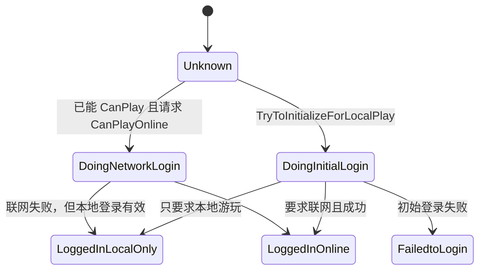
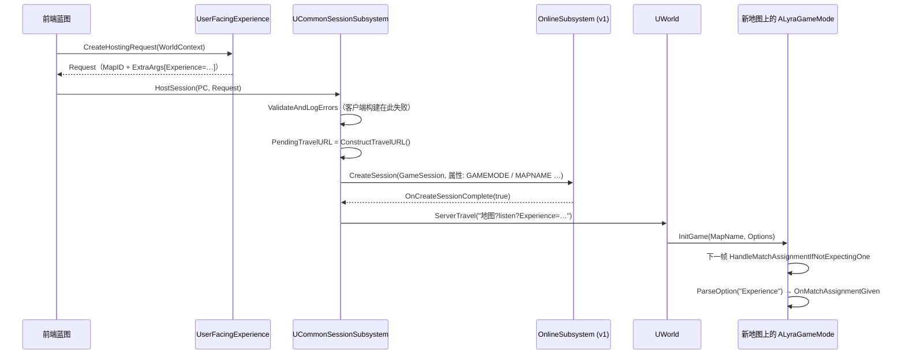
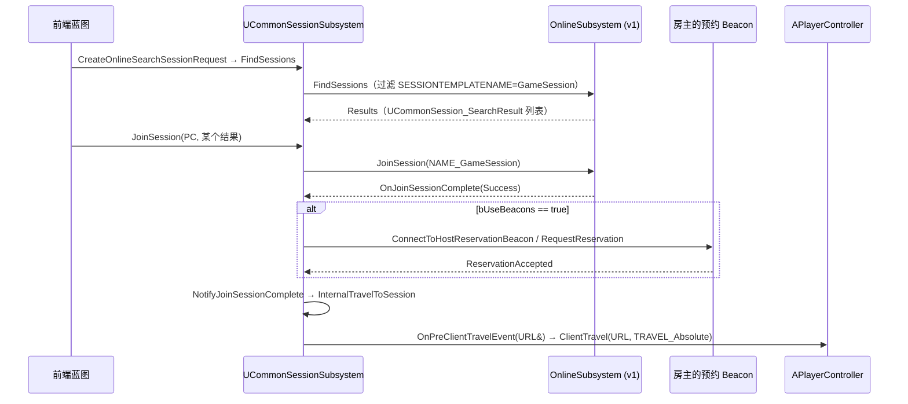

# 第 21 章　在线会话、开房到进图、构建变体

## 一个问题：点一下“团队死斗”，背后发生了什么？

在 Lyra 的主菜单里点一个玩法磁贴，几秒钟后你站在 `L_Expanse` 里，玩法是团队死斗，朋友可以在列表里搜到你的房间并加入。表面上只是一次点击，下面却藏着一串问题：

- 菜单只知道“这个磁贴代表团队死斗”。地图叫什么、Experience 叫什么、最多几个人，这些信息放在哪？怎么在换地图之后还能被新地图上的 GameMode 读到？
- 朋友怎么“搜到”这个房间？搜到之后，他的客户端是靠什么连上你的？他要不要也告诉自己的 GameMode“玩团队死斗”？
- 没有任何人点按钮的时候呢？一台专用服务器启动之后，谁来决定它跑哪张图、哪个玩法？
- 同一份代码，为什么改个构建目标名（`LyraGameSteam`），就变成了走 Steam 的版本？

这一章把这些问题串成一条线：先弄清 UE 的在线抽象和“换图”机制，再看 Lyra 的 CommonUser 插件如何把登录、开房、加入包装成统一接口，最后走完“点击 → 开房 → 换图 → 服务器读 URL 选 Experience”的全链路，并解释构建变体、打包和热修复这些“工程外壳”。

## 读完本章你能……

- 说出 Online Subsystem（OSSv1）和 Online Services（OSSv2）各是什么，以及 Lyra 当前编译的是哪一个；
- 画出从“点击玩法磁贴”到“服务器 GameMode 读出 `?Experience=`”的完整时序，并指出 Experience 是靠哪个字段传到新地图的；
- 解释为什么加入者的 URL 里没有 Experience，它是怎么知道玩什么的；
- 说清专用服务器没人点按钮时，是哪段代码、读哪些命令行参数把比赛开起来的；
- 说出 `LyraGame`、`LyraGameSteam`、`LyraGameEOS` 的区别在哪里，并按配方出一个 Steam 构建。

## 需要先知道的 UE 概念

### 在线子系统 OSSv1 与在线服务 OSSv2

玩家登录 Steam、创建房间、搜索房间、查好友，这些“平台在线功能”在每个平台上接口都不同。UE 提供了一层抽象，把它们统一成几个接口，游戏代码面对接口，具体实现是可替换的插件。这层抽象有两代：

在线子系统（Online Subsystem，OSSv1）是老的一代。入口是 `IOnlineSubsystem`，你用它拿到 `IOnlineIdentity`（登录）、`IOnlineSession`（会话）等接口。实现是 `OnlineSubsystemSteam`、`OnlineSubsystemEOS`、`OnlineSubsystemNull` 之类的插件，由配置文件里 `[OnlineSubsystem]` 段的 `DefaultPlatformService` 选择。

在线服务（Online Services，OSSv2）是新一代，接口按能力拆成 `IAuth`、`ISessions`、`ILobbies` 等，用异步操作句柄返回结果，由 `[OnlineServices]` 段的 `DefaultServices` 选择实现。

两代并存，项目只会同时编译其中一套“游戏侧封装”。**Lyra 的封装层 CommonUser 默认编译的是 OSSv1**（官方文档也这么说）。这是一个默认选择，不是缺陷，官方给出了切换到 OSSv2 的办法，本章后面会讲。

### 会话（Session）与大厅（Lobby）

会话是一条“可以被搜索到的房间记录”：房主创建它，带上一组公开属性（模式名、地图名、人数上限）；别人搜索，得到一组结果；挑一个加入，拿到一个“连接字符串”（通常是 IP 加端口）。要抓住的关键是：**会话负责“发现”和“预约”，不负责传游戏数据**。真正的联机仍然是第 3 章讲的那套——客户端用 NetDriver 连到服务器。大厅是会话的一种变体，通常由平台托管，带有成员列表和聊天。

### 旅行（Travel）与 URL

UE 里“切换地图”统称旅行。**URL** 是它的参数格式，长这样：`/Game/Maps/MyMap?listen?Foo=Bar?Baz`——地图路径，后面跟若干用 `?` 分隔的选项，`Key=Value` 是带值选项，单独的 `Baz` 是开关选项。选项最终会到达 GameMode 的 `InitGame(MapName, Options, ...)`，用 `UGameplayStatics::ParseOption`、`HasOption` 读取——第 6 章的 `?Experience=` 就是这么读的。

有两个引擎旅行函数要分清：

`UWorld::ServerTravel(URL)` 只能在服务器上调用：它先问 GameMode 能不能旅行（`CanServerTravel`），再由 `AGameModeBase::ProcessServerTravel` 通知所有已连接的客户端（给每个客户端发 `ClientTravel`），然后服务器自己加载新地图。`APlayerController::ClientTravel(URL, 类型)` 在客户端调用，让这个客户端自己去连另一个地址或加载另一张图（在服务器上调用则是“让这个客户端走”）。命令行里的 `open <地址或地图>` 本质上就是 ClientTravel。

换图还有“硬切换（非无缝）”和“无缝切换（seamless）”之分。硬切换会断开所有客户端连接再重连，所有 Actor 销毁重建，需要保留的数据只能放在 GameInstance 或存档里；无缝切换保持连接，过渡期间加载一张中转地图，并保留一部分对象（PlayerState 总会保留，去中转地图时 GameMode、GameState 也留着，到最终地图时就换成新的 GameMode 和 GameState）。是否无缝由 GameMode 的 `bUseSeamlessTravel` 决定，URL 选项 `?SeamlessTravel` / `?NoSeamlessTravel` 可以强制覆盖；在 PIE 里，除非设了 CVar `net.AllowPIESeamlessTravel=1`，引擎会强制退回硬切换。

**Lyra 默认用的是硬切换。** `bUseSeamlessTravel` 在引擎里默认是 false，Lyra 的 C++ 与 `B_LyraGameMode` 的类默认值都没有开启它，`Config` 里也没有配 `TransitionMap`（工程里虽有 `Content/System/TransitionMap.umap`，但未被配置引用）。`ALyraGameState::SeamlessTravelTransitionCheckpoint` 里清理机器人和不活跃 PlayerState 的逻辑是为开启无缝旅行的派生项目预留的钩子，在默认配置下不会触发。

主机服务器（Listen Server）和专用服务器（Dedicated Server）在第 3 章讲过。URL 里的 `?listen` 选项就是“我作为主机服务器接受连接”的意思：`UEngine::LoadMap` 加载完地图后，如果 URL 带 `Listen`（或本进程是专用服务器），就会创建监听用的 NetDriver。

### 构建目标（Target）与配置叠加

每个 `*.Target.cs` 描述一种“可编译、可运行的产物”：`TargetType.Game`（带客户端和服务器代码的游戏）、`Client`（只能连服务器）、`Server`（专用服务器）、`Editor`。UBT（Unreal Build Tool）读取它们，决定编译哪些模块、启用哪些插件。Target 还可以设置 `CustomConfig`，让打包时额外叠加一层配置，本章会详细讲。

## CommonUser：把“登录”变成一个状态机

### 问题：为什么不直接调 OSS？

最直观的做法是在 GameInstance 或蓝图里调 `IOnlineIdentity::Login`。它在 PC 上也许够用，但这几件事就应付不了：主机平台“按任意键才确定是哪个手柄的玩家登录”；分屏时第二个玩家可以当“访客”，没有平台账号；Steam 加 EOS 的组合里同时存在“平台身份”和“服务身份”两套上下文；登录之后还要检查“能不能联机、能不能用语音”这些权限。每个平台一份登录分支，很快就失控。

CommonUser 插件（`Plugins/CommonUser/Source/CommonUser/Public/CommonUserSubsystem.h`）把这一切包成两个子系统，游戏代码只面对它们。Epic 的官方文档《Common User Plugin for Lyra》（写于 5.0–5.1 时期）对它的定位是：OSS 是通用的，但不支持典型游戏会话的**高层流程**；CommonUser 是可选插件，补上“按任意键”的参与界面、手柄处理、开房和联机游戏这些常见流程；它既随 Lyra 发布，也可以单独用在别的项目里；功能通过子系统暴露，兼容 OSSv1 和实验性的 OSSv2，因为定义在游戏插件里，可以继承修改去适配专有在线系统。官方也明确说了它**不是为纯蓝图项目设计的**（需要 C++）。

### UCommonUserSubsystem 的核心：每个玩家一个 UCommonUserInfo

`UCommonUserSubsystem` 是 GameInstance 子系统。每个本地玩家有一个 `UCommonUserInfo`，记录平台用户、输入设备、各上下文下的网络 ID 和权限，以及一个初始化状态：



这些状态来自 `ECommonUserInitializationState`（`Unknown`、`DoingInitialLogin`、`DoingNetworkLogin`、`FailedtoLogin`、`LoggedInOnline`、`LoggedInLocalOnly`）。“在线上下文”（`ECommonUserOnlineContext`：`Game`、`Default`、`Service`、`Platform` 等）让 Steam 加 EOS 这种双后端组合有地方安放：`HasSeparatePlatformContext()` 判断“平台后端和默认服务后端是不是两个”，是的话为每个用户多建一份 Platform 缓存。

### 一次登录请求怎么走

调用有两个常用入口，参数里区别只在请求的权限：

```cpp
// 简化自 Plugins/CommonUser/Source/CommonUser/Private/CommonUserSubsystem.cpp
bool UCommonUserSubsystem::TryToInitializeForLocalPlay(int32 LocalPlayerIndex, FInputDeviceId PrimaryInputDevice, bool bCanUseGuestLogin)
{
    FCommonUserInitializeParams Params;
    Params.LocalPlayerIndex = LocalPlayerIndex;
    Params.bCanCreateNewLocalPlayer = true;                       // 可以顺便创建 ULocalPlayer
    Params.RequestedPrivilege = ECommonUserPrivilege::CanPlay;    // 只要能玩即可
    return TryToInitializeUser(Params);
}

bool UCommonUserSubsystem::TryToLoginForOnlinePlay(int32 LocalPlayerIndex)
{
    FCommonUserInitializeParams Params;
    Params.LocalPlayerIndex = LocalPlayerIndex;
    Params.bCanCreateNewLocalPlayer = false;
    Params.RequestedPrivilege = ECommonUserPrivilege::CanPlayOnline;   // 必须能联网
    return TryToInitializeUser(Params);
}
```

`TryToInitializeUser` 校验参数、创建或复用 `UCommonUserInfo`，把状态置为 `DoingInitialLogin`（或在已经可以本地游玩时置为 `DoingNetworkLogin`），然后发起一个 `FUserLoginRequest`，交给 `ProcessLoginRequest`。这个函数是个**分步状态机**：每一步在一个上下文上依次尝试“转移平台认证”（`TransferPlatformAuth`）、“自动登录”（`AutoLogin`）、“弹登录界面”（`ShowLoginUI`），任何一步让登录状态达标就算成功；成功之后再做“权限查询”（`QueryUserPrivilege`）；如果请求的上下文不止一个（先平台后服务），整个流程换上下文再来一遍。在 OSSv1 下 `TransferPlatformAuth` 直接返回 false，被记为失败，所以实际走的是自动登录加登录界面。

登录完成后，`HandleLoginForUserInitialize` 会处理访客：如果不是 0 号玩家、允许访客，并且登录失败（或拿到了和 0 号玩家相同的 ID），就生成一个 `GuestPlayerN` 的假 NetId。然后必要时 `CreateLocalPlayer`，调用 `SetLocalPlayerUserInfo` 把平台用户 ID 和缓存的 NetId 写进 `ULocalPlayer`（并更新已有的 PlayerState），下一帧 `HandleUserInitializeSucceeded` 把状态定为 `LoggedInOnline` 或 `LoggedInLocalOnly`，广播 `OnUserInitializeComplete`。

### 谁在监听登录完成

这个委托有两个关键的听众。其一是 `ULyraFrontendStateComponent` 的前端流程：它排了四步（等待用户初始化 → 尝试显示“按任意键”屏幕 → 尝试加入外部请求的会话 → 显示主菜单），在第二步里，如果平台不要求“按任意键”（`ShouldWaitForStartInput()` 为 false，即带有 `Platform.Trait.SingleOnlineUser` 的平台，比如 Windows），就直接 `TryToInitializeForLocalPlay(0, ...)` 自动登录，登录完继续下一步。其二是 `ULyraGameInstance::HandlerUserInitialized`，它在成功后让本地玩家去加载 Shared 设置——这正是第 20 章讲的那条时序的起点。

这里还能看到平台 Trait 的另一个用途：`UCommonGameInstance::Init` 把 CommonUI 的平台 Trait 集合交给 `UCommonUserSubsystem::SetTraitTags`，`ShouldWaitForStartInput` 靠它判断。同一份 ini 里的 Trait，既决定设置页显示哪些项，也决定登录要不要等按键。

## CommonSession：开房、搜索、加入

### 请求对象与子系统

`UCommonSessionSubsystem` 也是 GameInstance 子系统，对外是几个函数：`HostSession`、`FindSessions`、`JoinSession`、`QuickPlaySession`、`CleanUpSessions`。参数不是一堆散乱的形参，而是**请求对象**：

```cpp
// 简化自 Plugins/CommonUser/Source/CommonUser/Public/CommonSessionSubsystem.h
UCLASS(MinimalAPI, BlueprintType)
class UCommonSession_HostSessionRequest : public UObject
{
    ECommonSessionOnlineMode OnlineMode;      // Offline / LAN / Online
    bool bUseLobbies;                         // 是否用平台大厅
    bool bUsePresence;                        // 是否出现在好友的"在线状态"里
    FString ModeNameForAdvertisement;         // 搜索结果里显示的"模式名"
    FPrimaryAssetId MapID;                    // 要加载的地图（必须是 Map 类型主资产）
    TMap<FString, FString> ExtraArgs;         // 变成 URL 选项的额外参数
    int32 MaxPlayerCount = 16;

    virtual FString ConstructTravelURL() const;   // 拼出最终传给 ServerTravel 的 URL
};
```

把参数收进对象有两个好处：可以在创建后随意修改（比如 Lyra 的 `CreateHostingRequest` 创建后再填字段，专用服务器启动后再改 `OnlineMode`）；请求对象本身可以被蓝图持有和传递。

### ConstructTravelURL：URL 的唯一出口

```cpp
// 简化自 Plugins/CommonUser/Source/CommonUser/Private/CommonSessionSubsystem.cpp 的 UCommonSession_HostSessionRequest::ConstructTravelURL
FString CombinedExtraArgs;

if (OnlineMode == ECommonSessionOnlineMode::LAN)
    CombinedExtraArgs += TEXT("?bIsLanMatch");
if (OnlineMode != ECommonSessionOnlineMode::Offline)
    CombinedExtraArgs += TEXT("?listen");             // 联网模式：以主机服务器的身份监听

for (const auto& KVP : ExtraArgs)
{
    if (!KVP.Key.IsEmpty())
    {
        if (KVP.Value.IsEmpty()) CombinedExtraArgs += FString::Printf(TEXT("?%s"), *KVP.Key);          // 开关选项
        else                     CombinedExtraArgs += FString::Printf(TEXT("?%s=%s"), *KVP.Key, *KVP.Value);
    }
}
return FString::Printf(TEXT("%s%s"), *GetMapName(), *CombinedExtraArgs);   // 地图包名 + 选项
```

`GetMapName` 通过 AssetManager 把 `MapID` 查成包路径，查不到就返回空串，随后 `ValidateAndLogErrors` 报 `Can't find asset data for MapID ...`。所以 `MapID` 必须是被扫描到的 `Map` 主资产。结果形如 `/ShooterMaps/Maps/L_Expanse?listen?Experience=B_ShooterGame_Elimination`。**`Experience` 选项就是通过 `ExtraArgs` 塞进来的**，这是“开房时怎么让服务器知道玩什么”的全部秘密。

### 子类替换规则

两个子系统的 `ShouldCreateSubsystem` 都是同一种写法：

```cpp
// 简化自 UCommonSessionSubsystem::ShouldCreateSubsystem（UCommonUserSubsystem 同理）
TArray<UClass*> ChildClasses;
GetDerivedClasses(GetClass(), ChildClasses, false);
return ChildClasses.Num() == 0;     // 只在没有项目自己的子类时才创建基类实例
```

项目想改行为（比如重写 `CreateQuickPlaySearchSettings`），写一个子类就行，基类实例会自动让位，不需要改插件。限制是“直接子类只能有一个”，`GetSubsystem<UCommonSessionSubsystem>()` 在子类存在时仍然能拿到子类实例。这是“通过继承做配置”的一个不太常见但很干净的用法。

### 三个配置项

`UCommonSessionSubsystem` 的几个 `UPROPERTY(Config)` 在 `Config/DefaultEngine.ini` 的 `[/Script/CommonUser.CommonSessionSubsystem]` 里：`bUseLobbiesDefault=true`、`bUseLobbiesVoiceChatDefault=true`，以及（代码里默认 true 的）`bUseBeacons`。Steam 变体会把 `bUseBeacons` 改成 false，原因本章后面讲。

## 全流程：点击 → 开房 → 换图 → 服务器读 URL

现在把前面的零件拼起来。入口在前端 `Content/UI/Menu/Experiences/` 下的两个 UMG 蓝图：`W_ExperienceSelectionScreen` 提供“快速开始（`QuickplayButton` → `QuickPlaySession`）”“创建房间（`HostButton`）”“浏览房间（`BrowseButton`）”三个入口与玩法磁贴列表 `W_ExperienceList`；`W_HostSessionScreen` 在开房时调用所选条目的 `CreateHostingRequest`，把界面上选好的 `Online Mode`（默认 `Online`，可切为 `LAN` 或 `Offline`）写进请求，若关闭了机器人开关（`BotsEnabled == false`）还会往 `ExtraArgs` 填入 `NumBots=0`，最后调用 `HostSession`。它们操作的数据资产是 `ULyraUserFacingExperienceDefinition`：

```cpp
// 简化自 Source/LyraGame/GameModes/LyraUserFacingExperienceDefinition.h
UCLASS(BlueprintType)
class ULyraUserFacingExperienceDefinition : public UPrimaryDataAsset
{
    FPrimaryAssetId MapID;                 // 具体地图
    FPrimaryAssetId ExperienceID;          // 玩法（第 6 章的 Experience）
    TMap<FString, FString> ExtraArgs;      // 额外的 URL 选项
    FText TileTitle;                       // 菜单磁贴上的文字、图标、描述……
    bool bIsDefaultExperience = false;     // 是否是"快速开始"的默认项
    bool bShowInFrontEnd = true;
    bool bRecordReplay = false;            // 是否录像
    int32 MaxPlayerCount = 16;
};
```

它是“用户可见的玩法条目”：既是菜单上显示的磁贴，又是开房请求的模板。（它自己也是一个主资产，类型 `LyraUserFacingExperienceDefinition`，被 `Config/DefaultGame.ini` 的 AssetManager 规则扫描 `/Game/UI/Temp` 和 `/Game/System/Playlists`；各个 GameFeature 插件里的 `System/Playlists` 目录靠插件自己的数据声明扫描规则——例如 `ShooterMaps` 里有 `DA_Expanse_TDM`。）

### 第一站：CreateHostingRequest

```cpp
// 简化自 Source/LyraGame/GameModes/LyraUserFacingExperienceDefinition.cpp 的 CreateHostingRequest
const FString ExperienceName = ExperienceID.PrimaryAssetName.ToString();
const FString UserFacingExperienceName = GetPrimaryAssetId().PrimaryAssetName.ToString();

UCommonSession_HostSessionRequest* Result = nullptr;
if (UCommonSessionSubsystem* Subsystem = GameInstance ? GameInstance->GetSubsystem<UCommonSessionSubsystem>() : nullptr)
{
    Result = Subsystem->CreateOnlineHostSessionRequest();     // 带默认值的请求：Online、读 ini 里的大厅默认值
}
// ……拿不到子系统时手工 NewObject 一个，略……

Result->MapID = MapID;
Result->ModeNameForAdvertisement = UserFacingExperienceName;  // 会话属性里公开的"模式名" = 这个 DA 的名字
Result->ExtraArgs = ExtraArgs;
Result->ExtraArgs.Add(TEXT("Experience"), ExperienceName);    // 关键：Experience 变成 URL 选项
Result->MaxPlayerCount = MaxPlayerCount;

if (ULyraReplaySubsystem::DoesPlatformSupportReplays() && bRecordReplay)
    Result->ExtraArgs.Add(TEXT("DemoRec"), FString());        // 空值：URL 里变成开关选项 ?DemoRec
```

注意两个名字不要混：`ModeNameForAdvertisement` 是 UserFacing 资产的名字（给人看和搜索用，比如 `DA_Expanse_TDM`），而 URL 里的 `Experience` 是 `ExperienceID` 的名字（给 GameMode 用，比如 `B_ShooterGame_Elimination`）。

### 第二站：HostSession

```cpp
// 简化自 UCommonSessionSubsystem::HostSession 与 FinishSessionCreation
if (Request->OnlineMode == ECommonSessionOnlineMode::Offline)
{
    GetWorld()->ServerTravel(Request->ConstructTravelURL());   // 离线：不建会话，直接换图
}
else
{
    CreateOnlineSessionInternal(LocalPlayer, Request);         // 联网：先记下 PendingTravelURL，再向 OSS 创建会话
}

// 会话创建成功的回调里：
if (bUseBeacons) CreateHostReservationBeacon();
NotifyCreateSessionComplete(CreateSessionResult);
GetWorld()->ServerTravel(PendingTravelURL);                    // 创建成功后才真正换图
```

完整时序如下：



终点就是第 6 章的主干第 3 步：新地图上的 `ALyraGameMode::InitGame` 在下一帧调用 `HandleMatchAssignmentIfNotExpectingOne`，第一个来源就是 URL 选项 `Experience`，日志里会打印 `Identified experience LyraExperienceDefinition:<名字> (Source: OptionsString)`。至此，“菜单上的一个磁贴”变成了“服务器上的一个 Experience”，中间传递信息的载体就是 URL。

有两个细节值得记住。其一，`HostSession` 在 `Request->ValidateAndLogErrors` 里有 `#if WITH_SERVER_CODE`：Client 构建（`LyraClient`）没有服务器代码，一律返回 `Client builds cannot host game sessions.`，只能连别人的服务器。其二，会话创建之后，地图一旦加载完，`HandlePostLoadMap`（仅 OSSv1 版本）会把会话里公开的 `SETTING_MAPNAME` 更新成新地图的包路径，保证别人搜到的信息是对的。

### 加入：搜索、加入、预约、旅行

加入者这一侧：



`InternalTravelToSession` 向 OSS 要 `GetResolvedConnectString`（一个 IP:端口之类的字符串），广播 `OnPreClientTravelEvent(FString& URL)` 给项目一个**修改 URL 的钩子**，然后 `ClientTravel(URL, TRAVEL_Absolute)`。Lyra 在 `ULyraGameInstance::Init` 里绑定了它，`OnPreClientTravelToSession` 在开启调试加密时往 URL 末尾追加 `?EncryptionToken=...`——一个“不改插件就能改 URL”的例子。

预约 Beacon 是什么？Beacon（信标）是引擎里一种独立于正式游戏连接的轻量连接（`AOnlineBeacon` 家族，用自己的 `BeaconNetDriver`，所以 ini 里才有一条单独的 `DefName="BeaconNetDriver"`）。Lyra 用的是 `AOnlineBeaconHost` 加 `APartyBeaconHost`：加入者先向房主预留名额，房主确认后才真正旅行。`bUseBeacons` 为 true 时，`FinishJoinSession` 不会直接旅行，而是先 `ConnectToHostReservationBeacon`，由预约成功的回调再调用 `InternalTravelToSession`。**所以如果 Beacon 连不上，症状是“加入成功了，但没有跳转”。** 排查时看 `LogCommonSession`。

### 加入者的 URL 里为什么没有 Experience

注意加入者的 `ClientTravel` 用的是连接字符串，只有地址，**没有 `?Experience=`**。客户端不需要它：连上之后，服务器 GameState 上的 `ULyraExperienceManagerComponent::CurrentExperience` 作为被复制的属性同步下来，触发客户端的 `OnRep_CurrentExperience`，客户端自己开始加载（第 6 章讲过）。`?Experience=` 只给服务器端的 GameMode 看，客户端是被动接收的。

### 快速开始与邀请

`QuickPlaySession` 是“先搜、搜到就加入，搜不到就自己开”：先发一次搜索，结果回调 `HandleQuickPlaySearchFinished` 里有结果就 `JoinSession`，没有就 `HostSession`。源码里的 `//@TODO` 承认它既没有按 ping 排序，也没有按模式或地图过滤（过滤代码被注释掉了）。平台邀请的路径是 `HandleSessionUserInviteAccepted` → `NotifyUserRequestedSession` → `UCommonGameInstance::OnUserRequestedSession` → `SetRequestedSession`/`JoinRequestedSession`；前端流程的第三步 `FlowStep_TryJoinRequestedSession` 处理“一进游戏就有待加入的会话”的情形。（`ULyraGameInstance::CanJoinRequestedSession` 目前恒返回 true。）

## 专用服务器：没人点按钮的时候

专用服务器没有菜单，也没有人点磁贴。Lyra 让它在**默认地图（前端）上启动后自己开房**。这条路径在 `ALyraGameMode` 里。

### 触发条件：TryDedicatedServerLogin

回忆[第 6 章](06-Experience.md)讲过的选择顺序（那里是这段逻辑的权威说明，这里只复述与专用服务器有关的部分）：URL、PIE 开发者设置、命令行 `-Experience=`、World Settings，全都没有选出有效的 Experience，才轮到专用服务器逻辑：

```cpp
// 简化自 Source/LyraGame/GameModes/LyraGameMode.cpp 的 ALyraGameMode::TryDedicatedServerLogin
FString DefaultMap = UGameMapsSettings::GetGameDefaultMap();
if (GameInstance && World && World->GetNetMode() == NM_DedicatedServer && World->URL.Map == DefaultMap)
{
    // 只有"专用服务器 + 停在默认地图"才走这里
    UserSubsystem->OnUserInitializeComplete.AddDynamic(this, &ALyraGameMode::OnUserInitializedForDedicatedServer);

    // 专用服务器没有本地用户，索引 0 代表"默认平台用户"，由在线登录代码处理
    if (!UserSubsystem->TryToLoginForOnlinePlay(0))
    {
        OnUserInitializedForDedicatedServer(nullptr, false, FText(), ECommonUserPrivilege::CanPlayOnline, ECommonUserOnlineContext::Default);
    }
    return true;     // 告诉调用者：这条路接管了，别再继续选 Experience
}
return false;
```

专用服务器先走一次在线登录（CommonUser 那套状态机），不管成功与否，`OnUserInitializedForDedicatedServer` 都会继续（日志里会写 “starting online server as login is not required”），最后调用 `HostDedicatedServerMatch(Online)`。

### HostDedicatedServerMatch：从命令行找出“要开哪局”

```cpp
// 简化自 ALyraGameMode::HostDedicatedServerMatch
FString UserExperienceFromCommandLine;
if (FParse::Value(FCommandLine::Get(), TEXT("UserExperience="), UserExperienceFromCommandLine) ||
    FParse::Value(FCommandLine::Get(), TEXT("Playlist="), UserExperienceFromCommandLine))
{
    UserExperienceId = FPrimaryAssetId::ParseTypeAndName(UserExperienceFromCommandLine);
    if (!UserExperienceId.PrimaryAssetType.IsValid())          // 没写类型就补上 LyraUserFacingExperienceDefinition
        UserExperienceId = FPrimaryAssetId(UserExperienceType, FName(*UserExperienceFromCommandLine));
}

// 把所有 UserFacingExperience 都同步加载进来（服务器启动阶段，可以阻塞）
// 找到名字匹配的；找不到就用第一个 bIsDefaultExperience 为 true 的
UCommonSession_HostSessionRequest* HostRequest = FoundExperience->CreateHostingRequest(this);
HostRequest->OnlineMode = OnlineMode;
SessionSubsystem->HostSession(nullptr, HostRequest);           // HostingPlayer 为空：专用服务器没有玩家
```

看，它复用了和菜单完全相同的 `CreateHostingRequest` → `HostSession` → `ServerTravel` 链路，只是“点击”换成了“命令行”。所以一台专用服务器的启动命令是：

```
LyraServer.exe /Game/System/FrontEnd/Maps/L_LyraFrontEnd -log -UserExperience=<UserFacingExperience 的名字>
```

（`-Playlist=` 是同义的别名。）这个流程里 `HostSession` 的 `HostingPlayer` 传的是 `nullptr`，`UCommonSessionSubsystem::HostSession` 里有 `bIsDedicatedServer` 的分支专门放行这种情况。

关于参数名，有个自然的疑问：`UserExperience=` 里不是包含 `Experience=` 吗，会不会被 `-Experience=` 的解析误命中？不会。`FParse::Value` 内部用 `FCString::Strifind` 找键名，它要求命中位置的**前一个字符不是字母或数字**（见引擎 `CString.h` 与 `Parse.cpp`），所以 `-UserExperience=Foo` 里的 `Experience=` 前面是字母 `r`，不会被当成 `Experience=`；`-Experience=Foo`、` Experience=Foo` 这类（前面是空格、`-` 或 `?`）才会命中。因此两个参数互不干扰：传 `-UserExperience=` 时，`HandleMatchAssignmentIfNotExpectingOne` 读 `Experience=` 得到“没有”，流程顺理成章地走到 `TryDedicatedServerLogin`。

### 陷阱：`-Experience=` 会抢先接管

如果你给专用服务器传的是 **`-Experience=`**，行为完全不同。回看选择顺序：命令行 `-Experience=` 排在 `TryDedicatedServerLogin` 之前。所以：

- 在**默认地图**（前端）上给专用服务器传 `-Experience=B_ShooterGame_Elimination`，Experience 会被直接选中并加载**在前端地图上**，不会走登录和开房流程，你得到一台“地图是前端、玩法是团队死斗”的怪服务器。
- 想直接开一局，要么用 `-UserExperience=`（走开房路径，自己会换到正确的地图），要么**自己指定地图并同时传 Experience**，让服务器直接加载那张图：`LyraServer.exe /ShooterMaps/Maps/L_Expanse -Experience=B_ShooterGame_Elimination -log`。后一种不经过会话系统，适合本地测试。

实验 2 会做这件事。

## 构建变体：改一个 Target 名，换一套后端

### 一个共享的出口

所有 `*.Target.cs` 都在 `Source/LyraGame.Target.cs` 下。`LyraGame`、`LyraClient`、`LyraServer`、`LyraEditor` 是基础四个，最后都调用同一个 `LyraGameTarget.ApplySharedLyraTargetSettings(this)`。这个函数的结构值得读一下，因为它藏着一个重要的分支：

```csharp
// 简化自 Source/LyraGame.Target.cs 的 LyraGameTarget.ApplySharedLyraTargetSettings
Target.DefaultBuildSettings = BuildSettingsVersion.V7;
Target.IncludeOrderVersion = EngineIncludeOrderVersion.Latest;

if (Target.BuildEnvironment == TargetBuildEnvironment.Unique)
{
    // 独立构建环境：可以随意改选项
    Target.bUseLoggingInShipping = true;
    if (bIsShipping && !bIsDedicatedServer) Target.bDisableUnverifiedCertificates = true;  // Shipping 客户端强制验证 HTTPS 证书
    if (bIsShipping || bIsTest) { Target.bAllowGeneratedIniWhenCooked = false; Target.bAllowNonUFSIniWhenCooked = false; }
    if (Target.Type != TargetType.Editor) Target.DisablePlugins.Add("OpenImageDenoise");

    LyraGameTarget.ConfigureGameFeaturePlugins(Target);     // 按各 GameFeature .uplugin 的字段决定启用/禁用
}
else
{
    if (Target.Type == TargetType.Editor) LyraGameTarget.ConfigureGameFeaturePlugins(Target);
    else  // Shared 环境（用已安装引擎的预编译二进制）：不能改插件和选项，只打一次警告
        Logger.LogWarning("LyraGameEOS and dynamic target options are disabled when packaging from an installed version of the engine");
}
```

**已安装引擎（Launcher 版）的限制**就在这里：用 Launcher 安装的引擎打包非 Editor 目标时，构建环境是 `Shared`（复用引擎自带的预编译二进制，所以不能改 PCH 受影响的选项）。此时 `EnablePlugins` 之类都不会生效，只会输出这条警告。不需要自定义插件、只改配置的变体可能还能用；需要 `EnablePlugins` 的变体（EOS、SteamEOS）要源码版引擎才完整。另外，通常 Launcher 版引擎也不带 `Server`/`Client` 目标所需的预编译产物，专用服务器二进制一般需要源码版引擎（这是引擎方面的常见情况，请以你的引擎版本为准）。

### 变体只多做三件事

```csharp
// 摘自 Source/LyraGameSteam.Target.cs（其余变体同构）
public class LyraGameSteamTarget : LyraGameTarget
{
    public LyraGameSteamTarget(TargetInfo Target) : base(Target)
    {
        CustomConfig = "Steam";      // 叠加 Config/Custom/Steam/ 下的 ini
    }
}
```

`LyraGameEOS`、`LyraGameSteamEOS` 还会 `EnablePlugins.AddRange(...)` 加上 `OnlineServicesEOS`、`OnlineSubsystemEOS`，并把 `EOSReservedHooks` 列为可选插件；`LyraServerXxx` 继承 `LyraServerTarget` 做同样的事。**Steam 变体不需要额外启用插件**，因为 `LyraStarterGame.uproject` 里已经启用了 `OnlineSubsystemSteam`、`SocketSubsystemSteamIP` 和 `SteamSockets`。

所以 Target 之间的真正差异，几乎都在 `CustomConfig` 指向的 ini 里：

| 目标 | CustomConfig | 额外插件 |
|---|---|---|
| `LyraGame` / `LyraClient` / `LyraServer` | 无 | 无 |
| `LyraGameSteam` / `LyraServerSteam` | `Steam` | 无 |
| `LyraGameEOS` / `LyraServerEOS` | `EOS` | `OnlineServicesEOS`、`OnlineSubsystemEOS` |
| `LyraGameSteamEOS` / `LyraServerSteamEOS` | `SteamEOS` | 同上 |

### 配置叠加：Config/Custom/<Name>/

`CustomConfig` 让 UBT 在这次构建里把 `Config/Custom/<Name>/Default*.ini` 叠加到项目配置上。基础的 `DefaultEngine.ini` 不含任何 EOS 或 Steam 的内容——这是有意的，否则开发机的编辑器会去启用不可用的 SDK，需要凭据才能启动，NetDriver 被替换后本地 PIE 联机也会出问题。看 `Config/Custom/Steam/DefaultEngine.ini` 到底叠加了什么：

```ini
[OnlineSubsystem]
DefaultPlatformService=Steam            ; OSSv1：默认平台服务换成 Steam
bUseSteamNetworking=true

[OnlineServices]
DefaultServices=Steam                   ; OSSv2：默认服务（见下文：当前编译为 v1，对 CommonUser 不起作用）

[/Script/Engine.Engine]
!NetDriverDefinitions=ClearArray        ; 清掉旧的 NetDriver 定义
+NetDriverDefinitions=(DefName="GameNetDriver",DriverClassName="/Script/SteamSockets.SteamSocketsNetDriver",DriverClassNameFallback="OnlineSubsystemUtils.IpNetDriver")
; BeaconNetDriver 同样换成 SteamSockets，DemoNetDriver 保持引擎默认

[/Script/CommonUser.CommonSessionSubsystem]
; SteamSocketsNetDriver does not support beacon connections at the moment, so the flow will be disabled in this platform
bUseBeacons=false
```

四件事：换平台服务，换 NetDriver（网络传输层），声明大厅的属性模式（`[OnlineServices.Lobbies]`，这里没贴出来），关闭 Beacon。EOS 变体类似，但会额外要求你填写 `DefaultArtifactName`/`Artifacts`（被注释掉的占位符）等凭据。

最后一个**容易被误读的点**：`CommonUser.Build.cs` 里有一行——

```csharp
// 摘自 Plugins/CommonUser/Source/CommonUser/CommonUser.Build.cs
bool bUseOnlineSubsystemV1 = true;
// ……
PublicDefinitions.Add("COMMONUSER_OSSV1=" + (bUseOnlineSubsystemV1 ? "1" : "0"));
```

这不是缺陷，而是**默认选择**：Epic 官方的《Using Lyra With Epic Online Services》教程就是把这个变量作为切换开关来介绍的——把它改成 `false`，并在 `DefaultEngine.ini` 里设 `[/Script/Engine.OnlineEngineInterface] bUseOnlineServicesV2=true`，同时在含 `[OnlineSubsystemEOS]` 的 ini 里禁用 EOS 的 OSS（`bEnabled=false`），就能走 OSSv2。官方还说明，该插件的 EOS 部分同时有 OSSv1 与 OSSv2 两种实现，Lyra 默认使用 OSSv1。

这个值现在是 1 的含义是：CommonUser 中所有 OSSv1/OSSv2 分支都是 `#if COMMONUSER_OSSV1` 隔开的，所以 v2 分支**不参与编译**（里面还有若干 `TODO`，比如访客账号的 NetId）。对登录和会话代码来说，真正起作用的是 `[OnlineSubsystem]` 段（v1 的配置）；Steam 和 EOS 叠加层里 `[OnlineServices]` 与大厅 Schema 那些 v2 配置，对 CommonUser 来说暂时是备着的（这是由代码结构推出的结论；如果其他模块直接用 OSSv2，另当别论）。想切到 v2，除了改这个变量，还要按官方教程配 ini，并重新验证所有流程——不要未经测试就切换。

## 热修复与回放：两个简短的“工程外壳”

### 热修复（Hotfix）

线上游戏想不重新发版就修一些配置怎么办？UE 的 `UOnlineHotfixManager`（引擎类）会在启动时从在线服务（TitleFile 之类）下载一组“热修复文件”，把里面的 ini 内容合并进运行时配置。Lyra 在 `Config/DefaultEngine.ini` 的 `[/Script/Hotfix.OnlineHotfixManager]` 里指定了子类 `ULyraHotfixManager`，在引擎版基础上只加了几件事：

- 编辑器里直接跳过：`StartHotfixProcess` 开头 `if (GIsEditor) { ...Hotfixing skipped...; FinalizeHotfixProcess(SuccessNoChange); return; }`，所以热修复只能在打包版加在线服务下验证；
- 额外接受 `AssetMigrations.ini` 和任意 `.json` 文件；
- 检测到热修复文件里改了当前激活的 DeviceProfile，就在完成后 `ReapplyDeviceProfile()` 并通知 `ULyraSettingsLocal::OnHotfixDeviceProfileApplied()`，让画质默认值不重启就生效；
- 新的 GameFeature 插件加载后，重新对资产打补丁（`ULyraGameFeature_HotfixManager::OnGameFeatureLoading` → `RequestPatchAssetsFromIniFiles`）。

另外还有一套“运行时选项”（`ULyraRuntimeOptions`，控制台前缀 `ro.`），用来在线上开关功能；第 20 章提过，它的 ini 文件节名拼写有误，目前没有有效配置。

### 回放（Replay）

引擎有一套 DemoNetDriver：把网络复制的数据流录下来，之后回放。Lyra 的 `ULyraReplaySubsystem` 负责在客户端开始录制和清理旧录像；`DoesPlatformSupportReplays()` 检查平台 Trait `Platform.Trait.ReplaySupport`（Windows 的 ini 里有）。从开房的角度看，只有一处：`ULyraUserFacingExperienceDefinition::bRecordReplay` 为 true 且平台支持时，`CreateHostingRequest` 往 `ExtraArgs` 里加一个空值的 `DemoRec`，`ConstructTravelURL` 把它拼成 `?DemoRec` 开关选项，引擎在加载地图时识别它并开始录制（这是引擎行为）。

## 打包与 Cook：哪些东西会进最终的包

### Cook 的基本问题

打包时，引擎要决定把哪些资产“烹饪”（Cook，转换成目标平台格式）并放进包里。直接引用关系能自动传递：地图引用的网格、材质会一起进包。麻烦在于**只通过名字查找的资产**——比如 `?Experience=B_X` 里的 `B_X`——没有任何资产硬引用它，Cook 不知道要带上它。这正是第 4 章主资产的“Always Cook”规则要解决的问题。

### Lyra 的做法

打开 `Config/DefaultGame.ini`，`[/Script/Engine.AssetManagerSettings]` 里的 `PrimaryAssetTypesToScan` 把几类主资产标成 `CookRule=AlwaysCook`：`Map`（前端和编辑器默认地图），`LyraGameData`，`LyraExperienceDefinition`（`/Game/System/Experiences` 加上前端 Experience），`LyraUserFacingExperienceDefinition`（`/Game/UI/Temp`、`/Game/System/Playlists`），`LyraLobbyBackground`，`LyraExperienceActionSet`。也就是说，只要 Experience 和 UserFacing 资产放在这些目录里，不管有没有硬引用，打包时都会被带上。第 6 章讲过的“新 Experience 放错目录就找不到”，在打包版里表现为：运行时日志里 `EXPERIENCE: Wanted to use ... but couldn't find it, falling back to the default`。

GameFeature 插件的内容靠另一条线：它们是 `ExplicitlyLoaded`、`EnabledByDefault: false` 的插件，在 `uproject` 里被显式启用，`ConfigureGameFeaturePlugins` 在 `Unique` 环境（和编辑器目标）里按 `.uplugin` 的字段决定每个插件编译还是禁用；插件自己的 `GameFeatureData` 里的 AssetManager 扫描规则，让它里面的 Experience 和 UserFacing 资产被发现。

### 命令

Lyra 在 `Build/BatchFiles/` 里留了两个打包脚本，核心就是一行 UAT 命令。`RunLocalPackage.bat` 的内容（它假设 Lyra 位于引擎目录树的 `Samples/Games/Lyra` 下，你的路径需要相应调整）：

```
RunUAT.bat BuildCookRun -nop4 -project=<uproject 路径> -cook -stage -archive -archivedirectory=<输出目录>
    -package -compressed -pak -prereqs -targetplatform=Win64 -build -target=LyraGame -clientconfig=Development -utf8output -compile
```

`RunLocalPackage_EOS.bat` 与之完全相同，只把 `-target=LyraGame` 换成 `-target=LyraGameEOS`，输出目录换成 `PackagedDevEOS`。这就是“换构建变体”在命令行上的全部差别：`-target=` 后面的名字。打包后的 Windows 可执行文件会在 `Saved/Config/Windows/` 下（而不是编辑器的 `WindowsEditor`）读写 `GameUserSettings.ini`，这就是第 20 章里 Local 设置在打包版里落盘的位置。

## 动手实验

### 实验 1：从主菜单开房，在日志里看 URL

**目标**：亲眼看到 `ConstructTravelURL` 的结果，并验证“Experience 靠 URL 传”。

**步骤**：

1. 用命令行启动两个独立进程（`<引擎路径>` 是你的 UE 5.8 安装目录；路径里有空格要加引号）：

```
<引擎路径>\Engine\Binaries\Win64\UnrealEditor.exe "<工程路径>\LyraStarterGame.uproject" -game -log -windowed -ResX=1280 -ResY=720 -LogCmds="LogCommonSession Verbose, LogCommonUser Verbose"
```

   启动两次，第一个叫“主机”，第二个叫“访客”。两个窗口都会停在主菜单（前端）。
2. 在主机窗口的主菜单里进入“开始游戏 → 创建房间”（`W_HostSessionScreen`，默认 `Online Mode` 为 `Online`，本地测试也可切为 `LAN`），选 `DA_Expanse_TDM`（`MapID` 为 `Map:/ShooterMaps/Maps/L_Expanse`，`ExperienceID` 为 `LyraExperienceDefinition:B_ShooterGame_Elimination`）开房。

**先写下你的预测**：（a）这个玩法对应的 `MapID` 和 `ExperienceID` 是什么？打开 `ShooterMaps/Content/System/Playlists/DA_Expanse_TDM` 对照。（b）按 `ConstructTravelURL` 的规则，你期望看到的 URL 是什么？它会包含 `?listen` 吗？（取决于菜单传的 `OnlineMode`，如果是 Offline 就没有）（c）日志里会出现哪几条与 CommonSession 相关的行？

3. 在主机的输出日志里搜 `Experience=`、`LoadMap`、`OnCreateSessionComplete`、`Identified experience`。

**预期结果**：能搜到形如 `/ShooterMaps/Maps/L_Expanse?listen?Experience=B_ShooterGame_Elimination`（切为 `LAN` 时还会多一个 `?bIsLanMatch`）的 URL，它会出现在引擎打印的旅行日志里（例如 `LoadMap:` 一行）；`LogCommonSession` 打印 `OnCreateSessionComplete(SessionName: GameSession, bWasSuccessful: 1)`；进入新地图后，Lyra 打印 `Identified experience LyraExperienceDefinition:B_ShooterGame_Elimination (Source: OptionsString)`。`Source: OptionsString` 就证明 Experience 来自 URL。

4. 访客加入。有两条路，建议两条都试：
   - **走会话系统**：访客在主菜单打开“浏览房间”（`BrowseButton`）搜索并加入。在默认的 `OnlineSubsystemNull` 下，搜索靠局域网 UDP 广播（主机创建会话时带 `bIsLANMatch` 与 `bShouldAdvertise`）。同一台电脑上两个进程能否通过广播互相搜到受本机多网卡路由和防火墙影响——若列表为空，可检查防火墙，或直接改用下一条路。
   - **绕过会话系统**：访客按 `~` 打开控制台，输入 `open 127.0.0.1`。

**先写下你的预测**：访客进入后，他的日志里还会出现 `Identified experience ... (Source: OptionsString)` 吗？他是怎么知道这一局玩什么的？

**预期结果**：访客**不会**打印 `Identified experience`（那是服务器端 GameMode 的日志）；他的日志里会出现 Experience 管理组件的 `StartExperienceLoad` 之类的行，因为 `CurrentExperience` 被复制下来后，客户端自己开始加载。你同时验证了两点：加入靠的是地址而不是 Experience；`open` 能工作的前提是房主的 URL 里带了 `?listen`。如果房主日志里的 URL 没有 `?listen`，说明菜单走的是 Offline 模式，访客是连不上的。

### 实验 2：用命令行启动专用服务器，并用 `-Experience=` 指定玩法

**目标**：理解 `-Experience=` 和 `-UserExperience=` 的差别。

**步骤**：没有源码版引擎的话，可以用编辑器可执行文件模拟专用服务器（`-server -game`）。

1. 启动服务器：

```
<引擎路径>\Engine\Binaries\Win64\UnrealEditor.exe "<工程路径>\LyraStarterGame.uproject" /ShooterMaps/Maps/L_Expanse -server -game -log -Experience=B_ShooterGame_Elimination
```

2. 启动一个客户端窗口：`UnrealEditor.exe "<工程路径>\LyraStarterGame.uproject" -game -log -windowed`，进入前端后用控制台 `open 127.0.0.1`。

**先写下你的预测**：服务器日志里 `Identified experience` 的 `Source` 会是什么？服务器经过 `TryDedicatedServerLogin` 吗？为什么？

**预期结果**：`Source: CommandLine`。服务器启动的地图不是默认地图，`TryDedicatedServerLogin` 的条件（`World->URL.Map == DefaultMap`）不满足，且命令行 Experience 已经选中，所以不会走登录和开房流程。客户端连上后进入团队死斗。

3. 进阶：关掉服务器，把命令行换成默认地图加 `-UserExperience=`：

```
... UnrealEditor.exe "<工程路径>\LyraStarterGame.uproject" -server -game -log -UserExperience=DA_Expanse_TDM
```

   再预测，这次日志里应出现什么？按本章的分析，应该是：先出现专用服务器登录的日志（`Dedicated server user login ...`），然后经 `HostSession` 换到 `DA_Expanse_TDM` 对应的地图，最后出现 `Source: OptionsString` 的 `Identified experience`。
   
   这条路径要求当前在线子系统允许无本地玩家的专用服务器创建会话；如果日志里出现 `Failed to create session` 之类的报错、服务器停留在前端地图上，说明会话创建失败（`FinishSessionCreation(false)` 不会 `ServerTravel`），可以先用第 2 步验证流程，再回头排查在线后端。注意 `-UserExperience=DA_Expanse_TDM` 不会被 `Experience=` 的解析误命中（见上一节对 `FParse::Value` 的说明），所以日志里不应该出现 `Wanted to use ... couldn't find it` 的错误；如果出现了，说明你的命令行里还带着别的 `Experience=` 参数。

### 实验 3（只读）：差异全在 ini

**目标**：确认变体之间的差异几乎全在配置里。

**步骤**：并排打开 `Config/DefaultEngine.ini`、`Config/Custom/Steam/DefaultEngine.ini` 和 `Config/Custom/EOS/DefaultEngine.ini`。

**先写下你的预测**：Steam 叠加层里哪些段落会改变 CommonSession 的行为，哪些对 CommonUser 当前不起作用？

**预期结果**：改变行为的是 `[OnlineSubsystem]`、`[/Script/Engine.Engine]` 里的 `NetDriverDefinitions` 和 `[/Script/CommonUser.CommonSessionSubsystem]` 的 `bUseBeacons`；`[OnlineServices]` 和 `[OnlineServices.Lobbies]` 因为 CommonUser 编译成 OSSv1，暂时不被 CommonUser 使用。

## 配方：出一个 Steam 构建

1. **准备引擎**。优先用源码版引擎（Unique 构建环境）。用 Launcher 安装版引擎时，会看到那条 `LyraGameEOS and dynamic target options are disabled ...` 警告：Steam 目标本身不需要 `EnablePlugins`，所以主要差异靠 `CustomConfig`；在 Shared 环境下请以实际构建输出确认配置叠加是否生效。
2. **准备 Steam 侧**。需要 Steam 客户端在后台运行，并在可执行文件旁放一个 `steam_appid.txt`（开发阶段常用测试 AppID `480`）；Steamworks 的第三方库随引擎提供。这些属于 Steam 本身的约定，不是 Lyra 的代码，具体请以 Steamworks 文档为准。
3. **打包**。在 `RunLocalPackage.bat` 的基础上把 `-target=LyraGame` 换成 `-target=LyraGameSteam`，并换一个输出目录：

```
RunUAT.bat BuildCookRun -nop4 -project=<uproject 路径> -cook -stage -archive -archivedirectory=<输出目录>
    -package -compressed -pak -prereqs -targetplatform=Win64 -build -target=LyraGameSteam -clientconfig=Development -utf8output -compile
```

4. **专用服务器**对应 `LyraServerSteam`。BuildCookRun 里服务器目标的参数名请以 `RunUAT BuildCookRun -help` 为准；服务器目标需要源码版引擎。
5. **验证**。运行打包产物，看日志里 `LogOnline` 的 Steam 初始化信息，而不是 Null；两个 Steam 账号分别运行，一个开房一个搜索加入。因为 `bUseBeacons=false`，加入成功后会直接 `InternalTravelToSession`，不会经过预约 Beacon。如果“加入成功不跳转”，先检查 `bUseBeacons`：Steam 上它必须是 false（SteamSockets 的 NetDriver 不支持 Beacon 连接）。
6. **想建自己的变体**：复制 `Config/Custom/<X>/` 并写一个新的 `Source/LyraGame<X>.Target.cs`，继承 `LyraGameTarget`，设 `CustomConfig`，需要的话 `EnablePlugins`；服务器目标同理继承 `LyraServerTarget`。

EOS 变体的额外步骤：在 `Config/Custom/EOS/DefaultEngine.ini` 里把被注释掉的 `DefaultArtifactName`/`Artifacts`（OSSv1）填上你的 ProductId、SandboxId、DeploymentId、ClientId 等，然后才能启动。因为 CommonUser 当前编译为 v1，v1 的凭据是必须的。

## 常见误区

**误区 1：以为 Experience 是通过会话属性传给服务器的。**
会话属性里公开的是模式名和地图名（给搜索用的）。Experience 靠 URL 选项 `?Experience=` 传给新地图的 GameMode，来源是 `ExtraArgs["Experience"]`。

**误区 2：加入者需要自己带 Experience。**
不需要。客户端靠复制下来的 `CurrentExperience` 自己加载。

**误区 3：专用服务器上用 `-Experience=` 就能“开一局”。**
在默认地图上它会抢在登录开房流程之前选中 Experience，把玩法加载在前端地图上。开房要用 `-UserExperience=`，或者显式指定地图再传 `-Experience=`。

**误区 4：“Join 成功”就一定跳转。**
`bUseBeacons` 为 true 时，跳转由 Beacon 预约成功后触发。Beacon 连不上，表现为加入成功却没有反应。Steam 变体已经关掉了它。

**误区 5：在基础 `DefaultEngine.ini` 里直接写 Steam 或 EOS 配置。**
会让所有开发机和编辑器都被迫依赖这些 SDK 和凭据，NetDriver 被替换后本地 PIE 联机也可能失败。叠加层才是正确的位置。

**误区 6：以为 `[OnlineServices]` 配置现在就在生效。**
CommonUser 默认编译成 OSSv1，登录和会话路径读的是 `[OnlineSubsystem]`。要切 v2，按官方 EOS 教程改 `CommonUser.Build.cs` 的 `bUseOnlineSubsystemV1` 并配套改 ini，而且 v2 路径里还有未完成的 TODO。

**误区 7：在 Client 构建里调用 HostSession。**
`LyraClient` 没有服务器代码，`ValidateAndLogErrors` 会直接返回错误。Client 构建只用来连专用服务器。

**误区 8：以为 `-UserExperience=` 会和 `-Experience=` 互相干扰。**
不会。`FParse::Value` 要求键名前面不是字母或数字，所以 `UserExperience=` 不会被当成 `Experience=`。真正会抢先接管的只有字面写成 `-Experience=` 的参数。

## 本章小结

点击玩法磁贴之后，信息的流向是：`ULyraUserFacingExperienceDefinition` 把“地图加 Experience 加人数”打包成一个 `UCommonSession_HostSessionRequest`，Experience 作为 `ExtraArgs` 变成 URL 选项；`UCommonSessionSubsystem::HostSession` 在联网模式下先让 OSS 创建会话（公开模式名和地图名），成功后 `ServerTravel` 到 `ConstructTravelURL` 拼出的 `地图?listen?Experience=…`；新地图上的 `ALyraGameMode` 在 `InitGame` 的下一帧读到 `Experience` 选项，之后交给第 6 章的 Experience 机制。加入者靠搜索拿到连接字符串，经预约 Beacon（Steam 变体关闭）后 `ClientTravel`，Experience 由服务器复制过来。专用服务器没人点按钮时，由 `TryDedicatedServerLogin` 登录后，读 `-UserExperience=` 复用同一条开房链路。

构建上，所有 Target 共用一个 `ApplySharedLyraTargetSettings`，变体只多做 `CustomConfig`（加上 EOS 的两个插件），差异落在 `Config/Custom/<名字>/` 的 ini 叠加层里；CommonUser 默认编译为 OSSv1（`bUseOnlineSubsystemV1 = true`，官方给了切换到 OSSv2 的办法）。另外，Lyra 的旅行是默认的硬切换（`bUseSeamlessTravel` 没有被打开）。

```
 菜单磁贴 (UserFacingExperience: MapID + ExperienceID + ExtraArgs)
        │ CreateHostingRequest：ExtraArgs["Experience"]=ExperienceID
        ▼
 UCommonSession_HostSessionRequest ── ConstructTravelURL ──▶ "地图?listen?Experience=X"
        │ HostSession
        ▼
 OSS CreateSession（公开 GAMEMODE / MAPNAME）──成功──▶ ServerTravel(URL)
                                                          │
 专用服务器：TryDedicatedServerLogin → 登录 → -UserExperience= → 同一条链
                                                          ▼
                              新地图 ALyraGameMode::InitGame → ParseOption("Experience")
                                                          ▼
                       第 6 章：SetCurrentExperience → 复制 → 各端加载
 加入者：FindSessions → JoinSession →（Beacon）→ ClientTravel(IP:Port)   （URL 不带 Experience）

 构建：Target.cs ─ CustomConfig ─▶ Config/Custom/{Steam|EOS|SteamEOS}/*.ini 叠加
```

## 自测题

1. 一个玩家在主菜单点击玩法磁贴后，`?Experience=` 这个 URL 选项是在哪里被写进去的？

<details><summary>答案</summary>

在 `ULyraUserFacingExperienceDefinition::CreateHostingRequest` 里：`Result->ExtraArgs.Add(TEXT("Experience"), ExperienceName)`，`ExperienceName` 来自该资产的 `ExperienceID.PrimaryAssetName`。随后 `UCommonSession_HostSessionRequest::ConstructTravelURL` 把 `ExtraArgs` 拼成 URL 选项，`HostSession` 在会话创建成功后把整个 URL 交给 `ServerTravel`。
</details>

2. 房主 URL 里有 `?listen`，加入者的 `ClientTravel` URL 里没有 `?Experience=`。加入者如何知道要玩哪个 Experience？

<details><summary>答案</summary>

不需要从 URL 得知。服务器 GameState 上的 `ULyraExperienceManagerComponent::CurrentExperience` 是被复制的属性，客户端连上后收到它，触发 `OnRep_CurrentExperience`，客户端自己调用 `StartExperienceLoad` 加载（第 6 章）。`?Experience=` 只被服务器端的 `ALyraGameMode::HandleMatchAssignmentIfNotExpectingOne` 读取。
</details>

3. 你在默认地图上给专用服务器传了 `-Experience=B_ShooterGame_Elimination`，结果服务器没换到任何比赛地图，停在前端。为什么？怎么改？

<details><summary>答案</summary>

`HandleMatchAssignmentIfNotExpectingOne` 的选择顺序里，命令行 `-Experience=` 排在 `TryDedicatedServerLogin` 之前，所以 Experience 被直接选中并加载在前端地图上，专用服务器登录并开房的流程被绕过。改法：用 `-UserExperience=<UserFacingExperience 名>`（或 `-Playlist=`）走开房流程；或者在命令行里显式写比赛地图，并同时传 `-Experience=`。
</details>

4. 为什么 `LyraClient` 目标无法开房？这个限制是在哪一层实现的？

<details><summary>答案</summary>

`UCommonSession_HostSessionRequest::ValidateAndLogErrors` 里用 `#if WITH_SERVER_CODE` 区分：没有服务器代码的构建（Client 目标）直接返回错误 `Client builds cannot host game sessions.`，`HostSession` 因此失败。这是 CommonUser 插件里的限制，项目可以在子类里改变这个行为。
</details>

5. Steam 变体为什么要把 `bUseBeacons` 设成 false？如果不设会出现什么现象？

<details><summary>答案</summary>

SteamSockets 的 NetDriver 目前不支持 Beacon 连接（`Config/Custom/Steam/DefaultEngine.ini` 里的注释说明了这一点）。如果保持 `bUseBeacons=true`，`FinishJoinSession` 会等待 Beacon 预约成功后才调用 `InternalTravelToSession`，Beacon 连不上就表现为“Join 成功但不跳转”。
</details>

6. `Config/Custom/Steam/DefaultEngine.ini` 里有 `[OnlineServices] DefaultServices=Steam`。当前工程里它对 CommonUser 的会话流程有影响吗？为什么？

<details><summary>答案</summary>

没有（由代码结构推断）。`CommonUser.Build.cs` 里 `bUseOnlineSubsystemV1 = true`（默认值），定义 `COMMONUSER_OSSV1=1`，CommonUser 的 OSSv2 分支不参与编译，登录和会话路径读的是 OSSv1 的 `[OnlineSubsystem]` 配置。`[OnlineServices]` 对 CommonUser 来说是为将来切 v2 预备的（若别的模块直接使用 OSSv2，则另当别论）。
</details>

7. 设计题：你想让“团队死斗”房间在搜索列表里能按难度筛选（简单、困难）。需要改哪几处？提示：从“主机公开什么”和“搜索端过滤什么”两头考虑。

<details><summary>答案</summary>

主机端：难度要先作为会话的公开属性被广播。在 `CreateOnlineSessionInternalOSSv1` 里用 `HostSettings.Set(KEY, Value, EOnlineDataAdvertisementType::ViaOnlineService)` 增加一个键（值可以来自 `UCommonSession_HostSessionRequest` 新增的字段，或从 `ExtraArgs` 里取）；若以后切 OSSv2，还需要在 `Config/Custom/*/DefaultEngine.ini` 的大厅 Schema 里声明该属性。搜索端：用 `FCommonOnlineSearchSettingsOSSv1` 的 `QuerySettings.Set(KEY, Value, EOnlineComparisonOp::Equals)` 加过滤条件（`QuickPlaySession` 默认的过滤被注释掉了，可通过继承 `UCommonSessionSubsystem` 重写 `CreateQuickPlaySearchSettings`）；结果端用 `UCommonSession_SearchResult::GetStringSetting` 读出来显示。UI 上给 UserFacing 资产加一个难度字段，通过 `ExtraArgs` 传到 URL 也可以让 GameMode 读到。
</details>

8. 你把一个新的 Experience 资产放在 `/Game/Misc/` 下，编辑器里 `?Experience=` 能用，打包后却报找不到。最可能的原因是什么？

<details><summary>答案</summary>

`/Game/Misc/` 不在 `LyraExperienceDefinition` 主资产的扫描规则（`DefaultGame.ini` 的 `PrimaryAssetTypesToScan`，只扫 `/Game/System/Experiences` 和一个指定资产）覆盖范围内，因此没有被 `AlwaysCook`。编辑器里资产直接存在于磁盘，所以能加载；打包时没人硬引用它，就没被 Cook 进包。应把它放进被扫描的目录，或为它添加扫描规则（插件内的 Experience 则需在插件的 GameFeatureData 里声明）。
</details>

## 继续深入

- 登录、开房、搜索、加入的函数级调用链：[参考手册 50 §8.5~§8.7](../Reference/50-Settings-Online-Platform.md)
- 为什么 CommonUser 要抽象 OSS、为什么用 Target.CustomConfig：[参考手册 50 §9.6、§9.7](../Reference/50-Settings-Online-Platform.md)
- 构建目标、模块依赖、配置文件总览，以及添加模块、碰撞通道、主资产类型的菜谱：[参考手册 80](../Reference/80-Build-Config.md)
- 新增会话搜索过滤条件的完整做法：[参考手册 50 §6.5](../Reference/50-Settings-Online-Platform.md)
- Experience 选择顺序与加载全过程：[第 6 章　Experience 与 GameFeature](06-Experience.md)；网络基础：[第 3 章](03-Networking.md)；Shared 设置的加载时机：[第 20 章](20-Settings.md)
- **官方资料**（都写于 5.0–5.3 时期，与 5.8 源码冲突时以源码为准）：
  - [Common User Plugin for Lyra](https://dev.epicgames.com/documentation/en-us/unreal-engine/common-user-plugin-in-unreal-engine-for-lyra-sample-game)：CommonUser 的定位、OSSv1/OSSv2、不适用于纯蓝图项目。
  - [Using Lyra With Epic Online Services](https://dev.epicgames.com/documentation/en-us/unreal-engine/using-lyra-with-epic-online-services-in-unreal-engine)：`Config/Custom/EOS`、`LyraGameEOS` 目标、以及把 `bUseOnlineSubsystemV1` 改成 false 切换到 OSSv2 的步骤。该教程在 5.0 时期有一个 UAT 相关的打包问题（5.0.2 起修复），5.8 上请以实际构建为准。
  - [Upgrading the Lyra Starter Game to the Latest Engine Release](https://dev.epicgames.com/documentation/en-us/unreal-engine/upgrading-the-lyra-starter-game-to-the-latest-engine-release-in-unreal-engine)：5.1 起代码和蓝图改用 `PlatformUser` 与 `InputDeviceId`，代替已弃用的 controller id。
  - [Travelling in Multiplayer](https://dev.epicgames.com/documentation/unreal-engine/travelling-in-multiplayer-in-unreal-engine)：`ServerTravel`、`ClientTravel`、无缝与非无缝旅行的引擎文档。
- **社区**（均早于 5.8）：Cedric 的 [Multiplayer Compendium：Traveling in Multiplayer](https://cedric-neukirchen.net/docs/multiplayer-compendium/traveling-in-multiplayer/)；WizardCell 的 [Persistent Data 指南](https://wizardcell.com/unreal/persistent-data/)（硬切换时什么会丢、数据放哪）；Jonas Reich 的 [Lyra Build Report](https://jonasreich.de/blog/LyraBuildReport.html)（构建与打包）；Epic 论坛的 [EOS + Lyra 教程帖](https://forums.unrealengine.com/t/tutorial-using-epic-online-services-with-lyra-starter-game/576985)。
- 上一章：[第 20 章　设置系统：一个界面，两种存储，一百多个选项](20-Settings.md)
- 下一章：[第 22 章　综合项目：从零做一个“最后存活者”模式](22-Capstone.md)，把前面所有章节串起来。
