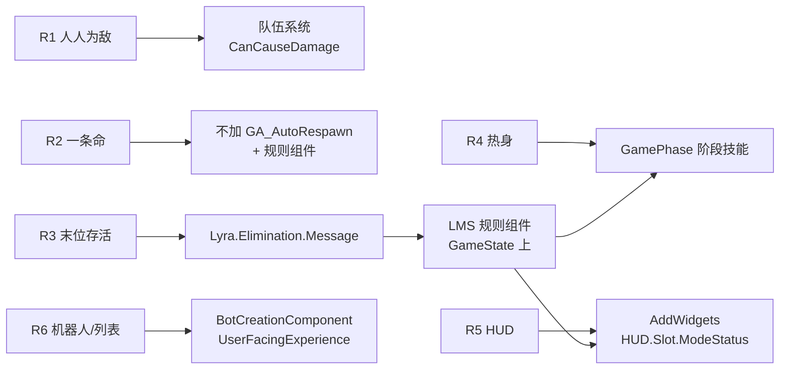
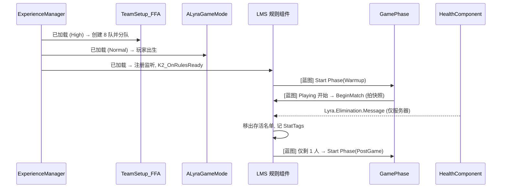

# 第 22 章　综合项目：从零做一个“最后存活者”模式

## 一个问题：策划发来一句话

周一早上，策划在群里发了一句话：

> “做个‘最后存活者’模式：所有人互相为敌，每人只有一条命，死了就出局，最后活着的人赢。开局先等几秒热身，结束时要公布赢家。机器人要能凑数，前端列表里要能选到它。”

如果是在前面章节之前，你大概会这样开工：复制 `B_ShooterGame_Elimination`，把计分组件里的胜利条件改成“只剩一人”，把 GameState 里的队伍数改多一点，再把 `GA_AutoRespawn` 删掉。能跑，但你心里没底：队伍为什么要改？删掉复活技能之后，晚进来的玩家怎么办？“谁死了”这个信息到底该从哪里拿？热身是谁在控制？

这一章是一次完整的“设计—搭建—验证”练习。我们不会再讲新的 Lyra 系统——它们都在前 21 章里讲过了。这一章要做的是把它们**拼起来**：先把需求逐条映射到已有系统，讨论每个选择以及被否决的方案，再动手写一个 C++ 的 GameState 组件、配几份数据资产、搭一个 HUD 控件，最后在 PIE 里用机器人和多个客户端验证。

写代码之前先做设计，是因为 Lyra 的特点是“每个需求都有至少两个能跑的做法”。选错了不会立刻报错，而是在你加第二个模式、第一次测多人、或者第一次有人中途加入时才出问题。

## 读完本章你能……

- 把一个新玩法需求拆成“Experience 数据 + GameFeature Action + 一个规则组件”，并说出每一块该放在哪个插件、哪个 Actor 上；
- 解释“没有队伍就打不掉血”这条规则出自哪段代码，并给出至少两种让自由混战成立的做法；
- 说出实现“只有一条命”的三种位置，以及为什么本章选择了其中最不起眼的一种；
- 写出一个只用已验证 API 的 GameState 组件：等待 Experience、监听 `Lyra.Elimination.Message`、维护存活名单、复制状态给 HUD；
- 在 PIE 里用主机服务器 + 客户端 + 机器人验证这个模式，并知道哪些现象应该在服务器上检查、哪些在客户端上检查。

## 需要先知道的概念

本章用到的 UE 和 Lyra 概念全部在前面讲过，这里只列回顾链接：Experience、ActionSet 与三档加载回调见[第 6 章](06-Experience.md)；`Add Components` / `Add Widgets` 见[第 7 章](07-ModularGameplay.md)；PawnData 与 Pawn 组装见[第 8 章](08-PawnAssembly.md)；伤害、死亡与重生见[第 12 章](12-DamageAndDeath.md)；队伍子系统与 GameplayMessageSubsystem 见[第 15 章](15-TeamsInteractionMessages.md)；HUD 槽位见[第 19 章](19-HUDAndLoading.md)；复制、OnRep 与监听服务器的差异见[第 3 章](03-Networking.md)。

本章没有新概念，只有一个需要提前回顾的工具：`BlueprintImplementableEvent`（[第 1 章](01-UObject.md)讲过）。它是只声明、不实现的 C++ 函数：C++ 里像普通函数一样调用，实现写在蓝图子类的事件图里；蓝图没实现，调用就什么也不发生。本章用它做规则组件和蓝图之间的桥——规则想用 C++ 写，但“启动游戏阶段”这类动作必须在蓝图里做（原因在 2.5 节）。它像模板方法模式里留给子类的钩子，不同的是实现者是一份蓝图资产，而不是另一个 C++ 类。

## 1. 先把需求写清楚

策划的一句话需要拆成可检验的条目，否则后面没法对照：

1. **R1 自由混战**：每个玩家（含机器人）都是其他所有人的敌人，枪能打到任何人。
2. **R2 一条命**：死亡后不再复活。
3. **R3 最后存活者获胜**：除一人以外全部出局时，比赛结束，那个人是赢家；同时全灭则平局。
4. **R4 热身**：开局先有一段热身，热身期间不能互相伤害；热身结束后才开始计存活。
5. **R5 公布结果**：HUD 上能看到存活人数，比赛结束时显示赢家。
6. **R6 能凑数、能选到**：机器人补位；前端“玩法列表”里有这个模式。
7. **R7 不破坏别人**：不改 `ALyraGameMode` 的行为，不影响团队死斗、占点等已有模式。

R7 是工程约束，也是 CLAUDE.md 里“不要新建 GameMode 子类”的来源，它决定了很多选择。

## 2. 设计讨论：每个需求落在哪个系统上

先看全局。下图把七条需求映射到 Lyra 里已有的东西，右边没有“新建 GameMode”：



### 2.1 第一个决定：不新建 GameMode

最直观的做法是写一个 `ALastManStandingGameMode : ALyraGameMode`，在里面重写 `ControllerCanRestart`、`HandleMatchHasEnded` 之类的函数。很多 UE 教程里“玩法规则写在 GameMode”就是这个习惯。

在 Lyra 里这条路走不通，原因不只是“规范不推荐”。回忆第 6 章的启动时序：**GameMode 是地图加载后第一个被创建的东西，Experience 是由 GameMode 自己去选的**。也就是说，Experience 无法反过来决定“用哪个 GameMode”。全局默认的 GameMode 是 `B_LyraGameMode`（`DefaultEngine.ini` 里的 `GlobalDefaultGameMode`），所有 Experience 共用它。想让某个模式用自己的 GameMode，只能在地图的 World Settings 里覆盖——这就回到了“玩法和地图 1:1 绑定”的老问题。

另一个原因是依赖方向。核心 C++（`Source/LyraGame`）不得引用 GameFeature 插件的内容。我们的规则放在 `LastManStanding` 插件里，`ALyraGameMode` 看不到它；反过来，插件里的类可以随意依赖 `LyraGame`。所以规则应该写成插件里的 **GameState 组件**，由 Experience 的 `Add Components` 在需要时挂上去——和 `B_TeamDeathMatchScoring` 同一个思路。

代价是：GameMode 里“出生/重启”的钩子（`ControllerCanRestart` 等）我们摸不到，这会在 2.3 节变成实际问题。

### 2.2 人人为敌：队伍系统怎么办

R1 看起来最简单——“不要队伍”就行了。我们先看看这个想法会发生什么。

最直观的做法：**Experience 里不加 `ULyraTeamCreationComponent`**，没有队伍，也就没有“同队不能互伤”的限制。

打开 `ULyraTeamSubsystem::CanCauseDamage`，它是伤害执行（`ULyraDamageExecution`）和命中标记都会调用的那个判定：

```cpp
// 简化自 Source/LyraGame/Teams/LyraTeamSubsystem.cpp 的 ULyraTeamSubsystem::CanCauseDamage
bool ULyraTeamSubsystem::CanCauseDamage(const UObject* Instigator, const UObject* Target, bool bAllowDamageToSelf) const
{
    if (bAllowDamageToSelf)
    {
        // 同一个对象，或同一个 PlayerState：自伤允许
        if ((Instigator == Target) || (FindPlayerStateFromActor(Cast<AActor>(Instigator)) == FindPlayerStateFromActor(Cast<AActor>(Target))))
        {
            return true;
        }
    }

    int32 InstigatorTeamId, TargetTeamId;
    const ELyraTeamComparison Relationship = CompareTeams(Instigator, Target, InstigatorTeamId, TargetTeamId);
    if (Relationship == ELyraTeamComparison::DifferentTeams)
    {
        return true;                                   // 不同队：可以伤害
    }
    else if ((Relationship == ELyraTeamComparison::InvalidArgument) && (InstigatorTeamId != INDEX_NONE))
    {
        // 目标没队伍：只要攻击者有队伍、目标有 ASC，就允许（靶子的临时逻辑）
        return UAbilitySystemGlobals::GetAbilitySystemComponentFromActor(Cast<const AActor>(Target)) != nullptr;
    }

    return false;                                      // 其余一律不允许，包括“同队”和“攻击者没队伍”
}
```

读这段代码要抓住三点：只有 `DifferentTeams` 会放行；“攻击者没有队伍”落到最后的 `return false`；而且**没有任何“友军伤害开关”**。所以“不加队伍组件”的结果不是“人人为敌”，而是“谁也打不掉谁的血”——子弹照样命中、命中特效照常播放，但预测的命中标记不会按“有效命中”显示（它走的也是这个函数），`DamageExecution` 里的队伍系数是 0。这是个会让人困惑半小时的坑，实验 1 会让你亲眼看一次。

于是有两条路：

- **方案 A：每人一队。** 用 `ULyraTeamCreationComponent`，把 `TeamsToCreate` 配成 N 个队伍（N 不小于最大人数）。`GetLeastPopulatedTeamID` 选“人数最少、同人数取编号最小”的队，所以前 N 个玩家自然各占一队。不需要写 C++。
- **方案 B：改规则。** 要么继承 `ULyraTeamCreationComponent`、重写 protected virtual 的 `ServerChooseTeamForPlayer`；要么在 `CanCauseDamage` 里加一个“自由混战”标志，对 `OnSameTeam` 放行。后者是最干净的长期做法，但要改核心代码，而且影响所有模式的判定。

本章选 **方案 A**：零 C++、零核心改动、满足 R7；机器人也走同一条 `OnGameModePlayerInitialized` 分队路径，所以机器人互相为敌也自然成立（`ALyraPlayerBotController::GetTeamAttitudeTowards` 里“队伍不同即敌对”）。

方案 A 的代价要记下来：

1. 队伍数量就是人数上限。玩家数超过队伍数后，多出来的人会和别人同队，彼此打不动。所以前端列表里的 `MaxPlayerCount` 要小于等于队伍数。
2. `GetLeastPopulatedTeamID` 里有一句 `check(TeamMemberCounts.Contains(PlayerTeamID))`，要求玩家的队伍编号必须在 `TeamsToCreate` 里——别用 `SetTeam` 作弊命令把人设到不存在的队伍上。
3. 队伍的显示资产（`ULyraTeamDisplayAsset`）决定队伍颜色。`TeamsToCreate` 的值允许为空，也允许多个队伍共用同一份资产。但共用颜色意味着“敌人和朋友看起来一样”。第一版先接受它，后面再补颜色。

顺便提一个值得欣赏的细节：`ULyraTeamCreationComponent` 在 `BeginPlay` 里用的是 `CallOrRegister_OnExperienceLoaded_HighPriority`。第 6 章说过，GameMode 让玩家出生挂在 Normal 档——队伍组件挂在更早的 High 档，所以玩家出生那一刻队伍已经存在、玩家已经分好队。这就是“三档优先级”的真实用途。

### 2.3 一条命：“不能复活”放在哪里

R2 是本章最值得讨论的一条。“让死亡的人不能再生成 Pawn”，在 Lyra 里至少有三个位置可以做。

**位置一：重写 `ALyraGameMode::ControllerCanRestart`。** 这是 GameMode 里为玩家和机器人统一提供的“能不能重启”的虚函数：

```cpp
// 简化自 Source/LyraGame/GameModes/LyraGameMode.cpp 的 ALyraGameMode::ControllerCanRestart
bool ALyraGameMode::ControllerCanRestart(AController* Controller)
{
    // ……玩家走 Super::PlayerCanRestart_Implementation，机器人做同等的空指针检查……

    // 再问一遍 GameState 上的出生管理组件
    if (ULyraPlayerSpawningManagerComponent* PlayerSpawningComponent = GameState->FindComponentByClass<ULyraPlayerSpawningManagerComponent>())
    {
        return PlayerSpawningComponent->ControllerCanRestart(Controller);
    }
    return true;
}
```

它很诱人：`PlayerCanRestart_Implementation` 会调用它，`ALyraPlayerBotController::ServerRestartController` 也会调用它，等于“一票否决”。但它有两个问题。第一，要重写它必须有 GameMode 子类，而 2.1 节已经说了为什么不行。第二，它并不覆盖所有路径：`ULyraBotCreationComponent::SpawnOneBot` 直接调的是 `GameMode->RestartPlayer(NewController)`，不经过它。

**位置二：在出生管理组件里拦。** 上面代码最后一行把问题转给了 `ULyraPlayerSpawningManagerComponent::ControllerCanRestart`——注释写得很明白，这是“让每个 Experience 自定义自己的重生规则”的扩展点。看看它现在的样子：

```cpp
// 简化自 Source/LyraGame/Player/LyraPlayerSpawningManagerComponent.cpp
bool ULyraPlayerSpawningManagerComponent::ControllerCanRestart(AController* Player)
{
    bool bCanRestart = true;

    // TODO Can they restart?

    return bCanRestart;
}
```

它是个 TODO，而且头文件里它是 **private、非 virtual**，只通过 `friend class ALyraGameMode` 暴露给 GameMode。也就是说，设计意图是对的，但原版没有把口子真正开出来。要走这条路，你得改核心：把它改成 `protected virtual`，再让规则组件继承 `ULyraPlayerSpawningManagerComponent` 并重写。这个改动很小，是三种做法里“正确位置”最对的一个——但它要求改核心。

**位置三：压根不给复活能力。** 看 Lyra 自己是怎么复活的（[第 12 章第八节](12-DamageAndDeath.md)讲过完整链路）：`GA_AutoRespawn` 是 ShooterCore 里的**蓝图**被动技能（`Ability.Type.Passive.AutoRespawn`，激活策略 `OnSpawn` 且不会被死亡取消），它在角色出生时监听死亡事件，倒计时结束后在权威端调用 `ALyraGameMode::RequestPlayerRestartNextFrame(Controller, true)`。这个技能放在 `AbilitySet_Elimination` 里（同在其中的还有 `GA_ShowLeaderboard_TDM`），由团队死斗 Experience 的 `Add Abilities` 授予给 `ALyraPlayerState`。**团队死斗“会复活”，是因为这个 Experience 选择了授予复活技能，而不是 GameMode 默认会复活**。GameMode 本身在 Pawn 死后什么都不会做（`FailedToRestartPlayer` 只处理“出生失败”的重试）。

顺便澄清一个常见误会：`RequestPlayerRestartNextFrame(Controller, bForceReset)` 里 `bForceReset` 为真时调用的是 `Controller->Reset()`，而引擎的 `APlayerController::Reset` 只做 `PawnPendingDestroy` + `UnPossess`，再切到旁观状态，**不会**去调 `ALyraCharacter::Reset`（后者只由强制重置技能 `ULyraGameplayAbility_Reset` 调用）。所以“重生”和“Pawn 自己的 Reset”是两条不相干的路。

所以最小改动的做法是：我们的 Experience **不引用 `AbilitySet_Elimination`**，也就没有人去调 `RequestPlayerRestartNextFrame`，死了的玩家自然留在无 Pawn 状态。

三种做法放在一起：

| 位置 | 改核心？ | 能否挡住迟到玩家 | 评价 |
|---|---|---|---|
| 重写 `ALyraGameMode::ControllerCanRestart` | 要子类 GameMode | 能 | 违背 R7，不选 |
| 出生管理组件的 `ControllerCanRestart` | 要把它改成 protected virtual | 能 | 位置最对，列为进阶扩展 |
| 不授予 `GA_AutoRespawn` | 否 | 不能 | 本章选择：先让模式跑起来 |

选位置三有一个**必须直说的缺陷**：它只是“没人复活你”，并没有“禁止你出生”。一个在比赛进行中才连进来的玩家，会走正常的 `HandleStartingNewPlayer` 出生流程，带着满血进场。我们的规则组件只统计“比赛开始那一刻”的名单，迟到者既不会被算作存活者、也赢不了——但他们的枪还是能打人，这对其他玩家是不公平的。完整的解法是位置二：Lyra 的 `OnExperienceLoaded` 和引擎默认的 `HandleStartingNewPlayer` 都会先问 `PlayerCanRestart`，所以在那里拦住就能挡住迟到者。本章把它放到“扩展思路”。

这里体现了 Lyra 的一个典型取舍：**“默认不做某事”往往比“禁止某事”更容易落地**。因为数据驱动的 Experience 能决定“加什么”，却不能决定“核心代码里已有的什么不要做”。

### 2.4 怎么知道“谁死了”

规则组件的核心输入是“有人被淘汰了”。有几种拿法。

最直观的做法：每帧或每秒遍历所有玩家，检查 Pawn 是否存在、血量是否为零。这能工作，但要自己解决“Pawn 死后被销毁、PlayerState 还在”的对应关系，而且没法知道**是谁杀的**。

第二种：给每个 Pawn 的 `ULyraHealthComponent` 绑定 `OnDeathStarted`。Pawn 会换（重生、新玩家、机器人），要不停绑定解绑；`DeathState` 是复制的，客户端也会触发。第三种：监听 `GameplayEvent.Death`——它是发给“死者自己的 ASC”、用来触发死亡技能的事件，不是给外部系统订阅的广播。

Lyra 其实已经准备好了专门给外部观察的广播。看 `ULyraHealthComponent::HandleOutOfHealth` 的后半段：

```cpp
// 简化自 Source/LyraGame/Character/LyraHealthComponent.cpp 的 ULyraHealthComponent::HandleOutOfHealth
#if WITH_SERVER_CODE
    // ……先发 GameplayEvent.Death 触发死亡技能……

    // 再发一条标准化的“动词消息”，让别的系统观察
    FLyraVerbMessage Message;
    Message.Verb = TAG_Lyra_Elimination_Message;        // "Lyra.Elimination.Message"
    Message.Instigator = DamageInstigator;               // 击杀者（伤害来源的 Owner）
    Message.InstigatorTags = *DamageEffectSpec->CapturedSourceTags.GetAggregatedTags();
    Message.Target = ULyraVerbMessageHelpers::GetPlayerStateFromObject(AbilitySystemComponent->GetAvatarActor());
    Message.TargetTags = *DamageEffectSpec->CapturedTargetTags.GetAggregatedTags();

    UGameplayMessageSubsystem& MessageSystem = UGameplayMessageSubsystem::Get(GetWorld());
    MessageSystem.BroadcastMessage(Message.Verb, Message);
#endif
```

这段有三个对规则组件至关重要的事实。第一，它整个包在 `WITH_SERVER_CODE` 里，**只在服务器上广播**。这正是我们想要的：规则只在权威端判定，客户端只接收复制的结果。第二，`Target` 是死者的 `PlayerState`（不是 Pawn——Pawn 马上会被销毁，PlayerState 才是稳定的身份）；`Instigator` 是伤害上下文里的“原始施加者”。由技能产生的伤害里，它是技能所属的 `PlayerState`（`ULyraGameplayAbility::MakeEffectContext` 里 `Instigator = ActorInfo->OwnerActor`）。第三，自杀、掉出世界这类伤害是 `ASC->MakeEffectContext()` 产生的，`Instigator` 也是死者自己的 PlayerState，所以“`Instigator == Target`”就表示自己淘汰了自己。

为了不依赖这些细节，我们的代码统一用 `ULyraVerbMessageHelpers::GetPlayerStateFromObject` 把 `Instigator` 和 `Target` 都转成 PlayerState——它同时接受 PlayerController、PlayerState、Pawn。

源码里还有两个 `@TODO` 值得知道：消息里的 `ContextTags` 没填，也没判断“是否敌方击杀/自杀/队友击杀”。这个模式不需要，但如果你要区分，得自己比较。

### 2.5 热身与结算：用 GamePhase，还是自己写计时器

R4 要求热身。最直观的做法是在规则组件里自己写一个计时器，到时间就开始比赛。这没错，但热身阶段还有别的事要做：禁止互相伤害、赛后禁止技能输入、最好有倒计时消息。这些 ShooterCore 里已经有现成的内容：`/ShooterCore/Experiences/Phases/` 下的 `Phase_Warmup`、`Phase_Playing`、`Phase_PostGame` 三个阶段技能，以及同目录的 `GE_PregameLobby`、`GE_DamageImmunity_FromGameMode`、`GE_BlockAbilityInput`。

回忆一下 GamePhase 的机制：阶段本身是 `ULyraGamePhaseAbility` 子类，由 `ULyraGamePhaseSubsystem::StartPhase` 在 **GameState 的 ASC** 上激活；Tag 层级决定嵌套关系，兄弟阶段会互相取消。

这里有一个工程细节会迫使我们用到上一节提到的“桥”。`ULyraGamePhaseSubsystem` 和 `ULyraGamePhaseAbility` 在头文件里是裸的 `UCLASS()`，**没有 `LYRAGAME_API` 导出**（`StartPhase` 本身也不是蓝图可调用，蓝图用的是它的 `K2_StartPhase`，显示名 “Start Phase”）。按 UE 的规则，其他模块直接调用它们会遇到链接错误；ShooterCore 的计分组件是蓝图，所以没遇到问题。（这类“漏了导出宏”的类在 [附录 A3](A3-CodeMap.md) 里有清单。）

于是分工变成：**C++ 规则组件管“规则和状态”，蓝图子类管“启动哪个阶段”**。规则组件在需要时调用 `BlueprintImplementableEvent`；蓝图子类的事件图里，用 `Get World Subsystem → Start Phase` 去开阶段。反方向，当 Playing 阶段开始时，蓝图用 `When Phase Starts or Is Active` 通知 C++ 的 `BeginMatch()`。

好消息是，ShooterCore 的三个阶段蓝图已经替我们把脏活做好了：

- **`Phase_Warmup`**（默认 `WaitForPlayersDuration = 30` 秒，`CountdownDuration = 3` 秒）：激活时先调用 `ULyraDevelopmentStatics::ShouldSkipDirectlyToGameplay`——若返回 true，直接调用 `StartPhase(Phase_Playing)`；否则通过 `ULyraGlobalAbilitySystem::ApplyEffectToAll` 给全员施加 `GE_PregameLobby`（授予 `Gameplay.DamageImmunity`，只免伤不锁输入，玩家热身时能跑能开枪），先等待 `WaitForPlayersDuration - CountdownDuration` 秒，再每秒通过 `MulticastMessageToClients` + 本地 `BroadcastMessage` 发出一条 `ShooterGame.GamePhase.MatchBeginCountdown`（`FLyraVerbMessage`，`Magnitude` 为剩余秒数），倒计时结束后移除 `GE_PregameLobby` 并调用 `StartPhase(Phase_Playing)`。
- **`Phase_PostGame`**（默认 `NewGameTime = 10` 秒）：激活时先对全员施加 `GE_DamageImmunity_FromGameMode`，延迟 `NewGameTime` 秒后再施加 `GE_BlockAbilityInput`（授予 `Gameplay.AbilityInputBlocked`），等下一帧自动调用 `ULyraSystemStatics::PlayNextGame` 重开下一局。

团队死斗的 `B_TeamDeathMatchScoring` 正是在开局启动 `Phase_Warmup`、结束时启动 `Phase_PostGame`，我们的规则组件走同一条路。这也解释了 `ULyraDeveloperSettings::bTestFullGameFlowInPIE` 的用途：`ShouldSkipDirectlyToGameplay` 在编辑器里当 `bTestFullGameFlowInPIE == false`（默认）时返回 true，因此 `Phase_Warmup` 在单人快速冒烟测试时会自动跳过等待、直入 `Phase_Playing`；想走完整热身（或多客户端 PIE 等所有人进场后再拍快照），在开发者设置里勾选 `bTestFullGameFlowInPIE` 即可。

### 2.6 HUD：用复制的状态，而不是消息

R5 要在 HUD 上显示存活人数和赢家。最直观的做法是规则组件在状态变化时广播一条消息，HUD 订阅它。Lyra 确实有现成的通道：`ALyraGameState::MulticastMessageToClients`。

但看一眼它的实现：

```cpp
// 简化自 Source/LyraGame/GameModes/LyraGameState.cpp 的 ALyraGameState::MulticastMessageToClients_Implementation
void ALyraGameState::MulticastMessageToClients_Implementation(const FLyraVerbMessage Message)
{
    if (GetNetMode() == NM_Client)       // 只有“纯客户端”才广播到本地消息子系统
    {
        UGameplayMessageSubsystem::Get(this).BroadcastMessage(Message.Verb, Message);
    }
}
```

它只在 `NM_Client` 上广播。监听服务器的主机玩家（既是服务器又是玩家）不会收到。而且它是 Unreliable 多播，丢了就丢了——适合“击杀播报”，不适合“当前存活人数”这种状态。

状态应该用**被复制的属性**表达：`MatchState`、`AliveCount`、`Winner` 三个属性放在规则组件上，每个带 OnRep 回调，回调里广播一个蓝图可绑定的委托。HUD 控件启动时读一次当前值，再绑定委托。晚加入的客户端不需要任何特殊处理，复制本身就会把当前值送过去——这和第 6 章 `CurrentExperience` 的道理一样。

有一个必须记住的细节：OnRep 回调只在**客户端**触发，监听服务器的主机上服务器端修改属性时不会调。所以服务器改状态后要手动调一次同名的 OnRep 函数，让主机玩家的 HUD 也刷新。Lyra 的 `ULyraQuickBarComponent` 就是这么做的（`AddItemToSlot` 里手动调 `OnRep_Slots`）。

### 2.7 旁观：Lyra 里没有这一块

玩家出局之后看什么？**Lyra 原版没有旁观系统**。源码里与 spectator 相关的只有零星几处：团队创建把纯旁观者的队伍清成 `NoTeam`，出生点选择给旁观者随机点，`ALyraPlayerState` 为旁观预留了一个由服务器写入、会复制的视角旋转（`GetReplicatedViewRotation`，由 `ALyraPlayerController` 在更新视角时写入）；没有“出局后跟随存活玩家”的逻辑。玩家死后 Pawn 被销毁，视角停留在死亡位置附近。第一版接受这个效果，旁观相机放进“扩展思路”。

### 2.8 机器人与前端列表

机器人不用新写：`B_ShooterBotSpawner` 是 `ULyraBotCreationComponent` 的蓝图子类，`NumBotsToCreate` 默认 3，控制器是 `B_AI_Controller_LyraShooter`。在我们的 Experience 里用 `Add Components` 把它挂到 `ALyraGameState`（仅服务器）即可。它在 `LowPriority` 档创建机器人，此时队伍组件（High）和我们的规则组件（Normal）都已就位。数量可以用 URL 的 `?NumBots=N` 临时覆盖。

前端列表靠 `ULyraUserFacingExperienceDefinition`：一份资产就是前端的一张“牌”，含地图、ExperienceID、标题、人数上限。主菜单会枚举所有 `bShowInFrontEnd` 的资产，不需要改前端蓝图。

### 2.9 代码放在哪个插件

最后一个决定：C++ 规则组件放哪里。塞进 `ShooterCore` 不用新建插件，但你是在改别人的插件（上游合并会冲突），`ShooterCoreRuntime` 出问题还会影响所有 Shooter 模式。新建 `LastManStanding` 插件多几步初始化，但边界清晰，卸载它不影响任何别的东西，依赖方向 `LastManStanding → ShooterCore → LyraGame` 单向无环——ShooterMaps 就是这种结构。选后者。

## 3. 动手搭建

整个模式由六块东西拼成：

```
LastManStanding 插件 (GameFeature, Registered)
 ├─ C++:  ULMSRulesComponent          规则 + 复制状态        (GameState 组件)
 ├─ BP:   B_LMS_Rules                  C++ 组件的蓝图子类：启动阶段   [蓝图]
 ├─ BP:   B_TeamSetup_FFA              ULyraTeamCreationComponent 子类 [蓝图]
 ├─ BP:   W_LMS_Status                 HUD 控件                       [蓝图]
 ├─ DA:   B_LastManStanding            Experience                    [蓝图类]
 └─ DA:   DA_LMS_Expanse               UserFacingExperience
```

下面的代码是**本章新写的**，不是 Lyra 原版；其中每个 Lyra / 引擎 API 都已在源码里核对过。“[蓝图]”标记的步骤必须在编辑器里完成，名称以编辑器所见为准。

### 步骤 0：新建插件骨架

推荐先在编辑器里走 **编辑 → 插件 → 添加 → Game Feature (with C++)**，插件名填 `LastManStanding`——向导会在 `Plugins/GameFeatures/LastManStanding/` 下自动生成模块骨架以及必需的 `Content/LastManStanding.uasset`（`UGameFeatureData` 数据资产；如果纯靠手工新建空文件夹，没有这份二进制资产，步骤 6 就无处配置扫描规则）。生成后打开 `LastManStanding.uplugin`，对照 `ShooterMaps.uplugin` 检查并补齐以下关键字段：

```json
"ExplicitlyLoaded": true,
"EnabledByDefault": false,
"BuiltInInitialFeatureState": "Registered",
"Modules": [ { "Name": "LastManStandingRuntime", "Type": "Runtime", "LoadingPhase": "Default" } ],
"Plugins": [ { "Name": "ShooterCore", "Enabled": true }, { "Name": "ShooterMaps", "Enabled": true },
             { "Name": "GameplayAbilities", "Enabled": true }, { "Name": "ModularGameplay", "Enabled": true },
             { "Name": "GameplayMessageRouter", "Enabled": true } ]
```

目录结构照 ShooterCore 的样子：`Source/LastManStandingRuntime/` 下放 `LastManStandingRuntime.Build.cs`，头文件放 `Public/`，源文件放 `Private/`。模块的依赖列表参照 `ShooterCoreRuntime.Build.cs`（`PCHUsage` 等样板也照抄），并按本章头文件的实际暴露面调整：

```csharp
// LastManStandingRuntime.Build.cs 的依赖部分（参照 ShooterCoreRuntime.Build.cs 调整）
PublicDependencyModuleNames.AddRange(new string[]
{
    "Core", "CoreUObject", "Engine",
    "LyraGame", "ModularGameplay",
    "GameplayTags", "GameplayMessageRuntime"   // 公开头文件包含了 GameplayMessageSubsystem.h
});
PrivateDependencyModuleNames.AddRange(new string[]
{
    "GameplayTasks", "GameplayAbilities", "AIModule"
});
```

再写一个空的模块类（`IMPLEMENT_MODULE(FDefaultGameModuleImpl, LastManStandingRuntime)` 即可，需要 `#include "Modules/ModuleManager.h"`；或像 `ShooterCoreRuntimeModule.cpp` 那样写一个空壳），最后在 `LyraStarterGame.uproject` 的 `Plugins` 数组加一项 `{ "Name": "LastManStanding", "Enabled": true }`——现有 5 个 GameFeature 插件都是这么启用的。重新生成工程文件并编译。

这份依赖表里哪些是必须的？`LyraGame.Build.cs` 把 `GameplayTags`、`GameplayTasks`、`GameplayAbilities`、`AIModule`、`ModularGameplay` 都放在**公开**依赖里，所以它们的头文件和链接会沿着 `LyraGame` 传递给我们，写不写都能编过；写出来是为了依赖关系自描述，也和 `ShooterCoreRuntime` 保持一致。真正必须显式写的是 `GameplayMessageRuntime`：它在 `LyraGame` 里是**私有**依赖，不会传递，漏了会先报找不到 `GameFramework/GameplayMessageSubsystem.h`，补上头文件路径后还会在链接 `UGameplayMessageSubsystem` 时报未解析符号。同理，`LyraPlayerState.h` 里的队伍接口会间接包含 `GenericTeamAgentInterface.h`（`AIModule`），这是接核心类头文件时常见的“看似无关”的头文件依赖，好在 `LyraGame` 的公开依赖已经替我们带上了。

### 步骤 1：写规则组件（C++）

先看头文件。类很小：三个被复制的属性、两个蓝图可绑定的委托、一个给蓝图调用的 `BeginMatch`、两个给蓝图实现的事件。

```cpp
// LMSRulesComponent.h（本章新写）
#pragma once

#include "Components/GameStateComponent.h"
#include "Engine/TimerHandle.h"                      // FTimerHandle 成员
#include "GameFramework/GameplayMessageSubsystem.h"  // FGameplayMessageListenerHandle 成员（插件 GameplayMessageRuntime）

#include "LMSRulesComponent.generated.h"

class APlayerState;
class ULyraExperienceDefinition;
struct FLyraVerbMessage;

UENUM(BlueprintType)
enum class ELMSMatchState : uint8 { Warmup, InProgress, PostGame };

DECLARE_DYNAMIC_MULTICAST_DELEGATE_OneParam(FLMSMatchStateChanged, ELMSMatchState, NewState);
DECLARE_DYNAMIC_MULTICAST_DELEGATE_OneParam(FLMSAliveCountChanged, int32, NewAliveCount);

UCLASS(Blueprintable)
class LASTMANSTANDINGRUNTIME_API ULMSRulesComponent : public UGameStateComponent
{
    GENERATED_BODY()

public:
    ULMSRulesComponent(const FObjectInitializer& ObjectInitializer = FObjectInitializer::Get());

    //~UActorComponent interface
    virtual void BeginPlay() override;
    virtual void EndPlay(const EEndPlayReason::Type EndPlayReason) override;
    virtual void GetLifetimeReplicatedProps(TArray<FLifetimeProperty>& OutLifetimeProps) const override;

    /** 由蓝图在“Playing 阶段开始”时调用：下一帧给存活者拍快照，开始判定胜负（仅服务器） */
    UFUNCTION(BlueprintCallable, BlueprintAuthorityOnly, Category="LMS")
    void BeginMatch();

    UFUNCTION(BlueprintPure, Category="LMS") ELMSMatchState GetMatchState() const { return MatchState; }
    UFUNCTION(BlueprintPure, Category="LMS") int32 GetAliveCount() const { return AliveCount; }
    UFUNCTION(BlueprintPure, Category="LMS") APlayerState* GetWinner() const { return Winner; }

    UPROPERTY(BlueprintAssignable, Category="LMS") FLMSMatchStateChanged OnMatchStateChanged;
    UPROPERTY(BlueprintAssignable, Category="LMS") FLMSAliveCountChanged OnAliveCountChanged;

    // ……protected / private 部分见下一段
};
```

接着是留给蓝图实现的事件和私有状态：

```cpp
// LMSRulesComponent.h（续）
protected:
    /** Experience 加载完成、规则就绪。蓝图在这里启动热身阶段（仅服务器） */
    UFUNCTION(BlueprintImplementableEvent, Category="LMS", meta=(DisplayName="On Rules Ready"))
    void K2_OnRulesReady();

    /** 比赛结束（仅服务器）。WinnerPlayer 为空表示平局 */
    UFUNCTION(BlueprintImplementableEvent, Category="LMS", meta=(DisplayName="On Match Ended"))
    void K2_OnMatchEnded(APlayerState* WinnerPlayer);

    /** 少于这个人数开局时，比赛不会自动结束（防止单人测试一开局就“获胜”） */
    UPROPERTY(EditDefaultsOnly, Category="LMS")
    int32 MinPlayersToEndMatch = 2;

private:
    void HandleExperienceLoaded(const ULyraExperienceDefinition* Experience);
    void StartMatch();
    void HandleEliminationMessage(FGameplayTag Channel, const FLyraVerbMessage& Message);
    void PruneAndCheckForWinner();
    void FinishMatch(APlayerState* WinnerPlayer);
    void SetMatchState(ELMSMatchState NewState);
    void SetAliveCount(int32 NewCount);

    UFUNCTION() void OnRep_MatchState();
    UFUNCTION() void OnRep_AliveCount();
    UFUNCTION() void OnRep_Winner();

    UPROPERTY(ReplicatedUsing=OnRep_MatchState) ELMSMatchState MatchState = ELMSMatchState::Warmup;
    UPROPERTY(ReplicatedUsing=OnRep_AliveCount) int32 AliveCount = 0;
    UPROPERTY(ReplicatedUsing=OnRep_Winner) TObjectPtr<APlayerState> Winner;

    // 以下仅服务器使用，不复制
    UPROPERTY(Transient) TArray<TObjectPtr<APlayerState>> AlivePlayers;
    int32 StartingPlayerCount = 0;
    FGameplayMessageListenerHandle EliminationListener;
    FTimerHandle PruneTimer;
};
```

几个设计要点。`MinPlayersToEndMatch` 是为了你自己测试：单人启动、没有机器人时，开局“只剩一个人”会立刻判定获胜；有了这个门槛，开局人数不足时比赛不会自己结束。`AlivePlayers` 存的是 PlayerState，不是 Pawn——Pawn 死了会被销毁，而 PlayerState 还在。`LASTMANSTANDINGRUNTIME_API` 让蓝图子类和别的模块能链接到这个类。

实现文件分三段看。第一段是构造、复制和 Experience 钩子：

```cpp
// LMSRulesComponent.cpp（本章新写）—— 第 1 段：构造与启动
#include "LMSRulesComponent.h"

#include "Engine/World.h"
#include "GameFramework/GameStateBase.h"
#include "GameFramework/PlayerState.h"
#include "GameModes/LyraExperienceManagerComponent.h"
#include "LyraLogChannels.h"                 // GetClientServerContextString
#include "Messages/LyraVerbMessage.h"
#include "Messages/LyraVerbMessageHelpers.h"
#include "NativeGameplayTags.h"
#include "Net/UnrealNetwork.h"
#include "Player/LyraPlayerState.h"
#include "TimerManager.h"

#include UE_INLINE_GENERATED_CPP_BY_NAME(LMSRulesComponent)

DEFINE_LOG_CATEGORY_STATIC(LogLMS, Log, All);

UE_DEFINE_GAMEPLAY_TAG_STATIC(TAG_Lyra_Elimination_Message, "Lyra.Elimination.Message");
UE_DEFINE_GAMEPLAY_TAG_STATIC(TAG_LMS_Stat_Kills,      "LMS.Stat.Kills");
UE_DEFINE_GAMEPLAY_TAG_STATIC(TAG_LMS_Stat_Eliminated, "LMS.Stat.Eliminated");
UE_DEFINE_GAMEPLAY_TAG_STATIC(TAG_LMS_Stat_Won,        "LMS.Stat.Won");

ULMSRulesComponent::ULMSRulesComponent(const FObjectInitializer& ObjectInitializer)
    : Super(ObjectInitializer)
{
    SetIsReplicatedByDefault(true);     // 组件要复制，必须显式打开
}

void ULMSRulesComponent::GetLifetimeReplicatedProps(TArray<FLifetimeProperty>& OutLifetimeProps) const
{
    Super::GetLifetimeReplicatedProps(OutLifetimeProps);
    DOREPLIFETIME(ThisClass, MatchState);
    DOREPLIFETIME(ThisClass, AliveCount);
    DOREPLIFETIME(ThisClass, Winner);
}

void ULMSRulesComponent::BeginPlay()
{
    Super::BeginPlay();

    // 规则只在权威端运行；客户端只需要复制下来的状态
    if (!HasAuthority()) { return; }

    // 和 ULyraBotCreationComponent::BeginPlay 同一个模式：Experience 没加载完不能做事
    AGameStateBase* GameState = GetGameStateChecked<AGameStateBase>();
    ULyraExperienceManagerComponent* ExperienceComponent = GameState->FindComponentByClass<ULyraExperienceManagerComponent>();
    check(ExperienceComponent);
    ExperienceComponent->CallOrRegister_OnExperienceLoaded(
        FOnLyraExperienceLoaded::FDelegate::CreateUObject(this, &ThisClass::HandleExperienceLoaded));
}

void ULMSRulesComponent::HandleExperienceLoaded(const ULyraExperienceDefinition* Experience)
{
    // 淘汰消息只在服务器广播，所以只需要在服务器注册监听
    UGameplayMessageSubsystem& Messages = UGameplayMessageSubsystem::Get(this);
    EliminationListener = Messages.RegisterListener(TAG_Lyra_Elimination_Message, this, &ThisClass::HandleEliminationMessage);

    SetMatchState(ELMSMatchState::Warmup);
    UE_LOG(LogLMS, Log, TEXT("LMS: rules ready (%s)"), *GetClientServerContextString(this));
    K2_OnRulesReady();                  // 交给蓝图去启动热身阶段
}
```

这一段完全沿用了第 6 章的模式：`CallOrRegister_OnExperienceLoaded` 保证不管我们的组件什么时候出现，都恰好收到一次“已加载”通知。`RegisterListener(Channel, this, &Member)` 的写法和 ShooterCore 的 `UAssistProcessor::StartListening` 完全一致；回调参数 `(FGameplayTag, const FLyraVerbMessage&)` 的结构体类型必须和广播方一致，类型不一致只会在日志里报错并且收不到消息。

第二段是核心：处理淘汰消息、清点存活者、结束比赛。

```cpp
// LMSRulesComponent.cpp —— 第 2 段：开赛
void ULMSRulesComponent::BeginMatch()
{
    if (!HasAuthority() || MatchState != ELMSMatchState::Warmup) { return; }

    // 晚一帧再拍快照：PIE 跳过热身时，Playing 阶段可能和机器人创建发生在同一帧
    // （机器人在 Low 档的回调里同步创建，下一帧它们一定已经就位）
    GetWorld()->GetTimerManager().SetTimerForNextTick(this, &ThisClass::StartMatch);
}

void ULMSRulesComponent::StartMatch()
{
    if (MatchState != ELMSMatchState::Warmup) { return; }   // BeginMatch 被重复调用时只生效一次

    // 给“开赛这一刻”的玩家拍快照：旁观者、已断线的、没有 Pawn 的（比如热身时已经掉出地图）不参赛
    AlivePlayers.Reset();
    for (APlayerState* PS : GetGameStateChecked<AGameStateBase>()->PlayerArray)
    {
        if (PS && !PS->IsOnlyASpectator() && !PS->IsInactive() && PS->GetPawn() != nullptr)
        {
            AlivePlayers.Add(PS);
        }
    }
    StartingPlayerCount = AlivePlayers.Num();
    SetAliveCount(StartingPlayerCount);
    SetMatchState(ELMSMatchState::InProgress);

    if (StartingPlayerCount < MinPlayersToEndMatch)
    {
        UE_LOG(LogLMS, Warning, TEXT("LMS: only %d player(s) at start; the match will not end automatically. Add bots."), StartingPlayerCount);
    }

    // 每秒清点一次，处理“中途退出”的玩家
    GetWorld()->GetTimerManager().SetTimer(PruneTimer, this, &ThisClass::PruneAndCheckForWinner, 1.0f, true);
}

```

`StartMatch` 拍下参赛名单。接下来是整个模式的心脏：处理淘汰消息。

```cpp
// LMSRulesComponent.cpp —— 第 2 段（续）
void ULMSRulesComponent::HandleEliminationMessage(FGameplayTag Channel, const FLyraVerbMessage& Message)
{
    if (MatchState != ELMSMatchState::InProgress) { return; }   // 热身/赛后的死亡不算

    APlayerState* Victim = ULyraVerbMessageHelpers::GetPlayerStateFromObject(Message.Target);
    APlayerState* Killer = ULyraVerbMessageHelpers::GetPlayerStateFromObject(Message.Instigator);

    if (Victim == nullptr || AlivePlayers.RemoveSingleSwap(Victim) == 0) { return; }

    // 统计写在 PlayerState 的 StatTags 上：它是 FastArray，会自动复制给所有客户端
    if (ALyraPlayerState* LyraVictim = Cast<ALyraPlayerState>(Victim))
    {
        LyraVictim->AddStatTagStack(TAG_LMS_Stat_Eliminated, 1);
    }
    if (Killer && Killer != Victim)                              // 自己淘汰自己不算击杀
    {
        if (ALyraPlayerState* LyraKiller = Cast<ALyraPlayerState>(Killer))
        {
            LyraKiller->AddStatTagStack(TAG_LMS_Stat_Kills, 1);
        }
    }

    SetAliveCount(AlivePlayers.Num());

    // 延迟一帧再判定胜负：同一帧内的多个淘汰（比如一颗手雷同时炸死两个人）都处理完，
    // 才能得出“0 人存活 = 平局”；立刻判定的话，先处理到的那个人会被误判成赢家
    GetWorld()->GetTimerManager().SetTimerForNextTick(this, &ThisClass::PruneAndCheckForWinner);
}

void ULMSRulesComponent::PruneAndCheckForWinner()
{
    if (MatchState != ELMSMatchState::InProgress) { return; }

    // 离开游戏的玩家：PlayerState 失效或被标记为 Inactive
    AlivePlayers.RemoveAll([](const TObjectPtr<APlayerState>& PS) { return PS == nullptr || PS->IsInactive(); });
    SetAliveCount(AlivePlayers.Num());

    if (StartingPlayerCount >= MinPlayersToEndMatch && AlivePlayers.Num() <= 1)
    {
        FinishMatch(AlivePlayers.Num() == 1 ? AlivePlayers[0].Get() : nullptr);   // 0 人存活 = 平局
    }
}
```

注意这里**没有任何直接检测血量或销毁 Pawn 的代码**。规则组件只知道“消息说谁被淘汰了”。这是 Lyra 消息系统的价值：计分、击杀播报（ShooterCore 的 `B_EliminationFeedRelay`）、助攻（`UAssistProcessor`）和我们的规则组件都订阅同一条消息，互相不知道对方存在。`AddStatTagStack` 是 `ALyraPlayerState` 上标了 `UE_API` 的公开函数（`StatTags` 是 FastArray，计分板、命中统计这类“按玩家累积的数字”都用它），所以不需要自己写复制。

第三段是收尾和 OnRep：

```cpp
// LMSRulesComponent.cpp —— 第 3 段：结束与复制
void ULMSRulesComponent::FinishMatch(APlayerState* WinnerPlayer)
{
    GetWorld()->GetTimerManager().ClearTimer(PruneTimer);

    if (ALyraPlayerState* LyraWinner = Cast<ALyraPlayerState>(WinnerPlayer))
    {
        LyraWinner->AddStatTagStack(TAG_LMS_Stat_Won, 1);
    }

    Winner = WinnerPlayer;                       // 先写 Winner 再切状态；两者同帧复制，OnRep 在整包属性落地之后才调用
    SetMatchState(ELMSMatchState::PostGame);
    OnRep_Winner();                              // 监听服务器的主机玩家不会收到 OnRep，手动调用
    K2_OnMatchEnded(WinnerPlayer);               // 交给蓝图去启动 PostGame 阶段
}

void ULMSRulesComponent::SetMatchState(ELMSMatchState NewState)
{
    if (MatchState != NewState)
    {
        MatchState = NewState;
        OnRep_MatchState();                      // 同上：服务器手动调
    }
}

void ULMSRulesComponent::SetAliveCount(int32 NewCount)
{
    if (AliveCount != NewCount)
    {
        AliveCount = NewCount;
        OnRep_AliveCount();
    }
}

void ULMSRulesComponent::OnRep_MatchState() { OnMatchStateChanged.Broadcast(MatchState); }
void ULMSRulesComponent::OnRep_AliveCount() { OnAliveCountChanged.Broadcast(AliveCount); }
void ULMSRulesComponent::OnRep_Winner()     { OnMatchStateChanged.Broadcast(MatchState); } // 若 Winner 对象引用晚一包到达，重发一次让 HUD 刷新赢家名

void ULMSRulesComponent::EndPlay(const EEndPlayReason::Type EndPlayReason)
{
    EliminationListener.Unregister();            // 消息子系统是 GameInstance 级的，必须自己注销
    if (UWorld* World = GetWorld()) { World->GetTimerManager().ClearTimer(PruneTimer); }
    Super::EndPlay(EndPlayReason);
}
```

最后一个细节是 `EndPlay` 里的注销：`UGameplayMessageSubsystem` 属于 GameInstance，换地图后监听还在。如果不注销，PlayNextGame 之后旧世界里的组件可能还会收到消息（组件被销毁时 `RegisterListener(Channel, Object, Func)` 版本里的弱引用会让回调变成空操作，但句柄本身还占着位置）。养成“谁注册谁注销”的习惯。

编译通过后，C++ 部分就完成了。注意我们**没有**在规则组件里写任何关于“怎么热身”“怎么复活”“怎么显示”的代码。

### 步骤 2：蓝图子类，把阶段接起来 [蓝图]

先复制 `/ShooterCore/Experiences/Phases/Phase_Warmup` 到本插件的 `Experiences/Phases/Phase_LMS_Warmup`，打开类默认值把 `WaitForPlayersDuration` 从 `30` 改成 `5`（保留 `CountdownDuration = 3`），不要直接改 ShooterCore 的原件以免影响团队死斗。

然后在 `LastManStanding` 插件内容里新建蓝图类 `B_LMS_Rules`，父类选 `LMSRulesComponent`。事件图里实现两个事件：

```
Event On Rules Ready                       // C++ 在 Experience 加载完成后调用
  → Get World Subsystem(LyraGamePhaseSubsystem) 存为局部变量 PhaseSubsystem
  → PhaseSubsystem.When Phase Starts or Is Active
       Phase Tag       = ShooterGame.GamePhase.Playing
       Match Type      = Exact Match
       When Phase Active (红色委托输入引脚) ──拖出新建 Custom Event──► Begin Match
  → (接上面的白色执行输出引脚 Then) PhaseSubsystem.Start Phase(Phase_LMS_Warmup)

Event On Match Ended (Winner Player)
  → Get World Subsystem(LyraGamePhaseSubsystem) → Start Phase(Phase_PostGame)
```

接线时注意两个细节：

1. **`When Phase Starts or Is Active` 不是异步 Latent 节点**——它的白色 `Then` 引脚在注册瞬间就会往下执行，真正的回调是左侧红色的委托输入引脚 **`When Phase Active`**（从该红引脚往左拖选 `Add Custom Event`，在自定义事件里调用 `Begin Match`）。
2. **先注册监听，再 `Start Phase(Phase_LMS_Warmup)`**：在单机快速测试（`bTestFullGameFlowInPIE = false`）时，`Phase_LMS_Warmup` 激活当场就会同步切入 `Phase_Playing`；先挂好监听可以保证无论同步跳过还是 5 秒热身结束都能稳稳接住（即便顺序反过来，`When Phase Starts or Is Active` 也会因“阶段已处于激活态”立即触发一次回调）。而赛后直接复用 ShooterCore 的 `Phase_PostGame` 即可，它会在 10 秒展示期结束后自动调用 `PlayNextGame` 重开下一局（`PlayNextGame` 同样未导出 `LYRAGAME_API`，在阶段蓝图里调正合适）。

这一步体现了“C++ 管规则，蓝图接内容”：**阶段的时序决定权在蓝图里，规则判定权在 C++ 里**，两边通过两个函数（`BeginMatch`、两个 `K2_` 事件）对接。

### 步骤 3：自由混战的队伍 [蓝图]

复制 `/ShooterCore/Game/B_TeamSetup_TwoTeams`（父类是 `LyraTeamCreationComponent`）为 `B_TeamSetup_FFA`，放进我们自己的插件目录。打开 Class Defaults，把 `Teams To Create` 改成 8 项，键从 0 到 7（`uint8`，上限 254；不要用 255，那是 `NoTeam`），值可以先复用 `/Game/System/Teams/` 下现有的四份 `TeamDA_*`（每份用两次），也可以先留空。

这里需要记住“队伍数 = 人数上限”。把后面 UserFacingExperience 的 `MaxPlayerCount` 设成 8。

### 步骤 4：HUD 控件 [蓝图]

新建 UMG 控件蓝图 `W_LMS_Status`（父类 `CommonUserWidget` 或 `UserWidget` 均可，它是挂到槽位里的普通控件，不是整页可激活界面），在画布里放一个 **`Common Text`**（`UCommonTextBlock`，注意 Lyra 在 `DefaultEditor.ini` 里隐藏了原生 `Text`，请在控件面板搜 `Common Text`），勾选 `Is Variable` 并命名为 `StatusText`。它要显示三种内容：热身时显示“准备中”；进行中显示“存活：N”；赛后显示赢家名字。图表逻辑如下：

```
Event Construct
  → Wait For Experience Ready                 // 第 6 章讲过的异步节点
      → Get Game State → Get Component By Class(LMSRulesComponent) → 存到变量 Rules
      → Bind Event to OnMatchStateChanged ──► OnStateChanged(NewState)  ──► RefreshAll()
      → Bind Event to OnAliveCountChanged ──► OnCountChanged(NewAliveCount) ──► RefreshAll()
      → RefreshAll()                          // 两个委托参数类型不同，各自接一个自定义事件再调无参函数 RefreshAll

RefreshAll
  → Switch on Rules.GetMatchState
      Warmup    : StatusText.SetText("准备中……")
      InProgress: StatusText.SetText(Format("存活：{0}", Rules.GetAliveCount))
      PostGame  : Winner = Rules.GetWinner
                  StatusText.SetText(Winner 无效 ? "平局" : (Winner == GetOwningPlayerState() ? "你赢了！" : Format("赢家：{0}", Winner.GetPlayerName)))
```

用 `Wait For Experience Ready` 而不是直接在 `Construct` 里找组件，原因和第 6 章“误区 1”一样：HUD 构造时 GameState 或我们的组件可能还没就绪。

还有一个比 Experience 加载更微妙的时序：规则组件是服务器创建、再复制到客户端的，客户端的 Experience 加载完成不保证这个组件已经到达。所以 `Get Component By Class` 返回无效是可能的，而且不是 bug。稳妥的做法是在无效时用一个 0.2 秒的 `Set Timer by Event` 重试，直到拿到再绑定委托（拿到之后 `RefreshAll` 一次，复制已经把当前值送过来了）。这是“状态靠复制、等复制到达”的又一个实例。

### 步骤 5：Experience [蓝图]

在 `LastManStanding/Content/System/Experiences/` 下新建蓝图类 `B_LastManStanding`，父类**直接**选 `LyraExperienceDefinition`（别的 Experience 蓝图当父类会被数据校验拒绝）。内容这样配：

- `Game Features To Enable`：`ShooterCore`、`LastManStanding`（填插件**名**，不是路径）；
- `Default Pawn Data`：`HeroData_ShooterGame`；
- `Action Sets`：`LAS_ShooterGame_SharedInput`（射击专属的输入配置和映射，来路见[第 11 章](11-Input.md)）、`LAS_ShooterGame_StandardComponents`、`LAS_ShooterGame_StandardHUD`；击杀勋章可选加 `EAS_BasicShooterAcolades`；
- `Actions`：一个 `Add Components`，条目如下；一个 `Add Widgets`。

`Add Components` 的条目（Actor 类 → 组件类，Client/Server 勾选）：

- `LyraGameState` → `B_LMS_Rules`：**只勾 Server**。它是被复制的组件（C++ 构造函数里 `SetIsReplicatedByDefault(true)`，蓝图子类继承这个设置）。[第 7 章](07-ModularGameplay.md)讲过：`CreateComponentOnInstance` 对被复制的组件只在权威端创建，客户端上的那一份是服务器复制过去的，所以勾不勾 Client 都不会让客户端本地创建（勾了无害，但会误导你以为是“两端各一份”）；
- `LyraGameState` → `B_TeamSetup_FFA`：仅 Server；
- `LyraGameState` → `B_TeamSpawningRules`（ShooterCore，C++ 是 `UTDM_PlayerSpawningManagmentComponent`）：仅 Server。它按“离敌人最远”选出生点，每人一队时恰好变成“离所有人最远”；
- `LyraGameState` → `B_ShooterBotSpawner`（ShooterCore）：仅 Server；
- `Controller` → `B_PickRandomCharacter`（`/Game/Characters/Cosmetics/`）：仅 Server，随机外观。

`Add Widgets`：Widgets 数组里加一项 `W_LMS_Status` → 槽位 `HUD.Slot.ModeStatus`。这个槽位在 ShooterCore 的 Tag 文件里声明，由 `W_ShooterHUDLayout` 里的扩展点控件承载；整页布局和其余槽位（准星、快捷栏、击杀信息）已经由 `LAS_ShooterGame_StandardHUD` 注入了。

特别留意：**我们没有引用 `AbilitySet_Elimination`，所以没有 `GA_AutoRespawn`，也没有 TDM 记分板技能**。这就是需求 R2 的实现。

### 步骤 6：扫描规则与前端入口 [蓝图]

资产放对地方才能被 AssetManager 找到——这是第 6 章“误区 2”的现场版。打开 `LastManStanding` 的 GameFeatureData 资产，在 `PrimaryAssetTypesToScan` 里照 TopDownArena 的样子加：

- `LyraExperienceDefinition`：目录 `System/Experiences`，勾选 `Has Blueprint Classes`；
- `LyraUserFacingExperienceDefinition`：目录 `System/Playlists`，Cook Rule 选 Always Cook；

然后新建 `System/Playlists/DA_LMS_Expanse`（类 `LyraUserFacingExperienceDefinition`）：

- `Map ID`：`Map:/ShooterMaps/Maps/L_Expanse`（复用现有地图；ShooterMaps 的 GFD 已扫描 `Maps` 目录）；
- `Experience ID`：`LyraExperienceDefinition:B_LastManStanding`；
- 标题、副标题、描述按需填；`Max Player Count`：8；`Show In Front End`：勾选；
- `Is Default Experience`：不勾（它只用于快速开始和专用服务器的默认玩法）。

主菜单的 `W_ExperienceList` 会自动枚举所有 `bShowInFrontEnd` 的资产，你不需要改任何前端蓝图。

### 步骤 7：冒烟测试

先别急着做完整测试，用最短的路径看看有没有跑起来：打开地图 `L_Expanse`，在 编辑 → 编辑器偏好设置 → `LyraStarterGame` 分类下的 Lyra Developer Settings 里把 `Experience Override` 设成 `B_LastManStanding`（`ULyraDeveloperSettings` 的 `config=EditorPerProjectUserSettings`，引擎会把这类设置放进“编辑器偏好设置”窗口而不是“项目设置”），开 PIE。如果角色出生、能开枪、`HUD.Slot.ModeStatus` 槽位所在处出现“存活：N”，说明 Experience、插件、规则组件、HUD 四件事都对了。如果画面卡在加载屏，先去日志里过滤 `LogLyraExperience` 和 `LogGameFeatures`——最常见的原因是插件名拼写、GFD 没配扫描规则，或者蓝图编译错误。排查方法在 [附录 A1](A1-Debugging.md)。



## 4. 在 PIE 里验证

多人游戏的验证要刻意设计。下面三个实验都用“监听服务器 + 客户端”的 PIE 配置：在 播放选项里把 Net Mode 设为 `Play As Listen Server`，玩家数设为 2 或 3。窗口 1 是主机（服务器 + 本地玩家），其余是客户端。第 3 章讲过怎么区分日志里的 Server 和 Client 标记。

先准备三项开发者设置（Lyra Developer Settings，只在编辑器里有效）：

- **`bTestFullGameFlowInPIE`**：**测 2 个及以上玩家的 PIE 时请勾选为 `true`！** 原因是 Lyra 的 `DefaultEditorPerProjectUserSettings.ini` 默认开启了 `Average` 网络延迟模拟（30~60ms），若跳过热身（`false`），服务器会在 Experience 就绪的下一帧立刻执行 `StartMatch()` 拍快照，此时远端客户端可能还没完成登录与出生，`AlivePlayers` 就只拍到了主机 1 个人；开启 5 秒热身可以保证所有客户端和机器人都出生后再拍参赛名单；
- `bOverrideBotCount` + `OverrideNumPlayerBotsToSpawn`：设成 2，这样每局有 2 个机器人；
- `bAllowPlayerBotsToAttack`：默认 true；想让机器人只站着挨打时关掉。

### 实验 1：亲眼看“没有队伍就打不掉血”

**目标**：验证 2.2 节的论断，建立对 `CanCauseDamage` 的直觉。

**步骤**：

1. 复制 `B_LastManStanding` 为 `B_LMS_NoTeams`，从 `Add Components` 里去掉 `B_TeamSetup_FFA` 和 `B_TeamSpawningRules`（后者在玩家没有队伍时会触发 `ensure`）；
2. 把 `Experience Override` 指向它，开 2 个玩家的 PIE（至少加 1 个机器人）；
3. 用其中一个玩家向机器人开枪，同时在控制台输入 `ListTeams`。

**先写下你的预测**：子弹会有命中反馈吗？机器人血量会下降吗？`ListTeams` 会输出什么？

**预期结果**：`ListTeams` 没有输出任何队伍；你的子弹能命中、有命中特效，但机器人不掉血，命中标记也不会按“有效命中”显示。

**原理**：攻击者没有队伍（`INDEX_NONE`）时 `CompareTeams` 返回 `InvalidArgument`，落到 `CanCauseDamage` 最后的 `return false`，`ULyraDamageExecution` 把伤害乘以 0。做完后记得把 `Experience Override` 改回 `B_LastManStanding`。

### 实验 2：淘汰、平局与胜利

**目标**：验证规则组件在服务器上判定、在客户端上显示，并看到“延迟一帧判定”的作用。

**步骤**：

1. 确认 `bTestFullGameFlowInPIE` 已勾选；玩家数 2，机器人数 0（`OverrideNumPlayerBotsToSpawn` 设 0）；
2. 日志过滤器输入 `LogLMS`，控制台打开 `GameplayMessageSubsystem.LogMessages 1`（打印所有经过消息子系统的广播）；
3. 等 5 秒热身结束、两个窗口的 HUD 都显示“存活：2”，在主机窗口控制台输入 `CheatAll DamageSelfDestruct`。`CheatAll` 会通过 Server RPC 在服务器上对所有 `ALyraPlayerController` 执行后面的命令，两人同一帧自杀；
4. 再把机器人数改成 1，重开 PIE，等热身结束显示“存活：3”后，在客户端窗口输入 `Cheat DamageSelfDestruct`（只让这个玩家自杀），再在主机窗口输入同一条命令。

**先写下你的预测**：第 3 步的结果是谁赢？第 4 步 HUD 上每一步显示什么？

**预期结果**：第 3 步是**平局**：两条淘汰消息在同一帧到达，延迟到下一帧再判定，所以 0 人存活。第 4 步中，存活数 3 → 2 → 1，最后赢家是机器人（`CheatAll` 只作用于玩家控制器，机器人不受影响）。日志里每次淘汰都有对应的 `Lyra.Elimination.Message`，且只出现在带 Server 标记的行里。

**原理**：自杀走的是 `ULyraHealthComponent::DamageSelfDestruct`，同样会经过 `Damage` 元属性触发 `OnOutOfHealth` 和淘汰消息；此时 `Instigator == Target`，所以不记击杀。如果把代码改成消息一到就判定，第 3 步会随机得出一个“赢家”——这是“同一帧的多个事件要攒一帧再判”的典型例子。

### 实验 3：真实击杀、两端一致与迟到者

**目标**：验证击杀统计的复制，并亲眼看到 2.3 节承认的缺陷。

**步骤**：

1. 玩家数 2，机器人数 1；热身结束后让主机玩家开枪击杀机器人；
2. 观察两个窗口的 HUD 与击杀者的 `LMS.Stat.Kills`（用 `ALyraPlayerState::GetStatTagStackCount` 在 HUD 蓝图里临时打印）；
3. 比赛进行中再加入一个新的 PIE 客户端（若编辑器配置不方便，可跳过，直接读“原理”）。

**先写下你的预测**：迟到的客户端会不会出生？会不会被算作存活者？

**预期结果**：两个窗口的“存活：N”同时变化，击杀数通过 `StatTags` 复制到两端。迟到者**会正常出生**，但不在存活名单里：他活着不影响“存活：N”，也赢不了，但他的枪能打人。

**原理**：`StatTags` 是 `FGameplayTagStackContainer`（FastArray），自动复制。`HandleStartingNewPlayer` 在 Experience 加载后对任何新玩家都会照常出生，我们没有拦它。

### 服务器和客户端各查什么

- **服务器**：`LMS: rules ready` 只出现一次且带 Server 标记；淘汰消息按预期出现；存活名单与真实情况相符（可在 `PruneAndCheckForWinner` 里临时加日志）。
- **客户端**：`AliveCount`、`MatchState`、`Winner` 随服务器变化。如果客户端不变，先确认 `B_LMS_Rules` 的 `Add Components` 条目勾了 Server（被复制的组件只由服务器创建），再确认组件真的是“被复制的”（`SetIsReplicatedByDefault(true)`，以及蓝图子类的 `Component Replicates` 没被关掉），最后看 GameState 本身有没有复制到这个客户端。
- **主机玩家**：它既是服务器又是客户端，没有 OnRep。主机 HUD 不刷新、其他客户端正常，几乎一定是忘了手动调 `OnRep_*`。
- **专用服务器**：改用专用服务器模式重复检查；它没有 HUD，不应因缺 Widget 报错（Widget 的 `AssetBundles="Client"` 只在客户端加载）。

## 常见误区

**误区 1：把“每人一条命”写进 `ALyraGameMode`。**
GameMode 是所有 Experience 共用的，而且早于 Experience 存在。要改“能不能重启”这类底层流程，只能改核心（并保持对其他模式无影响）；能用“不授予复活技能”解决的就别碰核心。

**误区 2：以为“不加队伍组件”就是自由混战。**
结果是没人能伤害任何人。必须有队伍，哪怕每人一队。要真正的“无队伍”语义，得改 `CanCauseDamage`。

**误区 3：在 `BeginPlay` 里直接注册淘汰监听。**
Experience 没加载完时，GameState 上很多东西还没就绪，而我们的组件又是由 Action 在 `ExecutingActions` 阶段加进来的。用 `CallOrRegister_OnExperienceLoaded` 等通知，别靠“它应该已经好了”。

**误区 4：用 `MulticastMessageToClients` 把状态同步给 HUD。**
它只在 `NM_Client` 上广播，监听服务器的主机玩家收不到，而且是 Unreliable。状态用复制的属性，事件才用消息。

**误区 5：在客户端判定胜负。**
`Lyra.Elimination.Message` 只在服务器广播，客户端上根本不会收到；判定放到客户端意味着每个客户端各自编一个答案。判定在服务器，客户端读复制结果。

## 本章小结

一个看似简单的玩法需求，在 Lyra 里被拆成了几块互相独立的东西：队伍组件决定“谁能伤害谁”，缺少复活技能决定“死了就是死了”，淘汰消息告诉规则组件“谁死了”，GamePhase 管热身和赛后的限制，复制的属性和 HUD 槽位负责展示。我们只写了一个 C++ 组件，其余全是数据。

整个设计的关键判断有三个：规则不属于 GameMode（它早于 Experience）；“不做某事”比“禁止某事”容易落地（不授予 `GA_AutoRespawn`）；状态靠复制，事件靠消息。每个选择都有明确的代价，其中最大的一笔——迟到玩家——被如实记在账上，留给你扩展。

```
Experience B_LastManStanding
 ├─ 插件: ShooterCore + LastManStanding
 ├─ ActionSets: 输入 / 标准组件 / 标准 HUD
 └─ Actions
      GameState ──► LMS 规则组件 (服务器创建并复制) ──订阅──► Lyra.Elimination.Message (服务器)
                      │  复制: MatchState / AliveCount / Winner
                      │  PlayerState.StatTags: Kills / Eliminated / Won
                      └─[BP]─► GamePhase: Warmup → Playing → PostGame
      GameState ──► 8 队分队 (每人一队) ──► CanCauseDamage 放行
      GameState ──► 机器人 / 出生规则
      Widgets ───► HUD.Slot.ModeStatus: W_LMS_Status (读复制状态)
```

## 自测题

1. 为什么“最后存活者”的规则不能写在一个新的 `ALyraGameMode` 子类里？

<details><summary>答案</summary>

两个原因。一是 GameMode 在地图加载时最先创建，并且是它自己去选 Experience，Experience 无法反过来选 GameMode；全局默认 GameMode 是所有模式共用的 `B_LyraGameMode`。二是核心 C++ 不能引用 GameFeature 插件，规则放在核心里就会把某个玩法硬编码进所有模式。正确做法是写成插件里的 GameState 组件，由 `Add Components` 注入。
</details>

2. 如果 Experience 里不加任何队伍组件，玩家 A 向玩家 B 开枪，会发生什么？追到哪一行代码可以解释？

<details><summary>答案</summary>

子弹命中，但 B 不掉血。`ULyraDamageExecution` 调用 `ULyraTeamSubsystem::CanCauseDamage(EffectCauser, HitActor)`；A 没有队伍，`CompareTeams` 返回 `InvalidArgument` 且 `InstigatorTeamId == INDEX_NONE`，不满足 else-if 条件，最终落到 `return false`，伤害系数为 0。
</details>

3. 实现“一条命”有哪几个位置？本章为什么选择“不授予 `GA_AutoRespawn`”？它最大的缺陷是什么？

<details><summary>答案</summary>

三个位置：重写 `ALyraGameMode::ControllerCanRestart`（要子类 GameMode）；在 `ULyraPlayerSpawningManagerComponent::ControllerCanRestart` 里拦（该函数目前是 private 非 virtual、且是 TODO，需改核心）；不给复活能力（Lyra 的复活是 `GA_AutoRespawn` 调 `RequestPlayerRestartNextFrame`，不是 GameMode 默认行为）。选第三种是因为零核心改动、满足“不破坏别的模式”。缺陷是它只是“没人复活你”，并不阻止迟到玩家正常出生。
</details>

4. 规则组件为什么只在服务器上订阅 `Lyra.Elimination.Message`？客户端怎么知道谁赢了？

<details><summary>答案</summary>

这条消息只在 `ULyraHealthComponent::HandleOutOfHealth` 的服务器代码里广播，客户端本地消息子系统里根本没有。规则判定也应当只有一份（权威端）。客户端通过规则组件上被复制的 `MatchState`、`AliveCount`、`Winner` 三个属性（带 OnRep 回调和蓝图委托）读到结果；晚加入的客户端靠复制拿到当前值。
</details>

5. 监听服务器的主机玩家的 HUD 不更新，而远端客户端的 HUD 正常。最可能是什么原因？怎么改？

<details><summary>答案</summary>

OnRep 回调只在客户端触发，主机上服务器修改属性时不会调用。需要在服务器修改属性的 setter 里手动调一次对应的 `OnRep_*`（本章的 `SetMatchState` 等就是这么做的，`ULyraQuickBarComponent` 也这样）。
</details>

6. 设计题：策划要求“比赛进行到 3 分钟还没分出胜负时进入‘突然死亡’，所有人血量变成 1”。你会怎么做，各部分放在哪里？

<details><summary>答案</summary>

在规则组件里（服务器）加一个计时器，`BeginMatch` 时启动；到点后调用一个 `BlueprintImplementableEvent`（如 `K2_OnSuddenDeath`），蓝图里对所有玩家应用一个把血量上限/当前血量压到 1 的效果（可用 `ULyraGlobalAbilitySystem::ApplyEffectToAll`——它对晚加入的玩家也会补发；它的类没有导出宏，所以要在蓝图里调，不能从插件的 C++ 直接链接）。如果想用阶段表达，就新建一个 `Playing.SuddenDeath` 子阶段技能，蓝图里 `Start Phase`。进入新阶段、HUD 提示用复制的属性通知客户端。这样所有改动都在插件里，不碰核心。
</details>

## 本章回顾：你刚刚用了哪些章节

做完这个项目，值得回头数一数：规则是 GameState 组件、模式是一份数据，来自[第 5 章](05-BirdsEye.md)的五层结构和[第 6 章](06-Experience.md)的 Experience；`Add Components`、`Add Widgets` 的注入来自[第 7 章](07-ModularGameplay.md)；复活是 PlayerState 上 ASC 的一个被动技能，来自[第 9](09-GASConcepts.md)、[10 章](10-LyraGAS.md)，重生链路本身见[第 12 章](12-DamageAndDeath.md)第八节；输入映射由 SharedInput ActionSet 带来，见[第 11 章](11-Input.md)；淘汰消息和“伤害为什么是 0”来自[第 12 章](12-DamageAndDeath.md)；`CanCauseDamage`、分队、消息子系统来自[第 15 章](15-TeamsInteractionMessages.md)；机器人的 Low 优先级和 `HUD.Slot.ModeStatus` 来自第 6、[19 章](19-HUDAndLoading.md)；前端列表和 URL 里的 `?Experience=` 来自[第 21 章](21-OnlineAndBuild.md)；主机服务器没有 OnRep、客户端收不到服务器独有的消息，来自[第 3 章](03-Networking.md)。

如果其中任何一个名词让你想去翻书，说明这一章达到了目的：它不是新知识点，而是对前 21 章的一次集成测试。

## 扩展思路

做完最小版本之后，按难度递增的方向有：

1. **旁观与出局相机**：死亡玩家改为跟随一名存活玩家。PlayerState 上有服务器写入的 `ReplicatedViewRotation`（为旁观预留），但没有现成的跟随逻辑，可以写一个 Controller 组件在出局后 `SetViewTarget` 到存活者。
2. **迟到者变旁观**：对 2.3 节缺陷的正解之一。Lyra 的队伍创建和出生点选择都已特殊处理 `IsOnlyASpectator()`，而引擎的 `AGameModeBase::HandleStartingNewPlayer` 会先问 `MustSpectate`（默认实现就是 `PlayerState->IsOnlyASpectator()`），为真就不出生。因此可以在新玩家出生前对他的 PlayerState 调用引擎的 `APlayerState::SetIsOnlyASpectator(true)`：挂钩点可用 `ALyraGameMode::OnGameModePlayerInitialized`（`GenericPlayerInitialization` 里广播，早于 `PostLogin` 里的 `HandleStartingNewPlayer`；`ULyraTeamCreationComponent` 正是靠它给新玩家分队）。注意机器人也会触发这个委托，要只处理 `APlayerController`，并且只在比赛已进入 `InProgress` / `PostGame` 后标记。
3. **开出“重生口子”**：把 `ULyraPlayerSpawningManagerComponent::ControllerCanRestart` 改成 `protected virtual`，让插件里的出生管理组件子类在比赛进行中返回 false。位置最正确，代价是一处核心改动，要保证别的 Experience 行为不变。
4. **记分板与倒计时**：照 `GA_ShowLeaderboard_TDM` 复制一份，列出 `LMS.Stat.Kills` / `LMS.Stat.Eliminated`；在 HUD 里监听消息频道 `ShooterGame.GamePhase.MatchBeginCountdown`（载荷为 `FLyraVerbMessage`，`Phase_Warmup` 每秒把剩余秒数写入 `Magnitude` 字段并通过 `MulticastMessageToClients` + 主机本地 `BroadcastMessage` 双路发出）做热身倒计时。
5. **真正的“无队伍”与自动化测试**：在 `CanCauseDamage` 里加自由混战开关，不再受人数上限约束；仿照 `ShooterTests` 的 CQTest 例子，写“只剩一人时进入 PostGame”的测试。

## 继续深入

- Experience 的完整拆解、团队死斗的资产引用链、阶段技能的参数：[参考手册 70 §3、§9](../Reference/70-GameFeatures-Content.md)；
- 队伍分配与 `CanCauseDamage` 的调用链：[参考手册 30 §3.6、§8.5](../Reference/30-GameplaySystems.md)；
- 死亡与淘汰消息的完整调用链：[参考手册 20 §3.5、§8.3](../Reference/20-AbilitySystem-Input.md)；
- Experience 加载与三档优先级：[参考手册 10 §8.1、§8.2](../Reference/10-CoreFramework.md)；
- 排查手册：[附录 A1　调试 Lyra 的工具箱](A1-Debugging.md)，术语：[附录 A2](A2-Glossary.md)，源码地图与已知坑：[附录 A3](A3-CodeMap.md)。
- 上一章：[第 21 章　在线会话、开房到进图、构建变体](21-OnlineAndBuild.md)

相关源码：[`LyraGameMode.cpp`](../../../Source/LyraGame/GameModes/LyraGameMode.cpp)、[`LyraPlayerSpawningManagerComponent.cpp`](../../../Source/LyraGame/Player/LyraPlayerSpawningManagerComponent.cpp)、[`LyraTeamSubsystem.cpp`](../../../Source/LyraGame/Teams/LyraTeamSubsystem.cpp)、[`LyraTeamCreationComponent.cpp`](../../../Source/LyraGame/Teams/LyraTeamCreationComponent.cpp)、[`LyraHealthComponent.cpp`](../../../Source/LyraGame/Character/LyraHealthComponent.cpp)、[`LyraGameState.cpp`](../../../Source/LyraGame/GameModes/LyraGameState.cpp)、[`LyraBotCreationComponent.cpp`](../../../Source/LyraGame/GameModes/LyraBotCreationComponent.cpp)、[`LyraGamePhaseSubsystem.h`](../../../Source/LyraGame/AbilitySystem/Phases/LyraGamePhaseSubsystem.h)、[`GameplayMessageSubsystem.h`](../../../Plugins/GameplayMessageRouter/Source/GameplayMessageRuntime/Public/GameFramework/GameplayMessageSubsystem.h)。
