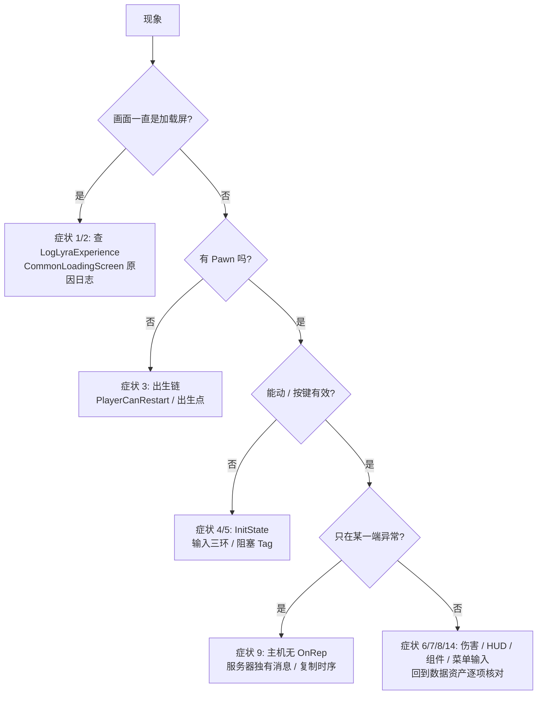

# 附录 A1　调试 Lyra 的工具箱

## 一个问题：角色出生了，但按什么键都没反应

你改完一份 PawnData，开 PIE。角色出现在出生点，镜头也对了，可是 WASD 没反应，鼠标也转不动视角。输出日志里没有红字。

这种“静默失败”是 Lyra 最典型的调试场景：它由很多松耦合的数据资产拼成，缺任何一块都不会崩溃，只会安静地少一块功能。如果没有方法，你会在 IMC、InputConfig、AbilitySet、Pawn 蓝图之间乱翻。有了方法，你只需要回答三个问题：

1. **这件事发生在服务器、拥有者客户端，还是所有端？**（第 3 章）
2. **它发生在第 5 章 12 步主干的哪一步？** Experience 加载完了吗？Pawn 的初始化状态链（InitState）走到哪一步了？
3. **哪个数据资产是这一步的输入？** 日志、控制台和断点的作用，就是把“静默”变成“有话说”。

本附录按**症状**组织：先给工具箱总览（日志、命令、作弊、开发者设置），再逐个症状列出“先查什么、会看到什么、常见原因”，然后是断点清单，最后是通用的 UE 调试技术。所有日志类别、控制台变量和命令都在源码里核对过；标了“引擎”的是 UE 自带的、不在本项目里。

## 1. 工具箱总览

### 1.1 日志类别

Lyra 自己定义了几个日志类别，名字很直白：

- `LogLyra`：通用。Pawn 生成失败（`Game mode was unable to spawn Pawn ...`）、PawnData 重复设置、ASC 切换 Avatar 等；
- `LogLyraExperience`：Experience 的选择与加载。`Identified experience X (Source: Y)`、`EXPERIENCE: StartExperienceLoad(...)`、`EXPERIENCE: OnExperienceLoadComplete(...)`，以及最重要的两条错误：`Wanted to use X but couldn't find it, falling back to the default` 和 `Failed to identify experience, loading screen will stay up forever`；
- `LogLyraAbilitySystem`：技能授予失败（AbilitySet 里 Ability/Effect/AttributeSet 为空）、武器技能提交失败等；
- `LogLyraTeams`：队伍设置，比如在非权威端调用 `SetGenericTeamId` 的错误；
- `LogLyraGamePhase`：阶段切换，`Beginning Phase '...'` / `Ending Phase` / `Ended Phase`，调阶段顺序时非常有用；
- `LogLyraCheat`：作弊命令的输出。

插件和引擎里和 Lyra 密切相关的类别：

- `LogGameFeatures`（引擎）：GameFeature 插件的状态迁移，以及 Lyra 的 Action 报错（比如 `Failed to find/add an ability component to ...`、`Failed to find UEnhancedInputLocalPlayerSubsystem ...`）；
- `LogGameplayMessageSubsystem`：消息结构体类型不匹配会在这里报 Error；
- `LogUIExtension`、`LogCommonGame`、`LogLoadingScreen`：UI 槽位、根布局、加载屏；
- `LogUIActionRouter`（引擎 CommonUI）：输入路由器每次应用输入配置时会打一行 `Applying input config for leaf-most node [...]`，排查“菜单没有鼠标”最直接（症状 14）；
- `LogCommonUser`、`LogCommonSession`：登录和会话（第 21 章）；
- `LogAimAssist`（ShooterCore）、`LogLyraGameSettingRegistry`、`LogLyraRepGraph`：各自专项。

Lyra 的很多日志行里带着 `Server` / `Client` 标记，来自 `GetClientServerContextString`（对 Actor 或组件按本地角色返回 `Server` 或 `Client`，拿不到角色时在编辑器里退回 PIE 上下文串，见 `LyraLogChannels.cpp`）；`GameplayMessageSubsystem.LogMessages` 打出的广播日志在编辑器里则直接带 PIE 上下文串。多人 PIE 时先看这个标记，再看内容。

想临时提高某个类别的详细程度，在控制台输入引擎命令 `Log LogLyraExperience Verbose`；想让它从启动就生效，用命令行参数 `-LogCmds="LogLyraExperience Verbose"`（引擎）。

### 1.2 项目自带的控制台变量与命令

下面这些都在源码里确认过。按“用来排查什么”分组：

**加载与资产**

- `lyra.chaos.ExperienceDelayLoad.MinSecs` / `lyra.chaos.ExperienceDelayLoad.RandomSecs`：给 Experience 加载人为增加固定/随机延迟，复现“加载很慢时的竞态”；
- `Lyra.DumpLoadedAssets`：列出通过 AssetManager 加载并驻留的资产；
- `Lyra.DumpGameplayCues [Refs]`：列出 GameplayCue 管理器加载的 Cue；
- `Lyra.ObjListToCollection`：把当前对象列表导出成一个资产集合（内存排查用）。

**加载屏**

- `CommonLoadingScreen.AlwaysShow`：强制显示加载屏；
- `CommonLoadingScreen.LogLoadingScreenReasonEveryFrame`：每帧把“为什么显示/隐藏加载屏”写进日志；
- `CommonLoadingScreen.HoldLoadingScreenAdditionalSecs`：加载结束后额外保持几秒（默认 2 秒）；
- 命令行 `-NoLoadingScreen`（仅非 Shipping 构建有效）。

**消息与 GAS**

- `GameplayMessageSubsystem.LogMessages`：设为 1，所有经过消息子系统的广播都会写日志；
- `showdebug abilitysystem`（引擎）：在 HUD 上显示 ASC 的技能、效果、属性和标签；`DefaultGame.ini` 里 `bUseDebugTargetFromHud=True`，所以它以你准星指向的 Actor 为目标；
- `AbilitySystem.Debug.NextCategory`（引擎）：切换 `showdebug abilitysystem` 的页签。

**武器与瞄准**

- `lyra.Weapon.DrawBulletTraceDuration`、`lyra.Weapon.DrawBulletHitDuration`、`lyra.Weapon.DrawBulletHitRadius`：画子弹轨迹与命中点（大于 0 时表示持续秒数）；
- `lyra.Weapon.EnableAimAssist`、`lyra.Weapon.DrawAimAssistDebug`、`lyra.Weapon.AimAssist.DrawDebugViewfinder`（ShooterCore，作弊类变量）。

**网络（均为引擎自带，非 Shipping 构建）**

- `p.NetShowCorrections 1`：画出客户端移动位置修正（红色是客户端错误位置，绿色是修正后的位置），查“角色被拉回”时用；
- `NetEmulation.PktLag <毫秒>`、`NetEmulation.PktLoss <百分比>`：运行时模拟延迟和丢包；等价的老写法是 `Net PktLag=100`、`Net PktLoss=5`（由 `UNetDriver::Exec` 处理，仅 `DO_ENABLE_NET_TEST` 为真时有效）；
- `stat net`：网络流量与连接质量统计（引擎的 `STATGROUP_Net`）。

**其他**

- `LyraCheat.EnableDebugCameraCycling`、`LyraCheat.StartInGodMode`：作弊相关开关；
- `LyraCharacter.GroundTraceDistance`：地面信息追踪距离；
- `LyraPC.ShouldAlwaysPlayForceFeedback`：非手柄也播放力反馈；
- `GameSettings.ShowDebugInfo`：设置页显示开发名与类；
- `Lyra.Settings.ApplyFrameRateSettingsInPIE` 等一组：让 PIE 里也应用帧率/设备配置设置；
- `Lyra.RepGraph.PrintRouting` 等 `Lyra.RepGraph.*`：复制图调试（默认复制图是关闭的）。

### 1.3 作弊命令

`ULyraCheatManager` 里标了 `Exec` 的函数可以直接在控制台输入：

- `Cheat <命令>`：通过 Server RPC 让**服务器**以你的 PlayerController 执行这条命令；`CheatAll <命令>` 对所有 `ALyraPlayerController` 执行（机器人不是 `ALyraPlayerController`，不受影响）；
- `DamageSelf <数值>`、`HealSelf <数值>`、`DamageTarget`、`HealTarget`、`DamageSelfDestruct`（自杀，绕过免疫）、`God`、`UnlimitedHealth`；
- `AddTagToSelf <Tag>`、`RemoveTagFromSelf <Tag>`：给自己的 ASC 加/去动态 Tag；
- `CancelActivatedAbilities`：取消所有输入激活的技能，追“技能被意外打断”时用；
- `CycleAbilitySystemDebug`：打开并切换 `showdebug abilitysystem`；
- `ToggleFixedCamera`、`CycleDebugCameras`：调试相机；
- `PlayNextGame`：同一张地图重新开一局（仅服务器有效）。

另外两组扩展：`ULyraTeamCheats` 的 `CycleTeam`、`SetTeam <编号>`、`ListTeams`；`ULyraBotCheats` 的 `AddPlayerBot`、`RemovePlayerBot`（它们找 GameState 上的 `ULyraBotCreationComponent`，没有这个组件就什么也不做）。UE 引擎自带的 `ToggleDebugCamera`、`Slomo`、`Ghost`、`Fly`、`Walk` 等也都可用。

这些作弊在**非 Shipping** 构建里才存在（`USING_CHEAT_MANAGER`）。

一个常见的坑：在客户端窗口直接输入 `DamageSelf`、`HealSelf` 之类的命令，函数在客户端本地执行，而伤害 GE 必须在权威端应用，所以什么也不会发生（[第 12 章](12-DamageAndDeath.md)讲过原因）。要在服务器上执行，请写成 `Cheat DamageSelf 30`。

### 1.4 开发者设置

编辑 → 编辑器偏好设置 → `LyraStarterGame` 分类 → Lyra Developer Settings（`ULyraDeveloperSettings`，只在编辑器里生效）。它的 `config=EditorPerProjectUserSettings`，引擎的 `UDeveloperSettings::GetContainerName` 会把这类设置放进“编辑器偏好设置”窗口，而不是“项目设置”；值存在 `DefaultEditorPerProjectUserSettings.ini` 的 `[/Script/LyraGame.LyraDeveloperSettings]` 节。如果你在“项目设置”里找不到它，不是你的问题：

- `ExperienceOverride`：PIE 时覆盖 Experience（优先级见第 6 章）；
- `bOverrideBotCount` + `OverrideNumPlayerBotsToSpawn`：覆盖机器人数量；
- `bAllowPlayerBotsToAttack`：机器人是否攻击；
- `bTestFullGameFlowInPIE`：为 false（默认）时 PIE 跳过热身与等人（`ULyraDevelopmentStatics::ShouldSkipDirectlyToGameplay`，C++ 里没有调用者，`Phase_Warmup` 资产里引用了它）；
- `CheatsToRun`：PIE 中在“作弊管理器创建时”或“玩家 Pawn 被控制时”自动执行的命令列表；
- `LogGameplayMessages`：等同于 `GameplayMessageSubsystem.LogMessages`。

## 2. 按症状排查

每个症状都按同一个顺序：先用最便宜的办法确认现象，再按“离主干起点从近到远”的顺序查原因。

### 症状 1：加载屏不消失

**先确认**：控制台输入 `CommonLoadingScreen.LogLoadingScreenReasonEveryFrame 1`，日志会告诉你加载屏当前是被谁挡着的。`LogLoadingScreen` 默认也每隔几秒打印一次原因。

加载屏管理器按固定顺序检查阻塞者，任一为真就显示（第 19 章）：CVar `CommonLoadingScreen.AlwaysShow`、没有 World、`GameState` 还没复制到、正在 `LoadMap` 或有 `TravelURL`、`World->HasBegunPlay()` 为 false、GameState 或其组件实现的 `ILoadingProcessInterface` 返回 true、本地玩家的 PC 还不存在。

按出现频率排序的原因：

1. **Experience 没有选出来或没有加载完。** `ULyraExperienceManagerComponent` 实现了加载屏接口，没到 `Loaded` 就一直说“Experience still loading”。去看 `LogLyraExperience`：有没有 `Identified experience ...`？有没有 `Failed to identify experience, loading screen will stay up forever`？加载是否停在某一步（`StartExperienceLoad` 有、`OnExperienceLoadComplete` 没有，说明资产包加载没完成；有但之后没有后续，看 GameFeature）。
2. **GameFeature 激活没回调。** 注意 Lyra 的 `OnGameFeaturePluginLoadComplete` 不检查结果，失败时通常是继续往下走而不是卡住；但如果插件状态机卡在某个状态永远不回调，计数器永远减不到 0。看 `LogGameFeatures`。
3. **自己加的阻塞者没释放。** 你的 GameState 组件实现了 `ILoadingProcessInterface`，或用了 `ULoadingProcessTask`，却忘了 `Unregister`/忘了在就绪后返回 false。`ShouldShowLoadingScreen` 返回 true 时必须给出非空原因，否则触发 `ensureMsgf`。
4. **没有 GameState，或没有本地 PlayerController。** 自定义了 GameMode 但没有设置 `GameStateClass`；或 PlayerController 不继承 `ACommonPlayerController`，根布局永远不创建。
5. **前端流程没走完。** `ULyraFrontendStateComponent` 的 `bShouldShowLoadingScreen` 只在 `AfterPush` 或 `Canceled` 时清除，主界面类加载异常时加载屏会一直在。
6. 刚好是 `HoldLoadingScreenAdditionalSecs`（默认 2 秒）在作祟，看起来“慢”但其实会自己消失。

### 症状 2：Experience 找不到，或回退成了默认体验

**先确认**：日志过滤 `LogLyraExperience`。正常时会有这样一行：

```
Identified experience LyraExperienceDefinition:B_xxx (Source: OptionsString)
```

括号里的 Source 是选择来源，只会是 `OptionsString`（URL 的 `?Experience=`）、`DeveloperSettings`（PIE 覆盖）、`CommandLine`（`-Experience=`）、`WorldSettings`、`Default` 之一。**Source 不是你以为的那个，就说明优先级链上有更靠前的来源把它盖掉了**。例如你在世界设置里改了 Experience，却忘了开发者设置里还有 `ExperienceOverride`。

如果看到 `Wanted to use X but couldn't find it, falling back to the default`，原因是 AssetManager 里没有这个 ID：

1. **资产目录不在扫描规则里。** Experience 的 ID 类型固定是 `LyraExperienceDefinition`，名字是资产名；资产必须在 `DefaultGame.ini` 的扫描目录（`/Game/System/Experiences`）里，或在所属插件 GameFeatureData 的 `PrimaryAssetTypesToScan` 里声明了对应目录。新建插件最常漏这一条。
2. **所属插件没启用。** 插件不在 `.uproject` 里，或还没注册，其下的资产不会进索引。
3. **名字拼写。** ID 区分大小写不敏感，但多一个后缀就是另一个资产。
4. **Experience 蓝图继承了另一个 Experience 蓝图。** 数据校验会报错（见第 6 章），保存时就会看到。
5. **蓝图类加载失败。** `SetCurrentExperience` 对加载失败直接 `check`，表现为崩溃而不是错误日志。

### 症状 3：玩家没有 Pawn（不出生）

先确认 Experience 已加载：Experience 没加载完时 `HandleStartingNewPlayer` 被跳过，加载完才由 `ALyraGameMode::OnExperienceLoaded` 补发出生。接着看 `LogLyra` 里这几条 Error：

- `Game mode was unable to spawn Pawn due to NULL pawn class`：PawnData 里的 `PawnClass` 为空，并且 GameMode 的默认 Pawn 类也没生效；
- `Game mode was unable to spawn Pawn of class [...] at [...]`：出生点被占用或没有出生点；
- `Game mode was unable to set PawnData on the spawned pawn`：Pawn 上有 `ULyraPawnExtensionComponent`，但 `GetPawnDataForController` 没有给出 PawnData（Experience 的 `DefaultPawnData` 与后备 PawnData 都没取到）。Pawn 上根本没有这个组件时，这条日志不会出现，而是之后 InitState 卡在 `Spawned`。

还有三类容易忽略的原因。**没有出生点或出生点类型不对**：地图里应使用 `ALyraPlayerStart`，普通 `APlayerStart` 不会被出生管理组件缓存（世界设置的 `CheckForErrors` 会警告）；**出生管理组件没有加**：没有 `ULyraPlayerSpawningManagerComponent` 时回退到引擎默认的选点；**`PlayerCanRestart` 返回 false**：被你自己的规则拦住了（比如“一条命”模式里的出生拦截）。`FailedToRestartPlayer` 会在玩家仍然可重启时每帧重试，所以失败是持续刷日志，而不是只打一次。

### 症状 4：Pawn 出生了，但不能动 / 按键没反应

这是附录开头的问题。按主干顺序：

1. **赛后阶段本来就不让动。** `Phase_PostGame` 在 10 秒展示期结束后会向全员施加 `GE_BlockAbilityInput`（授予 `Gameplay.AbilityInputBlocked`），这是设计行为。先用 `showdebug abilitysystem` 看 ASC 上有没有这个 Tag。热身阶段则不同：`Phase_Warmup` 施加的 `GE_PregameLobby` 只授予 `Gameplay.DamageImmunity`（免伤），没有输入阻塞，所以热身时角色能正常跑动和开枪，只是打不掉血。
2. **PawnData 的 `InputConfig` 为空。** `InitializePlayerInput` 整段不执行，不会有任何日志。
3. **Pawn 蓝图上没有 `ULyraHeroComponent`。** 没有它就没有输入和相机。
4. **输入组件类不对。** 项目配置里 `DefaultInputComponentClass=LyraInputComponent`；如果被改了，日志里有 `ensureMsgf`：`Unexpected Input Component class! The Gameplay Abilities will not be bound to their inputs.`。
5. **InitState 卡住了。** Hero 组件的 `Spawned → DataAvailable` 需要 PlayerState、Controller 与 PlayerState 配对，本地玩家还需要 `InputComponent`、`ALyraPlayerController` 和 `LocalPlayer`。PawnExt 的 `DataInitialized` 要等**所有**已注册 feature 到 `DataAvailable`，你自己加的 feature 忘了推进，就会拖住整个 Pawn。在两个组件的 `CanChangeInitState` 下断点，看是哪个条件不满足。
6. **IMC 没有加进去。** `InitializePlayerInput` 里只有 `bRegisterWithSettings == true` 的 IMC 才会被加入，并且开头有 `ClearAllMappings()`。通过 GameFeature 追加的 IMC 要有对应的 `Add Input Mapping` Action。

如果是**移动正常、技能不触发**，看下一个症状。

### 症状 5：技能不激活

输入到技能的“三环”必须一致：IMC 里有键位 → InputConfig 里 IA 与 InputTag 配对 → AbilitySet 里技能带同一个 InputTag。缺任何一环都**没有任何错误提示**。按这个顺序排除：

1. 键位是否真的触发了 IA（IA 的触发器类型会改变 Pressed/Released 时机，用 Hold 会丢掉“按下”那一刻）；
2. InputConfig 的 `AbilityInputActions` 里有没有这个 IA，InputTag 是否有效（无效项被静默跳过）；
3. 技能是否已授予并**复制到客户端**：`showdebug abilitysystem` 在客户端上看技能列表。Spec 上的 InputTag 随 Spec 复制，客户端没收到时按键被忽略；
4. ASC 是否带 `Gameplay.AbilityInputBlocked`，带的话 `ProcessAbilityInput` 会连 Held 一起清空；
5. `CanActivateAbility` 失败：看 `Ability.ActivateFail.*`，`TagsBlocked`（Tag 关系映射或 `Status.Death`）、`ActivationGroup`（有 `Exclusive_Blocking` 的技能在跑）、`Cost`、`Cooldown`；
6. `NetExecutionPolicy` 是 `ServerOnly`/`ServerInitiated`，客户端本来就不会自己激活；
7. Avatar 不是当前 Pawn（`InitAbilityActorInfo` 没执行，或客户端新旧 Pawn 并存）；
8. 技能类不是 `ULyraGameplayAbility`（`ProcessAbilityInput` 里的转换失败，不会进入激活列表）。

技巧：用 `CancelActivatedAbilities` 判断“是不是被别的技能打断”，用 `AddTagToSelf`/`RemoveTagFromSelf` 手动加减阻塞 Tag 看技能是否响应。失败反馈走 `Ability.UserFacingSimpleActivateFail.Message`，打开 `GameplayMessageSubsystem.LogMessages` 能直接看到。

### 症状 6：打中了但不掉血，或伤害为 0

**先怀疑队伍**。`ULyraTeamSubsystem::CanCauseDamage` 在攻击者没有队伍时返回 false，伤害乘以 0；这是“没有 `TeamCreationComponent` 的 Experience 里谁也打不掉谁”的原因。控制台 `ListTeams` 能立刻告诉你队伍有没有创建；`SetTeam <编号>` 可以手动换队。

然后依次查：

1. 攻击者的 `BaseDamage`（`ULyraCombatSet`，在 PlayerState 的 ASC 上默认 0）是否由 GE/AbilitySet 初始化；
2. 目标是否有 `Gameplay.DamageImmunity`（赛前免伤）或 `Cheat.GodMode`；
3. GE 是否选用了 `ULyraDamageExecution`；
4. Execution 只在服务器上跑（`WITH_SERVER_CODE`），客户端没有预测伤害（`PredictTargetGameplayEffects=False`），所以“客户端看不到血条变化”要先确认服务器是否真的扣了；
5. GE Context 若不是由 `ULyraGameplayAbility::MakeEffectContext` 产生，AbilitySource 为空，衰减系数为 1，距离回退到 `EffectCauser` 位置，并可能打一条 Error；
6. 用 `lyra.Weapon.DrawBulletTraceDuration 2` 看子弹到底打到了什么，是不是命中了胶囊而不是骨骼 Mesh（命中通道是 `Lyra_TraceChannel_Weapon`）。

### 症状 7：HUD 不显示

HUD 元素从“数据”到“屏幕”要经过一条长链（第 19 章）：根布局创建 → `AddWidgets` 把 HUD 布局推到 `UI.Layer.Game` → 布局里的扩展点控件注册 → `AddWidgets` 把元素注册到槽位。逐段检查：

1. **根布局存在吗？** 根布局只在拿到 PlayerController 后创建，PlayerController 必须继承 `ACommonPlayerController`。
2. **Experience 里有 `Add Widgets` 吗？** HUD 布局由 Experience/ActionSet 的 `Layout` 项推送（例如 `LAS_ShooterGame_StandardHUD`）。你的模式没引用它，就没有 `W_ShooterHUDLayout`，槽位也就不存在。
3. **槽位 Tag 对吗？** `Widgets` 项的 `SlotID` 必须与布局里 `UIExtensionPointWidget` 的 `ExtensionPointTag` 完全一致。写错是静默失败，`LogUIExtension` 的 Verbose 日志可以看到注册与匹配。
4. **类加载了吗？** `AddWidgets` 用同步 push，要求软类已加载，靠属性上的 `AssetBundles="Client"` 预载；没加载的会被静默跳过。
5. **这是专用服务器吗？** 专用服务器没有 HUD，根本不会创建这些控件。
6. **有人执行了 `showhud` 吗？** `ULyraUIManagerSubsystem` 每帧根据 `AHUD::bShowHUD` 切换根布局可见性，`showhud` 会把包括菜单在内的整个 UI 隐藏。
7. 控件自己的问题：用 `Wait For Experience Ready` 之后再去找 GameState 上的组件；要读 PlayerState 数据时注意它在客户端可能晚到。
8. **反过来：HUD 元素出现了两份。** `UGameFeatureAction_AddWidgets::HandleActorExtension` 对 `ExtensionAdded` 和 `GameActorReady` 两个事件都调用 `AddWidgets`，而 `AddWidgets` 直接往 `LayoutsAdded` 和 `ExtensionHandles` 里追加，没有去重。引擎的 `AddExtensionHandler` 对已经初始化的接收者会立即回调 `ExtensionAdded`，所以同一个 HUD 理论上可能先后收到两个事件（这是读源码的推断，没有在 PIE 里复现；正常流程里 HUD 通常在 handler 注册之后才初始化，不会重复）。如果你确实看到了重复，先在 `AddWidgets` 下断点数命中次数；自己写的 Action 要保证处理器幂等（[第 7 章](07-ModularGameplay.md)）。

### 症状 8：组件/技能/输入“没挂上”

Experience 里配了 `Add Components`，运行后目标 Actor 上却没有那个组件。按顺序查：

1. **GameFeature 插件到底激活了吗？** Experience 的 `GameFeaturesToEnable` 里是否包含它，插件名是否拼对。拼错会触发 `ensureMsgf`：`OnExperienceLoadComplete failed to find plugin URL from PluginName ...`，并且被忽略。看 `LogGameFeatures`。
2. **Action 是否在当前 Experience 里？** 插件激活只会执行插件自己 `GameFeatureData` 里的 Action，Experience 和 ActionSet 里的 Action 要被当前 Experience 引用才会执行（第 6 章“误区 5”）。
3. **Client / Server 勾选对吗？** 先看组件是不是“被复制的”（`Component Replicates`）。不复制的组件，管理器在每个满足勾选的端各创建一份：漏勾 Client，客户端就没有；漏勾 Server，服务器就没有。被复制的组件只在权威端创建，客户端那份靠服务器复制过来，所以必须勾 Server，勾不勾 Client 都不会让客户端本地创建（[第 7 章](07-ModularGameplay.md)“误区 4”）。
4. **目标 `ActorClass` 对吗？** `LyraGameState`、`AGameStateBase`、`AController`、`LyraPlayerState`、`LyraCharacter` 是不同层级。技能（ASC）挂在 `LyraPlayerState`，而不是 Pawn。
5. **目标 Actor 是 Modular 的吗？** 只有继承 `AModular*` 基类的 Actor 才会在 `PreInitializeComponents` 注册为接收者；继承普通 `ACharacter` 的 Pawn，所有 `AddComponents`/`AddAbilities` 都静默无效。
6. **时序。** `AddAbilities` 只在服务器执行，并且对 PlayerState 目标要等 `NAME_LyraAbilityReady`（`SetPawnData` 末尾发出）。如果 PawnData 没设置成功，技能永远不会授予。

### 症状 9：服务器和客户端表现不一致

这是最需要“先看是哪一端”的症状。把常见的“差异来源”列出来，遇到不一致时逐条对照：

- **监听服务器的主机没有 OnRep。** 服务器改被复制属性不会在本机触发 `OnRep_*`；主机的 UI 不刷新、而远端客户端正常，几乎都是这个原因。Lyra 的做法是服务器端手动调一次 `OnRep_*`（`ULyraQuickBarComponent` 就是例子）。
- **`LoadState` 不复制。** 每一端独立加载 Experience，客户端晚于服务器完成很正常。
- **`Lyra.Elimination.Message`、`Lyra.Damage.Message` 只在服务器广播**，客户端的本地消息子系统里没有；`ALyraGameState::MulticastMessageToClients` 只在 `NM_Client` 广播，监听服务器的主机收不到。
- **PawnData 的到达时机不同。** 服务器上 Pawn 的 `BeginPlay` 时已有；客户端要等 `OnRep_PawnData`。
- **Cosmetic 部件只在非专用服务器生成**，服务器上读 Cosmetic 标签为空。
- **GE Context 里的 `CartridgeID`、`AbilitySource` 不复制**，客户端读到的是默认值。
- **`DamageExecution` 只在服务器上跑**，客户端看不到预测伤害。
- **`EquippedItem` 在 QuickBar 上不复制**，客户端永远为空；需要物品信息时去问技能（`GetAssociatedItem()`）。
- **武器散布只在本地和服务器的 Controller 上更新**，且服务器上没有相机混合信息，两端的数值本来就不同。
- **PIE 里消息子系统是 GameInstance 级的**，同一进程里的服务器和客户端各有一份，不会串。如果你发现“客户端收到了服务器的消息”，那一定是通过复制/RPC 来的，查谁在转发。

排查方法：在可疑代码处分别在服务器和客户端打日志，用 `GetClientServerContextString(this)` 区分；对比属性值时，在两个 PIE 窗口各自输入同一条命令。

### 症状 10：队伍颜色不对 / 队伍没有分配

`ListTeams` 先看队伍有没有创建。队伍组件是在 Experience 加载完成的 **High** 档回调里创建队伍并给已有玩家分队，晚进的玩家通过 GameMode 的 `OnGameModePlayerInitialized` 分队。常见问题：队伍组件没加到 `LyraGameState` 上（或没勾 Server）；玩家被分到 `TeamsToCreate` 里没有的队伍；配色不对时检查 `ULyraTeamDisplayAsset` 里的参数名是否与材质/Niagara 的参数名**完全一致**，不一致是静默无效；在蓝图里读队伍颜色要用 `ObserveTeamColors`（DisplayAsset 可能晚到），不要一次性读取。

### 症状 11：GameplayCue 晚播、不播

先分清是“晚”还是“从不”。Lyra 的 `ULyraGameplayCueManager` 里 `ShouldSyncLoadMissingGameplayCues()` 返回 false、`ShouldAsyncLoadMissingGameplayCues()` 返回 true：Cue 触发时它的 Notify 类还没加载，引擎不会丢弃，而是把这次触发挂起（日志里是 `Deferred gameplay cue with tag ...`，在 `LogAbilitySystem` 里，级别 Display），异步加载完成后再补播（`Executing deferred gameplay cue`）。所以“某个 Cue 第一次出现得比别的晚半拍”是正常现象，之后就恢复正常。

真正“从不播”的原因通常是：

1. **Cue 的目录没有注册。** GameplayCue Manager 只会在注册过的路径里找 Notify；GameFeature 的 Cue 目录要有 `Add GameplayCue Path` Action（`UGameFeatureAction_AddGameplayCuePath`）或在 GFD 里已配置。可用 `Lyra.DumpGameplayCues` 看 Cue 是否在已加载列表里；
2. **补播时目标已失效。** 挂起期间目标 Actor 被销毁、所属 CueSet 被回收或世界正在销毁，补播会被跳过（引擎源码 `OnMissingCueAsyncLoadComplete`）；
3. **加载失败。** 日志里会有 `Late load of GameplayCueNotify ... failed!` 的 Warning；
4. Pawn 反初始化 ASC 时（`ULyraPawnExtensionComponent`）会调用 `RemoveAllGameplayCues`，挂在旧 Avatar 上的持续型 Cue 会被清掉，这是预期行为。

### 症状 12：消息发了，没人收到

先打开 `GameplayMessageSubsystem.LogMessages 1`。如果日志里有广播，说明发出去了；去看 `LogGameplayMessageSubsystem` 有没有 Error：**消息结构体类型与监听者期望的不一致，只会报 Error 且不投递**。如果日志里连广播都没有，检查：广播者是不是在服务器上而你在客户端听；`Channel` Tag 是否拼写一致（Tag 精确匹配，除非用了 `PartialMatch`）；监听是否在 `EndPlay` 后被注销，或根本没注册（组件的 `BeginPlay` 时机问题）。

### 症状 13：PIE 能用，打包后不行

这类问题的共同点是“开发者便利”只存在于编辑器：`ExperienceOverride` 只在 `IsPlayInEditor()` 时生效；机器人数量覆盖需要 `GIsEditor`；`CheatsToRun` 需要 `WITH_EDITOR`；作弊命令本身在 Shipping 里不存在；热修复在编辑器里被跳过；前端地图在 PIE 里被强制成 Standalone（`ForceStandaloneNetMode`）。在打包后的版本里，Experience 来自 URL、命令行或世界设置，所以新建的 Experience 目录必须在扫描规则中，并且 playlist 要设为 `AlwaysCook`。

### 症状 14：菜单打开后没有鼠标，或输入被吞

这是最容易被误诊的一个。先纠正一个常见猜测：**“`Input Config` 选了 `Default`，所以鼠标消失”并不成立。** `ELyraWidgetInputMode::Default` 让 `ULyraActivatableWidget::GetDesiredInputConfig` 返回空的 `TOptional`，意思是“我不表态”，而不是“保持上一个配置”。CommonUI 的路由器这时按引擎源码（`FActivatableTreeNode::FindDesiredInputConfig`）的顺序找：当前控件没有，就取它所属 ActionDomain 的配置，再沿激活树向父节点继承；整棵树都没有人表态时，若 `CommonInputSettings` 的 `bEnableDefaultInputConfig` 为真（默认 true，Lyra 没有改），就应用默认的 `FUIInputConfig()`，即 Menu 模式、不捕获鼠标。所以一个没有任何祖先表态的 `Default` 菜单，光标其实会出现。（详细推导见[第 18 章](18-UIFramework.md)。）

那么“没有鼠标”更可能来自：

1. **控件或它在激活树里的某个祖先选了 `Game` 或 `GameAndMenu`，而 `Game Mouse Capture Mode` 保持了默认的 `CapturePermanently`。** `GameAndMenu` 只是“UI 也能收到输入”，鼠标仍被永久捕获，光标就不显示。需要鼠标就明确选 `Menu`；
2. **控件没有通过 CommonUI 的容器推入。** 路由器只管激活树里的可激活控件；直接 `AddToViewport` 的控件不在栈或队列里，没人替它切换输入模式。用 `UCommonUIExtensions::PushContentToLayer_ForPlayer`（蓝图里同名节点；或 `AddWidgets` 的 `Layout`）推入 `UI.Layer.Menu` 之类的层；
3. **有人绕过 CommonUI 自己调了 `SetInputMode`。** 社区经验是 CommonUI 项目里别调用 `SetInputMode`，它会和路由器各改各的，结果取决于谁最后一次写入；
4. **最里层节点当前不在“接收输入”。** 路由器只对最里层（leaf-most）节点应用输入配置，并且只在它处于接收输入状态时才应用（源码里有一条 `Didn't apply input config ... because it's not receiving input right now` 的日志）；
5. **栈顶不是你以为的那个控件。** 栈只激活顶层控件，上面压着一个不可见的、表态为 `Game` 的控件时，下面的菜单再正确也没用；队列（`UCommonActivatableWidgetQueue`）一次只显示一个，先进先出。

**先确认**：看引擎的 `LogUIActionRouter` 日志（默认级别就会输出），打开或关闭菜单时会有一行 `Applying input config for leaf-most node [控件名]`。控件名就是路由器认定的最里层节点：对不上，说明是第 2、5 条；对上了，再看那个控件的 `Input Config` 与 `Game Mouse Capture Mode`。路由器是在栈顶变化后重新计算最里层节点的配置，而不是弹出一个“配置栈”，所以关闭菜单后输入回到什么状态，取决于此时新的最里层节点表了什么态。

至于“输入被吞”：`ULoadingScreenManager` 在加载屏显示期间会 `StartBlockingInput`，加载屏没消失时一切输入都不会到游戏里（先查症状 1）。

## 3. 断点位置清单

在 Rider 或 Visual Studio 里，把断点放在“决策点”而不是“出错点”。下面按主干顺序列出，都是源码里的函数：

**选择与加载（服务器为主）**

- `ALyraGameMode::HandleMatchAssignmentIfNotExpectingOne`：看最终 `ExperienceId` 和 `ExperienceIdSource`；
- `ULyraExperienceManagerComponent::SetCurrentExperience`、`StartExperienceLoad`、`OnExperienceLoadComplete`、`OnExperienceFullLoadCompleted`：加载状态机每一步；
- `ULyraExperienceManagerComponent::OnRep_CurrentExperience`：客户端何时开始加载；
- 具体 Action 的 `AddToWorld`（如 `UGameFeatureAction_AddWidgets::AddToWorld`）：Action 是否被执行；

**出生与初始化**

- `ALyraGameMode::HandleStartingNewPlayer_Implementation`、`OnExperienceLoaded`、`ChoosePlayerStart_Implementation`、`SpawnDefaultPawnAtTransform_Implementation`、`FailedToRestartPlayer`；
- `ULyraPawnExtensionComponent::CanChangeInitState`、`CheckDefaultInitialization`，`ULyraHeroComponent::CanChangeInitState`、`HandleChangeInitState`：InitState 卡在哪一步，在这里一目了然；
- `ULyraPawnExtensionComponent::InitializeAbilitySystem`：ASC 的 Avatar 绑定；
- `ALyraPlayerState::SetPawnData`：AbilitySet 的授予；

**输入与技能**

- `ULyraHeroComponent::InitializePlayerInput`：IMC 与 InputConfig 的绑定；
- `ULyraAbilitySystemComponent::AbilityInputTagPressed`、`ProcessAbilityInput`：按键有没有变成待激活的技能；
- `ULyraGameplayAbility::CanActivateAbility`、`DoesAbilitySatisfyTagRequirements`、`CheckCost`：技能被谁拒绝；

**伤害与死亡（服务器）**

- `ULyraDamageExecution::Execute_Implementation`：队伍系数、距离衰减、最终伤害；
- `ULyraTeamSubsystem::CanCauseDamage`：谁能伤害谁；
- `ULyraHealthSet::PostGameplayEffectExecute`：`Damage` 如何变成 `Health`；
- `ULyraHealthComponent::HandleOutOfHealth`：死亡事件和淘汰消息的源头；
- `ALyraGameMode::RequestPlayerRestartNextFrame`：谁在触发重生（C++ 里没有调用者，在这里下断点然后看调用栈能找到蓝图技能）；

**队伍、消息与 UI**

- `ULyraTeamCreationComponent::ServerCreateTeams`、`ServerChooseTeamForPlayer`；
- `UGameplayMessageSubsystem::BroadcastMessageInternal`（插件源码）：所有消息的总入口；
- `UGameFeatureAction_AddWidgets::HandleActorExtension`、`UUIExtensionSubsystem::RegisterExtensionAsWidgetForContext`：HUD 注入。

小技巧：多人 PIE 时，断点会在多个世界里被命中。用条件断点 `GetNetMode() == NM_ListenServer`（或检查 `HasAuthority()`）把无关世界过滤掉；或者先单人（Standalone）复现，确认逻辑后再回到多人。

## 4. 通用的 UE 调试技术

**Gameplay Debugger。** PIE 或游戏中按撇号键（`'`，引擎默认的 `ActivationKey` 是 `EKeys::Apostrophe`，可在编辑器偏好设置里改）打开，可以查看选中 Actor 的 AI、行为树、EQS、感知和能力系统信息，对排查机器人行为（行为树、感知）很有用。`LyraGame.Build.cs` 里调用了 `SetupGameplayDebuggerSupport`，所以 Lyra 的非 Shipping 构建里它是可用的。

**Visual Logger。** 在编辑器里打开 Visual Logger 窗口后开始录制，再运行 PIE，可以回放每一帧里被记录的形状、日志和属性变化。自己的代码里用 `UE_VLOG` 系列宏打点就能出现在时间线上。适合调“某一帧到底发生了什么”的问题，如机器人为什么停下。

**网络模拟。** 多人调试几乎总要加延迟：编辑器的播放设置里，多人选项下有“Network Emulation”，可选预设的丢包与延迟；运行时也可用控制台命令 `NetEmulation.PktLag 100`、`NetEmulation.PktLoss 5`，或老写法 `Net PktLag=100`、`Net PktLoss=5`（引擎，非 Shipping）；想看客户端位置被服务器纠正的样子，再开 `p.NetShowCorrections 1`。加了延迟再看技能预测、命中标记、`OnRep` 时序，很多只在“网络好”时才不出现的问题就暴露了。

**PIE 网络模式。** `Play As Standalone`、`Play As Listen Server`、`Play As Client`（带专用服务器）三种模式覆盖不同问题：Standalone 最快；Listen Server 用来检查“主机既是服务器又是玩家”的特殊路径；Client 加专用服务器用来检查服务器上没有 HUD、没有 Cosmetic、没有本地玩家的情况。注意前端地图因 `ForceStandaloneNetMode` 会被强制成 Standalone。

**stat 命令。** `stat fps`、`stat unit` 看帧率和线程耗时；`stat net` 看网络流量与连接质量（引擎）；Lyra 另外有自己的性能统计 HUD（设置里的性能统计）。

**Unreal Insights。** 需要看“哪一帧哪个函数慢”或“资产加载耗时”时，用 `-trace=...` 启动参数加编辑器内置 Insights 抓取。排查 Experience 加载慢特别有用，因为加载过程是异步的，普通断点看不出来。

**日志与命令行。** 命令行参数 `-Experience=` 指定 Experience，`?NumBots=N` 用 URL 选项覆盖机器人数量（URL 方式），`-LogCmds="..."` 设置日志类别，`-ExecCmds="..."` 启动后执行控制台命令。

## 5. 三个小实验

### 实验 1：让加载屏自己说话

**目标**：学会读“加载屏被谁挡着”。

**步骤**：

1. 启动前先在编辑器“输出日志”底部的 Cmd 输入框依次执行 `CommonLoadingScreen.LogLoadingScreenReasonEveryFrame 1` 和 `lyra.chaos.ExperienceDelayLoad.MinSecs 5`；
2. 开 PIE（Play As Client，2 个玩家），观察日志（过滤 `LogLoadingScreen`、`LogLyraExperience`）。

**先写下你的预测**：加载屏的原因会依次变成什么？它会在 Experience 加载完之后立刻消失吗？

**预期结果**：加载屏原因里会出现“Experience still loading”之类的描述，延迟结束后原因消失。编辑器里不额外保持 2 秒，打包后会多保持 `HoldLoadingScreenAdditionalSecs`。

**原理**：`ULyraExperienceManagerComponent` 是 GameState 上的 `ILoadingProcessInterface`，`LoadState != Loaded` 时返回 true；延迟发生在 `OnExperienceFullLoadCompleted` 开头，所以 Action 与“已加载”广播都被推迟了。做完把 `MinSecs` 改回 0。

### 实验 2：故意断开输入三环的一环

**目标**：亲眼看看“静默失败”长什么样。

**步骤**：

1. 打开 `InputData_Hero`，把 `InputTag.Weapon.Reload` 这一项的 InputTag 清空（**不要保存资产**，实验后撤销修改或重新加载资产）；
2. 开 PIE，按换弹键；
3. 打开 `showdebug abilitysystem`，看技能是否授予。

**先写下你的预测**：日志里会有错误吗？技能列表里还有换弹技能吗？

**预期结果**：没有任何错误；技能仍然在列表里（授予发生在 AbilitySet，不受影响），但按键没有反应。

**原理**：`BindAbilityActions` 对无效的 InputTag 静默跳过，Spec 上的 InputTag 与 InputConfig 之间没有任何交叉校验。

### 实验 3：看消息是怎么流动的

**目标**：用 `GameplayMessageSubsystem.LogMessages` 建立“消息在哪一端出现”的直觉。

**步骤**：

1. Play As Listen Server，2 个玩家；
2. 控制台输入 `GameplayMessageSubsystem.LogMessages 1`；
3. 在主机窗口输入 `Cheat DamageSelfDestruct`，观察两个窗口各自的日志。

**先写下你的预测**：`Lyra.Elimination.Message` 会在哪个窗口出现？远端客户端窗口会有这条消息吗？

**预期结果**：`Lyra.Elimination.Message` 和 `Lyra.Damage.Message` 的广播日志只带服务器的 PIE 上下文串；客户端上没有这两条（ShooterCore 的击杀播报如果经 GameState 多播转发，客户端上看到的是它转发的另一条消息）。

**原理**：这两条消息只在服务器代码里广播，且消息子系统是 GameInstance 级的，服务器和客户端各有一个。需要让客户端看到，必须自己通过复制属性或 RPC/多播转发。

## 6. 排查决策图



## 本附录小结

调试 Lyra 的核心是把“静默失败”变成“有话说”：先判断问题在哪一端、主干的哪一步，再用对应的日志类别、控制台变量、作弊命令和断点去观察。最容易出问题的地方是三类“数据对不上”：Tag 没对上（输入、槽位、消息频道）、目录没对上（资产扫描规则）、勾选没对上（Client/Server、Actor 类）。

## 继续深入

- Experience 加载卡住与启动的完整调用链：[参考手册 10 §8、§9](../Reference/10-CoreFramework.md)；
- 技能激活、输入与伤害管线的排查清单：[参考手册 20 §7、§10](../Reference/20-AbilitySystem-Input.md)；
- 队伍、武器、交互相关的调试问答：[参考手册 30 §9](../Reference/30-GameplaySystems.md)；
- 加载屏、HUD 槽位：[参考手册 40 §3、§7](../Reference/40-UI.md)；
- 源码地图与已知坑：[附录 A3](A3-CodeMap.md)；术语：[附录 A2](A2-Glossary.md)；一个完整的开发排错实例：[第 22 章](22-Capstone.md)。
