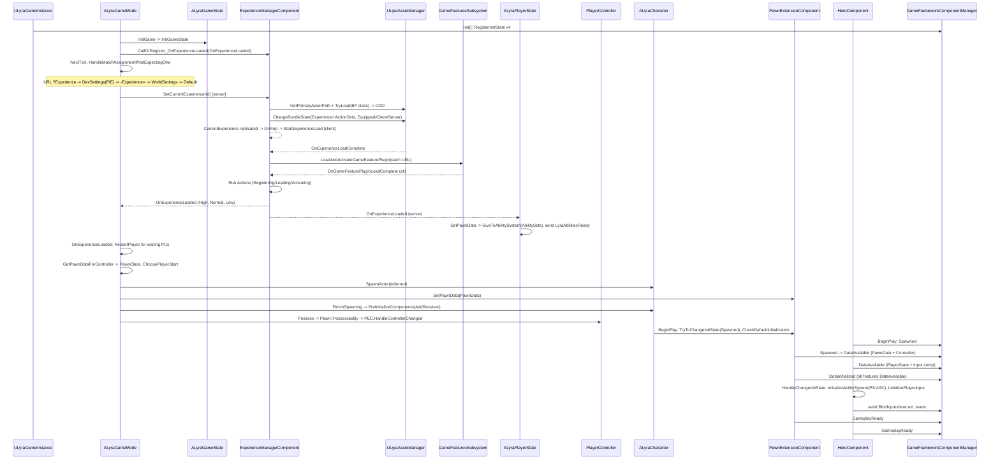

# 10 - 核心框架 (Core Framework)

> 范围: `Source/LyraGame/{GameModes,GameFeatures,System,Player,Character,Development}`、`LyraGameplayTags`、`LyraLogChannels`、`LyraGameModule.cpp`、`Source/LyraEditor`(简述)、`Plugins/ModularGameplayActors`。
> 引擎版本 UE 5.8。路径均相对 `Source/LyraGame/`(除非另行标注)。行号为阅读源码时的实际行号(未标行号处用函数名定位)。

## 1. 职责概述

Lyra 核心框架围绕三个思想:

1. **Experience(体验)驱动一切**: 地图只提供几何与默认 Experience 指针; "玩什么"由 `ULyraExperienceDefinition`(PrimaryDataAsset, 实为 BP 类 CDO)决定: 启用哪些 GameFeature 插件、默认 PawnData、一组 `UGameFeatureAction`。`ALyraGameMode` 只负责选定 Experience 并等待加载完成, 之后才允许玩家出生。
2. **PawnData 驱动角色**: `ULyraPawnData` 描述 Pawn 类、AbilitySet、TagRelationshipMapping、InputConfig、默认 CameraMode。Pawn 是"空壳 + 组件"。
3. **Modular + InitState 链**: 所有框架 Actor 继承 `Modular*` 基类并注册为 `UGameFrameworkComponentManager` 的 receiver, 允许 GameFeature 运行时注入组件/能力/输入/Widget; Pawn 内部初始化顺序由 `IGameFrameworkInitStateInterface` + 4 个 InitState Tag 协调(Spawned -> DataAvailable -> DataInitialized -> GameplayReady)。

GAS 的 ASC 与属性集放在 **PlayerState** 上(玩家 Pawn 只是 Avatar); GameState 上另有一个 ASC 用于全局 GameplayCue。

## 2. 关键类表

### 2.1 GameModes

| 类名 | 文件:行 | 职责 |
|---|---|---|
| `ALyraGameMode` | GameModes/LyraGameMode.h:37 / .cpp:33 | 继承 `AModularGameModeBase`; 选 Experience(`HandleMatchAssignmentIfNotExpectingOne` .cpp:88); Experience 未加载不出生玩家(`HandleStartingNewPlayer_Implementation` :391); 用 PawnData 决定 Pawn 类并在 FinishSpawning 前注入(`SpawnDefaultPawnAtTransform_Implementation` :345); 出生点交给 `ULyraPlayerSpawningManagerComponent`(`ChoosePlayerStart_Implementation` :401、`FinishRestartPlayer` :411) |
| `ALyraGameState` | GameModes/LyraGameState.h:27 / .cpp:22 | 持有 `ULyraExperienceManagerComponent`(构造中 CreateDefaultSubobject)与全局 `ULyraAbilitySystemComponent`(Mixed); 复制 `ServerFPS`(Tick 中写 `GAverageFPS`); `MulticastMessageToClients`(Unreliable)/`MulticastReliableMessageToClients` 把 `FLyraVerbMessage` 投递到客户端 `UGameplayMessageSubsystem`; `SeamlessTravelTransitionCheckpoint` 清理 Bot/Inactive PlayerState |
| `ULyraExperienceManagerComponent` | GameModes/LyraExperienceManagerComponent.h:30 / .cpp | Experience 加载状态机(`ELyraExperienceLoadState` .h:18: Unloaded/Loading/LoadingGameFeatures/LoadingChaosTestingDelay/ExecutingActions/Loaded/Deactivating); 复制 `CurrentExperience`(.h:82); 三档加载完成委托; 实现 `ILoadingProcessInterface`(`ShouldShowLoadingScreen` .cpp:447) |
| `ULyraExperienceDefinition` | GameModes/LyraExperienceDefinition.h:16 | `GameFeaturesToEnable`(:38 插件名)、`DefaultPawnData`(:43)、`Actions`(Instanced)、`ActionSets`; `IsDataValid` 校验空 Action 并**禁止 BP 继承 BP**; `UpdateAssetBundleData` 汇总 Action 的 AssetBundle |
| `ULyraExperienceActionSet` | GameModes/LyraExperienceActionSet.h:14 | 可复用 Action 集合(`Actions`, `GameFeaturesToEnable`), 与 Experience 组合 |
| `ULyraUserFacingExperienceDefinition` | GameModes/LyraUserFacingExperienceDefinition.h | 前端/大厅 "Playlist": `MapID`、`ExperienceID`、`ExtraArgs`、标题/图标、`bIsDefaultExperience`、`bRecordReplay`、`MaxPlayerCount`; `CreateHostingRequest`(.cpp:14)把 `ExperienceID` 名写入 `ExtraArgs["Experience"]`(:40) |
| `ALyraWorldSettings` | GameModes/LyraWorldSettings.h:16 | `DefaultGameplayExperience`(TSoftClassPtr, :35); `GetDefaultGameplayExperience`(.cpp:18)用 `UAssetManager::GetPrimaryAssetIdForPath` 解析; `ForceStandaloneNetMode`(前端地图 PIE 强制 Standalone); `CheckForErrors` 警告普通 `APlayerStart` |
| `ULyraExperienceManager` | GameModes/LyraExperienceManager.h:12 | EngineSubsystem(逻辑仅 `WITH_EDITOR`): 对多 PIE 窗口共享的 GameFeature 插件做引用计数(`NotifyOfPluginActivation`/`RequestToDeactivatePlugin`) |
| `ULyraBotCreationComponent` | GameModes/LyraBotCreationComponent.h:14 | GameState 组件(Abstract, 需 BP 子类); `BeginPlay`(.cpp:21)注册 **LowPriority** 回调; 服务器 `ServerCreateBots`(:44)循环 `SpawnOneBot`; Bot 数可被 DeveloperSettings(`GIsEditor`)与 URL `?NumBots=` 覆盖 |
| `UAsyncAction_ExperienceReady` | GameModes/AsyncAction_ExperienceReady.h:21 | BP 异步节点 `WaitForExperienceReady`(.cpp:17); 等 GameState 出现 -> 等 Experience Loaded(已加载也延迟一帧) |

### 2.2 GameFeatures

| 类名 | 文件:行 | 职责 |
|---|---|---|
| `UGameFeatureAction_WorldActionBase` | GameFeatures/GameFeatureAction_WorldActionBase.h:22 | `OnGameFeatureActivating`(.cpp:10): 绑定 `FWorldDelegates::OnStartGameInstance` -> `HandleGameInstanceStart`(:35) 并对已有 WorldContext 调 `AddToWorld`(纯虚) |
| `UGameFeatureAction_AddAbilities` | GameFeatures/GameFeatureAction_AddAbilities.h:75 | `AddToWorld`(.cpp:104)对每个 Entry `AddExtensionHandler(ActorClass, HandleActorExtension)`; `HandleActorExtension`(:142)在 `ExtensionAdded` 或 `ALyraPlayerState::NAME_LyraAbilityReady` 时 `AddActorAbilities`(:159, **仅 HasAuthority**, `GiveAbility`/`NewObject<UAttributeSet>`/`ULyraAbilitySet::GiveToAbilitySystem`); `FindOrAddComponentForActor`(:258)缺 ASC 时 `AddComponentRequest` |
| `UGameFeatureAction_AddInputBinding` | GameFeatures/GameFeatureAction_AddInputBinding.h:21 | `AddToWorld`(.cpp:69)对 `APawn` 注册; `HandlePawnExtension`(:107)在 `ExtensionAdded`/`ULyraHeroComponent::NAME_BindInputsNow` 时 `AddInputMappingForPlayer`(:122)-> `HeroComponent->AddAdditionalInputConfig`(需 `IsReadyToBindInputs`) |
| `UGameFeatureAction_AddInputContextMapping` | GameFeatures/GameFeatureAction_AddInputContextMapping.h:37 | `OnGameFeatureRegistering`(.cpp:27)->`RegisterInputMappingContexts`(给所有本地玩家的 `UEnhancedInputUserSettings` 注册 IMC); `AddToWorld`(:192)对 `APlayerController` 注册; `HandleControllerExtension`(:230)-> `AddInputMappingForPlayer`(:246) `AddMappingContext(IMC, Priority)` |
| `UGameFeatureAction_AddWidgets` | GameFeatures/GameFeatureAction_AddWidget.h:50 | `AddToWorld`(.cpp:91)对 `ALyraHUD` 注册; `HandleActorExtension`(:125)在 `ExtensionAdded`/`NAME_GameActorReady` 时 `AddWidgets`(:138): Layout -> `UCommonUIExtensions::PushContentToLayer_ForPlayer`, Widgets -> `UUIExtensionSubsystem::RegisterExtensionAsWidgetForContext` |
| `UGameFeatureAction_AddGameplayCuePath` | GameFeatures/GameFeatureAction_AddGameplayCuePath.h:15 | 纯数据(默认 `/GameplayCues`); 真正生效由 `ULyraGameFeature_AddGameplayCuePaths::OnGameFeatureRegistering`(LyraGameFeaturePolicy.cpp:91)添加路径并 `InitializeRuntimeObjectLibrary` |
| `UGameFeatureAction_SplitscreenConfig` | GameFeatures/GameFeatureAction_SplitscreenConfig.h:22 | 全局投票计数(`GlobalDisableVotes` .cpp:16)强制关闭分屏 |
| `ULyraGameFeaturePolicy` | GameFeatures/LyraGameFeaturePolicy.h:19 | DefaultGame.ini `GameFeaturesManagerClassName` 指定; `InitGameFeatureManager`(.cpp:19)注册 `ULyraGameFeature_HotfixManager`(插件 Loading 时 `RequestPatchAssetsFromIniFiles`, :72)与 `ULyraGameFeature_AddGameplayCuePaths`; `GetGameFeatureLoadingMode`(:55): client = `!IsRunningDedicatedServer()`, server = `!IsRunningClientOnly()` |

### 2.3 System

| 类名 | 文件:行 | 职责 |
|---|---|---|
| `ULyraAssetManager` | System/LyraAssetManager.h:31 | `StartInitialLoading`(.cpp:106): `STARTUP_JOB(InitializeGameplayCueManager())` + `STARTUP_JOB_WEIGHTED(GetGameData(), 25)` -> `DoAllStartupJobs`(:193); `GetGameData`(:134)/`GetOrLoadTypedGameData`; `LoadGameDataOfClass`(:144, 失败 `Fatal`); `GetDefaultPawnData`(:139); `GetAsset/GetSubclass`(.h:124/150, 同步加载并加入 `LoadedAssets` 常驻); `PreBeginPIE`(:254)预载 GameData; `FLyraBundles::Equipped`(:18); 命令 `Lyra.DumpLoadedAssets` |
| `ULyraGameData` | System/LyraGameData.h:20 | `DamageGameplayEffect_SetByCaller`、`HealGameplayEffect_SetByCaller`、`DynamicTagGameplayEffect` |
| `ULyraGameInstance` | System/LyraGameInstance.h:15 | `Init`(.cpp:88)**注册 4 个 InitState**(:97-100); 订阅 `OnPreClientTravelEvent`(测试加密 token); `HandlerUserInitialized`(:143)登录成功后 `LoadSharedSettingsFromDisk` |
| `ALyraGameSession` | System/LyraGameSession.h:13 | `ProcessAutoLogin` 空(逻辑在 `ALyraGameMode::TryDedicatedServerLogin`) |
| `ULyraGameEngine` | System/LyraGameEngine.h:14 | 空壳 `UGameEngine` 子类 |
| `ULyraReplicationGraph` / `ULyraReplicationGraphSettings` | System/LyraReplicationGraph.h:15 / LyraReplicationGraphSettings.h:14 | 自定义 RepGraph; 默认 `bDisableReplicationGraph = true`(Settings.h:24) |
| `ULyraSignificanceManager` | System/LyraSignificanceManager.h:12 | 空子类; `ALyraCharacter::BeginPlay` 中注册逻辑是 `@TODO` |
| `FGameplayTagStackContainer` | System/GameplayTagStack.h:44 | FastArray 复制的 Tag 计数容器(PlayerState `StatTags`) |
| `ULyraSystemStatics` | System/LyraSystemStatics.h:18 | `PlayNextGame`(.cpp:47, SeamlessTravel 重载 LastURL)、`GetPrimaryAssetIdFromUserFacingExperienceName`(:41) |
| `ULyraDevelopmentStatics` | System/LyraDevelopmentStatics.h | `ShouldSkipDirectlyToGameplay`(.cpp:16)/`ShouldLoadCosmeticBackgrounds`(:27)/`CanPlayerBotsAttack`(:38)(仅 PIE 受 DeveloperSettings 影响) |

### 2.4 Player

| 类名 | 文件:行 | 职责 |
|---|---|---|
| `ALyraPlayerController` | Player/LyraPlayerController.h:33 | `PostProcessInput`(.cpp:375)-> `ASC->ProcessAbilityInput`; `InitPlayerState`/`CleanupPlayerState`/`OnRep_PlayerState`(:269/:275/:281)-> `BroadcastOnPlayerStateChanged`(:237, 绑定 PlayerState 的 Team 委托); `OnRep_PlayerState` 客户端 `RefreshAbilityActorInfo`+`TryActivateAbilitiesOnSpawn`; `OnPossess`(:390)重置自动跑并在编辑器执行 `CheatsToRun`; `OnUnPossess`(:545)清 ASC Avatar; `PlayerTick`(:100)自动跑 + 更新 `ReplicatedViewRotation`; `ServerCheat`/`ServerCheatAll`; 子类 `ALyraReplayPlayerController`(.h:148) |
| `ALyraPlayerState` | Player/LyraPlayerState.h:51 / .cpp:30 | 构造中创建 ASC(Mixed)、`ULyraHealthSet`、`ULyraCombatSet`, `SetNetUpdateFrequency(100)`; `PostInitializeComponents`(:167); `OnExperienceLoaded`(:109); `SetPawnData`(:185); `ClientInitialize`(:59); `NAME_LyraAbilityReady`(:28); `OnDeactivated`(:76)Player/Inactive 均销毁 |
| `ULyraLocalPlayer` | Player/LyraLocalPlayer.h:27 | `GetSharedSettings`(.cpp:102, 桌面同步加载)、`LoadSharedSettingsFromDisk`(:124)、`OnPlayerControllerChanged`(:53)观察 Team |
| `ULyraPlayerSpawningManagerComponent` | Player/LyraPlayerSpawningManagerComponent.h:22 | `InitializeComponent`(.cpp:26)缓存全部 `ALyraPlayerStart`(含后续 `LevelAddedToWorld`/`OnActorSpawned`); `ChoosePlayerStart`(:71): PIE 优先 PlayFromHere -> 旁观者随机 -> `OnChoosePlayerStart`(虚, 子类/BP 定制)-> `GetFirstRandomUnoccupiedPlayerStart` -> `TryClaim`; `ControllerCanRestart`(恒 true, TODO); `FinishRestartPlayer` -> `OnFinishRestartPlayer`/`K2_OnFinishRestartPlayer` |
| `ALyraPlayerStart` | Player/LyraPlayerStart.h:28 | `StartPointTags`; `GetLocationOccupancy`(.cpp:16 Empty/Partial/Full)、`TryClaim`(:48)+1 秒轮询 `CheckUnclaimed`(:62) |
| `ALyraPlayerBotController` | Player/LyraPlayerBotController.h:24 | 基于 `AModularAIController`, `bWantsPlayerState=true`(.cpp:20); `ServerRestartController`(:104); Team 态度 |
| `ULyraCheatManager` | Player/LyraCheatManager.h:24 | `InitCheatManager`(.cpp:50)执行 `OnCheatManagerCreated` 的 `CheatsToRun`; Exec: `Cheat/CheatAll/PlayNextGame/DamageSelf/HealSelf/DamageSelfDestruct/UnlimitedHealth/God/ToggleFixedCamera/CycleDebugCameras/CycleAbilitySystemDebug/AddTagToSelf...`; CVar `LyraCheat.StartInGodMode` |
| `ALyraDebugCameraController` | Player/LyraDebugCameraController.h:18 | 调试相机 |

### 2.5 Character

| 类名 | 文件:行 | 职责 |
|---|---|---|
| `ALyraCharacter` | Character/LyraCharacter.h:39 / .cpp:30 | 默认子对象 `PawnExtComponent`/`HealthComponent`/`CameraComponent`(.cpp:64-73); `PossessedBy`(:212)/`UnPossessed`(:229)/`OnRep_Controller`(:249) -> `PawnExt->HandleControllerChanged`; `OnRep_PlayerState`(:256)-> `HandlePlayerStateReplicated`; `SetupPlayerInputComponent`(:263)-> `PawnExt->SetupPlayerInputComponent`; `OnAbilitySystemInitialized`(:197)-> `HealthComponent->InitializeWithAbilitySystem` + `InitializeGameplayTags`; 死亡: `OnDeathStarted`(:339)/`OnDeathFinished`(:344)/`DestroyDueToDeath`/`UninitAndDestroy`(:375); 复制: `GetLifetimeReplicatedProps`(:129), `PreReplication`(:137), `UpdateSharedReplication`(:527)/`FastSharedReplication_Implementation`(:553) |
| `ULyraPawnExtensionComponent` | Character/LyraPawnExtensionComponent.h:27 | 见 3.3; FeatureName `"PawnExtension"`(.cpp:20) |
| `ULyraHeroComponent` | Character/LyraHeroComponent.h:32 | 见 3.3; FeatureName `"Hero"`(.cpp:38); `NAME_BindInputsNow`(:37) |
| `ULyraPawnData` | Character/LyraPawnData.h:25 | `PawnClass`、`AbilitySets`、`TagRelationshipMapping`、`InputConfig`、`DefaultCameraMode` |
| `ULyraHealthComponent` | Character/LyraHealthComponent.h:42 | `InitializeWithAbilitySystem`(.cpp:52); `HandleOutOfHealth`(:148, `WITH_SERVER_CODE`, 发 `GameplayEvent.Death` 与 `Lyra.Elimination.Message`); `OnRep_DeathState`(:190); `StartDeath`(:235)/`FinishDeath`(:257); `DamageSelfDestruct`(:279) |
| `ALyraPawn` | Character/LyraPawn.h:20 | 非 Character 的 Modular Pawn + Team |
| `ALyraCharacterWithAbilities` | Character/LyraCharacterWithAbilities.h:18 | ASC 在自身的 Character(NPC/靶子), `PostInitializeComponents` 中 `InitAbilityActorInfo(this,this)` |
| `ULyraCharacterMovementComponent` | Character/LyraCharacterMovementComponent.h:48 | 地面信息缓存、`SetReplicatedAcceleration` |

### 2.6 Development / 其他

| 类名 | 文件:行 | 职责 |
|---|---|---|
| `ULyraDeveloperSettings` | Development/LyraDeveloperSettings.h:40 | `config=EditorPerProjectUserSettings`: `ExperienceOverride`(:54)、`bOverrideBotCount`/`OverrideNumPlayerBotsToSpawn`、`bAllowPlayerBotsToAttack`、`bTestFullGameFlowInPIE`、`bSkipLoadingCosmeticBackgroundsInPIE`、`CheatsToRun`(`FLyraCheatToRun` Phase: `OnCheatManagerCreated`/`OnPlayerPawnPossession`)、`CommonEditorMaps`、`OnPlayInEditorStarted`(.cpp:47 提示 Experience 覆盖) |
| `ULyraBotCheats` | Development/LyraBotCheats.h:15 | `AddPlayerBot`/`RemovePlayerBot`(找 GameState 上的 `ULyraBotCreationComponent`) |
| `ULyraPlatformEmulationSettings` | Development/LyraPlatformEmulationSettings.h:15 | PIE 平台/设备配置模拟 |
| `LyraGameplayTags` | LyraGameplayTags.h/.cpp | 原生 Tag(.cpp:11-56), `MovementModeTagMap`(:59)、`CustomMovementModeTagMap`(:70, 空待扩展)、`FindTagByString`(:75) |
| 日志 | LyraLogChannels.h:9-12 | `LogLyra/LogLyraExperience/LogLyraAbilitySystem/LogLyraTeams`; `GetClientServerContextString`(.cpp:11) |
| `FLyraGameModule` | LyraGameModule.cpp:20 | `IMPLEMENT_PRIMARY_GAME_MODULE`, 空 |
| `ULyraEditorEngine` | LyraEditor/LyraEditorEngine.cpp:56 | `PreCreatePIEInstances`: 前端地图(`ForceStandaloneNetMode`)强制 Standalone; 调 `OnPlayInEditorStarted`; `FirstTickSetup`(:42)显示插件内容 |
| LyraEditor 模块 | LyraEditor/LyraEditor.cpp:208 | `StartupModule`: GameplayCue 编辑器类/路径钩子、工具栏、PIE 开始时 `ULyraExperienceManager::OnPlayInEditorBegun`(:240)、`Validation/EditorValidator*`、`Commandlets/ContentValidationCommandlet` |

### 2.7 Plugins/ModularGameplayActors

模块 `ModularGameplayActors`(依赖 `ModularGameplay`、`AIModule`), 最小基类:

| 类 | 行为(Private/*.cpp) |
|---|---|
| `AModularCharacter`/`AModularPawn`/`AModularAIController` | `PreInitializeComponents` -> `AddGameFrameworkComponentReceiver(this)`(:12); `BeginPlay` 在 `Super` **之前**发 `NAME_GameActorReady`(:17); `EndPlay` -> `RemoveGameFrameworkComponentReceiver` |
| `AModularPlayerController` | 同上, 但 `GameActorReady` 在 `ReceivedPlayer` 发(ModularPlayerController.cpp:27), 并转发 `ReceivedPlayer/PlayerTick` 给 `UControllerComponent` |
| `AModularPlayerState` | 同上; 转发 `Reset`、`CopyProperties` 给 `UPlayerStateComponent` |
| `AModularGameStateBase`/`AModularGameState` | 同上; `AModularGameState::HandleMatchHasStarted` 转发给 `UGameStateComponent` |
| `AModularGameModeBase`/`AModularGameMode` | 仅设置默认 Modular 类 |

继承: `ALyraGameMode: AModularGameModeBase`; `ALyraGameState: AModularGameStateBase`; `ALyraPlayerState: AModularPlayerState`; `ALyraCharacter: AModularCharacter`; `ALyraPawn: AModularPawn`; `ALyraPlayerBotController: AModularAIController`; `ALyraPlayerController: ACommonPlayerController`(CommonGame 插件, 其是否基于 `AModularPlayerController` 本次未验证)。

## 3. 核心流程与数据流

### 3.1 启动序列(进程 -> 可玩)

**A. 进程/引擎级**

1. `DefaultEngine.ini`: `GameEngine=LyraGameEngine`、`AssetManagerClassName=LyraAssetManager`、`WorldSettingsClassName=LyraWorldSettings`、`LocalPlayerClassName=LyraLocalPlayer`、`GameUserSettingsClassName=LyraSettingsLocal`、`GameViewportClientClassName=LyraGameViewportClient`、`GlobalDefaultGameMode=/Game/B_LyraGameMode.B_LyraGameMode_C`、`GameInstanceClass=/Game/B_LyraGameInstance.B_LyraGameInstance_C`、`GameDefaultMap=L_LyraFrontEnd`; `DefaultGame.ini`: `GameFeaturesManagerClassName=LyraGameFeaturePolicy`、`LyraGameDataPath=/Game/DefaultGameData`、`DefaultPawnData=.../DefaultPawnData_EmptyPawn`。
2. `ULyraAssetManager::StartInitialLoading`(.cpp:106): `Super` 扫描 PrimaryAssetTypes(`LyraExperienceDefinition` 扫 `/Game/System/Experiences` + 前端 Experience; `LyraUserFacingExperienceDefinition` 扫 `/Game/UI/Temp`、`/Game/System/Playlists`; `LyraExperienceActionSet`; `LyraGameData` 等, DefaultGame.ini:55-65)-> 加载常驻 GameplayCue -> 同步加载 `ULyraGameData`。
3. `ULyraGameFeaturePolicy::InitGameFeatureManager`(.cpp:19)注册两个观察者。
4. `ULyraGameInstance::Init`(.cpp:88)注册 InitState 链。

**B. 地图加载 -> Experience 选择(服务器/单机)**

5. `ALyraGameMode::InitGame`(.cpp:80)`Super` 后 `SetTimerForNextTick(HandleMatchAssignmentIfNotExpectingOne)`; `InitGameState`(:452)里向 GameState 的 `ULyraExperienceManagerComponent` `CallOrRegister_OnExperienceLoaded(OnExperienceLoaded)`。
6. `HandleMatchAssignmentIfNotExpectingOne`(.cpp:88-165)按顺序、先命中者生效:
   1. (注释写了 Matchmaking assignment, **代码未实现**)
   2. URL `?Experience=<Name>`(`OptionsString`, :104, 类型固定 `LyraExperienceDefinition`)
   3. `ULyraDeveloperSettings::ExperienceOverride`(仅 `World->IsPlayInEditor()`, :111)
   4. 命令行 `-Experience=Type:Name` 或 `-Experience=Name`(:118-130)
   5. `ALyraWorldSettings::GetDefaultGameplayExperience`(:133)
   6. 若 Id 在 AssetManager 中查不到(`GetPrimaryAssetData`, :144)-> Error 并清空
   7. 仍无效: 若 `TryDedicatedServerLogin()`(:167, 专用服务器且在默认地图)返回 true 就 return(登录后 `OnUserInitializedForDedicatedServer` -> `HostDedicatedServerMatch`(:193)读 `-UserExperience=`/`-Playlist=`, 找 `ULyraUserFacingExperienceDefinition`(找不到取 `bIsDefaultExperience`), `CreateHostingRequest` -> `UCommonSessionSubsystem::HostSession` 换图); 否则硬编码 `B_LyraDefaultExperience`(:160, `@TODO`)。
7. `OnMatchAssignmentGiven`(:289)-> `ExperienceComponent->SetCurrentExperience(Id)`(.cpp:56): `GetPrimaryAssetPath` -> **同步 `TryLoad` BP 类** -> `GetDefault<>`(CDO)赋给 `CurrentExperience`(`check` 其为空)-> `StartExperienceLoad()`。

**C. Experience 加载(服务器与每个客户端各自执行)**

8. 服务器 `SetCurrentExperience` 后, `CurrentExperience` 复制到客户端 -> `OnRep_CurrentExperience`(.cpp:118)-> 客户端 `StartExperienceLoad()`。两端**各自独立加载**, `LoadState` 不复制。
9. `StartExperienceLoad`(.cpp:123): `LoadState=Loading`; `BundleAssetList` = Experience + 各 ActionSet 的 PrimaryAssetId; `BundlesToLoad` = `Equipped`、`LoadStateClient`(非专用服务器或编辑器)、`LoadStateServer`(非纯客户端或编辑器)(:150-164); `ChangeBundleStateForPrimaryAssets(..., AsyncLoadHighPriority)`(:169); 完成/取消回调 -> `OnExperienceLoadComplete`; 已加载则立即调用。(`RawAssetList`/`PreloadAssetList` 目前为空 TODO。)
10. `OnExperienceLoadComplete`(.cpp:214): `GameFeaturesToEnable`(Experience + ActionSets)经 `GetPluginURLByName` 转 URL(去重, 查不到 `ensureMsgf` 并忽略); 有插件: `LoadState=LoadingGameFeatures`, 逐个 `ULyraExperienceManager::NotifyOfPluginActivation` + `LoadAndActivateGameFeaturePlugin`, 回调 `OnGameFeaturePluginLoadComplete`(:278)递减计数到 0 -> `OnExperienceFullLoadCompleted`(**不检查 Result**); 无插件直接完成。
11. `OnExperienceFullLoadCompleted`(.cpp:289): 可选混沌延迟(CVar `lyra.chaos.ExperienceDelayLoad.MinSecs/RandomSecs`)-> `LoadState=ExecutingActions` -> `FGameFeatureActivatingContext`(`SetRequiredWorldContextHandle` 限定当前 World)-> 先 `Experience->Actions` 再各 `ActionSet->Actions` 依次 `OnGameFeatureRegistering()` -> `OnGameFeatureLoading()` -> `OnGameFeatureActivating(Context)`(:320-343)-> `LoadState=Loaded` -> 依次 `Broadcast`+`Clear` **HighPriority -> Normal -> LowPriority**(:347-354)-> 非 `UE_SERVER` 时 `ULyraSettingsLocal::OnExperienceLoaded()`。
    - **Experience 内联 Actions** 与 **插件自身 `UGameFeatureData` 的 Actions** 是两条路径: 前者由本组件手动执行; 后者由 GameFeatures 子系统在插件激活时执行。

**D. 玩家/Pawn 出生**

12. `HandleStartingNewPlayer_Implementation`(:391): Experience 未加载则**什么也不做**; 加载完成后 `ALyraGameMode::OnExperienceLoaded`(:305)遍历 PlayerController, 对无 Pawn 且 `PlayerCanRestart` 的 `RestartPlayer`。`ShouldSpawnAtStartSpot` 恒 false(:385), `UpdatePlayerStartSpot` 空(:486)。
13. `ALyraPlayerState::PostInitializeComponents`(.cpp:167)在**非客户端**游戏世界 `CallOrRegister_OnExperienceLoaded(OnExperienceLoaded)`; 回调(:109)`GameMode->GetPawnDataForController` -> `SetPawnData`(:185, 仅服务器、仅一次): 对 `PawnData->AbilitySets` `GiveToAbilitySystem`(给 PlayerState 的 ASC)-> 发扩展事件 `NAME_LyraAbilityReady` -> `ForceNetUpdate`。
14. `GetPawnDataForController`(.cpp:45): PlayerState.PawnData > `Experience->DefaultPawnData` > `ULyraAssetManager::GetDefaultPawnData()`(Experience 已加载); Experience 未加载 -> `nullptr`。
15. `GetDefaultPawnClassForController_Implementation`(:332)返回 `PawnData->PawnClass`(否则 Super)。`ChoosePlayerStart_Implementation`(:401)委托 GameState 上的 `ULyraPlayerSpawningManagerComponent`(需 Experience 用 AddComponents 加上; 没有则 Super)。
16. `SpawnDefaultPawnAtTransform_Implementation`(:345): `bDeferConstruction` + `RF_Transient` 生成 -> `ULyraPawnExtensionComponent::FindPawnExtensionComponent` -> `SetPawnData(PawnData)` -> `FinishSpawning`。`FinishRestartPlayer`(:411)先 SpawningManager 再 Super(Possess)。失败 `FailedToRestartPlayer`(:493)下一帧重试(玩家需 `PlayerCanRestart`)。
17. 模块化注入: Pawn `PreInitializeComponents` 注册为 receiver; 已激活的 `AddComponents`/`AddAbilities`/`AddInputBinding`/`AddWidgets` handler 收到 `ExtensionAdded`(及后续自定义事件)并生效。

**E. InitState 推进 -> GameplayReady**: 见 3.3 与第 8 节。

### 3.2 Mermaid 序列图



### 3.3 InitState 链与 GameFrameworkComponentManager

- **注册**: `ULyraGameInstance::Init`(System/LyraGameInstance.cpp:97-100): `RegisterInitState(Tag, bDispatchToExistingActors=false, WhatComesBefore)`, 线性链 `InitState.Spawned` -> `DataAvailable` -> `DataInitialized` -> `GameplayReady`(Tag 定义 LyraGameplayTags.cpp:27-30)。
- **参与者**(实现 `IGameFrameworkInitStateInterface`): `ULyraPawnExtensionComponent`("PawnExtension", .cpp:20)、`ULyraHeroComponent`("Hero", .cpp:38)。其他组件可按同样模式加入。
- **生命周期**: `OnRegister` -> `RegisterInitStateFeature()`(PawnExt .cpp:41; Hero .cpp:47, 仅游戏世界); `BeginPlay` -> `BindOnActorInitStateChanged` + `TryToChangeInitState(Spawned)` + `CheckDefaultInitialization()`(PawnExt .cpp:56; Hero .cpp:206); `EndPlay` -> `UnregisterInitStateFeature()`(PawnExt 先 `UninitializeAbilitySystem`)。
- **推进**: `CheckDefaultInitialization()`(PawnExt .cpp:213: 先 `CheckDefaultInitializationForImplementers()`, 再 `ContinueInitStateChain(StateChain)`; Hero .cpp:198 只 `ContinueInitStateChain`)。**重试触发点**:
  - `SetPawnData`(PawnExt .cpp:76) / `OnRep_PawnData`(:100)
  - `HandleControllerChanged`(:185) <- `ALyraCharacter::PossessedBy`/`UnPossessed`/`OnRep_Controller`
  - `HandlePlayerStateReplicated`(:203) <- `ALyraCharacter::OnRep_PlayerState`
  - `SetupPlayerInputComponent`(:208) <- `ALyraCharacter::SetupPlayerInputComponent`
  - `ALyraPlayerState::ClientInitialize`(:59)
  - `OnActorInitStateChanged`: PawnExt 监听所有 feature, 任一到 DataAvailable 就重试(.cpp:280); Hero 监听 PawnExt 到 DataInitialized 后重试(Hero .cpp:186)
  - Bot: `ULyraBotCreationComponent::SpawnOneBot`(.cpp:161)`RestartPlayer` 后手动调用
- **条件(`CanChangeInitState`)**:

| 转换 | PawnExt(.cpp:224-270) | Hero(.cpp:76-141) |
|---|---|---|
| (无)->Spawned | Owner 是有效 Pawn | 有 Pawn |
| Spawned->DataAvailable | `PawnData` 非空; 权威或本地控制端还须已有 Controller | 有 `ALyraPlayerState`; 非 SimulatedProxy 须 Controller->PlayerState->Owner == Controller; 本地控制且非 Bot 须 `Pawn->InputComponent`、`ALyraPlayerController`、`LocalPlayer` |
| DataAvailable->DataInitialized | `Manager->HaveAllFeaturesReachedInitState(Pawn, DataAvailable)` | 有 PlayerState 且 PawnExt 已 DataInitialized |
| DataInitialized->GameplayReady | 恒 true | 恒 true(TODO 加 Ability 初始化检查) |

- **副作用**: `ULyraHeroComponent::HandleChangeInitState`(.cpp:145-183, DataAvailable->DataInitialized): ① `PawnExtComp->InitializeAbilitySystem(PS->GetLyraAbilitySystemComponent(), PS)`(PawnExt .cpp:105: `InitAbilityActorInfo(PS, Pawn)`、`SetTagRelationshipMapping`、广播 `OnAbilitySystemInitialized` -> `ALyraCharacter::OnAbilitySystemInitialized`); ② 有 `ALyraPlayerController` 且有 `InputComponent` -> `InitializePlayerInput`; ③ 绑定 `CameraComponent->DetermineCameraModeDelegate` 到 `DetermineCameraMode`。PawnExt 自身 `HandleChangeInitState`(:272)为空。
- **`InitializePlayerInput`**(Hero .cpp:225-302): `ClearAllMappings`; 需要 `PawnData->InputConfig`; 注册并 `AddMappingContext` Hero 的 `DefaultInputMappings`; 要求 `ULyraInputComponent`: `AddInputMappings`、`BindAbilityActions`(Tag -> `Input_AbilityInputTagPressed/Released` -> `ASC->AbilityInputTagPressed/Released`)、`BindNativeAction`(Move/Look.Mouse/Look.Stick/Crouch/AutoRun); `bReadyToBindInputs=true`; 向 PlayerController 与 Pawn 发 `NAME_BindInputsNow`(.cpp:300-301)。
- **GameFrameworkComponentManager 其他用法**: `AddGameFrameworkComponentReceiver`/`RemoveGameFrameworkComponentReceiver`/`NAME_GameActorReady`(Modular* 基类); Action 用 `AddExtensionHandler(ActorClass, Delegate)` 订阅 `ExtensionAdded/ExtensionRemoved/ReceiverRemoved/自定义事件`, 用 `AddComponentRequest(ActorClass, ComponentClass)` 引用计数地添加组件; 自定义事件 `LyraAbilitiesReady`、`BindInputsNow`。

### 3.4 能力/输入/相机授予点

| 内容 | 谁/何时 |
|---|---|
| PawnData 的 AbilitySets | `ALyraPlayerState::SetPawnData`(服务器, Experience 加载后, .cpp:203-209) |
| Action `AddAbilities` | `HandleActorExtension` -> `AddActorAbilities`(服务器) |
| ASC Avatar 绑定 | `PawnExt::InitializeAbilitySystem`(DataInitialized, 所有端) |
| Ability 输入绑定 | `Hero::InitializePlayerInput`(本地玩家) |
| 输入消费 | `ALyraPlayerController::PostProcessInput`(.cpp:375)-> `ProcessAbilityInput` |
| 相机模式 | `Hero::DetermineCameraMode`(.cpp:471): 能力覆盖 > `PawnData->DefaultCameraMode` |

### 3.5 网络: 什么复制、何时

| 对象/属性 | 条件/方式 | 说明 |
|---|---|---|
| `ULyraExperienceManagerComponent::CurrentExperience` | 默认复制, `OnRep_CurrentExperience` | 服务器设置 -> 客户端 OnRep 触发各自 `StartExperienceLoad`; `LoadState` 不复制 |
| `ALyraGameState::ServerFPS` | 变化复制 | 服务器 `Tick` 写 `GAverageFPS` |
| `ALyraGameState::RecorderPlayerState` | `COND_ReplayOnly` | |
| GameState 消息 | NetMulticast Unreliable/Reliable | 只在 `NM_Client` 广播到消息子系统 |
| GameState ASC | Mixed | |
| `ALyraPlayerState::PawnData` | Push-model + `OnRep_PawnData`(空) | |
| `MyPlayerConnectionType`/`MyTeamID`/`MySquadID` | Push-model | `OnRep_MyTeamID` 广播 |
| `ReplicatedViewRotation` | Push-model, `COND_SkipOwner` | 旁观用 |
| `StatTags` | FastArray | |
| PlayerState ASC | Mixed: GE 全量只给 owner, 其他人 Minimal | `SetNetUpdateFrequency(100)` |
| `PawnExt::PawnData` | 默认复制 + `OnRep_PawnData -> CheckDefaultInitialization` | 与 PlayerState 的是两份 |
| `ULyraHealthComponent::DeathState` | 复制 + `OnRep_DeathState` | 客户端按 Old->New 推进, 处理客户端预测超前 |
| `ALyraCharacter::ReplicatedAcceleration` | `COND_SimulatedOnly`, 压缩 | `PreReplication` 压缩, `OnRep` 解压 |
| `ALyraCharacter::MyTeamID` | 复制 + OnRep | |
| `FastSharedReplication` | NetMulticast unreliable | 仅 RepGraph 路径驱动 |
| `ALyraPlayerController::TargetViewRotation` | 禁用复制(.cpp:92) | 改用 PlayerState |
| `ServerCheat`/`ServerCheatAll` | Reliable Server RPC | 仅 `USING_CHEAT_MANAGER` |

要点: Experience 的**选择只在服务器**(`HandleMatchAssignmentIfNotExpectingOne` 在 GameMode, 客户端没有 GameMode); 客户端靠复制的 `CurrentExperience` 触发本地加载; 未加载完成期间 `ShouldShowLoadingScreen` 为 true。

另: `DefaultEngine.ini` 有 `IrisCore.ObjectReplicationBridgeConfig` 过滤器与 `ReplicationStateDescriptorConfig`, `LyraGame.Build.cs:115` 调 `SetupIrisSupport`(是否实际启用由引擎 CVar 决定, 本次未确认)。

## 4. 与其他模块的接口

**Tag**(LyraGameplayTags.cpp): InitState x4; `InputTag.Move/Look.Mouse/Look.Stick/Crouch/AutoRun`; `Ability.Behavior.SurvivesDeath`、`Ability.ActivateFail.*`; `GameplayEvent.Death/Reset/RequestReset`; `SetByCaller.Damage/Heal`; `Cheat.GodMode/UnlimitedHealth`; `Status.Crouching/AutoRunning/Death/Death.Dying/Death.Dead`; `Movement.Mode.*`; 局部 `Lyra.Elimination.Message`(LyraHealthComponent.cpp:22)。

**消息/委托**
- `UGameplayMessageSubsystem`: `Lyra.Elimination.Message`(`FLyraVerbMessage`, 服务器 `HandleOutOfHealth`); `GameState::MulticastMessageToClients`、`PlayerState::ClientBroadcastMessage` 把服务器消息送进客户端消息子系统。
- `FOnLyraExperienceLoaded`(High/Normal/Low, 加载后注册则立即回调); `FOnLyraGameModePlayerInitialized`(`GenericPlayerInitialization`:462 后广播); `FOnLyraTeamIndexChangedDelegate`(`ILyraTeamAgentInterface`); HealthComponent 的 `OnHealthChanged/OnMaxHealthChanged/OnDeathStarted/OnDeathFinished`; PawnExt 的 `OnAbilitySystemInitialized/Uninitialized`; `OnRecorderPlayerStateChangedEvent`。
- GameFramework 扩展事件: `GameActorReady`、`LyraAbilitiesReady`、`BindInputsNow`。
- BP: `UAsyncAction_ExperienceReady`。

**其他模块**: AbilitySystem(`ULyraAbilitySet`、`ULyraAbilitySystemComponent::ProcessAbilityInput/TryActivateAbilitiesOnSpawn/SetTagRelationshipMapping`、`ULyraGameplayCueManager`、`ULyraHealthSet/CombatSet`); Input(`ULyraInputConfig/ULyraInputComponent`); Camera(`ULyraCameraMode/ULyraCameraComponent`); UI(`ALyraHUD`、CommonUI 层、UIExtension、`ILoadingProcessInterface`); Online(`UCommonSessionSubsystem`、`UCommonUserSubsystem`); Settings(`ULyraSettingsLocal::OnExperienceLoaded`、`ULyraSettingsShared`); Hotfix(`ULyraHotfixManager`)。

## 5. 数据驱动点

| 数据/配置 | 位置 | 驱动 |
|---|---|---|
| `ULyraExperienceDefinition`(BP) | `Content/System/Experiences/B_LyraDefaultExperience`、`Content/System/FrontEnd/B_LyraFrontEnd_Experience`; 插件: `Plugins/GameFeatures/ShooterCore/Content/Experiences/{B_ShooterGame_Elimination,B_LyraShooterGame_ControlPoints,B_ShooterGame_Perf}`、`TopDownArena/.../B_TopDownArenaExperience`、`B_TopDownArena_Multiplayer_Experience`、`ShooterExplorer/.../B_TestInventoryExperience`、`ShooterTests/.../B_BasicShooterTest,B_AutomatedShooterTest` | 插件、DefaultPawnData、Actions、ActionSets |
| `ULyraExperienceActionSet` | `ShooterCore/Content/Experiences/LAS_ShooterGame_{StandardComponents,StandardHUD,SharedInput}`、`ShooterExplorer/.../LAS_InventoryTest` | 复用 Action 组 |
| `ULyraUserFacingExperienceDefinition` | `Content/System/Playlists/DA_Frontend`、`DA_ExamplePlaylist` | 前端列表/开房参数 -> URL `?Experience=` |
| `ULyraPawnData` | `Content/Characters/Heroes/EmptyPawnData/DefaultPawnData_EmptyPawn`(后备)、`SimplePawnData`、`Content/Weapons/Tests/ShootingTarget_PawnData` | Pawn 类/能力/输入/相机 |
| `ALyraWorldSettings.DefaultGameplayExperience` | 每张地图 World Settings | 地图默认 Experience |
| `ULyraGameData` | `/Game/DefaultGameData` | 伤害/治疗 GE |
| `DefaultGame.ini` | AssetManagerSettings、`GameFeaturesManagerClassName`、`LyraGameDataPath`、`DefaultPawnData`、AbilitySystemGlobals(`LyraAbilitySystemGlobals`、`LyraGameplayCueManager`) | 资产扫描规则与全局类 |
| `DefaultEngine.ini` | 引擎类替换、`GlobalDefaultGameMode`(BP)、`GameInstanceClass`(BP)、`GameDefaultMap`、`net.AllowPIESeamlessTravel=1`、`SignificanceManagerClassName`、Iris | |
| GameFeature `.uplugin` | `ShooterCore.uplugin`: `ExplicitlyLoaded`, `BuiltInInitialFeatureState: Registered` | 仅 Registered, 由 Experience 激活 |
| `ULyraDeveloperSettings`(EditorPerProjectUserSettings) | Editor Preferences（编辑器偏好设置 -> LyraStarterGame） | PIE Experience 覆盖、Bot 数、自动作弊等 |
| 命令行/URL | `-Experience=`、`?Experience=`、`?NumBots=`、`-UserExperience=`/`-Playlist=`、`-LogAssetLoads`、`rpcport=` | |
| CVar | `lyra.chaos.ExperienceDelayLoad.*`、`Lyra.TestEncryption`、`Lyra.UseDTLSEncryption`、`LyraCheat.*`、`Lyra.RepGraph.*`、`LyraPC.ShouldAlwaysPlayForceFeedback`、`GameplayMessageSubsystem.LogMessages`、命令 `Lyra.DumpLoadedAssets` | |
| BP 子类 | `B_LyraGameMode`、`B_LyraGameInstance`、Pawn BP(含 Hero 组件)、`ULyraBotCreationComponent` BP 子类(`BotControllerClass/NumBotsToCreate/RandomBotNames`) | |

## 6. 扩展与修改配方

### 6.1 新建 Experience
1. 新建 Blueprint, 父类 `LyraExperienceDefinition`(只能 BP 继承 C++ 一层), 放入被扫描目录(`/Game/System/Experiences` 或在 AssetManager/GameFeatureData 规则里加目录)。
2. 设 `DefaultPawnData`; `GameFeaturesToEnable` 填插件**名称**(如 `ShooterCore`); `Actions` 加 `Add Components`/`Add Abilities`/`Add Input Mapping`/`Add Widgets`; 通用部分抽成 `LyraExperienceActionSet`。
3. 使用: 地图 World Settings `Default Gameplay Experience`; 或 PIE 的 Developer Settings `Experience Override`; 或 `?Experience=B_X` / `-Experience=B_X`; 或新建 `LyraUserFacingExperienceDefinition`(设 `MapID`/`ExperienceID`)放进 `/Game/System/Playlists`。
4. 出生管理: 在 Actions 里 AddComponents 给 `LyraGameState` 加 `LyraPlayerSpawningManagerComponent`(或 BP 子类, 重写 `OnChoosePlayerStart`/`OnFinishRestartPlayer`)。

### 6.2 新建 PawnData
1. Data Asset 类 `LyraPawnData`: `PawnClass`(BP 子类 of `ALyraCharacter`, 含 `LyraHeroComponent` 才有玩家输入/相机)、`AbilitySets`、`TagRelationshipMapping`、`InputConfig`(缺它 Hero 不绑任何输入)、`DefaultCameraMode`。
2. 在 Experience `DefaultPawnData` 引用。每玩家不同: 在 PlayerState `SetPawnData` 之前自行设置(PlayerState 的优先, `GetPawnDataForController` .cpp:50-56; 只能设一次)。

### 6.3 新建 GameFeatureAction
1. 继承 `UGameFeatureAction_WorldActionBase`, 实现 `AddToWorld`: 取 `UGameFrameworkComponentManager`, `AddExtensionHandler(ActorClass, Delegate)`/`AddComponentRequest`; 以 `FGameFeatureStateChangeContext` 为键保存 `FPerContextData`; `OnGameFeatureDeactivating` 中清理(句柄 `Empty()` 即反注册)。参考 `AddWidget`/`AddAbilities`。
2. 事件: 添加用 `ExtensionAdded`, 清理用 `ExtensionRemoved/ReceiverRemoved`, 需要等初始化阶段的用自定义事件。
3. `UCLASS(MinimalAPI, meta=(DisplayName="..."))` + `IsDataValid`; 引用软资源时给属性加 `meta=(AssetBundles="Client,Server")` 或重写 `AddAdditionalAssetBundleData`, 否则 Experience 的 bundle 加载不包含它们。
4. 注意: Experience 手动执行时 Registering/Loading/Activating 同帧连续调用, 且限定单个 WorldContext。

### 6.4 新游戏模式/规则集
Lyra 不新增 GameMode 类, 而是: GameFeature 插件(Registered, ExplicitlyLoaded)放规则代码/内容 -> 新 Experience `GameFeaturesToEnable` 引用 -> `AddComponents` 给 `LyraGameState`/`LyraPlayerState`/Controller 加规则组件 -> `AddAbilities`/`AddInputBinding`/`AddWidgets`。如需改 C++ 流程(出生/重启), 子类化 `ALyraGameMode`(重写 `*_Implementation`、`ControllerCanRestart` 等), 并改 BP `B_LyraGameMode` 的父类(`GlobalDefaultGameMode` 指向 `/Game/B_LyraGameMode`)。

### 6.5 通过 GameFeature 给所有 Pawn 加组件
- 用引擎的 `UGameFeatureAction_AddComponents`(来自 ModularGameplay/GameFeatures 插件, Lyra 未重写): `ActorClass=/Script/LyraGame.LyraCharacter`(或 BP 类), `ComponentClass=你的组件`, 选择 Client/Server。依赖 Pawn 继承 `AModularCharacter/AModularPawn`(`ALyraCharacter` 满足)。
- 放在 Experience/ActionSet 的 `Actions`(手动执行)或插件 `GameFeatureData` 的 Actions(插件激活时执行)。
- 需参与初始化: 组件实现 `IGameFrameworkInitStateInterface`(参考 `ULyraHeroComponent`): `OnRegister` 里 `RegisterInitStateFeature`, 唯一 FeatureName; `BeginPlay` 里 `BindOnActorInitStateChanged` + `TryToChangeInitState(Spawned)` + `CheckDefaultInitialization`; 实现 `CanChangeInitState`/`HandleChangeInitState`。注意 PawnExt 的 DataInitialized 要求所有已注册 feature 达 DataAvailable, 你的组件会**阻塞**它。
- ASC 相关: 用 `AddAbilities` 的 `GrantedAbilities/Attributes/AbilitySets`。

### 6.6 新增 InitState(慎用)
`ULyraGameInstance::Init` 追加 `RegisterInitState`; `LyraGameplayTags` 声明; 更新 PawnExt 与 Hero 两处硬编码 `StateChain`(PawnExt `CheckDefaultInitialization` .cpp:213、Hero .cpp:198)及各自 `CanChangeInitState`。

## 7. 坑与注意事项

1. **`SetCurrentExperience` 有 `check`**(.cpp:61-65): 资产 BP 加载失败直接崩; `check(CurrentExperience == nullptr)` 也使其不可重复调用。`OnMatchAssignmentGiven` 无有效 Id 仅打 Error("loading screen will stay up forever")。
2. **Id 类型固定为 `LyraExperienceDefinition`**: URL/Dev Settings/命令行裸名均按此类型构造; 所在目录必须被 AssetManager 规则覆盖。WorldSettings 解析失败会 Error 提示补 Asset Rules。
3. **优先级注释与代码不一致**: Matchmaking 未实现; Dedicated server 分支见 3.1 步骤 6.7。
4. **Experience 是 BP 类 CDO**: 不要运行时修改; BP 继承 BP 被 `IsDataValid` 拒绝。
5. **GameFeature 加载失败被吞**: `OnGameFeaturePluginLoadComplete` 不看 `Result`, 失败仍执行 Actions 并进入 Loaded, 查 `LogGameFeatures`/`LogLyraExperience`。
6. **已知未完成**: Actions 一次性三阶段、GameFeature 停用 "leak"、异步停用不完整(.cpp:437 Error)、不支持 Unload(`@TODO` .cpp:19-26)。`EndPlay` 会 Deactivate 本组件启用的插件(编辑器用引用计数避免多 PIE 窗口互踩)。
7. **客户端 Experience 可能晚于 Pawn/PlayerState 到达**: 依赖 Experience 的客户端逻辑必须用 `CallOrRegister_OnExperienceLoaded*`; `GetCurrentExperienceChecked()` 未加载会 `check` 崩溃。
8. **出生被阻塞**: Experience 未加载时 `HandleStartingNewPlayer` 被跳过; 加载永不完成则玩家无 Pawn; Pawn 类为空报 "NULL pawn class"; `FailedToRestartPlayer` 每帧重试。
9. **PawnData 两处存储**: PlayerState.PawnData(决定 AbilitySets/后续重生 PawnData, 仅服务器、仅设一次)与 PawnExt.PawnData(决定该 Pawn 的输入/相机/TagRelationshipMapping)。切换角色无现成 API。
10. **PawnExt 必须唯一且挂 Pawn**(`OnRegister` ensure); Hero 放非 Pawn BP 会 PIE 崩。输入组件必须是 `ULyraInputComponent` 子类, 否则 Ability 不绑输入(`ensureMsgf`)。
11. **DataInitialized 门槛**: 任何 feature 永不到 DataAvailable, Pawn 就卡住(能出生但无输入/无 ASC Avatar)。调试: 在各 `CanChangeInitState` 下断点。
12. **ASC 在 PlayerState**: 重生时 Avatar 切换: `UninitializeAbilitySystem` 取消能力(排除 `SurvivesDeath`)、清输入、清 Cue; 客户端延迟时新旧 Pawn 可并存(PawnExt .cpp:233-245 `ensure(!ExistingAvatar->HasAuthority())`)。`ALyraCharacterWithAbilities` 是 ASC 在自身的例外。
13. **`AddAbilities` 仅服务器**且 `LoadSynchronous`; `Hero::RemoveAdditionalInputConfig` 是 `@TODO`(.cpp:333), 所以 `AddInputBinding` 停用不会撤销绑定; `AddInputContextMapping::HandleControllerExtension` 有 TODO 指出 `ControllersAddedTo` 从未写入。
14. **Bot**: 需 `bWantsPlayerState`; 出生后手动 `CheckDefaultInitialization`; `!WITH_SERVER_CODE` 下 Bot 函数是 `ensureMsgf(0)`。
15. **ReplicationGraph 默认关闭**(`bDisableReplicationGraph=true`), `FastSharedReplication` 仅在 RepGraph 路径驱动。
16. **专用服务器**: `TryDedicatedServerLogin` 只在默认地图兜底; 否则进入的地图必须能解析出 Experience。
17. **调试加密 key 硬编码**(LyraGameInstance.cpp:104-109), 勿用于生产。
18. **Developer Settings 仅编辑器**: `ExperienceOverride` 需 `IsPlayInEditor()`; Bot 数覆盖需 `GIsEditor`; `CheatsToRun` 需 `WITH_EDITOR`。
19. **UserFacingExperience `ExtraArgs`** 是 URL 选项(含 `Experience=`、可能 `DemoRec`), 自定义键避免冲突。
20. **GameState 多播消息**只在 `NM_Client` 广播(.cpp:207), 服务器本地不会收到; 服务器侧需直接向本地消息子系统广播。

### 与原版 Lyra 对比的观察
源码层面与 Epic 发布的 Lyra(5.5+ 的 `UE_API` 宏风格)基本一致, 未发现游戏逻辑层面的明显定制。可能算项目/环境特有的点: `.uproject` 启用 `AIAssistant`、`ToolsetRegistry`、`AllToolsets`、`ModelContextProtocol` 等 AI/MCP 编辑器插件(不影响运行时); `DefaultEngine.ini` 含 Iris 配置与 `EntityActor.SimObject` 过滤项(新引擎特征); 上游 `@TODO` 全部保留(默认 Experience 硬编码为 `B_LyraDefaultExperience` 等)。

## 8. 函数级调用链

标记: **[S]** 仅服务器/权威, **[C]** 仅客户端, **[B]** 两端, **[RPC]**/**[OnRep]** 为网络跳转。行号见各函数条目。

### 8.1 地图加载 -> Experience 选定 -> 加载完成

```
[进程] ULyraAssetManager::StartInitialLoading (System/LyraAssetManager.cpp:106)
  → DoAllStartupJobs (:193) → InitializeGameplayCueManager (:124) / GetGameData (:134) → LoadGameDataOfClass (:144)       [B]
[进程] ULyraGameFeaturePolicy::InitGameFeatureManager (GameFeatures/LyraGameFeaturePolicy.cpp:19)                         [B]
[GameInstance] ULyraGameInstance::Init (System/LyraGameInstance.cpp:88) → GFCM->RegisterInitState x4 (:97-100)             [B]

[World] ALyraGameMode::InitGame (GameModes/LyraGameMode.cpp:80) → TimerManager::SetTimerForNextTick                          [S]
  → AGameModeBase::InitGameState → ALyraGameMode::InitGameState (:452)
      → ULyraExperienceManagerComponent::CallOrRegister_OnExperienceLoaded (ExperienceManagerComponent.cpp:82)
         (注册 ALyraGameMode::OnExperienceLoaded (:305))                                                                    [S]
  → [next tick] ALyraGameMode::HandleMatchAssignmentIfNotExpectingOne (:88)
      → UGameplayStatics::HasOption/ParseOption("Experience") (:104) | ULyraDeveloperSettings::ExperienceOverride (:113)
        | FParse::Value("Experience=") (:121) | ALyraWorldSettings::GetDefaultGameplayExperience (:137; WorldSettings.cpp:18)
      → ULyraAssetManager::GetPrimaryAssetData (:144) 校验
      → [兜底] TryDedicatedServerLogin (:167) → OnUserInitializedForDedicatedServer (:266) → HostDedicatedServerMatch (:193)
               → ULyraUserFacingExperienceDefinition::CreateHostingRequest (UserFacing.cpp:14) → UCommonSessionSubsystem::HostSession  [换图, 流程重来]
        | 硬编码 B_LyraDefaultExperience (:160)
      → ALyraGameMode::OnMatchAssignmentGiven (:289)
      → ULyraExperienceManagerComponent::SetCurrentExperience (.cpp:56)                                                     [S]
          → ULyraAssetManager::GetPrimaryAssetPath → FSoftObjectPath::TryLoad (BP 类) → GetDefault<> (CDO) → CurrentExperience
          → StartExperienceLoad (.cpp:123)                                                                                  [S]

[复制] CurrentExperience → 客户端 [OnRep] ULyraExperienceManagerComponent::OnRep_CurrentExperience (.cpp:118)
          → StartExperienceLoad (.cpp:123)                                                                                  [C]

StartExperienceLoad (.cpp:123) [B]
  → ULyraAssetManager::ChangeBundleStateForPrimaryAssets (:169, bundles: Equipped / LoadStateClient / LoadStateServer)
  → FStreamableHandle 完成回调 → OnExperienceLoadComplete (.cpp:214)
      → UGameFeaturesSubsystem::GetPluginURLByName (:231)
      → ULyraExperienceManager::NotifyOfPluginActivation (:268, 仅编辑器)
      → UGameFeaturesSubsystem::LoadAndActivateGameFeaturePlugin (:269)
         → [插件内部: 注册/加载/激活 GFD Actions, 观察者 ULyraGameFeature_HotfixManager::OnGameFeatureLoading (Policy.cpp:72),
            ULyraGameFeature_AddGameplayCuePaths::OnGameFeatureRegistering (Policy.cpp:91)]
         → OnGameFeaturePluginLoadComplete (.cpp:278) → (计数归零) OnExperienceFullLoadCompleted (.cpp:289)
      → [无插件] 直接 OnExperienceFullLoadCompleted
  → OnExperienceFullLoadCompleted (.cpp:289)
      → [可选] GetExperienceLoadDelayDuration + SetTimer 重入 (:296-304)
      → ActivateListOfActions(Experience->Actions) 然后 (ActionSet->Actions) (:336-343):
           UGameFeatureAction::OnGameFeatureRegistering → OnGameFeatureLoading → OnGameFeatureActivating(Context)
           (World 型 Action: WorldActionBase::OnGameFeatureActivating (WorldActionBase.cpp:10) → AddToWorld (子类))
      → LoadState = Loaded (:345)
      → OnExperienceLoaded_HighPriority.Broadcast → OnExperienceLoaded.Broadcast → OnExperienceLoaded_LowPriority.Broadcast (:347-354)
      → ULyraSettingsLocal::OnExperienceLoaded (:358, 非 UE_SERVER)
```

### 8.2 Experience Loaded 回调顺序(同一帧内)

```
OnExperienceLoadedFullCompleted → LoadState=Loaded
  ① HighPriority 委托: (本代码库 Lyra C++ 无内置订阅者, 留给"需要先于一切"的子系统, 如 BP/插件)
  ② Normal 委托(按 CallOrRegister 的注册顺序执行):
       - ALyraGameMode::OnExperienceLoaded (GameMode.cpp:305)  [S]  注册于 InitGameState (:459) → 对无 Pawn 的 PC 调 PlayerCanRestart + RestartPlayer
       - ALyraPlayerState::OnExperienceLoaded (PlayerState.cpp:109) [S/单机; 非 NM_Client] 注册于 PostInitializeComponents (:181)
              → ALyraGameMode::GetPawnDataForController → ALyraPlayerState::SetPawnData (:185) → ULyraAbilitySet::GiveToAbilitySystem
              → GFCM::SendGameFrameworkComponentExtensionEvent(this, NAME_LyraAbilityReady) (:211) → AddAbilities::HandleActorExtension
       - UAsyncAction_ExperienceReady::Step3_HandleExperienceLoaded (AsyncAction_ExperienceReady.cpp:84) [B]
       - 其他 GameState 组件/BP 自行 CallOrRegister
  ③ LowPriority 委托: ULyraBotCreationComponent::OnExperienceLoaded (BotCreation.cpp:32) [S] → ServerCreateBots (:44) → SpawnOneBot (:98)
注意: 注册晚于加载完成时, CallOrRegister 当场立即执行(不排队到 Broadcast); Broadcast 后各委托 Clear。
同一档内的执行顺序 = 注册顺序; GameMode 注册(InitGameState)通常早于 PlayerState(PostInitializeComponents)。
Actions 的 OnGameFeatureActivating 全部发生在 Broadcast 之前(LoadState=ExecutingActions 阶段)。
```

### 8.3 Pawn 出生(首次进入/Experience 刚加载)

```
[新玩家] AGameModeBase::PostLogin → AGameModeBase::HandleStartingNewPlayer → ALyraGameMode::HandleStartingNewPlayer_Implementation (:391)
   [S]  IsExperienceLoaded()==false → 直接返回(玩家等待)
[Experience Loaded] ALyraGameMode::OnExperienceLoaded (:305) → PlayerCanRestart_Implementation (:421) → ControllerCanRestart (:426)
   → ULyraPlayerSpawningManagerComponent::ControllerCanRestart (.cpp:218)
   → AGameModeBase::RestartPlayer
       → ALyraGameMode::ChoosePlayerStart_Implementation (:401) → ULyraPlayerSpawningManagerComponent::ChoosePlayerStart (.cpp:71)
            → OnChoosePlayerStart (虚) / GetFirstRandomUnoccupiedPlayerStart (:240) → ALyraPlayerStart::TryClaim (PlayerStart.cpp:48)
       → AGameModeBase::RestartPlayerAtPlayerStart → SpawnDefaultPawnAtTransform → ALyraGameMode::SpawnDefaultPawnAtTransform_Implementation (:345)
            → GetDefaultPawnClassForController (:332) → GetPawnDataForController (:45) → PawnData->PawnClass
            → UWorld::SpawnActor(bDeferConstruction)
            → ULyraPawnExtensionComponent::SetPawnData (PawnExt.cpp:76)  [PawnData 先于任何组件 BeginPlay]  [S]
            → APawn::FinishSpawning → AModularCharacter::PreInitializeComponents (AddGameFrameworkComponentReceiver)
               → (GFCM 对该 Pawn 应用已注册的 ComponentRequest/ExtensionHandler)
               → AActor::PostInitializeComponents → AModularCharacter::BeginPlay (发 GameActorReady, 然后 Super::BeginPlay)
                  → 各组件 BeginPlay: ULyraPawnExtensionComponent::BeginPlay (:56) / ULyraHeroComponent::BeginPlay (:206) → 见 8.4
       → ALyraGameMode::FinishRestartPlayer (:411) → ULyraPlayerSpawningManagerComponent::FinishRestartPlayer → Super → AController::Possess
            → ALyraPlayerController::OnPossess (PC.cpp:390) → APawn::PossessedBy → ALyraCharacter::PossessedBy (Character.cpp:212)
               → ULyraPawnExtensionComponent::HandleControllerChanged (PawnExt.cpp:185) → CheckDefaultInitialization (:213)
   [失败] ALyraGameMode::FailedToRestartPlayer (:493) → RequestPlayerRestartNextFrame (:469) → SetTimerForNextTick(ServerRestartPlayer_Implementation)
```
注: `SetPawnData` 发生在 `FinishSpawning` 之前, 所以服务器上组件 `BeginPlay` 时 PawnData 已经存在; 客户端上则要等复制([OnRep])。

### 8.4 InitState -> GameplayReady

**服务器(权威, 玩家 Pawn)**:
```
ALyraCharacter::BeginPlay (AModularCharacter::BeginPlay 发 GameActorReady → Super)                                   [S]
 ├─ ULyraPawnExtensionComponent::BeginPlay (PawnExt.cpp:56)
 │    → BindOnActorInitStateChanged(NAME_None) → TryToChangeInitState(Spawned)
 │      → CanChangeInitState (:224) → HandleChangeInitState (:272) → GFCM 记录并广播 OnActorInitStateChanged
 │    → CheckDefaultInitialization (:213) → CheckDefaultInitializationForImplementers → ContinueInitStateChain
 │       Spawned→DataAvailable: PawnData✓ + (HasAuthority → 需 Controller; 此时 Possess 尚未发生则 ✗ → 等)
 ├─ ULyraHeroComponent::BeginPlay (Hero.cpp:206) → TryToChangeInitState(Spawned) → CheckDefaultInitialization (:198)
 │       Spawned→DataAvailable: 需 PlayerState & Controller 配对 PS → 此时未 Possess ✗ → 等
FinishRestartPlayer → Possess → ALyraCharacter::PossessedBy (:212)
   → PawnExt::HandleControllerChanged (:185) → CheckDefaultInitialization → [PawnExt: Spawned→DataAvailable ✓]
        → 广播 OnActorInitStateChanged(PawnExtension, DataAvailable)
           → PawnExt::OnActorInitStateChanged (:280) (FeatureName≠自己且 DataAvailable) → CheckDefaultInitialization
           → Hero 的 CheckDefaultInitialization: PlayerState✓, Controller↔PS✓, 非本地控制(专用服务器无 LocalPlayer 需求)→ [Hero: Spawned→DataAvailable ✓]
        → PawnExt: DataAvailable→DataInitialized: HaveAllFeaturesReachedInitState(DataAvailable) ✓ → [PawnExt: DataInitialized]
        → Hero::OnActorInitStateChanged (Hero.cpp:186, PawnExt 到 DataInitialized) → CheckDefaultInitialization
            → Hero: DataAvailable→DataInitialized (需 PawnExt DataInitialized ✓)
              → ULyraHeroComponent::HandleChangeInitState (:145)
                  → ULyraPawnExtensionComponent::InitializeAbilitySystem (PawnExt.cpp:105)
                       → ULyraAbilitySystemComponent::InitAbilityActorInfo(PS, Pawn) → SetTagRelationshipMapping
                       → OnAbilitySystemInitialized.Broadcast → ALyraCharacter::OnAbilitySystemInitialized (Character.cpp:197)
                            → ULyraHealthComponent::InitializeWithAbilitySystem (Health.cpp:52) + ALyraCharacter::InitializeGameplayTags (:270)
                  → (本地玩家时) ULyraHeroComponent::InitializePlayerInput (:225) [服务器上若是 Listen Server 主机玩家则也会执行]
        → 两者 DataInitialized→GameplayReady (恒真) → [GameplayReady]
```
`ALyraPlayerState::SetPawnData`(给 PlayerState ASC 授予 AbilitySets)与上述链**独立**: 它取决于 Experience Loaded 与 PlayerState 的 `OnExperienceLoaded`, 而不取决于 InitState。

**拥有者客户端(Autonomous)**:
```
[复制] Pawn 到达 → PawnData [OnRep] ULyraPawnExtensionComponent::OnRep_PawnData (:100) → CheckDefaultInitialization
[复制] Controller [OnRep] ALyraCharacter::OnRep_Controller (:249) → HandleControllerChanged
[复制] PlayerState [OnRep] ALyraCharacter::OnRep_PlayerState (:256) → HandlePlayerStateReplicated (:203) → CheckDefaultInitialization
[本地] APawn::PawnClientRestart/SetupPlayerInputComponent → ALyraCharacter::SetupPlayerInputComponent (:263)
          → PawnExt::SetupPlayerInputComponent (:208) → CheckDefaultInitialization
[ALyraPlayerState::ClientInitialize (.cpp:59)] → PawnExt::CheckDefaultInitialization
上述任一到齐后 → 同服务器链: PawnExt DataAvailable(需 PawnData + 本地控制则需 Controller) / Hero DataAvailable(需 PlayerState + InputComponent + LocalPlayer)
   → DataInitialized: HandleChangeInitState → InitializeAbilitySystem(PS ASC) + InitializePlayerInput → SendGameFrameworkComponentExtensionEvent(BindInputsNow) (Hero.cpp:300-301)
        → UGameFeatureAction_AddInputBinding::HandlePawnExtension (:107) → AddInputMappingForPlayer (:122) → Hero::AddAdditionalInputConfig (:304)
        → UGameFeatureAction_AddInputContextMapping::HandleControllerExtension (:230) → AddMappingContext
   → GameplayReady
[ALyraPlayerController::OnRep_PlayerState (PC.cpp:281)] → LyraASC->RefreshAbilityActorInfo + TryActivateAbilitiesOnSpawn  [C]
```

**模拟代理(其他玩家)**: Pawn 复制 -> `OnRep_PawnData` / `OnRep_PlayerState`; Hero 的 DataAvailable 跳过 Controller 检查(`Role==SimulatedProxy`); 不会 `InitializePlayerInput`(无 PlayerController)。

### 8.5 重生 / 死亡 -> 再生成

```
[伤害] ULyraHealthSet::OnOutOfHealth → ULyraHealthComponent::HandleOutOfHealth (Health.cpp:148)  [S, WITH_SERVER_CODE]
   → ASC->HandleGameplayEvent(GameplayEvent.Death) → (死亡 GameplayAbility, 在 ShooterCore 等内容里)
        → ULyraHealthComponent::StartDeath (:235) → OnDeathStarted → ALyraCharacter::OnDeathStarted (Character.cpp:339) → DisableMovementAndCollision
        → ... (能力结束) FinishDeath (:257) → OnDeathFinished → ALyraCharacter::OnDeathFinished (:344) → (下一 tick) DestroyDueToDeath
            → K2_OnDeathFinished → UninitAndDestroy (:375): DetachFromControllerPendingDestroy + SetLifeSpan(0.1) + PawnExt::UninitializeAbilitySystem (PawnExt.cpp:152)
   → UGameplayMessageSubsystem::BroadcastMessage(Lyra.Elimination.Message)
   [客户端] ULyraHealthComponent::DeathState [OnRep] OnRep_DeathState (:190) → StartDeath / FinishDeath (在客户端重放)
[重生] (内容层 AutoRespawn 能力/GameState 组件, Tag `Ability.Type.Passive.AutoRespawn`)
   → ALyraGameMode::RequestPlayerRestartNextFrame (:469)
        [PC]  Controller->Reset (bForceReset) → APlayerController::Reset (引擎): PawnPendingDestroy(Pawn) + UnPossess   ※ 不会调用 ALyraCharacter::Reset; 后者只由 ULyraGameplayAbility_Reset 调用
              SetTimerForNextTick → APlayerController::ServerRestartPlayer_Implementation → ALyraGameMode::PlayerCanRestart_Implementation (:421)
              → RestartPlayer → [同 8.3: ChoosePlayerStart → SpawnDefaultPawnAtTransform → FinishRestartPlayer → Possess]
        [Bot] SetTimerForNextTick → ALyraPlayerBotController::ServerRestartController (BotController.cpp:104) → ALyraGameMode::ControllerCanRestart → RestartPlayer
   新 Pawn 上 PlayerState.PawnData 已存在(不会再执行 SetPawnData, 也不会再次授予 AbilitySets); 新 Pawn 自己的 PawnExt.PawnData 由 SpawnDefaultPawnAtTransform 再次设置。
   ASC Avatar 切换: PawnExt::InitializeAbilitySystem 里发现旧 Avatar 时 UninitializeAbilitySystem 踢掉旧 Pawn (PawnExt.cpp:105-140);
   ALyraPlayerController::OnUnPossess (PC.cpp:545) 先清 ASC Avatar。
```

### 8.6 GameFeature Action 注入链(AddAbilities / AddWidgets 例)

```
Experience 加载 → OnExperienceFullLoadCompleted → UGameFeatureAction_AddAbilities::OnGameFeatureActivating (.cpp:22)
   → UGameFeatureAction_WorldActionBase::OnGameFeatureActivating (.cpp:10) → AddToWorld (AddAbilities.cpp:104)
      → UGameFrameworkComponentManager::AddExtensionHandler(ActorClass, HandleActorExtension)
         → [已存在的 receiver 立即回调 ExtensionAdded; 以后注册的 receiver 在 AddGameFrameworkComponentReceiver 时回调]
            → HandleActorExtension (:142) → AddActorAbilities (:159) [S] → FindOrAddComponentForActor (:258) → GiveAbility / Set->GiveToAbilitySystem
         → [PlayerState 目标] 等待 NAME_LyraAbilityReady(SetPawnData 末尾发) 才授予, 因 PawnData 的 AbilitySets 需先到位
停用: EndPlay → DeactivateListOfActions → OnGameFeatureDeactivating → Reset → RemoveActorAbilities (:231)

AddWidgets: AddToWorld (AddWidget.cpp:91) → AddExtensionHandler(ALyraHUD) → HandleActorExtension (:125)
   → [HUD 的 NAME_GameActorReady / ExtensionAdded] AddWidgets (:138) [C, 仅本地玩家有 HUD 的 PC]
```

## 9. 速查问答

**Q1. 怎么让某个 Experience 不生成 Pawn?**
A: 让 `GetDefaultPawnClassForController` 无有效 Pawn 类: Experience 的 `DefaultPawnData` 指向一个 `PawnClass=None` 的 PawnData(`ALyraGameMode::GetDefaultPawnClassForController_Implementation` GameMode.cpp:332 会落到 `Super`, 默认 `DefaultPawnClass=ALyraCharacter`, 所以仅留空**并不**阻止!)。要真正不出生: (a) 在 GameState 上用 AddComponents 加一个自定义 `ULyraPlayerSpawningManagerComponent` 子类, 重写 `ControllerCanRestart` 返回 false —— 注意当前 `ULyraPlayerSpawningManagerComponent::ControllerCanRestart`(.h:48, .cpp:153)是私有非虚、被 `friend ALyraGameMode` 调用, 实际应改 C++(把它改虚)或子类化 `ALyraGameMode::ControllerCanRestart`(虚, GameMode.h:69); (b) 或把 `B_LyraGameMode` 的 `DefaultPawnClass` 设为 `ASpectatorPawn` 并让 PawnData 的 `PawnClass` 为它(前端 `B_LyraFrontEnd_Experience` 就是无玩家 Pawn 的典型, 可对照其 PawnData/Actions)。

**Q2. Pawn 的组件在哪一步才能安全访问 ASC?**
A: 不要在 `BeginPlay` 里取。ASC 在 PlayerState 上, Avatar 绑定发生在 `ULyraHeroComponent::HandleChangeInitState`(Hero.cpp:145)DataAvailable->DataInitialized 里调用的 `ULyraPawnExtensionComponent::InitializeAbilitySystem`(PawnExt.cpp:105)。安全的两种方式: 订阅 `PawnExt->OnAbilitySystemInitialized_RegisterAndCall(Delegate)`(PawnExt.cpp:292, 已初始化则立即调用)或自己做 InitState feature 并在 `InitState.DataInitialized`/`GameplayReady` 后访问。`ALyraCharacter::GetAbilitySystemComponent`(Character.cpp:187)在此之前返回 nullptr。

**Q3. 为什么 BeginPlay 里拿不到 PawnData?**
A: 服务器: `SpawnDefaultPawnAtTransform_Implementation`(GameMode.cpp:345)在 `FinishSpawning` 前就调 `PawnExt->SetPawnData`, 所以服务器上 BeginPlay 时**能**取到; 客户端: `PawnExt::PawnData` 是复制属性, BeginPlay 时往往还没到, 要等 `OnRep_PawnData`(PawnExt.cpp:100)。统一做法: 用 InitState(DataAvailable 之后即可读)或 `ULyraPawnExtensionComponent::GetPawnData<ULyraPawnData>()` 并判空。PlayerState 的 `PawnData`(PlayerState.cpp:185)则要等 Experience 加载完成。

**Q4. Experience 是怎么被选中的? 优先级?**
A: `ALyraGameMode::HandleMatchAssignmentIfNotExpectingOne`(.cpp:88): URL `?Experience=` > Developer Settings `ExperienceOverride`(仅 PIE)> 命令行 `-Experience=` > World Settings `DefaultGameplayExperience` > (专用服务器默认图走登录/Playlist 流程)> 硬编码 `B_LyraDefaultExperience`。Matchmaking 在注释里但未实现。

**Q5. 怎么在 PIE 里快速测试某个 Experience?**
A: Editor Preferences（编辑器偏好设置） -> `LyraStarterGame`(`ULyraDeveloperSettings` GetCategoryName) -> `Lyra Developer Settings` -> `Experience Override`(`ExperienceOverride`, Developer Settings.h:54), 选 `LyraExperienceDefinition` 资产。PIE 开始时 `ULyraEditorEngine::PreCreatePIEInstances` -> `OnPlayInEditorStarted` 会弹提示。也可 `-Experience=` 或在地图 World Settings 里改。

**Q6. Experience 里的 Actions 和 GameFeature 插件里的 Actions 有什么区别?**
A: Experience/ActionSet 的 Actions 由 `ULyraExperienceManagerComponent::OnExperienceFullLoadCompleted`(.cpp:320-343)手动执行, 只作用于当前 WorldContext, 随该 GameState 的 `EndPlay` 反激活(.cpp:380-445); 插件 `GameFeatureData` 里的 Actions 由 GameFeatures 子系统在插件 Activating 时执行, 作用于全进程, 随插件停用而反激活。Lyra 的 "Experience 专属"内容多用前者。

**Q7. 哪些 GameFeature 插件何时被激活?**
A: 由 `GameFeaturesToEnable`(Experience + ActionSets)在 `OnExperienceLoadComplete`(.cpp:214)通过 `LoadAndActivateGameFeaturePlugin` 激活; 插件本身 `BuiltInInitialFeatureState: Registered`(如 `ShooterCore.uplugin`)。注意 `GameFeaturesToEnable` 填的是插件**名**, 内部由 `GetPluginURLByName` 转换。

**Q8. 想加一个"所有 Pawn 都有"的组件怎么做?**
A: 见 6.5: 在 Experience/ActionSet 的 Actions 里加引擎的 `Add Components`, `ActorClass=LyraCharacter`。底层是 `UGameFrameworkComponentManager::AddComponentRequest`, 要求 Pawn 在 `PreInitializeComponents` 注册 receiver(`AModularCharacter::PreInitializeComponents`)。

**Q9. 为什么 Pawn 能出生但按键没反应?**
A: 检查链: ① `PawnData->InputConfig` 是否为空(`InitializePlayerInput` Hero.cpp:250 为空则整段不执行); ② Pawn BP 有无 `LyraHeroComponent`; ③ 输入组件类是否 `ULyraInputComponent`(Hero.cpp:274 ensure); ④ InitState 是否到 DataInitialized(缺 PlayerState/InputComponent/LocalPlayer 会卡在 Hero DataAvailable, Hero.cpp:93-125); ⑤ Ability 输入是否被 `ProcessAbilityInput` 消费(PC.cpp:375); ⑥ 日志 `LogLyra` 的 "Unexpected Input Component class"。

**Q10. PlayerState 的 PawnData 与 Pawn 的 PawnData 为什么有两份?**
A: PlayerState 的跨 Pawn 持久(决定重生用什么, 并在 `SetPawnData` 时给 PlayerState 的 ASC 发 AbilitySets); Pawn 上的(PawnExt)决定该 Pawn 实例的输入/相机/TagRelationshipMapping 并驱动 InitState(DataAvailable 的必要条件)。服务器出生时 GameMode 用同一个 `GetPawnDataForController` 结果设置两者。

**Q11. GameplayAbilities 的授予发生在哪?**
A: PawnData.AbilitySets: `ALyraPlayerState::SetPawnData`(PlayerState.cpp:203-209)服务器端; Experience `AddAbilities` Action: `AddActorAbilities`(AddAbilities.cpp:159)服务器端; 内容层(装备/武器)由各自系统授予, 不在本文范围。

**Q12. 客户端怎么知道当前 Experience?**
A: `ULyraExperienceManagerComponent::CurrentExperience` 复制(.cpp:373), `OnRep_CurrentExperience`(:118)触发客户端本地加载; 判断是否可用 `IsExperienceLoaded()`(:113)。注意复制的是 UObject 指针(CDO/BP 类默认对象, 可网络寻址的类默认对象)。

**Q13. 我在 GameState 组件里想在 Experience 就绪后做事, 用哪个回调?**
A: `GetGameStateChecked<AGameStateBase>()->FindComponentByClass<ULyraExperienceManagerComponent>()->CallOrRegister_OnExperienceLoaded(...)`(参考 `ULyraBotCreationComponent::BeginPlay` BotCreation.cpp:21 用 `_LowPriority`)。要在 GameMode/PlayerState 之前执行用 `_HighPriority`。BP 里用 `WaitForExperienceReady` 异步节点。

**Q14. High/Normal/Low 三档有什么用? 顺序?**
A: `OnExperienceFullLoadCompleted`(.cpp:347-354)严格 High -> Normal -> Low; 注册时已加载则立即执行(不受档位约束)。GameMode/PlayerState 用 Normal; Bot 创建用 Low(保证出生/规则就绪后再生成 Bot); High 留给需要先于玩法的子系统。

**Q15. 为什么 InitState 到不了 GameplayReady?**
A: 找出卡在哪个 feature: PawnExt 需 `PawnData` + (权威/本地)Controller(PawnExt.cpp:224-264); Hero 需 `ALyraPlayerState`、Controller↔PS Owner 配对、(本地)InputComponent+LocalPlayer(Hero.cpp:90-127); DataInitialized 需**所有**注册 feature 达 DataAvailable(`HaveAllFeaturesReachedInitState`, PawnExt.cpp:262)。自己加的 feature 忘了推进是常见原因。

**Q16. 如何给 Pawn 新增一个需要在初始化阶段运行的组件?**
A: 实现 `IGameFrameworkInitStateInterface`, 参考 `ULyraHeroComponent`: `OnRegister`->`RegisterInitStateFeature`; `BeginPlay`->`BindOnActorInitStateChanged(...)`+`TryToChangeInitState(Spawned)`+`CheckDefaultInitialization`; `CanChangeInitState` 判断条件; `HandleChangeInitState` 做初始化(例如 DataInitialized 时读 ASC); `OnActorInitStateChanged` 里监听 PawnExt 状态后再 `CheckDefaultInitialization`。

**Q17. ASC 为什么放在 PlayerState 而不是 Pawn?**
A: 让属性/能力/冷却跨死亡与重生持久(`ALyraPlayerState` 构造 PlayerState.cpp:30-47)。Pawn 作为 Avatar 通过 `InitAbilityActorInfo(Owner=PS, Avatar=Pawn)` 绑定(PawnExt.cpp:105)。例外: `ALyraCharacterWithAbilities`(NPC)自带 ASC。

**Q18. 重生时旧 Pawn 怎么解绑 ASC?**
A: `ALyraCharacter::UninitAndDestroy`(Character.cpp:375)-> `PawnExt::UninitializeAbilitySystem`(PawnExt.cpp:152: 取消能力(排除 `Ability.Behavior.SurvivesDeath`)、`ClearAbilityInput`、`RemoveAllGameplayCues`、`SetAvatarActor(nullptr)`); 另有 `ALyraPlayerController::OnUnPossess`(PC.cpp:545)兜底; 以及新 Pawn `InitializeAbilitySystem` 发现旧 Avatar 时直接踢(PawnExt.cpp:119-137)。

**Q19. 出生点怎么选? 怎么自定义?**
A: `ALyraGameMode::ChoosePlayerStart_Implementation`(:401)-> `ULyraPlayerSpawningManagerComponent::ChoosePlayerStart`(.cpp:71)。自定义: 子类化该组件重写 `OnChoosePlayerStart(Player, PlayerStarts)`(.h:38, 虚)返回 Actor, 或 BP 子类里实现 `OnFinishRestartPlayer` 事件; 然后用 AddComponents 在 Experience 里加到 `LyraGameState`。地图里用 `ALyraPlayerStart`(普通 `APlayerStart` 会被 `CheckForErrors` 警告, 且不会被缓存 CachedPlayerStarts)。

**Q20. 如何添加/移除 Bot?**
A: GameState 上加 `ULyraBotCreationComponent` 的 BP 子类(设 `BotControllerClass`、`NumBotsToCreate`); URL `?NumBots=N` 覆盖; 编辑器可用 `OverrideNumPlayerBotsToSpawn`; 运行时 `ULyraBotCheats::AddPlayerBot/RemovePlayerBot`(Exec)。Bot 走与玩家相同的 `GameMode->RestartPlayer` 与 InitState(`SpawnOneBot` 额外手动 `CheckDefaultInitialization`)。

**Q21. 前端(Frontend)是怎么当成 Experience 的?**
A: `L_LyraFrontEnd` 是默认地图, `B_LyraFrontEnd_Experience`(`Content/System/FrontEnd/`)被 DefaultGame.ini 的 `LyraExperienceDefinition` 扫描规则 `SpecificAssets` 显式列出(DefaultGame.ini:62); 地图 World Settings 的 `ForceStandaloneNetMode` 使 PIE 强制 Standalone。玩家从前端经 `ULyraUserFacingExperienceDefinition::CreateHostingRequest` -> Session -> 带 `?Experience=` 的 URL 旅行到游戏地图。

**Q22. `PlayNextGame` 做了什么?**
A: `ULyraSystemStatics::PlayNextGame`(.cpp:47)取 `WorldContext.LastURL`, 加 `?SeamlessTravel`, 去掉 host/port, `ServerTravel` 重新加载(同图同 Experience, Experience 因新 GameState 重新走一遍); PIE 下剥离前缀。`ULyraCheatManager::PlayNextGame` 暴露为 Exec。

**Q23. 作弊怎么用? 在哪生效?**
A: `ALyraPlayerController::AddCheats`(PC.cpp:322, `USING_CHEAT_MANAGER` 下强制)创建 `ULyraCheatManager`; `Cheat <cmd>`/`CheatAll` -> `ServerCheat`/`ServerCheatAll` Server RPC 在服务器 `ConsoleCommand`; `DamageSelf/HealSelf/God/UnlimitedHealth` 等通过 ASC 与 `ULyraGameData` 的伤害/治疗 GE; PIE 可用 Developer Settings `CheatsToRun` 在 `OnCheatManagerCreated` 或 `OnPlayerPawnPossession`(PC.cpp:397)时自动执行。

**Q24. 想读 `ULyraGameData` 里的伤害 GE 怎么读?**
A: `ULyraAssetManager::GetSubclass(ULyraGameData::Get().DamageGameplayEffect_SetByCaller)`(用法见 `ULyraHealthComponent::DamageSelfDestruct` Health.cpp:283); `ULyraGameData::Get()` -> `ULyraAssetManager::GetGameData()`(AssetManager.cpp:134), 路径来自 DefaultGame.ini `LyraGameDataPath`。找不到 GameData 会 `Fatal`(:186)。

**Q25. 为什么 `GetCurrentExperienceChecked()` 会崩?**
A: 它 `check(LoadState == Loaded)`(.cpp:106-111)。在 Experience 加载完成前调用就崩; 先 `IsExperienceLoaded()` 或用 `CallOrRegister_*`。

**Q26. 玩家比 Experience 先登录会怎样?**
A: `HandleStartingNewPlayer_Implementation`(:391)被跳过(玩家没有 Pawn), Experience 加载后 `ALyraGameMode::OnExperienceLoaded`(:305)再 `RestartPlayer`。PlayerState 也等同一回调(`ALyraPlayerState::OnExperienceLoaded`)再设 PawnData。所以此期间玩家处于无 Pawn 状态, 客户端靠 Loading Screen(`ShouldShowLoadingScreen` .cpp:447)遮挡。

**Q27. 怎么调试 Experience 加载卡住?**
A: 看日志 `LogLyraExperience`(`EXPERIENCE: StartExperienceLoad(...)`/`OnExperienceLoadComplete(...)`, 带 Server/Client 上下文串 `GetClientServerContextString`), `LogGameFeatures`; 用 CVar `lyra.chaos.ExperienceDelayLoad.MinSecs/RandomSecs` 复现慢加载; `Lyra.DumpLoadedAssets` 看已加载资产; 状态机见 `ELyraExperienceLoadState`(.h:18)。常见原因: 插件名拼错(`ensureMsgf` "failed to find plugin URL")、GFD 的 Asset Rules 缺目录、Bundle 未加载。

**Q28. 为什么我的新 Experience 在 `?Experience=` 里找不到?**
A: Id 类型固定 `LyraExperienceDefinition`(.cpp:107), 名字为资产名; 资产必须在 AssetManager 扫描目录(DefaultGame.ini:62 `/Game/System/Experiences`)或插件的 GameFeatureData 里声明了对应 Primary Asset 规则; 否则 `GetPrimaryAssetData` 失败(:144)回退到默认 Experience 并 Error 日志。

**Q29. Lyra 怎么处理分屏?**
A: `UGameFeatureAction_SplitscreenConfig`(`bDisableSplitscreen` 默认 true): `AddToWorld`(.cpp:54)对 GameViewport `SetForceDisableSplitscreen(true)`, 以全局投票计数(`GlobalDisableVotes`)支持多个 Experience/Action 叠加; 停用时按计数恢复。

**Q30. 修改 InitState 链/加新状态需要改哪些地方?**
A: 见 6.6: `LyraGameplayTags.h/.cpp` 声明; `ULyraGameInstance::Init`(.cpp:97-100)注册; PawnExt 与 Hero 的 `StateChain` 及 `CanChangeInitState`; 以及任何自定义 feature 的判断。`bDispatchToExistingActors=false` 意味着对已存在的 Actor 不会回溯派发。

## 10. 设计意图

每项: **解决什么问题 / 朴素做法会怎样 / 一个具体 bug 场景**。其中"设计动机"部分是基于代码结构的推断(源码注释只在个别处明确说明, 已标出)。

### 10.1 用 Experience(数据)代替 GameMode 子类
- **解决**: 同一张地图要能跑不同玩法(Elimination、ControlPoints、TopDown、前端、测试), 且玩法由内容团队以插件/资产交付, 无需新 C++ 类或新地图。`ALyraGameMode` 只做"选 Experience -> 等加载 -> 放行出生"(GameMode.cpp:88-165, :391)。
- **朴素做法**: 每种玩法一个 GameMode 子类 + 每个组合一张地图/`GameModeOverride`。后果: 玩法与地图 1:1 绑定; 前端/大厅要用 `?game=` 别名选类, 类引用写死在 ini/地图; 新增玩法需要重新编译; 无法在 URL 里 `?Experience=` 切换; 专用服务器无法统一开房(`CreateHostingRequest` 只写 `Experience=`, UserFacing.cpp:40)。
- **bug 场景**: 策划新增 "夺旗" 玩法, 复制了 Elimination 的 GameMode BP 并改默认 Pawn。三周后 Elimination 的出生逻辑修了 bug, 夺旗 GameMode 没同步, 玩家在夺旗里仍出生重叠。用 Experience: 共享的出生/HUD 放进同一个 `ActionSet`(如 `LAS_ShooterGame_StandardComponents`), 修一处全部生效。

### 10.2 GameFeature 插件 + Actions
- **解决**: 玩法内容(资产+代码)可独立打包、按 Experience 动态激活/停用; Actions 描述"激活时对世界做什么"(加组件/能力/输入/Widget), 且作用域限定在某个 WorldContext(`SetRequiredWorldContextHandle`, ExperienceManagerComponent.cpp:314-318), 保证 PIE 多世界(Server+Client 同进程)互不污染。
- **朴素做法**: 所有玩法资产/组件硬引用进核心模块和 Pawn BP。后果: 核心包无限膨胀; 所有玩法的代码总是加载; Pawn BP 成为每个玩法的冲突点; 无法按 Experience 卸载。
- **bug 场景**: 把"手雷能力"直接加到 `B_Hero` 蓝图里。前端 Experience 也用同一 Pawn(预览用), 于是在前端也授予了手雷并加载了武器资产, 内存与加载时间暴涨, 还可能因缺插件内容而报错。用 `AddAbilities` Action, 只有启用 `ShooterCore` 的 Experience 才有手雷。

### 10.3 ActionSet(组合而非继承)
- **解决**: 多个 Experience 共享一组 Action(HUD、标准组件、共享输入), 并按需叠加; Experience 本身**禁止 BP 继承 BP**(`ULyraExperienceDefinition::IsDataValid` 报错, 提示 "use composition via ActionSets instead")——这是源码明确写出的意图。
- **朴素做法**: Experience BP 继承 Experience BP 并在子类追加 Actions。后果: BP 默认值继承、数组属性覆盖/合并语义不透明(父类 Actions 被子类整个替换还是追加?), 重命名/移动父类引发级联损坏, 且 Experience 是"类的 CDO"(SetCurrentExperience 里 `GetDefault`), 继承链加载与 Bundle 收集更复杂。
- **bug 场景**: `B_Elim_Perf` 继承 `B_Elim`, 子类设置了 `Actions=[AddWidgets(PerfHUD)]`, 覆盖掉父类的 `Actions` 数组, 于是 Perf 版少了标准输入与组件, 玩家无法移动。组合: `ActionSets=[Standard..., PerfHUD]`, 追加语义明确。

### 10.4 PawnData 与 Pawn 类分离
- **解决**: "角色是什么"(能力、输入、相机、标签关系)是数据, 由 Experience 的 `DefaultPawnData` 或 PlayerState 决定; Pawn 类只是载体。同一 `ALyraCharacter` BP 可在不同 Experience 里表现为不同英雄/模式; 不改 Pawn 蓝图就能换输入配置与能力。
- **朴素做法**: 能力/输入/相机配在 Pawn BP 的默认值里, 每种角色一个 Pawn BP。后果: 同一英雄在不同玩法要复制 BP; 改能力要改 BP; PlayerState 的 ASC 在 Pawn 之前存在, 无法在 Pawn BP 里引用。
- **bug 场景**: 前端用 `DefaultPawnData_EmptyPawn`(后备 `GetDefaultPawnData`, AssetManager.cpp:139)得到一个无输入的 Pawn; 若输入 IMC 写在 Pawn BP 默认值里, 前端也会接管键盘。PawnData.`InputConfig` 为空时 `InitializePlayerInput` 整段跳过(Hero.cpp:250), 前端自然无游戏输入。

### 10.5 PawnData 同时存在于 PlayerState 与 PawnExt
- **解决**: 两者生命周期不同。PlayerState 跨 Pawn 持久且比 Pawn 早存在, 所以能在 **Experience 加载完成、Pawn 还没出生**时就授予 AbilitySets(`ALyraPlayerState::OnExperienceLoaded` -> `SetPawnData`, PlayerState.cpp:109/185), ASC 在 PlayerState 上, 重生不丢失; PawnExt 上的拷贝让 Pawn 自身(尤其**客户端**)能不依赖 GameMode 就拿到数据: GameMode 只存在于服务器, 客户端没有 `GetPawnDataForController`, 必须靠 Pawn 组件的复制属性(`OnRep_PawnData` -> `CheckDefaultInitialization`)。
- **朴素做法**: 只存 PlayerState 一份, Pawn 去 PlayerState 读。后果: 客户端上 Pawn 与 PlayerState 到达顺序不定(可能 Pawn 先到、PlayerState 为空); 又会让 Pawn 的 InitState 依赖另一个 Actor 的复制时序; 观察/旁观他人 Pawn 时没有拥有者的 PlayerState 逻辑可靠。只存 Pawn 一份: 重生/换 Pawn 就丢 AbilitySets 授权依据, 且 Experience 刚加载、Pawn 未生成时无处授予。
- **bug 场景**: 假设把 AbilitySets 的授予放在 `PawnExt::SetPawnData` 里。玩家每次重生都会重复给 PlayerState 的 ASC 再授予一遍同一批能力(ASC 属于 PlayerState, 能力不随 Pawn 销毁), 技能栏出现重复能力。现状设计: PlayerState.SetPawnData 只能设一次(PlayerState.cpp:194-198 报错返回)。

### 10.6 InitState 链(GameFrameworkComponentManager)而非 BeginPlay
- **解决**: 网络下依赖数据到达顺序不确定: 服务器 BeginPlay 时 PawnData 有而 Controller 还没 Possess; 客户端 BeginPlay 时 PawnData/PlayerState/Controller/InputComponent 逐个异步到达; 模块化组件(GameFeature 动态加入)还可能在 BeginPlay 之后才出现。InitState 把"每个 feature 自报就绪条件, 框架在所有条件满足时推进"(`CanChangeInitState`)集中, 并在任何输入事件(OnRep、Possess、SetupInput)后重试 `CheckDefaultInitialization`。DataInitialized 等所有 feature DataAvailable, 保证 `InitializeAbilitySystem` 在数据齐全时只执行一次。
- **朴素做法**: 在 `BeginPlay`/`PossessedBy` 里直接初始化 ASC 与输入。后果: 客户端 BeginPlay 时 PlayerState 为空 -> 空指针或永不初始化; 服务器与客户端路径不同导致 Listen Server 与纯客户端表现不一致; 后加入的组件拿不到"就绪"通知。
- **bug 场景**: 高延迟客户端: Pawn 先于 PlayerState 复制到达, `BeginPlay` 里 `GetPlayerState()` 为 null, 若直接 `InitializeAbilitySystem` 就崩/失效, 之后 PlayerState 到达没有人再触发。InitState 版本里 Hero 的 DataAvailable 条件要求 PlayerState(Hero.cpp:93), 并在 `ALyraCharacter::OnRep_PlayerState` -> `HandlePlayerStateReplicated` 里重试, 最终补上。另一个: 新增一个 `UMyFeatureComponent` 忘了到 DataAvailable, Pawn 将永远卡在 DataInitialized 之前(见第 7 节#11)——这也是该设计的代价。

### 10.7 Modular* Actor + 组件请求(AddComponentRequest / ExtensionHandler)
- **解决**: GameFeature 要在**不改类**的前提下给"某类 Actor"加组件/订阅事件, 且对已存在和之后才创建的 Actor 都生效、可反激活。`Modular*` 基类在 `PreInitializeComponents` 注册 receiver, 使 Manager 能在组件初始化前注入, 并在 `BeginPlay`(Controller 在 `ReceivedPlayer`)发 `GameActorReady`, 让 Action 在 Actor 就绪时执行(AddWidgets 靠它)。引用计数使多个 Action 请求同一组件互不冲突(`AddAbilities::FindOrAddComponentForActor` 特意区分"Manager 创建的组件"再多请求一次, AddAbilities.cpp:258-285)。
- **朴素做法**: 在 GameMode/Experience 里 `NewObject`+`RegisterComponent` 遍历所有 Pawn 加组件。后果: 之后出生的 Pawn 没有; 停用时无法可靠移除; 组件在 `BeginPlay` 之后才添加, 错过初始化时机; 多 Action 重复添加。
- **bug 场景**: Experience 加载完成时, 一个 Bot 已经出生(Bot 在 LowPriority 回调里生成, 但 GameState 组件可能更早): 遍历式添加会漏掉之后重启的玩家 Pawn。Manager 的 handler 对"已存在的 receiver 立即回调、之后注册的 receiver 注册时回调"(见 8.6), 都会覆盖。另: 继承普通 `ACharacter` 而非 `AModularCharacter` 的 Pawn 不会被注册, 所有 AddComponents/AddAbilities 对它静默无效。

### 10.8 延迟生成(`bDeferConstruction`)再 `FinishSpawning`
- **解决**: 让 PawnData 在**任何组件 BeginPlay 之前**写进 Pawn(GameMode.cpp:349-368)。服务器上 PawnExt 的 `BeginPlay` 立刻调 `CheckDefaultInitialization`, 若 PawnData 此时仍为空, 链会停在 Spawned 等待(靠后续 `SetPawnData` 再推进也行, 但会多一轮重试, 且其他组件的 `BeginPlay` 读不到)。同时 `RF_Transient` 防止出生的 Pawn 被存进地图。
- **朴素做法**: `SpawnActor` 后再 `SetPawnData`。后果: `BeginPlay`/组件的 `InitializeComponent` 在 `SpawnActor` 内已经跑完, 它们看到 `PawnData==null`; 自己的其他组件(蓝图)里读 PawnData 做初始化就得到空; 对 `Replicate` 初始 bunch 也可能先带着空的 PawnData 发给客户端, 客户端先走一次"数据未就绪"路径。
- **bug 场景**: 某设计师在 Pawn BP 的 `BeginPlay` 事件里读 `PawnExt.GetPawnData` 来设置初始材质。若不是延迟出生, 服务器上拿到 None, 材质总是默认的; 而客户端在 OnRep 之后才有数据, 又不一致。现状服务器上 BeginPlay 时必有, 客户端仍需 OnRep(见 Q3)——这是保持"服务器端读取更早"的折衷。

### 10.9 Experience 加载完成回调的三档优先级(High/Normal/Low)与"已加载则立即执行"
- **解决**: 多个系统依赖"Experience 已加载"但相互有序: 先注册基础子系统(High), 再让 GameMode 放行玩家/PlayerState 授权(Normal), 最后创建 Bot 等依赖玩法已就绪的东西(Low, `ULyraBotCreationComponent::BeginPlay` 用 `_LowPriority`)。`CallOrRegister_*` 在已加载时立即执行, 解决"晚到者"问题(玩家晚登录、客户端晚创建的 PlayerState、晚进入的 GameState 组件), 避免错过一次性广播。
- **朴素做法**: 单一多播委托 + 只在加载时广播。后果: 加载后才创建的对象注册了也永不触发(死等); 同档内部顺序靠注册先后, 容易出现 Bot 在玩家规则/出生管理就绪前就 `RestartPlayer`。
- **bug 场景**: Bot 创建组件用 Normal 档, 和 `ALyraGameMode::OnExperienceLoaded` 同档且注册更早, Bot 在 GameMode 放行之前 `RestartPlayer` -> `GetPawnDataForController` 取不到 PawnData(Experience 刚 Loaded 但 PlayerState 还没 `SetPawnData`)... 或者出生管理组件(AddComponents 加入, 在 Actions 阶段)还没 BeginPlay, Bot 走引擎默认出生点。Low 档加上 Actions 先于广播(`ExecutingActions` 在 Broadcast 之前)规避了这两个问题。

### 10.10 补充: 为什么 Experience 的加载、选择、出生互相"门控"
- 选择只在服务器、加载两端各自进行, 是因为客户端没有 GameMode; 用复制的 `CurrentExperience` 触发客户端加载, 而不是服务器通知"可以开始", 简化了迟加入(Late join)——迟加入客户端连上时 `CurrentExperience` 已在初始 bunch 中, 直接 `OnRep` 加载。
- `HandleStartingNewPlayer` 在未加载时跳过(GameMode.cpp:391-398), 再由 `OnExperienceLoaded` 补发, 避免玩家带着空的 PawnData/未激活的 Actions 出生; 否则出生后才激活的 `AddComponents` 需要依赖 receiver 追补(可行但多数逻辑没有为"组件中途出现"设计)。
- 代价/权衡: 加载失败或慢会让玩家卡在 Loading Screen(第 7 节#1、#8); `OnGameFeaturePluginLoadComplete` 不检查失败结果, 属于"宁可进入游戏也不卡死"的取舍(推断, 源码 `@TODO` 写明失败需显式处理)。
