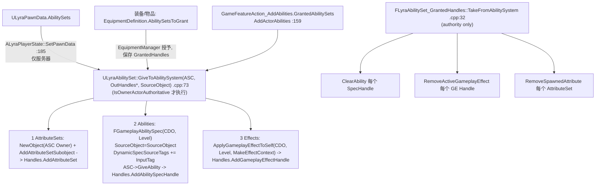
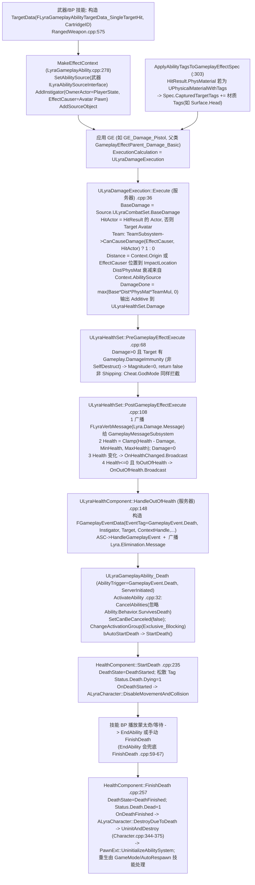

# 20 - AbilitySystem（GAS）与 Input（EnhancedInput + Tag 绑定）

范围：`Source/LyraGame/AbilitySystem/**`、`Source/LyraGame/Input/**`，以及 `Character/LyraHeroComponent.cpp` 中与输入绑定相关的部分。
引擎版本 UE 5.8。文件路径均相对 `Source/LyraGame/`，行号为当前磁盘源码行号。

---

## 1. 职责概述

这一块解决三件事：

1. **把 GAS 改造成"数据驱动 + 玩家状态持久"的形态**：ASC 挂在 `ALyraPlayerState` 上（Owner = PlayerState，Avatar = 当前 Pawn），技能/属性/GE 通过 `ULyraAbilitySet` DataAsset 成组授予与撤销；`ULyraGameplayAbility` 在原生 GA 上增加了激活策略（Activation Policy）、激活组（Activation Group）、额外消耗（`ULyraAbilityCost`）、失败消息、相机模式等。
2. **把 EnhancedInput 的 InputAction 通过 GameplayTag 映射到技能**：`ULyraInputConfig`（DataAsset）保存 `InputAction <-> InputTag`，`ULyraHeroComponent` 绑定后调用 ASC 的 `AbilityInputTagPressed/Released`，在 `PostProcessInput` 里由 `ProcessAbilityInput` 统一决定激活哪些技能。技能侧只需要在 AbilitySet 里声明 `InputTag`，不需要知道按键。
3. **提供标准的伤害/治疗/死亡管线**：GE + `ULyraDamageExecution`（读 `ULyraCombatSet::BaseDamage`、做距离/物理材质衰减、队伍判定）-> `ULyraHealthSet` 的元属性 `Damage` -> 扣 `Health` -> `OnOutOfHealth` -> `ULyraHealthComponent` 发 `GameplayEvent.Death` -> `ULyraGameplayAbility_Death` -> `StartDeath/FinishDeath`。

另外包含：全局技能/效果（`ULyraGlobalAbilitySystem`）、游戏阶段（`ULyraGamePhaseSubsystem`，基于 GameState 上的 ASC 与技能）、GameplayCue 管理器（`ULyraGameplayCueManager`，延迟加载 Cue）、自定义 `FGameplayEffectContext`（`FLyraGameplayEffectContext`）、玩家可映射按键设置与若干输入修饰器。

---

## 2. 关键类表

### 2.1 AbilitySystem

| 类名 | 文件:行 | 职责 |
|---|---|---|
| `ULyraAbilitySystemComponent` | `AbilitySystem/LyraAbilitySystemComponent.h:28` / `.cpp` | 项目 ASC。输入缓冲与处理（`AbilityInputTagPressed/Released` .cpp:186/201，`ProcessAbilityInput` .cpp:216）、激活组计数（.cpp:407-480）、TagRelationshipMapping 应用（.cpp:356-390）、OnSpawn 技能（.cpp:85）、失败通知（.cpp:330-405）、动态 Tag GE（.cpp:482-518）、`InitAbilityActorInfo` 扩展（.cpp:39） |
| `ULyraGameplayAbility` | `AbilitySystem/Abilities/LyraGameplayAbility.h:101` / `.cpp` | 项目 GA 基类（Abstract）。`ActivationPolicy`/`ActivationGroup`/`AdditionalCosts`/`FailureTagToUserFacingMessages`/`FailureTagToAnimMontage`。重写 `CanActivateAbility`(.cpp:136)、`CheckCost`(202)、`ApplyCost`(224)、`MakeEffectContext`(278)、`DoesAbilitySatisfyTagRequirements`(316)、`TryActivateAbilityOnSpawn`(442)、`ChangeActivationGroup`(497)、`SetCameraMode`(520) |
| `ELyraAbilityActivationPolicy` | `LyraGameplayAbility.h:39` | `OnInputTriggered` / `WhileInputActive` / `OnSpawn` |
| `ELyraAbilityActivationGroup` | `LyraGameplayAbility.h:58` | `Independent` / `Exclusive_Replaceable` / `Exclusive_Blocking` / `MAX` |
| `ULyraGameplayAbility_Death` | `Abilities/LyraGameplayAbility_Death.h:22` / `.cpp:14` | 死亡技能：由 `GameplayEvent.Death` 触发（CDO 构造里加 Trigger，.cpp:22-29），取消其他技能、切到 `Exclusive_Blocking`、`StartDeath()`；EndAbility 时 `FinishDeath()` |
| `ULyraGameplayAbility_Reset` | `Abilities/LyraGameplayAbility_Reset.h:23` / `.cpp:12` | 由 `GameplayEvent.RequestReset` 触发（仅服务器），取消技能、`Character->Reset()`、广播 `GameplayEvent.Reset` 消息 |
| `ULyraGameplayAbility_Jump` | `Abilities/LyraGameplayAbility_Jump.h:21` / `.cpp:13` | 跳跃：`CanActivateAbility` 先判 `CanJump()`；`CharacterJumpStart/Stop` 仅在本地控制时调用 |
| `ULyraAbilityCost` | `Abilities/LyraAbilityCost.h:18` | 额外消耗基类（`DefaultToInstanced, EditInlineNew, Abstract`）：`CheckCost` / `ApplyCost` / `bOnlyApplyCostOnHit` |
| `ULyraAbilityCost_ItemTagStack` | `Abilities/LyraAbilityCost_ItemTagStack.h:23` | 消耗装备物品实例上的 TagStack（弹药）；仅支持 `ULyraGameplayAbility_FromEquipment`；失败 Tag 默认 `Ability.ActivateFail.Cost` |
| `ULyraAbilityCost_PlayerTagStack` | `Abilities/LyraAbilityCost_PlayerTagStack.h:22` | 消耗 `ALyraPlayerState` 上的 TagStack |
| `ULyraAbilityCost_InventoryItem` | `Abilities/LyraAbilityCost_InventoryItem.h:24` | 实现被 `#if 0` 注释掉，`CheckCost` 恒返回 false，**不可用** |
| `FLyraAbilitySimpleFailureMessage` | `Abilities/LyraAbilitySimpleFailureMessage.h:14` | 失败文字消息载荷，Channel = `Ability.UserFacingSimpleActivateFail.Message` |
| `FLyraAbilityMontageFailureMessage` | `Abilities/LyraGameplayAbility.h:74` | 失败播放蒙太奇消息载荷，Channel = `Ability.PlayMontageOnActivateFail.Message` |
| `ULyraAbilitySet` / `FLyraAbilitySet_GrantedHandles` | `AbilitySystem/LyraAbilitySet.h:124` / `:90` | 只读 DataAsset：一次授予一组 Ability（带 InputTag）、GE、AttributeSet；Handles 用于撤销（`.cpp:73` `GiveToAbilitySystem`，`.cpp:32` `TakeFromAbilitySystem`） |
| `ULyraAbilityTagRelationshipMapping` | `AbilitySystem/LyraAbilityTagRelationshipMapping.h:42` | DataAsset：AbilityTag -> 要 Block/Cancel 的 AbilityTag、隐式 ActivationRequired/Blocked Tags |
| `ULyraAttributeSet` | `Attributes/LyraAttributeSet.h:52` | 属性集基类 + `ATTRIBUTE_ACCESSORS` 宏（:29）+ `FLyraAttributeEvent` 委托（:44） |
| `ULyraHealthSet` | `Attributes/LyraHealthSet.h:32` / `.cpp` | Health/MaxHealth + 元属性 Healing/Damage；免疫、作弊、clamp、OutOfHealth 广播 |
| `ULyraCombatSet` | `Attributes/LyraCombatSet.h:21` | BaseDamage / BaseHeal（`COND_OwnerOnly` 复制），作为 Execution 的来源属性 |
| `ULyraDamageExecution` | `Executions/LyraDamageExecution.h:18` / `.cpp:36` | 伤害计算：捕获 Source.BaseDamage，乘距离衰减、物理材质衰减、队伍系数，输出到 `Damage`（仅 `WITH_SERVER_CODE`） |
| `ULyraHealExecution` | `Executions/LyraHealExecution.h:18` / `.cpp:32` | 治疗计算：Source.BaseHeal -> `Healing` |
| `ULyraAbilitySystemGlobals` | `AbilitySystem/LyraAbilitySystemGlobals.h:13` / `.cpp:16` | 让 GAS 分配 `FLyraGameplayEffectContext`（DefaultGame.ini:13 指定） |
| `FLyraGameplayEffectContext` | `AbilitySystem/LyraGameplayEffectContext.h:16` / `.cpp` | 扩展 Context：`CartridgeID`、`AbilitySourceObject`（弱引用，不复制）、`GetPhysicalMaterial()`、`ExtractEffectContext()`（.cpp:16） |
| `FLyraGameplayAbilityTargetData_SingleTargetHit` | `AbilitySystem/LyraGameplayAbilityTargetData_SingleTargetHit.h:15` | 在 SingleTargetHit 上追加 `CartridgeID`（多弹丸同一弹壳识别），`AddTargetDataToContext` 写入 Context |
| `ILyraAbilitySourceInterface` | `AbilitySystem/LyraAbilitySourceInterface.h:20` | 伤害来源（武器）提供 `GetDistanceAttenuation` / `GetPhysicalMaterialAttenuation`；实现者：`ULyraRangedWeaponInstance`（`Weapons/LyraRangedWeaponInstance.h:20`） |
| `ULyraGlobalAbilitySystem` | `AbilitySystem/LyraGlobalAbilitySystem.h:47` / `.cpp` | WorldSubsystem：对所有已注册 ASC 授予/移除技能与 GE，新 ASC 注册时补发 |
| `ULyraGameplayCueManager` | `AbilitySystem/LyraGameplayCueManager.h:21` / `.cpp` | Cue 加载策略（预加载/按需）、`Lyra.DumpGameplayCues` 控制台命令、GameFeature Cue 路径 |
| `ALyraTaggedActor` | `AbilitySystem/LyraTaggedActor.h:13` | 带静态 `StaticGameplayTags` 的 Actor（实现 `IGameplayTagAssetInterface`），让没有 ASC 的东西也能被 Tag 查询 |
| `ULyraGamePhaseAbility` | `AbilitySystem/Phases/LyraGamePhaseAbility.h:14` | 游戏阶段技能基类，`GamePhaseTag`；`ServerInitiated`/`ServerOnly` |
| `ULyraGamePhaseSubsystem` | `AbilitySystem/Phases/LyraGamePhaseSubsystem.h:46` / `.cpp` | 在 **GameState 的 ASC** 上 `GiveAbilityAndActivateOnce` 阶段技能；按 Tag 层级结束兄弟阶段；观察者回调 |

### 2.2 Input

| 类名 | 文件:行 | 职责 |
|---|---|---|
| `ULyraInputConfig` / `FLyraInputAction` | `Input/LyraInputConfig.h:39` / `:20` | DataAsset：`NativeInputActions`（手动绑定，如 Move/Look）与 `AbilityInputActions`（自动绑定到技能）两个 `InputAction <-> InputTag` 列表；查找函数 `.cpp:14`/`:32` |
| `ULyraInputComponent` | `Input/LyraInputComponent.h:21` | `BindNativeAction`(.h:43)、`BindAbilityActions`(.h:53，对每条记录绑 `Triggered`->Pressed、`Completed`->Released，把 InputTag 作为参数)、`RemoveBinds`(.cpp:33)；`AddInputMappings/RemoveInputMappings` 是空钩子 |
| `ULyraHeroComponent`（输入部分） | `Character/LyraHeroComponent.cpp` | `InitializePlayerInput`(:225)、`AddAdditionalInputConfig`(:304)、`Input_AbilityInputTagPressed/Released`(:343/:357)、`Input_Move/LookMouse/LookStick/Crouch/AutoRun`(:374-469) |
| `ULyraPlayerInput` | `Input/LyraPlayerInput.h:17` | 继承 `UEnhancedPlayerInput`，在 `InputKey` 里为 Reflex 延迟标记（LMB 触发 flash）；与技能无关 |
| `ULyraInputUserSettings` | `Input/LyraInputUserSettings.h:18` | `UEnhancedInputUserSettings` 子类（DefaultInput.ini:51），目前只是空钩子 |
| `ULyraPlayerMappableKeyProfile` | `Input/LyraPlayerMappableKeyProfile.h:12` | 按键 Profile 子类（DefaultInput.ini:52），Equip/UnEquip 空钩子 |
| `ULyraPlayerMappableKeySettings` | `Input/LyraInputUserSettings.h:43` | 每个键映射的附加设置（Tooltip）。`GetTooltipText()` **只声明未定义**（全工程无实现） |
| `ULyraSettingBasedScalar` | `Input/LyraInputModifiers.h:21` | 按 `ULyraSettingsShared` 上 double 属性名缩放轴（鼠标灵敏度），缓存 FProperty |
| `ULyraInputModifierDeadZone` | `LyraInputModifiers.h:69` | 死区阈值取自共享设置（Move/Look 摇杆） |
| `ULyraInputModifierGamepadSensitivity` | `LyraInputModifiers.h:107` | 手柄灵敏度预设（Normal/ADS）-> `ULyraAimSensitivityData` 查表 |
| `ULyraInputModifierAimInversion` | `LyraInputModifiers.h:126` | 按设置反转 X/Y |
| `ULyraAimSensitivityData` | `Input/LyraAimSensitivityData.h:17` | `ELyraGamepadSensitivity -> float` 表（Slow 0.5 ... Insane 2.5） |

### 2.3 相关外部类（理解流程必需）

| 类名 | 文件:行 | 说明 |
|---|---|---|
| `ALyraPlayerState` | `Player/LyraPlayerState.cpp:31-44` | 构造时创建 ASC（`Mixed` 复制模式，`SetIsReplicated(true)`）、`ULyraHealthSet`、`ULyraCombatSet`；`SetNetUpdateFrequency(100)`；`PostInitializeComponents`(:167) 里 `InitAbilityActorInfo(this, GetPawn())`；`SetPawnData`(:185) 授予 `PawnData->AbilitySets` |
| `ALyraGameState` | `GameModes/LyraGameState.cpp:28,43-47` | 也有一个 ASC（`Mixed`），`InitAbilityActorInfo(this, this)`，用于 GamePhase 与全局状态技能 |
| `ULyraPawnExtensionComponent` | `Character/LyraPawnExtensionComponent.cpp:105,152,185` | `InitializeAbilitySystem(ASC, Owner)` / `UninitializeAbilitySystem()` / `HandleControllerChanged()` |
| `ULyraPawnData` | `Character/LyraPawnData.h:25` | `AbilitySets`(:41)、`TagRelationshipMapping`(:45)、`InputConfig`(:49)、`DefaultCameraMode` |
| `ALyraPlayerController::PostProcessInput` | `Player/LyraPlayerController.cpp:375` | 调用 `LyraASC->ProcessAbilityInput` |
| `ULyraHealthComponent` | `Character/LyraHealthComponent.cpp` | 监听 HealthSet 委托，发 Death 事件，管理 DeathState（NotDead/DeathStarted/DeathFinished） |
| `ALyraCharacter` | `Character/LyraCharacter.cpp:197,339,344,367,375` | `OnAbilitySystemInitialized` 初始化 HealthComponent；Death 回调禁用移动/碰撞、销毁 |

---

## 3. 核心流程与数据流

### 3.1 ASC 所有权：PlayerState 是 Owner，Pawn 是 Avatar

- **ASC 与 AttributeSet 在 `ALyraPlayerState` 构造中创建**（`Player/LyraPlayerState.cpp:34-40`）。Owner = PlayerState，Avatar = 当前 Pawn。
- **原因**：PlayerState 的生命周期跨越死亡与重生（Pawn 被销毁、新 Pawn 生成），因此已授予的技能、属性（含 BaseDamage）、冷却 GE、TagStack 弹药等不会随 Pawn 丢失；同时 PlayerState 对所有客户端复制，并且 `Mixed` 复制模式下 GE 只向 owner 全量复制、向模拟端只复制 Tag/Cue，带宽小。`SetNetUpdateFrequency(100)` 因为 ASC 需要高频更新。
- **Avatar 绑定**：Pawn 的 `ULyraHeroComponent` 走 InitState 链（`CanChangeInitState` :76 -> `DataAvailable -> DataInitialized`），在 `HandleChangeInitState`(:145) 中调用 `PawnExtComp->InitializeAbilitySystem(LyraPS->GetLyraAbilitySystemComponent(), LyraPS)`（:164）-> `ASC->InitAbilityActorInfo(PlayerState, Pawn)`（`LyraPawnExtensionComponent.cpp:142`）并 `SetTagRelationshipMapping(PawnData->TagRelationshipMapping)`（:147）。
- `ULyraAbilitySystemComponent::InitAbilityActorInfo`(.cpp:39) 在"新的 Pawn Avatar"时额外做：
  1. 对所有已授予技能的实例调用 `OnPawnAvatarSet()`（BP 事件 `OnPawnAvatarSet`）；
  2. `ULyraGlobalAbilitySystem::RegisterASC`（补发全局技能/GE）；
  3. `LyraAnimInstance->InitializeWithAbilitySystem`；
  4. `TryActivateAbilitiesOnSpawn()`（激活所有 `OnSpawn` 策略的技能）。
- **Pawn 死亡/销毁时**：`UninitializeAbilitySystem`（`LyraPawnExtensionComponent.cpp:152`）取消除带 `Ability.Behavior.SurvivesDeath` 之外的所有技能、`ClearAbilityInput()`、`RemoveAllGameplayCues()`、`SetAvatarActor(nullptr)`。新 Pawn 重新 `InitAbilityActorInfo` 时 OnSpawn 技能会被重新激活。
- 客户端若新 Pawn 先于旧 Pawn 销毁，`InitializeAbilitySystem`(:128-139) 会把旧 Pawn 踢出 Avatar。
- GameState 上的 ASC：`Owner = Avatar = GameState`（没有 Pawn），因此不会被 `RegisterASC` 注册进全局系统（该注册只发生在 `bHasNewPawnAvatar` 分支）。

### 3.2 激活策略与激活组

**ActivationPolicy**（`LyraGameplayAbility.h:39`，默认 `OnInputTriggered`，ctor .cpp:44）：

| 策略 | 触发点 |
|---|---|
| `OnInputTriggered` | `ProcessAbilityInput`（.cpp:267）：该帧按下且技能未激活 -> 加入 `AbilitiesToActivate`；若已激活则转发 InputPressed 事件（供 `WaitInputPress` 任务） |
| `WhileInputActive` | `ProcessAbilityInput`（.cpp:232-245）：输入保持期间，只要技能未激活就每帧尝试激活（连发武器） |
| `OnSpawn` | `TryActivateAbilityOnSpawn`（`LyraGameplayAbility.cpp:442`）：在 `OnGiveAbility`(:180) 与 `InitAbilityActorInfo`（新 Avatar）时尝试；条件：有 Avatar、Avatar 未 TearOff 且 `GetLifeSpan() <= 0`；并按 NetExecutionPolicy 判断由客户端（本地控制 + LocalPredicted/LocalOnly）还是服务器（ServerOnly/ServerInitiated）激活 |

**ActivationGroup**（`LyraGameplayAbility.h:58`，默认 `Independent`；计数数组 `ActivationGroupCounts` 在 ASC `.h:107`）：

| 组 | 语义 |
|---|---|
| `Independent` | 不受别的技能影响，也不影响别的技能 |
| `Exclusive_Replaceable` | 激活新的 Exclusive 技能时被取消并替换；该类技能不能 `SetCanBeCanceled(false)`（`LyraGameplayAbility.cpp:162-172` 报错拒绝） |
| `Exclusive_Blocking` | 运行期间阻止任何 Exclusive 技能激活（`IsActivationGroupBlocked` .cpp:407 判断 `Blocking` 计数 > 0；`CanActivateAbility` :150 返回 false 并加 `Ability.ActivateFail.ActivationGroup`） |

- 技能激活时 `NotifyAbilityActivated`(.cpp:320) -> `AddAbilityToActivationGroup`(:432)：Exclusive 组激活会 `CancelActivationGroupAbilities(Exclusive_Replaceable, 自己)`（:449）；结束时 `NotifyAbilityEnded`(:346) 减计数。
- 运行中可 `ChangeActivationGroup`(`LyraGameplayAbility.cpp:497`)。典型：Death 技能先 `SetCanBeCanceled(false)` 再 `ChangeActivationGroup(Exclusive_Blocking)`（`LyraGameplayAbility_Death.cpp:44-49`）。`CanChangeActivationGroup`(:467) 规则：非 Blocking 技能不能切入被阻塞的组；技能不可取消时不能变成 Replaceable。
- 同时存在的 Exclusive 技能数 > 1 时 `ensure` 失败并打 Error（ASC .cpp:457-461）。
- 激活组是"代码硬规则"，更灵活的互斥由 Tag 关系映射（见 3.6）负责，源码注释里也说激活组检查"Possibly remove after setting up tag relationships"（`LyraGameplayAbility.cpp:148`）。

### 3.3 输入 -> 技能（端到端）

```mermaid
sequenceDiagram
    participant HW as 键鼠/手柄
    participant EI as EnhancedInput(IMC+IA)
    participant IC as ULyraInputComponent
    participant HC as ULyraHeroComponent
    participant PC as ALyraPlayerController
    participant ASC as ULyraAbilitySystemComponent
    participant GA as ULyraGameplayAbility

    Note over HC,IC: 初始化: InitializePlayerInput (HeroComponent.cpp:225)
    HC->>EI: Subsystem->ClearAllMappings + AddMappingContext(DefaultInputMappings)
    HC->>IC: BindAbilityActions(PawnData->InputConfig, Pressed, Released)
    IC->>EI: BindAction(IA, Triggered, Pressed, InputTag) / (IA, Completed, Released, InputTag)

    HW->>EI: 按键
    EI->>IC: 触发 Triggered(InputTag)
    IC->>HC: Input_AbilityInputTagPressed(InputTag) (:343)
    HC->>ASC: AbilityInputTagPressed(InputTag) (.cpp:186)
    Note over ASC: 遍历 ActivatableAbilities, 匹配 Spec.GetDynamicSpecSourceTags().HasTagExact(InputTag)<br/>-> InputPressedSpecHandles + InputHeldSpecHandles
    PC->>ASC: PostProcessInput -> ProcessAbilityInput(dt) (PlayerController.cpp:375)
    alt 带有 Gameplay.AbilityInputBlocked
        ASC->>ASC: ClearAbilityInput, return
    else
        ASC->>ASC: 1) Held 且 Policy=WhileInputActive 且未激活 -> AbilitiesToActivate
        ASC->>ASC: 2) Pressed: 已激活 -> AbilitySpecInputPressed(转发 InputPressed 事件); 未激活且 Policy=OnInputTriggered -> AbilitiesToActivate
        ASC->>GA: 3) TryActivateAbility(handle) -> CanActivateAbility / CheckCost / Tag 检查
        ASC->>ASC: 4) Released: InputPressed=false, 已激活则 AbilitySpecInputReleased
        ASC->>ASC: 清空 Pressed/Released 缓冲 (Held 保留直到 Released)
    end
    EI->>IC: Completed -> Input_AbilityInputTagReleased -> ASC->AbilityInputTagReleased (从 Held 移除)
```

关键点：

- **InputTag 存放位置**：`FGameplayAbilitySpec::DynamicSpecSourceTags`，由 `ULyraAbilitySet::GiveToAbilitySystem` 在授予时写入（`LyraAbilitySet.cpp:118`）。技能 CDO 本身不含输入信息，同一个 GA 类可在不同 AbilitySet 中绑定到不同输入。
- `BindAbilityActions`（`LyraInputComponent.h:53`）：`Triggered` 绑 Pressed，`Completed` 绑 Released。注意用的是 `Triggered` 而不是 `Started`：持续按住时每帧都会调用 Pressed，ASC 里用 `AddUnique` 去重。若 IA 配的是 Tap/Hold 等触发器，Pressed/Released 时机会随之改变。
- 先把 Held 与 Pressed 都收集进 `AbilitiesToActivate`（`static TArray`）再统一 `TryActivateAbility`（.cpp:276-284），避免"按住激活后又因本帧 Pressed 给刚激活的技能发 InputPressed 事件"。
- `ULyraAbilitySystemComponent::AbilitySpecInputPressed/Released`(.cpp:150/168) 不支持 `bReplicateInputDirectly`，改用 `InvokeReplicatedEvent(InputPressed/Released)`，因此 `WaitInputPress/Release` AbilityTask 才能工作。
- **输入阻塞**：ASC 带 `Gameplay.AbilityInputBlocked`（`TAG_Gameplay_AbilityInputBlocked`，.cpp:17）时 `ProcessAbilityInput` 直接清空缓冲并返回；资产 `Content/GameplayEffects/GE_BlockAbilityInput`（Infinite GE，授予该 Tag）。
- **原生输入**（Move/Look/Crouch/AutoRun）不经过 ASC：`BindNativeAction(InputConfig, LyraGameplayTags::InputTag_Move, ETriggerEvent::Triggered, ...)`（`LyraHeroComponent.cpp:285-289`，`bLogIfNotFound=false`，缺失不报错）。
- **GameFeature 追加输入**：`UGameFeatureAction_AddInputBinding`（`GameFeatures/GameFeatureAction_AddInputBinding.cpp:105-140`）在 `NAME_BindInputsNow` 事件或扩展添加时，对 `IsReadyToBindInputs()` 的 HeroComponent 调用 `AddAdditionalInputConfig`(HeroComponent.cpp:304)，把额外的 `ULyraInputConfig`（如 `InputData_ShooterGame_AddOns`）绑上。`UGameFeatureAction_AddInputContextMapping`（`.cpp:240-256`）负责加 IMC。

### 3.4 AbilitySet 授予与撤销



- 授予顺序：**属性集 -> 技能 -> 效果**（效果可能依赖刚加的属性集）。
- 只能在权威端执行（两个函数开头都会 `IsOwnerActorAuthoritative()` 早退）。
- `SourceObject` 被写入 `AbilitySpec.SourceObject`，`ULyraGameplayAbility::GetAbilitySource`(`LyraGameplayAbility.cpp:428`) 会把它 `Cast<ILyraAbilitySourceInterface>`——武器技能因此能把武器实例变成伤害来源。
- `OutGrantedHandles` 传 `nullptr` 就等于"永不撤销"：`ALyraPlayerState::SetPawnData`(:207) 即如此。
- `FLyraAbilitySet_GameplayAbility::InputTag` 带 `Meta=(Categories="InputTag")`，只能选 `InputTag.*`；InputTag 可为空（纯被动/OnSpawn/事件触发技能）。

### 3.5 伤害 -> 死亡管线



补充细节：

- **Health 对修改器隐藏**：`Health` 属性 `Meta=(HideFromModifiers)`（`LyraHealthSet.h:74`），普通 GE 修改器不能直接改血，只能走 `Damage`（同样隐藏）元属性或 Execution。`Healing` 元属性没有 `HideFromModifiers`，普通 GE 可直接加 `Healing`。
- `PreAttributeBaseChange/PreAttributeChange` 对 `Health` 夹到 `[0, MaxHealth]`，`MaxHealth` 下限 1（`ClampAttribute` .cpp:221）。`PostAttributeChange`(:199)：MaxHealth 降到低于当前 Health 时用 `ApplyModToAttribute(Override)` 压回，并在 Health>0 时复位 `bOutOfHealth`。
- **客户端侧**：`OnRep_Health`(.cpp:38) 用估算幅度广播 `OnHealthChanged`/`OnOutOfHealth`（instigator/causer/spec 均为 null）。`HandleOutOfHealth` 里 `AbilitySystemComponent && DamageEffectSpec` 与 `WITH_SERVER_CODE` 保证只在服务器发 Death 事件；客户端的死亡表现靠 `DeathState` 复制（`OnRep_DeathState` :190 会补走 StartDeath/FinishDeath）。
- `DamageExecution` 全在 `#if WITH_SERVER_CODE`，客户端无预测伤害；`DefaultGame.ini:20` `PredictTargetGameplayEffects=False`。
- **自杀/掉出世界**：`ULyraHealthComponent::DamageSelfDestruct`(:279) 应用 `ULyraGameData::DamageGameplayEffect_SetByCaller`（`SetByCaller.Damage` = MaxHealth），并给 Spec 加动态 Tag `Gameplay.Damage.SelfDestruct`（可穿透免疫/GodMode）与 `Gameplay.Damage.FellOutOfWorld`；`ALyraCharacter::FellOutOfWorld`(Character.cpp:334) 调用它。
- **治疗**：`ULyraHealExecution` 读 `BaseHeal` 输出 `Healing`，`PostGameplayEffectExecute` 加回 Health（clamp 到 MaxHealth）。

### 3.6 Tag 关系映射与激活检查

- `ULyraGameplayAbility::DoesAbilitySatisfyTagRequirements`(`LyraGameplayAbility.cpp:316`) 重写了 GAS 默认逻辑：
  1. `AreAbilityTagsBlocked(GetAssetTags())` -> blocked；
  2. 取 CDO 的 `ActivationRequiredTags/ActivationBlockedTags`，再用 `LyraASC->GetAdditionalActivationTagRequirements(AssetTags, ...)`（ASC .cpp:379）并入 `TagRelationshipMapping` 的隐式要求/阻塞；
  3. ASC 拥有 blocked Tag 时，若同时有 `Status.Death`（层级匹配 Dying/Dead）则在 `OptionalRelevantTags` 加 `Ability.ActivateFail.IsDead`（:356-360）；
  4. blocked 优先于 missing，分别加 `ActivateFailTagsBlockedTag` / `ActivateFailTagsMissingTag`。
- 激活后 `ApplyAbilityBlockAndCancelTags`（ASC .cpp:356）把技能的 AbilityTags 通过映射表扩展成额外的 Block/Cancel Tag，再交给基类。
- 数据资产示例：`ShooterCore/Content/Game/TagRelationships_ShooterHero`（`Ability.Type.Action.*` 之间互斥、`Status.Death.Dying/Dead`、`Movement.Mode.Falling` 作为 ActivationBlocked 等）。映射表通过 `ULyraPawnData::TagRelationshipMapping` 指定，在 `InitializeAbilitySystem` 时设置到 ASC（所以**不同 PawnData 可有不同互斥规则**）。

### 3.7 技能消耗（Cost）

- `ULyraGameplayAbility` 有 `AdditionalCosts`（`UPROPERTY(EditDefaultsOnly, Instanced)`，`.h:202`），在 `CheckCost`(.cpp:202，先过基类 GE 消耗) 与 `ApplyCost`(.cpp:224) 逐个调用 `ULyraAbilityCost`。
- `bOnlyApplyCostOnHit`：`ApplyCost` 里通过 `DetermineIfAbilityHitTarget`（仅权威端，读 `ASC->GetAbilityTargetData` 判断 TargetData 是否带 HitResult）决定是否扣费（.cpp:231-273），例如"打中才扣"。
- `CheckCost` 失败时消耗类应在 `OptionalRelevantTags` 里加失败 Tag（如 `Ability.ActivateFail.Cost`），上层会据此给反馈。
- 消耗在 `ApplyCost` 里只在 `ActorInfo->IsNetAuthority()` 时真正扣（服务器权威）；客户端 `CheckCost` 读复制数据做预判。

### 3.8 技能失败消息

1. `TryActivateAbility` 失败 -> `ASC::NotifyAbilityFailed`(.cpp:330)：若 Avatar 不是本地控制且技能支持网络，走 `ClientNotifyAbilityFailed`（`UFUNCTION(Client, Unreliable)`，.cpp:392）通知拥有者客户端；否则本地直接处理。
2. `HandleAbilityFailed`(.cpp:397) -> `ULyraGameplayAbility::OnAbilityFailedToActivate` -> `NativeOnAbilityFailedToActivate`(`LyraGameplayAbility.cpp:102`) + BP 事件 `ScriptOnAbilityFailedToActivate`。
3. Native 实现遍历失败 Tag：
   - 在 `FailureTagToUserFacingMessages`（Tag->FText）命中第一个 -> 通过 `UGameplayMessageSubsystem` 在 `Ability.UserFacingSimpleActivateFail.Message` 广播 `FLyraAbilitySimpleFailureMessage`（UI 订阅后弹字）；
   - 在 `FailureTagToAnimMontage`（Tag->Montage）命中 -> 在 `Ability.PlayMontageOnActivateFail.Message` 广播 `FLyraAbilityMontageFailureMessage`（角色/动画侧订阅后播放，如没子弹时的空枪动作）。

### 3.9 GameplayCue

- C++ 里**没有**主动 `ExecuteGameplayCue`；Cue 由 GE（`GE_GameplayCueTest_*`）、BP 技能触发。
- `ULyraGameplayCueManager`（`DefaultGame.ini:16` `GlobalGameplayCueManagerClass`）：
  - `GameplayCueNotifyPaths=/Game/GameplayCueNotifies` 与 `/Game/GameplayCues`（ini:18-19）；GameFeature 通过 `UGameFeatureAction_AddGameplayCuePath`（默认目录 `/GameplayCues`）+ `ULyraGameFeature_AddGameplayCuePaths`（`GameFeatures/LyraGameFeaturePolicy.cpp:22,91`）动态加入。
  - `LyraGameplayCueManagerCvars::LoadMode`（.cpp:37）静态为 `LoadUpfront`：启动时 `ShouldAsyncLoadRuntimeObjectLibraries()` 返回 true，全部 Cue 一次性加载（编辑器 PIE 短、Cue 不会丢）；改成 `PreloadAsCuesAreReferenced(_GameOnly)` 则按 Tag 被引用时异步预加载（`OnGameplayTagLoaded -> ProcessTagToPreload`），客户端（非专用服务器）才延迟加载（`ShouldDelayLoadGameplayCues` :381）。
  - `ShouldSyncLoadMissingGameplayCues=false`、`ShouldAsyncLoadMissingGameplayCues=true`：缺失的 Cue 触发时异步加载（首次可能错过一次表现）。
  - 调试：控制台 `Lyra.DumpGameplayCues [Refs]`。
- `ALyraCharacter` 实现 `IGameplayCueInterface`（Character.h:98），可在角色蓝图里响应 Cue。

### 3.10 全局技能/效果

- `ULyraGlobalAbilitySystem`（World Subsystem）：`ApplyAbilityToAll / ApplyEffectToAll / RemoveAbilityFromAll / RemoveEffectFromAll`（BlueprintAuthorityOnly）。
- 状态：`AppliedAbilities`/`AppliedEffects`（类 -> {ASC -> Handle}）与 `RegisteredASCs`。
- `RegisterASC`(.cpp:126)：由 ASC 在拿到新的 Pawn Avatar 时调用，把所有已生效的全局技能/GE 补发给它；`UnregisterASC`(:142) 在 ASC `EndPlay`（ASC.cpp:29-37）里调用。
- 授予方式很"简"：技能 `FGameplayAbilitySpec(CDO)`（Level 1，无 InputTag）、GE 以 Level 1 `ApplyGameplayEffectToSelf`；同一类重复 `ApplyXToAll` 会被忽略（`Contains` 判断）。
- 内容示例：`ShooterCore/Content/Experiences/Phases/GE_DamageImmunity_FromGameMode`（赛前免伤）。

### 3.11 自定义 GameplayEffectContext 与复制

- 启用：`AbilitySystemGlobalsClassName=/Script/LyraGame.LyraAbilitySystemGlobals`（`DefaultGame.ini:13`），`AllocGameplayEffectContext` 返回 `FLyraGameplayEffectContext`。
- 新增字段：
  - `CartridgeID`：**不复制**（`NetSerialize` 只调基类，.cpp:27-35 注释说明）。仅在服务器处理 TargetData 时有效。
  - `AbilitySourceObject`（`TWeakObjectPtr<const UObject>`）：**不复制**，注释 "Only valid on the authority"。`SetAbilitySource`(.cpp:44)/`GetAbilitySource`(:50)。
- `Duplicate()`(.h:39) 深拷贝 HitResult。`TStructOpsTypeTraits` 启用 `WithNetSerializer` 与 `WithCopy`。
- **Iris**：`.cpp:37-42` 用 `UE_NET_IMPLEMENT_FORWARDING_NETSERIALIZER_AND_REGISTRY_DELEGATES(LyraGameplayEffectContext, FGameplayEffectContextNetSerializer)` 转发到引擎的 Context 序列化器。**如果以后让 `NetSerialize` 序列化新字段，必须写自定义 NetSerializer**，当前 fallback 不够（代码里有注释）。
- 填充方式：`ULyraGameplayAbility::MakeEffectContext`（.cpp:278）设置 AbilitySource（`GetAbilitySource` 取 SourceObject 的 `ILyraAbilitySourceInterface`）、`AddInstigator(OwnerActor, Avatar)`、`AddSourceObject`；`FLyraGameplayAbilityTargetData_SingleTargetHit::AddTargetDataToContext` 追加 `CartridgeID`。
- `ULyraDamageExecution` 通过 `ExtractEffectContext` 读取 Context 并用 AbilitySource 做衰减；若 GE 不是由 `ULyraGameplayAbility::MakeEffectContext` 产生（例如 `ASC->MakeEffectContext()` 的自杀 GE），AbilitySource 为空，则衰减系数为 1，距离回退到 `EffectCauser` 位置或 `WORLD_MAX`（并打 Error）。

### 3.12 游戏阶段（Game Phase）

- `ULyraGamePhaseSubsystem::StartPhase`(.cpp:50)：在 GameState 的 ASC 上 `GiveAbilityAndActivateOnce`（Spec 的 SourceObject = Subsystem）。
- `ULyraGamePhaseAbility::ActivateAbility/EndAbility`（`LyraGamePhaseAbility.cpp:25/37`）仅权威端回调 Subsystem `OnBeginPhase/OnEndPhase`。
- `OnBeginPhase`(.cpp:136)：对每个正在运行的阶段，若新阶段 Tag **不** `MatchesTag` 旧阶段 Tag（即不是子阶段）则 `CancelAbilitiesByFunc` 结束它；`Game.Playing` 与 `Game.Playing.X` 可共存，`Game.Playing` 与 `Game.GameOver` 不能。
- 观察者：`WhenPhaseStartsOrIsActive` / `WhenPhaseEnds`（精确/前缀匹配），**没有注销接口**（头文件 TODO 注明）。

---

## 4. 与其他模块的接口

| 对方模块 | 交互 |
|---|---|
| Character / PawnExtension / InitState | `InitializeAbilitySystem` 链（3.1）；`ALyraCharacter::OnAbilitySystemInitialized` -> `HealthComponent->InitializeWithAbilitySystem`（Character.cpp:197）；`ULyraPawnData` 提供 `AbilitySets`/`TagRelationshipMapping`/`InputConfig` |
| Player | `ALyraPlayerState` 拥有 ASC + HealthSet + CombatSet；`ALyraPlayerController::PostProcessInput`(:375) 驱动 `ProcessAbilityInput`；`ALyraPlayerState::NAME_LyraAbilityReady` 扩展事件（`SetPawnData` 末尾发出，GameFeatureAction_AddAbilities 据此授予技能） |
| GameFeatures | `UGameFeatureAction_AddAbilities`（`AddActorAbilities` .cpp:159：可加裸 GA、AttributeSet(+初始化 DataTable)、AbilitySet；`RemoveActorAbilities` :231 会 `SetRemoveAbilityOnEnd` 并 `TakeFromAbilitySystem`）；`AddInputBinding`/`AddInputContextMapping`/`AddGameplayCuePath` |
| Equipment / Weapons | 装备授予 AbilitySet（SourceObject=装备实例）；`ULyraGameplayAbility_FromEquipment`、`ULyraGameplayAbility_RangedWeapon`（TargetData -> `CallServerSetReplicatedTargetData` -> `CommitAbility` -> BP 应用 GE）；`ULyraRangedWeaponInstance` 实现 `ILyraAbilitySourceInterface`；`ULyraAbilityCost_ItemTagStack` 扣弹药 |
| Teams | `ULyraTeamSubsystem::CanCauseDamage(Instigator, Target, bAllowDamageToSelf=true)`（`Teams/LyraTeamSubsystem.cpp:345`）被 DamageExecution 调用：同队 0；同一 PlayerState 的自伤默认允许；无队伍目标仅当 Instigator 有队伍且目标有 ASC 才允许 |
| Messages / GameplayMessageRouter | 广播 `Lyra.Damage.Message`、`Lyra.Elimination.Message`（均为 `FLyraVerbMessage`）、`GameplayEvent.Reset`（`FLyraPlayerResetMessage`）、`Ability.UserFacingSimpleActivateFail.Message`、`Ability.PlayMontageOnActivateFail.Message` |
| Camera | `ULyraGameplayAbility::SetCameraMode/ClearCameraMode` -> `ULyraHeroComponent::SetAbilityCameraMode`（技能临时覆盖相机模式，`DetermineCameraMode` HeroComponent.cpp:471） |
| Animation | ASC 在新 Avatar 时 `LyraAnimInstance->InitializeWithAbilitySystem` |
| System | `ULyraGameData`：`DamageGameplayEffect_SetByCaller`、`HealGameplayEffect_SetByCaller`、`DynamicTagGameplayEffect`（`System/LyraGameData.h:35-43`），经 `ULyraAssetManager::GetSubclass` 加载 |
| Settings | 输入修饰器读取 `ULyraSettingsShared`（灵敏度、死区、反转）；`ULyraPlayerInput` 读取 `ULyraSettingsLocal`（延迟标记） |

**用到的主要 GameplayTag**（原生定义在 `LyraGameplayTags.cpp:11-46`，另有几个定义在各自 cpp）：

- 激活失败：`Ability.ActivateFail.{IsDead,Cooldown,Cost,TagsBlocked,TagsMissing,Networking,ActivationGroup}`
- 行为：`Ability.Behavior.SurvivesDeath`
- 输入：`InputTag.{Move,Look.Mouse,Look.Stick,Crouch,AutoRun}`（原生，仅 C++ 绑定）；`InputTag.{Jump,Ability.Dash,Ability.Heal,Ability.Melee,Ability.Emote,Ability.Quickslot*,Ability.ShowLeaderboard,Weapon.Fire,Weapon.FireAuto,Weapon.Reload,Weapon.ADS,Weapon.Grenade}`（ini/内容中定义，用于技能）
- 事件：`GameplayEvent.{Death,Reset,RequestReset}`
- SetByCaller：`SetByCaller.{Damage,Heal}`
- 状态：`Status.{Crouching,AutoRunning,Death,Death.Dying,Death.Dead}`
- 作弊：`Cheat.{GodMode,UnlimitedHealth}`
- 伤害：`Gameplay.Damage`、`Gameplay.DamageImmunity`、`Gameplay.Damage.SelfDestruct`、`Gameplay.Damage.FellOutOfWorld`（LyraHealthSet.cpp:15-19）、`Gameplay.AbilityInputBlocked`（ASC.cpp:17）、`Lyra.Damage.Message`
- 移动模式 Tag：`Movement.Mode.*`（`MovementModeTagMap`，由 Character 同步到 ASC 松散 Tag）

---

## 5. 数据驱动点

| 资产/配置 | 作用 |
|---|---|
| `ULyraAbilitySet`（`AbilitySet_*`，如 `ShooterCore/Game/AbilitySet_ShooterHero`、`Weapons/Pistol/AbilitySet_ShooterPistol`、`Rifle/AbilitySet_ShooterRifle`） | 技能 + InputTag（如 Hero 集合含 Death/Jump/Dash/Emote/Melee/Quickslot/ADS/Grenade/DropWeapon/SpawnEffect，另含 `GE_IsPlayer`；手枪集合含 `Fire_Pistol(InputTag.Weapon.Fire)`、`Reload_Pistol(InputTag.Weapon.Reload)`、`GA_Weapon_AutoReload`；步枪用 `InputTag.Weapon.FireAuto`）、GE、AttributeSet |
| `ULyraPawnData`（`PawnData` 资产，经 Experience 指定） | `AbilitySets`、`TagRelationshipMapping`、`InputConfig`、`DefaultCameraMode` |
| `ULyraInputConfig`（`Content/Input/InputData_Hero`：Native=Move/Look.Mouse/Look.Stick/Crouch/AutoRun；Ability=Jump/Ability.Dash/Ability.Heal/Weapon.Fire/FireAuto/Reload；`ShooterCore/.../InputData_ShooterGame_AddOns`：Emote/Melee/Quickslot.Drop/ShowLeaderboard/ADS/Grenade） | InputAction <-> InputTag |
| `ULyraHeroComponent::DefaultInputMappings`（BP 默认值，`TArray<FInputMappingContextAndPriority>`，`HeroComponent.h:95`） | Pawn 初始化时加的 IMC 与优先级、`bRegisterWithSettings` |
| `UInputMappingContext`（`Content/Input/Mappings/IMC_Default`、`ShooterCore/.../IMC_ShooterGame(_KBM)`、`IMC_ADS_Speed`） | 具体键位；IMC 中可配 `ULyraSettingBasedScalar`（`MouseSensitivityX/Y`）、`ULyraInputModifierDeadZone`（`DeadzoneStick`）、`ULyraInputModifierGamepadSensitivity`（`SensitivityLevelTable`）、PlayerMappableKeySettings |
| `ULyraAbilityTagRelationshipMapping`（`TagRelationships_ShooterHero`） | 技能互斥/取消/隐式 Required/Blocked |
| `ULyraGameplayAbility` CDO 属性 | `ActivationPolicy`、`ActivationGroup`、`AdditionalCosts`、`FailureTagToUserFacingMessages`、`FailureTagToAnimMontage`、AbilityTriggers、AbilityTags、Block/Cancel/Required/Blocked Tags、Net 策略 |
| `ULyraGameData`（`Config` 指定的 DataAsset） | Damage/Heal SetByCaller GE、DynamicTag GE |
| GE 资产 | 伤害/治疗 GE（`Content/GameplayEffects/Damage|Heal/*`、`Weapons/*/GE_Damage_*`）选择 `ULyraDamageExecution`/`ULyraHealExecution` 或 SetByCaller；`GE_BlockAbilityInput`；`GE_DynamicTag` |
| `ULyraAimSensitivityData` | 手柄灵敏度预设表 |
| `DefaultGame.ini:12-30` | `AbilitySystemGlobalsClassName`、`GlobalGameplayCueManagerClass`、`GameplayCueNotifyPaths`、`PredictTargetGameplayEffects=False`、`ReplicateActivationOwnedTags=True`、`ActivateFail*Tag` |
| `DefaultInput.ini:32-33,49-52` | `DefaultPlayerInputClass=LyraPlayerInput`、`DefaultInputComponentClass=LyraInputComponent`、`bEnableUserSettings=True`、`UserSettingsClass=LyraInputUserSettings`、`DefaultPlayerMappableKeyProfileClass=LyraPlayerMappableKeyProfile` |
| `DefaultGameplayTags.ini` | InputTag.* / Ability.Type.* 等内容 Tag |
| Cue 目录 | `/Game/GameplayCueNotifies`、`/Game/GameplayCues`、各 GameFeature 的 `/GameplayCues` |

---

## 6. 扩展与修改配方

### 6.1 新增一个带输入绑定的技能

1. **定义 Tag**：在 `Config/DefaultGameplayTags.ini` 加 `InputTag.Ability.MyAbility`（必须在 `InputTag.` 之下，才能被 `Categories="InputTag"` 的下拉选到）。
2. **创建技能**：C++ 继承 `ULyraGameplayAbility`（或直接 BP 继承它），设 `ActivationPolicy=OnInputTriggered`（连发用 `WhileInputActive`）、`ActivationGroup`、AbilityTags（如 `Ability.Type.Action.MyAbility`，以便被 TagRelationship 控制）。不要用 NonInstanced（会 ensure 报错），默认 `InstancedPerActor`+`LocalPredicted`+`ClientOrServer`。
3. **InputAction**：新建 `IA_MyAbility`（Boolean 型，触发器一般 Down/Pressed），把它放进某个 `IMC_*`（注意 `IMC` 必须被加入 Pawn：`DefaultInputMappings` 或 `GameFeatureAction_AddInputContextMapping`）。
4. **InputConfig**：在 `ULyraInputConfig.AbilityInputActions`（如 `InputData_Hero` 或 GameFeature 的 AddOns 配置）添加 `{IA_MyAbility, InputTag.Ability.MyAbility}`。GameFeature 的追加配置需要 `GameFeatureAction_AddInputBinding` 引用该 Config。
5. **AbilitySet**：在 `AbilitySet_*` 的 `GrantedGameplayAbilities` 添加 `{Ability=GA_MyAbility, AbilityLevel=1, InputTag=InputTag.Ability.MyAbility}`；该 AbilitySet 要被 `PawnData.AbilitySets`、装备定义或 `GameFeatureAction_AddAbilities.GrantedAbilitySets` 引用。
6. **（可选）互斥**：在 `TagRelationships_*` 为 `Ability.Type.Action.MyAbility` 配 Block/Cancel/Required/Blocked。
7. **（可选）失败反馈**：填 `FailureTagToUserFacingMessages` / `FailureTagToAnimMontage`。

三处必须一致：IMC 里有键位 -> InputConfig 里 IA 与 Tag 配对 -> AbilitySet 里技能带同一个 Tag。缺任何一环都是"按键没反应且不报错"。

### 6.2 新增 AttributeSet

1. 继承 `ULyraAttributeSet`，用 `ATTRIBUTE_ACCESSORS(ULyraXSet, Foo)` 生成访问器；属性 `ReplicatedUsing=OnRep_Foo`，`GetLifetimeReplicatedProps` 里 `DOREPLIFETIME_CONDITION_NOTIFY(..., REPNOTIFY_Always)`，`OnRep_Foo` 里 `GAMEPLAYATTRIBUTE_REPNOTIFY`（参考 `LyraCombatSet.cpp:19-35`、`TopDownArena/.../TopDownArenaAttributeSet.h`）。
2. 需要 clamp 就重写 `PreAttributeChange` + `PreAttributeBaseChange`（`LyraHealthSet.cpp:185-197`）；需要对 GE 结果做反应重写 `PostGameplayEffectExecute`。
3. 授予方式三选一：
   - 在 `ALyraPlayerState` 构造里 `CreateDefaultSubobject`（自动被 ASC 发现，`LyraPlayerState.cpp:39-40`，适合全局基础属性）；
   - 放进 `ULyraAbilitySet.GrantedAttributes`（`NewObject` + `AddAttributeSetSubobject`，可随 `TakeFromAbilitySystem` 撤销）；
   - `GameFeatureAction_AddAbilities.GrantedAttributes`（可带 DataTable 初始化）。
4. 元属性（只做中转）放在头文件最下方并加 `HideFromModifiers`（参照 Damage）。

### 6.3 新增伤害类型 / 新 Execution

- **只是换数值/来源**：新建 GE，Execution 选 `ULyraDamageExecution`，修改 Source 的 `BaseDamage`（通过 `ULyraCombatSet` 初始化 GE 或装备 GE）；做衰减在武器类里实现 `ILyraAbilitySourceInterface`（`GetDistanceAttenuation`/`GetPhysicalMaterialAttenuation`）。
- **新类别/新公式**：继承 `UGameplayEffectExecutionCalculation`，构造函数里 `RelevantAttributesToCapture.Add(...)`，`Execute_Implementation` 里（包 `#if WITH_SERVER_CODE`）计算后 `OutExecutionOutput.AddOutputModifier(FGameplayModifierEvaluatedData(ULyraHealthSet::GetDamageAttribute(), Additive, X))`，让最终仍走 `Damage -> Health`，这样免疫、GodMode、消息、死亡管线全部复用。别忘了在 Execution 里复用 `TeamSubsystem->CanCauseDamage`。
- **新增类型 Tag**（火/毒等）：用 GE 的 AssetTags/动态 Tag 标识，通过 `Spec.CapturedSourceTags/TargetTags` 在 Execution 里读取做抗性；或新增抗性属性放进新 AttributeSet。
- **新的伤害来源 UObject**：实现 `ILyraAbilitySourceInterface`，并确保它被作为 `AbilitySpec.SourceObject`（AbilitySet 的 `SourceObject` 参数，装备授予时传装备实例）。
- 直接改血（绕过 Execution）：GE 修改 `ULyraHealthSet.Damage`（HideFromModifiers，需用 Execution/SetByCaller GE）；`Healing` 可直接用修改器；`GE_Damage_Basic_SetByCaller` 使用 `SetByCaller.Damage`。

### 6.4 新增技能消耗

1. 继承 `ULyraAbilityCost`，实现 `CheckCost`（不满足时往 `OptionalRelevantTags` 加失败 Tag）与 `ApplyCost`（仅在 `ActorInfo->IsNetAuthority()` 时修改状态，参照 `LyraAbilityCost_PlayerTagStack.cpp:33-50`）。
2. 在技能（BP 的 Class Defaults 或 C++ CDO）的 `AdditionalCosts` 里 **Instanced** 添加。
3. 需要"命中才扣"就勾 `bOnlyApplyCostOnHit`，技能必须通过 TargetData（带 HitResult）并在权威端 `CommitAbility` 前已写入 ASC 的 target data cache（RangedWeapon 的做法）。
4. 在技能的 `FailureTagToUserFacingMessages` 里给该 Tag 配文字，UI 即可提示。
5. 注意：`CheckCost` 在客户端预测时也会跑，不要依赖仅服务器可见的数据。

### 6.5 新增输入动作 / 映射上下文

- **新增原生输入**（不走技能）：在 `ULyraHeroComponent::InitializePlayerInput` 增加 `BindNativeAction(InputConfig, MyNativeTag, ETriggerEvent::Triggered, this, &Input_X, false)`；Tag 在 `LyraGameplayTags.h/.cpp` 声明（`UE_DECLARE_GAMEPLAY_TAG_EXTERN` / `UE_DEFINE_GAMEPLAY_TAG_COMMENT`），Config 的 `NativeInputActions` 加条目。
- **新 IMC**：
  - 角色默认：在 Hero 组件（BP）的 `DefaultInputMappings` 加条目（`bRegisterWithSettings` 保持 true，见坑 #3）；
  - 模式/GameFeature：在 GameFeatureData 里加 `Add Input Mapping`（`UGameFeatureAction_AddInputContextMapping`，`Priority` 越高越优先）；
  - 要出现在设置界面（可改键），IA 勾 `bIsPlayerMappable` 并设置 `PlayerMappableKeySettings`（`ULyraPlayerMappableKeySettings` 含 Tooltip），IMC 通过 `RegisterInputMappingContext` 注册到 `UEnhancedInputUserSettings`。
- **新输入修饰器**：继承 `UInputModifier`，仿照 `LyraInputModifiers.cpp` 通过 `PlayerInput->GetOuter()` 取 `APlayerController -> ULyraLocalPlayer -> GetSharedSettings()` 读设置。
- 触发条件设置会影响 Pressed/Released：例如 Hold 触发器的 IA 只在满足时间后 `Triggered`，技能因此"按住才激活"。

### 6.6 添加一个被动（OnSpawn）技能

1. 技能 `ActivationPolicy = OnSpawn`；通常 `NetExecutionPolicy` 选 `ServerInitiated`/`ServerOnly`（纯服务器逻辑）或保持 `LocalPredicted`（本地控制端激活）；`ActivationGroup=Independent`；加 AbilityTag `Ability.Type.Passive.*`；若死亡后也要保持，加 `Ability.Behavior.SurvivesDeath`（否则 Pawn 死亡时 `UninitializeAbilitySystem` 会取消它，新 Pawn 生成时再激活）。
2. 不需要 InputTag（留空）。
3. 放入 AbilitySet 并通过 PawnData/装备/GameFeature 授予。授予时 `OnGiveAbility`(.cpp:174-181) 和新 Avatar 的 `TryActivateAbilitiesOnSpawn` 都会尝试激活；已激活则不会重复（`!Spec.IsActive()`）。
4. 示例：`GA_Weapon_AutoReload`（Weapon AbilitySet 中，无 InputTag）、`GA_AutoRespawn`、`GA_SpawnEffect`（`AbilitySet_ShooterHero`）。

### 6.7 其他常见修改

- **全局效果**：蓝图里 `GetWorld Subsystem -> ULyraGlobalAbilitySystem -> ApplyEffectToAll(GE)`（服务器）。
- **新游戏阶段**：继承 `ULyraGamePhaseAbility`，设 `GamePhaseTag`（必须，`IsDataValid` 校验），用 `ULyraGamePhaseSubsystem::StartPhase` 启动。
- **动态 Tag**：`ASC->AddDynamicTagGameplayEffect(Tag)`/`RemoveDynamicTagGameplayEffect(Tag)`（基于 `ULyraGameData::DynamicTagGameplayEffect` 的 Infinite GE，Tag 可复制，区别于只在本地的 Loose Tag）。
- **禁止输入**：对 ASC 应用 `GE_BlockAbilityInput`（授予 `Gameplay.AbilityInputBlocked`）。
- **运行时撤销一组技能**：保存 `FLyraAbilitySet_GrantedHandles`，调用 `TakeFromAbilitySystem(ASC)`。

---

## 7. 坑与注意事项

1. **输入的三环必须一致**（IMC -> InputConfig -> AbilitySet），缺一不会报错。`FindAbilityInputActionForTag` 只在查询时 log；`BindAbilityActions` 对 `InputTag` 无效的条目静默跳过（`LyraInputComponent.h:59`）。
2. **`GameFeatureAction_AddAbilities.GrantedAbilities`（裸 GA）无法绑定输入**：`FLyraAbilityGrant` 的 InputAction 字段被注释掉（`GameFeatureAction_AddAbilities.h`），且创建的 Spec 没有 InputTag（.cpp:184）。需要输入请走 `GrantedAbilitySets`。另外该 Action 用的是 `LoadSynchronous()` 同步加载。
3. **`InitializePlayerInput` 只在 `bRegisterWithSettings==true` 时才 `AddMappingContext`**（`LyraHeroComponent.cpp:256-267`，`AddMappingContext` 写在 if 内部）：勾掉该选项的 IMC 根本不会生效(flag 为 false 时既不 RegisterInputMappingContext 也不 AddMappingContext，直接跳过；且整个循环还要求 PawnData->InputConfig 非空)。同时 `Subsystem->ClearAllMappings()`（:244）会清掉此前加的所有 IMC。
4. **追加输入配置无法卸载**：`AddAdditionalInputConfig`(:304) 用局部 `BindHandles` 且丢弃；`RemoveAdditionalInputConfig` 是 `@TODO` 空实现（:333-336）。GameFeature 停用后绑定残留；重复调用会重复绑定（Pressed 被调两次但 `AddUnique` 吸收了副作用）。
5. **ProcessAbilityInput 用 `static TArray`**（.cpp:224）：单线程安全，但递归调用（技能激活里再触发 ProcessAbilityInput）会破坏数组；不要在技能里直接调它。
6. **绑定用的是 `ETriggerEvent::Triggered`**：对"按住"的 IA 每帧都会调 `AbilityInputTagPressed`，依赖 `AddUnique`。若 IA 配了 Pulse 之类触发器会得到重复 Pressed。
7. **PawnData 授予的 AbilitySet 永不撤销**（`SetPawnData` 传 nullptr，LyraPlayerState.cpp:207）；`SetPawnData` 只允许调一次（已有 PawnData 报错）且仅权威端。
8. **`IsOwnerActorAuthoritative()` 早退**：在客户端调用 `GiveToAbilitySystem/TakeFromAbilitySystem` 什么也不做且无日志。
9. **死亡与 Avatar 切换**：Pawn 死亡会取消除 `SurvivesDeath` 外所有技能并清输入（`UninitializeAbilitySystem`）；`Death` 技能与 `Reset` 技能自身忽略 `SurvivesDeath` 的取消，并自己 `SetCanBeCanceled(false)`。被动技能忘记加 `SurvivesDeath` 时，在 Death 过程中会被取消。
10. **`ChangeActivationGroup` 与 `SetCanBeCanceled`**：`Exclusive_Replaceable` 的技能不能 `SetCanBeCanceled(false)`；变成 Replaceable 需要当前可取消。Exclusive 同时运行数 > 1 会 `ensure`。
11. **`DoesAbilitySatisfyTagRequirements` 使用函数内 `static FGameplayTagContainer`**（.cpp:334-351）以省分配，不可重入；自定义子类重写时注意。
12. **TagRelationship 的 `AbilityTag` 编辑器过滤是 `Categories="Gameplay.Action"`**（`.h:19`），而实际数据用 `Ability.Type.Action.*`：下拉不会列出它们，只能手输/粘贴，属于元数据不一致，不影响运行。映射用 `HasTag`（层级匹配），父 Tag 会匹配子 Tag。
13. **伤害判定的 Instigator 是 EffectCauser（Pawn）而不是 PlayerState**：`CanCauseDamage(EffectCauser, HitActor)`。队伍未分配（`NoTeam`）的发起者对任何目标造成 0 伤害；"无队伍且有 ASC 的目标可被伤害"只在发起者有队伍时成立。调试"打不掉血"先查队伍。
14. **DamageExecution 仅服务器**（`WITH_SERVER_CODE`），且 `PredictTargetGameplayEffects=False`；客户端表现靠复制与 Cue。
15. **GE Context 的 `AbilitySourceObject` 与 `CartridgeID` 不复制**，客户端读到的是默认值。想在客户端使用须扩展 `NetSerialize` 并为 Iris 写自定义 NetSerializer（现用 forwarding fallback）。
16. **`ULyraAbilityCost_InventoryItem` 是空壳**（`#if 0`，`CheckCost` 恒 false），使用它的技能永远无法激活；`ItemTagStack` 只对 `ULyraGameplayAbility_FromEquipment` 有效，否则 `CheckCost` 返回 false。
17. **`ULyraPlayerMappableKeySettings::GetTooltipText()` 只声明未实现**，在 C++ 调用会链接失败（目前无调用者）。
18. **`ASC` 需要 `ULyraGameplayAbility` 派生技能**：`CancelAbilitiesByFunc` 对非 Lyra GA 只打 Error 并跳过（.cpp:107-112）；不要往该 ASC 授予原生 `UGameplayAbility`（`GameFeatureAction_AddAbilities.GrantedAbilities` 的类型是 `UGameplayAbility`，容易误用）。
19. **失败通知是 Unreliable Client RPC**，且仅对非本地控制 Avatar 发送；极端网络下提示可能丢失。
20. **GameplayCue 加载模式写死为 `LoadUpfront`**（静态变量，非 CVar，.cpp:37），改策略需改代码；启用延迟加载后 PIE 中"没看到特效"多半是 Cue 尚未加载（`ShouldSyncLoadMissingGameplayCues=false`）。
21. **GlobalAbilitySystem 只在 Pawn Avatar 就绪后才注册 ASC**，GameState ASC 不会收到全局技能/GE；且全局技能没有 InputTag、Level 固定 1。
22. **GamePhase 依赖 GameState 上的 ASC**（`World->GetGameState()->FindComponentByClass<ULyraAbilitySystemComponent>()`），没有该组件时 `ensure` 失败；阶段观察者无法注销。
23. **`bReplicateInputDirectly` 不被支持**（ASC.cpp:154），需要服务器知道按下/松开时用 `WaitInputPress/Release` 等 AbilityTask（走 `InvokeReplicatedEvent`）。
24. **`ULyraHealthComponent::InitializeWithAbilitySystem` 会 `SetNumericAttributeBase(Health, MaxHealth)`**（HealthComponent.cpp:83，注释 "TEMP"）：每次 Pawn 初始化都会把血量回满，不是读取持久化血量；这与 ASC 在 PlayerState 上"跨 Pawn 持久"的直觉不同。
25. **自定义 Execution/GE 里 `ULyraHealthSet::Health` 的 clamp**：直接 SetHealth 会走 `PreAttributeChange` clamp，但不会触发 `OnHealthChanged`（只有 `PostGameplayEffectExecute` 与 `OnRep` 触发）；用 `ApplyModToAttribute` 之类绕过 GE 的写法要自己考虑回调。
26. `InputTag.Move/Look.*/Crouch/AutoRun` 是原生 Tag，在 `DefaultGameplayTags.ini` 中不存在（由 `UE_DEFINE_GAMEPLAY_TAG_COMMENT` 注册），编辑器 Tag 下拉里能看到但无 ini 条目，勿在 ini 中重复添加。
27. **ASC 配置**：PlayerState 与 GameState 的 ASC 都是 `EGameplayEffectReplicationMode::Mixed`；AI 控制的 Bot 也有 PlayerState（所以同样有 ASC），但没有输入链，`ProcessAbilityInput` 不会被本地 PlayerController 驱动，AI 通过 `TryActivateAbility`/事件激活。

---

## 8. 函数级调用链

图例：`[S]` 仅服务器，`[C]` 仅客户端（本地控制端），`[B]` 双端；`==RPC==>` 为网络 RPC，`==OnRep==>` 为复制回调。带 `(engine)` 的是 UE GameplayAbilities 插件函数，行号随引擎版本变动，故不标行号；项目函数标 `文件:行`（`AbilitySystem/` 前缀省略时见各行所属类）。

### 8.1 按键 -> EnhancedInput -> InputTag -> ASC -> 技能激活（含预测键）

初始化（绑定一次，[C] 本地玩家 Pawn）：

```
ULyraHeroComponent::HandleChangeInitState (Character/LyraHeroComponent.cpp:145)   [B]
 -> ULyraPawnExtensionComponent::InitializeAbilitySystem(PS->ASC, PS) (:164)       [B]
 -> ULyraHeroComponent::InitializePlayerInput (:225)                               [C, 仅有 InputComponent 时 :169]
     -> UEnhancedInputLocalPlayerSubsystem::ClearAllMappings (:244)
     -> Subsystem->AddMappingContext(IMC, Priority) (:266)   (仅 bRegisterWithSettings==true)
     -> ULyraInputComponent::AddInputMappings (Input/LyraInputComponent.cpp:17)    (空钩子)
     -> ULyraInputComponent::BindAbilityActions<> (Input/LyraInputComponent.h:53)
         -> UEnhancedInputComponent::BindAction(IA, Triggered, this, &Input_AbilityInputTagPressed, InputTag)
         -> UEnhancedInputComponent::BindAction(IA, Completed, this, &Input_AbilityInputTagReleased, InputTag)
     -> ULyraInputComponent::BindNativeAction (Move/Look.Mouse/Look.Stick/Crouch/AutoRun) (:285-289)
     -> SendGameFrameworkComponentExtensionEvent(PC / Pawn, NAME_BindInputsNow) (:300-301)
         -> UGameFeatureAction_AddInputBinding::AddInputMappingForPlayer (GameFeatures/GameFeatureAction_AddInputBinding.cpp:122)
         -> ULyraHeroComponent::AddAdditionalInputConfig (:304) -> BindAbilityActions (:328)
```

运行期（每次按键）：

```
[硬件] -> APlayerController::PlayerTick -> UPlayerInput::ProcessInputStack -> UEnhancedPlayerInput::EvaluateInputDelegates (engine)  [C]
   (IMC 里 Modifier/Trigger 先处理: ULyraSettingBasedScalar::ModifyRaw_Implementation 等, Input/LyraInputModifiers.cpp:38/89/154/176)
 -> ULyraHeroComponent::Input_AbilityInputTagPressed(InputTag) (Character/LyraHeroComponent.cpp:343)      [C]
 -> ULyraAbilitySystemComponent::AbilityInputTagPressed (AbilitySystem/LyraAbilitySystemComponent.cpp:186)  [C]
      遍历 ActivatableAbilities.Items, Spec.GetDynamicSpecSourceTags().HasTagExact(InputTag)
      -> InputPressedSpecHandles.AddUnique / InputHeldSpecHandles.AddUnique    (只缓冲, 不激活)
 -> (同帧稍后) ALyraPlayerController::PostProcessInput (Player/LyraPlayerController.cpp:375)               [C]
 -> ULyraAbilitySystemComponent::ProcessAbilityInput (.cpp:216)
      HasMatchingGameplayTag(Gameplay.AbilityInputBlocked) -> ClearAbilityInput(); return  (:218-222)
      Held 循环 (:232): Policy==WhileInputActive && !IsActive -> AbilitiesToActivate
      Pressed 循环 (:250): Spec->InputPressed=true;
           IsActive ? AbilitySpecInputPressed (:261 -> .cpp:150 -> InvokeReplicatedEvent(InputPressed))
                    : Policy==OnInputTriggered ? AbilitiesToActivate.AddUnique (:267-269)
      for handle in AbilitiesToActivate: UAbilitySystemComponent::TryActivateAbility(handle) (engine) (:281-284)
      Released 循环 (:289): Spec->InputPressed=false; IsActive -> AbilitySpecInputReleased (:300 -> .cpp:168 -> InvokeReplicatedEvent(InputReleased))
      InputPressedSpecHandles.Reset(); InputReleasedSpecHandles.Reset()  (Held 保留, 直到 Released)
松开键 -> Completed -> ULyraHeroComponent::Input_AbilityInputTagReleased (HeroComponent.cpp:357)
        -> ASC::AbilityInputTagReleased (.cpp:201): InputReleasedSpecHandles.AddUnique, InputHeldSpecHandles.Remove
```

`TryActivateAbility` 之后（引擎，默认 LocalPredicted，ctor 见 `Abilities/LyraGameplayAbility.cpp:39-42`）：

```
UAbilitySystemComponent::TryActivateAbility -> InternalTryActivateAbility (engine)               [C 或 S]
 -> ULyraGameplayAbility::CanActivateAbility (LyraGameplayAbility.cpp:136)                        [B]
     -> UGameplayAbility::CanActivateAbility (engine: CheckCooldown / CheckCost / DoesAbilitySatisfyTagRequirements)
          -> ULyraGameplayAbility::CheckCost (:202)  (GE 消耗 + AdditionalCosts[i]->CheckCost)
          -> ULyraGameplayAbility::DoesAbilitySatisfyTagRequirements (:316) -> ASC::GetAdditionalActivationTagRequirements (ASC.cpp:379)
     -> ASC::IsActivationGroupBlocked (ASC.cpp:407); 失败 OptionalRelevantTags += Ability.ActivateFail.ActivationGroup (:154)
 [C, 非权威 + LocalPredicted]:
     FScopedPredictionWindow(engine) 生成 FPredictionKey
     -> CallServerTryActivateAbility(Handle, InputPressed, PredictionKey)
     ==RPC(Server)==> UAbilitySystemComponent::ServerTryActivateAbility (engine)
     -> [C 立即本地预测] CallActivateAbility -> PreActivate -> ULyraGameplayAbility::ActivateAbility (:190) -> BP Event ActivateAbility
 [S] ServerTryActivateAbility -> InternalServerTryActivateAbility (engine)
     -> 再次 CanActivateAbility (权威检查)
        失败: ==RPC(Client)==> ClientActivateAbilityFailed -> 客户端回滚预测 -> ASC::NotifyAbilityFailed (ASC.cpp:330)
        成功: ==RPC(Client)==> ClientActivateAbilitySucceed (确认预测键); 服务器 CallActivateAbility -> ActivateAbility
 PreActivate 内:
     ASC::NotifyAbilityActivated (ASC.cpp:320) -> AddAbilityToActivationGroup (:432) -> CancelActivationGroupAbilities(Exclusive_Replaceable) (:449 -> :472)
     ASC::ApplyAbilityBlockAndCancelTags (ASC.cpp:356) -> ULyraAbilityTagRelationshipMapping::GetAbilityTagsToBlockAndCancel (LyraAbilityTagRelationshipMapping.cpp:8)
失败反馈:
 ASC::NotifyAbilityFailed (ASC.cpp:330)
   Avatar 非本地控制 && IsSupportedForNetworking: ClientNotifyAbilityFailed ==RPC(Client, Unreliable)==> ClientNotifyAbilityFailed_Implementation (:392)
   -> HandleAbilityFailed (:397) -> ULyraGameplayAbility::OnAbilityFailedToActivate (.h:146) -> NativeOnAbilityFailedToActivate (.cpp:102)
   -> UGameplayMessageSubsystem::BroadcastMessage(Ability.UserFacingSimpleActivateFail.Message / Ability.PlayMontageOnActivateFail.Message)
```

预测键 (`FPredictionKey`) 由 `TryActivateAbility` 内部的 `FScopedPredictionWindow` 产生，`ActivationInfo.GetActivationPredictionKey()` 被后续 TargetData / GE / Cue 复用。Lyra 武器用它做 `AbilityTargetDataSetDelegate` 的 key（见 8.2）；输入事件 `InvokeReplicatedEvent` 也带同一个 `OriginalPredictionKey`（ASC.cpp:160-164）。

### 8.2 Commit / 消耗 / 冷却（以远程武器为例）

```
ULyraGameplayAbility_RangedWeapon::ActivateAbility (Weapons/LyraGameplayAbility_RangedWeapon.cpp:440)  [B]
  -> ASC->AbilityTargetDataSetDelegate(SpecHandle, ActivationPredictionKey).AddUObject(OnTargetDataReadyCallback) (:446)  (服务器等客户端 TargetData)
  -> ULyraRangedWeaponInstance::UpdateFiringTime
  -> Super::ActivateAbility -> BP (GA_Weapon_Fire_*) 调用 StartRangedWeaponTargeting
ULyraGameplayAbility_RangedWeapon::StartRangedWeaponTargeting (:552)                                   [C 本地控制端]
  -> PerformLocalTargeting (:352)   (射线/扩散 -> FHitResult[])
  -> new FLyraGameplayAbilityTargetData_SingleTargetHit{HitResult, CartridgeID=Rand} -> FGameplayAbilityTargetDataHandle (:575-584)
  -> ULyraWeaponStateComponent::AddUnconfirmedServerSideHitMarkers
  -> OnTargetDataReadyCallback (:594 -> :477)
ULyraGameplayAbility_RangedWeapon::OnTargetDataReadyCallback (:477)
  [C 且非权威] ASC->CallServerSetReplicatedTargetData(Spec, PredKey, TargetData, Tag, ScopedPredictionKey) (:492)
        ==RPC(Server)==> UAbilitySystemComponent::ServerSetReplicatedTargetData (engine)
        -> AbilityTargetDataSetDelegate.Broadcast -> [S] OnTargetDataReadyCallback (服务器端同一函数)
  [S] ULyraWeaponStateComponent::ClientConfirmTargetData ==RPC(Client)==> 确认命中标记 (:497-516)
  [B] UGameplayAbility::CommitAbility (:531)
        -> CommitCheck: CheckCooldown + ULyraGameplayAbility::CheckCost (LyraGameplayAbility.cpp:202)  失败 -> 返回 false -> 引擎侧 UGameplayAbility::K2_EndAbility (非 Lyra 代码, 原 :544 无此函数)
        -> CommitExecute:
             ApplyCooldown (engine: 对 Owner 应用 CooldownGameplayEffectClass)   例: GE_HeroDash_Cooldown / GE_Grenade_Cooldown
             ULyraGameplayAbility::ApplyCost (:224)
                 Super::ApplyCost (基类 CostGameplayEffectClass)
                 for AdditionalCosts: [bOnlyApplyCostOnHit] lambda DetermineIfAbilityHitTarget (:231) [S]: ASC::GetAbilityTargetData (ASC.cpp:520) -> TargetDataHasHitResult
                     ULyraAbilityCost_ItemTagStack::ApplyCost (Abilities/LyraAbilityCost_ItemTagStack.cpp:42) [S]: ItemInstance->RemoveStatTagStack(Tag, N)  (弹药 TagStack 复制到客户端)
        -> ULyraRangedWeaponInstance::AddSpread; OnRangedWeaponTargetDataReady (BlueprintImplementableEvent) -> BP 内对每个 Target 应用 GE (见 8.3)
  EndAbility (:458): 移除 delegate; ASC->ConsumeClientReplicatedTargetData; Super::EndAbility
        -> ULyraGameplayAbility::EndAbility (LyraGameplayAbility.cpp:195) -> ClearCameraMode (:531)
        -> ASC::NotifyAbilityEnded (ASC.cpp:346) -> RemoveAbilityFromActivationGroup (:464)
```

冷却：Lyra 未重写，沿用引擎 `CheckCooldown/ApplyCooldown`，冷却由 GE 授予的 Tag 实现，失败 Tag 为 `Ability.ActivateFail.Cooldown`（`Config/DefaultGame.ini:22`）。UI 冷却显示靠 BP 技能广播 `Ability.Dash/Grenade/Respawn.Duration.Message`（`DefaultGameplayTags.ini:10-14`）。

### 8.3 伤害 GE -> Execution -> HealthSet -> HealthComponent -> 死亡 -> 重生

```
GE Spec 构造 [S 或本地]:
  ULyraGameplayAbility::MakeEffectContext (LyraGameplayAbility.cpp:278) -> FLyraGameplayEffectContext::SetAbilitySource/AddInstigator/AddSourceObject
     (Context 实例由 ULyraAbilitySystemGlobals::AllocGameplayEffectContext 创建, LyraAbilitySystemGlobals.cpp:16)
  FLyraGameplayAbilityTargetData_SingleTargetHit::AddTargetDataToContext (LyraGameplayAbilityTargetData_SingleTargetHit.cpp:13) -> Context.CartridgeID
  ULyraGameplayAbility::ApplyAbilityTagsToGameplayEffectSpec (:303) -> PhysMat Tags -> Spec.CapturedTargetTags
ASC::ApplyGameplayEffectSpecToTarget (engine) [S]
 -> FActiveGameplayEffectsContainer::ExecuteActiveEffectsFrom (engine) -> UGameplayEffectExecutionCalculation
 -> ULyraDamageExecution::Execute_Implementation (Executions/LyraDamageExecution.cpp:36) [S, WITH_SERVER_CODE]
      AttemptCalculateCapturedAttributeMagnitude(BaseDamageDef) (:51)    -- Source.ULyraCombatSet::BaseDamage
      FLyraGameplayEffectContext::ExtractEffectContext (LyraGameplayEffectContext.cpp:16)
      ULyraTeamSubsystem::CanCauseDamage (Teams/LyraTeamSubsystem.cpp:345) (调用 :96)
      ILyraAbilitySourceInterface::GetDistanceAttenuation / GetPhysicalMaterialAttenuation (:123-126; 实现 Weapons/LyraRangedWeaponInstance.cpp:125/131)
      OutExecutionOutput.AddOutputModifier(Damage, Additive, DamageDone) (:136)
 -> ULyraHealthSet::PreGameplayEffectExecute (Attributes/LyraHealthSet.cpp:68) [S]
      免疫/GodMode: Magnitude=0; return false (:82-97);  否则缓存 HealthBefore/MaxHealthBefore (:102-103)
 -> (引擎应用 Additive 到 Damage; PreAttributeChange -> ClampAttribute :192/:221)
 -> ULyraHealthSet::PostGameplayEffectExecute (:108) [S]
      BroadcastMessage(Lyra.Damage.Message, FLyraVerbMessage) (:131-144)
      SetHealth(Clamp(Health - Damage, MinHealth, MaxHealth)); SetDamage(0) (:148-149)
      OnHealthChanged.Broadcast (:173) -> ULyraHealthComponent::HandleHealthChanged (Character/LyraHealthComponent.cpp:138) -> OnHealthChanged (UI/BP)
      Health<=0 && !bOutOfHealth: OnOutOfHealth.Broadcast (:178) -> ULyraHealthComponent::HandleOutOfHealth (:148) [S, WITH_SERVER_CODE]
 Health 复制: ==OnRep==> ULyraHealthSet::OnRep_Health (:38) [C] -> OnHealthChanged / OnOutOfHealth (instigator=null, 数值为估算)
 ULyraHealthComponent::HandleOutOfHealth (:148):
      FGameplayEventData{EventTag=GameplayEvent.Death, Instigator, Target=Avatar, OptionalObject=Spec.Def, ContextHandle,...} (:155-163)
      FScopedPredictionWindow(ASC, true); ASC->HandleGameplayEvent(GameplayEvent.Death, &Payload) (:165-166) [S]
        -> (engine) 匹配 AbilityTriggers -> TriggerAbilityFromGameplayEvent -> ULyraGameplayAbility_Death
           (Trigger 在 CDO ctor 加入 Abilities/LyraGameplayAbility_Death.cpp:22-29; NetExecutionPolicy=ServerInitiated :18)
      BroadcastMessage(Lyra.Elimination.Message) (:171-181)
 ULyraGameplayAbility_Death::ActivateAbility (.cpp:32) [S, ServerInitiated 技能状态复制到客户端]
      ASC->CancelAbilities(nullptr, &{Ability.Behavior.SurvivesDeath}, this) (:42)
      ULyraGameplayAbility::SetCanBeCanceled(false) (:44 -> LyraGameplayAbility.cpp:162)
      ULyraGameplayAbility::ChangeActivationGroup(Exclusive_Blocking) (:46 -> LyraGameplayAbility.cpp:497)
      ULyraGameplayAbility_Death::StartDeath (:70) -> ULyraHealthComponent::StartDeath (HealthComponent.cpp:235)
           DeathState=DeathStarted; Status.Death.Dying=1 (:246); OnDeathStarted
           -> ALyraCharacter::OnDeathStarted (Character/LyraCharacter.cpp:339) -> DisableMovementAndCollision (:350)
      DeathState 复制: ==OnRep==> ULyraHealthComponent::OnRep_DeathState (:190) [C] -> StartDeath()/FinishDeath() 补走
 GA_Hero_Death (BP): 播蒙太奇 -> EndAbility 或手动 FinishDeath
 ULyraGameplayAbility_Death::EndAbility (.cpp:59) -> FinishDeath (:81) -> ULyraHealthComponent::FinishDeath (HealthComponent.cpp:257)
      DeathState=DeathFinished; Status.Death.Dead=1 (:268); OnDeathFinished -> ALyraCharacter::OnDeathFinished (Character.cpp:344)
      -> SetTimerForNextTick(DestroyDueToDeath) (:346) -> DestroyDueToDeath (:367) -> UninitAndDestroy (:375) [S 部分]
           DetachFromControllerPendingDestroy; SetLifeSpan(0.1)
           ULyraPawnExtensionComponent::UninitializeAbilitySystem (Character/LyraPawnExtensionComponent.cpp:152):
               CancelAbilities(忽略 SurvivesDeath) / ClearAbilityInput (ASC.cpp:313) / RemoveAllGameplayCues / SetAvatarActor(nullptr)
           -> ALyraCharacter::OnAbilitySystemUninitialized (:207) -> ULyraHealthComponent::UninitializeFromAbilitySystem (HealthComponent.cpp:91)
 重生 (ShooterCore, 内容驱动):
      GA_AutoRespawn (ShooterCore/Content/Game/Respawn/GA_AutoRespawn; Tags: Ability.Type.Passive.AutoRespawn, Ability.Behavior.SurvivesDeath; 在 AbilitySet_ShooterHero 里, OnSpawn 被动)
        BP 监听死亡 (LyraHealth_DeathEvent / GameplayMessage) -> 倒计时, 广播 Ability.Respawn.Duration.Message / Completed.Message
        -> BP 调用 ALyraGameMode::RequestPlayerRestartNextFrame(Controller, bForceReset) (GameModes/LyraGameMode.cpp:469)
           (C++ 内无调用方, 由 BP 调用为推断)  [S]
           bForceReset -> Controller->Reset(); SetTimerForNextTick(PC, &APlayerController::ServerRestartPlayer_Implementation) (:478)
        -> AGameModeBase::RestartPlayer -> 生成新 Pawn (PawnData 来自 PlayerState) -> Possess -> PossessedBy -> PawnExt::HandleControllerChanged (PawnExtensionComponent.cpp:185)
        -> 新 Pawn 的 ULyraHeroComponent InitState 链 (HeroComponent.cpp:198-204) -> HandleChangeInitState (:145) -> InitializeAbilitySystem (PawnExtensionComponent.cpp:105)
        -> ULyraAbilitySystemComponent::InitAbilityActorInfo (ASC.cpp:39; bHasNewPawnAvatar): OnPawnAvatarSet / RegisterASC / TryActivateAbilitiesOnSpawn (:85)
        -> ALyraCharacter::OnAbilitySystemInitialized (Character.cpp:197) -> ULyraHealthComponent::InitializeWithAbilitySystem (HealthComponent.cpp:52)
              SetNumericAttributeBase(Health, MaxHealth) 满血 (:83); ClearGameplayTags (Dying/Dead=0) (:85)
 强制重置: GameplayEvent.RequestReset -> ULyraGameplayAbility_Reset::ActivateAbility (Abilities/LyraGameplayAbility_Reset.cpp:28) [S]
      -> ALyraCharacter::Reset (Character.cpp:120) -> UninitAndDestroy; BroadcastMessage(GameplayEvent.Reset)
```

### 8.4 AbilitySet 授予 / 撤销

```
授予 [S]:
 (a) ALyraPlayerState::SetPawnData (Player/LyraPlayerState.cpp:185) -> ULyraAbilitySet::GiveToAbilitySystem(ASC, nullptr) (:207)   (永不撤销)
       -> SendGameFrameworkComponentExtensionEvent(PS, NAME_LyraAbilityReady) (:210)
          -> UGameFeatureAction_AddAbilities::HandleActorExtension (GameFeatures/GameFeatureAction_AddAbilities.cpp:142) -> AddActorAbilities (:159)
 (b) FLyraEquipmentList::AddEntry (Equipment/LyraEquipmentManagerComponent.cpp:93): GiveToAbilitySystem(ASC, &NewEntry.GrantedHandles, EquipmentInstance)
 (c) UGameFeatureAction_AddAbilities::AddActorAbilities (.cpp:159): GiveAbility / NewObject<AttributeSet> / GrantedAbilitySets -> GiveToAbilitySystem(LyraASC, &AbilitySetHandles.AddDefaulted_GetRef()) (:219)
 ULyraAbilitySet::GiveToAbilitySystem (AbilitySystem/LyraAbilitySet.cpp:73)
   !ASC->IsOwnerActorAuthoritative() -> return (:77)
   AttributeSets: NewObject<UAttributeSet>(ASC->GetOwner(), Class); ASC->AddAttributeSetSubobject (:94-95); Handles.AddAttributeSet
   Abilities:     FGameplayAbilitySpec(CDO, Level); Spec.SourceObject=SourceObject (:117); Spec.GetDynamicSpecSourceTags().AddTag(InputTag) (:118)
                  ASC->GiveAbility(Spec) (:120) -> (engine) ActivatableAbilities (FFastArraySerializer).MarkItemDirty
                       -> ULyraGameplayAbility::OnGiveAbility (LyraGameplayAbility.cpp:174): K2_OnAbilityAdded; TryActivateAbilityOnSpawn (:442)
                  Handles.AddAbilitySpecHandle (:124)
   Effects:       ASC->ApplyGameplayEffectToSelf(CDO, Level, MakeEffectContext()) (:140); Handles.AddGameplayEffectHandle
 复制 [C]: ActivatableAbilities ==OnRep==> UAbilitySystemComponent::OnRep_ActivateAbilities (engine)
         客户端得到 Spec 及其 DynamicSpecSourceTags(InputTag) 之后 ASC::AbilityInputTagPressed 才能匹配 (未复制则按键被静默忽略)
撤销 [S]:
 FLyraAbilitySet_GrantedHandles::TakeFromAbilitySystem (LyraAbilitySet.cpp:32)
   !IsOwnerActorAuthoritative -> return (:36)
   ASC->ClearAbility(Handle) (:46) (engine; 正在运行则取消/延后 -> ULyraGameplayAbility::OnRemoveAbility :183 -> K2_OnAbilityRemoved)
   ASC->RemoveActiveGameplayEffect(Handle) (:54)
   ASC->RemoveSpawnedAttribute(Set) (:60)
   清空三个数组 (:63-65)
 调用方: FLyraEquipmentList::RemoveEntry (EquipmentManagerComponent.cpp:118), UGameFeatureAction_AddAbilities::RemoveActorAbilities (.cpp:231)
全局技能: ASC::InitAbilityActorInfo (ASC.cpp:73) -> ULyraGlobalAbilitySystem::RegisterASC (LyraGlobalAbilitySystem.cpp:126) -> FGlobalAppliedAbilityList::AddToASC (:9)
```

### 8.5 取消 / 阻塞小链

```
Tag 阻塞: ASC::ApplyAbilityBlockAndCancelTags (ASC.cpp:356) -> Super (engine: BlockedAbilityTags 计数 / CancelAbilitiesWithTag)
          其他技能激活时 ULyraGameplayAbility::DoesAbilitySatisfyTagRequirements (:316) -> AreAbilityTagsBlocked 失败
取消输入激活的技能: ASC::CancelInputActivatedAbilities (ASC.cpp:139) -> CancelAbilitiesByFunc (:97) -> LyraAbility->CancelAbility(...) (:128)  (CanBeCanceled=false 只打 Error :132)
Pawn 解绑: ULyraPawnExtensionComponent::UninitializeAbilitySystem (:152) -> ASC::ClearAbilityInput (ASC.cpp:313)
```

---

## 9. 设计意图（解决什么问题 / 朴素做法会坏在哪）

### 9.1 ASC 放在 PlayerState（Owner=PS，Avatar=Pawn）
- **解决**：技能、属性、冷却 GE、弹药 TagStack、已授予的 AbilitySet 需要跨 Pawn 死亡/重生/换 Pawn 存活；同时需要对所有客户端可见（Mixed 模式：Owner 全量、其他端只同步 Tag/Cue）。
- **朴素做法（ASC 挂 Pawn）**：Pawn 一死 ASC 随之销毁，要么每次重生重新授予全部技能并丢失冷却/弹药/属性（需另存档），要么在 Pawn 销毁与复制时序里出现"死亡动画期间技能已不存在"。客户端 Pawn 与 PlayerState 到达顺序不确定，所以 Lyra 用 InitState 链（`LyraHeroComponent.cpp:76-143`）等 PS 就绪再 `InitializeAbilitySystem`。
- **代价**：必须处理 Avatar 切换（`LyraPawnExtensionComponent.cpp:128-139` 踢旧 Pawn；`UninitializeAbilitySystem` :152）、Owner/Avatar 的 `GetControllerFromActorInfo`（`LyraGameplayAbility.cpp:62`）、PS 高频复制（`LyraPlayerState.cpp:43`）。

### 9.2 InputTag 间接层（IA <-> Tag <-> AbilitySpec）
- **解决**：技能与具体按键解耦。同一个 GA 类在手枪集合绑 `Weapon.Fire`、步枪集合绑 `Weapon.FireAuto`；InputConfig 在 PawnData 层替换；GameFeature 能追加输入而不改角色蓝图；玩家改键只动 IMC，不动技能。
- **朴素做法（在 GA 里直接写 `EnhancedInputAction` 或原生 `BindAbilityActivationToInputComponent` 的 enum ID）**：每个技能硬编码输入；换武器要改技能；输入与授予顺序耦合（武器被装备时再去绑输入）；原生 `InputID` 枚举是编译期常量，不能被 GameFeature 扩展。
- **机制**：Tag 存在 `Spec.DynamicSpecSourceTags`（`LyraAbilitySet.cpp:118`），ASC 只做 Tag 匹配（`LyraAbilitySystemComponent.cpp:192`）；`ProcessAbilityInput` 统一在帧末处理，避免"回调里直接激活"导致的重入与同帧重复。

### 9.3 ActivationPolicy（OnInputTriggered / WhileInputActive / OnSpawn）
- **解决**：把"何时尝试激活"变成技能属性，同一个 ASC 入口处理点按、按住连发、被动。
- **朴素做法**：连发在 BP 里写 Tick/Timer 或在 Pressed/Released 回调里手动循环，容易在丢帧/切枪时遗留；被动技能需要手动在某处 `TryActivate`，Pawn 重生后忘记激活。`OnSpawn` + `InitAbilityActorInfo` 钩子（`ASC.cpp:81`）保证每个新 Avatar 自动重启被动。

### 9.4 ActivationGroup（Independent / Exclusive_Replaceable / Exclusive_Blocking）
- **解决**：低成本的"同一时刻只有一个主动作"，以及"死亡/重置这类不可打断并阻止其他动作"。计数器 + `CancelActivationGroupAbilities`（`ASC.cpp:432-480`）。
- **朴素做法**：每个技能互相写 `CancelAbilitiesWithTag`/`BlockAbilitiesWithTag`，N 个技能需要 N² 配置；死亡被别的技能的 Block/Cancel 配置漏掉就能"死着开枪"。注意它与 TagRelationship 并存，源码注释认为长期可由后者取代（`LyraGameplayAbility.cpp:148`）。

### 9.5 AbilityTagRelationshipMapping
- **解决**：把"哪类动作阻止/取消哪类动作"集中到一张 DataAsset（`ULyraAbilityTagRelationshipMapping`），技能只声明自己的类别 Tag；映射表可按 PawnData 替换，设计师可改而不碰技能。
- **朴素做法**：把 `BlockAbilitiesWithTag/CancelAbilitiesWithTag/ActivationBlockedTags` 分散写在每个 GA 的 CDO 里；新增一个技能类别要回头改所有旧技能；不同角色类型规则不同要复制整套技能。
- **机制**：`ApplyAbilityBlockAndCancelTags`（`ASC.cpp:356`）与 `DoesAbilitySatisfyTagRequirements`（`LyraGameplayAbility.cpp:316`）在引擎的 Block/Cancel/Required 流程上叠加映射表结果，死亡时还会补 `IsDead` 失败 Tag。

### 9.6 ULyraAbilityCost（Instanced 对象列表）
- **解决**：弹药/资源这种"跨系统的消耗"（物品 TagStack、玩家 TagStack）无法用纯 GE 表示（GE 只能改 Attribute），且需要"命中才扣"。
- **朴素做法**：用 GE Cost 改 `Ammo` 属性，则弹药与物品实例（可丢弃、换装）脱钩；或在 BP 里手写扣弹药，客户端预测与服务器权威不一致、失败 Tag 不统一。

### 9.7 自定义 FLyraGameplayEffectContext
- **解决**：Execution 需要拿到"伤害来源（武器实例）、命中的物理材质、弹壳 ID"来做衰减与命中确认，这些不在 `FGameplayEffectContext` 里。
- **朴素做法**：用 GE 的 SetByCaller/Tag 传，类型受限（只有 float/Tag），传 UObject 指针不行；或让 Execution 自己去查 Pawn 的装备，Execution 与装备系统耦合，且 Execution 里没有"这一发是哪把武器"的信息。
- **边界**：`CartridgeID` 与 `AbilitySourceObject` 不复制（`LyraGameplayEffectContext.cpp:31-32`），因此只在服务器计算伤害时可靠；扩展复制字段必须同时写 Iris NetSerializer。

### 9.8 Damage/Healing 元属性 + Execution + HealthSet
- **解决**：把"计算（Execution：队伍、衰减）"与"应用（HealthSet：免疫、clamp、事件）"分开；`Health` 对 Modifier 隐藏（`LyraHealthSet.h:74`），所有伤害必须经 `Damage` 元属性，因此免疫、GodMode、`Lyra.Damage.Message`、OutOfHealth 判定只有一个入口。
- **朴素做法**：GE 直接对 `Health` 做 Additive 负值：绕过免疫与击杀判定；Clamp 要在每个 GE 里自己处理；服务器权威的"归零 -> 死亡"检测容易在 `PostAttributeChange` 里被多次触发。

### 9.9 ULyraHealthComponent 作为桥
- **解决**：HealthSet 住在 PlayerState 的 ASC 上，而死亡表现/UI/碰撞住在 Pawn 上。HealthComponent 挂 Pawn，在 ASC 初始化时订阅 HealthSet 委托（`HealthComponent.cpp:78-80`），向外提供 Pawn 视角的 `OnHealthChanged/OnDeathStarted/OnDeathFinished`，并把"血量归零"翻译成 `GameplayEvent.Death`（`:155`）驱动 Death 技能，自己维护可复制的 `DeathState` 状态机（`:190-233`）。
- **朴素做法**：UI/角色直接绑 AttributeSet 委托，则 Pawn 切换时要重新绑定；PlayerState 上的 HealthSet 对 Pawn 销毁无感知；死亡逻辑写在 HealthSet 里则属性层依赖角色层。Death 用技能而不是直接在组件里销毁 Pawn，是为了复用取消/阻塞/动画/网络（ServerInitiated）机制，并让设计师在 BP 里决定死亡流程长度（`StartDeath`/`FinishDeath` 分离）。

### 9.10 AbilitySet + GrantedHandles
- **解决**：授予的"一组东西"可被整体撤销（卸下武器时撤技能、GE、属性集），且来源对象（`SourceObject`）随之绑定到武器实例供 `ILyraAbilitySourceInterface` 使用。
- **朴素做法**：散落地 `GiveAbility` 并自己记 Handle，漏记就泄漏技能；撤销顺序错误会留下 GE 与属性集。

### 9.11 GlobalAbilitySystem、GameplayCueManager、GamePhase
- **GlobalAbilitySystem**：对"所有玩家"施加规则（赛前免伤），并且对之后加入的玩家自动补发；朴素做法是遍历现有玩家，晚进的玩家漏掉。
- **LyraGameplayCueManager**：客户端延迟加载 Cue 控制内存/启动时间，同时给编辑器 `LoadUpfront` 保证不丢特效。
- **GamePhase**：阶段本身是 GameState ASC 上的 GA，利用 GAS 的 Tag 层级与取消语义实现嵌套阶段互斥，朴素做法是自己写状态机与广播。

---

## 10. 速查问答

**Q1. 怎么做"按住蓄力、松开释放"的技能？**
`ActivationPolicy=OnInputTriggered`，BP 在 `ActivateAbility` 里开始蓄力并用 `WaitInputRelease`（AbilityTask）等松开。能工作是因为 `ProcessAbilityInput` 对已激活技能调用 `AbilitySpecInputReleased`（`LyraAbilitySystemComponent.cpp:297-301` -> :168），它 `InvokeReplicatedEvent(InputReleased)`。IA 触发器用 Down/Pressed，不要配 Hold（Hold 只在满足时间后才 `Triggered`，会丢掉"开始蓄力"时刻）。要"按住期间持续激活"（连发）用 `WhileInputActive`（`:232-245`），例如 `InputTag.Weapon.FireAuto`。

**Q2. 技能被打断（取消）如何处理？**
取消调用 `CancelAbility -> EndAbility(bWasCancelled=true)`。`ULyraGameplayAbility::EndAbility`（`LyraGameplayAbility.cpp:195`）清相机模式，`NotifyAbilityEnded`（ASC.cpp:346）出组。BP 监听 `OnEndAbility`。取消来源：Exclusive_Replaceable 被顶掉（`AddAbilityToActivationGroup` ASC.cpp:449）、TagRelationship 的 `AbilityTagsToCancel`（ASC.cpp:356）、死亡（`LyraGameplayAbility_Death.cpp:42`）、Pawn 反初始化（`LyraPawnExtensionComponent.cpp:165`）、`CancelInputActivatedAbilities`。防取消：`SetCanBeCanceled(false)`（Replaceable 组会拒绝，`LyraGameplayAbility.cpp:165`）；死亡后保留：加 `Ability.Behavior.SurvivesDeath`。

**Q3. 怎么加"护甲"属性并参与伤害计算？**
1) 新建 `ULyraArmorSet : ULyraAttributeSet`，加复制属性 `Armor`（参考 `LyraCombatSet.h/.cpp`，`ATTRIBUTE_ACCESSORS`）。2) 授予：`ALyraPlayerState` 构造里 `CreateDefaultSubobject`（`LyraPlayerState.cpp:39-40`）或放进 `ULyraAbilitySet.GrantedAttributes`。3) 改 `LyraDamageExecution.cpp`：`FDamageStatics` 新增 `ArmorDef = FGameplayEffectAttributeCaptureDefinition(ULyraArmorSet::GetArmorAttribute(), EGameplayEffectAttributeCaptureSource::Target, false)`，构造函数 `RelevantAttributesToCapture.Add(ArmorDef)`，`Execute_Implementation` 里 `AttemptCalculateCapturedAttributeMagnitude(ArmorDef, ...)`，在 `DamageDone`（:131）乘 `100/(100+Armor)`。4) 用 GE 初始化 Armor。仍输出到 `Damage`（:136），免疫/消息/死亡全部复用。

**Q4. 为什么我的技能在客户端不激活？**
按序排查：
- IMC 没进 LocalPlayer（`InitializePlayerInput` :252-269，`bRegisterWithSettings` 必须 true）；
- InputConfig 的 `AbilityInputActions` 没有该 IA 或 InputTag 无效（`BindAbilityActions` 静默跳过，`LyraInputComponent.h:59`）；
- Spec 的 `DynamicSpecSourceTags` 无 InputTag，或 Spec 尚未复制到客户端（`OnRep_ActivateAbilities`）；
- ASC 带 `Gameplay.AbilityInputBlocked`（`ProcessAbilityInput` :218）；
- `CanActivateAbility` 失败：看 `Ability.ActivateFail.*`（`ClientNotifyAbilityFailed`），常见 `TagsBlocked`（TagRelationship / `Status.Death`）、`ActivationGroup`（有 Exclusive_Blocking 在跑）、`Cost`；
- `NetExecutionPolicy` 是 `ServerOnly/ServerInitiated`，客户端本来不会自己激活；
- Avatar 不是该 Pawn / `InitAbilityActorInfo` 没执行（`LyraPawnExtensionComponent.cpp:105`）；
- 技能类不是 `ULyraGameplayAbility`（`ProcessAbilityInput` 中 Cast 失败，不会进入激活列表）。

**Q5. 技能怎么拿到 Avatar/Controller/HeroComponent？**
`GetLyraCharacterFromActorInfo()`（`LyraGameplayAbility.cpp:92`）、`GetLyraPlayerControllerFromActorInfo()`（:57）、`GetControllerFromActorInfo()`（:62，沿 Owner 链找）、`GetHeroComponentFromActorInfo()`（:97）、`GetLyraAbilitySystemComponentFromActorInfo()`（:52），均 BlueprintCallable（`Lyra|Ability`）。

**Q6. OnSpawn 被动技能何时激活？会重复吗？**
两处：`ULyraGameplayAbility::OnGiveAbility`（:174-181）与新 Pawn Avatar 时 `ASC::TryActivateAbilitiesOnSpawn`（ASC.cpp:85），都走 `TryActivateAbilityOnSpawn`（:442）：`!Spec.IsActive()` 防重复；Avatar TearOff/有 LifeSpan 时跳过；LocalPredicted/LocalOnly 在本地控制端激活，ServerOnly/ServerInitiated 在权威端激活（:453-459）。

**Q7. ActivationGroup 怎么选？**
Independent：普通动作与被动。Exclusive_Replaceable：可被其他独占技能顶掉的"状态型"动作。Exclusive_Blocking：不可打断并阻止其他独占技能（死亡）。多数互斥其实用 Tag 关系做（`TagRelationships_ShooterHero`）。

**Q8. 怎么实现"某技能期间禁止开火/换枪"？**
技能 AbilityTags 加 `Ability.Type.Action.X`；在 `ULyraAbilityTagRelationshipMapping` 资产添条目 `AbilityTag=Ability.Type.Action.X`，`AbilityTagsToBlock=Ability.Type.Action.WeaponFire`（运行期间阻止）或 `AbilityTagsToCancel`（激活时取消）。生效点 `ApplyAbilityBlockAndCancelTags`（ASC.cpp:356）。映射表经 `PawnData.TagRelationshipMapping` 设置（`LyraPawnExtensionComponent.cpp:147`）。

**Q9. 技能怎么带弹药消耗？**
CDO 的 `AdditionalCosts` 加 `ULyraAbilityCost_ItemTagStack`（Tag=弹药 StatTag，Quantity），技能需继承 `ULyraGameplayAbility_FromEquipment`（`GetAssociatedItem()`）。`CommitAbility`（`RangedWeapon.cpp:531`）扣除。失败 Tag 默认 `Ability.ActivateFail.Cost`（`LyraAbilityCost_ItemTagStack.cpp:11,16`）。

**Q10. 技能失败怎么给玩家提示？**
CDO 的 `FailureTagToUserFacingMessages` 配 `Ability.ActivateFail.Cost -> 文本`，UI 订阅 `Ability.UserFacingSimpleActivateFail.Message`（`FLyraAbilitySimpleFailureMessage`）；动画用 `FailureTagToAnimMontage` + 订阅 `Ability.PlayMontageOnActivateFail.Message`；也可 BP 重写 `ScriptOnAbilityFailedToActivate`。入口 `NativeOnAbilityFailedToActivate`（`LyraGameplayAbility.cpp:102`）。

**Q11. 怎么新增玩家可改键的输入？**
IA 勾 `bIsPlayerMappable`；IMC 映射上配 `PlayerMappableKeySettings`（`ULyraPlayerMappableKeySettings`，`LyraInputUserSettings.h:43`）；IMC 由 `RegisterInputMappingContext` 注册（`HeroComponent.cpp:256-261` / `GameFeatureAction_AddInputContextMapping.cpp:109`）。用户设置类见 `DefaultInput.ini:49-52`。

**Q12. 鼠标/手柄灵敏度怎么影响输入？**
IMC 里的 Modifier：`ULyraSettingBasedScalar`（读 `ULyraSettingsShared` 属性名，`LyraInputModifiers.cpp:38`）、`ULyraInputModifierGamepadSensitivity`（:154，查 `ULyraAimSensitivityData`）、`ULyraInputModifierDeadZone`（:89）、`ULyraInputModifierAimInversion`（:176）。均通过 `PlayerInput->GetOuter()` 取 `ULyraLocalPlayer` 的共享设置，因此是 per-player。

**Q13. 不同角色/模式怎么给不同按键与技能？**
不同 `ULyraPawnData`：各自的 `InputConfig`、`AbilitySets`、`TagRelationshipMapping`（`LyraPawnData.h:41-49`，如 `InputData_SimplePawn`）；模式附加内容走 GameFeature（`AddAbilities` / `AddInputBinding` / `AddInputContextMapping`）。

**Q14. 运行时给某玩家临时加/撤技能？**
权威端：`FGameplayAbilitySpec Spec(CDO, Level); Spec.GetDynamicSpecSourceTags().AddTag(InputTag); ASC->GiveAbility(Spec)`；撤销 `ClearAbility(Handle)`。更推荐封装为 `ULyraAbilitySet` 并保存 `FLyraAbilitySet_GrantedHandles`（`LyraAbilitySet.cpp:73/32`），装备就是这样（`LyraEquipmentManagerComponent.cpp:93/118`）。

**Q15. 怎么给全体玩家加效果（赛前无敌）？**
服务器 `ULyraGlobalAbilitySystem::ApplyEffectToAll(GE)`（`LyraGlobalAbilitySystem.cpp:94`），晚加入者在 `RegisterASC`（:126）补发，`RemoveEffectFromAll` 移除。示例 `ShooterCore/.../Phases/GE_DamageImmunity_FromGameMode`（授予 `Gameplay.DamageImmunity`，由 `PreGameplayEffectExecute` 拦截，`LyraHealthSet.cpp:82`）。

**Q16. 无敌/作弊怎么实现？**
`Gameplay.DamageImmunity`：Magnitude 置 0 并拒绝（`LyraHealthSet.cpp:82-87`）；`Cheat.GodMode/UnlimitedHealth`（非 Shipping）使 `MinimumHealth=1`（:115-122）；自杀伤害带动态 Tag `Gameplay.Damage.SelfDestruct` 绕过（`LyraHealthComponent.cpp:279-299`）。

**Q17. 治疗与回血上限？**
GE 用 `ULyraHealExecution`（Source `BaseHeal` -> `Healing`，`LyraHealExecution.cpp:32`），或直接用 Modifier 改 `Healing`，也可 `SetByCaller.Heal` + `ULyraGameData::HealGameplayEffect_SetByCaller`。`PostGameplayEffectExecute` 里 `Health = Clamp(Health + Healing, MinHealth, MaxHealth)`（`LyraHealthSet.cpp:151-155`）。

**Q18. 怎么监听血量变化/死亡？**
Pawn 侧用 `ULyraHealthComponent`：`OnHealthChanged`、`OnMaxHealthChanged`、`OnDeathStarted`、`OnDeathFinished`（`LyraHealthComponent.cpp:87,252,274`）。底层 `ULyraHealthSet::OnHealthChanged/OnMaxHealthChanged/OnOutOfHealth`（客户端经 `OnRep_Health` 触发，instigator 为空）。全局：GameplayMessage `Lyra.Damage.Message`、`Lyra.Elimination.Message`。

**Q19. 击杀播报怎么做？**
订阅 `GameplayMessageSubsystem` 的 `Lyra.Elimination.Message`（`FLyraVerbMessage`，`LyraHealthComponent.cpp:171-181` 发出）。队伍关系字段是 `@TODO`，需自行判断。

**Q20. 距离衰减/爆头倍率在哪配？**
`ULyraRangedWeaponInstance` 实现 `ILyraAbilitySourceInterface`：`GetDistanceAttenuation`（`LyraRangedWeaponInstance.cpp:125`）、`GetPhysicalMaterialAttenuation`（:131）。物理材质需是 `UPhysicalMaterialWithTags`，`ApplyAbilityTagsToGameplayEffectSpec`（`LyraGameplayAbility.cpp:307-313`）把它的 Tag 放进 `CapturedTargetTags`。前提：Context 来自 `ULyraGameplayAbility::MakeEffectContext`，且技能 `SourceObject` 实现该接口（装备授予时传装备实例）。

**Q21. 为什么我的伤害是 0？**
依次查：Source 的 `BaseDamage` 是否 0（PlayerState 上 CombatSet 默认 0，`LyraCombatSet.cpp:13`，需 GE/AbilitySet 初始化）；队伍判定（`CanCauseDamage` false -> 乘数 0，`LyraDamageExecution.cpp:90-98`）；目标有 `DamageImmunity`/GodMode；GE 是否使用 `ULyraDamageExecution`；Execution 在 `WITH_SERVER_CODE` 内，客户端不算；Context 没有 AbilitySource 时衰减为 1 但距离回退到 `WORLD_MAX`/EffectCauser（:100-114）。

**Q22. 怎么新增 GameplayEffectContext 字段并复制？**
在 `FLyraGameplayEffectContext` 加 UPROPERTY，改 `NetSerialize`（`LyraGameplayEffectContext.cpp:27`），**同时必须写自定义 Iris NetSerializer**（:37-42 注释）；`Duplicate()`（.h:39）已整体拷贝。填值处：`MakeEffectContext`（`LyraGameplayAbility.cpp:278`）或 TargetData 的 `AddTargetDataToContext`。

**Q23. 游戏阶段怎么实现？**
每个阶段是 `ULyraGamePhaseAbility` 子类（`GamePhaseTag` 必填，`LyraGamePhaseAbility.cpp:50` 校验）。`ULyraGamePhaseSubsystem::StartPhase`（`LyraGamePhaseSubsystem.cpp:50`）在 GameState ASC 上 `GiveAbilityAndActivateOnce`，`OnBeginPhase`（:136）按 Tag 层级结束非祖先阶段。观察：`WhenPhaseStartsOrIsActive/WhenPhaseEnds`。

**Q24. GameplayCue 为什么偶尔没播？**
`ShouldSyncLoadMissingGameplayCues=false`（`LyraGameplayCueManager.cpp:116`），异步加载未完成时触发的 Cue 丢失；GameFeature 的 Cue 目录必须有 `UGameFeatureAction_AddGameplayCuePath`；`LoadMode` 改为 Preload 时 PIE 尤其明显。用 `Lyra.DumpGameplayCues` 查。Pawn 反初始化会 `RemoveAllGameplayCues`（`LyraPawnExtensionComponent.cpp:167`）。

**Q25. 怎么临时禁用技能输入（过场/菜单）？**
给 ASC 应用授予 `Gameplay.AbilityInputBlocked` 的 GE（`Content/GameplayEffects/GE_BlockAbilityInput`），或 `ASC->AddDynamicTagGameplayEffect(Tag)`（ASC.cpp:482）。阻塞时 `ProcessAbilityInput` 会 `ClearAbilityInput()`（连 Held 一起清，:218-222），解除后需重新按键。原生移动/视角不受影响，需 `Controller->SetIgnoreMoveInput`（死亡时 `DisableMovementAndCollision` 如此，`LyraCharacter.cpp:350-353`）。

**Q26. 新增 GameplayTag：原生还是 ini？**
C++ 引用的用原生：`LyraGameplayTags.h` 的 `UE_DECLARE_GAMEPLAY_TAG_EXTERN` + `LyraGameplayTags.cpp` 的 `UE_DEFINE_GAMEPLAY_TAG_COMMENT`；仅内容使用的写进 `Config/DefaultGameplayTags.ini` 或 GameFeature 的 Tag 表；模块局部用 `UE_DEFINE_GAMEPLAY_TAG`（如 `LyraHealthSet.cpp:15`）。

**Q27. 技能怎么把冷却/持续时间给 UI？**
约定用 GameplayMessage 广播 `FLyraInteractionDurationMessage`，Channel 如 `Ability.Dash.Duration.Message`、`Ability.Grenade.Duration.Message`、`Ability.Respawn.Duration.Message`（`DefaultGameplayTags.ini:10-14`），由 BP 技能在应用冷却时发出；冷却本体仍是 GE（`ApplyCooldown`）。

**Q28. 怎么调试 GAS？**
`showdebug abilitysystem`（`DefaultGame.ini:14` `bUseDebugTargetFromHud=True`）；`Lyra.DumpGameplayCues`；日志 `LogLyraAbilitySystem`、`LogLyraGamePhase`；`ULyraDamageLogDebuggerComponent`（`Weapons/`）；AbilitySet 授予失败会打 Error（`LyraAbilitySet.cpp:90/110/135`）。

**Q29. AI/Bot 怎么用同一套技能？**
Bot 同样有 PlayerState/ASC，经 PawnData/AbilitySet 授予；没有本地输入链，因此用 `ASC->TryActivateAbilitiesByTag/ByClass` 或 `HandleGameplayEvent` 触发。LocalPredicted 技能在服务器控制的 Bot 上由权威端执行；`OnSpawn` 激活端判定见 `LyraGameplayAbility.cpp:453-459`。

**Q30. 死亡后为什么血量是满的 / 持久血量？**
`ULyraHealthComponent::InitializeWithAbilitySystem`（`LyraHealthComponent.cpp:83`）每次 Pawn 初始化把 Health 设为 MaxHealth（源码标 TEMP）。若要持久血量，需改这一行并另外保存数据。
