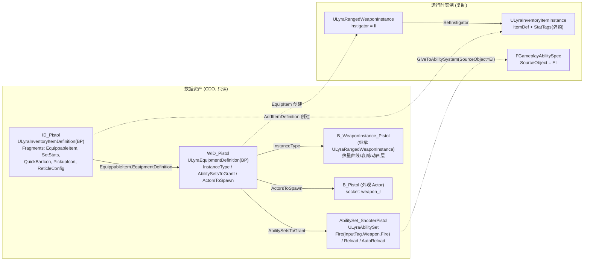
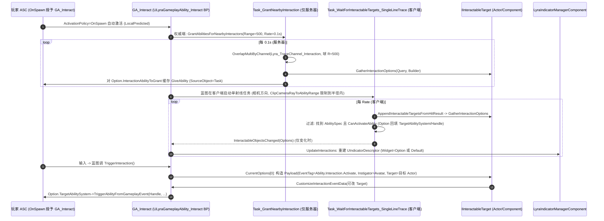

# 30 - 玩法系统：Weapons / Equipment / Inventory / Interaction / Teams

> 范围：`Source/LyraGame/{Weapons,Equipment,Inventory,Interaction,Teams}`，以及 `Plugins/GameFeatures/ShooterCore/Source` 中对它们的扩展。
> 除特别说明，文件路径均相对 `Source/LyraGame/`，行号为本工程当前源码的行号（UE 5.8）。
> 数据资产结论来自磁盘上 `.uasset` 的字符串扫描（未启动编辑器），标注"推断"的地方请在编辑器里复核。

---

## 1. 职责概述

这五个目录合起来回答"玩家手里拿着什么、怎么开枪、打到谁、谁是自己人、怎么和世界交互"：

| 模块 | 解决的问题 |
|---|---|
| **Inventory** | 物品的"定义（CDO 数据，Fragment 组合）"与"实例（带运行时状态，如弹药 TagStack）"。物品栏本身用 FastArray 复制。 |
| **Equipment** | 把"装备定义"落到 Pawn 上：创建装备实例、生成外观 Actor、通过 `ULyraAbilitySet` 授予/回收技能。`QuickBar` 是挂在 Controller 上的"3 个槽位 + 当前激活槽"，负责切换时 Equip/Unequip。 |
| **Weapons** | 在 Equipment 之上的武器层：`ULyraWeaponInstance`（动画层/手柄震动/交互计时）、`ULyraRangedWeaponInstance`（热量-散布模型、伤害衰减）、`ULyraGameplayAbility_RangedWeapon`（客户端预测命中扫描 + TargetData）、`ULyraWeaponStateComponent`（命中确认/命中标记）、`ALyraWeaponSpawner`（拾取台）。 |
| **Interaction** | 基于 GAS 的交互：服务器按固定频率扫描附近可交互物并"按需授予交互技能"，客户端沿相机射线选目标并显示指示器，触发后向目标 ASC 发 GameplayEvent。 |
| **Teams** | 队伍 ID 以 `FGenericTeamId` 存在 `ALyraPlayerState`，Pawn/Controller 镜像；`ULyraTeamSubsystem`（WorldSubsystem）统一查询、比较、伤害许可；`ALyraTeamPublicInfo/PrivateInfo` 是每队一个的复制 Actor，承载 `ULyraTeamDisplayAsset`（队伍配色）和队伍 TagStack；`ULyraTeamCreationComponent` 在 Experience 加载后创建队伍并分配玩家。 |

核心设计原则（整个文档反复出现）：

1. **Definition 是只读 CDO，Instance 才有状态**。Definition 类都是 `Const`，Fragment 通过 `GetDefault<>` 读取；可变数据（弹药、热量）放在 Instance（`StatTags`、成员变量）。
2. **复制靠 FastArraySerializer + 手动 SubObject 注册**（Iris 兼容，见 `RegisterReplicationFragments`）。
3. **一切"行为"通过 GAS 实现**：武器射击、交互、换枪（GA_QuickbarSlots）都是 `ULyraGameplayAbility` 子类，SourceObject 指向装备实例，从而 Ability 能反查武器/物品。
4. **大量内容是蓝图/资产**：C++ 只提供骨架（`StartRangedWeaponTargeting` 由 GA 蓝图调用，伤害 GE 由蓝图应用，`GiveWeapon` 由 `B_WeaponSpawner` 蓝图实现）。

---

## 2. 关键类表

### 2.1 Inventory

| 类名 | 文件:行 | 职责 |
|---|---|---|
| `ULyraInventoryItemFragment` | `Inventory/LyraInventoryItemDefinition.h:17-24` | Fragment 抽象基类（`DefaultToInstanced, EditInlineNew`），虚函数 `OnInstanceCreated(Instance)` 在实例创建时调用。 |
| `ULyraInventoryItemDefinition` | `Inventory/LyraInventoryItemDefinition.h:31-47` | 物品定义（Blueprintable/Const/Abstract）：`DisplayName` + `Instanced TArray<Fragments>`；`FindFragmentByClass`（`.cpp:18`）按 `IsA` 线性查找。 |
| `ULyraInventoryFunctionLibrary` | `...Definition.h:50-57` / `.cpp:37` | 蓝图用：从 ItemDef 类直接取 Fragment（走 CDO）。 |
| `ULyraInventoryItemInstance` | `Inventory/LyraInventoryItemInstance.h:20-77` | 物品实例（UObject，`IsSupportedForNetworking`）；复制 `StatTags`（`FGameplayTagStackContainer`）和 `ItemDef`（`.cpp:19-33`）；`FindFragmentByClass`（`.cpp:60`）转发到 ItemDef CDO。 |
| `FLyraInventoryEntry` / `FLyraInventoryList` | `Inventory/LyraInventoryManagerComponent.h:42-120` | FastArray 条目（Instance + StackCount + 非复制的 LastObservedCount）与列表；`PostReplicatedAdd/Change/PreReplicatedRemove`（`.cpp:37-66`）在客户端广播 `Lyra.Inventory.Message.StackChanged`（`.cpp:18,68-78`）。 |
| `ULyraInventoryManagerComponent` | `Inventory/LyraInventoryManagerComponent.h:134-171` | 物品栏组件（挂 Controller，推断）：`AddItemDefinition`（`.cpp:165`）、`RemoveItemInstance`（`.cpp:189`）、`FindFirstItemStackByDefinition`、`ConsumeItemsByDefinition`（`.cpp:241`）；手动 `ReplicateSubobjects`/`AddReplicatedSubObject`。 |
| `UInventoryFragment_EquippableItem` | `Inventory/InventoryFragment_EquippableItem.h:13-21` | 物品 -> 装备定义的桥：`TSubclassOf<ULyraEquipmentDefinition> EquipmentDefinition`。 |
| `UInventoryFragment_SetStats` | `Inventory/InventoryFragment_SetStats.h:14-27` / `.cpp:9` | `TMap<FGameplayTag,int32> InitialItemStats`，实例创建时转成 `AddStatTagStack`（武器的初始弹药就靠它）。 |
| `UInventoryFragment_QuickBarIcon` | `Inventory/InventoryFragment_QuickBarIcon.h:12-26` | 快捷栏图标（`Brush`、`AmmoBrush`、`DisplayNameWhenEquipped`）。 |
| `UInventoryFragment_PickupIcon` | `Inventory/InventoryFragment_PickupIcon.h:13-29` | 拾取台/世界显示用（`SkeletalMesh`、`DisplayName`、`PadColor`，默认绿色 `.cpp:7-10`）。 |
| `UInventoryFragment_ReticleConfig` | `Weapons/InventoryFragment_ReticleConfig.h:12-20` | 准星 Widget 列表（`ReticleWidgets`），位置在 Weapons 目录但属于 Inventory Fragment。 |
| `IPickupable` / `FInventoryPickup` / `UPickupableStatics` | `Inventory/IPickupable.h:21-89`, `.cpp:18,38` | 可拾取接口：`GetPickupInventory()` 返回 `Templates`(ItemDef+StackCount) 与 `Instances`；`AddPickupToInventory` 把它们加入物品栏。 |

### 2.2 Equipment

| 类名 | 文件:行 | 职责 |
|---|---|---|
| `ULyraEquipmentDefinition` | `Equipment/LyraEquipmentDefinition.h:37-56` | 装备定义（Const）：`InstanceType`（默认 `ULyraEquipmentInstance`，`.cpp:11`）、`AbilitySetsToGrant`、`ActorsToSpawn`（`FLyraEquipmentActorToSpawn`: Actor 类 + Socket + Transform，`.h:13-29`）。 |
| `ULyraEquipmentInstance` | `Equipment/LyraEquipmentInstance.h:19-72` | 装备实例：Outer 必须是 Pawn（`GetPawn` `.cpp:51`，`GetWorld` 也靠 Pawn `.cpp:23`）；复制 `Instigator`（=源 `ULyraInventoryItemInstance`）与 `SpawnedActors`；`SpawnEquipmentActors`（`.cpp:69`）延迟生成并挂到角色 Mesh；`OnEquipped/OnUnequipped` 转蓝图事件。 |
| `FLyraAppliedEquipmentEntry` / `FLyraEquipmentList` | `Equipment/LyraEquipmentManagerComponent.h:25-100` | FastArray；条目含 `EquipmentDefinition`、`Instance`、**非复制**的 `GrantedHandles`（只有服务器持有，用于回收技能）。`AddEntry`（`.cpp:68`）/`RemoveEntry`（`.cpp:109`）。 |
| `ULyraEquipmentManagerComponent` | `Equipment/LyraEquipmentManagerComponent.h:114-156` | 挂 **Pawn**（`UPawnComponent`）：`EquipItem`（`.cpp:148`）/`UnequipItem`（`.cpp:167`）、`GetFirstInstanceOfType`（`.cpp:240`）；`UninitializeComponent` 会卸下全部装备（`.cpp:203`）。 |
| `ULyraQuickBarComponent` | `Equipment/LyraQuickBarComponent.h:16-81` | 挂 **Controller**（`UControllerComponent`）：`Slots`(3) + `ActiveSlotIndex` 复制；`SetActiveSlotIndex` 是 Server RPC（`.h:30`, `.cpp:135`）；`AddItemToSlot`/`RemoveItemFromSlot`（`.cpp:169/181`）；消息 `Lyra.QuickBar.Message.SlotsChanged/ActiveIndexChanged`（`.cpp:19-20,205-223`）。 |
| `ULyraGameplayAbility_FromEquipment` | `Equipment/LyraGameplayAbility_FromEquipment.h:17-36` | "由装备授予的技能"基类：`GetAssociatedEquipment()` 读 `Spec->SourceObject`（`.cpp:18`），`GetAssociatedItem()` 读 `Equipment->GetInstigator()`（`.cpp:28`）；数据校验要求必须 Instanced（`.cpp:39-52`）。 |
| `ULyraPickupDefinition` / `ULyraWeaponPickupDefinition` | `Equipment/LyraPickupDefinition.h:18-69` | 拾取台 DataAsset：`InventoryItemDefinition`、`DisplayMesh`、`SpawnCoolDownSeconds`、拾取/重生音效与特效；武器版多 `WeaponMeshOffset/Scale`。 |

### 2.3 Weapons

| 类名 | 文件:行 | 职责 |
|---|---|---|
| `ULyraWeaponInstance` | `Weapons/LyraWeaponInstance.h:24-90` | 武器实例基类：`EquippedAnimSet/UneuippedAnimSet`（拼写即如此）按 `CosmeticTags` 选动画层（`PickBestAnimLayer` `.cpp:78`）、`ApplicableDeviceProperties`（手柄震动/灯光，装备时 Looping 激活 `.cpp:93`，卸下/死亡移除 `.cpp:120,135`）、`TimeSinceLastInteractedWith`（`.cpp:61`）。 |
| `ULyraRangedWeaponInstance` | `Weapons/LyraRangedWeaponInstance.h:19-250` | 热量-散布模型 + 枪械参数 + `ILyraAbilitySourceInterface`（距离/物理材质伤害衰减，`.cpp:125,131`）。 |
| `ULyraGameplayAbility_RangedWeapon` | `Weapons/LyraGameplayAbility_RangedWeapon.h:46-123` | 命中扫描 Ability 基类（蓝图 `GA_Weapon_Fire` 继承它）：本地瞄准/追踪、打包 TargetData、服务器接收、提交弹药、加散布。 |
| `ULyraWeaponStateComponent` | `Weapons/LyraWeaponStateComponent.h:40-92` | 挂 **Controller**：每帧 Tick 当前远程武器的散布（`.cpp:28`）；维护"未确认命中标记批次"，服务器通过 `ClientConfirmTargetData` RPC 确认（`.cpp:66`）；记录最后一次造成伤害的时间/屏幕位置供准星命中标记使用。 |
| `FLyraGameplayAbilityTargetData_SingleTargetHit` | `AbilitySystem/LyraGameplayAbilityTargetData_SingleTargetHit.h:15-67` | 在引擎 SingleTargetHit 上加 `CartridgeID`（同一发子弹的多个弹丸共享，`.cpp:13-31`），写入 `FLyraGameplayEffectContext`。 |
| `ALyraWeaponSpawner` | `Weapons/LyraWeaponSpawner.h:24-116` | 拾取台 Actor（胶囊重叠触发）：`AttemptPickUpWeapon` -> 蓝图 `GiveWeapon` -> 冷却/重生；`bIsWeaponAvailable` 复制。 |
| `ULyraDamageLogDebuggerComponent` | `Weapons/LyraDamageLogDebuggerComponent.h:23-47` | 调试：监听 `Lyra.Damage.Message`，按帧聚合后日志输出 DPS/命中间隔。 |
| `ULyraWeaponDebugSettings` | `Weapons/LyraWeaponDebugSettings.h:14-38` | 开发者设置，映射 CVar `lyra.Weapon.DrawBulletTraceDuration/DrawBulletHitDuration/DrawBulletHitRadius`（`RangedWeapon.cpp:16-38`）。 |

### 2.4 Interaction

| 类名 | 文件:行 | 职责 |
|---|---|---|
| `IInteractableTarget` | `Interaction/IInteractableTarget.h:41-51` | 可交互对象接口（Actor 或 Component 都可实现，不能蓝图实现）：`GatherInteractionOptions`、`CustomizeInteractionEventData`。 |
| `FInteractionOptionBuilder` | `...IInteractableTarget.h:13-31` | 收集选项并自动把 `InteractableTarget` 回填。 |
| `FInteractionOption` | `Interaction/InteractionOption.h:13-82` | 选项：`Text/SubText`、`InteractionAbilityToGrant`（方式 1：授予玩家自己）或 `TargetAbilitySystem + TargetInteractionAbilityHandle`（方式 2：目标自带 ASC）、`InteractionWidgetClass`。 |
| `FInteractionQuery` | `Interaction/InteractionQuery.h:12-28` | 请求者 Avatar/Controller/可选数据。 |
| `IInteractionInstigator` | `Interaction/IInteractionInstigator.h:24-31` | 多选项仲裁接口（`ChooseBestInteractionOption`）。**全工程无调用者**，`TriggerInteraction` 固定取 `CurrentOptions[0]`。 |
| `UInteractionStatics` | `Interaction/InteractionStatics.cpp:17-86` | 从 Actor/Overlap/Hit 里提取 `IInteractableTarget`（Actor 本身 + 其组件）。 |
| `ULyraGameplayAbility_Interact` | `Interaction/Abilities/LyraGameplayAbility_Interact.h:22-56` | 抽象基类：`OnSpawn` 自动激活、`InstancedPerActor`、`LocalPredicted`（`.cpp:21-27`）；服务器端启动扫描任务（`.cpp:29-39`）；`UpdateInteractions` 管理指示器（`.cpp:41`）；`TriggerInteraction`（`.cpp:78`）。参数：`InteractionScanRate=0.1`、`InteractionScanRange=500`、`DefaultInteractionWidgetClass`。 |
| `UAbilityTask_GrantNearbyInteraction` | `Interaction/Tasks/AbilityTask_GrantNearbyInteraction.cpp:23-94` | 服务器定时重叠扫描并 `GiveAbility`（按 Ability 类缓存）。 |
| `UAbilityTask_WaitForInteractableTargets(_SingleLineTrace)` | `Interaction/Tasks/AbilityTask_WaitForInteractableTargets.cpp:107`, `..._SingleLineTrace.cpp:47` | 客户端沿相机射线周期性选目标；`UpdateInteractableOptions` 过滤"当前能激活"的选项，变化时 `InteractableObjectsChanged`。 |
| `AGameplayAbilityTargetActor_Interact` | `Interaction/Abilities/GameplayAbilityTargetActor_Interact.cpp:16` | 基于 `TargetActor_Trace` 的另一种追踪实现（备用路径）。 |
| `FLyraInteractionDurationMessage` | `Interaction/LyraInteractionDurationMessage.h:14-24` | 交互持续时间消息，Tag `Ability.Interaction.Duration.Message`（`Interact.cpp:19`），用于进度条。 |

### 2.5 Teams

| 类名 | 文件:行 | 职责 |
|---|---|---|
| `ILyraTeamAgentInterface` | `Teams/LyraTeamAgentInterface.h:27-48` | 继承 `IGenericTeamAgentInterface`，加 `OnLyraTeamIndexChanged(UObject*, Old, New)` 委托与 `ConditionalBroadcastTeamChanged`（`.cpp:15`）。`GenericTeamIdToInteger/IntegerToGenericTeamId`（`.h:17-25`）：`NoTeam(255)` <-> `INDEX_NONE`。 |
| `ULyraTeamSubsystem` | `Teams/LyraTeamSubsystem.h:61-148` | WorldSubsystem：队伍注册表 `TeamMap`（`FLyraTeamTrackingInfo`: Public/Private Info + DisplayAsset + 变更委托）。关键 API：`FindTeamFromObject`（`.cpp:153`）、`CompareTeams`（`.cpp:222`）、`CanCauseDamage`（`.cpp:345`）、`ChangeTeamForActor`（`.cpp:134`）、`GetTeamDisplayAsset`（`.cpp:372`）、队伍 TagStack（`.cpp:250-330`）。 |
| `ALyraTeamInfoBase` | `Teams/LyraTeamInfoBase.h:17-51` | `AInfo`，`bAlwaysRelevant`；复制 `TeamId`(InitialOnly) 与 `TeamTags`；`TryRegisterWithTeamSubsystem`（`.cpp:58`）在 BeginPlay/OnRep 时向子系统注册。 |
| `ALyraTeamPublicInfo` / `ALyraTeamPrivateInfo` | `Teams/LyraTeamPublicInfo.h:14-35`, `LyraTeamPrivateInfo.h:11-18` | Public 持有复制的 `TeamDisplayAsset`(InitialOnly)；Private 目前与 Public 同样复制（`//@TODO: Actually make private`，`PrivateInfo.cpp:11`）。 |
| `ULyraTeamCreationComponent` | `Teams/LyraTeamCreationComponent.h:17-64` | `UGameStateComponent`：配置 `TeamsToCreate`(uint8 -> DisplayAsset)、两个 Info 类；Experience 加载后（`.cpp:46`）创建队伍并分配玩家。 |
| `ULyraTeamDisplayAsset` | `Teams/LyraTeamDisplayAsset.h:17-55` | DataAsset：`ScalarParameters/ColorParameters/TextureParameters`（按材质/Niagara 参数名）+ `TeamShortName`；`ApplyToMaterial/MeshComponent/NiagaraComponent/Actor`（`.cpp:14-107`）；编辑器改动会通知子系统（`.cpp:110-118`）。 |
| `ULyraTeamStatics` | `Teams/LyraTeamStatics.h:16-37` | 蓝图函数库：`FindTeamFromObject`(含 DisplayAsset)、`GetTeamColorWithFallback` 等。 |
| `UAsyncAction_ObserveTeam` / `UAsyncAction_ObserveTeamColors` | `Teams/AsyncAction_ObserveTeam.h:19`, `AsyncAction_ObserveTeamColors.h:19` | 蓝图异步节点：立即回调一次当前队伍，之后随队伍变化/DisplayAsset 变化回调（`ObserveTeamColors` 会在换队时重新绑定对应队伍的 DisplayAsset 委托 `.cpp:56-78`）。 |
| `ULyraTeamCheats` | `Teams/LyraTeamCheats.cpp:15-64` | 控制台作弊：`CycleTeam`、`SetTeam`、`ListTeams`（由子系统在 `Initialize` 注册，`Subsystem.cpp:72-82`）。 |

团队接口的实现者（不在 Teams 目录内）：`ALyraPlayerState`（权威存储，`Player/LyraPlayerState.cpp:236-265`）、`ALyraPlayerController`（转发 PlayerState 的队伍变化，`Player/LyraPlayerController.cpp:240-270`）、`ALyraPlayerBotController`、`ALyraCharacter`（`Character/LyraCharacter.cpp:155-170,215-245,484-515`）、`ALyraPawn`、`ULyraLocalPlayer`。

### 2.6 ShooterCore 插件中的相关 C++（只记链接）

| 类 | 文件 | 与本模块的关系 |
|---|---|---|
| `ALyraWorldCollectable` | `Plugins/GameFeatures/ShooterCore/Source/ShooterCoreRuntime/Public/LyraWorldCollectable.h:18` | 同时实现 `IInteractableTarget` + `IPickupable`：`GatherInteractionOptions` 添加 `Option`，`GetPickupInventory` 返回 `StaticInventory`。是"世界里可按键拾取物品"的标准样板。 |
| `UTDM_PlayerSpawningManagmentComponent` | `.../Private/TDM_PlayerSpawningManagmentComponent.cpp:20-89` | 用 `ULyraTeamSubsystem::FindTeamFromObject` 判断队伍，选离敌方最远的出生点。 |
| `UAimAssistTargetManagerComponent` | `.../Private/Input/AimAssistTargetManagerComponent.cpp:314` | `PS->GetTeamId() == OwnerData.TeamID` 过滤友军目标。 |
| `UAssistProcessor / UElimChainProcessor / UElimStreakProcessor` | `.../Private/MessageProcessors/*.cpp` | 监听 `Lyra.Damage.Message`（由 `LyraHealthSet.cpp:134` 发出）与 `Lyra.Elimination.Message`，产出助攻/连杀/连击 Verb 消息；`ULyraAccoladeHostWidget` 订阅 `Lyra.ShooterGame.Accolade`（`Accolades/LyraAccoladeHostWidget.cpp:15,39`）显示。 |
| `FLyraControlPointStatusMessage` | `.../Public/Messages/ControlPointStatusMessage.h` | 控制点状态消息（含 `OwnerTeamID`）；控制点逻辑本身是蓝图（`Content/ControlPoint`）。 |

---

## 3. 核心流程与数据流

### 3.1 对象关系总览（定义 vs 实例）



### 3.2 物品 -> 装备 -> 开火 全链路

```mermaid
sequenceDiagram
  autonumber
  participant Spawner as ALyraWeaponSpawner / Hero BP
  participant Inv as LyraInventoryManagerComponent (Controller)
  participant QB as LyraQuickBarComponent (Controller)
  participant EM as LyraEquipmentManagerComponent (Pawn)
  participant ASC as LyraAbilitySystemComponent
  participant Cl as 客户端(本地玩家)
  participant Sv as 服务器

  Spawner->>Inv: AddItemDefinition(ItemDef)  [服务器]
  Inv->>Inv: NewObject Instance; 每个 Fragment.OnInstanceCreated (SetStats 写弹药 TagStack)
  Spawner->>QB: GetNextFreeItemSlot / AddItemToSlot(slot, item)
  Spawner->>QB: SetActiveSlotIndex(slot) [Server RPC]
  QB->>QB: UnequipItemInSlot(); ActiveSlotIndex=N
  QB->>QB: EquipItemInSlot(): 取 Item 的 UInventoryFragment_EquippableItem
  QB->>EM: EquipItem(EquipmentDefinition)
  EM->>EM: AddEntry: NewObject(InstanceType, Outer=Pawn)
  EM->>ASC: AbilitySet->GiveToAbilitySystem(ASC, &GrantedHandles, SourceObject=EquipmentInstance)
  EM->>EM: Instance->SpawnEquipmentActors (服务器生成, 挂 Mesh socket, 复制)
  EM->>EM: MarkItemDirty -> FastArray 复制; Instance->OnEquipped()
  QB->>EM: Instance->SetInstigator(ItemInstance)  (EquipItem 返回之后!)
  EM-->>Cl: PostReplicatedAdd -> Instance->OnEquipped()
  Note over Cl: 玩家按下 InputTag.Weapon.Fire -> GA_Weapon_Fire (RangedWeapon) 预测激活
  Cl->>Cl: BP 调 StartRangedWeaponTargeting(): PerformLocalTargeting -> 散布 + 多弹丸追踪
  Cl->>Cl: 打包 FLyraGameplayAbilityTargetData_SingleTargetHit(CartridgeID)<br/>WeaponState.AddUnconfirmedServerSideHitMarkers
  Cl->>Cl: OnTargetDataReadyCallback -> ScopedPrediction
  Cl->>Sv: CallServerSetReplicatedTargetData(TargetData)
  Sv->>Sv: AbilityTargetDataSetDelegate -> OnTargetDataReadyCallback
  Sv-->>Cl: WeaponState.ClientConfirmTargetData(UniqueId, bValid=true, HitReplaces)
  Sv->>Sv: CommitAbility (LyraAbilityCost_ItemTagStack 扣 MagazineAmmo)
  Sv->>Sv: RangedWeaponInstance.AddSpread()
  Sv->>Sv: BP OnRangedWeaponTargetDataReady -> Apply GE_Damage_* (LyraDamageExecution)
  Sv->>Sv: LyraDamageExecution: CanCauseDamage(队伍) x 距离衰减 x 物理材质衰减 -> HealthSet.Damage
```

要点逐步说明：

**(a) 物品创建**：`FLyraInventoryList::AddEntry`（`LyraInventoryManagerComponent.cpp:80-108`）在 **权威端**创建实例，Outer 用 Actor 而非组件（`//@TODO ... UE-127172`），遍历 `ItemDef` CDO 的 Fragment 调 `OnInstanceCreated`。`UInventoryFragment_SetStats` 就是在这里把 `Lyra.ShooterGame.Weapon.MagazineAmmo / MagazineSize / SpareAmmo`（`ShooterCoreTags.ini:48-50`，`ID_Pistol` 的 `InitialItemStats` 中确认）写成 TagStack。

**(b) 装备**：`ULyraQuickBarComponent::SetActiveSlotIndex_Implementation`（`QuickBar.cpp:135`）先卸下旧装备再装新装备；`EquipItemInSlot`（`.cpp:86`）通过 `SlotItem->FindFragmentByClass<UInventoryFragment_EquippableItem>()` 拿到 `EquipmentDefinition`，调 `EquipmentManager->EquipItem`（`.cpp:100`），并 `SetInstigator(SlotItem)`（`.cpp:103`）建立 **装备实例 -> 物品实例** 的反向链接。`FindEquipmentManager`（`.cpp:123`）是 `Controller->GetPawn()->FindComponentByClass<>`，所以换 Pawn（重生）后需要重新装备。

**(c) 技能授予**：`FLyraEquipmentList::AddEntry`（`EquipmentManagerComponent.cpp:89-95`）对每个 `AbilitySetsToGrant` 调 `GiveToAbilitySystem(ASC, &NewEntry.GrantedHandles, Result)`——第三个参数把 **装备实例** 设为 Spec 的 `SourceObject`。卸下时 `GrantedHandles.TakeFromAbilitySystem`（`.cpp:118`）回收。`ULyraGameplayAbility_FromEquipment::GetAssociatedEquipment`（`.cpp:18`）就是读这个 SourceObject；`ULyraGameplayAbility::GetAbilitySource`（`AbilitySystem/Abilities/LyraGameplayAbility.cpp:428-440`）把同一个 SourceObject 当作 `ILyraAbilitySourceInterface`，写入 GE Context（`.cpp:288-298`）——这就是 `ULyraRangedWeaponInstance` 能参与伤害衰减计算的原因。

**(d) 客户端同步**：`FLyraEquipmentList::PostReplicatedAdd`（`.cpp:40-50`）在客户端调用 `OnEquipped`；`PreReplicatedRemove`（`.cpp:28`）调用 `OnUnequipped`。外观 Actor 是在服务器 `SpawnEquipmentActors` 生成并复制的，客户端不会自己生成。

### 3.3 命中扫描细节（`ULyraGameplayAbility_RangedWeapon`）

1. **激活**（`.cpp:440`）：绑定 `AbilityTargetDataSetDelegate(SpecHandle, PredictionKey)` -> `OnTargetDataReadyCallback`；`WeaponData->UpdateFiringTime()`；再 `Super::ActivateAbility`（进入蓝图 `K2_ActivateAbility`）。`EndAbility`（`.cpp:456`）取消绑定并 `ConsumeClientReplicatedTargetData`。构造函数给 `SourceBlockedTags` 加了 `Ability.Weapon.NoFiring`（`.cpp:41,76`）。
2. **本地瞄准**（`PerformLocalTargeting` `.cpp:352`）：只在 `IsLocallyControlled`（含服务器上的 AI）执行；固定使用 `CameraTowardsFocus`（`.cpp:364`）——起点是相机而不是枪口。`GetTargetingTransform`（`.cpp:209`）里 `GetWeaponTargetingSourceLocation` 目前只返回 Pawn 位置（`.cpp:193-207`，`@TODO`），所以 `WeaponForward/WeaponTowardsFocus` 其实等价于 Pawn 位置。
3. **每发子弹**（`TraceBulletsInCartridge` `.cpp:382`）：对 `BulletsPerCartridge` 个弹丸循环；散布角 = `GetCalculatedSpreadAngle() * GetCalculatedSpreadAngleMultiplier()`，取一半转弧度，再 `VRandConeNormalDistribution`（`.cpp:45`）在圆锥内随机（`SpreadExponent` 越大越向中心聚集）；终点 = 起点 + 方向 * `MaxDamageRange`。
4. **追踪**（`DoSingleBulletTrace` `.cpp:292`）：先 `LineTraceMulti`（`Lyra_TraceChannel_Weapon`，`DetermineTraceChannel` 可重写 `.cpp:138`），若没命中 Pawn 且 `BulletTraceSweepRadius > 0` 再做球扫（宽容命中），并保证被墙挡住的 Pawn 不会被扫描穿透（`.cpp:323-345`）。`WeaponTrace`（`.cpp:143`）按 `HitObjectHandle` 去重，`bTraceComplex=true`、返回物理材质。碰撞通道 `Lyra_TraceChannel_Weapon=ECC_GameTraceChannel2`（`Physics/LyraCollisionChannels.h:15`）；`LyraPawnMesh` 对它 Block、`LyraPawnCapsule` 对 `Weapon_Capsule` Block（`Config/DefaultEngine.ini:188-189`），所以子弹打到的是骨骼 Mesh（保证部位判定）。
5. **打包 TargetData**（`StartRangedWeaponTargeting` `.cpp:552`）：每个 `FHitResult` 一个 `FLyraGameplayAbilityTargetData_SingleTargetHit`，同一次射击共享随机的 `CartridgeID`；`TargetData.UniqueId = WeaponState->GetUnconfirmedServerSideHitMarkerCount()`；然后 `AddUnconfirmedServerSideHitMarkers` 把命中点投影到屏幕并预判 `bShowAsSuccess`（`WeaponState.cpp:44-53` 用 `TeamSubsystem->CanCauseDamage` 判断是否为敌人），再直接调用 `OnTargetDataReadyCallback`。
6. **回调**（`OnTargetDataReadyCallback` `.cpp:477`）：
   - 客户端（非权威且本地控制）`CallServerSetReplicatedTargetData` 把数据发给服务器（`.cpp:489-493`）。
   - 服务器分支（`WITH_SERVER_CODE`，`.cpp:499-527`）：收集 `bHitReplaced` 的索引，调 `WeaponStateComponent->ClientConfirmTargetData(UniqueId, true, HitReplaces)` 让客户端把该批命中标记确认为"有效命中"。
   - `CommitAbility`（扣弹药等 Cost）成功 -> `WeaponData->AddSpread()` -> 蓝图事件 `OnRangedWeaponTargetDataReady(TargetData)`（`.cpp:531-540`）；失败则 `K2_EndAbility`。
   - 最后 `ConsumeClientReplicatedTargetData`（`.cpp:549`）。
7. **伤害**：C++ 里没有直接施加伤害，由蓝图 `GA_Weapon_Fire`（`Content/Weapons/GA_Weapon_Fire.uasset`，字符串里有 `BP_ApplyGameplayEffectToTarget`、`GetHitResultFromTargetData`、`K2_HasAuthority`、`IsLocallyControlled`、`MakeGameplayCueParametersFromHitResult`）把 TargetData 里的 HitResult 套到各自武器的伤害 GE（如 `Content/Weapons/Pistol/GE_Damage_Pistol`）上，并触发 GameplayCue（`GCN_Weapon_*_Fire`）。GE 的执行计算是 `ULyraDamageExecution`：
   - 队伍许可：`TeamSubsystem->CanCauseDamage(EffectCauser, HitActor)` -> 乘 0/1（`AbilitySystem/Executions/LyraDamageExecution.cpp:89-98`）。
   - 距离：`Context.HasOrigin()` 优先，否则 EffectCauser 位置（`.cpp:100-114`）。
   - 武器衰减：`AbilitySource->GetDistanceAttenuation / GetPhysicalMaterialAttenuation`（`.cpp:116-128`）。
   - 结果写 `LyraHealthSet::Damage`，`LyraHealthSet.cpp:134` 发 `Lyra.Damage.Message`。

> **服务器校验的真实强度**：服务器 **不重新追踪**，也不校验射程/视线/时间戳。`bIsTargetDataValid` 被硬编码为 `true`（`.cpp:495`）；`bProjectileWeapon` 是一个永远为 `false` 的局部变量（`.cpp:497`）。实际约束仅来自：技能激活条件、`CommitAbility` 的 Cost（弹药）、蓝图里的射速限制（`FireDelayTimeSecs`），以及伤害执行里的队伍判断。如果要做反作弊/服务器权威命中，需要在 `OnTargetDataReadyCallback` 中自己加校验（见 6.6）。

> **蓝图必须做的门控（推断）**：服务器上由远端客户端触发的激活，`PerformLocalTargeting` 因为 `!IsLocallyControlled()` 返回空，若蓝图仍调用 `StartRangedWeaponTargeting` 就会用空 TargetData 走一遍回调。`GA_Weapon_Fire` 蓝图含 `IsLocallyControlled` 与 `HasAuthority` 节点，应是在本地控制时才调用 `StartRangedWeaponTargeting`，其余情况等待 `AbilityTargetDataSetDelegate`。改这个蓝图时要保持这个分支。

### 3.4 命中确认（Hit Confirmation）与命中标记

- 本地射击时在 `UnconfirmedServerSideHitMarkers` 里记一批（`Markers` = 每个 Hit 的屏幕坐标、`bShowAsSuccess`、`HitZone`，`WeaponState.cpp:103-134`）；`HitZone` 取物理材质 Tag 中匹配 `Gameplay.Zone` 的那个（爆头/弱点）。
- 服务器收到 TargetData 后调用 `ClientConfirmTargetData`（Client Reliable RPC）；客户端按 `UniqueId` 找到批次，若 `bSuccess` 则把 `bShowAsSuccess && 未被 HitReplaces` 的条目追加到 `LastWeaponDamageScreenLocations`，并刷新 `LastWeaponDamageInstigatedTime`（`.cpp:66-101`、`144-152`，0.1s 窗口内累积，超过则清空重来）。
- `UI/Weapons/SHitMarkerConfirmationWidget.cpp:38,96` 读取这些位置画命中标记。
- `UpdateDamageInstigatedTime` 在 C++ 里没有调用者，说明由蓝图（如伤害反馈/GameplayCue）调用。

### 3.5 散布/热量模型（`ULyraRangedWeaponInstance`）

```
Heat 范围 = [min, max] 取自三条曲线 X 轴范围的并集 (ComputeHeatRange .cpp:88)
装备时: Heat = (min+max)/2 ; SpreadAngle = HeatToSpreadCurve(Heat) ; 所有乘子=1 (.cpp:48-66)
每次开火 (AddSpread .cpp:111): Heat = clamp(Heat + HeatToHeatPerShotCurve(Heat)) ; SpreadAngle = HeatToSpreadCurve(Heat)
每帧 Tick (UpdateSpread .cpp:148): 超过 SpreadRecoveryCooldownDelay 后 Heat -= HeatToCoolDownPerSecondCurve(Heat)*dt
最终散布 = SpreadAngle(度, 直径) * Multiplier
Multiplier = Aiming * StandingStill * Crouching * JumpFall  (UpdateMultipliers .cpp:166)
  - StandingStill: 速度<=StandingStillSpeedThreshold(80) 完全生效, 到 +StandingStillToMovingSpeedRange(20) 线性淡出到 1
  - Crouching / JumpFall: 目标值 FInterpTo 平滑 (TransitionRate_*)
  - Aiming: 当前相机混合栈顶 Tag == Lyra.Weapon.SteadyAimingCamera 时按混合权重插值到 SpreadAngleMultiplier_Aiming (.cpp:195-208)
bHasFirstShotAccuracy = bAllowFirstShotAccuracy && 所有乘子在目标值 && 散布在最小 (.cpp:81)
  -> GetCalculatedSpreadAngleMultiplier() 返回 0 (完美精度)
```

- `Tick` 由 **`ULyraWeaponStateComponent::TickComponent`**（Controller 上，`WeaponState.cpp:28-41`）驱动，只 Tick `EquipmentManager->GetFirstInstanceOfType(ULyraRangedWeaponInstance)`。
- 参数全部是 `UPROPERTY(EditAnywhere)`，在武器实例蓝图（如 `B_WeaponInstance_Pistol`）里配置；`WITH_EDITORONLY_DATA` 的 `Debug_*` 字段只用于编辑器可视化（`.cpp:38-45`）。
- 伤害衰减：`DistanceDamageFalloff`（曲线 X=cm, Y=倍率，无数据则恒 1，`.cpp:125-129`）；`MaterialDamageMultiplier`（物理材质 `UPhysicalMaterialWithTags` 的 Tag -> 倍率，多个相乘，`.cpp:131-146`；例如手枪实例里能看到 `Gameplay.Zone.WeakSpot`）。

### 3.6 队伍分配与影响

```mermaid
sequenceDiagram
  autonumber
  participant Exp as ExperienceManagerComponent(GameState)
  participant TC as ULyraTeamCreationComponent (GameState, 由 Experience ActionSet 添加)
  participant GM as ALyraGameMode
  participant PS as ALyraPlayerState
  participant TI as ALyraTeamPublicInfo/PrivateInfo
  participant TS as ULyraTeamSubsystem
  participant PC as PlayerController / Pawn

  TC->>Exp: BeginPlay: CallOrRegister_OnExperienceLoaded_HighPriority(OnExperienceLoaded)
  Exp-->>TC: Experience 加载完成 (仅服务器继续)
  TC->>TI: ServerCreateTeams(): 每个 TeamsToCreate 项 SpawnActor Public+Private, SetTeamId, SetTeamDisplayAsset
  TI->>TS: BeginPlay/SetTeamId/OnRep_TeamId -> RegisterTeamInfo (TeamMap[TeamId])
  TC->>PS: ServerAssignPlayersToTeams(): 已有玩家 ServerChooseTeamForPlayer
  TC->>GM: 订阅 OnGameModePlayerInitialized -> 后来者同样分配
  PS->>PS: 旁观者 -> NoTeam; 否则 GetLeastPopulatedTeamID() -> SetGenericTeamId
  PS-->>PC: MyTeamID 复制; OnRep_MyTeamID -> ConditionalBroadcastTeamChanged
  PC->>PC: Controller 监听 PlayerState 队伍变化并转发, Pawn 在 PossessedBy 时采用 Controller 队伍并监听
  Note over TS: 查询: FindTeamFromObject / CompareTeams / CanCauseDamage / GetTeamDisplayAsset
```

- **选队规则**：`GetLeastPopulatedTeamID`（`TeamCreationComponent.cpp:132-188`）统计 `PlayerArray` 里每队非 Inactive 玩家数，人数最少者胜，人数相同取 TeamId 最小者；`ServerChooseTeamForPlayer`（`.cpp:87`）对 `IsOnlyASpectator()` 清队。
- **队伍 ID 范围**：`TeamsToCreate` 的 key 是 `uint8`；`FGenericTeamId::NoTeam=255`，故有效 ID 为 0..254。
- **查询优先级**（`ULyraTeamSubsystem::FindTeamFromObject` `.cpp:153-183`）：①对象自己实现 `ILyraTeamAgentInterface` -> ②Actor 的 `GetInstigator()` 实现了接口 -> ③是 `ALyraTeamInfoBase` -> ④通过 Pawn/Controller/PlayerState 找 `ALyraPlayerState`。所以投射物/特效只要正确设置 `Instigator`（注意不是 Owner）就自动继承队伍。
- **伤害与友军**：`CanCauseDamage`（`.cpp:345-370`）：
  1. `bAllowDamageToSelf`：同一对象或同一 PlayerState -> 允许；
  2. 不同队 -> 允许；同队 -> 禁止（**没有"友军伤害开关"**，注释虽写"taking into account friendly fire settings"，但代码里没有此设置）；
  3. 一方无队（`InvalidArgument`）：只要 **攻击者有队** 且目标有 ASC 就允许（靶子/无队伍假人，`@TODO` 临时逻辑）。
- **视觉**：`ULyraTeamDisplayAsset` 存材质参数（`TeamColor`、`EmissiveColor*`、`EdgeGlowColor`、`Team.WeaponTint` 等，见 `Content/System/Teams/TeamDA_Red.uasset`）。蓝图通过 `UAsyncAction_ObserveTeamColors`（节点会立即回调一次，再随队伍/DisplayAsset 修改回调）拿到 DisplayAsset 后调用 `ApplyToActor/ApplyToMeshComponent/ApplyToNiagaraComponent`，例如角色、武器 Actor、`B_TeamColor_DeviceProperty`（手柄灯条颜色）等。
- **AI**：`ALyraPlayerBotController` 的 `GetTeamAttitudeTowards` 逻辑在 `Player/LyraPlayerBotController.cpp:139-144`，不同队即为敌对。

### 3.7 交互流程



- 两种交互执行方式（见 `InteractionOption.h:31-50`）：①`InteractionAbilityToGrant`——目标自己没有 ASC，由扫描任务把交互技能授予玩家，选项被过滤时 `TargetAbilitySystem` 被回填成玩家 ASC；②目标自带 ASC 与技能句柄（如坐椅子）。
- ShooterExplorer 插件里有具体蓝图：`GA_Interact`、`GA_Interaction_Collect`、`GA_Interaction_Sit`（`Plugins/GameFeatures/ShooterExplorer/Content/...`）。ShooterCore 的 `ALyraWorldCollectable` 是 C++ 样板。
- 碰撞：可交互物需响应 `Lyra_TraceChannel_Interaction`（`ECC_GameTraceChannel1`），工程里有预设 `Interactable_OverlapDynamic` / `Interactable_BlockDynamic`（`Config/DefaultEngine.ini:190-191`）。

### 3.8 拾取台（Weapon Spawner）

`ALyraWeaponSpawner`：胶囊 `OnComponentBeginOverlap`（`.cpp:35,104`）-> 权威端、`bIsWeaponAvailable`、Pawn 有 ASC -> `AttemptPickUpWeapon`（`.cpp:124`）-> 调蓝图 `GiveWeapon(ItemDef, Pawn)`（BlueprintImplementableEvent，返回 bool）-> 成功则隐藏、播放特效、`StartCoolDown`（`CoolDownTime` 来自 `WeaponDefinition->SpawnCoolDownSeconds`，`.cpp:55-58`）。冷却结束 `ResetCoolDown`（`.cpp:152`）会 0.25s 后再次检查站在台子上的 Pawn（`CheckExistingOverlapDelay`）。客户端通过 `OnRep_WeaponAvailability` 同步显隐和特效。

`B_WeaponSpawner` 蓝图（`ShooterCore/Content/Blueprint/B_WeaponSpawner.uasset`）里的 `GiveWeapon` 流程（由字符串推断）：找到 Pawn 控制器上的 `InventoryManager` 与 `QuickBar`；若已拥有同类武器 -> 按 `GetDefaultStatFromItemDef(ItemDef, SpareAmmo)` 补备弹（上限为原拾取值）；否则 `AddItemDefinition` -> `GetNextFreeItemSlot` -> `AddItemToSlot` -> `SetActiveSlotIndex`。

---

## 4. 与其他模块的接口

| 对方模块 | 接口点 |
|---|---|
| **AbilitySystem** | `ULyraAbilitySet::GiveToAbilitySystem/TakeFromAbilitySystem`（`AbilitySystem/LyraAbilitySet.h:100,134`）；`ULyraGameplayAbility` 的 `GetAbilitySource`；`ULyraAbilityCost_ItemTagStack`（`AbilitySystem/Abilities/LyraAbilityCost_ItemTagStack.cpp:19-59`，要求 Ability 是 `FromEquipment`，用 `GetAssociatedItem()->GetStatTagStackCount(Tag)` 校验并 `RemoveStatTagStack` 扣费）；`ULyraDamageExecution`；`FLyraGameplayEffectContext`（`CartridgeID`、AbilitySource、HitResult）；`ILyraAbilitySourceInterface`。注意 `ULyraAbilityCost_InventoryItem` 的实现被 `#if 0` 掉并恒返回 false，**不要使用**。 |
| **GameplayTags** | `Ability.Weapon.NoFiring`（阻止开火）、`Ability.Interaction.Activate`（交互事件）、`Ability.Interaction.Duration.Message`、`Lyra.Weapon.SteadyAimingCamera`（瞄准镜头 -> 散布系数）、`Gameplay.Zone.*`（命中部位）、`Lyra.ShooterGame.Weapon.{MagazineAmmo,MagazineSize,SpareAmmo}`（弹药 StatTag，定义在 ShooterCore 的 `Config/Tags/ShooterCoreTags.ini`）、`InputTag.Weapon.Fire/Reload`、`InputTag.Ability.Quickslot.{CycleForward,CycleBackward,SelectSlot}`。 |
| **GameplayMessageRouter 消息** | `Lyra.Inventory.Message.StackChanged`(`FLyraInventoryChangeMessage`)、`Lyra.QuickBar.Message.SlotsChanged`(`FLyraQuickBarSlotsChangedMessage`)、`Lyra.QuickBar.Message.ActiveIndexChanged`、`Lyra.Damage.Message`(`FLyraVerbMessage`，被 DamageLogDebugger/Assist 等监听)、`Ability.Interaction.Duration.Message`。UI（快捷栏、弹药计数 `UI/Weapons/LyraWeaponUserInterface.cpp:34`）订阅这些消息。 |
| **Experience / GameFeature** | `ULyraTeamCreationComponent` 通过 Experience ActionSet 的 `AddComponents` 加到 GameState（ShooterCore 的 `B_TeamSetup_TwoTeams`，TopDownArena 的 `B_TeamSetup_FourTeams`）；QuickBar 作为 `B_QuickBarComponent` 由 `LAS_ShooterGame_StandardComponents` 加到 `AController`（玩家与机器人共用）；`ShooterCore` 的 `GameFeatureData` 则把 `ULyraInventoryManagerComponent` 加到 `AController`、`ULyraEquipmentManagerComponent` 加到 `ALyraCharacter`、`ULyraWeaponStateComponent` 加到 `ALyraPlayerController`。 |
| **Player / Character** | `ALyraPlayerState` 是队伍权威；`ALyraCharacter::PossessedBy` / `NotifyControllerChanged` 同步队伍；`ULyraHealthComponent::OnDeathStarted`（武器实例在死亡时移除手柄属性 `LyraWeaponInstance.cpp:23-33`）。 |
| **Camera** | `ULyraCameraComponent::GetBlendInfo`（`LyraRangedWeaponInstance.cpp:197-204`）决定瞄准散布系数。 |
| **Animation / Cosmetics** | `FLyraAnimLayerSelectionSet`（`EquippedAnimSet`）按 `CosmeticTags`（如 `Cosmetic.AnimationStyle.*`）选动画层；队伍配色参数名需与材质一致。 |
| **Input** | `UInputDeviceSubsystem` 的 `UInputDeviceProperty`（装备时 Looping 激活）；快捷栏/射击/换弹通过 Input Tag -> AbilitySet 绑定。 |
| **UI** | `ULyraIndicatorManagerComponent`（交互指示器）；`SHitMarkerConfirmationWidget`（命中标记）；`ULyraReticleWidgetBase`（`UInventoryFragment_ReticleConfig`）；`LyraWeaponUserInterface`。 |
| **物理/碰撞** | 通道宏 `Lyra_TraceChannel_Interaction/Weapon/Weapon_Capsule/Weapon_Multi`（`Physics/LyraCollisionChannels.h:12-21`）。 |

---

## 5. 数据驱动点

按"从最外层资产往里"列出，以 Pistol 为例（资产位于 `Plugins/GameFeatures/ShooterCore/Content/Weapons/Pistol/`）：

| 资产 | 类型（父类） | 控制什么 |
|---|---|---|
| `ID_Pistol` | `ULyraInventoryItemDefinition` 蓝图 | `DisplayName` + Fragments：`EquippableItem`(-> `WID_Pistol`)、`SetStats`(MagazineAmmo/MagazineSize/SpareAmmo 初始值)、`QuickBarIcon`(`T_UI_Icon_RangedWeapons_Pistol(_Ammo)`)、`PickupIcon`、`ReticleConfig`(-> `W_Reticle_Pistol`)。 |
| `WID_Pistol` | `ULyraEquipmentDefinition` 蓝图 | `InstanceType = B_WeaponInstance_Pistol`、`AbilitySetsToGrant = AbilitySet_ShooterPistol`、`ActorsToSpawn = B_Pistol @ socket weapon_r`（含 Transform）。 |
| `AbilitySet_ShooterPistol` | `ULyraAbilitySet`（PrimaryDataAsset） | 授予 `GA_Weapon_Fire_Pistol`(InputTag.Weapon.Fire)、`GA_Weapon_Reload_Pistol`(InputTag.Weapon.Reload)、`/Game/Weapons/GA_Weapon_AutoReload`。 |
| `B_WeaponInstance_Pistol` | 继承 `ULyraRangedWeaponInstance` 蓝图 | 热量/散布曲线、站立/蹲/空中/瞄准系数、`BulletsPerCartridge`、`MaxDamageRange`、`BulletTraceSweepRadius`、`DistanceDamageFalloff`、`MaterialDamageMultiplier`、`EquippedAnimSet/UneuippedAnimSet`、`ApplicableDeviceProperties`。 |
| `GA_Weapon_Fire_Pistol` | 继承 `GA_Weapon_Fire` -> `ULyraGameplayAbility_RangedWeapon` | `ActivationPolicy`(WhileInputActive)、`AdditionalCosts`(ItemTagStack 扣 MagazineAmmo)、`FireDelayTimeSecs`、`CharacterFireMontage`、GameplayCue Tag、伤害 GE（`GE_Damage_Pistol`）。 |
| `GE_Damage_*` | GameplayEffect | 基础伤害（`BaseDamage` 属性），使用 `ULyraDamageExecution`。 |
| `WeaponPickupData_Pistol` | `ULyraWeaponPickupDefinition` | `InventoryItemDefinition = ID_Pistol`、`DisplayMesh = SM_Pistol`、`SpawnCoolDownSeconds`、拾取/重生音效特效、网格偏移缩放。 |
| `B_WeaponSpawner`（关卡里放置） | `ALyraWeaponSpawner` 蓝图 | 实例上设置 `WeaponDefinition`（`EditInstanceOnly`）。 |
| `B_Hero_ShooterMannequin` | Pawn 蓝图 | `AddInitialInventory`：发初始物品并激活第一个槽（含 `ID_Pistol`）。 |
| `GA_QuickbarSlots` | 蓝图 Ability | `WaitGameplayEvent` 监听 `InputTag.Ability.Quickslot.*`，调用 `CycleActiveSlotForward/Backward`/`SetActiveSlotIndex`。输入由 `IA_QuickSlot1~3`、`IA_QuickSlot_Cycle*` 触发。 |
| `B_TeamSetup_TwoTeams` / `B_TeamSetup_FourTeams` | `ULyraTeamCreationComponent` 蓝图 | `TeamsToCreate` 映射 TeamId -> `TeamDA_Blue/Red`（Four: +Green/Yellow，位于 `Content/System/Teams/`）。 |
| `TeamDA_*` | `ULyraTeamDisplayAsset` | `ColorParameters`(`TeamColor`, `EmissiveColor`..., `EdgeGlowColor`...)、`ScalarParameters`、`TextureParameters`、`TeamShortName`。材质/Niagara 参数名必须与之同名才会生效。 |
| `Config/DefaultEngine.ini:188-197` | 碰撞配置 | 4 个自定义 Trace 通道与 `LyraPawnMesh/Capsule`、`Interactable_*` 预设。 |
| `Config/Tags/ShooterCoreTags.ini` | 标签 | 弹药 StatTag 等。 |
| `lyra.Weapon.Draw*` CVars / `ULyraWeaponDebugSettings` | 调试 | 画子弹轨迹与命中点。 |

---

## 6. 扩展与修改配方

### 6.1 新增一把武器（端到端，以"Rifle2"hit-scan 为例）

1. **武器实例蓝图** `B_WeaponInstance_Rifle2`：父类选 `LyraRangedWeaponInstance`（或自写 C++ 子类）；配置散布曲线（`HeatToSpreadCurve` X=热量范围，Y=散布角；`HeatToHeatPerShotCurve`、`HeatToCoolDownPerSecondCurve`）、`SpreadAngleMultiplier_*`、`MaxDamageRange`、`DistanceDamageFalloff`、`MaterialDamageMultiplier`（Tag 如 `Gameplay.Zone.WeakSpot` -> 倍率）、`EquippedAnimSet/UneuippedAnimSet`。
2. **外观 Actor** `B_Rifle2`（Skeletal/Static Mesh + 枪口特效等）。
3. **技能**：复制 `Content/Weapons/Rifle/GA_Weapon_Fire_Rifle_Auto` 改名（继承 `GA_Weapon_Fire`），设置 `AdditionalCosts`（`ULyraAbilityCost_ItemTagStack`，Tag=`Lyra.ShooterGame.Weapon.MagazineAmmo`，Quantity=1）、射速、Montage、GameplayCue；换弹 GA 复制 `GA_Weapon_Reload_Rifle`。伤害 GE 复制 `GE_Damage_RifleAuto`，在 `DamageExecution` 里调基础伤害。
4. **AbilitySet** `AbilitySet_ShooterRifle2`：添加上述 GA，`InputTag.Weapon.Fire` / `InputTag.Weapon.Reload`。
5. **装备定义** `WID_Rifle2`（父类 `LyraEquipmentDefinition`）：`InstanceType=B_WeaponInstance_Rifle2`，`AbilitySetsToGrant=[AbilitySet_ShooterRifle2]`，`ActorsToSpawn=[{B_Rifle2, weapon_r, Transform}]`。
6. **物品定义** `ID_Rifle2`（父类 `LyraInventoryItemDefinition`）Fragments：
   - `InventoryFragment_EquippableItem` -> `WID_Rifle2`；
   - `InventoryFragment_SetStats` -> `MagazineAmmo/MagazineSize/SpareAmmo` 初值；
   - `InventoryFragment_QuickBarIcon`、`InventoryFragment_PickupIcon`；
   - `InventoryFragment_ReticleConfig` -> 准星 Widget（`W_Reticle_Rifle2`，继承 `ULyraReticleWidgetBase`）。
7. **拾取**：`WeaponPickupData_Rifle2`（`LyraWeaponPickupDefinition`，指向 `ID_Rifle2`、网格、冷却、音效）；关卡里放 `B_WeaponSpawner` 并设置 `WeaponDefinition`。
8. **初始装备**（可选）：把 `ID_Rifle2` 加到 `B_Hero_ShooterMannequin` 的 `AddInitialInventory`；或通过 Experience 的相应 Action。
9. **UI**：弹药计数 Widget（参考 `W_AmmoCounter_Rifle`）按 `MagazineAmmo/SpareAmmo` StatTag 显示。
10. **验证**：用 `lyra.Weapon.DrawBulletTraceDuration 2` 看弹道；`ULyraDamageLogDebuggerComponent`（添加到靶子 Actor）打印 DPS。

> 纯数据武器不需要改 C++。如要全新散布模型，继承 `ULyraRangedWeaponInstance` 并重写 `Tick/AddSpread`（注意目前相关方法非 virtual，需自行改签名）。

### 6.2 新增一个 Inventory Fragment

```cpp
// Inventory/InventoryFragment_Durability.h
UCLASS()
class UInventoryFragment_Durability : public ULyraInventoryItemFragment
{
    GENERATED_BODY()
public:
    UPROPERTY(EditAnywhere, BlueprintReadOnly, Category=Durability)
    int32 MaxDurability = 100;

    virtual void OnInstanceCreated(ULyraInventoryItemInstance* Instance) const override
    {
        Instance->AddStatTagStack(TAG_Item_Durability, MaxDurability);  // 可变状态放 Instance 的 StatTags
    }
};
```

规则：
- Fragment 是 CDO 数据，**不能写入**；运行时状态一律放 `ULyraInventoryItemInstance::StatTags`（`AddStatTagStack/RemoveStatTagStack` 仅权威端，自动复制）。
- 使用：`Item->FindFragmentByClass<UInventoryFragment_Durability>()`（C++ 模板版 `LyraInventoryItemInstance.h:56`）或蓝图 `FindItemDefinitionFragment`。
- 如果新 Fragment 在 GameFeature 插件中，Build.cs 要依赖 `LyraGame`；类名前缀惯例 `UInventoryFragment_`。
- 需要更丰富的复制（非 TagStack 数据）时，在 `ULyraInventoryItemInstance` 加 `UPROPERTY(Replicated)` 并在 `GetLifetimeReplicatedProps`（`.cpp:19`）注册；Iris 已通过 `RegisterReplicationFragments` 自动从属性生成。

### 6.3 新增一个可交互物（Interactable）

**A. 世界拾取物（最快）**：蓝图继承 `ALyraWorldCollectable`（ShooterCore），设置：
- `Option`（`FInteractionOption`）：`Text/SubText`、`InteractionAbilityToGrant`（例如 `GA_Interaction_Collect`）、`InteractionWidgetClass`；
- `StaticInventory`（`FInventoryPickup.Templates` 填 ItemDef+StackCount）；
- 碰撞对象类型/预设用 `Interactable_OverlapDynamic`（需响应 `Lyra_TraceChannel_Interaction` Overlap）。
`GA_Interaction_Collect` 里在服务器用 `UPickupableStatics::GetFirstPickupableFromActor(Target)` + `AddPickupToInventory`（注意只用 `Templates`，见 7 的坑）。

**B. 自定义 C++ Actor/Component**：
```cpp
class AMyDoorButton : public AActor, public IInteractableTarget
{
    virtual void GatherInteractionOptions(const FInteractionQuery& Query, FInteractionOptionBuilder& Builder) override
    {
        FInteractionOption Opt;
        Opt.Text = LOCTEXT("Open","Open");
        Opt.InteractionAbilityToGrant = UGA_OpenDoor::StaticClass();   // 授予玩家自己的技能
        Builder.AddInteractionOption(Opt);
    }
    virtual void CustomizeInteractionEventData(const FGameplayTag& Tag, FGameplayEventData& Data) override
    {
        Data.Target = LinkedDoor;   // 例如让事件 Target 变成门
    }
};
```
- 技能 `UGA_OpenDoor`：`ULyraGameplayAbility`，用 `Ability.Interaction.Activate` 作为 Trigger（Gameplay Event），在 `ActivateAbility` 里读 `TriggerEventData->Target`。
- 目标自带 ASC：设置 `TargetAbilitySystem` + `TargetInteractionAbilityHandle`，不要设置 `InteractionAbilityToGrant`。
- 确保该 Actor 的碰撞对 `Lyra_TraceChannel_Interaction` 为 Overlap（服务器授予扫描用）并对客户端射线用的 TraceProfile 可命中。

### 6.4 新增队伍 / 队伍颜色

1. **新 DisplayAsset**：内容浏览器新建 `LyraTeamDisplayAsset`（如 `TeamDA_Purple`），在 `ColorParameters` 里填与你材质/Niagara 一致的参数名（参考 `TeamDA_Red`：`TeamColor`、`EmissiveColor`、`EdgeGlowColor`、`Team.WeaponTint`…），`TeamShortName` 填简称。
2. **新队伍配置**：复制 `B_TeamSetup_TwoTeams`（或 FourTeams），在 `TeamsToCreate` 里增加 `{TeamId -> TeamDA_Purple}`，TeamId 为 `uint8`（0..254）。该组件需通过 Experience 的 ActionSet 加到 `LyraGameState`。
3. **使用**：蓝图 `ObserveTeamColors(角色/PlayerState)` -> `DisplayAsset.ApplyToActor(Self)`；材质里必须存在同名参数，否则静默无效。
4. **运行时换队测试**：控制台 `CycleTeam` / `SetTeam N` / `ListTeams`（`LyraTeamCheats`）。
5. **自定义分队规则**：继承 `ULyraTeamCreationComponent` 重写 `ServerChooseTeamForPlayer`/`GetLeastPopulatedTeamID`（仅 `WITH_SERVER_CODE`，函数在 `protected virtual`/`private`，后者需要改成 protected virtual）。
6. **友军伤害开关**：现有代码无此项。在 `ULyraTeamSubsystem::CanCauseDamage`（`LyraTeamSubsystem.cpp:358`）里对 `OnSameTeam` 增加一个设置（`UDeveloperSettings`/GameState 属性）判断即可；`WeaponStateComponent::ShouldShowHitAsSuccess` 和 `LyraDamageExecution` 都会自动一致。
7. **队伍分数/标签**：`AddTeamTagStack(TeamId, Tag, N)`（仅服务器，队伍 Info 必须已生成）；任何端 `GetTeamTagStackCount`。

### 6.5 近战武器变体

近战无需扩展 `RangedWeapon` 类，参考 `Content/Game/Melee/GA_Melee`（角色通用近战）与 `Content/Weapons/GE_Damage_Melee`：
1. 装备定义 `WID_Knife`：`InstanceType = ULyraWeaponInstance`（或其蓝图子类，需要的话），`AbilitySetsToGrant` 授予近战 GA。
2. 近战 GA 继承 `ULyraGameplayAbility_FromEquipment`（拿 `GetAssociatedEquipment/GetAssociatedItem`）。检测方式：动画 Notify 触发 Gameplay Event -> `WaitGameplayEvent` -> 在**本地**做 `SphereTraceMulti`(Weapon 通道) 或使用 `AGameplayAbilityTargetActor_Trace`，再按预测流程把 `FGameplayAbilityTargetDataHandle` 发给服务器（可直接照抄 `OnTargetDataReadyCallback` 的 `CallServerSetReplicatedTargetData` 流程）。
3. 伤害：服务器上对 TargetData 的每个 HitResult 应用 `GE_Damage_Melee`；`EffectContext` 要带 HitResult 与 AbilitySource（用 `MakeEffectContext` 默认即带）。若需要距离/部位衰减，让武器实例实现 `ILyraAbilitySourceInterface`。
4. 命中标记：如果也想显示命中标记，复用 `WeaponStateComponent::AddUnconfirmedServerSideHitMarkers` 和 `ClientConfirmTargetData`（接口都是 public 的）。

### 6.6 投射物武器变体

1. 新 GA 继承 `ULyraGameplayAbility_FromEquipment`（或继承 `ULyraGameplayAbility_RangedWeapon` 复用散布/起点计算：`GetWeaponInstance()`、`GetTargetingTransform` 等是 protected，可直接用）。
2. 起点方向：`PerformLocalTargeting` 是 protected 非 virtual；自写时可调用 `GetTargetingTransform(Pawn, CameraTowardsFocus)` 并用 `ULyraRangedWeaponInstance::GetCalculatedSpreadAngle()` 和 `VRandConeNormalDistribution`（目前是 `.cpp` 内的自由函数，需要提取到头文件）计算散布。
3. **服务器**生成投射物 Actor（`SpawnActorDeferred`，`Owner=Pawn, Instigator=Pawn`，这样 `FindTeamFromObject` 才能通过 Instigator 找到队伍），投射物命中时在服务器 `ApplyGameplayEffectToTarget`，EffectCauser=投射物，这样 `LyraDamageExecution` 的 `CanCauseDamage(EffectCauser, HitActor)` 才有队伍信息（EffectCauser 为投射物，由 Instigator 间接取队）。参考 `Content/Weapons/Grenade`（`GE_Damage_Grenade`、`Curve_GrenadeDamage`、`GCN_Grenade_Detonate`）的蓝图做法。
4. 命中确认：投射物无法在发射时确认，可在服务器命中时给发射者 Controller 的 `ULyraWeaponStateComponent` 调 `UpdateDamageInstigatedTime(EffectContext)`（public）触发命中标记；`RangedWeapon` 里预留的 `bProjectileWeapon` 局部变量（`.cpp:497`）说明官方留了这个口子但没实现。
5. 弹药扣除：同样用 `ULyraAbilityCost_ItemTagStack`。

### 6.7 其他常用修改

- **增加快捷栏槽位数**：`NumSlots` 是 `UPROPERTY()`（无 Edit 说明符，`LyraQuickBarComponent.h:62-64`），只能改 C++ 默认值（或加 `EditDefaultsOnly` 后在 `B_QuickBarComponent` 里改），同时更新 `IA_QuickSlot*`/UI。
- **服务器端命中校验**：在 `OnTargetDataReadyCallback`（`RangedWeapon.cpp:495`）前对 `LocalTargetDataHandle` 的每个 HitResult 做：起点是否在 Pawn 附近（防瞬移）、距离 <= `MaxDamageRange`、与服务器上目标位置的容差内重新 `LineTrace`；失败则 `bIsTargetDataValid=false`，同时 `ClientConfirmTargetData(..., false, ...)`。
- **子弹从枪口出发**：把 `PerformLocalTargeting` 里的 `CameraTowardsFocus`（`.cpp:364`）改成 `WeaponTowardsFocus` 并实现 `GetWeaponTargetingSourceLocation`（`.cpp:193`，现返回 Pawn 位置）。

---

## 7. 坑与注意事项

### Inventory / Equipment

1. **`FLyraInventoryList::AddEntry(ULyraInventoryItemInstance*)` 是 `unimplemented()`**（`LyraInventoryManagerComponent.cpp:110-113`）。因此 `AddItemInstance`、以及 `IPickupable` 中 `FPickupInstance` 路径（`UPickupableStatics::AddPickupToInventory` `IPickupable.cpp:49-52`）会直接崩/断言。只能用 `Templates`（ItemDef）路径。
2. **没有真正的堆叠**：`StackCount` 记录在 Entry 上但 `GetTotalItemCountByDefinition`（`.cpp:222`）按条目计数而不是求和；`ConsumeItemsByDefinition` 每次移除整条目；`CanAddItemDefinition` 永远返回 true（`.cpp:159-163`）。弹药用的是 `StatTags` 而不是堆叠数量。
3. **`ConsumeItemsByDefinition`/`RemoveEntry` 不会 `RemoveReplicatedSubObject`**（只有 `RemoveItemInstance` 会，`.cpp:189-197`），用前者移除物品会在注册子对象列表里残留。
4. **`OnEquipped` 里读 `GetInstigator()` 在服务器上是空的**：`EquipItem` 里先 `OnEquipped()`（`EquipmentManagerComponent.cpp:156`），`QuickBar` 之后才 `SetInstigator`（`QuickBar.cpp:103`）。客户端 `PostReplicatedAdd` 时 Instigator 可能也尚未复制到位（`OnRep_Instigator` 是空实现）。需要物品信息的逻辑应放进技能（`GetAssociatedItem()`）或延后。
5. **`ULyraEquipmentInstance::GetWorld()` 依赖 Outer 是 Pawn**（`.cpp:23`）；Outer 为空/被销毁时返回 null，`ULyraWeaponInstance::OnEquipped` 里有 `check(World)`。`DestroyEquipmentActors` 不会清空 `SpawnedActors` 数组（`.cpp:91-100`）。
6. **构造函数里 `GetPawn()`**：`ULyraWeaponInstance` 构造里用 `GetPawn()` 绑定死亡委托（`.cpp:18-34`），而 Outer 在 `NewObject` 构造阶段已设定；CDO/编辑器预览构造时 Pawn 为空，代码已判空，别在这里加依赖世界的逻辑。
7. **装备在 Pawn 上、QuickBar 在 Controller 上**：重生后新 Pawn 的 `EquipmentManager` 是空的，而 Controller 上的 `QuickBar.ActiveSlotIndex`/`EquippedItem` 仍旧；`EquippedItem` 本身不复制（`QuickBar.h:79-80`），客户端永远为 null。初始物品的重新装备靠 Hero 蓝图 `AddInitialInventory`（它会 `RemoveItemFromSlot`/`AddItemToSlot`/`SetActiveSlotIndex`）。若自己改了重生流程，要保证 `SetActiveSlotIndex` 能重新进入（它有 `ActiveSlotIndex != NewIndex` 判断，`.cpp:137`）。
8. `RemoveItemFromSlot` 激活槽被移除时把 `ActiveSlotIndex=-1` **不会触发 `OnRep_ActiveSlotIndex` 广播**（`.cpp:185-189`），UI 可能不刷新；而 `AddItemToSlot`/`RemoveItemFromSlot` 在服务器手动调用 `OnRep_Slots()` 是为了让监听服务器/本地也收到消息。
9. `ULyraGameplayAbility_FromEquipment` 在数据校验里禁止 `NonInstanced`（`.cpp:43-48`）；`GetAssociatedEquipment` 依赖 Spec 的 SourceObject，**若 AbilitySet 是在装备管理器以外授予的（SourceObject 为空）则武器 GA 无法激活**（`CanActivateAbility` 会报错，`RangedWeapon.cpp:84-101`）。
10. Fragment 访问的是 CDO：蓝图里 `Instanced` 的 Fragment 对象在 ItemDef 类 CDO 中，**不要写它们的成员**。

### Weapons

11. **`ULyraRangedWeaponInstance::LastFireTime` 从未被赋值**（`.h:194`，`.cpp:150`；整个工程只有这两处引用）。因此 `SpreadRecoveryCooldownDelay` 实际不生效（`TimeSince(0)` 永远大于延迟）。`ULyraWeaponInstance::UpdateFiringTime` 写的是另一个私有变量 `TimeLastFired`。想要"开火后延迟冷却"需在 `AddSpread` 里设置 `LastFireTime = World->GetTimeSeconds()`。
12. **散布只在本地+服务器的 Controller Tick**：`ULyraWeaponStateComponent` 在 Controller 上 Tick；模拟代理（别人机器上的其它玩家）的武器不会更新散布，也不应该用它。服务器上的散布值与客户端并不一致（服务器没有相机混合信息，`AimingAlpha=0`），而且服务器不使用它——命中由客户端决定。
13. **`UniqueId` 用的是"未确认批次数量"**（`RangedWeapon.cpp:571`），并且 `FLyraServerSideHitMarkerBatch::UniqueId` 是 `uint8`，而 RPC 参数是 `uint16`。数量不是单调递增的序号，高射速+确认乱序时可能出现重复 ID，导致命中标记匹配错批次（仅影响 UI 标记，不影响伤害）。
14. **武器 Tick 只作用于"第一个"远程武器实例**（`WeaponState.cpp:36`），多把同时装备时只有第一把更新。
15. **`ShouldShowHitAsSuccess` 的 `TODO`**：不检查伤害是否真被无敌/护盾吞掉，也不检查目标是否已死亡。
16. **子弹起点是相机**，没有"枪口被墙挡住"的处理（`@TODO`，`RangedWeapon.cpp:363`）；贴墙射击会穿过枪管。
17. `UpdateDamageInstigatedTime`/`HitReplaced` 在 C++ 里都没有调用者/设置者；它们由蓝图使用（或预留）。
18. 武器拾取台：`GiveWeapon` 是 **BlueprintImplementableEvent**，如果蓝图没实现返回值默认 false -> 永远捡不起来（用 `B_WeaponSpawner` 作为父类）。`ULyraPickupDefinition::SpawnCoolDownSeconds` 无默认值（`LyraPickupDefinition.h:35`，未初始化的 `int32`）。拾取台只在服务器触发，且要求 Pawn 有 ASC。

### Interaction

19. **`IInteractionInstigator` 没被使用**；多个选项时 `TriggerInteraction` 只取 `CurrentOptions[0]`（`LyraGameplayAbility_Interact.cpp:88`）。排序依据是接口指针地址（`FInteractionOption::operator<`），不稳定。
20. `GrantNearbyInteraction` 只授予**不回收**（缓存里只增，`Task.cpp:78-91`）；玩家走远后技能仍在 ASC 上，直到 `GA_Interact` 结束（Task 随 Ability 结束，但 `GiveAbility` 的技能 Spec 不会被清理）。
21. 客户端能否激活是看 `FindAbilitySpecFromClass` 找到 Spec 且 `CanActivateAbility`（`WaitForInteractableTargets.cpp:107-150`）：服务器授予的技能要先复制到客户端，才会出现交互提示，有一小段延迟；靠近后立刻按键可能失败。
22. `UInteractionStatics::GetActorFromInteractableTarget` 对既非 Actor 也非 Component 的对象 `unimplemented()`（`InteractionStatics.cpp:29-32`）。
23. `AbilityTask_WaitForInteractableTargets::AimWithPlayerController` 里 `check(PC)`（`.cpp:45`），在 AI 上使用会崩，注释 `@TODO: Bots?`。

### Teams

24. **同队无法互伤，且没有开关**；**双方都没有 PlayerState 时 `CanCauseDamage` 反而返回 true**（`FindPlayerStateFromActor` 两边均为 nullptr，`nullptr == nullptr`，`.cpp:349`，仅当 `bAllowDamageToSelf=true`）。另外攻击者没有队伍（`INDEX_NONE`）时不能伤害任何人（`.cpp:362`），所以 **没有 `TeamCreationComponent` 的 Experience 里玩家无法互相造成伤害**。
25. **`SetGenericTeamId` 在不同类上规则不同**：PlayerState 只能在权威端设置（`LyraPlayerState.cpp:236-250`）；`ALyraCharacter` 在有 Controller 时拒绝设置（`LyraCharacter.cpp:484-501`，队伍由 Controller 驱动）。换队要通过 `ULyraTeamSubsystem::ChangeTeamForActor`（会优先找 PlayerState，`.cpp:134`）。
26. **Team Info 的 `TeamId` / `TeamDisplayAsset` 是 `COND_InitialOnly`** 且 `SetTeamId`/`SetTeamDisplayAsset` 有 `check(... == INDEX_NONE/nullptr)`（`TeamInfoBase.cpp:70-79`, `PublicInfo.cpp:24-32`）：**一个队伍的 DisplayAsset 创建后不可运行时替换**；要换颜色，改 DisplayAsset 内容并 `NotifyTeamDisplayAssetModified`（目前广播给所有队伍的观察者，`Subsystem.cpp:389-398`）。
27. `ALyraTeamPrivateInfo` 目前并不"私有"（`@TODO`），队伍 Info 都是 `bAlwaysRelevant`。队伍 TagStack 是 Public + Private 相加（`Subsystem.cpp:312-319`）。
28. 查询时序：开局早期 `FindTeamFromObject` 可能为 `INDEX_NONE`；`DisplayAsset` 在 Info 复制到客户端前为空——因此颜色监听应使用 `ObserveTeamColors`（会在 DisplayAsset 到达时再次回调），不要一次性读取。
29. `FindTeamFromObject` 不使用 Owner 而用 `GetInstigator()`；`ULyraEquipmentInstance::SpawnEquipmentActors` 生成武器 Actor 时 Owner=Pawn 但**未设置 Instigator**（`LyraEquipmentInstance.cpp:81`），所以武器 Actor 本身查不到队伍（只有它们的 `Instigator` 被另外设置才行）。
30. `TeamsToCreate` 里的 TeamId 必须连续性无要求，但 `GetLeastPopulatedTeamID` 内的 `check(TeamMemberCounts.Contains(PlayerTeamID))`（`.cpp:155`）要求玩家的队伍 ID 必须属于 `TeamsToCreate`，作弊/调试把玩家设置成不存在的队伍会触发 check。
31. 队伍创建只在服务器 `WITH_SERVER_CODE`；Client 构建里这些函数不存在。

### 工程/定制性备注

- 本范围内（5 个目录 + ShooterCore C++）源码与上游 Lyra 5.x 基本一致，未发现明显的项目自定义逻辑；仅体现 UE 5.8 的写法（`UE_API`/`MinimalAPI`、Iris `RegisterReplicationFragments`、`UE_INLINE_GENERATED_CPP_BY_NAME`、`DOREPLIFETIME_WITH_PARAMS_FAST` 的 push model）。
- 工程特有的内容主要在插件层：`Plugins/GreenRoom`、`Plugins/RedRoom`、`Plugins/LyraExtTool`（带自己的 Source）——它们与本文范围的 C++ 没有直接引用关系。
- 具体的玩法蓝图（`GA_Weapon_Fire`、`B_WeaponSpawner`、`GA_QuickbarSlots`、`GA_Interact`）是改行为的主战场，建议改动前先在编辑器里确认上面标注"推断"的部分。

---

## 8. 函数级调用链

图例：`[S]` 仅服务器，`[C]` 仅（本地）客户端，`[B]` 两端；`==RPC==>` 网络调用，`==OnRep==>` 复制回调。路径均相对 `Source/LyraGame/`。标注"(BP)"的步骤在蓝图中，行号不可用；"(推断)"需在编辑器核实。

### 8.1 开火：输入 -> 伤害 -> 命中确认 -> 命中标记

```
[C] Enhanced Input IA_Weapon_Fire -> InputTag.Weapon.Fire
[C] ULyraAbilitySystemComponent::AbilityInputTagPressed/Held (输入标签路由, 见 GAS 文档)
    -> TryActivateAbility(GA_Weapon_Fire_*), ActivationPolicy=WhileInputActive (BP)
[B] LocalPredicted: 客户端先激活并发 ServerTryActivateAbility ==RPC==> [S] 服务器同样激活
[B] ULyraGameplayAbility_RangedWeapon::CanActivateAbility (Weapons/LyraGameplayAbility_RangedWeapon.cpp:84)
    -> Super (含 SourceBlockedTags: Ability.Weapon.NoFiring, 构造 :76) ; GetWeaponInstance()==nullptr 则拒绝
[B] ULyraGameplayAbility_RangedWeapon::ActivateAbility (.cpp:440)
    -> ASC->AbilityTargetDataSetDelegate(Spec, PredKey).AddUObject(OnTargetDataReadyCallback)  (.cpp:446)
    -> ULyraWeaponInstance::UpdateFiringTime (Weapons/LyraWeaponInstance.cpp:54)
    -> Super::ActivateAbility -> K2_ActivateAbility (GA_Weapon_Fire BP)
[C] GA_Weapon_Fire (BP, IsLocallyControlled 分支) -> StartRangedWeaponTargeting (.cpp:552)
[C]   -> ULyraWeaponStateComponent* = Controller->FindComponentByClass
[C]   -> PerformLocalTargeting (.cpp:352)   // 仅 IsLocallyControlled
[C]        -> GetTargetingTransform(Pawn, CameraTowardsFocus) (.cpp:209)   // PC->GetPlayerViewPoint
[C]        -> TraceBulletsInCartridge (.cpp:382)  // 每个弹丸
[C]             -> ULyraRangedWeaponInstance::GetCalculatedSpreadAngle / GetCalculatedSpreadAngleMultiplier (RangedWeaponInstance.h:41,46)
[C]             -> VRandConeNormalDistribution (.cpp:45)
[C]             -> DoSingleBulletTrace (.cpp:292) -> WeaponTrace (.cpp:143)
[C]                  LineTraceMultiByChannel / SweepMultiByChannel(Lyra_TraceChannel_Weapon)  (.cpp:156-160)
[C]   -> new FLyraGameplayAbilityTargetData_SingleTargetHit{HitResult, CartridgeID=Rand()}  (.cpp:579)
[C]   -> TargetData.UniqueId = WeaponState->GetUnconfirmedServerSideHitMarkerCount()  (.cpp:571)
[C]   -> ULyraWeaponStateComponent::AddUnconfirmedServerSideHitMarkers (Weapons/LyraWeaponStateComponent.cpp:103)
          ProjectWorldToScreen; ShouldShowHitAsSuccess -> ULyraTeamSubsystem::CanCauseDamage (Teams/LyraTeamSubsystem.cpp:345)
[C]   -> OnTargetDataReadyCallback(TargetData) (.cpp:477)  [本地直接调用]
[C]        FScopedPredictionWindow; bShouldNotifyServer = LocallyControlled && !Authority (.cpp:489)
[C]        -> ASC->CallServerSetReplicatedTargetData(Spec, PredKey, TargetData, Tag, ScopedPredictionKey) ==RPC==> [S]
[C]        -> CommitAbility (客户端预测扣弹: ULyraAbilityCost_ItemTagStack::CheckCost; ApplyCost 仅权威 AbilitySystem/Abilities/LyraAbilityCost_ItemTagStack.cpp:44)
[C]        -> ULyraRangedWeaponInstance::AddSpread (RangedWeaponInstance.cpp:111)
[C]        -> OnRangedWeaponTargetDataReady (BP) : 客户端只播放 GameplayCue/表现, 不施加伤害 (BP 里 HasAuthority 分支)

[S] ASC::ServerSetReplicatedTargetData_Implementation -> 触发 AbilityTargetDataSetDelegate
[S] ULyraGameplayAbility_RangedWeapon::OnTargetDataReadyCallback (.cpp:477)  [同一函数, 服务器分支]
[S]   -> 收集 bHitReplaced 的索引 HitReplaces (.cpp:509-519)
[S]   -> ULyraWeaponStateComponent::ClientConfirmTargetData(UniqueId, true, HitReplaces) ==RPC(Client, Reliable)==> [C]   (.cpp:521)
[S]   -> CommitAbility (权威扣弹: LyraAbilityCost_ItemTagStack::ApplyCost -> ULyraInventoryItemInstance::RemoveStatTagStack  Inventory/LyraInventoryItemInstance.cpp:40)
[S]   -> ULyraRangedWeaponInstance::AddSpread
[S]   -> OnRangedWeaponTargetDataReady (BP): 对每个 HitResult
          UAbilitySystemBlueprintLibrary::GetHitResultFromTargetData -> BP_ApplyGameplayEffectToTarget(GE_Damage_*)
          (FLyraGameplayAbilityTargetData_SingleTargetHit::AddTargetDataToContext AbilitySystem/LyraGameplayAbilityTargetData_SingleTargetHit.cpp:13 写入 CartridgeID/HitResult)
[S]   -> ULyraGameplayAbility::MakeEffectContext (AbilitySystem/Abilities/LyraGameplayAbility.cpp:~280-300): SetAbilitySource(武器实例), AddInstigator(OwnerActor, Avatar)
[S]   -> ULyraDamageExecution::Execute_Implementation (AbilitySystem/Executions/LyraDamageExecution.cpp:~30-139)
          ULyraTeamSubsystem::CanCauseDamage (:96)  x  ILyraAbilitySourceInterface::GetDistanceAttenuation (RangedWeaponInstance.cpp:125)
          x GetPhysicalMaterialAttenuation (:131)  -> ULyraHealthSet::Damage 属性
[S]   -> ULyraHealthSet::PostGameplayEffectExecute (AbilitySystem/Attributes/LyraHealthSet.cpp:~134) 广播 Lyra.Damage.Message
          -> (ShooterCore) UAssistProcessor::OnDamageMessage 等; 死亡 -> Lyra.Elimination.Message
[S]   -> 若 BP 调用 ULyraWeaponStateComponent::UpdateDamageInstigatedTime (Weapons/LyraWeaponStateComponent.cpp:136) 仅更新服务器侧时间

[C] ULyraWeaponStateComponent::ClientConfirmTargetData_Implementation (.cpp:66)
      按 UniqueId 找批次; bSuccess 时 -> ActuallyUpdateDamageInstigatedTime (:144) + LastWeaponDamageScreenLocations.Add
[C] SHitMarkerConfirmationWidget (UI/Weapons/SHitMarkerConfirmationWidget.cpp:38,96) 每帧读
      GetLastWeaponDamageScreenLocations / GetTimeSinceLastHitNotification 绘制命中标记
[B] ULyraGameplayAbility_RangedWeapon::EndAbility (.cpp:456): 移除委托 + ConsumeClientReplicatedTargetData (:471)
[C] 另一路: ULyraRangedWeaponInstance::Tick 由 ULyraWeaponStateComponent::TickComponent (:28) 每帧驱动 -> UpdateSpread/UpdateMultipliers
```

### 8.2 拾取 -> 入包 -> 快捷栏 -> 装备 -> 技能 -> 动画层

```
[S] ALyraWeaponSpawner::OnOverlapBegin (Weapons/LyraWeaponSpawner.cpp:104)   // 胶囊重叠, 仅权威
[S]  -> AttemptPickUpWeapon_Implementation (:124)  // 需 bIsWeaponAvailable && Pawn 有 ASC
[S]  -> GiveWeapon (BlueprintImplementableEvent, B_WeaponSpawner BP)
[S]       -> (已有同类) GetDefaultStatFromItemDef (:244) + AddStatTagStack(SpareAmmo)
[S]       -> (新武器)  ULyraInventoryManagerComponent::AddItemDefinition (Inventory/LyraInventoryManagerComponent.cpp:165)
[S]            -> FLyraInventoryList::AddEntry (:80): NewObject<ULyraInventoryItemInstance>; SetItemDef;
                  逐个 ULyraInventoryItemFragment::OnInstanceCreated (UInventoryFragment_SetStats::OnInstanceCreated  Inventory/InventoryFragment_SetStats.cpp:9 -> AddStatTagStack)
                  MarkItemDirty; AddReplicatedSubObject (:174)
[S]       -> ULyraQuickBarComponent::GetNextFreeItemSlot (Equipment/LyraQuickBarComponent.cpp:154)
[S]       -> ULyraQuickBarComponent::AddItemToSlot (:169) -> OnRep_Slots() 手动调用 (:176) 广播 Lyra.QuickBar.Message.SlotsChanged
[S]       -> ULyraQuickBarComponent::SetActiveSlotIndex (Server RPC, :135)
[S]            -> UnequipItemInSlot (:111) -> ULyraEquipmentManagerComponent::UnequipItem (Equipment/LyraEquipmentManagerComponent.cpp:167)
                    RemoveReplicatedSubObject; Instance->OnUnequipped (K2); FLyraEquipmentList::RemoveEntry (:109):
                    GrantedHandles.TakeFromAbilitySystem(ASC) (:118) + DestroyEquipmentActors (:121) + MarkArrayDirty
[S]            -> ActiveSlotIndex = NewIndex
[S]            -> EquipItemInSlot (:86): FindFragmentByClass<UInventoryFragment_EquippableItem> -> EquipmentDefinition
[S]                 -> ULyraEquipmentManagerComponent::EquipItem (:148)
[S]                      -> FLyraEquipmentList::AddEntry (:68): NewObject(InstanceType, Outer=Pawn)
                            -> ULyraAbilitySet::GiveToAbilitySystem(ASC, &GrantedHandles, SourceObject=EquipmentInstance) (:93)
                            -> ULyraEquipmentInstance::SpawnEquipmentActors (Equipment/LyraEquipmentInstance.cpp:69)  // Deferred spawn, AttachToComponent(Mesh, socket)
                            -> MarkItemDirty
                      -> ULyraEquipmentInstance::OnEquipped (:102) -> K2_OnEquipped (BP)
                         ULyraWeaponInstance::OnEquipped (Weapons/LyraWeaponInstance.cpp:36): TimeLastEquipped, ApplyDeviceProperties (:93)
                         ULyraRangedWeaponInstance::OnEquipped (RangedWeaponInstance.cpp:48): Heat=中点, 乘子复位
                      -> AddReplicatedSubObject(Result)
[S]                 -> EquippedItem->SetInstigator(SlotItem)  (:103)
[S]            -> OnRep_ActiveSlotIndex() 手动调用 (:145) -> 广播 Lyra.QuickBar.Message.ActiveIndexChanged
 ==OnRep (FastArray) / Spec 复制==>
[C] FLyraEquipmentList::PostReplicatedAdd (Equipment/LyraEquipmentManagerComponent.cpp:40) -> Instance->OnEquipped()  (同上, 本地版)
[C] FLyraInventoryList::PostReplicatedAdd (Inventory/LyraInventoryManagerComponent.cpp:47) -> Lyra.Inventory.Message.StackChanged
[C] ULyraQuickBarComponent::OnRep_Slots (:205) / OnRep_ActiveSlotIndex (:215) -> UI 消息
[C] 动画层: B_WeaponInstance_* 的 K2_OnEquipped (BP) 调 ULyraWeaponInstance::PickBestAnimLayer(bEquipped=true, CosmeticTags)
       (Weapons/LyraWeaponInstance.cpp:78 -> FLyraAnimLayerSelectionSet::SelectBestLayer) 再对角色 Mesh 的 AnimInstance LinkAnimClassLayers (BP; C++ 无调用点)
       卸下时 K2_OnUnequipped 用 bEquipped=false 的 UneuippedAnimSet
[C] 手柄: ApplyDeviceProperties -> UInputDeviceSubsystem::ActivateDeviceProperty(Looping)
```

### 8.3 切枪

```
[C] IA_QuickSlot1~3 / Cycle -> InputTag.Ability.Quickslot.SelectSlot|CycleForward|CycleBackward
[C] GA_QuickbarSlots (BP, passive, AbilityTask_WaitGameplayEvent) ->
      CycleSlot: ULyraQuickBarComponent::CycleActiveSlotForward (Equipment/LyraQuickBarComponent.cpp:46)
        循环找下一个非空槽 -> SetActiveSlotIndex(NewIndex) ==RPC(Server, Reliable)==> [S]
      SelectSlot: 直接 SetActiveSlotIndex(EventMagnitude->int) (BP)
[S] SetActiveSlotIndex_Implementation (:135): 若 IsValidIndex && 不同 -> 按 8.2 的 Unequip/Equip 流程
[C] ActiveSlotIndex ==OnRep==> OnRep_ActiveSlotIndex (:215); 装备实例经 FastArray 到达 (PostReplicatedAdd/PreReplicatedRemove)
```
注意：客户端调用 `CycleActiveSlotForward` 用的是本地复制的 `Slots`/`ActiveSlotIndex`；`SetActiveSlotIndex` 是 RPC，客户端不做预测，切枪有一个 RTT 的延迟。

### 8.4 交互：扫描 -> 选项 -> 触发

```
[B] ULyraGameplayAbility_Interact 构造: OnSpawn / InstancedPerActor / LocalPredicted (Interaction/Abilities/LyraGameplayAbility_Interact.cpp:21)
    ASC::GiveAbility -> TryActivateAbilityOnSpawn (AbilitySystem/Abilities/LyraGameplayAbility.cpp:~441) 自动激活
[B] ULyraGameplayAbility_Interact::ActivateAbility (:29)
[S]   (Role==Authority) UAbilityTask_GrantNearbyInteraction::GrantAbilitiesForNearbyInteractors (Tasks/AbilityTask_GrantNearbyInteraction.cpp:23) -> ReadyForActivation
[S]   Activate (:31) -> 定时器 QueryInteractables (:49) 每 InteractionScanRate
[S]     World->OverlapMultiByChannel(Lyra_TraceChannel_Interaction, Sphere(InteractionScanRange)) (:59)
[S]     UInteractionStatics::AppendInteractableTargetsFromOverlapResults (Interaction/InteractionStatics.cpp:55)
[S]     IInteractableTarget::GatherInteractionOptions(Query, Builder) (实现者, 如 ALyraWorldCollectable::GatherInteractionOptions)
[S]     对 Option.InteractionAbilityToGrant: ASC->GiveAbility(FGameplayAbilitySpec(..., SourceObject=this Task)) (:86) -> Spec 复制到客户端
[C]   GA_Interact (BP) 创建 UAbilityTask_WaitForInteractableTargets_SingleLineTrace::WaitForInteractableTargets_SingleLineTrace (Tasks/..._SingleLineTrace.cpp:16)
[C]   PerformTrace (:47): AimWithPlayerController (Tasks/AbilityTask_WaitForInteractableTargets.cpp:36) + ClipCameraRayToAbilityRange (:88)
         -> LineTrace (:19, LineTraceMultiByProfile)
         -> AppendInteractableTargetsFromHitResult (InteractionStatics.cpp:73)
         -> UpdateInteractableOptions (WaitForInteractableTargets.cpp:107)
              GatherInteractionOptions; FindAbilitySpecFromClass (InteractionAbilityToGrant) 或 TargetAbilitySystem->FindAbilitySpecFromHandle
              CanActivateAbility 过滤; 回填 Option.TargetAbilitySystem/Handle
              变化时 InteractableObjectsChanged.Broadcast (:177)
[C]   BP 绑定 -> ULyraGameplayAbility_Interact::UpdateInteractions (Interact.cpp:41)
         移除旧 UIndicatorDescriptor; 为每个 Option 新建 (SetDataObject/SetSceneComponent/SetIndicatorClass) -> ULyraIndicatorManagerComponent::AddIndicator
         CurrentOptions = InteractiveOptions (:75)
[C] 玩家按交互键 -> GA_Interact BP -> ULyraGameplayAbility_Interact::TriggerInteraction (:78)
      CurrentOptions[0]; Payload{EventTag=Ability.Interaction.Activate, Instigator=Avatar, Target=目标Actor}
      IInteractableTarget::CustomizeInteractionEventData (可改 Target)
      FGameplayAbilityActorInfo::InitFromActor(目标Actor, Payload.Target, Option.TargetAbilitySystem)
      Option.TargetAbilitySystem->TriggerAbilityFromGameplayEvent(Handle, &ActorInfo, Tag, &Payload, ASC) (:114)
         -> 被授予的交互 GA (如 GA_Interaction_Collect) 以 GameplayEvent 触发
         -> (推断) 该 GA 在服务器: UPickupableStatics::GetFirstPickupableFromActor -> AddPickupToInventory (Inventory/IPickupable.cpp:38)
```
警告：`TriggerInteraction` 在客户端调用且 TargetAbilitySystem 是本地 ASC；事件触发的 GA 是否在服务器运行取决于该 GA 的 NetExecutionPolicy。

### 8.5 加入游戏：分队 -> OnRep -> 换色

```
[S] ALyraGameMode 玩家初始化 -> OnGameModePlayerInitialized.Broadcast (GameModes/LyraGameMode.cpp:466)
[S] ULyraTeamCreationComponent::BeginPlay (Teams/LyraTeamCreationComponent.cpp:35)
      -> ExperienceManagerComponent::CallOrRegister_OnExperienceLoaded_HighPriority (:43)
[S] OnExperienceLoaded (:46) -> HasAuthority:
      ServerCreateTeams (:59) -> ServerCreateTeam (:110): SpawnActor Public/Private Info; SetTeamId; SetTeamDisplayAsset
         ALyraTeamInfoBase::SetTeamId (Teams/LyraTeamInfoBase.cpp:70) -> TryRegisterWithTeamSubsystem (:58) -> ULyraTeamSubsystem::RegisterTeamInfo (LyraTeamSubsystem.cpp:91)
            -> FLyraTeamTrackingInfo::SetTeamInfo (:23) -> OnTeamDisplayAssetChanged.Broadcast
      ServerAssignPlayersToTeams (:68): 现有玩家 + GameMode->OnGameModePlayerInitialized.AddUObject(OnPlayerInitialized) (:84)
[S] OnPlayerInitialized (:100) -> ServerChooseTeamForPlayer (:87) -> GetLeastPopulatedTeamID (:132)
      -> ALyraPlayerState::SetGenericTeamId (Player/LyraPlayerState.cpp:236): MARK_PROPERTY_DIRTY(MyTeamID); ConditionalBroadcastTeamChanged
 ==复制 MyTeamID / TeamInfo(InitialOnly TeamId, DisplayAsset)==>
[C] ALyraPlayerState::OnRep_MyTeamID (:262) -> ILyraTeamAgentInterface::ConditionalBroadcastTeamChanged (Teams/LyraTeamAgentInterface.cpp:15)
[C] ALyraTeamInfoBase::OnRep_TeamId (:81) / ALyraTeamPublicInfo::OnRep_TeamDisplayAsset (:34) -> TryRegisterWithTeamSubsystem
[B] ALyraPlayerController::OnPlayerStateChangedTeam (Player/LyraPlayerController.cpp:~226) -> 转发 ConditionalBroadcastTeamChanged (:229)
[B] ALyraCharacter::OnControllerChangedTeam (Character/LyraCharacter.cpp:~510) -> 更新 MyTeamID + 广播
    (Pawn 初次: PossessedBy (:215) / NotifyControllerChanged (:155) 采用 Controller 队伍)
[C] UAsyncAction_ObserveTeamColors::Activate (Teams/AsyncAction_ObserveTeamColors.cpp:25) 订阅 GetTeamChangedDelegateChecked -> OnWatchedAgentChangedTeam (:80)
      -> ULyraTeamStatics::GetTeamDisplayAsset -> BroadcastChange (:56) 并在 TeamSubsystem->GetTeamDisplayAssetChangedDelegate(Team) 上监听 DisplayAsset 变化
      -> BP OnTeamChanged(bTeamSet, TeamId, DisplayAsset) -> ULyraTeamDisplayAsset::ApplyToActor (Teams/LyraTeamDisplayAsset.cpp:91)
         -> ApplyToMeshComponent (:35) SetVectorParameterValueOnMaterials / ApplyToNiagaraComponent (:69)
[Editor] 修改 TeamDA_* -> PostEditChangeProperty (:110) -> ULyraTeamSubsystem::NotifyTeamDisplayAssetModified (LyraTeamSubsystem.cpp:389) -> 全部观察者刷新
[S] 测试: ULyraTeamCheats::SetTeam/CycleTeam (Teams/LyraTeamCheats.cpp:15,40) -> ULyraTeamSubsystem::ChangeTeamForActor (:134)
```

---

## 9. 速查问答

**Q1. 怎么做霰弹枪？**
把 `BulletsPerCartridge`（`LyraRangedWeaponInstance.h:170`）设成 N，在 `B_WeaponInstance_Shotgun` 里设大的 `HeatToSpreadCurve` 与较短 `MaxDamageRange`；`TraceBulletsInCartridge`（`RangedWeapon.cpp:382`）按弹丸数循环，同一次射击的弹丸共享 `CartridgeID`。参考 `ShooterCore/Content/Weapons/Shotgun/*`（`GE_Damage_Shotgun`、`GA_Weapon_Fire_Shotgun`、`B_WeaponInstance_Shotgun`）。伤害 GE 按 HitResult 逐个应用。

**Q2. 怎么开启友军伤害？**
当前没有开关。`ULyraTeamSubsystem::CanCauseDamage`（`LyraTeamSubsystem.cpp:345-370`）只在 `DifferentTeams` 返回 true。最小改动：给 `OnSameTeam` 加一个 bool（`UDeveloperSettings` / CVar / GameState 属性）。`ULyraDamageExecution`（`LyraDamageExecution.cpp:89-98`）与命中标记 `ShouldShowHitAsSuccess`（`WeaponStateComponent.cpp:44`）都走这个函数，自动一致。

**Q3. 加子弹/换弹逻辑在哪？**
蓝图 + StatTag：弹药是物品实例的 `StatTags`——`Lyra.ShooterGame.Weapon.MagazineAmmo/MagazineSize/SpareAmmo`（`ShooterCoreTags.ini:48-50`），初值由 `UInventoryFragment_SetStats`（`InventoryFragment_SetStats.cpp:9`）从 `ID_*` 写入。开火扣弹：`ULyraAbilityCost_ItemTagStack::ApplyCost`（`LyraAbilityCost_ItemTagStack.cpp:42`）。换弹：`Content/Weapons/GA_Weapon_ReloadMagazine`（失败标签 `Ability.ActivateFail.MagazineFull/NoSpareAmmo`、事件 `GameplayEvent.ReloadDone`）与各枪 `GA_Weapon_Reload_*`；自动换弹 `GA_Weapon_AutoReload`。补给：`B_WeaponSpawner` 的 `GiveAmmoForDuplicatedWeapons` + `ALyraWeaponSpawner::GetDefaultStatFromItemDef`（`.cpp:244`）。

**Q4. 弹药 UI 怎么拿数据？**
`ULyraQuickBarComponent::GetActiveSlotItem`（`QuickBar.cpp:149`）-> `ULyraInventoryItemInstance::GetStatTagStackCount(Tag)`（`ItemInstance.cpp:45`）；监听 `Lyra.QuickBar.Message.ActiveIndexChanged`。示例 Widget：`W_AmmoCounter_Pistol/Rifle/Shotgun`；C++ 辅助 `UI/Weapons/LyraWeaponUserInterface.cpp:34`。

**Q5. 做抛射物（火箭筒/榴弹）武器要改哪？**
见 6.6。新 GA 继承 `ULyraGameplayAbility_FromEquipment`（或复用 `RangedWeapon` 的 `GetTargetingTransform`）；`[S]` `SpawnActorDeferred` 设 `Instigator=Pawn`（`FindTeamFromObject` 靠 Instigator，`LyraTeamSubsystem.cpp:164`）；命中时服务器应用 GE，EffectCauser=投射物；弹药走 `ULyraAbilityCost_ItemTagStack`；命中标记可手动调 `ULyraWeaponStateComponent::UpdateDamageInstigatedTime`。参考 `Weapons/Grenade/*`。

**Q6. 近战武器怎么做？**
见 6.5：`WID_Knife` + `ULyraWeaponInstance`，GA 继承 `ULyraGameplayAbility_FromEquipment`；动画通知 + 本地扫描 + TargetData 同步；参考 `ShooterCore/Content/Game/Melee/GA_Melee` 与 `GE_Damage_Melee`。

**Q7. 掉落武器怎么做？**
已有 `ShooterCore/Content/Input/Abilities/GA_DropWeapon`（用到 `GetActiveSlotIndex`、`RemoveItemFromSlot`、`RemoveItemInstance`）。流程：`[S]` `QuickBar::RemoveItemFromSlot`（`:181`，激活槽会先 `UnequipItemInSlot`）-> `InventoryManager::RemoveItemInstance`（`.cpp:189`）-> 生成 `ALyraWorldCollectable` 子类（`StaticInventory.Templates` 填同一 ItemDef）。想保留弹药需走 `FInventoryPickup.Instances`，但该路径会崩（`AddEntry(Instance)` 是 `unimplemented`，`LyraInventoryManagerComponent.cpp:110`），要先实现它（把现有 Instance 放进 `Entries`，`MarkItemDirty`），或在拾取时按 StatTag 重写。

**Q8. 怎么做背包 UI？**
数据：`ULyraInventoryManagerComponent::GetAllItems`（`.cpp:199`）、`FindFirstItemStackByDefinition`；实时更新监听 `Lyra.Inventory.Message.StackChanged`（`FLyraInventoryChangeMessage`，`LyraInventoryManagerComponent.h:23`）。条目外观：`UInventoryFragment_QuickBarIcon`/`PickupIcon`。快捷栏：`ULyraQuickBarComponent::GetSlots` + `Lyra.QuickBar.Message.SlotsChanged`。拖拽换位需自己加 Server RPC（现有 `AddItemToSlot/RemoveItemFromSlot` 是 `BlueprintAuthorityOnly`）。

**Q9. 武器外观 Actor 在哪生成？**
`WID_*.ActorsToSpawn`（`FLyraEquipmentActorToSpawn`，`LyraEquipmentDefinition.h:13`）；`ULyraEquipmentInstance::SpawnEquipmentActors`（`LyraEquipmentInstance.cpp:69`）在**服务器**生成并挂到角色 Mesh socket，Actor 需 `bReplicates`。

**Q10. 怎么给武器加新属性/配件？**
可变状态用新 StatTag（`AddStatTagStack`）；静态配置加 Fragment（6.2）；运行时在 `ULyraRangedWeaponInstance` 子类读取。要影响散布逻辑需把 `AddSpread`/`Tick` 改成 virtual。

**Q11. 怎么调后坐力/散布？**
武器实例蓝图：`HeatToSpreadCurve`、`HeatToHeatPerShotCurve`、`HeatToCoolDownPerSecondCurve`、`SpreadAngleMultiplier_*`、`TransitionRate_*`、`SpreadExponent`（见 3.5）。镜头后坐力不在这套里，是 GA/相机模式/Cue 的事。`SpreadRecoveryCooldownDelay` 因 `LastFireTime` 未赋值而无效（坑 11）。

**Q12. 怎么让子弹从枪口射出？**
`PerformLocalTargeting`（`RangedWeapon.cpp:364`）把 `CameraTowardsFocus` 换成 `WeaponTowardsFocus`，并实现 `GetWeaponTargetingSourceLocation`（`:193`，目前返回 Pawn 位置）从武器 Actor 的 muzzle socket 取位置（`ULyraEquipmentInstance::GetSpawnedActors`）。

**Q13. 怎么做服务器权威命中/反作弊？**
在 `OnTargetDataReadyCallback`（`:477-495`）对每个 `FHitResult` 校验：起点离 Pawn 距离、射程 `MaxDamageRange`、服务器重做 `LineTrace`（通道 `Lyra_TraceChannel_Weapon`，带延迟补偿容差）；失败置 `bIsTargetDataValid=false` 并 `ClientConfirmTargetData(UniqueId,false,{})`。

**Q14. 怎么做爆头倍率/新衰减？**
骨骼物理材质用 `UPhysicalMaterialWithTags`（Tag 如 `Gameplay.Zone.WeakSpot`），武器实例 `MaterialDamageMultiplier`（`RangedWeaponInstance.h:189`）写倍率，`GetPhysicalMaterialAttenuation`（`.cpp:131`）会相乘；距离衰减 `DistanceDamageFalloff`（X=cm）。更复杂的在 `ULyraDamageExecution`（`LyraDamageExecution.cpp:116-131`）扩展，它拿得到 `SourceTags/TargetTags`。

**Q15. 命中标记、命中音在哪？**
命中标记：`ULyraWeaponStateComponent` + `SHitMarkerConfirmationWidget`（8.1）；`HitZone` 来自 `Gameplay.Zone.*` 物理材质 Tag。音效与飘字走 GameplayCue / `B_NiagaraNumberPopComponent`（`LAS_ShooterGame_StandardComponents` 添加）。

**Q16. 怎么新增快捷栏槽位？**
`NumSlots=3`（`QuickBar.h:64`，非 Edit 属性）；改默认值或加 `EditDefaultsOnly`；加 `IA_QuickSlot4` 与 `GA_QuickbarSlots` 的 SelectSlot 分支，UI 加一格。`BeginPlay` 会补齐 `Slots`（`QuickBar.cpp:38-41`）。

**Q17. 重生后武器怎么恢复？**
新 Pawn 的 EquipmentManager 是空的；`B_Hero_ShooterMannequin` 的 `AddInitialInventory` 重新发放并 `SetActiveSlotIndex`。若 Controller 上的背包保留，需把 `ActiveSlotIndex` 先置 -1 再设回（相同索引会被忽略，`QuickBar.cpp:137`）。

**Q18. 怎么做"被动装备"（护甲）？**
`ULyraEquipmentDefinition` 的 `InstanceType` 用普通 `ULyraEquipmentInstance`，`AbilitySetsToGrant` 的 `ULyraAbilitySet` 可同时授予 GE/AttributeSet（句柄都存 `GrantedHandles`，卸下时回收）。

**Q19. AbilitySet 授予的技能如何绑到输入？**
AbilitySet 条目的 `InputTag`（如 `InputTag.Weapon.Fire`）写入 Spec 的动态标签，输入系统按标签匹配触发（见 GAS/Input 文档）。新武器沿用同样 InputTag 即可，不改输入映射。

**Q20. 怎么新增可交互物？**
见 6.3。最快：蓝图继承 `ALyraWorldCollectable`；碰撞预设 `Interactable_OverlapDynamic`；`Option.InteractionAbilityToGrant = GA_Interaction_Collect`；`StaticInventory.Templates = {ItemDef,1}`。

**Q21. "按 E 拾取"提示 UI 在哪？**
`ULyraGameplayAbility_Interact::UpdateInteractions`（`Interact.cpp:41`）通过 `ULyraIndicatorManagerComponent` 创建 `UIndicatorDescriptor`；Widget 取 `FInteractionOption::InteractionWidgetClass`，为空用 `DefaultInteractionWidgetClass`（`Interact.h:54`）。进度条用 `FLyraInteractionDurationMessage`。

**Q22. 交互范围/频率怎么调？**
`GA_Interact` 蓝图里改 `InteractionScanRange`(500) / `InteractionScanRate`(0.1)（`Interact.h:48-52`）。该值用于服务器授予扫描；客户端射线距离由蓝图传给 `WaitForInteractableTargets_SingleLineTrace` 的参数决定。

**Q23. 怎么新增队伍/换队伍颜色？**
6.4：新建 `TeamDA_*` + 在 `B_TeamSetup_*` 的 `TeamsToCreate` 加项；运行时 `SetTeam N`（`LyraTeamCheats.cpp:40`）。颜色参数名要与材质一致。

**Q24. 自定义 Actor（炮塔）怎么属于某队并能被打？**
实现 `ILyraTeamAgentInterface`（`GetGenericTeamId/SetGenericTeamId/GetOnTeamIndexChangedDelegate`，参考 `Character/LyraPawn.cpp:70-100`），有 ASC + `ULyraHealthSet` 才受伤。无队伍目标：攻击者有队且目标有 ASC 就能被打（`CanCauseDamage` `:362-366`）。

**Q25. 怎么判断敌我？**
C++：`ULyraTeamSubsystem::CompareTeams(A,B)`（`:237`）；蓝图：`ULyraTeamStatics::FindTeamFromObject`。投射物/特效通过 `Instigator` 继承队伍（`FindTeamFromObject` `:164`）。

**Q26. 队伍分数存在哪？**
`ALyraTeamPublicInfo::TeamTags`（复制的 TagStack）+ `ULyraTeamSubsystem::AddTeamTagStack/GetTeamTagStackCount`（`:250/312`）。ShooterCore 的 `B_TeamDeathMatchScoring` / `B_ControlPointScoring` 用它（推断）。

**Q27. 出生点怎么按队伍选？**
`UTDM_PlayerSpawningManagmentComponent::OnChoosePlayerStart`（ShooterCore，`TDM_PlayerSpawningManagmentComponent.cpp:20`）是样板：`FindTeamFromObject` 取队，选离敌人最远的出生点；`B_TeamSpawningRules` 挂载。

**Q28. AI 敌我识别？**
`ALyraPlayerBotController`（`Player/LyraPlayerBotController.cpp:139-144`）不同 TeamId 即敌对；队伍来自 Bot 的 PlayerState。

**Q29. 命中标记为什么有时不出？**
需同时满足：`ShouldShowHitAsSuccess`（`CanCauseDamage` 为 true）、服务器 `ClientConfirmTargetData` 回传、`UniqueId` 匹配（坑 13）、`ProjectWorldToScreen` 成功（目标在屏幕外会被跳过，`WeaponStateComponent.cpp:112`）。

**Q30. 调试武器最快手段？**
CVar `lyra.Weapon.DrawBulletTraceDuration 2`、`lyra.Weapon.DrawBulletHitDuration 2`；靶子上加 `ULyraDamageLogDebuggerComponent` 看 DPS；`ShowDebug AbilitySystem`；武器实例在编辑器里有 `Debug_*` 只读属性。

**Q31. 同一把枪在不同角色上显示不同动画？**
`EquippedAnimSet`（`FLyraAnimLayerSelectionSet`）按 `CosmeticTags`（如 `Cosmetic.AnimationStyle.Feminine`，`B_WeaponInstance_Pistol` 里可见）选 ABP 层；入口 `ULyraWeaponInstance::PickBestAnimLayer`（`.cpp:78`），在装备事件 BP 中调用。

**Q32. "客户端看不到物品"怎么排查？**
①`AddItemDefinition` 是否在服务器调用；②`ULyraInventoryManagerComponent` 子对象注册（`.cpp:172,267`）；③Instance Outer 是 Actor 非组件（`:92`）；④客户端 `PostReplicatedAdd` 是否广播 StackChanged（`:47`）。

**Q33. 世界里的可拾取物如何显示模型？**
武器拾取台用 `ULyraWeaponPickupDefinition.DisplayMesh`（`ALyraWeaponSpawner::OnConstruction`，`.cpp:94`）；普通物品用 `ALyraWorldCollectable` 蓝图自带 Mesh；`UInventoryFragment_PickupIcon` 提供展示用 SkeletalMesh/PadColor。

**Q34. 怎么在特定模式禁止开火？**
给角色施加标签 `Ability.Weapon.NoFiring`（`RangedWeapon.cpp:41` 的 `SourceBlockedTags`），例如 GE 的 Granted Tags；可由 Experience 阶段（`Experiences/Phases`）统一授予。

**Q35. 这套代码哪里最"半成品"（面试常问）？**
`FLyraInventoryList::AddEntry(Instance)` 未实现；无真正堆叠/容量限制（`CanAddItemDefinition` 恒 true）；`IInteractionInstigator` 未使用；`ULyraAbilityCost_InventoryItem` 被 `#if 0`；`LastFireTime` 未赋值；`GetWeaponTargetingSourceLocation` 仅返回 Pawn 位置；服务器命中验证缺失；`ALyraTeamPrivateInfo` 并不私有；无友军伤害开关。这些多数是官方 `@TODO`，生产项目需自行补全。

---

## 10. 设计意图

每条按"解决什么问题 / 朴素做法会坏在哪 / 一个具体场景"展开。

### 10.1 Definition 与 Instance 分离（`ULyraInventoryItemDefinition` vs `ULyraInventoryItemInstance`；`ULyraEquipmentDefinition` vs `ULyraEquipmentInstance`）

- **解决的问题**：策划配置（名字、图标、能给什么技能）是不变的、可被所有玩家共享；而弹药、热量等是"每个玩家每把枪"独有的、要复制的状态。Definition 是 `Const` 类，运行时只读 CDO（`GetDefault<>`，`LyraInventoryItemInstance.cpp:60-68`），Instance 是真正的 UObject，复制 `ItemDef` + `StatTags`（`:19-25`）。网络上只传"哪个类 + 几个 TagStack"，不传整份配置。
- **朴素做法会坏**：把配置和状态放同一个 Actor/UObject 里 -> 每把枪一个完整对象，配置随对象复制（带宽大），改配置要改每个实例；存档/重生时无法"换壳不丢状态"。
- **场景**：两个玩家都拿 `ID_Rifle`。服务器只有一份 `ID_Rifle` CDO；A 打了 10 发（A 的 Instance 上 `MagazineAmmo` 减 10），B 不受影响。拾取台给第二个玩家发枪只是 `AddItemDefinition` -> `FLyraInventoryList::AddEntry(ItemDef)` 新建一个 Instance（`LyraInventoryManagerComponent.cpp:80-108`）。

### 10.2 物品与装备再分一层（Item -> Equipment）

- **解决的问题**：物品栏里"存在"的东西 != 手里"拿着"的东西。物品（`ID_*`）可以在背包里躺着、不在世界里有任何表现；装备（`WID_*`）才会生成外观 Actor、授予技能。`UInventoryFragment_EquippableItem` 是二者的唯一桥（`InventoryFragment_EquippableItem.h:19-20`）。
- **朴素做法会坏**：物品直接带技能/模型 -> 背包里 3 把枪就同时授予 3 套开火技能，输入冲突；非装备类物品（医疗包、钥匙）也被迫携带无意义字段。
- **场景**：玩家带手枪+步枪+霰弹枪，只有激活槽那把的 `AbilitySet` 在 ASC 上；切枪时 `UnequipItemInSlot` 回收旧的、`EquipItemInSlot` 授予新的（`QuickBar.cpp:111,86`），而三个 ItemInstance（含弹药）始终保留在背包。

### 10.3 Fragment 组合（`ULyraInventoryItemFragment`）

- **解决的问题**：物品种类繁多（武器、治疗、材料），属性组合各异。Fragment 是 `Instanced, EditInlineNew` 的小对象，在 `ID_*` 里按需拼装（可装备、初始数值、快捷栏图标、准星…）。新增一种能力 = 新增一个 Fragment 类，不改 `ULyraInventoryItemDefinition`。`OnInstanceCreated` 钩子让 Fragment 在实例化时写入初始状态（`LyraInventoryManagerComponent.cpp:94-100`）。
- **朴素做法会坏**：继承树 `Item -> Weapon -> RangedWeapon -> Shotgun` 会爆炸（"可装备且可堆叠且有图标"等组合）；或一个巨大的 `FItemRow` 结构体里所有字段都有，大部分物品用不到，UI/逻辑要处理一堆空值。
- **场景**：做"带耐久的刀"只需新 `UInventoryFragment_Durability`（6.2），不动已有的 `ID_Pistol`；UI 想显示图标只查 `UInventoryFragment_QuickBarIcon`，没有就不显示。

### 10.4 装备时用 AbilitySet 授予技能，且 `SourceObject = 装备实例`

- **解决的问题**：①技能随装备出现/消失，且回收是精确的（`GrantedHandles` 记录句柄，`TakeFromAbilitySystem`，`EquipmentManagerComponent.cpp:93,118`）；②`SourceObject` 让技能"知道自己属于哪把枪"：`GetAssociatedEquipment()`（`FromEquipment.cpp:18`）拿到武器实例读散布/射程，`GetAssociatedItem()`（`:28`）经 `Instigator` 拿到物品实例读弹药；③`GetAbilitySource`（`LyraGameplayAbility.cpp:428-440`）把同一个对象放进 GE Context，让 `ULyraDamageExecution` 能问"这把枪的距离衰减是多少"。
- **朴素做法会坏**：把技能永久授予角色 -> 所有武器共用一个 `Fire`，换枪要靠 if/else 判断当前枪；回收时按 `GiveAbility` 返回值手动 Clear，容易漏；伤害衰减只能在 GA 里写死或在每个 GE 里配。授予时不带 SourceObject，则两把枪的同名技能无法区分各自数据。
- **场景**：步枪和霰弹枪都用 `InputTag.Weapon.Fire`。装备霰弹枪时，ASC 里只有 `GA_Weapon_Fire_Shotgun`，其 `GetWeaponInstance()` 返回霰弹枪实例（`BulletsPerCartridge=N`）；收起后该技能被移除，不会残留导致"拿着步枪却打出霰弹"。

### 10.5 QuickBar 在 Controller，EquipmentManager 在 Pawn

- **解决的问题**：生命周期不同。Pawn 会死亡重生、被销毁；Controller（及其 PlayerState）活得更久。"我有哪三把枪、当前选哪格"属于玩家（Controller），而"此刻手里这个实例和它挂的技能/Actor"属于身体（Pawn，且 ASC 的 Avatar 是 Pawn，外观要挂在 Pawn Mesh 上，`SpawnEquipmentActors` 依赖 Outer=Pawn，`LyraEquipmentInstance.cpp:51,69`）。
- **朴素做法会坏**：全放 Pawn -> 死亡时背包与槽位位置一起消失，需要额外保存/恢复；全放 Controller -> 装备实例的 `GetWorld()/GetPawn()` 要绕路，Pawn 销毁时外观 Actor 与技能不会自动清理（现在 Pawn 的 `UninitializeComponent` 会统一卸下装备，`EquipmentManagerComponent.cpp:203-219`）。
- **场景**：玩家被击杀并重生：旧 Pawn 销毁，旧装备被 `UninitializeComponent` 卸下（技能与枪模型消失）；新 Pawn 出现，Controller 上 QuickBar 仍存着三个 ItemInstance，只需重新 `SetActiveSlotIndex` 即可再次装备（坑 7）。

### 10.6 客户端追踪 + TargetData 上送（Client-side trace, server trusts）

- **解决的问题**：高延迟下"我准星对准了却没打中"的体验灾难。客户端用自己看到的画面做追踪（`PerformLocalTargeting`，`RangedWeapon.cpp:352`），立即产生击中表现；结果以 `FGameplayAbilityTargetDataHandle` 打包，借 GAS 的 `CallServerSetReplicatedTargetData` + 预测键走现成的可靠传输与预测窗口（`:489-493`），GA 不用自己写 RPC。每个弹丸一条 `SingleTargetHit` + 共享 `CartridgeID`，服务器侧可识别"同一发霰弹"。
- **朴素做法会坏**：纯服务器追踪 -> 瞄准的是客户端看到的"过去"位置，移动目标要提前量，100ms 延迟就明显手感差；自写 RPC 传命中 -> 要自己处理预测键、与 ASC Cost 提交的时序、断线清理。
- **场景**：玩家 120ms 延迟，向横向奔跑的敌人开枪。客户端本地追踪命中敌人，立刻出现命中标记和 Cue；服务器收到 TargetData 后直接应用伤害。代价就是 8.1 中提到的"服务器不复核"，因此需要自己加合法性校验（Q13）。
- **关于 `Lyra_TraceChannel_Weapon`**：用专门的通道让 `LyraPawnMesh` 对子弹 Block、对其它查询 Ignore（`DefaultEngine.ini:188-189`），保证命中的是骨骼 Mesh（有物理材质可分部位），而不是 Capsule。

### 10.7 `ULyraWeaponStateComponent` 在 Controller 上

- **解决的问题**：①需要一个"每个本地玩家一份、跨武器切换保持"的地方存放命中标记的未确认批次与最近伤害时间——换枪不应清掉正在飞的命中确认；②需要一个**能收 Client RPC** 的所属客户端 Actor：`ClientConfirmTargetData` 是 `UFUNCTION(Client, Reliable)`（`WeaponStateComponent.h:51`），只有被本玩家拥有的 Actor（Controller）才能向该客户端发 RPC，武器实例是普通 UObject 没有 RPC 能力；③Controller 只存在于服务器与所属客户端，天然避免为每个模拟代理都 Tick 武器散布（`TickComponent` 只 Tick 自己 Pawn 的第一把远程武器，`:28-41`）。
- **朴素做法会坏**：把未确认批次放在武器实例里 -> 换枪后实例被销毁，迟到的确认包找不到批次；放在 Pawn 上 -> 死亡后命中标记（击杀那一枪）刚好丢失；放在 HUD/Widget 里 -> 服务器没有该对象，无法发 RPC。
- **场景**：玩家打出击杀一枪的同一帧死亡/切枪。确认 RPC 稍后到达，Controller 上的 `UnconfirmedServerSideHitMarkers` 仍在，击杀命中标记正常显示。

### 10.8 队伍信息作为独立的复制 Actor（`ALyraTeamPublicInfo/PrivateInfo`），队伍 ID 存在 PlayerState

- **解决的问题**：①"队伍"本身没有天然的宿主——它不是某个玩家的属性；用一个 `bAlwaysRelevant` 的 `AInfo` 承载队伍级数据（`TeamTags` 得分、`TeamDisplayAsset` 配色），所有客户端稳定可见，且 TeamId/DisplayAsset 用 `COND_InitialOnly` 只复制一次（`LyraTeamInfoBase.cpp:28`，`PublicInfo.cpp:21`）；②玩家的队伍 ID 存在 `ALyraPlayerState`（随玩家存活、重生/换 Pawn 不丢，网络上权威），Pawn/Controller 只是镜像并通过 `ILyraTeamAgentInterface` 委托传播（8.5）；③`ULyraTeamSubsystem` 作为世界级注册表，把"Info Actor 到达时机不确定"（OnRep 顺序不定）收敛为 `TryRegisterWithTeamSubsystem`（`TeamInfoBase.cpp:58`）。Private/Public 拆开是为将来仅向队友复制的数据预留（目前 `@TODO`）。
- **朴素做法会坏**：在 GameState 里放 `TArray<FTeamData>` 复制 -> 配色/得分任何变化都要整数组 diff，且 `UDataAsset` 引用在数组里不好做 InitialOnly；把 TeamId 存在 Pawn -> 重生一瞬间无队（Pawn 在 `PossessedBy` 前没有队伍，`LyraCharacter.cpp:215`），伤害判定、出生点选择拿不到队伍；把配色存在每个角色上 -> 配色变更要通知全体角色。
- **场景**：中途加入的玩家 C：客户端先收到 PlayerState 的 `MyTeamID` 与两个 Info Actor（顺序任意），`ObserveTeamColors` 保证无论谁先到，一旦"队伍 ID + DisplayAsset"都就绪就应用配色，不会出现"先回调空资产再永远不更新"（`AsyncAction_ObserveTeamColors.cpp:56-78`）。

### 10.9 `CanCauseDamage` 集中在 `ULyraTeamSubsystem`

- **解决的问题**：同一条规则被三处用到——伤害执行（权威）、命中标记（预测）、AI/其它。放在子系统中保证一致，且提供"通过 Instigator/Controller/PlayerState 多路解析队伍"的 `FindTeamFromObject`（`:153`），投射物、拾取物也能被判定。
- **朴素做法会坏**：每个 GE/武器/UI 各写一份 `if (A.Team != B.Team)` -> 加友伤开关或新模式（自由混战、PvE）要改 N 处，客户端预测与服务器权威不一致，出现"打友军有命中标记却无伤害"。
- **场景**：加友伤开关只改 `CanCauseDamage` 一处，伤害与命中标记同步变化（Q2）。

### 10.10 交互技能"按需授予"（`UAbilityTask_GrantNearbyInteraction`）

- **解决的问题**：世界里有成百上千个可交互物，每个对应不同的交互技能（坐、开门、拾取）。如果开局把全部技能授予每个玩家，ASC 会膨胀、技能 Spec 全量复制。现在只在服务器按 `InteractionScanRate` 扫描附近，把附近对象的 `InteractionAbilityToGrant` 缓存式授予（`Task.cpp:78-91`），Spec 经 ASC 正常复制到客户端，客户端射线任务再从 ASC 里找 Spec 并过滤 `CanActivateAbility`（`WaitForInteractableTargets.cpp:107-150`）。可交互对象只需实现 `IInteractableTarget` 返回 `FInteractionOption`，不需要懂 ASC。授予与"选中谁/显示什么"分开：服务器管权限（谁能做什么），客户端管表现（指示器）。
- **朴素做法会坏**：客户端直接发"交互 X"RPC -> 绕过 GAS 的激活条件/标签阻断/冷却/预测，要重写；全量授予 -> 开局授予与复制开销大，且服务器无法按距离限制；让目标 Actor 自己负责触发 -> 两个玩家同时交互需要自己处理竞争。
- **场景**：玩家走近椅子：服务器 0.1s 内扫描到椅子的 `GatherInteractionOptions` 返回 `GA_Interaction_Sit`，授予给玩家；Spec 复制到达后，玩家看向椅子时客户端射线任务发现 Spec 且可激活，弹出指示器；按键时 `TriggerInteraction` 以 `Ability.Interaction.Activate` 事件触发该技能，走完整的 GAS 预测与同步。代价：授予不回收（坑 20）、有一小段复制延迟（坑 21）。

### 10.11 FastArraySerializer + 手动 SubObject 注册（Inventory/Equipment 列表）

- **解决的问题**：条目带 UObject 引用（Instance）且需要"增/删/改"粒度的回调（`PostReplicatedAdd/PreReplicatedRemove`）。FastArray 只发 delta，并让客户端在条目到达时执行 `OnEquipped`（`EquipmentManagerComponent.cpp:40`）、广播 `StackChanged`（`InventoryManagerComponent.cpp:47`）。Instance 作为 replicated sub-object 手动注册（`AddReplicatedSubObject`），Iris 通过 `RegisterReplicationFragments` 从属性生成 Fragment。
- **朴素做法会坏**：普通 `TArray<UObject*>` 复制 -> 每次变化整数组比较，客户端不知道"哪一项是新来的"，只能自己 diff 触发装备/卸下逻辑；子对象不注册则不会被复制。
- **场景**：玩家捡了第二把枪，只发送新增条目；客户端 `PostReplicatedAdd` 触发 UI 消息，不会因为背包里已有的枪而重复触发。
