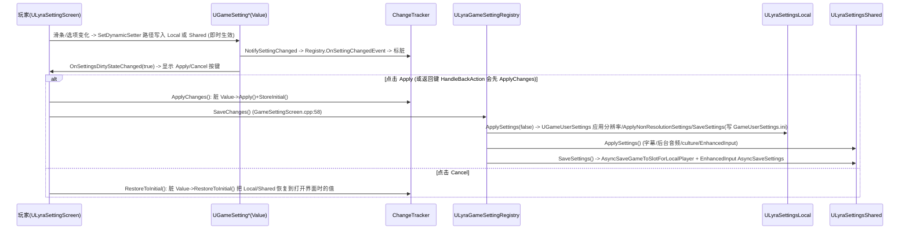

# 50 - 设置 / 在线 / 平台 (Settings, Online, Platform)

范围：`Source/LyraGame/Settings/`、`Plugins/GameSettings/`、`Plugins/CommonUser/`、`Source/LyraGame/Hotfix/`、`Source/LyraGame/Performance/`，以及 `Source/*.Target.cs` 与 `Config/Custom/*` 中与在线后端相关的部分。
引擎版本 UE 5.8。除特别说明，行号均指当前仓库文件。

---

## 1. 职责概述

这一块解决四类问题：

1. **设置的数据层**：把"玩家可调选项"拆成两类持久化。
   - `ULyraSettingsLocal`（继承 `UGameUserSettings`，写入 `GameUserSettings.ini`）：与机器相关（分辨率、画质、帧率上限、音量、音频设备、HDR、性能统计显示列表等）。
   - `ULyraSettingsShared`（继承 `ULocalPlayerSaveGame`，存档槽 `SharedGameSettings`）：与玩家账号相关、可云存档（色盲、字幕、鼠标/手柄灵敏度、反转轴、震动、后台音频、语言等），另外按键绑定走 `UEnhancedInputUserSettings`，随 Shared 一起保存。
2. **设置的声明式 UI 框架**（`GameSettings` 插件）：用 `UGameSetting` 对象树 + "动态属性路径"数据源 + 编辑条件（`FGameSettingEditCondition`）描述设置，`UGameSettingScreen/Panel/ListView/ListEntry` 负责显示，`FGameSettingRegistryChangeTracker` 负责 Apply/Cancel 脏标记。
3. **用户登录与会话**（`CommonUser` 插件）：`UCommonUserSubsystem` 负责本地用户/平台用户/在线登录/权限查询；`UCommonSessionSubsystem` 负责 Host/Find/Join/QuickPlay 与拼接 travel URL。
4. **平台与性能**：`Hotfix`（在线热修复 ini/DeviceProfile/文本）、`Performance`（平台渲染设置、性能统计采样子系统与显示枚举）、`Development/LyraPlatformEmulationSettings`（编辑器内模拟平台）。

构建变体（EOS/Steam/SteamEOS）通过 `Target.cs` 的 `CustomConfig` 切换 `Config/Custom/<Name>/` 下的 ini 叠加层，从而改变默认在线服务与 NetDriver。

---

## 2. 关键类表

### 2.1 LyraGame/Settings

| 类名 | 文件:行 | 职责 |
|---|---|---|
| `ULyraSettingsLocal` | Settings/LyraSettingsLocal.h:36 / .cpp:341 | 机器级设置。`GameUserSettingsClassName=/Script/LyraGame.LyraSettingsLocal`（Config/DefaultEngine.ini:28）。重写 `SetToDefaults`(.cpp:353)、`LoadSettings`(374)、`ApplyNonResolutionSettings`(1221)、`GetEffectiveFrameRateLimit`(452)、`SetOverallScalabilityLevel`(1314)。静态入口 `Get()` (.cpp:423) |
| `FLyraScalabilitySnapshot` | LyraSettingsLocal.h:21 | 从 DeviceProfile 读取的 sg.* 画质快照，用于移动端 clamp |
| `ULyraSettingsShared` | Settings/LyraSettingsShared.h:73 / .cpp:37 | 每玩家存档设置。`ChangeValueAndDirty` 模板(h:385)统一"赋值+置脏+广播 OnSettingChanged"。`LoadOrCreateSettings`(.cpp:62)/`AsyncLoadOrCreateSettings`(72)/`CreateTemporarySettings`(52) |
| `ULyraGameSettingRegistry` | Settings/LyraGameSettingRegistry.h:40 / .cpp:24(Get) | `UGameSettingRegistry` 子类。`OnInitialize`(.cpp:54) 依次建 Video/Audio/Gameplay/MouseAndKeyboard/Gamepad 五个顶级集合；`SaveChanges`(75) 同时保存 Local 与 Shared |
| `GET_LOCAL_SETTINGS_FUNCTION_PATH` / `GET_SHARED_SETTINGS_FUNCTION_PATH` | LyraGameSettingRegistry.h:24/30 | 宏：构造 `FGameSettingDataSourceDynamic`，路径为 `LocalPlayer->GetLocalSettings()->Xxx` 或 `->GetSharedSettings()->Xxx` |
| `ULyraGameSettingRegistry::InitializeVideoSettings` | LyraGameSettingRegistry_Video.cpp:140（帧率 839） | Display / Graphics / GraphicsQuality / AdvancedGraphics 四组；含自定义编辑条件 `FGameSettingEditCondition_FramePacingMode`(51)、`_DynamicResolution`(80)、`_VideoQuality`(111，且在 SettingChanged 时立即 `ApplyScalabilitySettings`) |
| `...InitializeAudioSettings` | LyraGameSettingRegistry_Audio.cpp:23 | 音量(Local，ScalarDynamic)、字幕页(Shared)、输出设备、后台音频(Shared)、HRTF、HDR 音频 |
| `...InitializeGameplaySettings` | LyraGameSettingRegistry_Gameplay.cpp:16 | 语言(Shared，自定义 Discrete)、回放(Local)、DLC 页 |
| `...InitializeMouseAndKeyboardSettings` | LyraGameSettingRegistry_MouseAndKeyboard.cpp:21 | 灵敏度(Shared)；按键绑定由 `UEnhancedInputUserSettings` 的 KeyProfile 自动生成 `ULyraSettingKeyboardInput`(行 133-216) |
| `...InitializeGamepadSettings` | LyraGameSettingRegistry_Gamepad.cpp:21 | 手柄型号(Local)、震动/反转/灵敏度预设/死区/输入 API(Shared) |
| `...AddPerformanceStatPage` | LyraGameSettingRegistry_PerfStats.cpp:115 | 性能统计显示页；延迟统计相关编辑条件(24-111)，`static_assert(Count==18)`(119) |
| `...AddDLCPage` | LyraGameSettingRegistry_DLC.cpp:77 | 仅当 `Lyra.DLCMenu.Show=1` 且有 `IPlatformDLC` 时出现；100ms 定时器刷新状态文本 |
| `ULyraSettingValueDiscrete_Resolution/Display/OverallQuality/MobileFPSType/Language/PerfStat` 等 | Settings/CustomSettings/*.h | 无法用"getter/setter 字符串路径"表达的设置，直接继承 `UGameSettingValueDiscrete`/`Scalar` 并重写 StoreInitial/ResetToDefault/RestoreToInitial/Set/GetDiscreteOption* |
| `ULyraSettingKeyboardInput` | CustomSettings/LyraSettingKeyboardInput.cpp:87 | 一行按键绑定；调用 `UEnhancedInputUserSettings::MapPlayerKey/ResetAllPlayerKeysInRow` |
| `ULyraSettingsListEntrySetting_KeyboardInput` | Settings/Widgets/LyraSettingsListEntrySetting_KeyboardInput.h:22 | 对应的列表条目 Widget（主/副键位按钮、清除、重置、PressAnyKey 面板） |
| `ULyraSettingAction_SafeZoneEditor` / `_HDRCalibrationEditor`、`ULyraSafeZoneEditor` / `ULyraBrightnessEditor` / `ULyraHDRCalibrationEditor` | CustomSettings/、Screens/ | `UGameSettingAction` + 带命名 Action Tag(`GameSettings.Action.EditSafeZone` 等)，由面板的 `OnExecuteNamedAction` 蓝图事件弹出全屏编辑器 |
| `ULyraSettingScreen` | UI/LyraSettingScreen.h:15 / .cpp:22 | `UGameSettingScreen` 的 Lyra 子类：`CreateRegistry()` 创建 `ULyraGameSettingRegistry`；绑定 Back/Apply/Cancel 的 UI Action（来自 DataTable 行） |
| `ULyraLocalPlayer` | Player/LyraLocalPlayer.cpp:97/102/124 | `GetLocalSettings()`(=`ULyraSettingsLocal::Get()`)、`GetSharedSettings()`（桌面同步加载，其它平台先给临时对象）、`LoadSharedSettingsFromDisk()` |

### 2.2 GameSettings 插件

| 类名 | 文件:行 | 职责 |
|---|---|---|
| `UGameSetting` | Public/GameSetting.h:27 / Private/GameSetting.cpp | 抽象基类：DevName/DisplayName/Description/Warning、`AddEditCondition`(cpp:200)、`AddEditDependency`(207)、`RefreshEditableState`(216)、`Apply`(86)、`NotifySettingChanged`(178)。`Initialize`(38) 要求 DevName 与 DisplayName 非空（非 Shipping ensure） |
| `UGameSettingValue` | Public/GameSettingValue.h:21 | "有值"的设置：`StoreInitial/ResetToDefault/RestoreToInitial`；`OnInitialized` 里调用 `StoreInitial` 并要求有 Description 或 DynamicDetails |
| `UGameSettingValueDiscrete` / `...Dynamic` / `_Bool` `_Number` `_Enum` `_Color` `_Vector2D` | Public/GameSettingValueDiscreteDynamic.h:21,79,103,150,196,237 | 离散选项；值内部统一为字符串，经 getter/setter 数据源读写。Bool 自带 OFF/ON 两项(cpp:193-194) |
| `UGameSettingValueScalar` / `UGameSettingValueScalarDynamic` | Public/GameSettingValueScalarDynamic.h | 滑条：`SetSourceRangeAndStep`、`SetMinimumLimit/MaximumLimit`、`SetDisplayFormat`（预设 `Raw/RawTwoDecimals/ZeroToOnePercent/SourceAsPercent100...`）。缺 DisplayFormat 会 ensureAlways(cpp:95) |
| `UGameSettingAction` | Public/GameSettingAction.h:27 | 按钮型：`SetCustomAction(lambda)` 或 `SetNamedAction(Tag)`；`SetDoesActionDirtySettings(true)` 才会脏 |
| `UGameSettingCollection` / `UGameSettingCollectionPage` | Public/GameSettingCollection.h | 分组节点；Page 是"进入子页"导航项，需要 NavigationText 与 Description |
| `FGameSettingDataSource` / `FGameSettingDataSourceDynamic` | Public/DataSource/*.h | 抽象数据源；Dynamic 使用 `FCachedPropertyPath` 以 `PropertyPathHelpers::Get/SetPropertyValueAsString` 沿 UFunction/UPROPERTY 路径访问（cpp:16-35） |
| `FGameSettingEditCondition` / `FGameSettingEditableState` | Public/GameSettingFilterState.h:159 / 83(注意：159 是 FGameSettingEditCondition，83 是 FGameSettingEditableState) | 编辑条件：`GatherEditState` 里调用 `Hide/Disable/DisableOption/UnableToReset/Kill`。`Kill` = 隐藏 + 不可重置 + 不上报 |
| `FWhenCondition` / `FWhenPlatformHasTrait` / `FWhenPlayingAsPrimaryPlayer` | Public/EditCondition/*.h | 内置条件：内联 lambda / 平台 Trait 标签(`KillIfMissing` `DisableIfMissing` ...) / 仅主玩家可改 |
| `FGameSettingFilterState` | Public/GameSettingFilterState.h:29 | 过滤（隐藏/禁用/可重置/嵌套页/搜索文本/根列表） |
| `UGameSettingRegistry` | Public/GameSettingRegistry.h:27 / Private/Registry/GameSettingRegistry.cpp | 注册表：`RegisterSetting`(102)/`RegisterInnerSettings`(112，递归注册子设置并绑定事件)、`FindSettingByDevName`、`GetSettingsForFilter`、`SaveChanges`(虚)、`Regenerate` |
| `FGameSettingRegistryChangeTracker` | Public/GameSettingRegistryChangeTracker.h / cpp | 监听 registry 的 `OnSettingChangedEvent` 收集脏设置；`ApplyChanges`(55)=对每个脏 Value 调 `Apply()`+`StoreInitial()`；`RestoreToInitial`(69) |
| `UGameSettingScreen` | Public/Widgets/GameSettingScreen.h:25 / cpp | 激活式屏幕基类：`GetOrCreateRegistry`(cpp:33) 调虚函数 `CreateRegistry()`；`ApplyChanges`(58) 先 ChangeTracker.Apply 再 `Registry->SaveChanges()`；`CancelChanges` |
| `UGameSettingPanel` / `UGameSettingListView` / `UGameSettingListEntry*` / `UGameSettingDetailView` / `UGameSettingVisualData` | Public/Widgets/*.h | 面板：用 Ticker 等 registry `IsFinishedInitializing()` 后 `SetListItems(VisibleSettings)`；`UGameSettingVisualData`(DataAsset) 把 Setting 类 → 条目 Widget 类、DevName → 条目、详情扩展 映射(Private/Widgets/GameSettingVisualData.cpp:12-60) |

### 2.3 CommonUser 插件

| 类名 | 文件:行 | 职责 |
|---|---|---|
| `UCommonUserSubsystem` | Public/CommonUserSubsystem.h:~170 / Private/CommonUserSubsystem.cpp:325 | GameInstanceSubsystem（若有子类则基类不创建，cpp:441）。管理 `UCommonUserInfo`、登录状态机、权限缓存、Trait 标签 |
| `UCommonUserInfo` | CommonUserSubsystem.h:41 | 每个本地玩家一个：PlatformUser、InputDevice、`InitializationState`、按 Context 缓存 NetId/昵称/权限 |
| `FCommonUserInitializeParams` | CommonUserSubsystem.h:~140 | `TryToInitializeUser` 参数 |
| `ECommonUserOnlineContext` / `ECommonUserInitializationState` / `ECommonUserPrivilege` ... | Public/CommonUserTypes.h:46-193 | Game/Default/Service/Platform 上下文；Unknown→DoingInitialLogin→DoingNetworkLogin→LoggedInOnline/LoggedInLocalOnly/FailedtoLogin |
| `UAsyncAction_CommonUserInitialize` | Private/AsyncAction_CommonUserInitialize.cpp | 蓝图异步节点包装 |
| `UCommonUserBasicPresence` | Private/CommonUserBasicPresence.cpp | 基于 `OnSessionInformationChangedEvent` 写 Rich Presence，Config/Custom/*/DefaultEngine.ini 中 `[/Script/CommonUser.CommonUserBasicPresence]` 配置 |
| `UCommonSessionSubsystem` | Public/CommonSessionSubsystem.h:~245 / Private/CommonSessionSubsystem.cpp:316 | Host/QuickPlay/Find/Join/CleanUp、事件广播、Reservation Beacon |
| `UCommonSession_HostSessionRequest` | CommonSessionSubsystem.h:~65 / cpp:241-312 | 主机请求：OnlineMode(Offline/LAN/Online)、bUseLobbies、bUsePresence、ModeNameForAdvertisement、MapID、ExtraArgs、MaxPlayerCount；`ConstructTravelURL`(cpp:254) |
| `UCommonSession_SearchSessionRequest` / `UCommonSession_SearchResult` | CommonSessionSubsystem.h | 搜索请求与结果（OSSv1 包 `FOnlineSessionSearchResult`，v2 包 `FLobby`） |
| `FCommonOnlineSearchSettingsOSSv1/v2` | CommonSessionSubsystem.cpp:~190 / ~220 | 搜索条件载体（v1: `QuerySettings`；v2: `FindLobbyParams.Filters`） |

### 2.4 Hotfix / Performance / 平台

| 类名 | 文件:行 | 职责 |
|---|---|---|
| `ULyraHotfixManager` | Hotfix/LyraHotfixManager.h:11 / .cpp:15 | `UOnlineHotfixManager` 子类；`HotfixManagerClassName` 在 Config/DefaultEngine.ini:56-57 指向它 |
| `ULyraRuntimeOptions` | Hotfix/LyraRuntimeOptions.h:28 | `URuntimeOptionsBase`，控制台前缀 `ro.`；config 文件 `RuntimeOptions` |
| `ULyraTextHotfixConfig` | Hotfix/LyraTextHotfixConfig.h:16 | DeveloperSettings(DefaultGame.ini)；`TextReplacements` 经 `RegisterPolyglotTextData` 热替换任意 FText |
| `ULyraPlatformSpecificRenderingSettings` | Performance/LyraPerformanceSettings.h:68 | `UPlatformSettings`（按平台 ini），`FramePacingMode`(Desktop/Console/Mobile)、`UserFacingDeviceProfileOptions`、`MobileFrameRateLimits`、`bSupportsGranularVideoQualitySettings`、`bSupportsAutomaticVideoQualityBenchmark`。`Get()` 在 cpp:18 |
| `ULyraPerformanceSettings` | Performance/LyraPerformanceSettings.h:121 | 项目级：`DesktopFrameRateLimits`（默认 30..360，cpp:33）、`UserFacingPerformanceStats`（`FLyraPerformanceStatGroup` = Tag 查询 + 允许的统计集合） |
| `ELyraDisplayablePerformanceStat` / `ELyraStatDisplayMode` | Performance/LyraPerformanceStatTypes.h:14/33 | 18 种统计 + Hidden/TextOnly/GraphOnly/TextAndGraph |
| `ULyraPerformanceStatSubsystem` + `FLyraPerformanceStatCache` + `FSampledStatCache` | Performance/LyraPerformanceStatSubsystem.h:165/123/25 / cpp:28,158 | 采样子系统：`GEngine->AddPerformanceDataConsumer` 注册 `IPerformanceDataConsumer`，每帧 `ProcessFrame` 写入 125 样本环形缓冲 |
| `ULyraPlatformEmulationSettings` | Development/LyraPlatformEmulationSettings.h:15 | 编辑器 per-project 设置：模拟平台 Trait、模拟 DeviceProfile、PIE 是否应用帧率/前端性能/DeviceProfile（背后是 CVar） |
| `LyraMemoryDebugCommands` | Performance/LyraMemoryDebugCommands.cpp:51 | `Lyra.ObjListToCollection` 等调试命令 |

---

## 3. 核心流程与数据流

### 3.1 本地 vs 云存档：为什么这样拆

- `ULyraSettingsShared` 的类注释（LyraSettingsShared.h:65-71）：Shared 设置**不依赖机器**、可放云端、且按玩家存（存档槽 `SharedGameSettings`，.cpp:18）。手柄键位偏好如果放 Local，则同机所有用户共用，所以放 Shared。
- `ULyraSettingsLocal` 是引擎的 `UGameUserSettings`，其属性 `UPROPERTY(Config)` 写入 `GameUserSettings.ini`，天然是"机器级"：分辨率、窗口模式、画质(`Scalability`)、帧率上限、音量、音频设备、HDR、DisplayGamma、SafeZone、控制器类型、回放开关、性能统计列表(`DisplayStatList`)、延迟统计开关。
- 个别例外值得注意：
  - **音量**放在 Local（并通过 AudioModulation ControlBusMix 应用，.cpp:1023-1470）。
  - **语言**：Shared 保存"待应用 culture"，但最终**写入 `GGameUserSettingsIni`** 的 `[Internationalization] Culture`(LyraSettingsShared.cpp:235)，因为需要在玩家登录前、加载界面早期就本地化。
  - **反转轴 / 灵敏度**在 Shared，且 `ApplyInputSensitivity()` 当前是空实现(.cpp:288)；真正的灵敏度应用在输入/Hero 侧读取 Shared。

### 3.2 设置声明 → 绑定 → 显示

```
ULyraSettingScreen::CreateRegistry()                      (UI/LyraSettingScreen.cpp:22)
  -> NewObject<ULyraGameSettingRegistry>()->Initialize(LocalPlayer)
       -> OnInitialize(): InitializeXxxSettings() + RegisterSetting()   (Registry.cpp:137)
            每个设置:  NewObject<UGameSettingValueXxx>()
                       SetDevName / SetDisplayName / SetDescriptionRichText
                       SetDynamicGetter(GET_LOCAL_SETTINGS_FUNCTION_PATH(GetFoo))
                       SetDynamicSetter(GET_LOCAL_SETTINGS_FUNCTION_PATH(SetFoo))
                       SetDefaultValue(...)  /  AddOption(...)
                       AddEditCondition(...) /  AddEditDependency(OtherSetting)
                       Collection->AddSetting(Setting)  -> Setting->Initialize(LocalPlayer)
UGameSetting::Initialize -> Startup -> Getter->Startup -> StartupComplete -> OnInitialized
       -> (Dynamic) ensure Getter/Setter Resolve (非 Shipping)  -> StoreInitial()
UGameSettingPanel::RefreshSettingsList (Ticker, 等 Registry->IsFinishedInitializing())
       ULyraGameSettingRegistry::IsFinishedInitializing 额外要求 GetSharedSettings()!=nullptr  (Registry.cpp:119)
       -> Registry->GetSettingsForFilter(FilterState) -> ListView->SetListItems
UGameSettingListView::OnGenerateEntryWidgetInternal -> UGameSettingVisualData::GetEntryForSetting
       (按 DevName -> 按 UClass 继承链找条目 Widget; 资产在 BP, 不在 C++)
```

**动态路径（Dynamic Path）**：`GET_LOCAL_SETTINGS_FUNCTION_PATH(X)` 展开为 `{"GetLocalSettings","X"}`，从 `ULocalPlayer`（即 `ULyraLocalPlayer`）出发依次解析 UFUNCTION/UPROPERTY。所以：
- 被引用的函数必须是 `UFUNCTION()`（无参 getter；仅一个参数的 setter），或直接引用 `UPROPERTY`（如 `bDesiredHeadphoneMode`、`bUseHDRAudioMode`，Audio.cpp:278-303）。
- 路径写错只会在非 Shipping 的 `OnInitialized` ensure 里报错（GameSettingValueDiscreteDynamic.cpp:91-93）。
- 值经字符串传递：Enum 用枚举名字符串，Number 用 `LexToString`，所以 `UGameSettingValueDiscreteDynamic_Number` 的 `AddOption(0.0f, ...)` 与 getter 返回值的字符串必须一致（如帧率 `0` 表示 Unlimited）。

**编辑条件与依赖**：
- `AddEditCondition(cond)`：`GatherEditState` 在 `ComputeEditableState`(GameSetting.cpp:120) 里运行；结果缓存在 `EditableStateCache`。条件内部可用 `BroadcastEditConditionChanged()` 触发刷新（例：DLC 的 `FDLCInitEditCondition`、延迟统计的 `..._LatencyStatsCurrentlyEnabled`）。
- `AddEditDependency(OtherSetting)`：别的设置值变化时本设置重新求值，并（若原因非 DependencyChanged）以 `DependencyChanged` 再广播自身变化（GameSetting.cpp:263-272）。画质预设与各子项互相依赖就是这样实现的（Video.cpp:561-620）。
- 平台能力判断一律走平台 Trait 标签：`FWhenPlatformHasTrait::KillIfMissing(Tag, "原因")`，Trait 来自 `CommonInputPlatformSettings_<Platform>` 的 `PlatformTraits`（Config/Windows/WindowsGame.ini:13-24）。

### 3.3 设置保存 / 应用流程



要点：
- **改动即时生效、Apply 才持久化**。需要"延迟生效"的设置自己持有 `Desired*` 字段（`bDesiredHeadphoneMode`、`DesiredUserChosenDeviceProfileSuffix`、`DesiredMobileFrameRateLimit`，在 `ApplyNonResolutionSettings`(Local.cpp:1280-1295) 里落地；`ResetToCurrentSettings`(402) 回滚）。分辨率/窗口模式使用 `UGameUserSettings` 自带的挂起机制，并在 `ConfirmVideoMode`(428) 里同步移动端 FPS。
- 画质 `FGameSettingEditCondition_VideoQuality::SettingChanged` 在每次改变时立即 `Scalability::SetQualityLevels`（Video.cpp:127-132，TODO 注明"暂时立即应用"）。
- `ULyraSettingsLocal::SetHeadphoneModeEnabled`(.cpp:927) 在值变化时**直接 SaveSettings()**，绕过 Apply/Cancel，属于特例。
- **Shared 的加载时机**：`ULyraGameInstance::HandlerUserInitialized`(System/LyraGameInstance.cpp:143) 登录成功 → `LocalPlayer->LoadSharedSettingsFromDisk()` → 异步加载 → `OnSharedSettingsLoaded` 替换临时对象并记录 `NetIdForSharedSettings`(LyraLocalPlayer.cpp:124-146)。桌面平台 `GetSharedSettings()` 第一次调用就同步 `LoadOrCreateSettings`(LyraLocalPlayer.cpp:108)；非桌面先返回 `CreateTemporarySettings`。
- 每次 Shared 加载/创建都会立刻 `ApplySettings()`（字幕、后台音频、语言、输入）。

### 3.4 帧率 / 设备配置文件 / 前端性能

- `GetEffectiveFrameRateLimit()`(Local.cpp:452) 把多个上限取最小：基础限制、前端(菜单)限制(`FrameRateLimit_InMenu`，仅当 `SetShouldUseFrontendPerformanceSettings(true)`)、电池、后台、动态分辨率目标。ConsoleStyle 直接返回 0（用 rhi.SyncInterval）。编辑器 PIE 默认不应用（CVar `Lyra.Settings.ApplyFrameRateSettingsInPIE`，.cpp:40）。
- 前端开关来自 `UI/Frontend/ApplyFrontendPerfSettingsAction.cpp:28/39`（GameFeatureAction，进/出前端 Experience 时调用）。
- `UpdateGameModeDeviceProfileAndFps()`(.cpp:1478)：按 `UserChosenDeviceProfileSuffix` + `UserFacingDeviceProfileOptions`(含 `MinRefreshRate` 回退) 组合出 `<Platform>_<Suffix>` 的 DeviceProfile 名，找到即 `SetOverrideDeviceProfile`（编辑器内用 `SetPreviewDeviceProfile`，且名字取自 `ULyraPlatformEmulationSettings`）。然后按 `FramePacingMode` 走 `UpdateDesktop/Console/MobileFramePacing`。`ExperienceSuffix` 目前恒为空（@TODO，.cpp:1494-1496）。
- Experience 加载完成后 `LyraExperienceManagerComponent.cpp:358` 调 `OnExperienceLoaded()`，热修复 DeviceProfile 后 `OnHotfixDeviceProfileApplied()`，二者都 `ApplyNonResolutionSettings()` 重新应用。
- 移动端特有一套 Clamp 逻辑（`ClampMobileQuality`/`RemapMobileResolutionQuality`，.cpp:825-915），数据来自 CVar `Lyra.DeviceProfile.Mobile.*`（在 DeviceProfiles.ini 里由设备配置设置）。

### 3.5 性能统计显示管线

```
Config/DefaultGame.ini: ULyraPerformanceSettings.UserFacingPerformanceStats (Tag 查询 + 允许的统计)
        |  (设置页) FGameSettingEditCondition_PerfStatAllowed 用 UCommonUIVisibilitySubsystem 的 Visibility Tags 判断是否 Hide
        v
ULyraSettingValueDiscrete_PerfStat::SetDiscreteOptionByIndex -> ULyraSettingsLocal::SetPerfStatDisplayState
        -> DisplayStatList (UPROPERTY(Config)) + OnPerfStatDisplayStateChanged 广播   (Local.cpp:582)
        v
UI/PerformanceStats/LyraPerfStatContainerBase  订阅事件 -> UpdateVisibilityOfChildren (按 GetPerfStatDisplayState 显隐子 Widget)
        v
UI/PerformanceStats/LyraPerfStatWidgetBase  每帧从 ULyraPerformanceStatSubsystem::GetCachedStat / GetCachedStatData 取值绘制(文字/图表)
        ^
FLyraPerformanceStatCache::ProcessFrame (IPerformanceDataConsumer, 每帧)
   - FrameData: ClientFPS/IdleTime/FrameTime/GT/RT/RHI/GPU
   - ALyraGameState::GetServerFPS -> ServerFPS
   - PlayerState Ping、NetConnection 丢包/包速率/包大小
   - ILatencyMarkerModule (Reflex) -> Latency_Total/Game/Render (+ CSV 类别 LyraPerformance)
```

延迟统计需要平台 Trait `Platform.Trait.SupportsLatencyStats/Markers`（Windows ini 已开），Marker 还默认要求 NVIDIA（CVar `Lyra.Settings.LatencyMarkersRequireNVIDIA`，PerfStats.cpp:18）。`bEnableLatencyTrackingStats` 通过 `ApplyLatencyTrackingStatSetting` 开关所有 `ILatencyMarkerModule`。

### 3.6 用户登录流程（CommonUser）

1. `UCommonUserSubsystem::Initialize`(cpp:325)：`CreateOnlineContexts`(346) 建立 Default 上下文（`Online::GetSubsystem`），若存在独立平台 OSS（`IOnlineSubsystem::GetByPlatform()` 不同于默认）则再建 Platform 上下文；`BindOnlineDelegates`；`SetMaxLocalPlayers(4)`。
2. 前端"按任意键"：`ULyraFrontendStateComponent`（UI/Frontend/LyraFrontendStateComponent.cpp:80-190）若平台 `ShouldWaitForStartInput()` 为 false 直接继续，否则注册 `OnUserInitializeComplete` 并 `TryToInitializeForLocalPlay(0, FInputDeviceId(), false)`。
3. `TryToInitializeUser`(cpp:1007)：校验索引/设备，创建 `UCommonUserInfo`，状态置 `DoingInitialLogin` 或（已可 CanPlay 且请求 CanPlayOnline 时）`DoingNetworkLogin`，调用 `LoginLocalUser`(1490) → `ProcessLoginRequest`(1507)。
4. `ProcessLoginRequest` 状态机：先在平台上下文(`PlatformOrDefault`)再在服务上下文；对每个上下文依次尝试 TransferPlatformAuth → AutoLogin → ShowLoginUI → QueryUserPrivilege。（OSSv1 下 TransferPlatformAuth 立即标 Failed）
5. 回调 `HandleLoginForUserInitialize`(1342)：刷新 NetId；非首个玩家且可当访客时生成 `GuestPlayerN` 假 NetId；必要时 `GameInstance->CreateLocalPlayer`；`SetLocalPlayerUserInfo`(2387) 把 PlatformUserId 与 `CachedUniqueNetId` 写入 `ULocalPlayer`（并更新 PlayerState）；下一帧 `HandleUserInitializeSucceeded`(1457) 设状态 `LoggedInOnline/LoggedInLocalOnly` 并广播 `OnUserInitializeComplete`。
6. `ULyraGameInstance::HandlerUserInitialized`(LyraGameInstance.cpp:143) 在成功后加载玩家的 Shared 设置。
7. 专用服务器：`ALyraGameMode::TryDedicatedServerLogin`(GameModes/LyraGameMode.cpp:167) 调 `TryToLoginForOnlinePlay(0)`；登录完成后 `HostDedicatedServerMatch`(204) 解析 `-UserExperience=`/`-Playlist=` 找到 `ULyraUserFacingExperienceDefinition`，`CreateHostingRequest` → `HostSession(nullptr, Request)`。

### 3.7 Host Session → Travel（含 Experience）

```mermaid
sequenceDiagram
    participant UI as 前端(BP/UI)
    participant UFE as ULyraUserFacingExperienceDefinition
    participant SS as UCommonSessionSubsystem
    participant OSS as OnlineSubsystem(v1)/OnlineServices
    participant W as UWorld
    UI->>UFE: CreateHostingRequest(WorldContext)  (LyraUserFacingExperienceDefinition.cpp:13)
    UFE->>SS: CreateOnlineHostSessionRequest()  (OnlineMode=Online, bUseLobbies=bUseLobbiesDefault, bUsePresence=!DS)
    UFE->>UFE: Request.MapID/ModeNameForAdvertisement/ExtraArgs/MaxPlayerCount; ExtraArgs["Experience"]=ExperienceID.Name (+DemoRec)
    UI->>SS: HostSession(PC, Request)  (cpp:459)
    SS->>SS: ValidateAndLogErrors (Client 构建直接报 "Client builds cannot host game sessions", cpp:300)
    alt OnlineMode == Offline
        SS->>W: ServerTravel(Request.ConstructTravelURL())
    else Online / LAN
        SS->>SS: PendingTravelURL = ConstructTravelURL()  (map?listen?Experience=...?extraArgs)
        SS->>OSS: CreateSession (v1: FCommonSession_OnlineSessionSettings + SETTING_GAMEMODE/MAPNAME/...)  (cpp:519)
        OSS-->>SS: OnCreateSessionComplete -> FinishSessionCreation(true)  (cpp:693)
        SS->>SS: bUseBeacons? CreateHostReservationBeacon()
        SS->>UI: OnCreateSessionCompleteEvent
        SS->>W: ServerTravel(PendingTravelURL)
    end
    Note over W: 新地图 AGameModeBase::InitGame 读取 URL 选项 "Experience" (LyraGameMode.cpp:104-106) -> 加载 ULyraExperienceDefinition
```

- `ConstructTravelURL`(cpp:254)：`<MapPackageName>` + (`?bIsLanMatch` 若 LAN) + (`?listen` 若非 Offline) + `?Key=Value`(ExtraArgs)。`Experience` 选项就是靠 ExtraArgs 注入的，这是"Host → 服务器如何知道玩哪个 Experience"的关键。
- `HandlePostLoadMap`(cpp:1725，仅 OSSv1)：主机换图后更新会话的 `SETTING_MAPNAME` 并重建 Beacon。
- 加入端：`FindSessions` → `UCommonSession_SearchResult` 列表 → `JoinSession`(cpp:1157) → `JoinSessionInternalOSSv1`(1202, 强制 `bUsesPresence=true`) → `OnJoinSessionComplete` → `FinishJoinSession`(1309)：`bUseBeacons` 为真则先 `ConnectToHostReservationBeacon`，成功后由 Beacon 流程调用 `InternalTravelToSession`；否则直接 `NotifyJoinSessionComplete` + `InternalTravelToSession(NAME_GameSession)`。
- `InternalTravelToSession`(1523)：取 `GetResolvedConnectString` → 广播 `OnPreClientTravelEvent(URL&)`（`ULyraGameInstance::OnPreClientTravelToSession` 在此追加调试加密 token，LyraGameInstance.cpp:313）→ `PlayerController->ClientTravel(URL, TRAVEL_Absolute)`。
- 前端从邀请/外部加入：`GameInstance->GetRequestedSession()` + `FlowStep_TryJoinRequestedSession`(LyraFrontendStateComponent.cpp:192) 调 `JoinRequestedSession` 并等待 `OnJoinSessionCompleteEvent`。
- **QuickPlay**(cpp:878)：先 `CreateOnlineSearchSessionRequest` 搜索；`HandleQuickPlaySearchFinished`(957) 有结果就 `JoinSession` 第一个，否则 `HostSession` 自己建（注释承认"没有按 ping 排序，TODO"）。

### 3.8 热修复流程

1. `Config/DefaultEngine.ini:56` 指定 `ULyraHotfixManager`。
2. `StartHotfixProcess`(cpp:267)：**编辑器直接跳过**（`FinalizeHotfixProcess(SuccessNoChange)`）。
3. `WantsHotfixProcessing/ApplyHotfixProcessing`：额外接受 `AssetMigrations.ini` 与任意 `.json`(cpp:135-193)。
4. `HotfixIniFile`(162)：若内容是 `DEVICEPROFILES.INI`，检查当前激活 DeviceProfile 是否被引用 → `bHasPendingDeviceProfileHotfix`。
5. `OnHotfixAvailablityCheck`(228)：发现 `GAME.INI` 待更新 → `OnPendingGameHotfixChanged(true)`（UI 可提示"有待应用的热修复"）；`ApplyHotfixProcessing` 处理 GAME.INI 后清除。
6. `OnHotfixCompleted`(97)：重载服务器 NetDriver 的 DDoS 配置；若 DeviceProfile 被改 → `UDeviceProfileManager::ReapplyDeviceProfile()` + `ULyraSettingsLocal::OnHotfixDeviceProfileApplied()`。
7. 新 GameFeature 插件加载时（`ULyraGameFeature_HotfixManager::OnGameFeatureLoading`，GameFeatures/LyraGameFeaturePolicy.cpp:72）调 `RequestPatchAssetsFromIniFiles()`，下一帧重新 `PatchAssetsFromIniFiles()` 以补丁新插件里的资产。
8. 文本热修复：`ULyraTextHotfixConfig.TextReplacements`（DefaultGame.ini，可被热修复 ini 覆盖；`PostReloadConfig` 重新注册）。
9. 运行时开关：`ULyraRuntimeOptions`（`ro.` 前缀 CVar）。**注意** `Config/DefaultRuntimeOptions.ini` 中的 section 名写成了 `[/Script/LyraGame.LyraRuntimeOptons]`（拼写错误），如果在这里放配置不会生效。

---

## 4. 与其他模块的接口

| 对方 | 接口 |
|---|---|
| Player (`ULyraLocalPlayer`) | `GetLocalSettings/GetSharedSettings/LoadSharedSettingsFromDisk`；`LocalPlayerClassName=LyraLocalPlayer`(DefaultEngine.ini:27)。设置数据源路径都以 LocalPlayer 为根 |
| GameInstance (`ULyraGameInstance`) | 绑定 `OnPreClientTravelEvent`；`HandlerUserInitialized` 里加载 Shared；`GetRequestedSession/JoinRequestedSession/CanJoinRequestedSession` |
| GameModes | `ALyraGameMode`：`TryDedicatedServerLogin`、`HostDedicatedServerMatch`、URL 选项 `Experience`；`ULyraExperienceManagerComponent` 在完成加载后调 `ULyraSettingsLocal::OnExperienceLoaded`；`ULyraUserFacingExperienceDefinition::CreateHostingRequest` 是 CommonSession 的主要调用方 |
| UI | `ULyraSettingScreen`（BP 子类绑定 `Settings_Panel`、`TopSettingsTabs`、Visual Data）；`ULyraFrontendStateComponent`（登录/PressStart/加入请求）；`UI/PerformanceStats/*`（读 Local + StatSubsystem）；CommonUI `UCommonUIVisibilitySubsystem`（Platform Trait 标签来源）；`UCommonMessagingSubsystem`（语言/DLC 弹窗） |
| Input | `ULyraInputUserSettings`（Config/DefaultInput.ini:51 `UserSettingsClass`），`UEnhancedInputUserSettings` 的 KeyProfile 驱动键位设置页；`ULyraSettingsShared::SaveSettings/ApplySettings` 同步保存/应用 |
| Audio | `ULyraAudioSettings`（DefaultGame.ini:219）给出 ControlBus/Mix 资产；`ULyraAudioMixEffectsSubsystem::ApplyDynamicRangeEffectsChains`(HDR 音频) |
| Subtitles | `USubtitleDisplaySubsystem::SetSubtitleDisplayOptions`（Shared.ApplySubtitleOptions） |
| Replays | `ULyraReplaySubsystem::GetPlatformSupportTraitTag` 作为回放设置的 Trait 条件 |
| GameFeatures | `ULyraGameFeature_HotfixManager`；`ApplyFrontendPerfSettingsAction` |
| Platform 模块 | `PlatformDLC`、`Reflex`(LatencyMarker)、`OnlineSubsystemSteam/EOS`、`OnlineServicesNull/OSSAdapter` |

**GameplayTag（本模块定义/依赖）**
- 本模块定义：`GameSettings.Action.EditSafeZone/EditBrightness/CalibrateHDR`（Video.cpp:35-37）；`Platform.Trait.SupportsWindowedMode/NeedsBrightnessAdjustment/SupportsCustomDynamicResolution/SupportsLatencyStats/SupportsLatencyMarkers/BinauralSettingControlledByOS/Input.SupportsGamepad/Input.SupportsTriggerHaptics`；CommonUser 的 `SystemMessage.Error.InitializeLocalPlayerFailed`、`Platform.Trait.RequiresStrictControllerMapping/SingleOnlineUser`。
- Trait 的**赋值**在 `Config/<Platform>/*Game.ini` 的 `CommonInputPlatformSettings_<Platform>` 里；Windows 已启用上面所有（WindowsGame.ini:13-24）。
- 事件：无 GameplayMessage；全部使用 C++ 委托（`OnUserInitializeComplete`、`OnCreateSessionCompleteEvent`、`OnJoinSessionCompleteEvent`、`OnSessionInformationChangedEvent`、`OnPreClientTravelEvent`、`OnPerfStatDisplayStateChanged`、`OnPendingGameHotfixChanged`）。

---

## 5. 数据驱动点

| 数据 | 位置 | 控制什么 |
|---|---|---|
| `GameUserSettingsClassName` | Config/DefaultEngine.ini:28 | Local 设置类 |
| `ULyraPlatformSpecificRenderingSettings`（按平台 ini） | Config/<Platform>/*Game.ini 的 per-platform 段 | FramePacingMode、DefaultDeviceProfileSuffix、UserFacingDeviceProfileOptions、MobileFrameRateLimits、是否支持细粒度画质/基准测试 |
| `ULyraPerformanceSettings` | Config/DefaultGame.ini（DeveloperSettings，`PerPlatformSettings` 为编辑辅助） | `DesktopFrameRateLimits`、`UserFacingPerformanceStats` |
| `Config/DefaultDeviceProfiles.ini` + CVar `Lyra.DeviceProfile.*` | DeviceProfile | 控制台/移动 FPS、画质上限与推荐值、`sg.*` 默认 |
| `CommonInputPlatformSettings_<Platform>.PlatformTraits` | Config/Windows/WindowsGame.ini 等 | 哪些设置/功能显示 |
| `UGameSettingVisualData`（DataAsset，BP） | 设置屏幕 BP 的 ListView | Setting 类/DevName → 条目 Widget；详情面板扩展 |
| `ULyraSettingScreen` 的 `BackInputActionData/ApplyInputActionData/CancelChangesInputActionData` | BP 默认值（DataTable 行） | 屏幕按键 |
| `ULyraUserFacingExperienceDefinition` | PrimaryAsset，目录 `/Game/UI/Temp`、`/Game/System/Playlists`（DefaultGame.ini:63） | MapID、ExperienceID、ExtraArgs、MaxPlayerCount、bRecordReplay、是否默认 Experience → 构造 HostSessionRequest |
| `[/Script/CommonUser.CommonSessionSubsystem]` | DefaultEngine.ini:380 | `bUseLobbiesDefault=true`、`bUseLobbiesVoiceChatDefault=true`；Steam 变体额外 `bUseBeacons=false`；`BeaconTeamCount/TeamSize/MaxReservations` 可配 |
| `[OnlineServices] DefaultServices=Null` | DefaultEngine.ini:73 | 基础构建的 OSSv2 默认服务；EOS 变体改为 `Epic`，Steam 变体改为 `Steam` |
| `[/Script/CommonUser.CommonUserBasicPresence]` | Config/Custom/*/DefaultEngine.ini | 会话驱动的富状态文案与键 |
| `[/Script/Hotfix.OnlineHotfixManager]` | DefaultEngine.ini:56 | 热修复管理器类 |
| `ULyraRuntimeOptions` | Config/DefaultRuntimeOptions.ini（有拼写错误，见 3.8） | `ro.*` 运行时开关 |
| `ULyraPlatformEmulationSettings` | Editor per-project（`config=EditorPerProjectUserSettings`） | 编辑器内模拟平台 Trait/DeviceProfile；PIE 下是否应用帧率/前端性能/DeviceProfile（CVar `Lyra.Settings.Apply*InPIE`） |
| CVar | `Lyra.DLCMenu.Show`、`GameSettings.ShowDebugInfo`、`Lyra.Settings.LatencyMarkersRequireNVIDIA`、`Lyra.DeviceProfile.Console.TargetFPS/FrameSyncType`、`gpad.Default*StickInnerDeadZone` | 见各自文件 |

### 在线后端：Target 与 Config 叠加

| Target | CustomConfig | 额外插件 | 效果 |
|---|---|---|---|
| `LyraGame` / `LyraClient` / `LyraServer` / `LyraEditor` | (无) | — | 默认 `OnlineServices.DefaultServices=Null`，OSS 走 Null 子系统，`IpNetDriver` |
| `LyraGameEOS` / `LyraServerEOS` (Source/LyraGameEOS.Target.cs) | `EOS` | EnablePlugins: `OnlineServicesEOS`、`OnlineSubsystemEOS`；Optional: `EOSReservedHooks` | `DefaultPlatformService=EOS`、`NetDriverEOS`(回退 IpNetDriver)、`bUseEOSSessions` 等，Lobbies Schema 属性(GAMEMODE/MAPNAME/...)；需自行填 Artifacts/ProductId 等凭据 |
| `LyraGameSteam` / `LyraServerSteam` | `Steam` | 无额外 EnablePlugins（uproject 里已启用 `OnlineSubsystemSteam`、`SocketSubsystemSteamIP`、`SteamSockets`） | `DefaultPlatformService=Steam`、`SteamSocketsNetDriver`、`CompatibleUniqueNetIdTypes=Steam`、`bUseBeacons=false`（SteamSockets 不支持信标） |
| `LyraGameSteamEOS` / `LyraServerSteamEOS` | `SteamEOS` | 同 EOS | `DefaultPlatformService=EOS` + `NativePlatformService=Steam`，EOSSDK 平台整合，`bLoadNativeOSSBeforeDefault=true`，Steam 为"集成平台" |

要点：
- `CustomConfig` 让 UBT 在打包时把 `Config/Custom/<Name>/Default*.ini` 叠加到项目配置（`DefaultEngine.ini`/`DefaultGame.ini`）。基础 `DefaultEngine.ini` 不含任何 EOS/Steam 内容。
- `ApplySharedLyraTargetSettings`（LyraGame.Target.cs:23）只在 `TargetBuildEnvironment.Unique` 下才改插件与选项；使用 Installed（Launcher）引擎构建 EOS/Steam 变体时会出现警告 "LyraGameEOS and dynamic target options are disabled..."(第 80 行)，Target.cs 里的 `EnablePlugins` 不会生效。
- `Config/Custom/EOS/DefaultGame.ini` 里的 `[Staging] DisallowedConfigFiles` 只是示例。
- **CommonUser 目前编译为 OSSv1**：`CommonUser.Build.cs` 里 `bool bUseOnlineSubsystemV1 = true`，定义 `COMMONUSER_OSSV1=1`；OSSv2 路径（`OnlineServicesInterface`、`Lobbies`）存在但**不会被编译**。切 OSSv2 需把该变量改为 false，并保证 `DefaultServices`、Lobby schema 配置（已存在于 Custom ini）正确。

---

## 6. 扩展与修改配方

### 6.1 新增一个画质/图形类设置（Local，机器级）

示例：新增 "Motion Blur" 开关。

1. `LyraSettingsLocal.h`：在合适分区添加
   ```cpp
   UFUNCTION() bool GetMotionBlurEnabled() const { return bMotionBlurEnabled; }
   UFUNCTION() void SetMotionBlurEnabled(bool bEnabled);
   UPROPERTY(Config) bool bMotionBlurEnabled = true;
   ```
   - 必须 `UFUNCTION()`（动态路径要求）。`UPROPERTY(Config)` 才会写入 `GameUserSettings.ini`（Local 是 `UGameUserSettings`，自动保存 Config 属性）。
2. `LyraSettingsLocal.cpp`：Setter 里即时生效（如 `IConsoleManager` 设 `r.MotionBlurQuality`，`ECVF_SetByGameSetting`）；如需在加载/应用时重放，在 `ApplyNonResolutionSettings()`(1221) 追加；默认值可在 `SetToDefaults()`(353) 设置。
3. `LyraGameSettingRegistry_Video.cpp`：在 `Graphics` 或 `AdvancedGraphics` 块里仿 VerticalSync(793-813) 添加
   ```cpp
   auto* Setting = NewObject<UGameSettingValueDiscreteDynamic_Bool>();
   Setting->SetDevName(TEXT("MotionBlur"));            // 全局唯一
   Setting->SetDisplayName(LOCTEXT("MotionBlur_Name", "Motion Blur"));
   Setting->SetDescriptionRichText(LOCTEXT("MotionBlur_Desc", "..."));   // 不能为空
   Setting->SetDynamicGetter(GET_LOCAL_SETTINGS_FUNCTION_PATH(GetMotionBlurEnabled));
   Setting->SetDynamicSetter(GET_LOCAL_SETTINGS_FUNCTION_PATH(SetMotionBlurEnabled));
   Setting->SetDefaultValue(GetDefault<ULyraSettingsLocal>()->GetMotionBlurEnabled());
   Setting->AddEditCondition(FWhenPlayingAsPrimaryPlayer::Get());
   Graphics->AddSetting(Setting);
   ```
4. 若要多档选项用 `UGameSettingValueDiscreteDynamic_Number` + `AddOption(n, Text)`；滑条用 `UGameSettingValueScalarDynamic`（必须 `SetDisplayFormat` 与 `SetSourceRangeAndStep`）。
5. 如果该设置属于"Scalability 画质"（sg.*），要同时改 `FLyraScalabilitySnapshot` 相关函数（含 `static_assert(sizeof(FQualityLevels)==88)`，LyraSettingsLocal.cpp:110 等多处，引擎升级后会触发编译断言）。
6. 无需改 UI 蓝图：条目 Widget 按 Setting 类（Bool/Number/Enum → Discrete 条目；Scalar → 滑条）由 `UGameSettingVisualData` 映射。

### 6.2 新增一个玩法/账号类设置（Shared，可云存档）

1. `LyraSettingsShared.h`：加 `UPROPERTY()`（**无需 Config，但必须 UPROPERTY** 才会随 SaveGame 序列化），getter/setter 用 `ChangeValueAndDirty(Member, NewValue)`（自动置脏、广播）；需要即时副作用就在 setter 里调用 Apply 函数，并在 `ApplySettings()`(.cpp:102) 里重放（加载后同样生效）。
2. 可序列化的结构变化要提升 `GetLatestDataVersion()`(.cpp:45)，必要时做兼容（当前版本 1）。
3. Registry 里使用 `GET_SHARED_SETTINGS_FUNCTION_PATH(GetXxx/SetXxx)` 声明（模板同 6.1 的第 3 步），放进 Gameplay/Audio/Gamepad/MouseAndKeyboard 任一集合；建议加 `FWhenPlayingAsPrimaryPlayer::Get()`。
4. 默认值用 `GetDefault<ULyraSettingsShared>()->GetXxx()`（与构造函数默认一致）。
5. 需要新分页：`UGameSettingCollectionPage` + `SetNavigationText` + `SetDescriptionRichText`（参考字幕页 Audio.cpp:131-141 或性能统计页）。
6. 注意：`ULyraGameSettingRegistry::IsFinishedInitializing` 要求 Shared 已加载，否则面板不显示。

### 6.3 新增一个按键绑定设置

按键设置**不在 Registry 里手写**，而是数据驱动：
1. 创建/编辑 `UInputAction` 并勾选 `Player Mappable`（`UPlayerMappableKeySettings`，含 `DisplayName`、`DisplayCategory`；子类 `ULyraPlayerMappableKeyProfile`/`ULyraInputUserSettings` 见 Input/）。
2. 把该 Action 放进某个 `UInputMappingContext` 且注册到 EnhancedInput 用户设置：Lyra 通过 `GameFeatureAction_AddInputContextMapping`(GameFeatures/) 与 `LyraHeroComponent`/`LyraPlayerController` 注册；需要 `bRegisterWithSettings`(上下文注册选项)=true。
3. `InitializeMouseAndKeyboardSettings` 在打开设置页时遍历 `UserSettings->GetAllAvailableKeyProfiles()` 的 `GetPlayerMappingRows()`，按 `DisplayCategory` 自动建集合，并给每一行 `NewObject<ULyraSettingKeyboardInput>`（MouseAndKeyboard.cpp:180-215）。无任何 C++ 改动。
4. 若想追加**非按键**的输入偏好（如"按住/切换"），在 `ULyraInputUserSettings`(Input/LyraInputUserSettings.h) 加 `UPROPERTY(SaveGame)` 属性（随 EnhancedInput 用户设置保存，`ULyraSettingsShared::SaveSettings` 会触发 `AsyncSaveSettings`）。
5. 注意过滤：键盘页用 `KeyToMatch=EKeys::W, bMatchBasicKeyTypes=true`(MouseAndKeyboard.cpp:192-194) 只显示键鼠键位；手柄页 `GamepadBindingCollection` 当前是空集合（Gamepad.cpp:120-126），手柄键位目前没有自动生成。

### 6.4 切换到 Steam / EOS 构建

1. 选 Target：`LyraGameSteam`、`LyraGameEOS`、`LyraGameSteamEOS`（服务器对应 `LyraServer*`）。命令：`RunUAT BuildCookRun -project=... -target=LyraGameEOS -platform=Win64 -clientconfig=Development ...`；编辑器内无法切换（Editor 目标不应用 CustomConfig）。
2. 必须使用**源码版引擎**（Unique 构建环境），否则 `EnablePlugins` 被忽略（LyraGame.Target.cs 的 Warning）。
3. EOS：编辑 `Config/Custom/EOS/DefaultEngine.ini`，取消注释并填 OSSv1 的 `DefaultArtifactName/Artifacts`（ClientId/ProductId/SandboxId/DeploymentId/EncryptionKey）。OSSv2 另填 `[OnlineServices.EOS]`；由于 CommonUser 当前是 v1，v1 凭据是必须的。
4. Steam：保证 `steam_appid.txt`（开发期）与 Steamworks SDK；基础配置已在 uproject 启用 `OnlineSubsystemSteam`/`SteamSockets`。`bUseBeacons=false` 已设置。
5. SteamEOS：Steam 启动、EOS 作为服务；同样需要 EOS 凭据，`EOSSDK` 集成已配好。
6. 校验：日志中应看到 `LogCommonUser` 创建的 Default/Platform 上下文；`UCommonUserSubsystem::HasSeparatePlatformContext()` 在 SteamEOS 下为 true。
7. 想自建新变体：复制 `Config/Custom/<X>/` + 新增 `Source/LyraGame<X>.Target.cs`（继承 `LyraGameTarget`，设 `CustomConfig`、`EnablePlugins`）。

### 6.5 新增会话搜索过滤条件

在 `UCommonSessionSubsystem` 中有三个入口：
1. **QuickPlay 默认过滤**：覆写或修改 `CreateQuickPlaySearchSettingsOSSv1`(cpp:915)：
   ```cpp
   QuickPlaySearch->QuerySettings.Set(SETTING_GAMEMODE, HostRequest->ModeNameForAdvertisement, EOnlineComparisonOp::Equals);
   ```
   当前这些行被注释掉（"默认不包含地图/模式"）。OSSv2 对应 `FindLobbyParams.Filters.Emplace(FFindLobbySearchFilter{...})`（cpp:937）。
2. **自定义属性要先被广播**：搜索只能过滤主机已广播的键。主机端在 `CreateOnlineSessionInternalOSSv1`(cpp:519) 里 `HostSettings.Set(KEY, Value, EOnlineDataAdvertisementType::ViaOnlineService)`；新键需加入请求（如 `UCommonSession_HostSessionRequest` 的字段或 `ExtraArgs`）。EOS/Steam 的 OSSv2 Lobby 还要在 `Config/Custom/*/DefaultEngine.ini` 的 `SchemaAttributeDescriptors` 与 `SchemaCategoryAttributeDescriptors` 中声明该属性（现有：SchemaCompatibilityId、PRESENCESEARCH、GAMEMODE、MAPNAME、MATCHTIMEOUT、SESSIONTEMPLATENAME、OSSv2）。
3. **自定义 UI 搜索**：`UCommonSession_SearchSessionRequest` 本身没有过滤字段；要从蓝图/Lyra 子类传入过滤，需要继承 `UCommonSessionSubsystem`（有子类时基类不创建，cpp:423）并重写 `CreateQuickPlaySearchSettings`，或扩展 `FindSessions` 构造 `FCommonOnlineSearchSettings`。注意 v1 的 `FindSessionsInternalOSSv1` 总会追加 `SETTING_SESSION_TEMPLATE_NAME=GameSession`(cpp:805) 与 `SETTING_ONLINESUBSYSTEM_VERSION`。
4. 结果读取：`UCommonSession_SearchResult::GetStringSetting/GetIntSetting(Key)` 读取自定义键。

### 6.6 其他常用修改

- **新增性能统计**：在 `ELyraDisplayablePerformanceStat`（`Count` 之前）加枚举 → 更新两处 `static_assert(Count==18)`（PerfStats.cpp:119、StatSubsystem.cpp:138/150）→ `FLyraPerformanceStatCache::ProcessFrame` 里 `RecordStat` → 在 `AddPerformanceStatPage` 加 `ULyraSettingValueDiscrete_PerfStat` → 新建对应 `ULyraPerfStatWidgetBase` 子类 BP 放入 HUD 容器；`ULyraPerformanceSettings` 的构造会默认允许所有枚举值。
- **新增桌面帧率档**：编辑 `ULyraPerformanceSettings.DesktopFrameRateLimits`（DefaultGame.ini），选项自动出现。
- **新增平台画质预设**：`ULyraPlatformSpecificRenderingSettings.UserFacingDeviceProfileOptions` + 在 DeviceProfiles.ini 添加 `<Platform>_<Suffix>` 配置文件。
- **热修复文本**：在 `ULyraTextHotfixConfig.TextReplacements` 添加 `FPolyglotTextData`。
- **本地化 culture 默认**：`[Internationalization]`（DefaultEngine.ini:351 仅添加了 EngineOverrides 路径）。

---

## 7. 坑与注意事项

1. **Local 与 Shared 的 Apply 路径不同**：Local 的 `ApplySettings(false)` 会同步写 ini；Shared 是**异步**存档且"失败也无妨"（`AsyncSaveGameToSlotForLocalPlayer`，注释 "it's okay if it fails"）。在非桌面平台上 Shared 在登录完成前只是临时对象，保存不会落盘。
2. **动态路径只认 UFUNCTION/UPROPERTY**：getter 不能有参数；setter 必须刚好一个参数；`UPROPERTY` 可见性（private 也可，因为通过反射）。拼写错误只在非 Shipping ensure。
3. **字符串往返**：Number/Enum 选项用字符串比较，浮点格式不同会导致找不到选项而回退到 `GetDiscreteOptionDefaultIndex()`（可能返回 -1，需设置 `SetDefaultValue`）。
4. **DevName 必须全局唯一**（`RegisterInnerSettings` 在非 Shipping 会 ensure 重复）；`PerfStat` 的 DevName 由 `SetStat` 自动生成 `PerfStat_<int>`；按键行 `KBM_Input_<MappingName>`。
5. **Scalar 必须配置 DisplayFormat / 范围**；`SetValue` 会按 `SourceStep` 取整并受 Min/Max Limit 钳制。Brightness 使用 1.7~2.7 的 gamma 映射为 50%~150% 显示（Video.cpp:337-340）。
6. **Resolution / Display / OverallQuality 的 `StoreInitial/Reset/Restore` 为空实现**：这些设置依赖 `UGameUserSettings` 自身的挂起/回滚机制，Cancel 对它们靠引擎的 `ResetToCurrentSettings`，不要照抄这个模式给普通设置。
7. **画质类立即应用**（`FGameSettingEditCondition_VideoQuality::SettingChanged`）：Cancel 通过 `RestoreToInitial` 恢复值后再次触发应用，没有"确认视频模式倒计时"UI。
8. **`static_assert(sizeof(Scalability::FQualityLevels) == 88)`** 出现在 LyraSettingsLocal.cpp 多处，引擎升级新增质量通道时会编译失败，需同步更新 Snapshot/Override/Clamp/Highest-level 四处。
9. **语言设置**：写入 `GameUserSettings.ini` 的 culture 需要重启才完全生效（`OnApply` 弹确认框，Language.cpp:41）；PIE 不受影响（描述里有警告）。
10. **Registry 的创建点有两种**：`ULyraGameSettingRegistry::Get()`(Registry.cpp:107) 以 LocalPlayer 为 Outer 缓存；`ULyraSettingScreen::CreateRegistry()` 每次 NewObject 新建（无 Outer）。别假设两者是同一实例。
11. **DLC 页默认不出现**（需 `Lyra.DLCMenu.Show=1` 且 PlatformDLC 模块提供实现）；该页会注册 0.1 秒的 FTSTicker，Registry 销毁时需自行移除（`DLCTickHandle`）。
12. **CommonUser 是 OSSv1 编译**（见 5 节）。OSSv2 路径里有若干 TODO（访客账号 NetId、`FUniqueNetIdRepl` 封装），不要未经测试就切换。
13. **子类替换规则**：`UCommonUserSubsystem` / `UCommonSessionSubsystem::ShouldCreateSubsystem` 在存在子类时让基类不创建，所以 `GetSubsystem<UCommonSessionSubsystem>()` 在子类存在时仍能拿到（按基类类型查找）——但只能存在一个直接子类。
14. **Client 构建不能 Host**：`ValidateAndLogErrors` 在 `!WITH_SERVER_CODE` 时直接失败；LyraClient 目标只能连接专用服务器。
15. **Steam 构建不使用 Beacon**；其他构建默认 `bUseBeacons=true`，Join 成功后真正的 travel 由 Beacon 预约成功后触发——如果 Beacon 连接失败，表现为"Join 完成但不跳转"，排查看 `ConnectToHostReservationBeacon`。
16. **热修复在编辑器被跳过**，只能在打包/`-game`+在线服务下验证；`HotfixManager` 依赖 OnlineSubsystem 的 TitleFile/CloudStorage，Null 子系统基本不会有内容。
17. **`DefaultRuntimeOptions.ini` 拼写错误**（`LyraRuntimeOptons`，少了个 i，且内容只是被注释的示例）：目前无有效配置。
18. **`ULyraSettingsLocal::SetHeadphoneModeEnabled` 与 `LoadSettings` 内部会 `SaveSettings()`**，不要在设置初始化路径里频繁调用。
19. **Frame rate CVar 名**：代码中是 `Lyra.Settings.ApplyFrameRateSettingsInPIE`（Local.cpp:40）；测试 PIE 帧率设置时需设为 true，否则 `GetEffectiveFrameRateLimit` 直接走引擎默认。
20. **编辑器与 PIE**：很多设置（语言、前端性能、DeviceProfile、帧率）在 PIE 中默认不生效；需要在 `Editor Preferences > Platform Emulation`（`ULyraPlatformEmulationSettings`）或相应 CVar 里打开。

---

## 8. 函数级调用链

记法：`Class::Func (file:line) → ...`。路径缩写：`GS`=Plugins/GameSettings/Source/Private，`CU`=Plugins/CommonUser/Source/CommonUser/Private，`LG`=Source/LyraGame。

### 8.1 设置界面打开 → Registry 初始化

```
(BP 子类 ULyraSettingScreen 被 PushContentToLayer 激活)
ULyraSettingScreen::NativeOnInitialized (LG/UI/LyraSettingScreen.cpp:13)
  → RegisterUIActionBinding Back/Apply/Cancel (行17-19)
UGameSettingScreen::NativeOnActivated (GS/Widgets/GameSettingScreen.cpp:19)
  → FGameSettingRegistryChangeTracker::WatchRegistry (GS/Registry/GameSettingRegistryChangeTracker.cpp:22) → ClearDirtyState
  → OnSettingsDirtyStateChanged(false) → ULyraSettingScreen::OnSettingsDirtyStateChanged_Implementation (LyraSettingScreen.cpp:56) 移除 Apply/Cancel 绑定
(蓝图首次调用 GetRegistry<>()/NavigateToSetting)
UGameSettingScreen::GetOrCreateRegistry (GameSettingScreen.cpp:33)
  → ULyraSettingScreen::CreateRegistry (LyraSettingScreen.cpp:22)
      → NewObject<ULyraGameSettingRegistry>() → UGameSettingRegistry::Initialize (GS/Registry/GameSettingRegistry.cpp:21)
          → ULyraGameSettingRegistry::OnInitialize (LG/Settings/LyraGameSettingRegistry.cpp:54)
              → InitializeVideoSettings (…_Video.cpp:140) → InitializeVideoSettings_FrameRates (839)
                    [Video.cpp:222 内部] → AddPerformanceStatPage (…_PerfStats.cpp:115)
              → InitializeAudioSettings (…_Audio.cpp:23) → InitializeGameplaySettings (…_Gameplay.cpp:16) → AddDLCPage (…_DLC.cpp:77)
              → InitializeMouseAndKeyboardSettings (…_MouseAndKeyboard.cpp:21) → InitializeGamepadSettings (…_Gamepad.cpp:21)
              → UGameSettingRegistry::RegisterSetting (GameSettingRegistry.cpp:102) → RegisterInnerSettings (112) 递归绑定 OnSettingChanged/Applied/EditConditionChanged
      每个设置: UGameSettingCollection::AddSetting (GS/GameSettingCollection.cpp:19) → UGameSetting::Initialize (GS/GameSetting.cpp:38)
          → EditCondition->Initialize → UGameSetting::Startup (70) → Getter->Startup → OnDataSourcesReady → StartupComplete (75)
          → UGameSettingValueDiscreteDynamic::OnInitialized (GS/GameSettingValueDiscreteDynamic.cpp:87, 非 Shipping 校验路径 Resolve) → UGameSettingValue::OnInitialized → StoreInitial
  → NewRegistry->OnSettingChangedEvent.AddUObject(HandleSettingChanged) (GameSettingScreen.cpp:38)
  → UGameSettingPanel::SetRegistry (GS/Widgets/GameSettingPanel.cpp:62) → RefreshSettingsList (158, FTSTicker 等 IsFinishedInitializing)
      → ULyraGameSettingRegistry::IsFinishedInitializing (LyraGameSettingRegistry.cpp:36; 额外要求 ULyraLocalPlayer::GetSharedSettings()!=nullptr, LyraLocalPlayer.cpp:102)
      → UGameSettingRegistry::GetSettingsForFilter → UGameSettingCollection::GetSettingsForFilter → ListView_Settings->SetListItems
      → UGameSettingListView::OnGenerateEntryWidgetInternal (GS/Widgets/GameSettingListView.cpp:37) → UGameSettingVisualData::GetEntryForSetting (GameSettingVisualData.cpp:12) → EntryWidget.SetSetting
      → 每个可见设置 UGameSetting::RefreshEditableState(false)
```

### 8.2 修改一个 Local 设置（例：Shadows，UGameSettingValueDiscreteDynamic_Number）

```
UGameSettingListEntrySetting_Discrete::HandleRotatorChangedValue (GS/Widgets/GameSettingListEntry.cpp:179)
  → UGameSettingValueDiscreteDynamic::SetDiscreteOptionByIndex (GameSettingValueDiscreteDynamic.cpp:129)
  → SetValueFromString(Str, Reason) (74) → FGameSettingDataSourceDynamic::SetValue (GS/DataSource/GameSettingDataSourceDynamic.cpp:31)
       → PropertyPathHelpers::SetPropertyValueFromString: ULocalPlayer → ULyraLocalPlayer::GetLocalSettings (LyraLocalPlayer.cpp:97)
         → ULyraSettingsLocal::Get (LyraSettingsLocal.cpp:423) → SetShadowQuality (UGameUserSettings, 引擎)
  → UGameSetting::NotifySettingChanged (GameSetting.cpp:178)
       → EditCondition->SettingChanged → FGameSettingEditCondition_VideoQuality::SettingChanged (…_Video.cpp:127)
             → ULyraSettingsLocal::ApplyScalabilitySettings (LyraSettingsLocal.cpp:1018) → Scalability::SetQualityLevels
       → OnSettingChangedEvent.Broadcast
             → UGameSettingRegistry::HandleSettingChanged → FGameSettingRegistryChangeTracker::HandleSettingChanged (…ChangeTracker.cpp:91) 标脏
             → UGameSettingScreen::HandleSettingChanged (GameSettingScreen.cpp:131) → ULyraSettingScreen::OnSettingsDirtyStateChanged_Implementation(true) 显示 Apply/Cancel
             → 依赖者: UGameSetting::HandleEditDependencyChanged (GameSetting.cpp:263) → 例如 OverallQuality 重新计算(Custom)
```

滑条：`UGameSettingListEntrySetting_Scalar::HandleSliderValueChanged (GameSettingListEntry.cpp:252)` → `SetValueNormalized` → `UGameSettingValueScalarDynamic::SetValue (GS/GameSettingValueScalarDynamic.cpp:187，取整/Min/Max 钳制)` → `Setter->SetValue` → `NotifySettingChanged`。

### 8.3 Apply / Cancel — Local

```
ULyraSettingScreen::HandleApplyAction (LyraSettingScreen.cpp:46)
  [返回键: HandleBackAction (34) → AttemptToPopNavigation，否则 ApplyChanges + DeactivateWidget]
  → UGameSettingScreen::ApplyChanges (GameSettingScreen.cpp:58)
      → FGameSettingRegistryChangeTracker::ApplyChanges (…ChangeTracker.cpp:55): 每个脏 UGameSettingValue: Apply() (GameSetting.cpp:86 → OnApply → EditCondition->SettingApplied → OnSettingAppliedEvent) + StoreInitial()
      → ClearDirtyState (GameSettingScreen.cpp:74)
      → ULyraGameSettingRegistry::SaveChanges (LyraGameSettingRegistry.cpp:75)
          → ULyraSettingsLocal::ApplySettings(false) [UGameUserSettings 引擎函数]
              → ApplyResolutionSettings → ApplyNonResolutionSettings → ULyraSettingsLocal::ApplyNonResolutionSettings (LyraSettingsLocal.cpp:1221)
                    → LoadUserControlBusMix (1358) / SetVolumeForControlBus (1173) 重放五路音量
                    → UCommonInputSubsystem::SetGamepadInputType(ControllerPlatform) (1275)
                    → SetHeadphoneModeEnabled (927) / 提交 DesiredUserChosenDeviceProfileSuffix (1285)
                    → ApplyDisplayGamma (667) / ApplySafeZoneScale (1216) / SetMobileFPSMode (799) / UpdateGameModeDeviceProfileAndFps (1478)
                    → PerfStatSettingsChangedEvent.Broadcast (1298)
              → SaveSettings() → GameUserSettings.ini
ULyraSettingScreen::HandleCancelChangesAction (51) → UGameSettingScreen::CancelChanges (68)
  → FGameSettingRegistryChangeTracker::RestoreToInitial (…ChangeTracker.cpp:69) → 每个脏 Value::RestoreToInitial → ClearDirtyState
```

### 8.4 修改并保存一个 Shared 设置（例：Invert Vertical Axis / Subtitles）

```
Setter 路径: ULocalPlayer → ULyraLocalPlayer::GetSharedSettings (LyraLocalPlayer.cpp:102)
  → ULyraSettingsShared::SetInvertVerticalAxis (LyraSettingsShared.h:333) → ChangeValueAndDirty (h:385) → bIsDirty=true + OnSettingChanged.Broadcast
  → ApplyInputSensitivity (LyraSettingsShared.cpp:288, 空实现)
字幕: SetSubtitlesTextSize (h:232) → ApplySubtitleOptions (cpp:177) → USubtitleDisplaySubsystem::SetSubtitleDisplayOptions
Apply: UGameSettingScreen::ApplyChanges → ULyraGameSettingRegistry::SaveChanges (LyraGameSettingRegistry.cpp:75)
  → ULyraSettingsShared::ApplySettings (LyraSettingsShared.cpp:102)
        → ApplySubtitleOptions / ApplyBackgroundAudioSettings (201) / ApplyCultureSettings (211) / UEnhancedInputUserSettings::ApplySettings
  → ULyraSettingsShared::SaveSettings (87) → AsyncSaveGameToSlotForLocalPlayer (槽 "SharedGameSettings") + UEnhancedInputUserSettings::AsyncSaveSettings
Load (登录后):
UCommonUserSubsystem::HandleUserInitializeSucceeded (CU/CommonUserSubsystem.cpp:1457) → OnUserInitializeComplete.Broadcast
  → UCommonGameInstance::HandlerUserInitialized (绑定于 CommonGameInstance.cpp:95)
  → ULyraGameInstance::HandlerUserInitialized (LG/System/LyraGameInstance.cpp:143)
  → ULyraLocalPlayer::LoadSharedSettingsFromDisk (LyraLocalPlayer.cpp:124)
  → ULyraSettingsShared::AsyncLoadOrCreateSettings (LyraSettingsShared.cpp:72) → lambda: LoadedSettings->ApplySettings()
  → ULyraLocalPlayer::OnSharedSettingsLoaded (136) 替换 SharedSettings、记录 NetIdForSharedSettings
```

语言（特殊）：`ULyraSettingValueDiscrete_Language::SetDiscreteOptionByIndex (CustomSettings/LyraSettingValueDiscrete_Language.cpp)` → `ULyraSettingsShared::SetPendingCulture (LyraSettingsShared.cpp:253)` / `ResetToDefaultCulture (279)` → Apply 时 `ApplyCultureSettings (211)` → `FInternationalization::SetCurrentCulture` + `GConfig->SetString(..., GGameUserSettingsIni)`；`OnApply (Language.cpp:41)` 弹出需重启提示。

### 8.5 登录（Press Start → 在线登录 → 玩家可用）

```
UCommonGameInstance::Init (Plugins/CommonGame/Source/Private/CommonGameInstance.cpp:82)
  → UCommonUserSubsystem::SetTraitTags (CU/CommonUserSubsystem.cpp:2548)   [Trait 来自 Config/<Platform>/*Game.ini]
  → 绑定 OnUserInitializeComplete → HandlerUserInitialized, OnHandleSystemMessage, OnUserPrivilegeChanged
UCommonUserSubsystem::Initialize (CU:325) → CreateOnlineContexts (346) → BindOnlineDelegates (450) → BindOnlineDelegatesOSSv1 (569)
ULyraFrontendStateComponent::FlowStep_WaitForUserInitialization (LG/UI/Frontend/LyraFrontendStateComponent.cpp:80)
  → FlowStep_TryShowPressStartScreen (110)
      → UCommonUserSubsystem::ShouldWaitForStartInput (CU:2553)
      → false: OnUserInitializeComplete.AddDynamic(OnUserInitialized) + TryToInitializeForLocalPlay (CU:979)
      → true : 推入 PressStart 屏幕, BP 调 UAsyncAction_CommonUserInitialize / ListenForLoginKeyInput (CU:1106) → OverrideInputKeyForLogin (1256) → TryToInitializeUser
UCommonUserSubsystem::TryToInitializeUser (CU:1007)
  → CreateLocalUserInfo (417) / RefreshLocalUserInfo (2024) / 状态 DoingInitialLogin|DoingNetworkLogin
  → LoginLocalUser (1490) → ProcessLoginRequest (1507)
        → TransferPlatformAuth (475) / AutoLogin (485 → AutoLoginOSSv1 603)
        → ShowLoginUI (499 → ShowLoginUIOSSv1 608 → HandleOnLoginUIClosed 1785)
        → QueryUserPrivilege (513 → QueryUserPrivilegeOSSv1 619 → HandleCheckPrivilegesComplete 1829)
        → HandleUserLoginCompleted (1740) / HandleIdentityLoginStatusChanged (2560)
  → HandleLoginForUserInitialize (1342): 访客处理 → GameInstance->CreateLocalPlayer → SetLocalPlayerUserInfo (2387)
  → [下一帧] HandleUserInitializeSucceeded (1457) | HandleUserInitializeFailed (1416 → SendSystemMessage 926)
  → OnUserInitializeComplete 广播:
        ULyraFrontendStateComponent::OnUserInitialized (LyraFrontendStateComponent.cpp:168) 继续 Flow
        ULyraGameInstance::HandlerUserInitialized (LyraGameInstance.cpp:143) 加载 Shared 设置
专用服务器: ALyraGameMode::TryDedicatedServerLogin (LG/GameModes/LyraGameMode.cpp:167)
  → UCommonUserSubsystem::TryToLoginForOnlinePlay (CU:997) → ALyraGameMode::OnUserInitializedForDedicatedServer (266) → HostDedicatedServerMatch (193)
```

### 8.6 Host Session → Travel URL → 服务器加载地图与 Experience

```
(前端 BP 选择 ULyraUserFacingExperienceDefinition 后)
ULyraUserFacingExperienceDefinition::CreateHostingRequest (LG/GameModes/LyraUserFacingExperienceDefinition.cpp:13)
  → UCommonSessionSubsystem::CreateOnlineHostSessionRequest (CU/CommonSessionSubsystem.cpp:432)
  → 填充 MapID / ModeNameForAdvertisement / ExtraArgs["Experience"]=ExperienceID.PrimaryAssetName / MaxPlayerCount / DemoRec
UCommonSessionSubsystem::HostSession (CU:459)
  → UCommonSession_HostSessionRequest::ValidateAndLogErrors (290)
  → Offline: GetWorld()->ServerTravel(Request->ConstructTravelURL())
  → 否则 CreateOnlineSessionInternal (506): PendingTravelURL = ConstructTravelURL (254) → CreateOnlineSessionInternalOSSv1 (519)
        → IOnlineSession::CreateSession(UserId, NAME_GameSession, FCommonSession_OnlineSessionSettings + SETTING_GAMEMODE/MAPNAME/MATCHING_TIMEOUT/SESSION_TEMPLATE_NAME/ONLINESUBSYSTEM_VERSION)
        → (OSS 回调, BindOnlineDelegatesOSSv1 338 绑定) → OnCreateSessionComplete (651) → FinishSessionCreation (693)
              → CreateHostReservationBeacon (1625) [bUseBeacons]
              → NotifyCreateSessionComplete (1598)
              → GetWorld()->ServerTravel(PendingTravelURL)      // "<MapPackage>?listen?Experience=<Name>[?extra]"
  → NotifySessionInformationUpdated(InGame, Mode, Map) (1604) → UCommonUserBasicPresence 更新 Rich Presence
服务器新地图:
ALyraGameMode::InitGame (LyraGameMode.cpp:80) → 下一帧 HandleMatchAssignmentIfNotExpectingOne (88)
  → 优先级: URL ?Experience= (104-108, ParseOption) → PIE: ULyraDeveloperSettings::ExperienceOverride (111-114)
            → 命令行 -Experience= (118-128) → AWorldSettings::GetDefaultGameplayExperience (133-137)
  → ALyraGameMode::OnMatchAssignmentGiven (289) → ULyraExperienceManagerComponent::SetCurrentExperience (LG/GameModes/LyraExperienceManagerComponent.cpp:56) → StartExperienceLoad (123)
  → OnExperienceLoadComplete (214) → OnGameFeaturePluginLoadComplete (278) → OnExperienceFullLoadCompleted (289)
        → ULyraSettingsLocal::OnExperienceLoaded (ExperienceManagerComponent.cpp:358; 重应用 DeviceProfile) → ALyraGameMode::OnExperienceLoaded (LyraGameMode.cpp:305) RestartPlayer
  (客户端经 OnRep_CurrentExperience (ExperienceManagerComponent.cpp:118) 同步加载)
地图切换后(仅 OSSv1): UCommonSessionSubsystem::HandlePostLoadMap (CU:1725) → UpdateSession(SETTING_MAPNAME) + CreateHostReservationBeacon
```

### 8.7 通过搜索加入

```
(前端 BP)
UCommonSessionSubsystem::CreateOnlineSearchSessionRequest (CU:447) → 绑定 request.OnSearchFinished
UCommonSessionSubsystem::FindSessions (CU:756)
  → MakeShared<FCommonOnlineSearchSettingsOSSv1>(Request)  (bIsLanQuery, MaxSearchResults=10, SETTING_ONLINESUBSYSTEM_VERSION, SEARCH_LOBBIES)
  → FindSessionsInternal (771: 单次搜索守卫) → FindSessionsInternalOSSv1 (799: 追加 SETTING_SESSION_TEMPLATE_NAME=GameSession) → IOnlineSession::FindSessions
  → OnFindSessionsComplete (1073) → 填充 Request->Results (UCommonSession_SearchResult) → UCommonSession_SearchSessionRequest::NotifySearchFinished (43)
UCommonSessionSubsystem::JoinSession (CU:1157) → NotifySessionInformationUpdated(InGame, SETTING_GAMEMODE, SETTING_MAPNAME)
  → JoinSessionInternal (1192) → JoinSessionInternalOSSv1 (1202: bUsesPresence=true) → IOnlineSession::JoinSession(NAME_GameSession)
  → OnJoinSessionComplete (1216) → FinishJoinSession (1309)
        → bUseBeacons: ConnectToHostReservationBeacon (1240) → (预约成功) InternalTravelToSession
        → 否则: NotifyJoinSessionComplete (1592) + InternalTravelToSession (1523)
  → InternalTravelToSession: GetResolvedConnectString → OnPreClientTravelEvent.Broadcast(URL&)
        → ULyraGameInstance::OnPreClientTravelToSession (LyraGameInstance.cpp:313) → APlayerController::ClientTravel(URL, TRAVEL_Absolute)
QuickPlay: QuickPlaySession (878) → CreateQuickPlaySearchSettings (905 → OSSv1 915) → FindSessionsInternal → HandleQuickPlaySearchFinished (957) → JoinSession(第一个结果) | HostSession(HostRequest)
平台邀请: OnSessionUserInviteAccepted → HandleSessionUserInviteAccepted (1679) → NotifyUserRequestedSession (1586)
  → UCommonGameInstance::OnUserRequestedSession (CommonGameInstance.cpp:129) → SetRequestedSession → JoinRequestedSession
  | 前端: ULyraFrontendStateComponent::FlowStep_TryJoinRequestedSession (LyraFrontendStateComponent.cpp:192)
失败: TravelLocalSessionFailure (CU:1702) → NotifySessionInformationUpdated(OutOfGame)
返回主菜单: UCommonGameInstance::ReturnToMainMenu → ResetUserAndSessionState → UCommonUserSubsystem::ResetUserState (CU:1230) + UCommonSessionSubsystem::CleanUpSessions (CU:987)
```

### 8.8 按键重绑与保存

```
(设置页构建) ULyraGameSettingRegistry::InitializeMouseAndKeyboardSettings (…_MouseAndKeyboard.cpp:21)
  → UEnhancedInputLocalPlayerSubsystem::GetUserSettings → GetAllAvailableKeyProfiles → Profile->GetPlayerMappingRows (行180-185)
  → NewObject<ULyraSettingKeyboardInput> → InitializeInputData (CustomSettings/LyraSettingKeyboardInput.cpp:171) → Collection->AddSetting
(列表条目) VisualData 把 ULyraSettingKeyboardInput 映射到 BP 派生自 ULyraSettingsListEntrySetting_KeyboardInput
用户点击:
ULyraSettingsListEntrySetting_KeyboardInput::HandlePrimaryKeyClicked (LG/Settings/Widgets/LyraSettingsListEntrySetting_KeyboardInput.cpp:37)
  → 推入 UGameSettingPressAnyKey → OnKeySelected → HandlePrimaryKeySelected (53) → ChangeBinding(slot,key) (77)
      → ULyraSettingKeyboardInput::GetAllMappedActionsFromKey (LyraSettingKeyboardInput.cpp:224)
      → 有冲突: 推入 UKeyAlreadyBoundWarning → HandlePrimaryDuplicateKeySelected → KeyboardInputSetting->ChangeBinding
      → 无冲突: ULyraSettingKeyboardInput::ChangeBinding (262, 非手柄键) → UEnhancedInputUserSettings::MapPlayerKey(FMapPlayerKeyArgs) → NotifySettingChanged(Change)
  → 清除: HandleClearClicked (126) → ChangeBinding(0, EKeys::Invalid)
  → 重置: HandleResetToDefaultClicked → ULyraSettingKeyboardInput::ResetToDefault (222) → ResetAllPlayerKeysInRow
Apply: UGameSettingScreen::ApplyChanges → ChangeTracker::ApplyChanges → StoreInitial (LyraSettingKeyboardInput.cpp:236) → ULyraGameSettingRegistry::SaveChanges
  → ULyraSettingsShared::ApplySettings (102) → UEnhancedInputUserSettings::ApplySettings → ULyraInputUserSettings::ApplySettings (LG/Input/LyraInputUserSettings.cpp:7, 空扩展点)
  → ULyraSettingsShared::SaveSettings (87) → UEnhancedInputUserSettings::AsyncSaveSettings
Cancel: ChangeTracker::RestoreToInitial → ULyraSettingKeyboardInput::RestoreToInitial (254) → ChangeBinding(slot, InitialKey)
```

### 8.9 性能统计显示

```
ULyraSettingValueDiscrete_PerfStat::SetDiscreteOptionByIndex (CustomSettings/LyraSettingValueDiscrete_PerfStat.cpp:110)
  → ULyraSettingsLocal::SetPerfStatDisplayState (LyraSettingsLocal.cpp:582) → PerfStatSettingsChangedEvent.Broadcast
  → ULyraPerfStatContainerBase::UpdateVisibilityOfChildren (LG/UI/PerformanceStats/LyraPerfStatContainerBase.cpp, 订阅于 :24) → GetPerfStatDisplayState (LyraSettingsLocal.cpp:570)
每帧: UEngine → FLyraPerformanceStatCache::ProcessFrame (LG/Performance/LyraPerformanceStatSubsystem.cpp:28) → RecordStat (131) → FSampledStatCache::RecordSample
读取: ULyraPerfStatWidgetBase (LyraPerfStatWidgetBase.cpp:135) → ULyraPerformanceStatSubsystem::GetCachedStat (StatSubsystem.cpp:170) / GetCachedStatData (175)
```

### 8.10 热修复

```
UOnlineHotfixManager (引擎启动时) → ULyraHotfixManager::StartHotfixProcess (LG/Hotfix/LyraHotfixManager.cpp:199; 编辑器直接 Finalize)
  → (逐文件) WantsHotfixProcessing (135) / ApplyHotfixProcessing (186) / HotfixIniFile (162: DEVICEPROFILES.INI 检测)
  → OnHotfixAvailablityCheck (228) → OnPendingGameHotfixChanged
  → FinalizeHotfixProcess → OnHotfixCompleted (97)
        → NetDriver DDoS.InitConfig; UDeviceProfileManager::ReapplyDeviceProfile → ULyraSettingsLocal::OnHotfixDeviceProfileApplied (LyraSettingsLocal.cpp:542) → ApplyNonResolutionSettings
GameFeature 插件加载: ULyraGameFeature_HotfixManager::OnGameFeatureLoading (LG/GameFeatures/LyraGameFeaturePolicy.cpp:72)
  → ULyraHotfixManager::RequestPatchAssetsFromIniFiles (254) → PatchAssetsFromIniFiles (215)
```

---

## 9. 设计意图

对每个主要设计选择：解决什么问题；如果用朴素方式做会出什么问题。

### 9.1 Local / Shared 双层设置

- **解决**：同一台机器可有多个本地玩家/账号，而"画质、分辨率、音频设备"是机器属性、"灵敏度、色盲、字幕、键位"是人的属性。Local 复用引擎 `UGameUserSettings`（自带分辨率/Scalability/VSync 的挂起、确认、回滚与 ini 持久化）；Shared 用 `ULocalPlayerSaveGame`，按 `UniqueNetId` 区分，可交给平台云存档。
- **朴素做法的后果**：全放 ini → 换账号后沿用上一个人的灵敏度/键位，无法云同步，主机平台不允许任意写 ini；全放 SaveGame → 要自己重写分辨率/画质应用逻辑，且在玩家登录前（前端、加载界面）读不到画质，会先以错误画质渲染。
- **折中点**：语言偏好属于人，但需要在登录前本地化 UI，所以 `ApplyCultureSettings` 把 culture 写进 `GGameUserSettingsIni`（LyraSettingsShared.cpp:235）。桌面平台 `GetSharedSettings()` 可同步加载（LyraLocalPlayer.cpp:108），主机必须等登录，先给临时对象（`CreateTemporarySettings`），登录后异步替换并 `ApplySettings`。

### 9.2 字符串路径的动态 getter/setter（`FGameSettingDataSourceDynamic`）

- **解决**：设置声明代码只需写 `GET_LOCAL_SETTINGS_FUNCTION_PATH(GetFoo)` 一行，就把 UI 值与任意 `UFunction`/`UPROPERTY` 绑定，值统一成字符串，因此 Bool/Enum/Number/Color/Vector2D 共用一个 `UGameSettingValueDiscreteDynamic` 基类，条目 Widget 只认"离散/标量/按钮/导航"四类。
- **朴素做法的后果**：为每个设置写一个 `UGameSetting` 子类并手写 Get/Set（几十个类、样板爆炸）；或用函数指针/lambda 绑定，则无法在资产/配置中重用，也无法在 `OnInitialized` 里统一做"路径是否可解析"的校验（GameSettingValueDiscreteDynamic.cpp:91-93）。
- **代价**：路径写错只在非 Shipping 报 ensure；类型靠字符串往返，浮点格式/枚举名变更会导致找不到选项；必须是 UFUNCTION/UPROPERTY（所以 `ULyraSettingsLocal` 的 getter 到处是 `UFUNCTION()`）。无法用路径表达的设置（分辨率、显示器、总体画质、性能统计、语言、键位）才写自定义 `UGameSettingValueDiscrete` 子类。

### 9.3 编辑条件（`FGameSettingEditCondition`）与依赖（`AddEditDependency`）

- **解决**：同一份设置声明要跨 PC/主机/移动、编辑器/打包、主玩家/分屏玩家工作。条件对象在 `GatherEditState` 里表达"隐藏/禁用/禁用某选项/不可重置"，结果缓存并在依赖变化或条件广播时刷新；`AddEditDependency` 把"一个设置变化→另一个重算"变成声明（例：画质预设 ↔ 各画质项，Video.cpp:561-620）。
- **朴素做法的后果**：在构建 Registry 时用 `#if`/`if(Platform)` 直接不创建设置 → 无法响应运行期变化（ALT+Enter 切窗口模式后分辨率项应变灰，Video.cpp:226-278 就是靠 `RefreshEditableState` 完成）、无法给出"为什么灰"的玩家可读原因、也无法在 Trait 被热更/模拟平台（`ULyraPlatformEmulationSettings`）时变化。`Kill` 同时让它退出"重置全部"和分析上报，避免平台不存在的设置污染数据。
- **平台 Trait 标签**：把"平台能力"数据化（`CommonInputPlatformSettings_<Platform>.PlatformTraits`），新平台只改 ini，不改设置代码。

### 9.4 "即时改动 + Apply 才持久化 + Cancel 可回滚" 的 ChangeTracker

- **解决**：滑条拖动要即时预览（音量、亮度、安全区），但玩家可能取消。`UGameSettingValue` 有 `StoreInitial/RestoreToInitial`，Tracker 只记录"哪些脏"，Apply 时对脏项 `Apply()+StoreInitial()` 并 `Registry->SaveChanges()`。
- **朴素做法的后果**：改动直接落盘 → 取消无从恢复，且每次拖动一次 IO；改动只在 Apply 时写入 → 没有实时预览。因此需要 `Desired*` 暂存字段的设置（设备画质后缀、移动 FPS、HRTF）才分离出"想要的值"和"生效的值"。

### 9.5 Registry + Collection 树 + VisualData 的分层

- **解决**：数据（`UGameSetting` 树）与表现（Widget）解耦：C++ 只声明设置，美术在蓝图 `UGameSettingVisualData` 里决定哪类设置用哪个条目 Widget、详情扩展；`UGameSettingPanel` 用 `FGameSettingFilterState` 实现根列表/子页导航/搜索。
- **朴素做法的后果**：Widget 里硬编码设置项 → 加设置要改 UMG 资产且无法跨平台过滤；多个屏幕（主菜单、暂停菜单）无法共享同一份设置声明。

### 9.6 CommonUser 对 OSS 的抽象

- **解决**：游戏逻辑只面对 `UCommonUserSubsystem`（登录/权限/NetId/连接状态）与 `UCommonSessionSubsystem`（Host/Find/Join/QuickPlay），而不是 `IOnlineIdentity`/`IOnlineSession`。同时统一了"平台 OSS（Steam/PSN/XSX）与服务 OSS（EOS）并存"（`ECommonUserOnlineContext` Game/Default/Service/Platform），用 `COMMONUSER_OSSV1` 宏隔离 v1/v2 实现，用 `FCommonUserInitializeParams`/`ECommonUserInitializationState` 把多步登录（本地登录→网络登录→权限检查→可选登录 UI）做成状态机，并发出统一的 `OnUserInitializeComplete`。
- **朴素做法的后果**：在 GameInstance/蓝图里直接调 OSS → 每个平台一份登录分支；主机的"按键触发登录、控制器配对变化、分屏玩家访客"无法复用；SteamEOS 这种双上下文无法表达；会话创建/加入后的 travel、Beacon、Presence 更新分散在各处，容易出现"建房成功但没带 Experience 参数"的 bug。
- **参数化 travel**：`ConstructTravelURL` 把"地图 + listen + ExtraArgs"集中构造，Lyra 只需把 `Experience` 放进 ExtraArgs；`OnPreClientTravelEvent` 给项目一个修改 URL 的钩子（例如加密 token），不必改插件。
- **子类替换**：`ShouldCreateSubsystem` 在存在子类时让基类不创建，项目可 `class ULyraSessionSubsystem : UCommonSessionSubsystem` 覆写 `CreateQuickPlaySearchSettings` 等虚函数而不需要改插件。

### 9.7 Target.CustomConfig 配置叠加层

- **解决**：同一份代码/内容要打出 Null、EOS、Steam、SteamEOS 四种后端，差异仅是配置（`DefaultPlatformService`、`NetDriverDefinitions`、`OnlineServices.DefaultServices`、Lobby schema、凭据）与几个插件。`Target.CustomConfig="EOS"` 让 UBT 把 `Config/Custom/EOS/Default*.ini` 叠加到基础配置，且服务器/客户端目标共享同一叠加层。
- **朴素做法的后果**：把 EOS/Steam 配置直接写进 `DefaultEngine.ini` → 开发机编辑器会启用不可用的 SDK/覆盖层、需要凭据才能启动、NetDriver 被替换导致本地 PIE 联机失败；每种后端维护一份拷贝则容易漂移（Lobby schema 在三个变体里保持一致就是靠复制，需注意同步）。
- **限制**：只在 `TargetBuildEnvironment.Unique` 下 `EnablePlugins` 才生效（LyraGame.Target.cs:23 起的 `ApplySharedLyraTargetSettings`），Launcher 版引擎打这些变体会被忽略并警告。

### 9.8 性能统计采用 `IPerformanceDataConsumer` 缓存 + 设置驱动显示

- **解决**：统计采集与显示解耦：子系统每帧写 125 样本环形缓冲，Widget 只读缓存；"显示哪些、文字还是图表"是用户的 Local 设置（`DisplayStatList`），"允许哪些"是项目/平台配置（`UserFacingPerformanceStats` + Tag 查询）。
- **朴素做法的后果**：每个 Widget 自己计算帧率/订阅网络对象 → 重复采样、开销随 Widget 数量增长；"平台不支持延迟统计"无法被统一隐藏。

### 9.9 DeviceProfile 后缀 + 帧率模式（Desktop/Console/Mobile）

- **解决**：不同平台对"帧率/画质"的控制模型本质不同：桌面是玩家自由选限制，主机是固定 Present Interval + 预设，移动是 FPS 档位联动画质上限。用 `ULyraPlatformSpecificRenderingSettings::FramePacingMode` 选择模型，用 DeviceProfile（`<Platform>_<Suffix>`）承载具体 CVar。
- **朴素做法的后果**：在代码里 `#if PLATFORM_*` 写死 → 新增平台/热修复调整档位都要改代码；热修复后需 `ReapplyDeviceProfile`（`OnHotfixCompleted`）才能不重启生效。

### 9.10 Hotfix 管理器的自定义

- **解决**：Lyra 只在引擎 `UOnlineHotfixManager` 上加三件事：识别 DeviceProfile 变更并重新应用设置；GameFeature 插件加载后重新 patch 资产；编辑器跳过。这样线上可用 ini 热修画质档位/CVar/资产迁移/文本而无需重新发布。
- **朴素做法的后果**：不重新 patch → 后加载的 GameFeature 里的资产收不到热修复；不重新应用 DeviceProfile → 热修后的画质默认值只在下次启动才变化。

---

## 10. 速查问答

**1. 设置存在哪个文件？**
Local（`ULyraSettingsLocal`）→ `Saved/Config/<Platform>/GameUserSettings.ini`（所有 `UPROPERTY(Config)`；语言 culture 也在其 `[Internationalization]`）。Shared（`ULyraSettingsShared`）→ SaveGame 槽 `SharedGameSettings`（`Saved/SaveGames/…`，按本地玩家/用户）；键位 → `UEnhancedInputUserSettings` 的独立存档。

**2. Local 与 Shared 分别该放什么？**
机器相关（分辨率、画质、帧率、音量、音频设备、HDR、性能统计显示、回放）→ Local；人相关/可云同步（灵敏度、反转轴、色盲、字幕、震动、死区、语言偏好、键位）→ Shared。依据 LyraSettingsShared.h:65-71。

**3. 怎么加一个 FOV 设置？**
FOV 是玩家偏好 → Shared。(1) `LyraSettingsShared.h` 加 `UPROPERTY() float FieldOfView = 90.f;` 与 `UFUNCTION() GetFieldOfView()` / `SetFieldOfView(float)`（内部 `ChangeValueAndDirty(FieldOfView, V)`）；(2) `LyraGameSettingRegistry_MouseAndKeyboard.cpp`（或 Gameplay）仿 `MouseSensitivityYaw`（行48-62）建 `UGameSettingValueScalarDynamic`：`SetDynamicGetter/Setter(GET_SHARED_SETTINGS_FUNCTION_PATH(...))`、`SetSourceRangeAndStep(TRange<double>(70,120),1)`、`SetDisplayFormat(UGameSettingValueScalarDynamic::SourceAsInteger)`、`SetDefaultValue`；(3) 生效：相机侧（`ULyraCameraMode` 或 PlayerController）读 `ULyraLocalPlayer::GetSharedSettings()->GetFieldOfView()`，并订阅 `OnSettingChanged` 即时刷新。

**4. 一个设置在 UI 上是怎么变成控件的？**
`UGameSettingVisualData::GetEntryForSetting`（Widgets/GameSettingVisualData.cpp:12）：自定义 → `EntryWidgetForName[DevName]` → 沿 UClass 继承链 `EntryWidgetForClass`。VisualData 是设置屏 BP 里 `UGameSettingListView` 的 DataAsset。

**5. `GET_LOCAL_SETTINGS_FUNCTION_PATH` 做了什么？**
展开为 `MakeShared<FGameSettingDataSourceDynamic>({"GetLocalSettings","Xxx"})`（LyraGameSettingRegistry.h:30），运行时用 `FCachedPropertyPath` 从 `ULocalPlayer` 反射解析并以字符串读写，所以目标必须是 `UFUNCTION`/`UPROPERTY`。

**6. 设置改了为什么没保存？**
(a) 没走 `UGameSettingScreen::ApplyChanges`；(b) Local 属性缺 `UPROPERTY(Config)`；(c) Shared 属性缺 `UPROPERTY()` 或 setter 没用 `ChangeValueAndDirty`；(d) 非桌面平台登录前 Shared 只是临时对象；(e) 设置被 `Kill`/Disable。

**7. 怎么让设置只在某平台显示？**
`AddEditCondition(FWhenPlatformHasTrait::KillIfMissing(Tag, TEXT("reason")))`，并在 `Config/<Platform>/<Platform>Game.ini` 的 `CommonInputPlatformSettings_<Platform>.PlatformTraits` 加该 Tag（Windows：WindowsGame.ini:13-24）。自定义逻辑用 `MakeShared<FWhenCondition>(lambda)`。

**8. Kill / Hide / Disable 区别？**
`Disable(Text)` 可见但灰、带原因；`Hide(DevReason)` 不可见；`Kill` = 隐藏 + 不可重置 + 不上报（GameSettingFilterState.h:83-138）。

**9. 设置之间如何联动？**
`Dep->AddEditDependency(Other)` + `AddEditCondition(FWhenCondition)`；示例 Resolution 依赖 WindowMode（Video.cpp:203-211）。依赖变化时 `UGameSetting::HandleEditDependencyChanged`（GameSetting.cpp:263）重算并以 `DependencyChanged` 通知。

**10. 画质预设"Custom"怎么出现？**
`ULyraSettingValueDiscrete_OverallQuality::GetDiscreteOptionIndex` 在 `GetOverallScalabilityLevel()==INDEX_NONE` 时返回 Custom 索引；每个子画质项 `GraphicsQualityPresets->AddEditDependency(Setting)`（Video.cpp:592,614…）。

**11. 帧率限制由谁决定？**
`ULyraSettingsLocal::GetEffectiveFrameRateLimit`（LyraSettingsLocal.cpp:452）取基础/菜单/电池/后台/动态分辨率的最小值，`UpdateEffectiveFrameRateLimit`（719）下发 CVar。可选档位来自 `ULyraPerformanceSettings::DesktopFrameRateLimits`。

**12. 怎么给主机/移动配置画质档位？**
`ULyraPlatformSpecificRenderingSettings`（`FramePacingMode`、`UserFacingDeviceProfileOptions`、`DefaultDeviceProfileSuffix`）+ `Config/DefaultDeviceProfiles.ini` 里 `<Platform>_<Suffix>`；`UpdateGameModeDeviceProfileAndFps`（LyraSettingsLocal.cpp:1478）拼名并应用。

**13. 怎么添加新性能统计？**
枚举（`LyraPerformanceStatTypes.h`）→ 更新 `static_assert(Count==18)`（PerfStats.cpp:119；StatSubsystem.cpp:138/150）→ `FLyraPerformanceStatCache::ProcessFrame`（cpp:28）里 `RecordStat` → `AddPerformanceStatPage` 增 `ULyraSettingValueDiscrete_PerfStat` → HUD 容器加 `ULyraPerfStatWidgetBase` 子类。

**14. 怎么启动专用服务器并直接开一局？**
`LyraServer.exe /Game/System/FrontEnd/Maps/L_LyraFrontEnd -log -UserExperience=<UserFacingExperience名>`（或 `-Playlist=`）。`ALyraGameMode::TryDedicatedServerLogin`（LyraGameMode.cpp:167，仅默认地图+专用服务器）→ `UCommonUserSubsystem::TryToLoginForOnlinePlay`（CU:997）→ `OnUserInitializedForDedicatedServer`（266）→ `HostDedicatedServerMatch`（193；解析命令行，缺省选 `bIsDefaultExperience`）→ `CreateHostingRequest` → `HostSession(nullptr, Request)`。需 `WITH_SERVER_CODE`。

**15. 如何切换到 Steam / EOS？**
选 Target：`LyraGameSteam` / `LyraGameEOS` / `LyraGameSteamEOS`（服务器 `LyraServer*`），其 `CustomConfig` 叠加 `Config/Custom/<X>/DefaultEngine.ini`；需源码版引擎。EOS 填 `DefaultArtifactName/Artifacts`；Steam 变体 `bUseBeacons=false`。详见 6.4 与第 5 节。

**16. EOS 与 Steam 版本区别在哪？**
`DefaultPlatformService`、`[OnlineServices] DefaultServices`（Epic/Steam）、`NetDriverDefinitions`（NetDriverEOS / SteamSocketsNetDriver）、EOS 需 `OnlineServicesEOS`/`OnlineSubsystemEOS`；SteamEOS 加 `NativePlatformService=Steam` 与 `bLoadNativeOSSBeforeDefault=true`。

**17. CommonUser 用 OSSv1 还是 v2？**
v1：`CommonUser.Build.cs` `bUseOnlineSubsystemV1=true` → `COMMONUSER_OSSV1=1`；`...OSSv2` 分支不编译。

**18. 怎么判断用户是否已登录/能联网？**
`UCommonUserSubsystem::GetUserInfoForLocalPlayerIndex(i)` → `UCommonUserInfo::IsLoggedIn()` / `InitializationState` / `GetPrivilegeAvailability(ECommonUserPrivilege::CanPlayOnline)`；`UCommonUserSubsystem::HasOnlineConnection()`（CU:840）。

**19. 平台 Trait 从哪来？**
`UCommonGameInstance::Init`（CommonGameInstance.cpp:82）读 `ICommonUIModule::GetSettings().GetPlatformTraits()` 并 `SetTraitTags` 给 CommonUser；设置系统经 `UCommonUIVisibilitySubsystem`（`FWhenPlatformHasTrait`）使用。

**20. Host 时服务器怎么知道玩哪个 Experience？**
`CreateHostingRequest` 把 `ExtraArgs["Experience"]` 设为 `ExperienceID`（LyraUserFacingExperienceDefinition.cpp:40）→ `ConstructTravelURL`（CU:254）拼 `?Experience=Name` → 新地图 `HandleMatchAssignmentIfNotExpectingOne`（LyraGameMode.cpp:88）`ParseOption(...,"Experience")`（106）→ `OnMatchAssignmentGiven`（289）→ `SetCurrentExperience`。

**21. 加入端 URL 为何不带 Experience？**
客户端 URL 来自 `GetResolvedConnectString`；Experience 由服务器 `ULyraExperienceManagerComponent::CurrentExperience` 复制给客户端（`OnRep_CurrentExperience`，ExperienceManagerComponent.cpp:118）。

**22. 怎么给会话搜索加过滤（如难度）？**
主机端：`CreateOnlineSessionInternalOSSv1`（CU:519）`HostSettings.Set(KEY, Value, ViaOnlineService)`（值来自请求的 ExtraArgs/新字段）。搜索端：`CreateQuickPlaySearchSettingsOSSv1`（915）或自建 `FCommonOnlineSearchSettingsOSSv1`，`QuerySettings.Set(KEY, Value, EOnlineComparisonOp::Equals)`；OSSv2/EOS Lobby 另需在 `Config/Custom/*/DefaultEngine.ini` 声明 `SchemaAttributeDescriptors`。读取用 `UCommonSession_SearchResult::GetStringSetting`。

**23. 怎么拦截/修改客户端 travel URL？**
绑定 `UCommonSessionSubsystem::OnPreClientTravelEvent(FString&)`；Lyra 的实现是 `ULyraGameInstance::OnPreClientTravelToSession`（LyraGameInstance.cpp:313，加调试加密 token）。

**24. 为什么 Join 成功但不跳转？**
`bUseBeacons` 为真时跳转由 `ConnectToHostReservationBeacon`（CU:1240）预约成功后触发；Steam 变体已禁用。查 `LogCommonSession`。

**25. 邀请/外部加入如何处理？**
`HandleSessionUserInviteAccepted`（CU:1679）→ `NotifyUserRequestedSession`（1586）→ `UCommonGameInstance::OnUserRequestedSession`（CommonGameInstance.cpp:129）→ `SetRequestedSession` → `JoinRequestedSession`；前端 `ULyraFrontendStateComponent::FlowStep_TryJoinRequestedSession`（192）。`ULyraGameInstance::CanJoinRequestedSession`（132）目前恒真。

**26. 怎么新增按键绑定并出现在设置页？**
把 `UInputAction` 标 Player Mappable（含 DisplayName/DisplayCategory），经 `UInputMappingContext` 注册到 EnhancedInput 用户设置；`InitializeMouseAndKeyboardSettings`（MouseAndKeyboard.cpp:180-215）自动生成 `ULyraSettingKeyboardInput`；保存随 `ULyraSettingsShared::SaveSettings`（LyraSettingsShared.cpp:93-98）。

**27. 手柄键位设置在哪？**
目前 `GamepadBindingCollection`（Gamepad.cpp:120-126）是空集合；键位页只生成键鼠键（`Options.KeyToMatch=EKeys::W, bMatchBasicKeyTypes`）。

**28. 热修复怎么测？**
编辑器内跳过（LyraHotfixManager.cpp:201-205）。需打包版 + 在线服务（EOS TitleStorage，`TitleStorageTags` 含 HOTFIX），上传 `DefaultGame.ini`/`DefaultDeviceProfiles.ini`/`AssetMigrations.ini`。文本热修用 `ULyraTextHotfixConfig.TextReplacements`。

**29. 运行时开关在哪加？**
`ULyraRuntimeOptions`（Hotfix/LyraRuntimeOptions.h）加 `UPROPERTY(Config)` bool，控制台 `ro.<Name>`；注意 `DefaultRuntimeOptions.ini` 的 section 名当前拼错（`LyraRuntimeOptons`）。

**30. 编辑器里测设置为什么没反应？**
PIE 默认不应用帧率/前端性能/DeviceProfile：开 `Lyra.Settings.ApplyFrameRateSettingsInPIE` / `ApplyFrontEndPerformanceOptionsInPIE` / `ApplyDeviceProfilesInPIE`，或在 `ULyraPlatformEmulationSettings`（Editor Preferences）勾选；语言需 `-game`。
