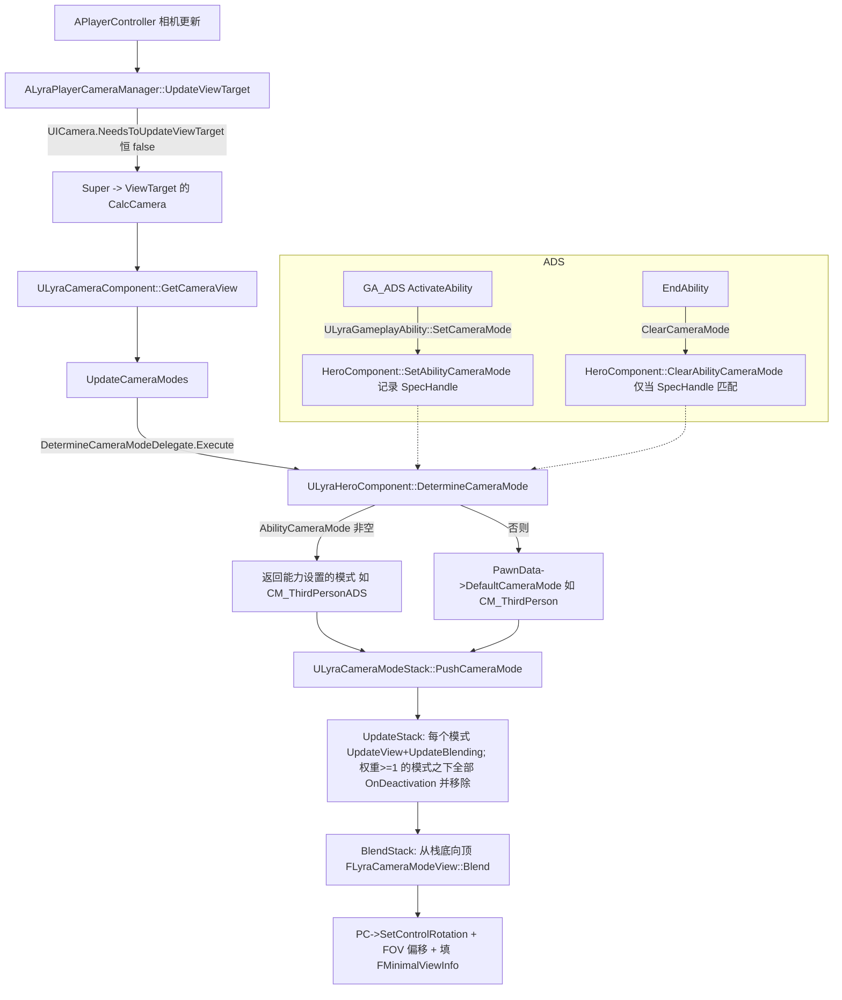
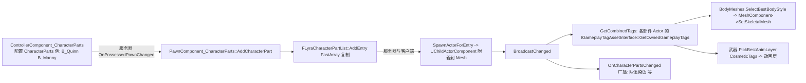
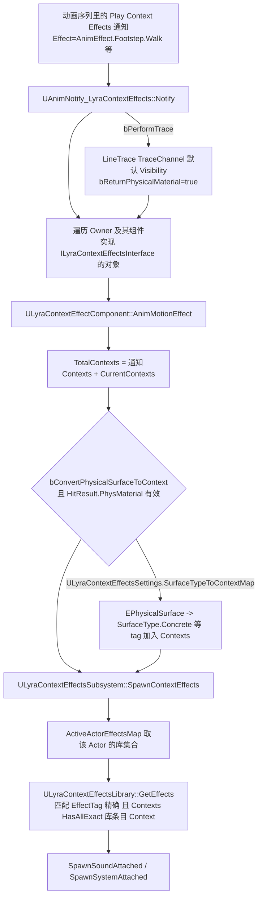
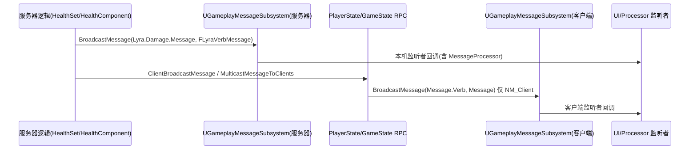

# 60 - 表现层 (Presentation)

范围：Camera、Animation、Cosmetics、Feedback(ContextEffects / NumberPops)、Audio、Physics、Messages、Replays、`Character/LyraCharacterMovementComponent`，以及插件 GameplayMessageRouter、GameSubtitles、PocketWorlds。
路径前缀：`Source/LyraGame/` 简写为 `LG/`，`Plugins/` 简写为 `P/`。行号基于当前磁盘源码。

---

## 1. 职责概述

表现层把"游戏状态"翻译成玩家看到/听到的东西，并且尽量与玩法代码解耦：

- **相机**：`ULyraCameraComponent` 持有一个 `ULyraCameraModeStack`，每帧向 Pawn 询问"当前该用哪个 CameraMode"，把栈里的各个模式按权重混合成最终视角。能力(如 ADS)通过 `HeroComponent` 临时覆盖相机模式。
- **动画**：`ULyraAnimInstance` 把 ASC 里的 GameplayTag 自动同步成动画蓝图变量(`FGameplayTagBlueprintPropertyMap`)，并从 `ULyraCharacterMovementComponent` 取地面距离。武器的动画层(Linked Anim Layer)由武器实例按"Cosmetic 标签"挑选。
- **Cosmetics**：控制器上的 `ULyraControllerComponent_CharacterParts` 保存"想穿什么"，Pawn 上的 `ULyraPawnComponent_CharacterParts` 复制并生成 ChildActor 部件，同时根据部件携带的 `Cosmetic.*` 标签选择身体 SkeletalMesh；这些标签又被武器用来选动画层(男/女动画风格)。
- **Feedback**：ContextEffects 是"动画通知 -> 语境标签(表面类型) -> 音效/Niagara"的数据驱动管线；NumberPops 是伤害数字。
- **Audio**：通过 Audio Modulation 的 ControlBusMix 应用用户音量设置、加载屏幕静音混音，并按 HDR/LDR 切换 Submix 效果链。
- **Messages / GameplayMessageRouter**：以 GameplayTag 为频道、USTRUCT 为载荷的解耦事件总线；Lyra 在其上定义 `FLyraVerbMessage` 等标准消息并提供网络复制通道。
- **Replays**：封装 UE 的 DemoNetDriver 录制/回放/清理旧回放。
- **GameSubtitles**：字幕显示格式的 GameInstanceSubsystem + UMG 控件 + 媒体字幕播放器。
- **PocketWorlds**：在主世界里按玩家流入一个"口袋关卡"并用 SceneCapture 渲染到 RenderTarget，用于 UI 中的角色预览。

---

## 2. 关键类表

### 2.1 Camera

| 类名 | 文件:行 | 职责 |
|---|---|---|
| `ULyraCameraComponent` | `LG/Camera/LyraCameraComponent.h:28` / `.cpp:14` | `UCameraComponent` 派生；`GetCameraView` (.cpp:32) 每帧：`UpdateCameraModes` -> `EvaluateStack` -> 回写 ControlRotation -> 叠加一帧 FOV 偏移 -> 填 `FMinimalViewInfo`。`DetermineCameraModeDelegate` (.h:44) 是向外要"当前模式"的委托 |
| `ULyraCameraMode` | `LG/Camera/LyraCameraMode.h:68` / `.cpp:52` | 抽象基类(`NotBlueprintable`，只能 C++ 子类 + BP 子类需子类声明 Blueprintable，如 ThirdPerson)。属性：`FieldOfView`、`ViewPitchMin/Max`、`BlendTime`(默认 0.5)、`BlendFunction`(默认 EaseOut)、`BlendExponent`(默认 4)、`CameraTypeTag`。`UpdateView` (.cpp:133) 计算 `View`；`UpdateBlending` (.cpp:177) 推进 BlendAlpha/BlendWeight；`GetPivotLocation` (.cpp:82) 考虑蹲伏胶囊高度差 + `BaseEyeHeight` |
| `FLyraCameraModeView` | `LyraCameraMode.h:45` / `.cpp:17,25` | 一个模式的输出(Location/Rotation/ControlRotation/FOV)，`Blend` 做线性/角度混合 |
| `ULyraCameraModeStack` | `LyraCameraMode.h:163` / `.cpp:229` | 栈 `CameraModeStack[0]` 为最顶(最新)。`PushCameraMode` (.cpp:264)、`UpdateStack` (.cpp:365)、`BlendStack` (.cpp:407)、`GetBlendInfo` (.cpp:449) |
| `ULyraCameraMode_ThirdPerson` | `LG/Camera/LyraCameraMode_ThirdPerson.h:19` / `.cpp:22` | `Abstract, Blueprintable`。按俯仰角采样偏移曲线(`TargetOffsetCurve` 或 `TargetOffsetX/Y/Z` RuntimeFloatCurve)；蹲伏偏移平滑；`UpdatePreventPenetration` (.cpp:111) + `PreventCameraPenetration` (.cpp:173) 多根 feeler 射线防穿墙 |
| `FLyraPenetrationAvoidanceFeeler` | `LG/Camera/LyraPenetrationAvoidanceFeeler.h:13` | feeler 参数：AdjustmentRot / WorldWeight / PawnWeight / Extent / TraceInterval |
| `ILyraCameraAssistInterface` | `LG/Camera/LyraCameraAssistInterface.h:17` | 可由 Controller/Pawn 实现：`GetIgnoredActorsForCameraPentration`、`GetCameraPreventPenetrationTarget`、`OnCameraPenetratingTarget`。`ALyraPlayerController` 实现了 `OnCameraPenetratingTarget` (`LyraPlayerController.cpp:385`) |
| `ALyraPlayerCameraManager` | `LG/Camera/LyraPlayerCameraManager.h:26` / `.cpp:19` | 默认 FOV 80、俯仰 -89/89 (宏 `LYRA_CAMERA_DEFAULT_*` 在 .h:14-16)；拥有 `UICamera` 子对象；`UpdateViewTarget` (.cpp:34)；`DisplayDebug` 打印相机组件栈 |
| `ULyraUICameraManagerComponent` | `LG/Camera/LyraUICameraManagerComponent.h:19` / `.cpp:14` | UI 占用相机的挂点。**stock Lyra 即为空壳**：`NeedsToUpdateViewTarget()` 恒返回 false (.cpp:54)，`UpdateViewTarget`/`OnShowDebugInfo` 空实现；`SetViewTarget` 通过 `bUpdatingViewTarget` guard 转发给相机管理器 |
| `ULyraCameraMode_TopDownArenaCamera` | `P/GameFeatures/TopDownArena/Source/TopDownArenaRuntime/Public/LyraCameraMode_TopDownArenaCamera.h:19` | GameFeature 里的自定义模式示例(继承 `ULyraCameraMode`，重写 `UpdateView`) |

### 2.2 Animation / Movement

| 类名 | 文件:行 | 职责 |
|---|---|---|
| `ULyraAnimInstance` | `LG/Animation/LyraAnimInstance.h:18` / `.cpp:15` | `GameplayTagPropertyMap` (.h:42) + `GroundDistance` (.h:45)；`InitializeWithAbilitySystem` (.cpp:20)；`NativeUpdateAnimation` (.cpp:51) 取 `GetGroundInfo().GroundDistance`；`IsDataValid` 校验 tag map |
| `ULyraCharacterMovementComponent` | `LG/Character/LyraCharacterMovementComponent.h:48` / `.cpp:22` | 见 3.5 |
| `FLyraCharacterGroundInfo` | `LyraCharacterMovementComponent.h:23` | 地面命中 + 距离，按帧缓存 |

### 2.3 Cosmetics

| 类名 | 文件:行 | 职责 |
|---|---|---|
| `FLyraCharacterPart` | `LG/Cosmetics/LyraCharacterPartTypes.h:56` | 部件请求：`PartClass`(AActor 子类)、`SocketName`、`CollisionMode`(默认 NoCollision) |
| `FLyraCharacterPartHandle` | `LyraCharacterPartTypes.h:31` | 添加部件返回的句柄(int32 计数器) |
| `ULyraControllerComponent_CharacterParts` | `LG/Cosmetics/LyraControllerComponent_CharacterParts.h:53` / `.cpp:14` | 挂在 Controller 上；`CharacterParts` 数组(EditAnywhere，在 BP 里配置玩家/机器人的"自然"部件)；服务器端在 `BeginPlay` (.cpp:19) 监听 `OnPossessedPawnChanged` (.cpp:106)，换 Pawn 时从旧 Pawn 移除、加到新 Pawn |
| `ECharacterPartSource` | `LyraControllerComponent_CharacterParts.h:15` | Natural / NaturalSuppressedViaCheat / AppliedViaDeveloperSettingsCheat / AppliedViaCheatManager |
| `ULyraPawnComponent_CharacterParts` | `LG/Cosmetics/LyraPawnComponent_CharacterParts.h:123` / `.cpp:218` | 挂在 Pawn 上；持有复制的 `CharacterPartList`；`BodyMeshes` (.h:177) 决定身体 Mesh；`BroadcastChanged` (.cpp:332) 选 Mesh 并广播 `OnCharacterPartsChanged`；`GetCombinedTags` (.cpp:319) |
| `FLyraCharacterPartList` | `LyraPawnComponent_CharacterParts.h:62` / `.cpp:27-214` | `FFastArraySerializer`。`AddEntry` 仅服务器；`SpawnActorForEntry` (.cpp:153) 在非专用服务器上创建 `UChildActorComponent` 附着到 Mesh/根组件 |
| `FLyraAppliedCharacterPartEntry` | `LyraPawnComponent_CharacterParts.h:31` | 复制项，`Part` 复制；`PartHandle`(仅服务器)、`SpawnedComponent`(仅客户端)不复制 |
| `FLyraAnimLayerSelectionSet/Entry` | `LG/Cosmetics/LyraCosmeticAnimationTypes.h:31,17` / `.cpp:10` | 动画层规则表，`SelectBestLayer`：按顺序第一个 `CosmeticTags.HasAll(RequiredTags)` 的规则，否则 `DefaultLayer` |
| `FLyraAnimBodyStyleSelectionSet/Entry` | `LyraCosmeticAnimationTypes.h:64,50` / `.cpp:23` | 身体 Mesh 规则表(+`ForcedPhysicsAsset`)，`SelectBestBodyStyle` |
| `ULyraCosmeticDeveloperSettings` | `LG/Cosmetics/LyraCosmeticDeveloperSettings.h:26` | 编辑器 PIE 里强制替换/追加部件的开发者设置 |
| `ULyraCosmeticCheats` | `LG/Cosmetics/LyraCosmeticCheats.h` | 控制台 `AddCharacterPart` / `ReplaceCharacterPart` / `ClearCharacterPartOverrides` |

### 2.4 Feedback

| 类名 | 文件:行 | 职责 |
|---|---|---|
| `UAnimNotify_LyraContextEffects` | `LG/Feedback/ContextEffects/AnimNotify_LyraContextEffects.h:96` / `.cpp:45` | 动画通知"Play Context Effects"：可选向下 LineTrace 取物理材质，然后对 Owner Actor 及其组件里实现了 `ILyraContextEffectsInterface` 的对象调用 `AnimMotionEffect`；编辑器预览分支直接在预览世界里播 |
| `ILyraContextEffectsInterface` | `.../LyraContextEffectsInterface.h:38` | `AnimMotionEffect`(BlueprintNativeEvent) |
| `ULyraContextEffectComponent` | `.../LyraContextEffectComponent.h:24` / `.cpp:18` | 挂在角色上；`DefaultEffectContexts`、`DefaultContextEffectsLibraries`、`bConvertPhysicalSurfaceToContext`；`BeginPlay` 把库注册进子系统；`AnimMotionEffect_Implementation` (.cpp:61) 合并 Contexts + 表面类型转成的语境标签后调 `SpawnContextEffects` |
| `ULyraContextEffectsSubsystem` | `.../LyraContextEffectsSubsystem.h:56` / `.cpp:20` | `UWorldSubsystem`：`ActiveActorEffectsMap` (Actor -> 库集合)；`SpawnContextEffects` 查库并 `SpawnSoundAttached` / `SpawnSystemAttached` |
| `ULyraContextEffectsSettings` | `.../LyraContextEffectsSubsystem.h:28` | DeveloperSettings(DefaultGame.ini)：`SurfaceTypeToContextMap` (EPhysicalSurface -> GameplayTag) |
| `ULyraContextEffectsLibrary` | `.../LyraContextEffectsLibrary.h:74` / `.cpp:11` | 数据资产：`ContextEffects` 数组 `{EffectTag, Context(标签容器), Effects(软引用 Sound/Niagara)}`；`LoadEffects` 同步加载；`GetEffects` 匹配 |
| `ULyraNumberPopComponent` | `LG/Feedback/NumberPops/LyraNumberPopComponent.h:46` | 抽象 `UControllerComponent`，`AddNumberPop(FLyraNumberPopRequest)` |
| `FLyraNumberPopRequest` | `LyraNumberPopComponent.h:14` | WorldLocation / SourceTags / TargetTags / NumberToDisplay / bIsCriticalDamage |
| `ULyraNumberPopComponent_MeshText` | `.../LyraNumberPopComponent_MeshText.h:61` / `.cpp:45` | 官方方案：静态网格+材质(WPO)逐位数字，带组件池；用 `Styles` 里的 `ULyraDamagePopStyle` 按 `TargetTags` 选 Mesh/颜色；只在本地控制器显示 (.cpp:49-55) |
| `ULyraDamagePopStyle` | `.../LyraDamagePopStyle.h:14` | DataAsset：`MatchPattern`(FGameplayTagQuery)、`Color`/`CriticalColor`、`TextMesh` |
| `ULyraNumberPopComponent_NiagaraText` | `.../LyraNumberPopComponent_NiagaraText.h:14` / `.cpp:20` | Niagara 方案：把 `FVector4(XYZ位置, W伤害)` 追加进 Niagara Array DI；暴击以**负数**表示 |
| `ULyraDamagePopStyleNiagara` | `.../LyraDamagePopStyleNiagara.h:15` | DataAsset：`NiagaraArrayName` + `TextNiagara` |

### 2.5 Audio / Physics

| 类名 | 文件:行 | 职责 |
|---|---|---|
| `ULyraAudioSettings` | `LG/Audio/LyraAudioSettings.h:31` | DeveloperSettings(DefaultGame.ini `[/Script/LyraGame.LyraAudioSettings]`)：默认/加载屏幕/用户 ControlBusMix、五个音量 ControlBus、HDR/LDR 子混音效果链 |
| `ULyraAudioMixEffectsSubsystem` | `LG/Audio/LyraAudioMixEffectsSubsystem.h:41` / `.cpp:21` | 仅 Game/PIE 世界(.cpp:352)；`PostInitialize` (.cpp:52) 加载全部资产并绑定加载屏幕委托；`OnWorldBeginPlay` (.cpp:223) 激活 BaseMix+UserMix 并用 `LyraSettingsLocal` 的音量更新；`ApplyDynamicRangeEffectsChains` (.cpp:267) |
| `LyraCollisionChannels.h` | `LG/Physics/LyraCollisionChannels.h:12-21` | 宏：`Lyra_TraceChannel_Interaction`=GameTraceChannel1、`_Weapon`=2、`_Weapon_Capsule`=3、`_Weapon_Multi`=4；5 号(AimAssist)由 ShooterCore 使用，只在注释中 |
| `UPhysicalMaterialWithTags` | `LG/Physics/PhysicalMaterialWithTags.h:42` | 物理材质 + `Tags` 容器(如 `Gameplay.Zone.WeakSpot`) |

### 2.6 Messages / GameplayMessageRouter

| 类名 | 文件:行 | 职责 |
|---|---|---|
| `UGameplayMessageSubsystem` | `P/GameplayMessageRouter/Source/GameplayMessageRuntime/Public/GameFramework/GameplayMessageSubsystem.h:139` | `UGameInstanceSubsystem`。`Get(WorldContext)` (.h:150)；`BroadcastMessage<T>` (.h:168)；`RegisterListener` 三个重载(.h:183/205/228)；`UnregisterListener` (.h:252)；`ListenerMap` (.h:288) |
| `FGameplayMessageListenerHandle` | `.h:77` | 句柄，`Unregister()` |
| `EGameplayMessageMatch` / `FGameplayMessageListenerParams` | `GameplayMessageTypes2.h:14,29` | ExactMatch / PartialMatch(监听父频道也收子频道) |
| `UAsyncAction_ListenForGameplayMessage` | `.../AsyncAction_ListenForGameplayMessage.h:25` | 蓝图异步监听节点，`GetPayload` 取载荷；K2Node 在 `GameplayMessageNodes`(UncookedOnly) 模块 |
| `FLyraVerbMessage` | `LG/Messages/LyraVerbMessage.h:12` | 通用 "Instigator Verb Target" 消息：Verb, Instigator, Target, InstigatorTags, TargetTags, ContextTags, Magnitude |
| `ULyraVerbMessageHelpers` | `LG/Messages/LyraVerbMessageHelpers.h:21` | `GetPlayerStateFromObject`、`GetPlayerControllerFromObject`、VerbMessage <-> `FGameplayCueParameters` 转换 (.cpp:68,83；ContextTags 未映射，有 @TODO) |
| `FLyraVerbMessageReplication` | `LG/Messages/LyraVerbMessageReplication.h:42` / `.cpp:21` | FastArray：服务器 `AddMessage`，客户端 `PostReplicatedAdd` -> `RebroadcastMessage` -> 本地 `BroadcastMessage(Message.Verb, ...)` |
| `FLyraNotificationMessage` | `LG/Messages/LyraNotificationMessage.h:17` | 通知(击杀信息/拾取流)：TargetChannel / TargetPlayer / PayloadMessage / PayloadTag / PayloadObject；频道 `TAG_Lyra_AddNotification_Message` |
| `UGameplayMessageProcessor` | `LG/Messages/GameplayMessageProcessor.h:26` | 服务器侧"消息处理器"组件基类：BeginPlay 调 `StartListening`，EndPlay 自动注销 `AddListenerHandle` 登记的句柄 |

### 2.7 Replays / Subtitles / PocketWorlds

| 类名 | 文件:行 | 职责 |
|---|---|---|
| `ULyraReplaySubsystem` | `LG/Replays/LyraReplaySubsystem.h:61` / `.cpp:20` | `PlayReplay`、`RecordClientReplay` (.cpp:47)、`CleanupLocalReplays` (.cpp:63)、`SeekInActiveReplay`、长度/当前时间；平台能力靠 tag `Platform.Trait.ReplaySupport` (.cpp:18) |
| `ULyraReplayList/ListEntry` | `LyraReplaySubsystem.h:50,20` | 供 UI 显示的回放条目 |
| `UAsyncAction_QueryReplays` | `LG/Replays/AsyncAction_QueryReplays.h:23` | 蓝图异步枚举回放，返回 `ULyraReplayList` |
| `USubtitleDisplaySubsystem` | `P/GameSubtitles/Source/Public/SubtitleDisplaySubsystem.h:45` | 持有 `FSubtitleFormat`(大小/颜色/描边/背景透明度)，`DisplayFormatChangedEvent` |
| `USubtitleDisplayOptions` | `.../SubtitleDisplayOptions.h:56` | DataAsset：字体 + 各枚举档位对应数值/颜色/背景刷 |
| `USubtitleDisplay` | `.../Widgets/SubtitleDisplay.h:18` | UMG 控件，监听格式变化 |
| `UMediaSubtitlesPlayer` | `.../Players/MediaSubtitlesPlayer.h:23` | Tickable，随 `UMediaPlayer` 播放 `UOverlays` 字幕 |
| `UPocketLevel` | `P/PocketWorlds/Source/Public/PocketLevel.h:18` | DataAsset：要流入的 `Level` + `Bounds`(避免多实例重叠) |
| `UPocketLevelSubsystem` | `.../PocketLevelSystem.h:20` | `GetOrCreatePocketLevelFor(LocalPlayer, PocketLevel, SpawnPoint)` |
| `UPocketLevelInstance` | `.../PocketLevelInstance.h:27` | 用 `ULevelStreamingDynamic::LoadLevelInstanceBySoftObjectPtr` 流入；`StreamIn/StreamOut`；就绪回调；level 标 `bClientOnlyVisible` |
| `UPocketCapture` | `.../PocketCapture.h:22` | Abstract/Blueprintable：SceneCapture 到 Diffuse / AlphaMask / Effects 三张 RT |
| `UPocketCaptureSubsystem` | `.../PocketCaptureSubsystem.h:21` | `CreateThumbnailRenderer(TSubclassOf<UPocketCapture>)`；每帧 `StreamThisFrame` 保持被拍摄物体纹理流送 |

---

## 3. 核心流程与数据流

### 3.1 相机模式栈



要点(都在源码里确认过)：

- 绑定点：`ULyraHeroComponent`(`LG/Character/LyraHeroComponent.cpp:180`) 在 Pawn 初始化时把 `DetermineCameraModeDelegate` 绑到自己的 `DetermineCameraMode` (.cpp:471)。优先级：`AbilityCameraMode` > `PawnData->DefaultCameraMode`(`LG/Character/LyraPawnData.h:53`)。
- 能力入口：`ULyraGameplayAbility::SetCameraMode` (`LG/AbilitySystem/Abilities/LyraGameplayAbility.cpp:520`) / `ClearCameraMode` (.cpp:531)；`EndAbility` 里自动 `ClearCameraMode` (.cpp:197)，所以能力结束一定会还原。`ClearAbilityCameraMode` 只在 `SpecHandle` 相同时才清，避免多个能力互相覆盖。
- `PushCameraMode` (`LyraCameraMode.cpp:264`) 语义：若已在栈顶直接返回；若在栈中则先移除并计算它当前对最终画面的"贡献"(`ExistingStackContribution`)，用它作为新的起始 BlendWeight，保证 ADS 中途松开不跳变；新模式插到下标 0；栈底永远权重 1。栈每帧每个"可见"模式都会 `UpdateView`，所以被淡出中的旧模式仍在更新。
- 混合：`FLyraCameraModeView::Blend` (.cpp:25) 位置线性插值，旋转用归一化差值，FOV 线性。`BlendWeight` 由 `BlendAlpha` 经 `BlendFunction`(Linear/EaseIn/EaseOut/EaseInOut，指数 `BlendExponent`) 得到 (.cpp:177)。
- `CameraTypeTag` 用于玩法侧查询："栈顶"的 tag 与权重通过 `GetBlendInfo`(`LyraCameraComponent.cpp:120`) 暴露。`ULyraRangedWeaponInstance` 用它判断是否处于 `Lyra.Weapon.SteadyAimingCamera` (`LG/Weapons/LyraRangedWeaponInstance.cpp:13,203`)，并按权重混合瞄准散布倍率，所以 ADS 的精度奖励与镜头过渡同步。
- 注意 `GetBlendInfo` 取的是 `CameraModeStack.Last()`(.cpp:459)，**即栈底**，而头文件注释写的是"top layer"。栈底权重恒为 1，稳定后栈只剩一个元素所以通常等于当前模式；过渡期间它返回的是即将被取代的旧模式的 tag 与权重 1.0(而不是新模式的渐入权重)。如果改用它做渐入判断请先核对这一点。
- ThirdPerson 防穿墙：`ECC_Camera` 通道球扫，feeler[0] 为主射线(硬阻挡，立即吸附)，feeler[1..] 为预测射线(软阻挡，平滑拉近)，`TraceInterval` 控制多少帧扫一次；忽略带 `IgnoreCameraCollision` Actor Tag 的物体和位于 ViewTarget 前方的 `ACameraBlockingVolume`；`ReportPenetrationPercent` 触发 `OnCameraPenetratingTarget`。头文件里 `GetIgnoredActorsForCameraPentration` 在 .cpp:195 仍是 TODO 未接入。
- 关联资产：`Content/Characters/Cameras/CM_ThirdPerson`、`CM_ThirdPerson_Death`(死亡能力 `GA_Hero_Death` 调 SetCameraMode)、`Plugins/GameFeatures/ShooterCore/Content/Camera/CM_ThirdPersonADS`(tag=`Lyra.Weapon.SteadyAimingCamera`，由 `GA_ADS` 设置/清除)、TopDownArena 的 `CM_ArenaFramingCamera`。

### 3.2 动画读取标签 / 动画层与武器(C++ 侧)

1. `ALyraCharacter` 的 ASC 在 `InitAbilityActorInfo` 里 (`LG/AbilitySystem/LyraAbilitySystemComponent.cpp:76`) 对 `ULyraAnimInstance` 调 `InitializeWithAbilitySystem`；AnimInstance 自己在 `NativeInitializeAnimation` (.cpp:38) 也会尝试一次。两处都调用 `GameplayTagPropertyMap.Initialize(this, ASC)`，之后 tag 增减会自动写入动画蓝图里映射的 bool/int 变量。**映射关系在动画蓝图的 Class Defaults -> GameplayTags 里配置**，不是 C++。`IsDataValid` 会校验映射的变量存在。
2. 每帧 `NativeUpdateAnimation` 从 `ULyraCharacterMovementComponent::GetGroundInfo()` 取 `GroundDistance` 暴露给 ABP(跳跃落地判断)。
3. 动画层选择：`ULyraWeaponInstance` 有 `EquippedAnimSet` / `UneuippedAnimSet` (`LG/Weapons/LyraWeaponInstance.h:46,49`)，`PickBestAnimLayer(bEquipped, CosmeticTags)` (.cpp:78) 调 `FLyraAnimLayerSelectionSet::SelectBestLayer`。`CosmeticTags` 来自 `ULyraPawnComponent_CharacterParts::GetCombinedTags(Cosmetic 前缀)`。**真正调用 `LinkAnimClassLayers` 的是蓝图**(`ShooterCore/Content/Weapons/B_WeaponInstance_Base` 引用了 `PickBestAnimLayer`)，C++ 只提供选择函数。
4. 具体资产：规则里的 `Layer` 是 `ABP_RifleAnimLayers`、`ABP_RifleAnimLayers_Feminine` 等(`Content/Characters/Heroes/Mannequin/Animations/Locomotion/{Pistol,Rifle,Shotgun,Unarmed}/`)，`RequiredTags` 为 `Cosmetic.AnimationStyle.Feminine` 之类；`ABP_ItemAnimLayersBase` + `ALI_ItemAnimLayers` 是 Linked Anim Layer Interface。

### 3.3 Cosmetics：选部件、选身体、驱动动画层



- **谁决定穿什么**：`ULyraControllerComponent_CharacterParts::CharacterParts` 是数据。商店/选角项目里由 `B_CharacterSelection`、`B_PickRandomCharacter`(`Content/Characters/Cosmetics/`)等蓝图包含该组件并配置 `B_Manny`/`B_Quinn`(部件 Actor，内部有 `SKM_Manny` + `ABP_Mannequin_CopyPose`)。Experience 的 ActionSet 通常把这些组件加到 Controller 上。
- **谁决定身体**：Pawn 上组件的 `BodyMeshes` (`B_MannequinPawnCosmetics`：用 `SKM_Manny_Invis`/`SKM_Quinn_Invis` 作为不可见的驱动 Mesh)。逻辑是"可见 Mesh 是部件(CopyPose)，ACharacter 自带 Mesh 是不可见驱动骨架，由部件的标签选骨架 Mesh"。
- **标签**(`Config/DefaultGameplayTags.ini:35-38`)：`Cosmetic`、`Cosmetic.AnimationStyle.Feminine/Masculine`、`Cosmetic.BodyStyle.Medium`；`B_Manny` 带 Masculine+Medium，`B_Quinn` 带 Feminine+Medium，`B_TinplateUE4` 带 Masculine+Medium。
- **网络**：`AddCharacterPart` 仅服务器；`CharacterPartList` 用 `DOREPLIFETIME` 复制(.cpp:228)。客户端在 `PostReplicatedAdd/Change/Remove` 里生成/销毁 ChildActor。专用服务器不生成 Actor (.cpp:157)，因此**专用服务器上 `GetCombinedTags` 为空**，选 Mesh/选动画层只在有表现的端有意义。
- **Controller 端不复制**：`CharacterParts` 数组只在服务器 `HasAuthority()` 下应用 (`.cpp:24`)。
- **开发调试**：`ULyraCosmeticDeveloperSettings`(编辑器 PIE，`CheatMode` Replace/Add)与 `ULyraCosmeticCheats` 控制台命令，都通过 `ECharacterPartSource` 区分来源，ClearCheatParts 会还原自然部件。

### 3.4 ContextEffects 管线



- 匹配规则 (`LyraContextEffectsLibrary.cpp:21-23`)：`Effect.MatchesTagExact` + `Context.HasAllExact(条目.Context)` + "两者要么都空要么都非空"。库里 `FLyraContextEffects` 条目的 `Context` 和 `EffectTag` 必须有效，否则加载时被丢弃 (.cpp:69)。
- 库注册：`ULyraContextEffectComponent::BeginPlay` (.cpp:28) 把 `DefaultContextEffectsLibraries` 同步加载并登记到子系统，`EndPlay` 移除；运行时可用 `UpdateLibraries` / `UpdateEffectContexts`(例如换鞋/换表面)。
- 本项目实际数据：`Config/DefaultGame.ini:213-214` 的 `SurfaceTypeToContextMap` = SurfaceType3(Glass)->`SurfaceType.Glass`，2(Concrete)->`SurfaceType.Concrete`，1(Character)->`SurfaceType.Character`，Default->`SurfaceType.Default`；物理表面名在 `Config/DefaultEngine.ini:338-340`。标签表 `Content/ContextEffects/DT_AnimEffectTags`(`AnimEffect.Footstep.{Walk,Jog,Jump,Land}`) 与 `DT_SurfaceTypes` 通过 `Config/DefaultGameplayTags.ini:6-7` 注册。库资产 `Content/ContextEffects/CFX_DefaultSkin` 引用 `sfx_Character_FS_{Concrete,Glass}_nl_meta`、`sfx_Character_Land_{Concrete,Glass}_nl_meta`(只有 Walk 与 Land 两个 Effect、Concrete/Default/Glass 语境)。`B_Hero_Default` 带有 `LyraContextEffectComponent`。脚步动画上的通知由 `FootstepEffectTagModifier`(`Mannequin/Animations/AnimModifiers/`) 动画修改器批量生成。
- 编辑器里 `ULyraContextEffectsLibrary` 的资产工厂在 `Source/LyraEditor/Private/LyraContextEffectsLibraryFactory.*`。
- 缺陷提示：`UnloadAndRemoveContextEffectsLibraries` 只是从 Map 移除引用；`GetEffects` 没匹配时不做回退到 Default 语境，所以新增表面必须在库里补齐条目。

### 3.5 CharacterMovementComponent 定制

(`LG/Character/LyraCharacterMovementComponent.cpp`)

- `GetGroundInfo()` (.cpp:54)：每帧缓存(`GFrameCounter`)。Walking 时直接用 `CurrentFloor`，距离 0；否则向下 LineTrace(`LyraCharacter.GroundTraceDistance` CVar，默认 100000，Cheat)，`GroundDistance = Hit.Distance - CapsuleHalfHeight`；NavWalking 为 0。供 `ULyraAnimInstance` 使用。
- `SimulateMovement` (.cpp:27)：若 `bHasReplicatedAcceleration` 则保留复制来的 Acceleration(模拟代理用于动画)。`SetReplicatedAcceleration` 由 `ALyraCharacter` 在 `OnRep_ReplicatedAcceleration` 里调用。
- `CanAttemptJump` (.cpp:42)：去掉了 UE 默认的"蹲伏时不能跳"检查，所以**蹲伏中可以直接跳**。
- `GetMaxSpeed` / `GetDeltaRotation` (.cpp:107-130)：ASC 上有 `Gameplay.MovementStopped` (`TAG_Gameplay_MovementStopped`) 时返回 0 速度/0 转向(死亡/定身用)。
- 蹲伏本体用 UE 默认(`ACharacter::Crouch`)，相机的蹲伏偏移见 ThirdPerson 的 `UpdateForTarget`。

### 3.6 GameplayMessageRouter 与已存在的消息

模式：**频道 = GameplayTag，载荷 = 任意 USTRUCT，发送端与监听端按 struct 类型约定**。`BroadcastMessageInternal` (`GameplayMessageSubsystem.cpp:65`) 从 Channel 逐级 `RequestDirectParent()` 往上找监听表，首级 tag 的监听者总会收到，父级只给 `PartialMatch` 的监听者；监听者结构体类型必须是发送类型的父类(`IsChildOf`)，否则 Error 日志；广播时拷贝监听数组，回调中注销是安全的；调用顺序不保证。`UE::GameplayMessageSubsystem::ShouldLogMessages`(控制台变量)可打印所有广播。



项目中现存的消息结构体 (USTRUCT) 与广播点：

| 载荷结构 | 频道 tag | 广播位置 |
|---|---|---|
| `FLyraVerbMessage` | `Lyra.Damage.Message`(`TAG_Lyra_Damage_Message`)；`Lyra.Elimination.Message` (`TAG_Lyra_Elimination_Message`)；其他由 ShooterCore 处理器产生的(Assist/ElimChain/ElimStreak) | `LG/AbilitySystem/Attributes/LyraHealthSet.cpp:144`、`LG/Character/LyraHealthComponent.cpp:171-181`；复制通道 `LyraGameState.cpp:107`(`MulticastMessageToClients`)、`LyraPlayerState.cpp:292`(`ClientBroadcastMessage`)、`LyraVerbMessageReplication.cpp:58` |
| `FLyraNotificationMessage` | `Lyra.AddNotification.Message`；ShooterCore 另有 `Lyra.AddNotification.KillFeed` | 监听：`ShooterCore/.../Accolades/LyraAccoladeHostWidget.cpp:24`；通道声明 `LyraNotificationMessage.h:11` |
| `FLyraAbilitySimpleFailureMessage` | `Ability.UserFacingSimpleActivateFail.Message` | `LyraGameplayAbility.cpp:117` |
| `FLyraAbilityMontageFailureMessage` | `Ability.PlayMontageOnActivateFail.Message` | `LyraGameplayAbility.cpp:131` |
| `FLyraPlayerResetMessage` | `GameplayEvent.Reset` | `LyraGameplayAbility_Reset.cpp:52` |
| `FLyraQuickBarSlotsChangedMessage` / `FLyraQuickBarActiveIndexChangedMessage` | `Lyra.QuickBar.Message.SlotsChanged` / `.ActiveIndexChanged` | `LyraQuickBarComponent.cpp:212,222` |
| `FLyraInventoryChangeMessage` | `Lyra.Inventory.Message.StackChanged` | `LyraInventoryManagerComponent.cpp:77` |
| `FLyraInteractionDurationMessage` | (交互持续时间 tag) | `LG/Interaction/` |
| `FLyraControlPointStatusMessage` | 控制点状态 | ShooterCore `Messages/ControlPointStatusMessage.h` |
| `FColorChangingMessage`、`FTestHeavyMessage` | 测试频道 | ShooterTests (`ShooterTestAsyncMessageTestActor.h`) |

`UGameplayMessageProcessor` 子类 (ShooterCore `MessageProcessors/AssistProcessor`、`ElimChainProcessor`、`ElimStreakProcessor`) 监听 Elimination/Damage 消息并再发出新的 VerbMessage。它们由 Experience ActionSet 里的"加组件"动作加到 GameState 上(服务器一次)，需自行按玩家过滤。

### 3.7 NumberPops 流程

`GCNL_Character_DamageTaken`(GameplayCue Notify)的 `OnExecute` 从 `EffectContext` 取**攻击者(`GetInstigatorActor`)**的本地 `PlayerController` (`IsLocallyControlled`)，拿上面的 `NumberPopComponent` 调用 `AddNumberPop(FLyraNumberPopRequest)`。当前内容实际用的是 **Niagara 版**：`Content/Effects/Blueprints/B_NiagaraNumberPopComponent`(继承 `ULyraNumberPopComponent_NiagaraText`，引用 `DamagePopStyleNiagara` 资产)，并由 `ShooterCore/Content/Experiences/LAS_ShooterGame_StandardComponents` 加到 `ALyraPlayerController`(仅客户端)。MeshText 版 C++ 存在但这些资产里未发现使用。

- Niagara 版：首次调用创建 `UNiagaraComponent` 并设置 `Style->TextNiagara`；每次把 `(Pos.xyz, ±Damage)` 追加到 Niagara 的 `Style->NiagaraArrayName` Vector4 数组。**负号 = 暴击**。`NiagaraComp` 从不清空数组(追加只增不减，除非 Niagara 系统自己消耗)，且每次都会读整个数组再写回。
- MeshText 版：数字拆位 -> 池化 `UStaticMeshComponent`(按 Mesh 分池) + MID 参数(`0a/0b/0c...` 位置/缩放旋转/时长)；`ComponentLifespan` 后由定时器回收；只对本地控制器生效。样式选择依赖 `ULyraDamagePopStyle::MatchPattern.Matches(Request.TargetTags)`，**未匹配任何样式时 `DetermineStaticMesh` 返回 nullptr，直接不显示**。

### 3.8 Audio

`ULyraAudioMixEffectsSubsystem`：
1. `PostInitialize`：从 `ULyraAudioSettings` 同步加载 BaseMix / UserMix / LoadingScreenMix / 5 个 ControlBus / HDR+LDR 子混音链；订阅 `ULoadingScreenManager::OnLoadingScreenVisibilityChangedDelegate`，显示加载屏时激活 LoadingScreenMix(压低背景声)，隐藏时关闭。
2. `OnWorldBeginPlay`：激活 BaseMix 与 UserMix，用 `ULyraSettingsLocal` 的 Overall/Music/SoundFX/Dialogue/VoiceChat 音量创建 MixStage 并 `UpdateMix`；再按 `IsHDRAudioModeEnabled()` 调 `ApplyDynamicRangeEffectsChains`。
3. 设置界面切换 HDR 时 `LyraSettingsLocal.cpp:974-976` 直接调用 `ApplyDynamicRangeEffectsChains`。
4. 项目配置(`Config/DefaultGame.ini:219-229`)：`CBM_BaseMix`、`CBM_UserMix`、`CB_Main/Music/SFX/Dialogue/VoiceChat`；HDR 链 = `MainSubmix` + `DYN_MainDynamics`；LDR 链 = `MainSubmix` + `DYN_LowMultibandDynamics` + `DYN_LowDynamics`；加载屏混音 `CBM_LoadingScreenMix`。

### 3.9 Replays

- 开关：`ULyraUserFacingExperienceDefinition::bRecordReplay` (`LG/GameModes/LyraUserFacingExperienceDefinition.h:65`)，并且 `ULyraReplaySubsystem::DoesPlatformSupportReplays()` 为真时在会话请求参数里加 `DemoRec` (`.cpp:45`)；平台支持来自 CommonUI 平台特性 `Platform.Trait.ReplaySupport`。
- 客户端录制：`ALyraPlayerController::TryToRecordClientReplay` (`LyraPlayerController.cpp:159`)(由游戏逻辑/蓝图调用)，条件见 `ShouldRecordClientReplay` (:183)：非回放、非录制中、非专用服务器、本地控制器、且**当前地图不是默认(前端)地图**(`CurrentMap == UGameMapsSettings::GetGameDefaultMap()` 时直接 return false，:199-203)，然后检查 `UReplaySubsystem` 未在录制/回放，再检查用户设置。成功后调 `SetRecorderPlayerState` 与 `RecordClientReplay`，并按 `GetNumberOfReplaysToKeep` 清理旧回放。
- 回放观察者：`ALyraReplayPlayerController` (`LyraPlayerController.cpp:600` 起)不会再录制，且跟随 `RecorderPlayerState`。
- 查询/播放 UI：`UAsyncAction_QueryReplays` -> `ULyraReplayList` -> `PlayReplay(Entry)` -> `UGameInstance::PlayReplay`；拖动进度条 `SeekInActiveReplay` 走 `UDemoNetDriver::GotoTimeInSeconds`。
- 注意 `CleanupLocalReplays` 代码注释自述"只用 generic file streamer 测试过"。

### 3.10 PocketWorlds(角色预览)

1. UI(蓝图)通过 `UPocketLevelSubsystem::GetOrCreatePocketLevelFor(LocalPlayer, PocketLevel, SpawnPoint)` 得到 `UPocketLevelInstance`；`Initialize` 以 `SpawnPoint` 为中心、`PocketLevel->Bounds.GetAbsMax()` 为半径记录范围，`LoadLevelInstanceBySoftObjectPtr` 在该位置动态流入关卡；`StreamIn/StreamOut` 控制可见/加载；加载完成后设为 `bClientOnlyVisible` 并回调就绪事件。
2. 就绪后蓝图在口袋关卡里生成角色(通常带 `ULyraPawnComponent_CharacterParts`)，通过 `UPocketCaptureSubsystem::CreateThumbnailRenderer(子类)` 创建 `UPocketCapture`，`SetCaptureTarget` + `CaptureDiffuse/AlphaMask/Effects` 渲染到 RT，UI 材质(`P/PocketWorlds/Content/M_PocketCaptureMasked`)显示。
3. 使用方在内容里：`Content/UI/FrontEnd/W_FrontEndHUDLayout`、`Content/UI/Hud/W_DefaultHUDLayout` 与两个 GameFeature 的 HUD 布局资产引用了 Pocket 相关类。

### 3.11 GameSubtitles

`USubtitleDisplaySubsystem`(GameInstance 级，`Get(LocalPlayer)`) 保存玩家选择的 `FSubtitleFormat`；`LyraGameSettingRegistry_Audio.cpp:172` 起把枚举选项暴露到设置界面；`USubtitleDisplay` 控件(`Content/UI/Foundation/Subtitles/W_SubtitleDisplayHost`)读取 `USubtitleDisplayOptions` 资产(`Content/UI/Settings/Extensions/Subtitle/GameSubtitleOptions`)渲染。格式存于 `ULyraSettingsShared`(`LyraSettingsShared.h/.cpp`)。`UMediaSubtitlesPlayer` 用于视频字幕(需与 MediaPlayer 同步 Play/Stop)。

---

## 4. 与其他模块的接口

| 对接模块 | 接口 |
|---|---|
| Character / PawnData / Hero | `ULyraHeroComponent::DetermineCameraMode`(`LyraHeroComponent.cpp:471`)、`SetAbilityCameraMode`/`ClearAbilityCameraMode`；`ULyraPawnData::DefaultCameraMode`；`ALyraCharacter` 构造时创建 `ULyraCameraComponent` 默认相对位置 (-300,0,75) (`LyraCharacter.cpp:72-73`) |
| GAS | `ULyraGameplayAbility::SetCameraMode/ClearCameraMode`；`ULyraAbilitySystemComponent::InitAbilityActorInfo` 初始化 `ULyraAnimInstance`；`ULyraCharacterMovementComponent` 读 `Gameplay.MovementStopped`；`LyraHealthSet`/`LyraHealthComponent` 发 VerbMessage |
| Weapons | `GetBlendInfo` + `Lyra.Weapon.SteadyAimingCamera`；`ULyraWeaponInstance::PickBestAnimLayer`；武器命中使用 `Lyra_TraceChannel_Weapon*` 与 `UPhysicalMaterialWithTags`(弱点 tag) |
| Interaction | `Lyra_TraceChannel_Interaction` |
| Controller | `ALyraPlayerController` 默认 `PlayerCameraManagerClass = ALyraPlayerCameraManager` (`LyraPlayerController.cpp:48`)，实现 `ILyraCameraAssistInterface::OnCameraPenetratingTarget`，录制回放控制 |
| Settings | `ULyraSettingsLocal` 提供音量/HDR/回放保留数；`LyraGameSettingRegistry_Audio` 提供字幕设置；`LyraSettingsShared` 保存字幕格式 |
| UI | 消息监听(KillFeed、Accolade、QuickBar 等)；`ULoadingScreenManager` 事件驱动音频混音；PocketWorlds 用于 UI 预览 |
| Experience / GameFeature | ActionSet 通过 "Add Components" 给 Controller 添加 `NumberPopComponent`、`ControllerComponent_CharacterParts`，给 GameState 添加 MessageProcessor |
| Platform/CommonUI | `Platform.Trait.ReplaySupport` |

GameplayTag 汇总：`Lyra.Weapon.SteadyAimingCamera`、`Gameplay.MovementStopped`、`Cosmetic.*`、`AnimEffect.Footstep.*`、`SurfaceType.*`、`Lyra.Damage.Message`、`Lyra.Elimination.Message`、`Lyra.AddNotification.Message`、`Platform.Trait.ReplaySupport`。

---

## 5. 数据驱动点

| 数据 | 位置 | 控制什么 |
|---|---|---|
| 相机模式 BP(`CM_*`) | `ULyraCameraMode_ThirdPerson` 的 BP 子类 | FOV、俯仰限制、BlendTime/Function/Exponent、`CameraTypeTag`、偏移曲线(`TargetOffsetCurve` 的 `CurveVector`，如 `ThirdPersonOffsetCurve`/`ThirdPersonADSOffsetCurve`)、feeler 列表、蹲伏混合速度 |
| `ULyraPawnData::DefaultCameraMode` | `HeroData_*`/`SimplePawnData` 资产 | Pawn 默认相机 |
| GA 蓝图里 `SetCameraMode` 节点 | `GA_ADS`、`GA_Hero_Death` | 能力期间覆盖相机 |
| AnimBP 的 GameplayTagPropertyMap | 动画蓝图 Class Defaults | tag -> 动画变量 |
| 武器实例 BP 的 `EquippedAnimSet`/`UneuippedAnimSet` | `B_WeaponInstance_*` | 动画层 + Cosmetic 标签规则 |
| `ControllerComponent_CharacterParts::CharacterParts` | Controller BP / ActionSet | 角色外观部件 |
| `PawnComponent_CharacterParts::BodyMeshes` | `B_MannequinPawnCosmetics` 等 Pawn BP | 身体骨架 Mesh 规则 |
| 部件 Actor 的 GameplayTag 接口 | `B_Manny`/`B_Quinn`/`B_TinplateUE4` | `Cosmetic.*` 标签来源 |
| `ULyraContextEffectsSettings` | `DefaultGame.ini` | 表面 -> 语境 tag |
| `ULyraContextEffectsLibrary` 资产 | `Content/ContextEffects/CFX_*` | (EffectTag, Context) -> Sound/Niagara |
| `DT_AnimEffectTags` / `DT_SurfaceTypes` | `Content/ContextEffects/` | 标签注册 |
| `ULyraDamagePopStyle` / `ULyraDamagePopStyleNiagara` | 数据资产 | 数字样式 |
| `ULyraAudioSettings` | `DefaultGame.ini` | 混音/Submix 资产 |
| `ULyraCosmeticDeveloperSettings` | 编辑器用户设置 | PIE 外观作弊 |
| `UPocketLevel` | 数据资产 | 预览关卡 + 范围 |
| `USubtitleDisplayOptions` | `GameSubtitleOptions` | 字幕样式档位 |
| `LyraUserFacingExperienceDefinition::bRecordReplay` | Experience 资产 | 是否自动录制 |
| `CollisionProfile`(`DefaultEngine.ini:188-201`) | 引擎配置 | 自定义通道与 `LyraPawnMesh`/`LyraPawnCapsule` 等 profile |
| CVar | `LyraCharacter.GroundTraceDistance`；`GameplayMessageSubsystem` 的日志开关 | 调试 |

---

## 6. 扩展与修改配方

### 6.1 新增一个相机模式

1. 若只需调参：在内容浏览器基于 `ULyraCameraMode_ThirdPerson` 新建 BP(例如 `CM_ThirdPersonSprint`)，设置 FOV、`BlendTime`、`CameraTypeTag`(可选，自定义 tag 加到 `Config/DefaultGameplayTags.ini` 或你的 GameFeature tag 文件)、`TargetOffsetCurve`(新 CurveVector，X=前后/Y=左右/Z=上下，横轴为俯仰角度)。
2. 若需自定义算法：新建 C++ `UCLASS() class ULyraCameraMode_Xxx : public ULyraCameraMode`，重写 `UpdateView(float)`(最后要写 `View.Location/Rotation/ControlRotation/FieldOfView`)，参考 `LyraCameraMode_TopDownArenaCamera.cpp`。基类是 `NotBlueprintable`，要在 BP 里配置参数需自己的类声明 `Blueprintable`(ThirdPerson 就是这么做的)；放进 GameFeature 时放在该插件的 Runtime 模块。
3. 默认使用：把 BP 填到 `ULyraPawnData::DefaultCameraMode`(`HeroData_*`)。
4. 临时使用(例如冲刺/ADS)：在 `ULyraGameplayAbility` 派生 GA 蓝图的 ActivateAbility 里调用 `Set Camera Mode`(传入你的类)；结束能力时自动清除(`EndAbility` 内 `ClearCameraMode`)。要在玩法里感知它，使用 `ULyraCameraComponent::GetBlendInfo` 对比 `CameraTypeTag`(参考 `LyraRangedWeaponInstance.cpp:195-207`)。
5. 需要防穿墙微调：修改 BP 里的 `PenetrationAvoidanceFeelers`；某个 Actor 不要挡相机：给它添加 Actor Tag `IgnoreCameraCollision`，或把碰撞对 `Camera` 通道设为 Ignore。

### 6.2 新增一个 Cosmetic 部件(例如新角色/帽子)

1. 新建一个 `AActor` 蓝图(模板：复制 `Content/Characters/Cosmetics/B_Manny`)：包含 `USkeletalMeshComponent`(用 `ABP_Mannequin_CopyPose` 复制父骨骼姿势，或你自己的 AnimBP)，并让 Actor 实现 `IGameplayTagAssetInterface`/添加 `GameplayTags` 描述(参考现有部件的 `Cosmetic.*` 设置方式)——`CollectCombinedTags` 只会从 `IGameplayTagAssetInterface` 取标签 (`LyraPawnComponent_CharacterParts.cpp:143`)。
2. 如要更换身体骨架(不同体型)：在目标 Pawn BP 的 `ULyraPawnComponent_CharacterParts::BodyMeshes.MeshRules` 添加 `{Mesh, RequiredTags}`；新增标签(如 `Cosmetic.BodyStyle.Large`)到 `DefaultGameplayTags.ini`；如果新体型需要不同动画风格/武器层，同步给 `FLyraAnimLayerSelectionSet` 加规则。
3. 如要换不同动画风格：给部件打 `Cosmetic.AnimationStyle.*` 标签；在每个武器实例 BP 的 `EquippedAnimSet`/`UneuippedAnimSet.LayerRules` 里加 `{Layer=ABP_xxxAnimLayers_新风格, RequiredTags=该tag}`(规则按顺序匹配，把更具体的放前面，`DefaultLayer` 兜底)。
4. 让某个玩家/机器人使用它：在 Controller 上的 `ULyraControllerComponent_CharacterParts` 里 `CharacterParts` 增加条目(或运行时服务器调用 `AddCharacterPart`)。
5. 调试：控制台 `AddCharacterPart <部件BP短名>` / `ReplaceCharacterPart <名>` / `ClearCharacterPartOverrides`(`ULyraCosmeticCheats`)，或在 Project Settings 的 Cosmetic 开发者设置里配置 `CheatCosmeticCharacterParts`。
6. 必须在服务器添加(带 `BlueprintAuthorityOnly`)，客户端靠复制自动生成。

### 6.3 新增一个表面 ContextEffect(例如"木头"脚步声)

1. 物理表面：`Project Settings -> Physics -> Physical Surface` 添加 `SurfaceType4=Wood`(写入 `DefaultEngine.ini [/Script/Engine.PhysicsSettings] PhysicalSurfaces`)。
2. 标签：在 `DT_SurfaceTypes`(DataTable，已通过 `DefaultGameplayTags.ini` 的 `GameplayTagTableList` 注册) 添加 `SurfaceType.Wood`。
3. 映射：`Project Settings -> LyraContextEffects -> Surface Type To Context Map` 增加 `SurfaceType4 -> SurfaceType.Wood`(落盘到 `DefaultGame.ini` `[/Script/LyraGame.LyraContextEffectsSettings]`)。
4. 物理材质：新建/修改 `PhysicalMaterial`，`Surface Type = Wood`，赋给木头网格材质；注意通知的 Trace 需 `bReturnPhysicalMaterial`(代码已开)。
5. 库：打开 `CFX_DefaultSkin`(或你的库)，新增条目：`EffectTag=AnimEffect.Footstep.Walk`(及 Jog/Land...)，`Context=SurfaceType.Wood`，`Effects=[音效/Niagara]`。每个 Effect 都要补条目，否则那个动作在木头上无声。
6. 若是新的动作(如 "AnimEffect.Footstep.Slide")：在 `DT_AnimEffectTags` 加标签，在对应动画里添加 `Play Context Effects` 通知，填 `Effect`、勾 `bPerformTrace`、`EndTraceLocationOffset`(如 Z=-50)、`bAttached`+`SocketName`(如脚骨骼)，库里添加条目。
7. 角色需有 `ULyraContextEffectComponent` 且 `DefaultContextEffectsLibraries` 包含该库(默认英雄 BP 已有)。需要装备/状态决定语境时，调用 `UpdateEffectContexts` 或 `UpdateLibraries`。
8. 编辑器里预览：通知细节 `PreviewProperties`(`bPreviewInEditor`、`PreviewContextEffectsLibrary`、`PreviewPhysicalSurface`)。

### 6.4 广播并监听一个新的 Gameplay 消息

C++ (发送)：

```cpp
// 1) 定义载荷
USTRUCT(BlueprintType)
struct FMyScoreMessage { GENERATED_BODY()
    UPROPERTY(BlueprintReadWrite) TObjectPtr<APlayerState> Player = nullptr;
    UPROPERTY(BlueprintReadWrite) int32 Score = 0; };
// 2) 声明频道 tag(.h: UE_DECLARE_GAMEPLAY_TAG_EXTERN / .cpp: UE_DEFINE_GAMEPLAY_TAG，或 ini 里注册)
// 3) 广播
UGameplayMessageSubsystem::Get(this).BroadcastMessage(TAG_My_Score_Message, Msg);
```

C++ (监听)：`Handle = UGameplayMessageSubsystem::Get(this).RegisterListener(TAG_My_Score_Message, this, &UMy::OnScore);`，签名 `void OnScore(FGameplayTag Channel, const FMyScoreMessage& Msg)`；在 EndPlay/析构里 `UnregisterListener(Handle)`(Processor 子类用 `AddListenerHandle` 自动清理)。需要收到子频道时用 `FGameplayMessageListenerParams` 且 `MatchType=PartialMatch`。

蓝图：广播用 `Broadcast Message` 节点(选频道 tag 与结构体)；监听用 `Listen For Gameplay Messages` 异步节点(`UAsyncAction_ListenForGameplayMessage`，选 PayloadType)，回调里用 `Get Payload`；记得在不需要时取消该异步 Action。

网络：消息总线**本身不复制**，只在调用它的那个进程内分发。要让客户端 UI 收到：服务器通过 RPC/复制把数据送到客户端再广播，可直接复用 `ALyraPlayerState::ClientBroadcastMessage`(单播)、`ALyraGameState::MulticastMessageToClients`(多播)传 `FLyraVerbMessage`，或用 `FLyraVerbMessageReplication` FastArray 嵌在自己的 Actor 里(记得 `SetOwner`)。两个 RPC 实现里都有 `NM_Client` 检查以避免 Standalone/监听服务器重复触发。需要 Instigator/Target 类通用消息时优先用 `FLyraVerbMessage`，无需新建结构体。

### 6.5 新增一种伤害数字样式

- MeshText 方案(Lyra 自带)：
  1. 新建 `ULyraDamagePopStyle` DataAsset：`bOverrideMesh`/`bOverrideColor` 打开(这两个是无 `EditAnywhere` 的 UPROPERTY，需要 DataAsset 的 BP 或代码里设置——注意它们不在编辑面板里编辑，EditCondition 引用的是它们)，设 `MatchPattern`(按 **TargetTags** 匹配的 `FGameplayTagQuery`)、`TextMesh`、`Color`、`CriticalColor`。
  2. 把它加入 `ULyraNumberPopComponent_MeshText`(BP 子类)的 `Styles` 数组；样式列表按顺序，第一个匹配的生效，颜色与 Mesh 各自独立查找。
  3. 材质需提供与 `SignDigitParameterName`/`PositionParameterNames(0a..8a)`/`ScaleRotationAngleParameterNames`/`DurationParameterNames`/`Color`/`isCriticalHit?`/`MoveToCamera` 对应的参数。
- Niagara 方案(当前项目使用)：新建 `ULyraDamagePopStyleNiagara` 资产(`TextNiagara` + `NiagaraArrayName`，数组名必须与 Niagara 系统里的 Array DI 一致)，设置到 `B_NiagaraNumberPopComponent` 的 `Style`；要区分不同样式(如治疗/暴击颜色)需在 Niagara 内用 `W` 的符号，或自己扩展 `AddNumberPop`。
- 替换组件：新写一个 `ULyraNumberPopComponent` 子类重写 `AddNumberPop`，在 Experience ActionSet 里把组件加到 Controller；伤害来源是 GameplayCue `GCNL_Character_DamageTaken` 调用 `AddNumberPop`。

### 6.6 其他常见修改

- 蹲伏时禁止跳跃：去掉 `ULyraCharacterMovementComponent::CanAttemptJump` 的重写。
- 新增碰撞通道：同时修改 `LyraCollisionChannels.h` 与 `DefaultEngine.ini` 的 `DefaultChannelResponses` / profile(文件头注释已提醒)。
- 新增一种音量设置：`ULyraAudioSettings` 增加 ControlBus 属性 -> 子系统加载并加入 MixStage 数组 -> `ULyraSettingsLocal` 增加 getter/setter -> `LyraGameSettingRegistry_Audio` 增加设置项。
- 回放：给体验打开 `bRecordReplay`，并确认平台特性 tag 在 CommonUI 平台设置里有 `Platform.Trait.ReplaySupport`。

---

## 7. 坑与注意事项

1. **相机栈只由一个委托驱动**：`DetermineCameraModeDelegate` 只在 `HeroComponent` 初始化时绑定，且仅当 `PawnData` 存在 (`LyraHeroComponent.cpp:178`)。没有 HeroComponent 的 Pawn(如简单 AI、旁观者)相机栈永远为空，`EvaluateStack` 输出默认 `FLyraCameraModeView`(位置原点)。
2. `ULyraCameraMode::GetCameraTypeTag` 与 `GetBlendInfo` 取的是栈底元素(`Stack.Last()`)，过渡期间并不反映正在渐入的新模式，见 3.1。
3. 相机模式实例按**类**在栈里缓存且 outer 是 `ULyraCameraModeStack` (`NewObject(GetOuter(), ...)`，outer 实际为相机组件)；`GetLyraCameraComponent` 用 `CastChecked<ULyraCameraComponent>(GetOuter())`，所以模式对象不能脱离相机组件创建。
4. `ULyraCameraMode` 是 `NotBlueprintable`，直接在编辑器里无法从它派生 BP；用 `ULyraCameraMode_ThirdPerson` 或自己的 `Blueprintable` 子类。`bUseRuntimeFloatCurves` 与 `TargetOffsetCurve` 二选一(注释 UE-103986)。
5. `GetCameraView` 每帧 `PC->SetControlRotation(View.ControlRotation)`，所以**别在别处直接设 ControlRotation**，会被相机栈覆盖(俯仰也被 `ViewPitchMin/Max` 夹)。
6. `FieldOfViewOffset` 只存活一帧，需要持续偏移就每帧调用 `AddFieldOfViewOffset`。
7. `ULyraUICameraManagerComponent` 是空实现(`NeedsToUpdateViewTarget` 永远 false)，不要指望它接管相机；它只是扩展点。
8. **Cosmetics**：专用服务器不生成部件 Actor，因此服务器上读 `GetCombinedTags` 为空——不要在服务器逻辑里依赖 Cosmetic 标签。`PostReplicatedChange` 是"销毁再创建"，不支持原地更新。`FLyraAppliedCharacterPartEntry` 的 `PartHandle`/`SpawnedComponent` 不复制，客户端 `RemoveCharacterPart(Handle)` 无意义，只能在服务器调用。
9. `ULyraControllerComponent_CharacterParts::EndPlay` 会 `RemoveAllCharacterParts`，且 `RemoveCharacterPart(const FLyraCharacterPart&)` 按 `AreEquivalentParts`(类+Socket)匹配，同一部件重复添加时只移除第一个。
10. 部件 Actor 的 `SetActorEnableCollision(false)` 默认生效(`NoCollision`)，若部件需要受击碰撞要显式选 `UseCollisionFromCharacterPart`。
11. **ContextEffects**：`ULyraContextEffectsLibrary::LoadEffectsInternal` 是同步 `TryLoad`(代码里写着 TODO Async)，`LoadAndAddContextEffectsLibraries` 用 `LoadSynchronous`，首次给大库会卡顿。`ActiveActorEffectsMap` 以 Actor 为 Key，同一 Actor 再次 `Load...` 会 `Emplace` 覆盖旧集合。
12. 通知的 Trace 默认 `ECC_Visibility`，只有 `bPerformTrace` 为真才会有物理材质；不 Trace 则 `HitResult` 为空，表面语境不会生成，只剩 `Contexts`/`CurrentContexts`。
13. ContextEffect 通知本身会在**服务器与客户端动画 tick 的任意位置执行**(动画在专用服务器不更新则不触发)；音效/Niagara 的 `SpawnSoundAttached` 在专用服务器上自然没有输出。
14. **GameplayMessageRouter**：struct 类型不一致只会 Error 日志且不投递，容易"悄悄收不到"；监听 lambda 捕获裸指针要自行注销；`Get(WorldContext)` 需要能解析到 GameInstance(没有 World 的对象会 assert)；Subsystem 是 GameInstance 级，同一进程内多个 PIE 世界各有各的实例，但同一 GameInstance 下切换地图后监听仍保留(需要在 EndPlay 注销)。
15. `FLyraVerbMessage` 里 `Instigator/Target` 是 `TObjectPtr<UObject>`，经 RPC 发送时依赖对象可复制；`ContextTags` 在转换成 GameplayCueParameters 时被丢弃 (`LyraVerbMessageHelpers.cpp:77`)。`FLyraVerbMessageReplication` 没有清理旧消息的逻辑(`PreReplicatedRemove` 被注释)，长期使用会累积复制项。
16. **MeshText 数字**：超过 8 位数字会触发 `ensure` 并被截为 9；`Styles` 全部不匹配时静默不显示；只在本地控制器上显示。**Niagara 数字**：`Style` 为空时 `AddNumberPop` 会解引用空指针(`Style->NiagaraArrayName`，.cpp:51)，必须配置 `Style`。
17. **Audio**：`DoesSupportWorldType` 仅 Game/PIE；资产引用缺失只会 `ensureMsgf`，且 `UserMix` 的五个 ControlBus 必须同时有效才会应用用户音量 (.cpp:243)。`ApplyDynamicRangeEffectsChains` 的 0.1s 淡入淡出写死；HDR 与 LDR 都包含同一 Submix 时只覆盖不清除。
18. **Replays**：自动录制只在 `ShouldRecordClientReplay` 满足条件时发生；回放中 `ALyraReplayPlayerController` 禁止再录制；DemoNetDriver 相关功能在不支持平台 `DoesPlatformSupportReplays()` 为假时 `RecordClientReplay` 会 `ensure` 失败。
19. **PocketWorlds**：口袋关卡通过流送在主世界同一坐标系里，`SpawnPoint` 和 `Bounds` 要避开真实关卡几何和其他实例；关卡被标成 `bClientOnlyVisible` 并 hack `bExchangedRoles`(`PocketLevelInstance.cpp` 约 103-109)，注意不要把联机逻辑放进口袋关卡。`UPocketCapture` 需要每帧保证被拍摄物体纹理流送(`StreamThisFrame`)，否则预览糊。
20. 碰撞通道文件注释提醒：改 `LyraCollisionChannels.h` 必须同步 `DefaultEngine.ini`，通道值会保存在资产实例里，不要改已有编号。

---

### 附：与标准 Lyra 5.x 对比，看起来是自定义/新增的内容

- `ULyraNumberPopComponent_NiagaraText` + `ULyraDamagePopStyleNiagara` + `Content/Effects/Blueprints/B_NiagaraNumberPopComponent`：Niagara 版伤害数字，当前项目实际使用的就是它，与 MeshText 方案并存(二者均为 Lyra 自带)(`Style` 空指针风险见上)。这两个类属于原版 Lyra 自带(与 MeshText 版同属 Feedback/NumberPops)，并非本项目自定义；代码未见明显改动。
- `ULyraCameraMode_TopDownArenaCamera`(TopDownArena GameFeature)：标准 Lyra 5.x 自带，不算自定义。
- 其余读到的 Camera/Animation/Cosmetics/ContextEffects/Audio/Replays/Messages/PocketWorlds/GameSubtitles 代码与标准 Lyra 5.x 一致，没有发现项目专属改动；`ULyraUICameraManagerComponent` 为官方即有的空壳。

---

## 8. 函数级调用链

记法：`Class::Func (file:line)`，文件均相对 `Source/LyraGame/`(LG) 或 `Plugins/`(P)；`BP:` 表示在蓝图资产中(已用二进制字符串确认引用存在，具体节点连线需在编辑器查看)。

### 8.1 相机：能力 -> 栈 -> 每帧视角

**A. 能力设置相机模式(以 ADS 为例)**

```
GA_ADS (BP: ShooterCore/Content/Input/Abilities/GA_ADS，引用 CM_ThirdPersonADS)
 → ULyraGameplayAbility::SetCameraMode(TSubclassOf<ULyraCameraMode>)  (LG/AbilitySystem/Abilities/LyraGameplayAbility.cpp:520)
   → ENSURE_ABILITY_IS_INSTANTIATED_OR_RETURN                          (只允许实例化能力)
   → GetHeroComponentFromActorInfo()                                   (找 ULyraHeroComponent)
   → ULyraHeroComponent::SetAbilityCameraMode(CameraMode, CurrentSpecHandle)  (LG/Character/LyraHeroComponent.cpp:495)
       写 AbilityCameraMode / AbilityCameraModeOwningSpecHandle        (.cpp:499-500)
   → ActiveCameraMode = CameraMode                                     (LyraGameplayAbility.cpp:527，供清理判断)
结束：
ULyraGameplayAbility::EndAbility (LyraGameplayAbility.cpp:195)
 → ULyraGameplayAbility::ClearCameraMode (LyraGameplayAbility.cpp:531)
   → ULyraHeroComponent::ClearAbilityCameraMode(CurrentSpecHandle)     (LyraHeroComponent.cpp:504，句柄相同才清)
```

**B. 相机组件每帧取模式并求值**

```
APlayerController::UpdateCameraManager (引擎)
 → ALyraPlayerCameraManager::UpdateViewTarget(FTViewTarget&, float)    (LG/Camera/LyraPlayerCameraManager.cpp:34)
   → ULyraUICameraManagerComponent::NeedsToUpdateViewTarget()          (LyraUICameraManagerComponent.cpp:54，恒 false)
   → APlayerCameraManager::UpdateViewTarget → AActor::CalcCamera → UCameraComponent::GetCameraView
 → ULyraCameraComponent::GetCameraView(float, FMinimalViewInfo&)       (LG/Camera/LyraCameraComponent.cpp:32)
   1) UpdateCameraModes()                                              (.cpp:85)
        → DetermineCameraModeDelegate.Execute()                        (.cpp:93)
          → ULyraHeroComponent::DetermineCameraMode()                  (LyraHeroComponent.cpp:471)
              AbilityCameraMode ? 它 : PawnExtComp->GetPawnData<ULyraPawnData>()->DefaultCameraMode  (.cpp:473-488)
        → ULyraCameraModeStack::PushCameraMode(Class)                  (LG/Camera/LyraCameraMode.cpp:264)
            · GetCameraModeInstance(Class)  (.cpp:343，按类缓存 NewObject(GetOuter()))
            · 栈顶已是它 → return (.cpp:276)
            · 在栈内 → 计算 ExistingStackContribution 并 RemoveAt (.cpp:287-309)
            · bShouldBlend = BlendTime>0 && StackSize>0 → SetBlendWeight(ExistingStackContribution 或 1) (.cpp:312-315)
              → ULyraCameraMode::SetBlendWeight (.cpp:146，反推 BlendAlpha)
            · CameraModeStack.Insert(Mode, 0) ; Last()->SetBlendWeight(1) (.cpp:318-321)
            · 新加入则 ULyraCameraMode::OnActivation() (.cpp:326)
   2) ULyraCameraModeStack::EvaluateStack(DeltaTime, OutView)          (.cpp:330)
        → UpdateStack(DeltaTime)                                        (.cpp:365)
            for 每个模式: ULyraCameraMode::UpdateCameraMode (.cpp:127)
               → UpdateView (虚; 基类 .cpp:133; ThirdPerson 版 LyraCameraMode_ThirdPerson.cpp:35)
               → UpdateBlending (.cpp:177) 推进 BlendAlpha → BlendWeight
            首个 BlendWeight>=1 的模式之下全部 OnDeactivation 并 RemoveAt (.cpp:383-404)
        → BlendStack(OutView)                                           (.cpp:407)
            从 Stack.Last() 开始，逐个 FLyraCameraModeView::Blend(View, Weight) (.cpp:25)
   3) PC->SetControlRotation(View.ControlRotation)                     (LyraCameraComponent.cpp:44-47)
   4) View.FieldOfView += FieldOfViewOffset; FieldOfViewOffset=0       (.cpp:51-52)
   5) SetWorldLocationAndRotation + 填 DesiredView.*                    (.cpp:55-75)
```

**C. ThirdPerson 模式 `UpdateView` 内部**

```
ULyraCameraMode_ThirdPerson::UpdateView (LyraCameraMode_ThirdPerson.cpp:35)
 → UpdateForTarget (.cpp:74)   ACharacter::IsCrouched → SetTargetCrouchOffset(CrouchedEyeHeight-BaseEyeHeight)
 → UpdateCrouchOffset (.cpp:360)   InterpEaseInOut 到 TargetCrouchOffset
 → GetPivotLocation() (LyraCameraMode.cpp:82: 胶囊半高差 + CDO BaseEyeHeight) + CurrentCrouchOffset
 → GetPivotRotation() (.cpp:114: Pawn->GetViewRotation()) ; Pitch ClampAngle(ViewPitchMin,Max)
 → 采样 TargetOffsetCurve->GetVectorValue(Pitch) 或 TargetOffsetX/Y/Z.GetRichCurveConst()->Eval(Pitch)  (.cpp:51-68)
   View.Location = Pivot + PivotRotation.RotateVector(Offset)
 → UpdatePreventPenetration(DeltaTime) (.cpp:111)
     取 ILyraCameraAssistInterface (Controller / TargetActor / PPActor) (.cpp:122-128)
     SafeLocation = 瞄准线上到胶囊最近点，Z 夹在胶囊内再外推 PushInDistance (.cpp:133-151)
     → PreventCameraPenetration(Actor, SafeLoc, View.Location, dt, AimLineToDesiredPosBlockedPct, bSingleRay) (.cpp:173)
         每根 feeler: 旋转 BaseRay(Yaw/Pitch) → World->SweepSingleByChannel(ECC_Camera) (.cpp:227)
         忽略 Tag IgnoreCameraCollision / 目标前方的 ACameraBlockingVolume (.cpp:245-271)
         DistBlockedPctThisFrame = min(...) ; RayIdx==0 → HardBlockedPct，其余 → SoftBlockedPct (.cpp:292-301)
         Hard 立即吸附 / Soft 按 PenetrationBlendInTime 平滑拉近 / 放出按 PenetrationBlendOutTime (.cpp:309-343)
         CameraLoc = SafeLoc + (CameraLoc-SafeLoc)*DistBlockedPct (.cpp:348)
     AimLineToDesiredPosBlockedPct < ReportPenetrationPercent → Assist->OnCameraPenetratingTarget()  (.cpp:159-168)
```

**D. 玩法反读相机(ADS 精度)**：`ULyraCameraComponent::GetBlendInfo` (`LyraCameraComponent.cpp:120`) → `ULyraCameraModeStack::GetBlendInfo` (`LyraCameraMode.cpp:449`) → 与 `TAG_Lyra_Weapon_SteadyAimingCamera` 比较并按权重混合散布倍率(`LG/Weapons/LyraRangedWeaponInstance.cpp:195-207`)。

### 8.2 Cosmetics：控制器加部件 -> Pawn 复制生成 -> 动画层选择

```
[服务器] ULyraControllerComponent_CharacterParts::BeginPlay (LG/Cosmetics/LyraControllerComponent_CharacterParts.cpp:19)
 → HasAuthority() → OwningController->OnPossessedPawnChanged.AddDynamic(OnPossessedPawnChanged) (.cpp:26-28)
 → 若已有 Pawn → OnPossessedPawnChanged(nullptr, Pawn) (.cpp:30-33) ; ApplyDeveloperSettings() (.cpp:36)
ULyraControllerComponent_CharacterParts::OnPossessedPawnChanged(Old, New) (.cpp:106)
 → 旧 Pawn: OldCustomizer->RemoveCharacterPart(Entry.Handle) + Handle.Reset()   (.cpp:109-116)
 → 新 Pawn: FindComponentByClass<ULyraPawnComponent_CharacterParts>() ; 对每个 !Handle.IsValid() 且非 Suppressed 的 Entry
     → ULyraPawnComponent_CharacterParts::AddCharacterPart (LG/Cosmetics/LyraPawnComponent_CharacterParts.cpp:231)
       → FLyraCharacterPartList::AddEntry(FLyraCharacterPart) (.cpp:76)
           Handle = PartHandleCounter++ ; 仅 HasAuthority (.cpp:78-81)
           Entries.AddDefaulted_GetRef ; NewEntry.Part/PartHandle (.cpp:83-85)
           → SpawnActorForEntry(NewEntry) (.cpp:153)   服务器(非专用)本地也生成
               · 非 NM_DedicatedServer (.cpp:157)
               · GetSceneComponentToAttachTo() = ACharacter::GetMesh() 否则根 (.cpp:303)
               · NewObject<UChildActorComponent> → SetupAttachment(Mesh, Socket) → SetChildActorClass(PartClass) → RegisterComponent (.cpp:167-171)
               · CollisionMode==NoCollision → SetActorEnableCollision(false) (.cpp:181-183)
               · SpawnedRoot->AddTickPrerequisiteComponent(Mesh) (.cpp:189)
           → OwnerComponent->BroadcastChanged() (.cpp:89)
           → MarkItemDirty(NewEntry) (.cpp:92) → FastArray 复制
[客户端] FLyraCharacterPartList::NetDeltaSerialize (LyraPawnComponent_CharacterParts.h:78)
 → PostReplicatedAdd (.cpp:42) → SpawnActorForEntry (.cpp:153) → OwnerComponent->BroadcastChanged()
   (改动 → PostReplicatedChange .cpp:57 先 Destroy 再 Spawn；移除 → PreReplicatedRemove .cpp:27 → DestroyActorForEntry .cpp:202)
ULyraPawnComponent_CharacterParts::BroadcastChanged (.cpp:332)
 → GetCombinedTags(FGameplayTag()) (.cpp:319) → FLyraCharacterPartList::CollectCombinedTags (.cpp:135)
     遍历 Entry.SpawnedComponent->GetChildActor() 的 IGameplayTagAssetInterface::GetOwnedGameplayTags
 → BodyMeshes.SelectBestBodyStyle(MergedTags) (LyraCosmeticAnimationTypes.cpp:23: 首个 HasAll(RequiredTags) 的 Mesh，否则 DefaultMesh)
 → USkeletalMeshComponent::SetSkeletalMesh(DesiredMesh, bReinitPose=true) (.cpp:344) ; ForcedPhysicsAsset → SetPhysicsAsset (.cpp:347-350)
 → OnCharacterPartsChanged.Broadcast(this) (.cpp:354)   (BP 订阅者: 队伍染色等)

[装备武器时选动画层]
ULyraEquipmentManagerComponent::EquipItem → 创建实例并 SpawnEquipmentActors (LG/Equipment/LyraEquipmentManagerComponent.cpp:101)
 → ULyraEquipmentInstance::OnEquipped (LG/Equipment/LyraEquipmentInstance.cpp:102) → K2_OnEquipped()
 → ULyraWeaponInstance::OnEquipped (LG/Weapons/LyraWeaponInstance.cpp:36)  (C++ 部分: 记录 TimeLastEquipped, ApplyDeviceProperties)
 → BP: B_WeaponInstance_Base 的 K2_OnEquipped (ShooterCore/Content/Weapons/，资产中同时含 GetPawn / PawnComponent_CharacterParts / GetCombinedTags / PickBestAnimLayer / LinkAnimClassLayers)
     GetPawn → PawnComponent_CharacterParts::GetCombinedTags → PickBestAnimLayer(bEquipped=true, tags)
       → ULyraWeaponInstance::PickBestAnimLayer (LyraWeaponInstance.cpp:78)
         → FLyraAnimLayerSelectionSet::SelectBestLayer (LyraCosmeticAnimationTypes.cpp:10)
     → AnimInstance::LinkAnimClassLayers(Layer)
 → OnUnequipped 同理用 UneuippedAnimSet(拼写如此，源码里就是 Uneuipped) 选 "收枪" 层
```

### 8.3 AnimNotify -> ContextEffect -> 表面查询 -> 声音/VFX

```
动画序列 NotifyTrack (Play Context Effects，AnimEffect.Footstep.*；由 FootstepEffectTagModifier 批量生成)
 → UAnimNotify_LyraContextEffects::Notify(MeshComp, Animation, EventReference)  (LG/Feedback/ContextEffects/AnimNotify_LyraContextEffects.cpp:45)
   · bPerformTrace → UWorld::LineTraceSingleByChannel(TraceStart → +EndTraceLocationOffset, TraceChannel, QueryParams(bReturnPhysicalMaterial=true)) (.cpp:67-79)
   · 收集实现 ULyraContextEffectsInterface 的对象: OwningActor 本身 + 其全部组件 (.cpp:85-105)
   · 对每个: ILyraContextEffectsInterface::Execute_AnimMotionEffect(Obj, Bone, Effect, MeshComp, LocOffset, RotOffset, Anim, bHit, Hit, Contexts, VFXScale, Volume, Pitch) (.cpp:113)
 → ULyraContextEffectComponent::AnimMotionEffect_Implementation (.../LyraContextEffectComponent.cpp:61)
   · TotalContexts = Contexts ∪ CurrentContexts (.cpp:73-74)
   · bConvertPhysicalSurfaceToContext 且 HitResult.PhysMaterial 有效:
       SurfaceType = PhysMaterial->SurfaceType (.cpp:86)
       GetDefault<ULyraContextEffectsSettings>()->SurfaceTypeToContextMap.Find(SurfaceType) → TotalContexts.AddTag (.cpp:89-96)
   · 缓存 ActiveAudioComponents / ActiveNiagaraComponents (.cpp:103-118)
   → UWorld::GetSubsystem<ULyraContextEffectsSubsystem>()->SpawnContextEffects(Owner, MeshComp, Bone, ..., MotionEffect, TotalContexts, AudioOut, NiagaraOut, ...) (.cpp:131)
 → ULyraContextEffectsSubsystem::SpawnContextEffects (.../LyraContextEffectsSubsystem.cpp:20)
   · ActiveActorEffectsMap.Find(SpawningActor) (.cpp:35) → ULyraContextEffectsSet 的库集合
   · 对每个库: Loaded → ULyraContextEffectsLibrary::GetEffects(Effect, Contexts, Sounds, Niagara) (.cpp:55)
                 Unloaded → LoadEffects() (.cpp:64，本次不播)
       GetEffects (.../LyraContextEffectsLibrary.cpp:11): MatchesTagExact(Effect) && Context.HasAllExact(条目.Context) && (两者空性相同)
   · UGameplayStatics::SpawnSoundAttached (.cpp:72) / UNiagaraFunctionLibrary::SpawnSystemAttached (.cpp:82)
[库的注册, 先于上述发生]
ULyraContextEffectComponent::BeginPlay (.cpp:28)
 → ULyraContextEffectsSubsystem::LoadAndAddContextEffectsLibraries(Owner, DefaultContextEffectsLibraries) (Component.cpp:41 → Subsystem.cpp:108)
   → TSoftObjectPtr::LoadSynchronous → ULyraContextEffectsLibrary::LoadEffects (Library.cpp:33) → LoadEffectsInternal (.cpp:55，逐条 FSoftObjectPath::TryLoad → ULyraActiveContextEffects) → EffectsLoadState=Loaded (.cpp:114)
 → ActiveActorEffectsMap.Emplace(Owner, Set) (Subsystem.cpp:136)
```

### 8.4 消息：广播 -> 监听者

```
[发送] UGameplayMessageSubsystem::BroadcastMessage<T>(Channel, Msg) (P/GameplayMessageRouter/Source/GameplayMessageRuntime/Public/GameFramework/GameplayMessageSubsystem.h:168)
 → TBaseStructure<T>::Get() → BroadcastMessageInternal(Channel, StructType, Bytes) (GameplayMessageSubsystem.cpp:65)
    · 可选日志 (ShouldLogMessages)  (.cpp:67-82)
    · for (Tag=Channel; Tag.IsValid(); Tag=Tag.RequestDirectParent()) (.cpp:86)
        ListenerMap.Find(Tag) → 复制 ListenerArray (.cpp:88-91)
        bOnInitialTag || MatchType==PartialMatch (.cpp:95)
        StructType->IsChildOf(ListenerStructType) 才调用 Listener.ReceivedCallback(Channel, StructType, Bytes) (.cpp:105-107)，否则 Error (.cpp:111)
[注册] RegisterListener<T>(Channel, Obj, &Class::Func) (.h:205) → RegisterListener<T>(Channel, lambda) (.h:183)
 → RegisterListenerInternal (GameplayMessageSubsystem.cpp:147) → ListenerMap.FindOrAdd(Channel).Listeners.Add ; HandleID=++List.HandleID (.cpp:149-155)
[注销] UnregisterListener(Handle) (.cpp:161) → UnregisterListenerInternal (.cpp:175)

[例 1: 伤害] ULyraHealthSet::PostGameplayEffectExecute (LG/AbilitySystem/Attributes/LyraHealthSet.cpp:108)
   Damage 分支: 填 FLyraVerbMessage(Verb=TAG_Lyra_Damage_Message "Lyra.Damage.Message", Instigator=EffectCauser, Target=OwningActor, Magnitude) → BroadcastMessage (.cpp:131-144)
[例 2: 击杀] ULyraHealthComponent::HandleOutOfHealth (LG/Character/LyraHealthComponent.cpp:148)
   → HandleGameplayEvent(死亡事件) → FLyraVerbMessage(Verb=TAG_Lyra_Elimination_Message "Lyra.Elimination.Message", Target=GetPlayerStateFromObject(Avatar)) → BroadcastMessage (.cpp:171-181)
   → 服务器进程内监听者: ShooterCore 的 UGameplayMessageProcessor 子类 (ElimChain/ElimStreak/Assist: StartListening → AddListenerHandle) → 再 BroadcastMessage 派生消息
   → 到客户端 UI: B_AccoladeRelay、Phase_Warmup (BP，资产里含 ClientBroadcastMessage/MulticastMessageToClients) 调
       ALyraPlayerState::ClientBroadcastMessage (LG/Player/LyraPlayerState.cpp:292, Client RPC) /
       ALyraGameState::MulticastMessageToClients (LG/GameModes/LyraGameState.cpp:103, Multicast RPC)
       → 仅 NM_Client 时 UGameplayMessageSubsystem::Get(this).BroadcastMessage(Message.Verb, Message)
       → 客户端监听者: UI(KillFeed、Accolade: ULyraAccoladeHostWidget 注册 TAG_Lyra_AddNotification_Message，ShooterCore/.../LyraAccoladeHostWidget.cpp:24)
[例 3: 能力失败提示] ULyraGameplayAbility::NativeOnAbilityFailedToActivate (LyraGameplayAbility.cpp:~100) → FLyraAbilitySimpleFailureMessage / FLyraAbilityMontageFailureMessage → BroadcastMessage (.cpp:117 / :131)
[例 4: FastArray 复制] FLyraVerbMessageReplication::AddMessage (LyraVerbMessageReplication.cpp:21) → MarkItemDirty → 客户端 PostReplicatedAdd (.cpp:36) → RebroadcastMessage (.cpp:54) → BroadcastMessage(Message.Verb, Message)
[蓝图监听] UAsyncAction_ListenForGameplayMessage::ListenForGameplayMessages → Activate → RegisterListenerInternal → HandleMessageReceived → OnMessageReceived 委托 → GetPayload(CustomThunk) 拷贝结构体
```

### 8.5 伤害数字

```
GCNL_Character_DamageTaken (BP GameplayCue Notify，Content/GameplayCueNotifies/)
 → GetInstigatorActor(EffectContext) → 攻击者的本地 PlayerController 上 ULyraNumberPopComponent::AddNumberPop(FLyraNumberPopRequest) (虚，LG/Feedback/NumberPops/LyraNumberPopComponent.h:56)
   → [当前项目] ULyraNumberPopComponent_NiagaraText::AddNumberPop (LyraNumberPopComponent_NiagaraText.cpp:20)
       暴击 LocalDamage*=-1 (.cpp:25-28) → 首次 NewObject<UNiagaraComponent> + SetAsset(Style->TextNiagara) + RegisterComponent (.cpp:31-43)
       → Activate ; SetWorldLocation (.cpp:46-47)
       → UNiagaraDataInterfaceArrayFunctionLibrary::GetNiagaraArrayVector4 / SetNiagaraArrayVector4 (.cpp:51-53) 追加 FVector4(X,Y,Z,Damage)
   → [备选] ULyraNumberPopComponent_MeshText::AddNumberPop (.cpp:45): DetermineStaticMesh (.cpp:231) → 池取/建 UStaticMeshComponent (.cpp:91-118) → SetMaterialParameters (.cpp:247) → 定时 ReleaseNextComponents (.cpp:167)
```

### 8.6 动画每帧 / 移动

```
ULyraAnimInstance::NativeInitializeAnimation (LG/Animation/LyraAnimInstance.cpp:38) → UAbilitySystemGlobals::GetAbilitySystemComponentFromActor → InitializeWithAbilitySystem (.cpp:20) → FGameplayTagBlueprintPropertyMap::Initialize
ULyraAbilitySystemComponent::InitAbilityActorInfo (LG/AbilitySystem/LyraAbilitySystemComponent.cpp:39) → (.cpp:76-79) LyraAnimInst->InitializeWithAbilitySystem(this)   [ASC 在 PlayerState 上，换 Pawn 时重新绑定]
ULyraAnimInstance::NativeUpdateAnimation (.cpp:51) → ULyraCharacterMovementComponent::GetGroundInfo (LG/Character/LyraCharacterMovementComponent.cpp:54) → GroundDistance
模拟代理: ALyraCharacter::OnRep_ReplicatedAcceleration (LG/Character/LyraCharacter.cpp:467) → ULyraCharacterMovementComponent::SetReplicatedAcceleration (LyraCharacterMovementComponent.cpp:101) → SimulateMovement 保留 Acceleration (LyraCharacterMovementComponent.cpp:29)
```

---

## 9. 速查问答

**Q1. 摄像机怎么选当前模式？**
`ULyraCameraComponent::UpdateCameraModes` (`Camera/LyraCameraComponent.cpp:85`) 调委托 -> `ULyraHeroComponent::DetermineCameraMode` (`Character/LyraHeroComponent.cpp:471`)：先 `AbilityCameraMode`，再 `ULyraPawnData::DefaultCameraMode`。

**Q2. ADS 视角是怎么实现的？**
`GA_ADS`(`ShooterCore/Content/Input/Abilities/`) 激活时调 `ULyraGameplayAbility::SetCameraMode(CM_ThirdPersonADS)` (`AbilitySystem/Abilities/LyraGameplayAbility.cpp:520`)，结束时 `ClearCameraMode`。`CM_ThirdPersonADS`(`ShooterCore/Content/Camera/`) 是 `ULyraCameraMode_ThirdPerson` 的 BP，更小 FOV + `ThirdPersonADSOffsetCurve`，`CameraTypeTag=Lyra.Weapon.SteadyAimingCamera`。武器散布读该 tag：`LyraRangedWeaponInstance.cpp:203`。

**Q3. ADS 过渡为什么平滑、中途松开也不跳？**
`ULyraCameraModeStack::PushCameraMode` (`LyraCameraMode.cpp:264`) 把已在栈中模式的当前贡献作为新起始权重(`ExistingStackContribution`, .cpp:287-313)；`SetBlendWeight` (.cpp:146) 反解 `BlendAlpha` 保持曲线连续。

**Q4. 怎么加第一人称视角？**
新建 C++ `ULyraCameraMode_FirstPerson : ULyraCameraMode`(声明 `Blueprintable`)，重写 `UpdateView`：`View.Location = GetPivotLocation()`(已含蹲伏高度，`LyraCameraMode.cpp:82`)，`View.Rotation = GetPivotRotation()`，`View.ControlRotation = View.Rotation`，`View.FieldOfView = FieldOfView`；`BlendTime` 设短。再建 BP，填到 `PawnData->DefaultCameraMode`，或做成能力(参考 `GA_ADS`)用 `SetCameraMode` 切换。配套：隐藏自己的身体/部件(用 `ULyraPawnComponent_CharacterParts::GetCharacterPartActors` 遍历部件 Actor 设 `SetOwnerNoSee`)，武器 Mesh 与手臂另处理；不要手动改相机相对位置(会被栈覆盖)。第三人称被穿墙时隐藏角色的挂点：`ILyraCameraAssistInterface::OnCameraPenetratingTarget`(`ALyraPlayerController` 已实现，`LyraPlayerController.cpp:385`)。

**Q5. 怎么做一帧性的 FOV 抖动/冲击？**
每帧调 `ULyraCameraComponent::AddFieldOfViewOffset(float)` (`LyraCameraComponent.h:47`，用完清零，`.cpp:51-52`)；持续变化应换相机模式。

**Q6. 相机穿墙怎么处理，怎么让某物体不挡相机？**
`ULyraCameraMode_ThirdPerson::PreventCameraPenetration` (`LyraCameraMode_ThirdPerson.cpp:173`)，`ECC_Camera` 通道扫描。物体碰撞对 Camera 设 Ignore，或 Actor 加 Tag `IgnoreCameraCollision` (.cpp:19,245)。

**Q7. 相机偏移曲线怎么调？**
`CM_ThirdPerson` 的 `TargetOffsetCurve`(`Content/Characters/Cameras/ThirdPersonOffsetCurve`，`UCurveVector`)：横轴=俯仰角度，输出 XYZ=相对 Pivot 的局部偏移(`RotateVector` 后叠加，.cpp:55-56)。要在 PIE 里实时改，勾 `bUseRuntimeFloatCurves` 用 `TargetOffsetX/Y/Z`。

**Q8. 死亡后相机怎么变？**
`GA_Hero_Death`(`Content/Characters/Heroes/Abilities/`)调 `SetCameraMode(CM_ThirdPerson_Death)`；`EndAbility` 清除。

**Q9. 俯仰角限制在哪配？**
每个 `ULyraCameraMode::ViewPitchMin/Max` (`LyraCameraMode.h:126,130`)，默认 -89/89(`LYRA_CAMERA_DEFAULT_PITCH_*`，`LyraPlayerCameraManager.h:15-16`)；`ALyraPlayerCameraManager` 构造里同样设置 (`.cpp:23-24`)。

**Q10. 旁观/观战相机怎么走？**
`ULyraHeroComponent` 对所有 Pawn 绑定委托("in case we spectate later"，`LyraHeroComponent.cpp:175-181`)。注意只有 `PawnData` 存在时才绑定；没有 HeroComponent 的 Pawn 相机栈为空。UI 抢相机的扩展点是 `ULyraUICameraManagerComponent`(目前空壳)。

**Q11. 动画蓝图怎么知道角色在 ADS/蹲伏/死亡？**
`ULyraAnimInstance::GameplayTagPropertyMap` (`Animation/LyraAnimInstance.h:42`)：在 ABP 类默认值里把 GameplayTag 映射到 bool/int 变量；`InitializeWithAbilitySystem` (.cpp:20) 注册，tag 增减自动更新。tag 必须在 ASC 里(由 GE/能力授予)。`ULyraAbilitySystemComponent::InitAbilityActorInfo` (`LyraAbilitySystemComponent.cpp:76-79`) 在换 Pawn 时重新绑定。

**Q12. ABP 里怎么拿"离地高度"？**
`ULyraAnimInstance::GroundDistance` (`.h:45`，BlueprintReadOnly)，来源 `ULyraCharacterMovementComponent::GetGroundInfo` (`LyraCharacterMovementComponent.cpp:54`)；追踪距离 CVar `LyraCharacter.GroundTraceDistance`。

**Q13. 换角色模型/换装怎么做？**
(1) 新建部件 Actor BP(复制 `Content/Characters/Cosmetics/B_Manny`)，换其 SkeletalMesh，设 `Cosmetic.*` 标签；(2) 在使用者 Controller 的 `ULyraControllerComponent_CharacterParts::CharacterParts` 添加该部件(见 `B_PickRandomCharacter`/`B_CharacterSelection`)，或服务器运行时调 `AddCharacterPart`；(3) 若骨架不同，在 `ULyraPawnComponent_CharacterParts::BodyMeshes` 加规则(`B_MannequinPawnCosmetics`)。调试控制台：`ReplaceCharacterPart B_Quinn`(`Cosmetics/LyraCosmeticCheats.cpp:44`)。

**Q14. 换装后客户端怎么同步？**
`FLyraCharacterPartList` 是 `FFastArraySerializer`(`LyraPawnComponent_CharacterParts.h:62`)，`AddEntry` 仅服务器；客户端 `PostReplicatedAdd/Change` 里 `SpawnActorForEntry` (.cpp:42,57,153)，各端本地生成 ChildActor。

**Q15. 男/女动画风格怎么区分？**
部件标签 `Cosmetic.AnimationStyle.Masculine/Feminine`(`B_Manny`/`B_Quinn`)；武器 BP `K2_OnEquipped` 里取 `GetCombinedTags` 传给 `PickBestAnimLayer` (`Weapons/LyraWeaponInstance.cpp:78`)，规则表里 Feminine 对应 `ABP_RifleAnimLayers_Feminine`，默认 `ABP_RifleAnimLayers`。

**Q16. 新增一把武器的动画层怎么接？**
新建 `ABP_XxxAnimLayers`(实现 `ALI_ItemAnimLayers`，参考 `ABP_ItemAnimLayersBase`)，在 `B_WeaponInstance_Xxx` 的 `EquippedAnimSet` / `UneuippedAnimSet` (`LyraWeaponInstance.h:46,49`) 配 `LayerRules`/`DefaultLayer`；基类 BP 的 `K2_OnEquipped` 负责 `LinkAnimClassLayers`。

**Q17. 为什么服务器读不到 Cosmetic 标签？**
专用服务器不生成部件 Actor (`LyraPawnComponent_CharacterParts.cpp:157`)，`CollectCombinedTags` 只遍历 `SpawnedComponent` (.cpp:141)，所以为空。服务器逻辑请用别的复制数据(PawnData/队伍等)。

**Q18. 脚步声按地面材质区分怎么配？**
(1) 物理材质 `Surface Type`(`DefaultEngine.ini:338-340`)；(2) `SurfaceTypeToContextMap`(`DefaultGame.ini:214`)映射到 `SurfaceType.*`；(3) 动画上的 `Play Context Effects` 通知(`Effect=AnimEffect.Footstep.Walk`，勾 `bPerformTrace`，`EndTraceLocationOffset` 朝下)；(4) 库 `CFX_DefaultSkin` 的条目 `{AnimEffect.Footstep.Walk, [SurfaceType.Concrete]} → sfx_Character_FS_Concrete_nl_meta`；(5) 角色上 `ULyraContextEffectComponent` 引用该库。流程见 8.3。

**Q19. 为什么新表面没声音？**
常见原因：物理材质未赋给被踩的材质；`SurfaceTypeToContextMap` 漏了；库里没有该 (Effect, Context) 条目——`GetEffects` 要求 `HasAllExact`，且条目 `Context` 为空只匹配空 `Contexts`(`LyraContextEffectsLibrary.cpp:21-23`)；库为 `Unloaded` 时第一次只触发加载不播放(`Subsystem.cpp:61-65`)；`ULyraContextEffectComponent` 没配置库；通知没勾 `bPerformTrace`(没有 HitResult 就没有表面语境)。

**Q20. 怎么给不同装备(如重甲)换脚步声？**
`ULyraContextEffectComponent::UpdateEffectContexts(NewContexts)` (`LyraContextEffectComponent.cpp:151`，加如 `Armor.Heavy` 的标签)，库条目 `Context` 写 `[SurfaceType.Concrete, Armor.Heavy]`；或 `UpdateLibraries` 整库替换(.cpp:158)。

**Q21. 怎么在击杀时全局广播一个事件？**
服务器上已有：`ULyraHealthComponent::HandleOutOfHealth` 广播 `Lyra.Elimination.Message`(`LyraHealthComponent.cpp:171-181`)，你只需监听：`UGameplayMessageSubsystem::Get(World).RegisterListener(TAG_Lyra_Elimination_Message, this, &UMy::OnElim)`(签名 `(FGameplayTag, const FLyraVerbMessage&)`)；要派生新事件(如连杀)继承 `UGameplayMessageProcessor`(参考 ShooterCore `ElimStreakProcessor`)并由 Experience ActionSet 加到 GameState。需要客户端也收到：`ALyraPlayerState::ClientBroadcastMessage` / `ALyraGameState::MulticastMessageToClients`。

**Q22. 自己定义一个新消息？**
见 6.4：USTRUCT + 频道 tag + `BroadcastMessage`/`RegisterListener`。频道可分层(`My.Event.A`)，父级监听用 `PartialMatch`。蓝图用 `Listen For Gameplay Messages`。

**Q23. 消息总线会自动联网吗？**
不会，纯本进程分发(`UGameplayMessageSubsystem` 是 GameInstance 子系统)。联网靠 RPC/复制后再本地广播，复用 `FLyraVerbMessage` + `ClientBroadcastMessage`/`MulticastMessageToClients`/`FLyraVerbMessageReplication`。

**Q24. 监听了却收不到？**
检查：struct 类型一致或监听类型是发送类型的父类(`GameplayMessageSubsystem.cpp:105,111`，否则 Error 日志)；频道 tag 精确匹配(或用 PartialMatch 监听父频道)；服务器/客户端进程不同；注册时机早于广播；监听对象已被 GC(用 `WeakObject` 重载会静默跳过)；开启消息日志(`ShouldLogMessages` 对应的 CVar，`.cpp:68`)。

**Q25. 伤害数字怎么出来的，怎么改样式？**
`GCNL_Character_DamageTaken` 从 `EffectContext` 取攻击者(`Instigator`)的本地 `PlayerController` → `ULyraNumberPopComponent::AddNumberPop`。当前内容用 `B_NiagaraNumberPopComponent`(`ULyraNumberPopComponent_NiagaraText`)；改 `ULyraDamagePopStyleNiagara` 资产的 Niagara 系统即可换外观。区分类型(暴击色/治疗)：Niagara 里按 `W` 符号(负为暴击)分支，或扩展 `AddNumberPop` 编码类型。原版 MeshText 方案要配 `Styles` 且 `bOverrideMesh=true`，否则不显示(`DetermineStaticMesh` 返回空)。

**Q26. 玩家音量设置怎么生效？**
`ULyraSettingsLocal` 存值 → `ULyraAudioMixEffectsSubsystem::OnWorldBeginPlay` (`Audio/LyraAudioMixEffectsSubsystem.cpp:223`) 创建 `FSoundControlBusMixStage` 并 `UpdateMix`(`CBM_UserMix`)；加载屏幕静音由 `OnLoadingScreenStatusChanged` (.cpp:327) 激活 `CBM_LoadingScreenMix`。资产路径见 `DefaultGame.ini:219-229`。

**Q27. HDR/LDR 音频切换怎么做的？**
`Settings/LyraSettingsLocal.cpp:974` 调 `ULyraAudioMixEffectsSubsystem::ApplyDynamicRangeEffectsChains(bool)` (`LyraAudioMixEffectsSubsystem.cpp:267`)：对新链 `SetSubmixEffectChainOverride(Submix, 链, 0.1s)`，旧链中未被新链覆盖的 submix 用 `ClearSubmixEffectChainOverride`。链配置在 `ULyraAudioSettings::HDRAudioSubmixEffectChain/LDRAudioSubmixEffectChain`。

**Q28. 自定义碰撞通道在哪？武器/交互用哪个？**
`Physics/LyraCollisionChannels.h`：交互=`Lyra_TraceChannel_Interaction`(1)、武器=`_Weapon`(2，命中物理资产)、`_Weapon_Capsule`(3，命中胶囊)、`_Weapon_Multi`(4，穿透多目标)；AimAssist=5(ShooterCore)。改动须同步 `DefaultEngine.ini:193-201`。

**Q29. 怎么给命中区域(弱点)加标签？**
`UPhysicalMaterialWithTags::Tags` (`Physics/PhysicalMaterialWithTags.h:51`)，例如 `PhysMat_Player_WeakSpot`(`Content/Characters/Heroes/`) 带 `Gameplay.Zone.WeakSpot`；武器伤害计算读命中物理材质的 tag。

**Q30. 蹲伏时为什么还能跳？**
`ULyraCharacterMovementComponent::CanAttemptJump` (`Character/LyraCharacterMovementComponent.cpp:42`) 去掉了蹲伏检查。眼高 `BaseEyeHeight=80`、`CrouchedEyeHeight=50` (`LyraCharacter.cpp:79-80`)；相机偏移来自 `ULyraCameraMode_ThirdPerson::UpdateForTarget`。

**Q31. 怎么让角色定身/禁止转向？**
给 ASC 授予 `Gameplay.MovementStopped`(`TAG_Gameplay_MovementStopped`)，`GetMaxSpeed`/`GetDeltaRotation` 返回 0 (`LyraCharacterMovementComponent.cpp:107-130`)。

**Q32. 远端玩家的移动动画为什么顺滑？**
`ALyraCharacter` 打包复制 `ReplicatedAcceleration`(`LyraCharacter.cpp:149-151`，`COND_SimulatedOnly` :133)，客户端 `OnRep_ReplicatedAcceleration` (.cpp:467) 解包并调 `SetReplicatedAcceleration`，`SimulateMovement` 保留它供 ABP 使用。

**Q33. 怎么录制/回放？**
体验资产勾 `bRecordReplay` → 会话参数加 `DemoRec`(`GameModes/LyraUserFacingExperienceDefinition.cpp:45`)；客户端录制调 `ALyraPlayerController::TryToRecordClientReplay`(`Player/LyraPlayerController.cpp:159`) → `ULyraReplaySubsystem::RecordClientReplay`(`Replays/LyraReplaySubsystem.cpp:47`)；UI 用 `UAsyncAction_QueryReplays` 取列表，`PlayReplay` / `SeekInActiveReplay`。平台需有 `Platform.Trait.ReplaySupport`。

**Q34. 字幕怎么调样式？**
设置界面写 `FSubtitleFormat` 到 `ULyraSettingsShared` → `USubtitleDisplaySubsystem::SetSubtitleDisplayOptions`(`P/GameSubtitles/Source/Public/SubtitleDisplaySubsystem.h:64`) 触发 `DisplayFormatChangedEvent` → `USubtitleDisplay` 控件刷新；档位数值在资产 `GameSubtitleOptions`(`USubtitleDisplayOptions`)。

**Q35. 主菜单里的 3D 角色预览怎么做到？**
PocketWorlds：`UPocketLevelSubsystem::GetOrCreatePocketLevelFor(LocalPlayer, PocketLevel, Spawn)` 流入关卡(`PocketLevelInstance.cpp` 的 `Initialize`/`StreamIn`)，`UPocketCaptureSubsystem::CreateThumbnailRenderer` 得到 `UPocketCapture` 并 `CaptureDiffuse`，输出 RT 给 UI 材质(`P/PocketWorlds/Content/M_PocketCaptureMasked`)。

**Q36. 怎么调试相机/ContextEffects/消息？**
相机：`showdebug camera`，`ALyraPlayerCameraManager::DisplayDebug` (`LyraPlayerCameraManager.cpp:47`) → `ULyraCameraComponent::DrawDebug` → `ULyraCameraModeStack::DrawDebug` 打印栈与权重；ThirdPerson 在 `ENABLE_DRAW_DEBUG` 下画射线。ContextEffects：编辑器动画预览用通知的 `PreviewProperties`。消息：`LogGameplayMessageSubsystem` 日志。外观：`AddCharacterPart` 等控制台命令 / Cosmetic 开发者设置。

---

## 10. 设计意图

每项按"解决什么问题 / 朴素做法会坏在哪 / 一个具体场景"说明。

### 10.1 相机模式栈 + 权重混合 (`ULyraCameraModeStack`)

- **解决的问题**：相机行为由多个互相独立、可能在任意时刻切换的来源决定(默认第三人称、ADS、死亡、俯视竞技场)，需要过渡平滑，且玩法层不想知道"相机具体怎么算"。栈把"选哪个模式"(`ULyraHeroComponent::DetermineCameraMode`)与"怎么算/怎么过渡"(`ULyraCameraMode` + `Stack`)彻底分离；`CameraTypeTag` 让玩法只按"类别"查询而不依赖具体类。
- **朴素做法会坏**：直接在能力里 `SetFieldOfView`/移动相机 -> (1) 切换瞬间画面跳变；(2) 按住 ADS 的同时被击杀，两个来源互相覆盖，没有"谁赢"的规则；(3) ADS 松开途中再次按下，从 0 重新淡入而不是从当前位置继续；(4) 每个相机变体要拷贝一份防穿墙/蹲伏逻辑。
- **具体场景**：玩家 ADS 淡入到 40% 时松手。`PushCameraMode(CM_ThirdPerson)` 发现 ThirdPerson 仍在栈里，取它当前对画面的贡献(`LyraCameraMode.cpp:287-313`)作为起始权重，从 60% 往回淡，视角连续，不跳。又如死亡：`GA_Hero_Death` 设置 `CM_ThirdPerson_Death`，能力结束自动 `ClearCameraMode`。
- **配套设计**："权重>=1 的模式之下全部移除"(`UpdateStack` .cpp:383)保证栈不会无限增长；"栈底永远 100%"(.cpp:321)保证任何时刻至少有一个完整视角；`ClearAbilityCameraMode` 用 SpecHandle 防止 A 能力清掉 B 能力设置的模式。`ILyraCameraAssistInterface` 把"忽略哪些 Actor/穿墙回调"交给 Controller/Pawn，相机模式本身不依赖具体游戏类。

### 10.2 `ULyraAnimInstance::GameplayTagPropertyMap`

- **解决的问题**：动画蓝图需要大量布尔状态(是否蹲伏、ADS、死亡、冲刺...)，而权威状态已经在 ASC 的 GameplayTag 里。`FGameplayTagBlueprintPropertyMap` 让美术在 ABP 里"tag -> 变量"声明式绑定，由引擎在 tag 增删时自动写变量。
- **朴素做法会坏**：在 ABP 的 EventGraph/`NativeUpdateAnimation` 里每帧 `HasMatchingGameplayTag` 轮询 -> 每个角色每帧多次查询，且各 ABP 复制粘贴一份；或者玩法代码直接设动画变量 -> 玩法依赖具体 ABP，换 ABP 就坏，且服务器/客户端/模拟代理状态不一致(tag 本身会复制，变量不会)。
- **具体场景**：新增"冲刺"：能力授予 `Status.Sprinting` tag(无需改 C++)，在 ABP 类默认值加映射 `Status.Sprinting -> bIsSprinting`，所有端(含模拟代理，因为 tag 复制)的动画自动切换。`IsDataValid` (`LyraAnimInstance.cpp:27`) 在保存/校验阶段就能发现映射的变量被删。
- **细节**：初始化被调用两次(`NativeInitializeAnimation` 与 `InitAbilityActorInfo`)是因为 ASC 在 PlayerState 上，Pawn 与 ASC 谁先就绪不确定；换 Pawn 时必须重新绑定。`GroundDistance` 走 C++ 而不是 tag，因为它是连续值。

### 10.3 Cosmetics：Controller 组件 -> Pawn 组件

- **解决的问题**：玩家"想穿什么"属于玩家(跨死亡/重生持续)，而"现在身上有什么部件 Actor"属于当前 Pawn(Pawn 会死/换)。拆成 `ULyraControllerComponent_CharacterParts`(意图，持久) 与 `ULyraPawnComponent_CharacterParts`(实际状态，复制、生成 Actor)。部件携带 `Cosmetic.*` 标签，再反过来驱动身体 Mesh 与武器动画层，所以换装与动画风格统一由标签联动。
- **朴素做法会坏**：把外观直接写在 Pawn BP 里 -> 无法按玩家选择换装，每个造型要一个 Pawn 类；在 Pawn 上用普通复制数组 + 手工 Spawn -> 顺序与增删同步容易出错，且专用服务器也生成视觉 Actor 浪费；把部件做成 Pawn 的子组件而非 Actor -> 无法带自己的动画蓝图/逻辑/标签。若 Controller 不保存意图，Pawn 死亡重生后外观丢失。
- **具体场景**：玩家选了 Quinn 后死亡重生。新 Pawn 被 Possess 时 `OnPossessedPawnChanged`(`LyraControllerComponent_CharacterParts.cpp:106`) 把 Controller 上保存的 `B_Quinn` 重新加到新 Pawn；客户端经 FastArray 复制看到新增条目生成部件；`BroadcastChanged` 按 `Cosmetic.AnimationStyle.Feminine` 选好骨架 Mesh，之后拿起步枪时 `PickBestAnimLayer` 自动挑 `ABP_RifleAnimLayers_Feminine`。
- **取舍**：FastArray 的 `PostReplicatedChange` 是销毁重建(简单但不支持原地修改)；`SpawnedComponent` 不复制(每端本地生成)；专用服务器不生成 Actor，因此 Cosmetic 标签不能作为服务器逻辑依据。

### 10.4 ContextEffects：标签 + 物理表面 -> 数据库查表

- **解决的问题**："同一个动作在不同语境下表现不同"(脚步在混凝土/玻璃/金属，落地轻/重)。动画师只负责在动作上标"这是一次 `AnimEffect.Footstep.Walk`"，音频/特效师在库里填"(Walk, Concrete) -> 哪个声音"。两边只通过标签对话。
- **朴素做法会坏**：在每个脚步动画通知里直接引用 Sound/Niagara -> 新增一种地面要改数百个动画；在 C++ 里 `switch(SurfaceType)` -> 程序员成为瓶颈，素材无法热替换；每次脚步都同步加载资源 -> 卡顿(库在 BeginPlay 预加载)。直接用 `EPhysicalSurface` 作为键 -> 只能一维，无法叠加"重甲"之类的额外语境。
- **具体场景**：角色踩在玻璃地面。通知向下追踪取到 `PhysMat` 的 `SurfaceType3`，设置表映射为 `SurfaceType.Glass`，与 `CurrentContexts` 合并，库里条目 `{AnimEffect.Footstep.Walk,[SurfaceType.Glass]}` 命中，播放 `sfx_Character_FS_Glass_nl_meta`。新增"木头"只需加物理表面、映射、库条目，不动任何动画与 C++ (见 6.3)。
- **设计点**：Interface + Component 分离，使 AnimNotify 对 Actor 的具体类无感(Actor 或其任一组件实现接口即可)；子系统以"Actor -> 库集合"缓存，使同一世界内多个角色共享已加载库；库资产用 `HasAllExact` 的精确匹配，行为可预测(代价是要补全条目，无回退)。

### 10.5 GameplayMessageRouter vs 直接委托

- **解决的问题**：Lyra 的 UI、GameFeature 插件、玩法系统彼此在不同模块/不同生命周期，不能互相引用。路由器以"GameplayTag 频道 + USTRUCT 载荷"让发送方与监听方只依赖共享的 tag 与结构体，不依赖彼此的类；GameFeature 可以在运行时加入/移出而无需改核心代码。
- **朴素做法会坏**：直接委托要求监听方拿到发送方对象引用 -> HUD 需要持有每个 `HealthComponent`、`QuickBarComponent`、`InventoryManager`，Pawn 重生后引用失效要反复重绑；ShooterCore 的击杀连击处理器要依赖 `LyraGame` 内部类，反向依赖形成模块循环；核心模块也无法知道有哪些插件想听"击杀"。
- **具体场景**：玩家击杀发生。`ULyraHealthComponent::HandleOutOfHealth` 广播 `Lyra.Elimination.Message`(`LyraHealthComponent.cpp:181`)；`ElimStreakProcessor`(ShooterCore，服务器)监听它并发出连杀消息；`B_AccoladeRelay` 把结果经 RPC 送到客户端并再本地广播；`ULyraAccoladeHostWidget` 监听 `Lyra.AddNotification.Message` 显示勋章。核心代码不引用任何一个监听者。
- **代价/取舍**：弱类型(struct 不匹配只有运行时 Error)，调用顺序不保证，不自动联网，难以静态追踪"谁在听"。因此 Lyra 约定：高频、强耦合、同一对象内部的交互(如 `OnDeathStarted`、`OnHealthChanged`)仍用普通委托；跨模块、一对多、可选监听的事件才用路由器。`FLyraVerbMessage` 用"Instigator Verb Target"的通用形状降低新建结构体的需求。

### 10.6 PocketWorlds

- **解决的问题**：UI 里要显示"带光照、带动画、带当前装扮的 3D 角色"(选角、装备预览)。需要一个独立于主关卡的小场景，并且每个本地玩家一份、多个预览互不重叠，同时输出为纹理给 UMG 使用。
- **朴素做法会坏**：直接在主世界里摆预览角色 -> 会被主世界光照/后处理/碰撞/其他玩家影响，且玩家能看到；每次预览新开 World 或 PIE-like 私有世界 -> 内存和 Tick 成本高，无法复用 Gameplay 子系统与网络上下文；用静态截图 -> 不能反映当前换装与动画。
- **具体场景**：前端选角界面打开时，`GetOrCreatePocketLevelFor` 在远离地图的坐标流入口袋关卡(`Bounds` 防止多个玩家的实例重叠)，蓝图在里面生成带 `ULyraPawnComponent_CharacterParts` 的预览角色，`UPocketCapture` 把它渲染到 RenderTarget，菜单里的材质显示该纹理；关闭界面时 `StreamOut` 并 `DestroyThumbnailRenderer`。
- **设计点**：用关卡流送(`ULevelStreamingDynamic`)而非新 World，复用同一世界；`bClientOnlyVisible` 令其只在本地玩家可见；`StreamThisFrame` 手动保证被拍摄物体的纹理流送，否则预览模糊；三张 RT(Diffuse/AlphaMask/Effects)使角色可以无背景合成到任意 UI。

### 10.7 其他次要设计(简述)

- **`ULyraCharacterMovementComponent::GetGroundInfo` 按帧缓存**：动画与玩法多处会查"离地多远"，缓存避免每次都做一次长射线；非 Walking 才射线。
- **`ReplicatedAcceleration` 量化复制**：模拟代理本地不跑输入，没有加速度就无法驱动起步/转身动画；用 3 个字节近似复制，带宽极小。
- **音频用 Control Bus Mix 而非直接改 SoundClass 音量**：设置、加载屏幕、基础混音可以叠加激活/关闭且互不覆盖；HDR/LDR 通过 Submix 效果链覆盖实现，一个开关切换整条链。
- **Replay 封装为 GameInstance 子系统**：回放跨地图存在，需要在世界销毁后仍保持录制/清理状态机(`CleanupLocalReplays` 的异步枚举-删除循环)。
